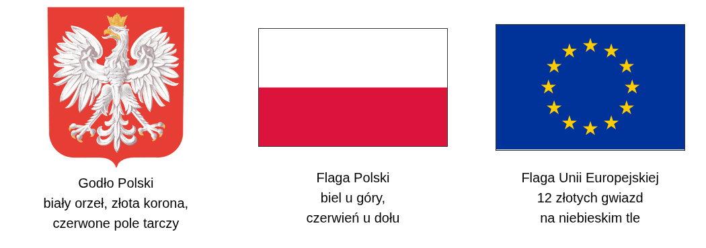

# Mieszkamy w Polsce — pomoc dla grupy

## Co nas łączy?
**Wspólnota** to grupa ludzi, których coś łączy: więzi, zasady lub wspólne działania. Do kilku wspólnot można należeć jednocześnie.

**Państwo** ma terytorium, mieszkańców i władzę. Obywateli łączy prawna więź z państwem: mają prawa i obowiązki. Nie każdy mieszkaniec Polski jest jej obywatelem; polski obywatel może też mieszkać za granicą.

**Naród** to wspólnota ludzi związanych m.in. językiem, historią, kulturą i tradycjami oraz poczuciem przynależności. **Ojczyzna** to kraj, który uznajemy za własny. **Patriotyzm** to przywiązanie do ojczyzny i działanie dla jej dobra; nie wymaga niechęci do innych narodów.

## Znaki wspólnoty

Polski hymn to **„Mazurek Dąbrowskiego”**. Słowa napisał **Józef Wybicki w 1797 roku**, kiedy Polska nie miała własnego niepodległego państwa. Pieśń dawała nadzieję na odzyskanie ojczyzny. Hymnem państwowym jest od 1927 roku.

Symbole pomagają rozpoznać państwo i poczuć więź z ludźmi, których nie znamy osobiście. Podczas hymnu zachowujemy powagę i szacunek.

Polska należy do Unii Europejskiej — wspólnoty współpracujących państw. **12 gwiazd nie oznacza liczby państw.** Flaga UE symbolizuje jedność i solidarność. Jej hymn, **„Oda do radości”**, jest melodią bez oficjalnego tekstu. Nie zastępuje polskiego hymnu.

## Pamięć w kalendarzu
- **3 maja — Święto Narodowe Trzeciego Maja:** pamiętamy o uchwaleniu Konstytucji 3 maja w **1791 roku** — ważnych zasad urządzenia państwa.
- **15 sierpnia — Święto Wojska Polskiego:** upamiętniamy zwycięstwo w Bitwie Warszawskiej w **1920 roku**.
- **11 listopada — Narodowe Święto Niepodległości:** pamiętamy o odzyskaniu przez Polskę niepodległości w **1918 roku**.

Święta pomagają pamiętać o wydarzeniach, rozumieć ich znaczenie i spotykać się jako wspólnota.

# Zadania dla par i grup

## 1. Czy miejsce zamieszkania wystarczy?
- **Hania** ma polskie obywatelstwo. Mieszka z rodzicami w Norwegii, mówi po polsku i czuje się Polką.
- **Leo** jest obywatelem Francji. Od miesiąca mieszka w Polsce. Nie ma polskiego obywatelstwa.
- **Adam** ma polskie obywatelstwo. W jego domu mówi się po polsku i ormiańsku. Polska jest jego ojczyzną; pielęgnuje też ormiańskie tradycje rodzinne.

W parze rozstrzygnijcie spór:

**„Każdy mieszkaniec Polski ma polskie obywatelstwo, a człowiek mieszkający za granicą nie może należeć do polskiego narodu”.**

Wskażcie dwie postacie, które podważają to zdanie. Następnie wyjaśnijcie, czy dwujęzyczny dom Adama wyklucza jego więź z Polską.

## 2. Redakcja ma kłopot
Organizator przesłał zapowiedź święta. Przeczytajcie ją i naprawcie **cztery błędy**. Nie przepisujcie całego tekstu — każdy zapisuje poprawki w swojej karcie.

**Zapraszamy 11 listopada na Święto Niepodległości!**

Wspominamy uchwalenie Konstytucji 3 maja w 1791 roku. Przy wejściu powiesimy flagę Polski: czerwony pas u góry, biały na dole. Nasze godło to biały orzeł bez korony na czerwonej tarczy. Obok ustawimy flagę UE — jej gwiazdy pokazują liczbę państw należących do Unii.

**Do rozmowy:** Czy poprawienie samych flag wystarczy, jeżeli organizator nie wie, jakie wydarzenie upamiętnia? Uzasadnijcie odpowiedź.

## 3. Zaproście ludzi do wspólnego działania
Wybierzcie **jedno** z trzech świąt z kalendarza. Zaplanujcie krótkie działanie dla szkoły lub sąsiadów, które pomoże zrozumieć, co świętujemy. Macie już flagi — nie projektujcie kolejnej dekoracji.

Ustalcie: **co robimy, z jakim wydarzeniem to łączymy i jak mogą włączyć się inni**. Rzecznik ma 30 sekund. Słuchający wskazują, jakie wydarzenie przypomina pomysł grupy.
