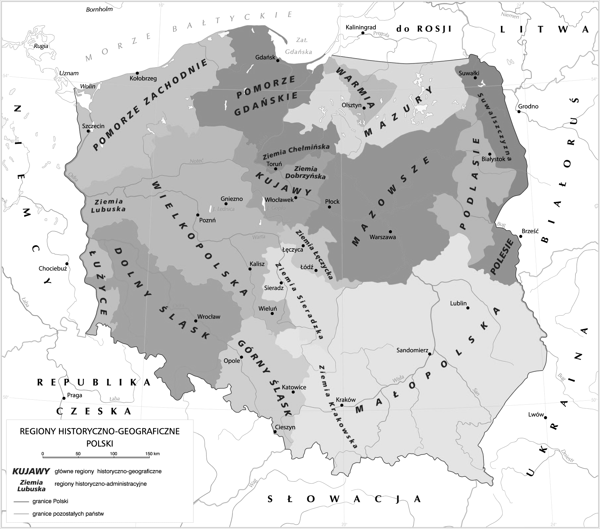
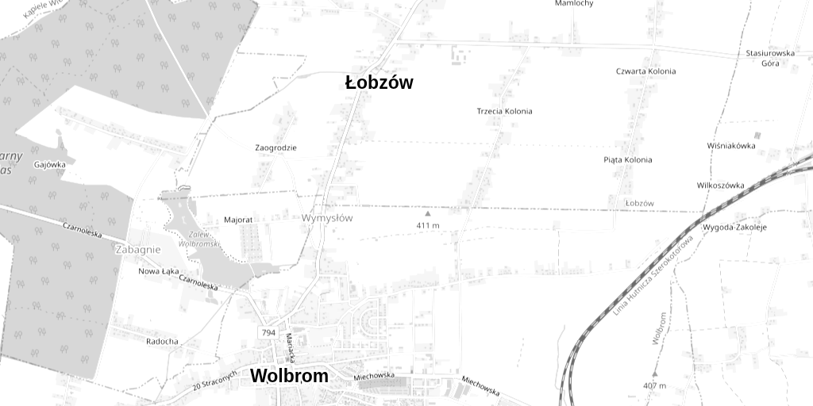
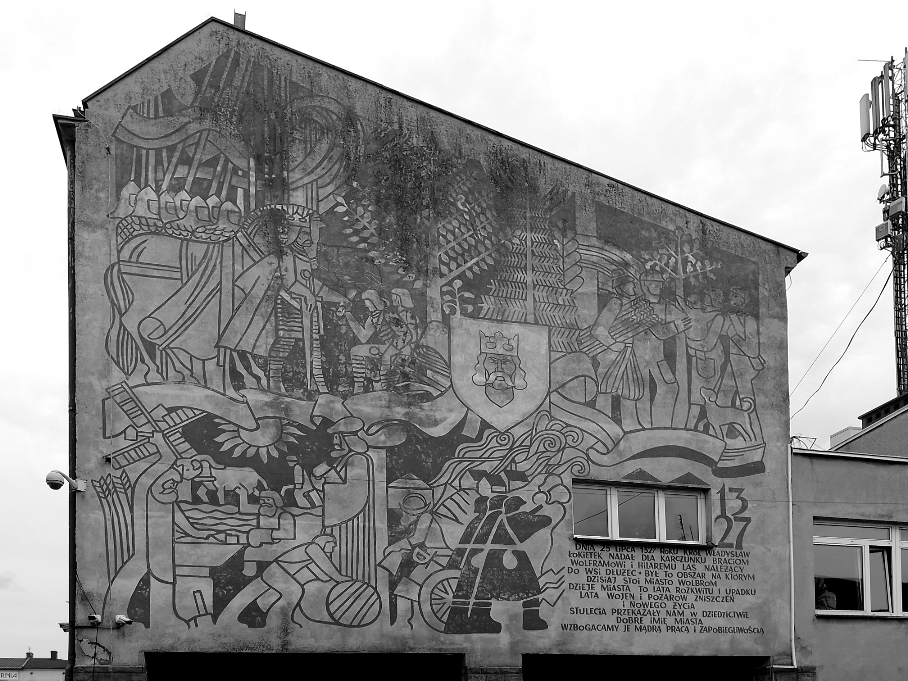

# 1. Nasze miejsce na mapie

**Przeczytajcie razem.** Mała ojczyzna to bliskie nam miejsce i jego ludzie: wieś, miasto albo dzielnica. Region to większy obszar wyróżniający się historią, krajobrazem i zwyczajami. Łobzów i Wolbrom leżą w historycznej Małopolsce. Region historyczny nie jest tym samym co dzisiejsze województwo.

Mapa regionów: Krystian Chariza i zespół, ZPE, CC BY 3.0 (creativecommons.org/licenses/by/3.0/). Zmieniono na czerń i biel; granice regionów są umowne. Nie są to granice województw.

Mapa okolicy, północ u góry: © autorzy OpenStreetMap, openstreetmap.org/copyright (ODbL). Wydruk czarno-biały; wzmocniono dwie istniejące nazwy. Stan pobrania: 18.10.2026.

**Zróbcie to w 4 minuty.** Wskażcie palcem Małopolskę oraz dwa inne regiony. Na drugiej mapie znajdźcie Łobzów i Wolbrom. Wybierzcie widoczny na niej las, zalew lub miejscowość, które pokazalibyście gościowi. Każdy wpisuje w polu 1 dwa inne regiony oraz wybór z krótkim „bo…”. Nie piszcie po tej kartce.

<!-- page -->

# 2. Dwie miejscowości, dwa jubileusze

**Najpierw przeczytajcie.** Dawna wzmianka to zapis nazwy miejscowości w dokumencie. Pokazuje, że miejsce już wtedy było znane; nie dowodzi, że powstało dokładnie w tym roku. Lokacja to prawne zorganizowanie miejscowości według określonych zasad.

**Łobzów.** Według opracowania gminy najstarsza wzmianka o wsi pochodzi z **1323 roku**. Zapisano nazwę „Lobsow”. **18 czerwca 2023 roku** mieszkańcy obchodzili jubileusz 700-lecia lokacji. Upamiętniono go tablicą. Nazwa obchodów nie zmienia wzmianki w dokładną datę powstania wsi.

**Wolbrom.** W **1327 roku** Władysław Łokietek nadał braciom Wolframowi i Hilaremu teren, na którym rozwinęło się miasto. Gmina wiąże z tym rokiem początek miasta. **W 2027 roku** Wolbrom będzie obchodził 700-lecie. W roku szkolnym 2026/2027 jesteśmy więc przed tym jubileuszem, a nie przed jubileuszem Łobzowa.

**Zróbcie to w 4 minuty.** Poniżej są cztery wydarzenia w pomieszanej kolejności. W polu 2 na swojej karcie wpiszcie obok tych samych wydarzeń numery od 1 (najwcześniejsze) do 4 (najpóźniejsze). Nie trzeba niczego wycinać ani przepisywać dat.

- Obchody 700-lecia Łobzowa — 2023.
- Nadanie Łokietka związane z początkiem Wolbromia — 1327.
- Zapowiedziany jubileusz Wolbromia — 2027.
- Najstarsza wzmianka o Łobzowie — 1323.

**Porozmawiajcie, potem każdy zapisuje jedno zdanie:** czy z samej wzmianki z 1323 roku wiemy, że wieś powstała dokładnie wtedy? Wyjaśnijcie dlaczego.

Opracowanie dla uczniów na podstawie UMiG Wolbrom: „Łobzów świętował 700-lecie lokacji”, „Historia miasta”, „25 lipca – 699. rocznica założenia Wolbromia”. To współczesne opracowania, nie średniowieczne dokumenty. Pełne adresy: osobny wykaz źródeł.

<!-- page -->

# 3. Detektywi lokalnej przeszłości

**Przyjrzyjcie się zdjęciu i dwóm krótkim zapisom.** Źródło pomaga odpowiedzieć na konkretne pytanie. Dzisiejsza fotografia pokazuje współczesny sposób pamiętania, nie wygląd króla sprzed siedmiuset lat.

**Fotografia muralu w Wolbromiu, 22.06.2024.** Fot. Kamil Czaiński / Wikimedia Commons, CC BY-SA 4.0 (creativecommons.org/licenses/by-sa/4.0/). Wersja czarno-biała, zmniejszona. To dzisiejsze upamiętnienie Władysława Łokietka.

**Zapis 1 — współczesne opracowanie „Historia miasta”, UMiG Wolbrom:**

„W 1327 roku król nadał braciom, wówczas już sołtysom wsi Dłużec, las należący do tej wsi”.

Bracia to Wolfram i Hilary. Królem był Władysław Łokietek. Nadanie pomogło w rozwoju miejscowości. Cytat nie jest tekstem dokumentu z 1327 roku.

**Zapis 2 — relacja gminy z jubileuszu Łobzowa w 2023 roku:**

„tablicy upamiętniającej 700-lecie lokacji wsi Łobzów”.

To fragment zdania opisującego poświęcenie tablicy podczas obchodów. Tablica upamiętnia jubileusz, a mural — postać i wydarzenie.

**Zróbcie to w 4 minuty.** Znajdźcie na zdjęciu postać w koronie i zapis roku. W polu 3 każdy kończy zdanie: „Wolbrom upamiętnia … przez …”. Dopiszcie, gdzie szukalibyście dalszych wiadomości: w bibliotece, archiwum lub u opiekuna miejsca. Powiedzcie sobie, o co tam zapytacie.

Krótkie cytaty z wolbrom.pl służą porównaniu sposobów upamiętniania. Nie kopiujemy galerii zdjęć gminy.

<!-- page -->

# 4. Legenda pod lupą

**Przed lekturą.** Legenda łączy opowieść o miejscu z elementami, których nie musimy uznawać za potwierdzone. Nie każda legenda zawiera magię. Samo to, że coś mogło się wydarzyć, nie dowodzi, że tak było. Ten przykład dotyczy **Białegostoku, nie Łobzowa ani Wolbromia**.

**Legenda o początkach Białegostoku — fragment z dostarczonego podręcznika, s. 48:**

Pewnego dnia książę litewski Giedymin, polując w Puszczy Bielskiej, zapędził się za [...] jeleniem na jej północno-zachodni skraj, aż hen w pobliże granicy z Mazowszem. Wieczór już zapadł, gdy wreszcie dopadł zwierza [...]. [...] [Po polowaniu] książę odpoczywał nad strumieniem. Był dosyć wartki [szybki] i w przeciwieństwie do innych rzek i strumieni w tej części puszczy – czysty. [...] – Czysty, biały stok [dawniej: potok lub strumień] – powiedział książę. – Można by nad nim zbudować dwór myśliwski albo i wieś założyć. Woli książęcej stało się zadość. Wkrótce nad strumieniem wybudowano dwór, potem i wieś o nazwie Biały Stok.

Źródło podane w podręczniku: „Legendy województw: białostockiego, łomżyńskiego, suwalskiego”, oprac. W. Niewińska, Białystok 1995, s. 10. Przepisano dostarczony fragment wraz z jego opuszczeniami i objaśnieniami; nie jest to cała legenda.

**Zróbcie to w 4 minuty.** Sprawdźcie, czy w tym fragmencie jest magia lub inne niemożliwe zdarzenie. Jeśli nie ma, wpiszcie w polu 4 „brak”. Następnie zapiszcie jedno opisane zdarzenie, które mogło zajść, ale wymagałoby potwierdzenia w innym źródle. Nie uznawajcie opowieści za dowód powstania miasta.

**Pomoc:** rozmowa księcia, polowanie, budowa dworu — co należałoby sprawdzić? Prawdziwe miejsce w opowieści nie potwierdza wszystkich opisanych wydarzeń.

<!-- page -->

# 5. Ratujemy ślad przeszłości

**Najpierw przeczytajcie.** Zabytek to ślad przeszłości o wartości historycznej, artystycznej lub naukowej. Nie musi być zamkiem. Może nim być budynek lub przedmiot. W gminnym wykazie zabytków znajduje się m.in. **kościół św. Katarzyny w Wolbromiu wraz z dzwonnicą i otoczeniem**. Dawne budynki pokazują, jak żyli i budowali wcześniejsi mieszkańcy. Trzeba je chronić, by także inni mogli je poznać.

Tablica z jubileuszu w 2023 roku jest pamiątką i formą upamiętnienia. Nie nazywamy jej automatycznie zabytkiem wpisanym do rejestru.

**Sytuacja do rozważenia.** Podczas spaceru zauważacie zabrudzoną tablicę pamiątkową. Kolega proponuje: „Przemalujmy ją, będzie ładniejsza!”. Nie wiecie, z jakiego materiału ją wykonano ani czym wolno ją czyścić.

**Zróbcie to w 4 minuty.** Wybierzcie bezpieczne działanie i uzasadnijcie je w polu 5 na swojej karcie. Możecie użyć początku: „Nie będę…; zgłoszę…, bo…”. Najpierw porozmawiajcie, potem każdy zapisuje własną odpowiedź.

**Co warto wiedzieć przed wyborem:**

- Farba, szczotka lub środek czyszczący mogą zniszczyć napis albo powierzchnię.
- Dziecko nie odnawia samodzielnie tablicy ani zabytku. Nie dotyka uszkodzonego obiektu i nie wchodzi na ogrodzenie.
- O problemie zawiadamia dorosłego, nauczyciela lub opiekuna miejsca. To opiekun ustala, jak postąpić i czy potrzebna jest pomoc specjalisty.
- Można zadbać o pamięć inaczej: opowiedzieć o miejscu, przeczytać napis z bezpiecznej odległości, przygotować przewodnik.

**Jeżeli skończycie wcześniej:** powiedzcie, dlaczego nawet dobre chęci nie wystarczą do bezpiecznego odnawiania starego przedmiotu. Niczego nie dopisujcie na arkuszu stacji.

Opracowanie dla uczniów: dostarczony podręcznik, s. 49; UMiG Wolbrom, „Rejestr zabytków i Gminna Ewidencja Zabytków”. Opisana sytuacja jest zadaniem do rozważenia, nie relacją o rzeczywistym uszkodzeniu tablicy w Łobzowie.
