<!-- .slide: id="otwarcie" class="cover" data-purpose="opening" data-layout="hero-source" data-goals="G1 G2 G3" -->

<figure class="">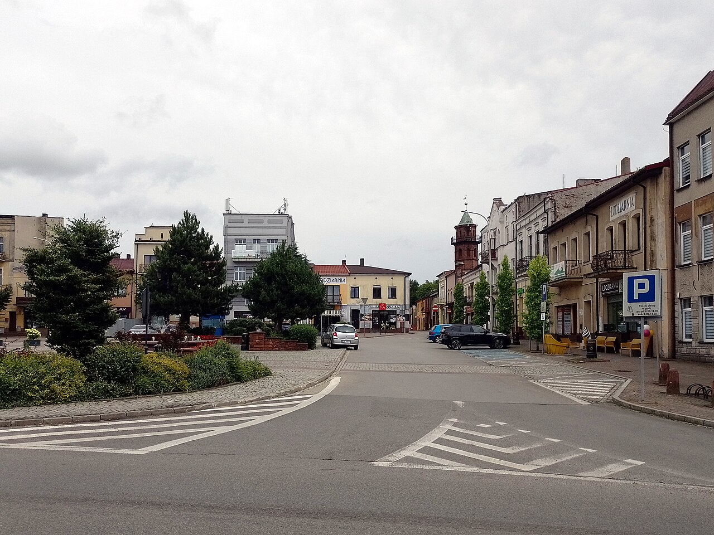<figcaption>Rynek · 22 VI 2024 · Kamil Czaiński, CC BY-SA 4.0</figcaption></figure>

Moja mała ojczyzna · historia · klasa IV
<h1>Wolbrom. W drodze do 700-lecia</h1>
1327 — 2027

Co z przeszłości zachowamy dla przyszłych mieszkańców?

notes:
0:00–0:45. Pokaż najpierw fotografię. „Kto rozpoznaje to miejsce? Po czym je poznaliście?” Przyjmij dwie krótkie odpowiedzi. „Dziś zajrzymy do historii miasta, które znamy z przejazdów, zakupów i spotkań. W 2027 roku Wolbrom będzie obchodził 700-lecie. Przygotujemy dla niego życzenia, ale nie takie, które pasują do każdego miasta. Zanim je napiszemy, poszukamy czegoś wyjątkowego w jego przeszłości”. Nie mów, że właśnie trwa jubileusz, jeśli prowadzisz lekcję w 2026 roku. Fotografia: 22 czerwca 2024, Kamil Czaiński; otwarcie ma kadr kompozycyjny, pełne ujęcie dostępne po kliknięciu.

---

<!-- .slide: id="mala-ojczyzna" class="local" data-purpose="explanation" data-layout="hero-source" data-goals="G2" -->

<figure class="">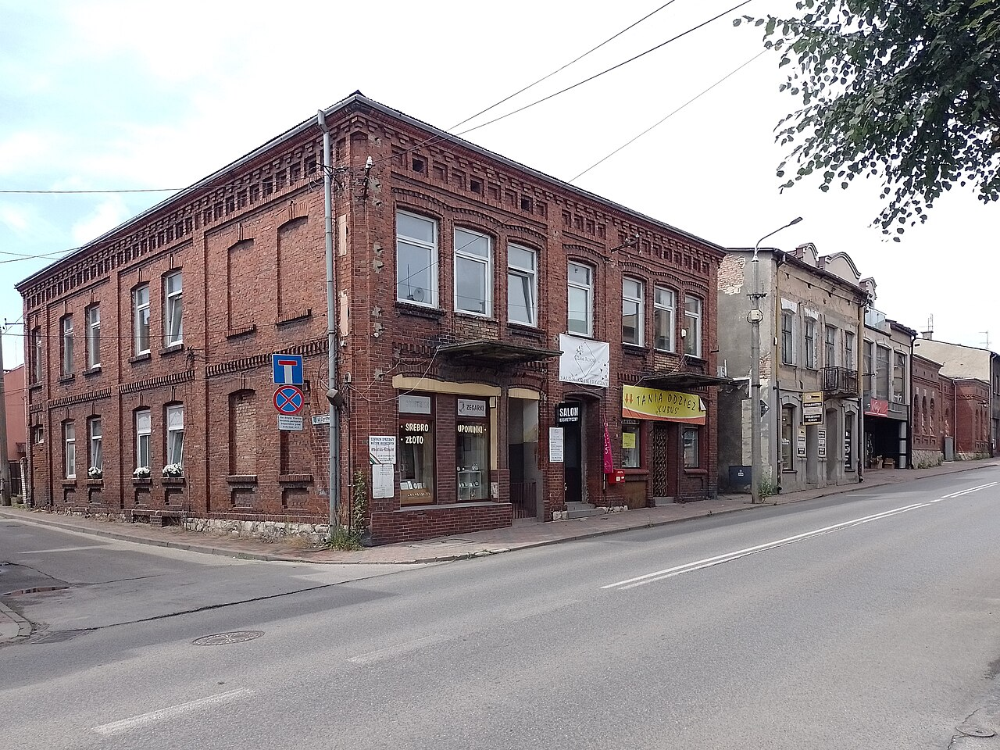<figcaption>Ulica Krakowska · 22 VI 2024 Kamil Czaiński, CC BY-SA 4.0</figcaption></figure>

<h2>Mała ojczyzna to…</h2>
bliskie miejsca, ludzie i ich historie.

Może łączyć nas z miastem, wsią albo całą okolicą.

notes:
0:45–1:45. „Ojczyzna może oznaczać cały kraj. Małą ojczyzną nazywamy bliską nam okolicę: miejsce, z którym łączą nas wspomnienia i ludzie. Nie trzeba urodzić się w samym Wolbromiu. Ktoś mieszka w Łobzowie lub innej miejscowości gminy, a do Wolbromia przyjeżdża. Te miejsca też mogą być dla niego ważne”. Zapytaj: „Jakie jedno miejsce z naszej okolicy pokazalibyście gościowi?”. Przyjmij dwie odpowiedzi, nie oceniaj więzi dzieci z miejscem. „Widzimy prawdziwą ulicę Krakowską. Zwykła ulica też może być częścią naszej małej ojczyzny, bo łączy miejsca i ludzkie wspomnienia”. Fotografia z 22 czerwca 2024; nie domysł o dawnym wyglądzie.

---

<!-- .slide: id="urodziny" class="anniversary-slide" data-purpose="explanation" data-layout="timeline-band" data-goals="G1" -->

Rocznica ma swoją datę
<h2>Dlaczego właśnie 700?</h2>

<strong>1327</strong>
Początek dziejów miasta przyjęty dla jubileuszu.

→
<strong>2027</strong>
700. rocznica.

2027 − 1327 = <b>700 lat</b>

Miasto ma długą historię. Nie każdy jego budynek ma 700 lat!
<figure class="date-panorama">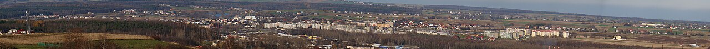<figcaption>Wolbrom z Kamiennej Góry · fotografia udostępniona w 2009, data wykonania nieustalona · Marcin Osuszek (OsUcH), CC BY-SA 3.0</figcaption></figure>

notes:
1:45–2:45. „Wiek człowieka liczymy od urodzenia. Miasto nie rodzi się tak jak człowiek. Jego rozwój trwa wiele lat, ale ważny dawny dokument może wyznaczać datę, do której nawiązujemy podczas rocznicy. Wolbrom odnosi swoje 700-lecie do roku 1327”. Poproś o wspólne odczytanie działania. „Który rok wpiszemy więc na urodzinowej pocztówce?” — 2027. Wyraźnie dodaj: „Nie oznacza to, że każdy dom, drzewo i kościół powstały w 1327 roku”. W 2026 roku powiedz, że miasto dopiero przygotowuje się do tej rocznicy. Zapis 1327–2027 dotyczy jubileuszu miasta, nie datowania pokazanego budynku.

---

<!-- .slide: id="poczatek" class="founding-slide" data-purpose="explanation" data-layout="process" data-goals="G1 G2" -->

<figure class="">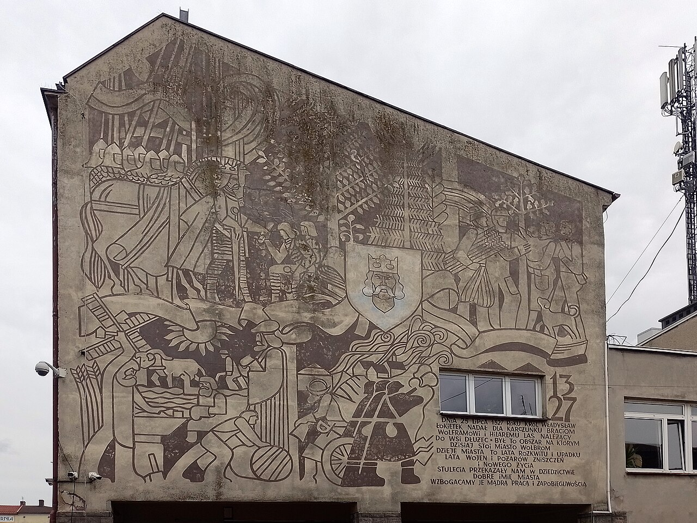<figcaption>Mural o początkach Wolbromia · fotografia 22 VI 2024 Kamil Czaiński, CC BY-SA 4.0</figcaption></figure>

Pamięć w przestrzeni miasta
<h2>Wolbrom pamięta o początkach.</h2>
1327

<b>Łokietek</b> nadaje las.

<b>Wolfram i Hilary</b> organizują osadnictwo.

notes:
2:45–3:45. „Wyobraźcie sobie, ile trzeba przygotować, żeby mogła rozwinąć się osada: miejsce na domy, drogi i pracę. Według historii miasta w 1327 roku król Władysław Łokietek nadał Wolframowi i Hilaremu las na terenie dzisiejszego Wolbromia. Bracia mieli organizować osadnictwo, czyli sprowadzać i urządzać życie mieszkańców. Nazwę Wolbrom wiąże się z imieniem Wolframa”. Zapytaj: „Czy od samego nadania ziemi od razu stoją wszystkie domy?” — nie, to początek procesu. Nie pokazujemy wymyślonego dokumentu, portretu braci ani rekonstrukcji dawnej puszczy. Nie rozwijaj problematycznego opisu 1311 r. z miejskiego opracowania. Mural jest współczesną formą upamiętnienia, nie średniowiecznym obrazem ani wiernym portretem Łokietka. Pokaż datę na ścianie. To przykład, jak mieszkańcy przypominają o dawnych postaciach. Fotografia 22 VI 2024. Opis źródła nazywa to nadaniem praw, ale w narracji zachowujemy ostrożniejsze określenie: nadanie lasu i jubileuszowe początki miasta.

---

<!-- .slide: id="handel" class="market-photo" data-purpose="evidence" data-layout="hero-source" data-goals="G2" -->
<figure class="">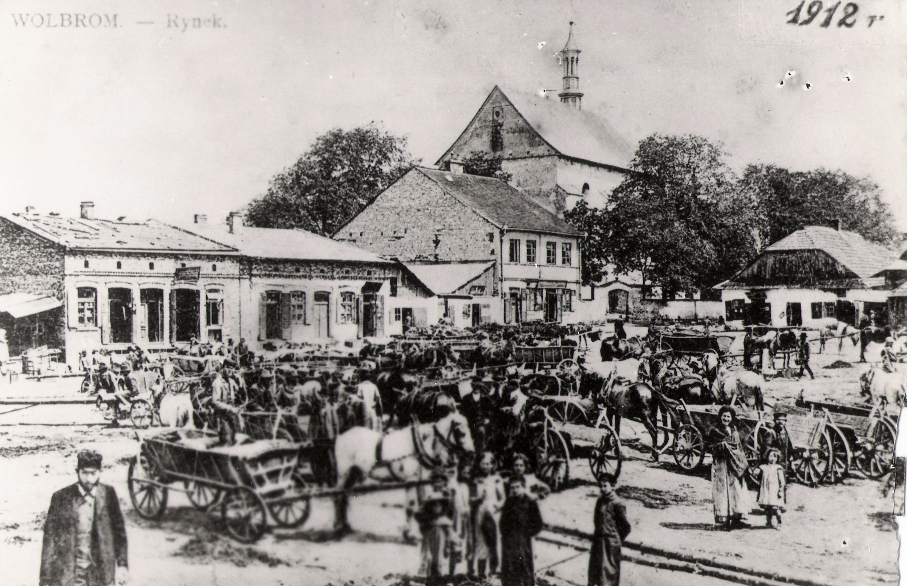<figcaption>Rynek w Wolbromiu · 1912 według opisu UMiG · autor nieustalony</figcaption></figure>
<h2>Rynek: tu spotykali się ludzie</h2>
Kupić. Sprzedać. Porozmawiać.

notes:
3:45–5:00. „Przyjrzyjcie się temu dawnemu widokowi. Co pomaga rozpoznać targ?” Dzieci wskazują wozy, konie i ludzi. „Rolnicy przywozili to, co wyhodowali, rzemieślnicy oferowali wyroby, kupcy sprzedawali towary. Rynek był miejscem wymiany, ale też spotkań i wiadomości. Handel pomagał miastu się rozwijać”. Władysław Jagiełło nadał Wolbromiowi przywileje handlowe w 1400 r. — wystarczy w opowieści, bez dodatkowej daty do zapamiętania. Podkreśl: „Fotografia jest dużo późniejsza niż początki miasta. Miejska reprodukcja opisuje ją rokiem 1912; nie jest to niezależnie zbadane datowanie. Nie pokazuje targu w średniowieczu”. Nie odgaduj czwartku na podstawie samych wozów.

---

<!-- .slide: id="czwartek" class="market-day-slide" data-purpose="explanation" data-layout="statement" data-goals="G2" -->

Przywilej — specjalne uprawnienie
<h2>Stały dzień ułatwiał handel.</h2>
1485

Ustanowiono <b>czwartkowe targi</b>.

Wiadomo, kiedy przyjechać i spotkać kupujących.

<figure class="">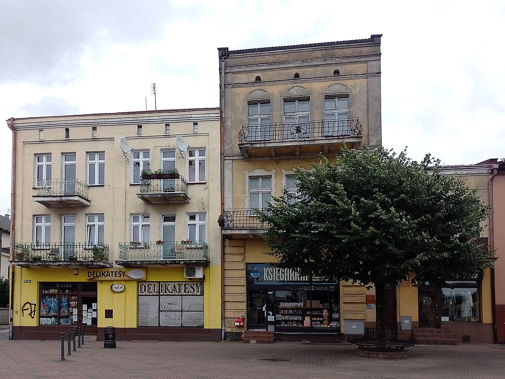<figcaption>Sklepy przy rynku · 22 VI 2024 Kamil Czaiński, CC BY-SA 4.0</figcaption></figure>

notes:
5:00–6:00. „Co by się stało, gdyby sprzedawca przyjechał we wtorek, a wszyscy kupujący w piątek?” Daj dzieciom chwilę na krótką odpowiedź. „Właśnie dlatego wspólny termin był ważny. W 1485 roku Wolbrom otrzymał uprawnienie do targów w czwartki. Ktoś mógł przygotować towar i zaplanować drogę, bo wiedział, kiedy spotka innych”. Przywilej objaśnij jako specjalne uprawnienie nadane miastu. Nie buduj dodatkowego ćwiczenia z dat. Nie twierdź, że przez wszystkie następne stulecia targ odbywał się bez żadnej przerwy, ani że dawne zdjęcie zostało na pewno zrobione w czwartek. Chodzi o zrozumienie, jak stały termin pomagał w handlu. Zdjęcie sklepów jest współczesne, z 2024 r.; pokazuje dzisiejsze funkcje centrum, nie sam przywilej ani targ w 1485 r.

---

<!-- .slide: id="zrodlo" class="full-source" data-purpose="evidence" data-layout="evidence" data-goals="G2" -->
<h2>Co opowiada dawne zdjęcie?</h2><figure class="">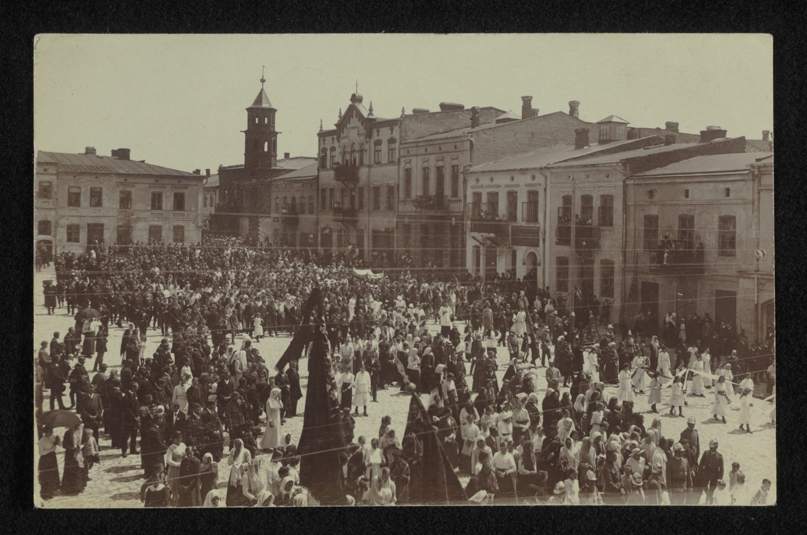<figcaption>Rynek w Wolbromiu · nieokreślone uroczystości, 1916 · BN / Polona, domena publiczna</figcaption></figure>
Wskaż dwa szczegóły. Co widzisz, a czego tylko się domyślasz?

notes:
6:00–7:15. Daj 10 sekund cichego oglądania. „Dziś można zrobić zdjęcie telefonem. Dawne fotografie też zatrzymywały chwilę. Ta pochodzi z 1916 roku. Widzimy duże zgromadzenie na rynku, ale katalog nie mówi, jakie to były uroczystości”. Zapytaj o dwa szczegóły. Model obserwacji: tłum, stroje, zabudowa, ozdoby i pochód. Jeśli ktoś mówi „to urodziny miasta”, odpowiedz: „To pomysł, ale ze zdjęcia i opisu nie umiemy tego potwierdzić”. Nie wymagaj pełnej krytyki źródła. „Dzięki zdjęciu znamy wygląd tej chwili. Nie dowiadujemy się z niego wszystkiego o ludziach”. Kliknij powiększenie tylko jeśli potrzebne; zamknij Escape.

---

<!-- .slide: id="dawniej-dzis" class="then-now" data-purpose="evidence" data-layout="photo-pair" data-goals="G2" -->
<h2>Ten sam rynek, inne czasy</h2>
<figure class="">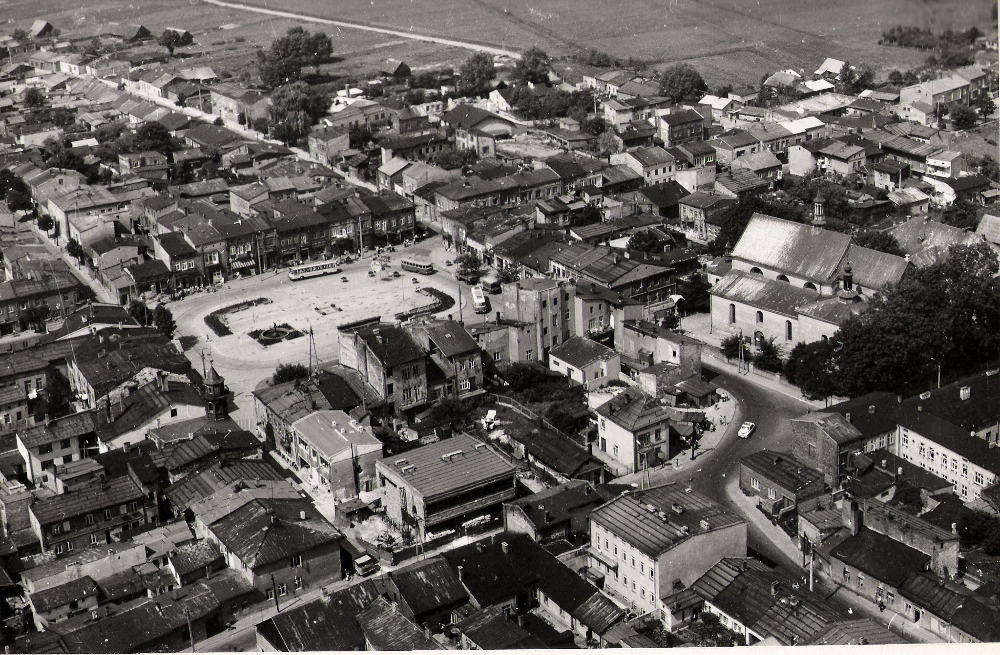<figcaption>DAWNIEJ · lata 70. XX w. według UMiG Autor nieustalony</figcaption></figure><figure class="">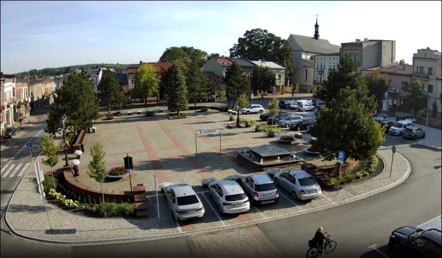<figcaption>WSPÓŁCZEŚNIE · data zdjęcia nieustalona UMiG Wolbrom</figcaption></figure>

Wskaż rynek i kościół. Co zmieniło się wokół nich?

notes:
7:15–8:30. „To dwa widoki tego samego rynku Wolbromia. Na obu odszukajcie plac i kościół św. Katarzyny. Nie są zrobione z tego samego miejsca: dawniej oglądamy szerszą panoramę z góry”. Datowanie dawnej fotografii „lata 70. XX wieku” pochodzi z tytułu miejskiego załącznika, nie z daty dodania pliku do internetu. Data współczesnego ujęcia nie jest ustalona. Dzieci porównują skalę zieleni, transport i zagospodarowanie placu. Nie dopasowują na siłę wszystkich domów. To porównanie miejsca, a nie identycznych osi fotograficznych. Zdjęcia nie dowodzą wieku każdego budynku.

---

<!-- .slide: id="praca" class="industry" data-purpose="explanation" data-layout="hero-source" data-goals="G2" -->
<h2>Miasto zmieniała też praca.</h2>
<figure class="">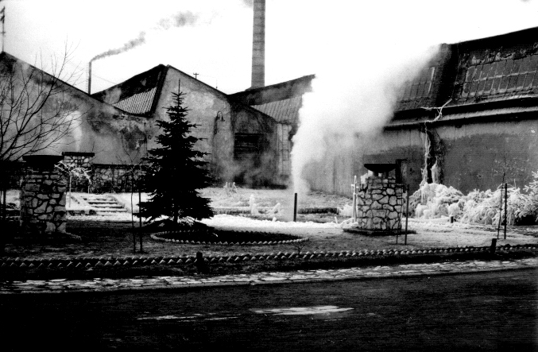<figcaption>Dawny zakład · data i autor nieustalone · UMiG</figcaption></figure><figure class="">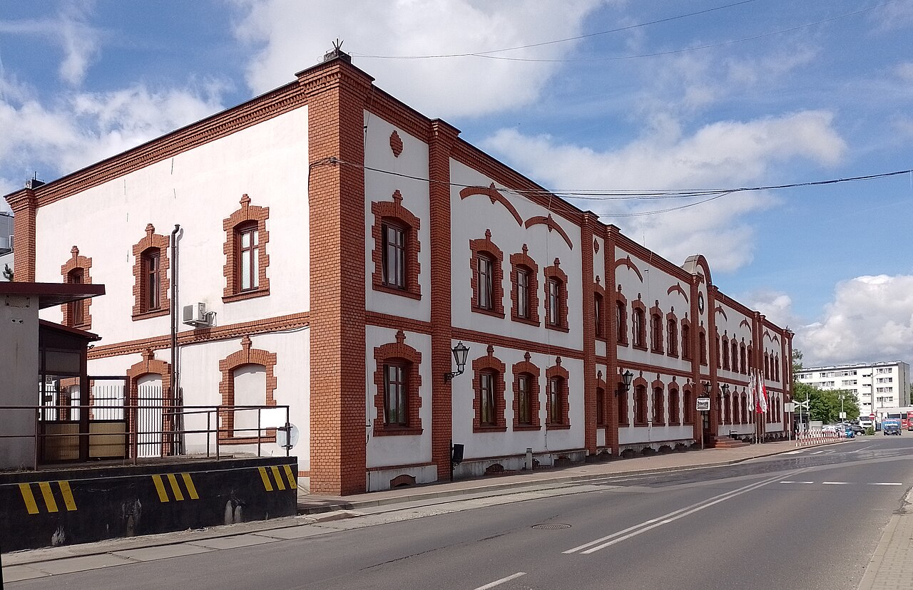<figcaption>Fabryka Taśm Transporterowych · 25 VI 2024 Kamil Czaiński, CC BY-SA 4.0</figcaption></figure>

Zakłady dawały pracę. Kolej przewoziła ludzi i towary.

<figure class="">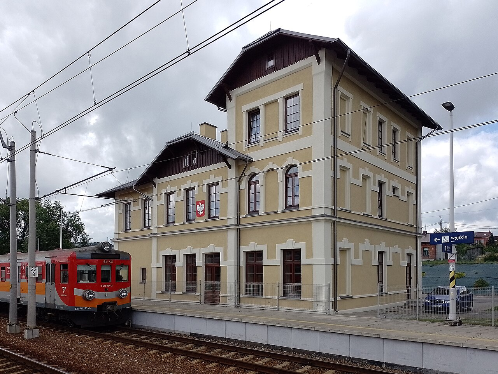<figcaption>Dworzec · 25 VI 2024 · Kamil Czaiński, CC BY-SA 4.0</figcaption></figure>

notes:
8:30–9:30. „Historia miasta to nie tylko królowie i bardzo dawne czasy. W Wolbromiu rozwijał się również przemysł, zwłaszcza związany z wyrobami gumowymi. Wielu mieszkańców pracowało w zakładach. Praca miała wpływ na życie rodzin i całej miejscowości”. Na fotografii wskaż hale, komin i tory. Nie przypisuj konkretnej daty zdjęciu i nie nazywaj pokazanej hali bez potwierdzenia. Zapytaj: „Jakie miejsca pracy znacie w naszej okolicy?”. Wystarczą dwa przykłady. Nie przekształcaj w wykład o technice ani nie powtarzaj promocyjnych ocen dotyczących środowiska. Przykład ma pokazać zmianę miasta i udział zwykłych mieszkańców w jego historii. Fotografie zakładów pokazują rozwój przemysłu w tym samym mieście; nie twierdzimy, że to ten sam budynek dawniej i dziś. Dworzec jest dodatkowym przykładem życia gospodarczego. O kolei powiedz jedno zdanie: przewoziła ludzi i towary; bez nowej daty do nauczenia.

---

<!-- .slide: id="katarzyna-dawniej-dzis" class="church-compare" data-purpose="evidence" data-layout="photo-pair" data-goals="G2 G3" -->
<h2>Kościół św. Katarzyny — dawniej i dziś</h2>
<figure class="">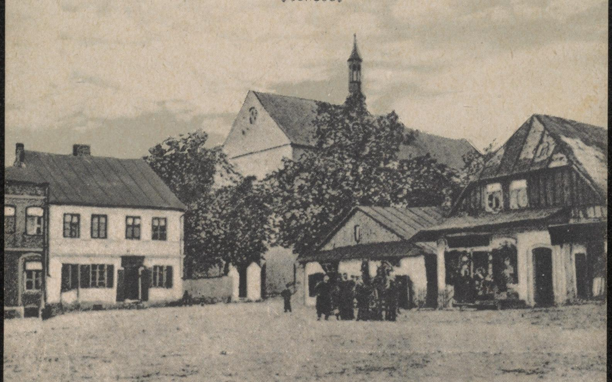<figcaption>DAWNIEJ · fragment pocztówki wydanej 1918–1939 BN / Polona, domena publiczna</figcaption></figure><figure class="">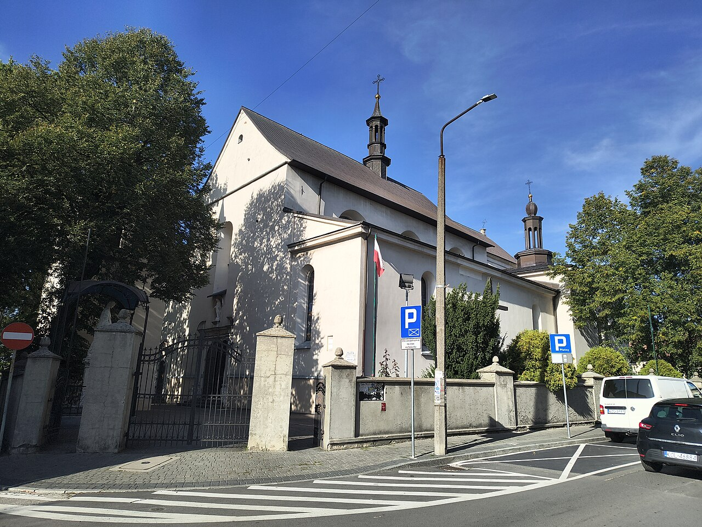<figcaption>DZISIAJ · fotografia 8 IX 2026 FFugi, CC BY 4.0</figcaption></figure>

Ten sam kościół. Co pomaga go rozpoznać?

notes:
9:30–10:15. Obejrzyjcie kościół św. Katarzyny w dwóch ujęciach, od strony rynku, ale pod różnymi kątami. Uczniowie wskazują bryłę i wieżyczkę; nie trzeba oceniać przebudów na podstawie zdjęć. Identyfikacja dawnego widoku opiera się na obiekcie Polony, kategoriach jego reprodukcji Commons i porównaniu architektury; nie mylimy go z drewnianym NMP. 1918–1939 to czas wydania pocztówki, nie pewna data wykonania ujęcia. Fotografia FFugi z 8 IX 2026 pokazuje obecny zespół kościoła od rynku. Zabytek jest rzeczywistym śladem przeszłości i wymaga ochrony.

---

<!-- .slide: id="drewniany-zabytek" class="wooden" data-purpose="explanation" data-layout="source-split" data-goals="G2 G3" -->

<figure class="">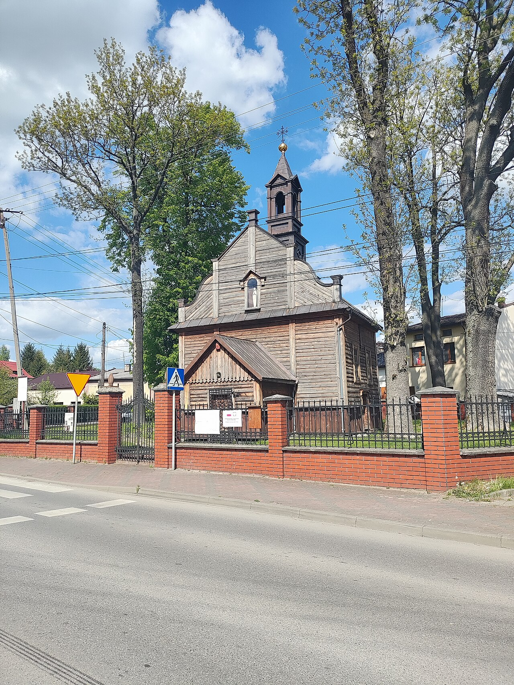<figcaption>Kościół Niepokalanego Poczęcia NMP · 1 V 2025 Michał Bulsa, CC0</figcaption></figure>

Zabytek — wartościowy ślad przeszłości
<h2>Dawny budynek potrzebuje troski.</h2>
Drewniany kościół Niepokalanego Poczęcia NMP.

<b>Poznajemy. Nie niszczymy. Dbamy, by przetrwał.</b>

notes:
10:15–11:00. „To inny zabytek: drewniany kościół Niepokalanego Poczęcia Najświętszej Maryi Panny. Czy 700-lecie miasta oznacza, że on też ma dokładnie 700 lat?” — nie. Nie uczymy dodatkowej daty budowy. „Dlaczego warto zachować sam budynek, a nie tylko jego zdjęcie?” Zabytek pozwala poznawać dawne materiały i umiejętności. Dzieci nie wykonują remontów, ale mogą nie niszczyć, poznawać historię i zgłaszać uszkodzenia dorosłym. Nie myl go z kaplicą cmentarną. Obiekt figuruje w miejskim wykazie zabytków. Fotografia Michała Bulsy z 1 maja 2025.

---

<!-- .slide: id="pamiec" class="postcard-slide" data-purpose="evidence" data-layout="source-split" data-goals="G2 G3" -->

<figure class="">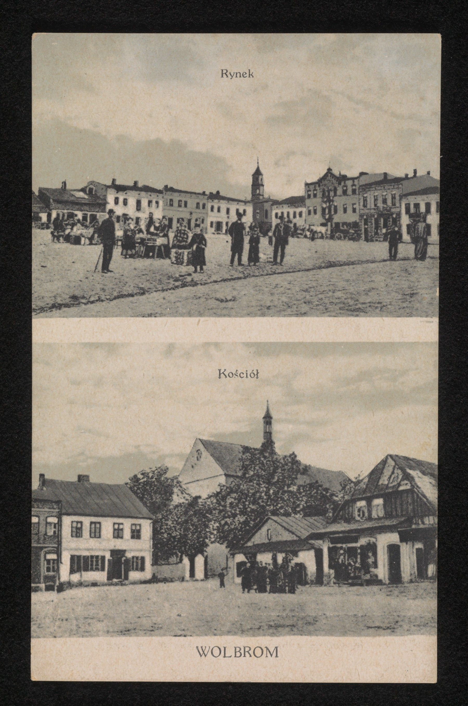<figcaption>„Wolbrom” · pocztówka dwuwidokowa, wydanie 1918–1939 Nakład B. Janowskiego · BN / Polona, domena publiczna</figcaption></figure>

Mały przedmiot, duża historia
<h2>Pocztówka też przechowuje pamięć.</h2>
Pokazuje miejsce. Niesie wiadomość. Może przetrwać wiele lat.

notes:
11:00–12:00. Pokaż całą pocztówkę. „Wcześniej oglądaliśmy osobno jej dwa widoki. Teraz widzicie, że pochodziły z jednego druku. Ktoś chciał pokazać Wolbrom innym ludziom. Takie drobne przedmioty mogą przetrwać dłużej niż nasze wspomnienia”. Wyjaśnij różnicę: nie jest to rysunek wykonany przez dzisiejsze dziecko ani fotografia średniowiecza, lecz dawna drukowana pocztówka. „My też możemy stworzyć wiadomość o mieście. Nasza będzie urodzinowa. Dobierzemy do niej miejsce i życzenie, które wynikają z poznanej historii”. Nie trzeba omawiać znaczków, adresowania i działania poczty; to nie cel zadania.

---

<!-- .slide: id="przyszlosc" class="future" data-purpose="explanation" data-layout="process" data-goals="G2 G3" -->

<figure class="">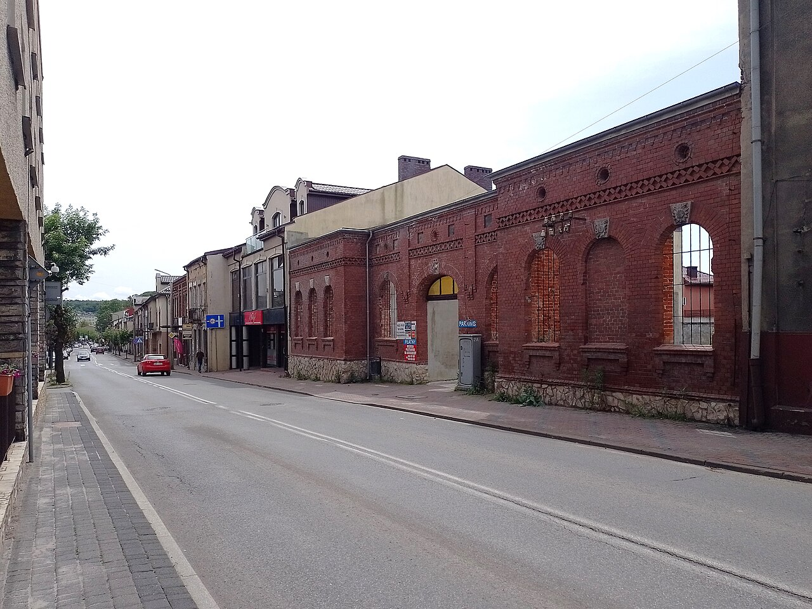<figcaption>Ulica Krakowska i zachowana fasada Starej Poczty 22 VI 2024 · Kamil Czaiński, CC BY-SA 4.0</figcaption></figure>

<h2>Co zachowamy dla przyszłych mieszkańców?</h2>
<b>Pamiętam</b> miejsce i jego historię.

<b>Życzę</b> mu dobrej przyszłości.

Historia podpowiada, o co warto zadbać.

notes:
12:00–13:30. „Znamy już kilka fragmentów historii: początek miasta, rynek i handel, pracę mieszkańców, zabytki. Nie musimy umieć opowiedzieć wszystkiego, żeby złożyć miastu sensowne życzenie. Wystarczy połączyć jeden fakt z troską o przyszłość”. Zapytaj: „Czego może potrzebować ważne dawne miejsce, żeby poznali je ludzie za wiele lat?”. Przyjmij różne pomysły: troski, ochrony, odwiedzających, wiedzy o historii. Nie pokazuj gotowego tekstu pocztówki. Poproś, żeby każde dziecko w myślach wybrało miejsce. Na kolejnym slajdzie pojawi się dokładna instrukcja, a podczas pracy możesz indywidualnie pomóc powiązać pomysł z faktem. Widzimy zachowaną fasadę Starej Poczty przy Krakowskiej. To przykład, że śladem przeszłości bywa również część dawnego budynku. Miejski wykaz wymienia część elewacji frontowej przy Krakowskiej 6. Nie nazywaj zdjęcia zachowanym całym budynkiem. W razie braku czasu wystarczy jedno zdanie, bez dodatkowego zadania.

---

<!-- .slide: id="pocztowka-zadanie" class="task-slide" data-purpose="practice" data-layout="task-board" data-goals="G1 G2 G3" -->

Każdy samodzielnie · 16 minut · jedna kartka A4
<h2>Pocztówka na 700-lecie</h2>

<h3>Na okładce</h3>
Narysuj i podpisz <b>jedno poznane miejsce</b>.

Dodaj: <b>1327–2027 · 700 lat</b>.

<h3>W środku · 2–3 zdania</h3>
Przypomnij <b>jeden fakt z lekcji</b>.

Złóż miastu <b>życzenie, które do tego faktu pasuje</b>.

Złóż A4 na pół. Bez wycinania. Rysunek może być prosty.

notes:
15:00–17:00 instrukcja i rozdanie; 17:00–33:00 praca. Rozdaj 18 czystych kartek A4 i przybory, bez dodatkowej karty pracy. „Każdy robi własną pocztówkę. Złóżcie kartkę na pół. Na okładce narysujcie jedno miejsce z Wolbromia, podpiszcie je i dodajcie daty jubileuszu. W środku w dwóch lub trzech zdaniach przypomnijcie jeden fakt z lekcji, a potem złóżcie życzenie, które do niego pasuje”. Poproś jedną osobę o powtórzenie zadania własnymi słowami. Dopiero wtedy rozpocznij 16 minut pracy. Najpierw sens i tekst, potem dopracowanie koloru. Po 8 minutach przypomnij o życzeniu. Nie wymagaj idealnej architektury ani odwzorowania fotografii. Nie kopiują modelu, nie pracują grupowo, nic nie wycinają.

---

<!-- .slide: id="pomoc" class="support-slide" data-purpose="practice" data-layout="task-board" data-goals="G1 G2 G3" -->
<h2 data-task-role="prompt">Sprawdź, czy to naprawdę o Wolbromiu</h2>
<ol class="checklist"><li><b>Miejsce</b> — ma podpis.</li><li><b>Rocznica</b> — 1327–2027, czyli 700 lat.</li><li><b>Wiadomość</b> — fakt i pasujące do niego życzenie.</li></ol>

Potrzebujesz początku?

„Wolbromiu, pamiętam, że… Życzę Ci…”

notes:
Slajd pomocniczy podczas tych samych 16 minut, nie nowy etap. Uczeń potrzebujący wsparcia może połączyć fakt i życzenie w jednym pełnym zdaniu lub podyktować je dorosłemu. Dla szybszych: „Dopisz, co sam możesz zrobić dla wybranego miejsca”. Przykład tylko w notatkach, po własnej próbie dziecka: „Wolbromiu, Twój rynek od dawna służył handlowi i spotkaniom. Życzę Ci troski o to miejsce, żeby nadal łączyło mieszkańców”. Dopuszczalne są inne fakty i życzenia. Poprawiaj „kościół ma 700 lat”, wskazując różnicę między wiekiem miasta i budynku. Nie oceniaj zdolności plastycznych.

---

<!-- .slide: id="wyjscie" class="exit-slide" data-purpose="exit-ticket" data-layout="task-board" data-goals="G1 G2 G3" -->

Na zakończenie
<h2>Pamięć + dobre życzenie</h2>

<strong>Pokaż osobie obok.</strong>
Wskaż fakt i powiedz, dlaczego wybrałeś takie życzenie.

<h3>Każdy na odwrocie</h3>
700-lecie Wolbromia przypada w roku <b>…</b>

Warto chronić <b>…</b>, ponieważ <b>…</b>

notes:
33:00–36:00: dzieci pokazują sobie prace bez zmiany miejsc, potem tylko dwie chętne osoby przedstawiają je klasie. Nie wywołuj po kolei wszystkich 18, bo zabraknie czasu. Synteza ustna: miasto ma długą historię, poznajemy ją ze śladów i źródeł, a rocznica zachęca do troski o przyszłość. 36:00–38:00: każdy zapisuje dwa krótkie uzupełnienia na odwrocie — rok 2027 i konkretne miejsce z sensownym powodem ochrony. Zbierz 18 prac do przejrzenia, a nie tylko dwie prezentowane. 38:00–40:00: bufor i porządkowanie. Służy przejściom i dokończeniu zapisu, nie dodatkowej aktywności.

---

<!-- .slide: id="zrodla" class="source-list" data-purpose="synthesis" data-layout="statement" data-goals="G2" -->
<h2>Zdjęcia mają swoją historię</h2>

<b>Commons</b> · Kamil Czaiński, Michał Bulsa, FFugi i Marcin Osuszek — prawa osobno dla każdego zdjęcia w sources.md.

<b>Polona / Biblioteka Narodowa</b> Pocztówka „Wolbrom”, 1918–1939, i fotografia rynku z 1916 r. — domena publiczna.

<b>UMiG Wolbrom</b> Historia miasta, jubileusz i miejska galeria dawnych zdjęć. Przy nieustalonej dacie nie dopisujemy roku.

<b>Pełna dokumentacja</b> sources.md: adres i prawa każdego obrazu, kadrowanie oraz ograniczenia prywatnego wykorzystania.

notes:
Zaplecze nauczyciela, poza 15-minutową narracją. Poniżej pełne źródła i prawa, także w pliku portable.

# Źródła i prawa — Wolbrom 700 lat
## Fakty i zakres
- https://wolbrom.pl/miasto-i-gmina-wolbrom/historia-miasta/ — opracowanie UMiG: 1327 nadanie lasu Wolframowi i Hilaremu przez Łokietka; 1400 przywileje Jagiełły; 1485 czwartkowe targi; przemysł i kolej. Pominięto problematyczne 1311 i 1931, drastyczne opisy i twierdzenia środowiskowe.
- https://wolbrom.pl/25-lipca-699-rocznica-zalozenia-wolbromia/ — jubileusz 700-lecia w 2027, nie w 2026.
- https://wolbrom.pl/miasto-i-gmina-wolbrom/rejestr-zabytkow-i-gminna-ewidencja-zabytkow/ — kościoły św. Katarzyny i Niepokalanego Poczęcia NMP, część frontowej elewacji dawnej poczty przy Krakowskiej 6.
- Dz.U. 2026 poz. 378, s.147–148; curriculum/official/D2026000037801-historia-pp-146-170.txt, wiersze 65–136. Częściowo 2.3, bez deklaracji całego katalogu zasłużonych; 2.4; pomocniczo 1.4–6 i 4.2.
- Materiały ZPE sprawdzono jako kontekst dydaktyczny (historia lokalna i źródła), nie jako źródło fotografii ani dat Wolbromia. Nie dobrano niepasujących ogólnych ilustracji.

## Prawa do całości
Fotografie Commons mają poniższe indywidualne licencje. Dwa obiekty Polony są w domenie publicznej. **Część fotografii miejskich ma prawa nieustalone; zgoda na pracę prywatną nie jest zgodą na publiczne rozpowszechnianie. Nie przypisujemy im CC ani nie publikujemy otwarcie całego portable.** Ocena podstawy dozwolonego użytku należy do instytucji korzystającej. Każdy taki obraz służy omówieniu źródła, zmiany miejsca lub historii, nie samej dekoracji.

## Każdy użyty obraz

### 1. `assets/01-rynek.jpg` — Rynek w Wolbromiu.jpg
- Źródło: https://commons.wikimedia.org/wiki/File:Rynek_w_Wolbromiu.jpg
- Autor / instytucja: Kamil Czaiński
- Data / medium: 2024-06-22 13:55:26; fotografia. Podstawa: DateTimeOriginal metadanych Commons
- Prawa: CC BY-SA 4.0; https://creativecommons.org/licenses/by-sa/4.0
- Zmiany i zastrzeżenia: Zmniejszenie do 1280 px szerokości; pełny obraz w powiększeniu.
- Plik źródłowy: https://upload.wikimedia.org/wikipedia/commons/0/00/Rynek_w_Wolbromiu.jpg

### 2. `assets/02-rynek-pierzeja.jpg` — Rynek w Wolbromiu - pierzeja wschodnia.jpg
- Źródło: https://commons.wikimedia.org/wiki/File:Rynek_w_Wolbromiu_-_pierzeja_wschodnia.jpg
- Autor / instytucja: Kamil Czaiński
- Data / medium: 2024-06-22 13:53:28; fotografia. Podstawa: DateTimeOriginal metadanych Commons
- Prawa: CC BY-SA 4.0; https://creativecommons.org/licenses/by-sa/4.0
- Zmiany i zastrzeżenia: Zmniejszenie do 1280 px szerokości; pełny obraz w powiększeniu.
- Plik źródłowy: https://upload.wikimedia.org/wikipedia/commons/e/e1/Rynek_w_Wolbromiu_-_pierzeja_wschodnia.jpg

### 3. `assets/04-nmp.jpg` — Church of the Immaculate Conception in Wolbrom.jpg
- Źródło: https://commons.wikimedia.org/wiki/File:Church_of_the_Immaculate_Conception_in_Wolbrom.jpg
- Autor / instytucja: Michał Bulsa
- Data / medium: 2025-05-01 15:12:53; fotografia. Podstawa: DateTimeOriginal metadanych Commons
- Prawa: CC0; http://creativecommons.org/publicdomain/zero/1.0/deed.en
- Zmiany i zastrzeżenia: Zmniejszenie do 1280 px szerokości; pełny obraz w powiększeniu.
- Plik źródłowy: https://upload.wikimedia.org/wikipedia/commons/6/6c/Church_of_the_Immaculate_Conception_in_Wolbrom.jpg

### 4. `assets/05-stacja.jpg` — Stacja kolejowa Wolbrom - budynek dworcowy od strony peronów.jpg
- Źródło: https://commons.wikimedia.org/wiki/File:Stacja_kolejowa_Wolbrom_-_budynek_dworcowy_od_strony_peron%C3%B3w.jpg
- Autor / instytucja: Kamil Czaiński
- Data / medium: 2024-06-25 10:18:45; fotografia. Podstawa: DateTimeOriginal metadanych Commons
- Prawa: CC BY-SA 4.0; https://creativecommons.org/licenses/by-sa/4.0
- Zmiany i zastrzeżenia: Zmniejszenie do 1280 px szerokości; pełny obraz w powiększeniu.
- Plik źródłowy: https://upload.wikimedia.org/wikipedia/commons/0/01/Stacja_kolejowa_Wolbrom_-_budynek_dworcowy_od_strony_peron%C3%B3w.jpg

### 5. `assets/06-przemysl.jpg` — Wolbrom, strefa przemysłowa, ulica 1 Maja, Fabryka Taśm Transporterowych - budynek z 1908 roku.jpg
- Źródło: https://commons.wikimedia.org/wiki/File:Wolbrom,_strefa_przemys%C5%82owa,_ulica_1_Maja,_Fabryka_Ta%C5%9Bm_Transporterowych_-_budynek_z_1908_roku.jpg
- Autor / instytucja: Kamil Czaiński
- Data / medium: 2024-06-25 09:59:45; fotografia. Podstawa: DateTimeOriginal metadanych Commons
- Prawa: CC BY-SA 4.0; https://creativecommons.org/licenses/by-sa/4.0
- Zmiany i zastrzeżenia: Zmniejszenie do 1280 px szerokości; pełny obraz w powiększeniu.
- Plik źródłowy: https://upload.wikimedia.org/wikipedia/commons/f/f1/Wolbrom%2C_strefa_przemys%C5%82owa%2C_ulica_1_Maja%2C_Fabryka_Ta%C5%9Bm_Transporterowych_-_budynek_z_1908_roku.jpg

### 6. `assets/07-mural.jpg` — Wolbrom, mural upamiętniający nadanie praw miejskich przez Władysława Łokietka w 1327.jpg
- Źródło: https://commons.wikimedia.org/wiki/File:Wolbrom,_mural_upami%C4%99tniaj%C4%85cy_nadanie_praw_miejskich_przez_W%C5%82adys%C5%82awa_%C5%81okietka_w_1327.jpg
- Autor / instytucja: Kamil Czaiński
- Data / medium: 2024-06-22 13:54:55; fotografia (mural jest współczesnym upamiętnieniem). Podstawa: DateTimeOriginal metadanych Commons
- Prawa: CC BY-SA 4.0; https://creativecommons.org/licenses/by-sa/4.0
- Zmiany i zastrzeżenia: Zmniejszenie do 1280 px szerokości; pełny obraz w powiększeniu.
- Plik źródłowy: https://upload.wikimedia.org/wikipedia/commons/1/13/Wolbrom%2C_mural_upami%C4%99tniaj%C4%85cy_nadanie_praw_miejskich_przez_W%C5%82adys%C5%82awa_%C5%81okietka_w_1327.jpg

### 7. `assets/rynek-1912.jpg` — rynek-1912
- Źródło: https://wolbrom.pl/wolbrom-na-starych-fotografiach/rynek-1912/
- Autor / instytucja: Nieustalony; galeria zbiorowa Stanisława Kajdy, Marka Dulskiego i innych nie pozwala przypisać konkretnej fotografii.
- Data / medium: 1912; fotografia. Podstawa: Tytuł źródłowego załącznika miejskiego; NIE data uploadu
- Prawa: rights unknown / brak otwartej licencji; nie CC
- Zmiany i zastrzeżenia: Bez zmian.
- Plik źródłowy: https://wolbrom.pl/wp-content/uploads/rynek-1912.jpg

### 8. `assets/rynek-lata-70.jpg` — rynek-z-gory-lata-70-te
- Źródło: https://wolbrom.pl/wolbrom-na-starych-fotografiach/rynek-z-gory-lata-70-te/
- Autor / instytucja: Nieustalony; galeria zbiorowa Stanisława Kajdy, Marka Dulskiego i innych nie pozwala przypisać konkretnej fotografii.
- Data / medium: lata 70. XX wieku; fotografia. Podstawa: Tytuł źródłowego załącznika miejskiego; NIE data uploadu
- Prawa: rights unknown / brak otwartej licencji; nie CC
- Zmiany i zastrzeżenia: Bez zmian.
- Plik źródłowy: https://wolbrom.pl/wp-content/uploads/rynek-z-gory-lata-70-te.jpg

### 9. `assets/panorama.jpg` — Panorama Wolbromia z Kamiennej Gory
- Źródło: https://commons.wikimedia.org/wiki/File:Panorama_Wolbromia_z_Kamiennej_Gory.jpg
- Autor / instytucja: Original uploader was OsUcH (Marcin Osuszek) at pl.wikipedia
- Data / medium: 23 February 2009 (original upload date); fotografia. Podstawa: Dla panoramy tylko data pierwszego uploadu; data wykonania nieustalona.
- Prawa: CC BY-SA 3.0; https://creativecommons.org/licenses/by-sa/3.0
- Zmiany i zastrzeżenia: Zmniejszenie do 1280 px szerokości; pełny kadr.
- Plik źródłowy: https://upload.wikimedia.org/wikipedia/commons/6/6e/Panorama_Wolbromia_z_Kamiennej_Gory.jpg?utm_source=commons.wikimedia.org&utm_campaign=imageinfo&utm_content=original

### 10. `assets/katarzyna.jpg` — Wolbrom, Zespół kościoła parafialnego św. Katarzyny
- Źródło: https://commons.wikimedia.org/wiki/File:Wolbrom,_Zesp%C3%B3%C5%82_ko%C5%9Bcio%C5%82a_parafialnego_%C5%9Bw._Katarzyny.jpg
- Autor / instytucja: FFugi
- Data / medium: 2026-09-08 16:14:44; fotografia. Podstawa: DateTimeOriginal metadanych Commons
- Prawa: CC BY 4.0; https://creativecommons.org/licenses/by/4.0
- Zmiany i zastrzeżenia: Zmniejszenie do 1280 px szerokości; pełny kadr.
- Plik źródłowy: https://upload.wikimedia.org/wikipedia/commons/c/c2/Wolbrom%2C_Zesp%C3%B3%C5%82_ko%C5%9Bcio%C5%82a_parafialnego_%C5%9Bw._Katarzyny.jpg?utm_source=commons.wikimedia.org&utm_campaign=imageinfo&utm_content=original

### 11. `assets/krakowska.jpg` — Wolbrom, ulica Krakowska między Ogrodową i Rynkiem
- Źródło: https://commons.wikimedia.org/wiki/File:Wolbrom,_ulica_Krakowska_mi%C4%99dzy_Ogrodow%C4%85_i_Rynkiem.jpg
- Autor / instytucja: Kamil Czaiński
- Data / medium: 2024-06-22 14:10:58; fotografia. Podstawa: DateTimeOriginal metadanych Commons
- Prawa: CC BY-SA 4.0; https://creativecommons.org/licenses/by-sa/4.0
- Zmiany i zastrzeżenia: Zmniejszenie do 1280 px szerokości; pełny kadr.
- Plik źródłowy: https://upload.wikimedia.org/wikipedia/commons/a/ab/Wolbrom%2C_ulica_Krakowska_mi%C4%99dzy_Ogrodow%C4%85_i_Rynkiem.jpg?utm_source=commons.wikimedia.org&utm_campaign=imageinfo&utm_content=original

### 12. `assets/poczta.jpg` — Wolbrom, ulica Krakowska i Stara Poczta
- Źródło: https://commons.wikimedia.org/wiki/File:Wolbrom,_ulica_Krakowska_i_Stara_Poczta.jpg
- Autor / instytucja: Kamil Czaiński
- Data / medium: 2024-06-22 14:09:44; fotografia. Podstawa: DateTimeOriginal metadanych Commons
- Prawa: CC BY-SA 4.0; https://creativecommons.org/licenses/by-sa/4.0
- Zmiany i zastrzeżenia: Zmniejszenie do 1280 px szerokości; pełny kadr.
- Plik źródłowy: https://upload.wikimedia.org/wikipedia/commons/f/fc/Wolbrom%2C_ulica_Krakowska_i_Stara_Poczta.jpg?utm_source=commons.wikimedia.org&utm_campaign=imageinfo&utm_content=original

### 13. `assets/pocztowka.jpg` — Wolbrom — pocztówka dwuwidokowa Rynek / Kościół
- Źródło: https://polona.pl/preview/74de69b9-3564-4014-a5d6-38359e895a4b
- Autor / instytucja: Nakład B. Janowskiego; fotograf nieustalony; BN DŻS XII 8b/p.20/45
- Data / medium: wydanie [1918–1939], nie pewna data wykonania ujęć; drukowana pocztówka. Podstawa: Rekord BN / Polona
- Prawa: Domena publiczna według rekordu Polony; https://creativecommons.org/publicdomain/mark/1.0/
- Zmiany i zastrzeżenia: Pełny druk na slajdzie 12; oddzielny jawny kadr kościoła na slajdzie 10.
- Plik źródłowy: https://polona.pl/iiif/3/94126754-23e5-4a51-a27a-a081738c137a/full/1800,/0/default.jpg

### 14. `assets/pocztowka-kosciol.jpg` — Kościół św. Katarzyny — fragment powyższej pocztówki
- Źródło: https://polona.pl/preview/74de69b9-3564-4014-a5d6-38359e895a4b
- Autor / instytucja: Nakład B. Janowskiego; fotograf nieustalony
- Data / medium: wydanie [1918–1939], nie data ujęcia; drukowana pocztówka. Podstawa: Ten sam obiekt BN / Polona
- Prawa: Domena publiczna według rekordu Polony; https://creativecommons.org/publicdomain/mark/1.0/
- Zmiany i zastrzeżenia: Kadr dolnego widoku; identyfikacja obiektu wsparta kategoriami reprodukcji Commons i porównaniem zewnętrznej bryły kościoła. Nie jest to drewniany kościół NMP.

### 15. `assets/rynek-1916.jpg` — [Nieokreślone uroczystości na rynku w Wolbromiu]
- Źródło: https://polona.pl/preview/3f415e2e-4a47-4ef8-b62c-47b06710d8c2
- Autor / instytucja: Fotograf nieustalony; Biblioteka Narodowa
- Data / medium: 1916; fotografia. Podstawa: Rekord BN / Polona
- Prawa: Domena publiczna według rekordu Polony; https://creativecommons.org/publicdomain/mark/1.0/
- Zmiany i zastrzeżenia: Bez zmian. Nie rozpoznano rodzaju uroczystości.
- Plik źródłowy: https://polona.pl/iiif/3/ba89d6d1-9eb1-49f7-aef4-d9c1b206c113/full/1800,/0/default.jpg

### 16. `assets/fabryka-dawniej.jpg` — Dawny zakład przemysłowy w Wolbromiu
- Źródło: https://wolbrom.pl/wolbrom-na-starych-fotografiach/
- Autor / instytucja: Nieustalony
- Data / medium: Nieustalona; fotografia. Podstawa: Brak datowania w dostępnym opisie
- Prawa: Autor i data nieustalone; brak potwierdzonej wolnej licencji, nie CC. Prywatny materiał szkolny z komentarzem dydaktycznym; publiczne rozpowszechnianie wymaga wyjaśnienia praw. Galeria wskazuje fotografie przekazane lub udostępnione UMiG Wolbrom przez Stanisława Kajdę, Marka Dulskiego i innych — nie jest to atrybucja autorstwa pojedynczego obrazu.
- Zmiany i zastrzeżenia: Bez zmian. Nie twierdzimy, że to ten sam budynek co sąsiednia fotografia FTT.
- Plik źródłowy: https://wolbrom.pl/wp-content/uploads/36.jpg

### 17. `assets/rynek-wspolczesny.jpg` — Współczesny widok rynku
- Źródło: https://wolbrom.pl/25-lipca-699-rocznica-zalozenia-wolbromia/
- Autor / instytucja: Nieustalony
- Data / medium: Nieustalona; nie utożsamiać z datą wpisu; fotografia. Podstawa: Strona miejska nie ustala daty wykonania
- Prawa: Autor i data nieustalone; brak potwierdzonej wolnej licencji, nie CC. Prywatny materiał szkolny z komentarzem dydaktycznym; publiczne rozpowszechnianie wymaga wyjaśnienia praw. Galeria wskazuje fotografie przekazane lub udostępnione UMiG Wolbrom przez Stanisława Kajdę, Marka Dulskiego i innych — nie jest to atrybucja autorstwa pojedynczego obrazu.
- Zmiany i zastrzeżenia: Kadr górnej części zdjęcia bez promocyjnego pasa. Ten sam rynek i kościół co na panoramie z lat 70., różne kierunki fotografowania.
- Plik źródłowy: https://wolbrom.pl/wp-content/uploads/swieto-Wolbromia.jpg
## Kontrola wizualna i ograniczenia
Wszystkie użyte zdjęcia i ich kadry obejrzano; 17 plików obrazu reprezentuje 16 oryginałów (pełna pocztówka i kadr kościoła to jeden obiekt). Archiwalia: 1912, 1916, panorama lat 70., dawny zakład, dwuwidokowa pocztówka. Datowania miejskie są opisami źródła, nie niezależną ekspertyzą. Pary dotyczą potwierdzonego rynku oraz kościoła Katarzyny; nie obiecują identycznego punktu widzenia. Fabryk nie przedstawiamy jako pary tego samego budynku.

Odrzucono myloną z NMP kaplicę cmentarną, niezweryfikowane wydarzenie z 1916, mapy projektu i wizualizacje zagospodarowania zalewu. Bez AI, bez wymyślonych dawnych fotografii. Commons API i pobieranie oryginałów bywały blokowane (403/429); użyto niezależnie wcześniej pobranych miniaturek 1280 px z metadanymi oraz lokalnych zdjęć badawczych. Po zgłoszeniu braku zgody na kolejne pobrania nie wykonywano dalszych pobrań.

Paleta: `vivid-dark2` z istniejącego katalogu runtime; Nunito Sans, lokalne WOFF2, SIL OFL 1.1. Bez zmian shared. Contact sheet: `.hermes/reviews/4/04-wolbrom-700-lat/contact.jpg`; wizualny przegląd nie zastępuje akceptacji nauczyciela.
