<!-- .slide: id="otwarcie" class="cover" data-purpose="opening" data-layout="hero-source" data-goals="G1 G2 G3" -->

<figure class="">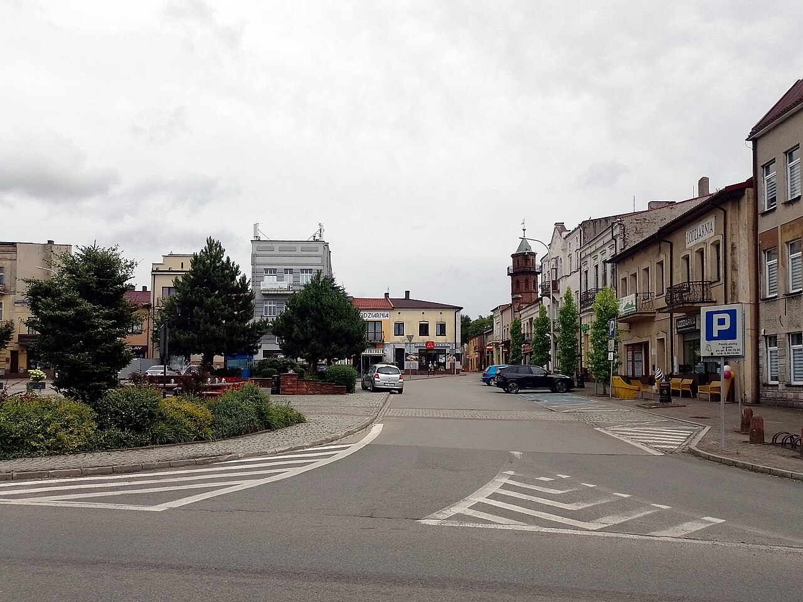<figcaption>Rynek · 2024</figcaption></figure>

Moja mała ojczyzna · historia · klasa IV
<h1>Wolbrom. W drodze do 700-lecia</h1>
1327 — 2027

Co z przeszłości zachowamy dla przyszłych mieszkańców?

notes:
0:00–0:35. Pokaż najpierw fotografię. „Kto rozpoznaje to miejsce? Po czym je poznaliście?” Przyjmij dwie krótkie odpowiedzi. „Dziś zajrzymy do historii miasta, które znamy z przejazdów, zakupów i spotkań. W 2027 roku Wolbrom będzie obchodził 700-lecie. Przygotujemy dla niego życzenia, ale nie takie, które pasują do każdego miasta. Zanim je napiszemy, poszukamy czegoś wyjątkowego w jego przeszłości”. Nie mów, że właśnie trwa jubileusz, jeśli prowadzisz lekcję w 2026 roku. Fotografia: 22 czerwca 2024, Kamil Czaiński; otwarcie ma kadr kompozycyjny, pełne ujęcie dostępne po kliknięciu.

---

<!-- .slide: id="mala-ojczyzna" class="local" data-purpose="explanation" data-layout="hero-source" data-goals="G2" -->

<figure class="">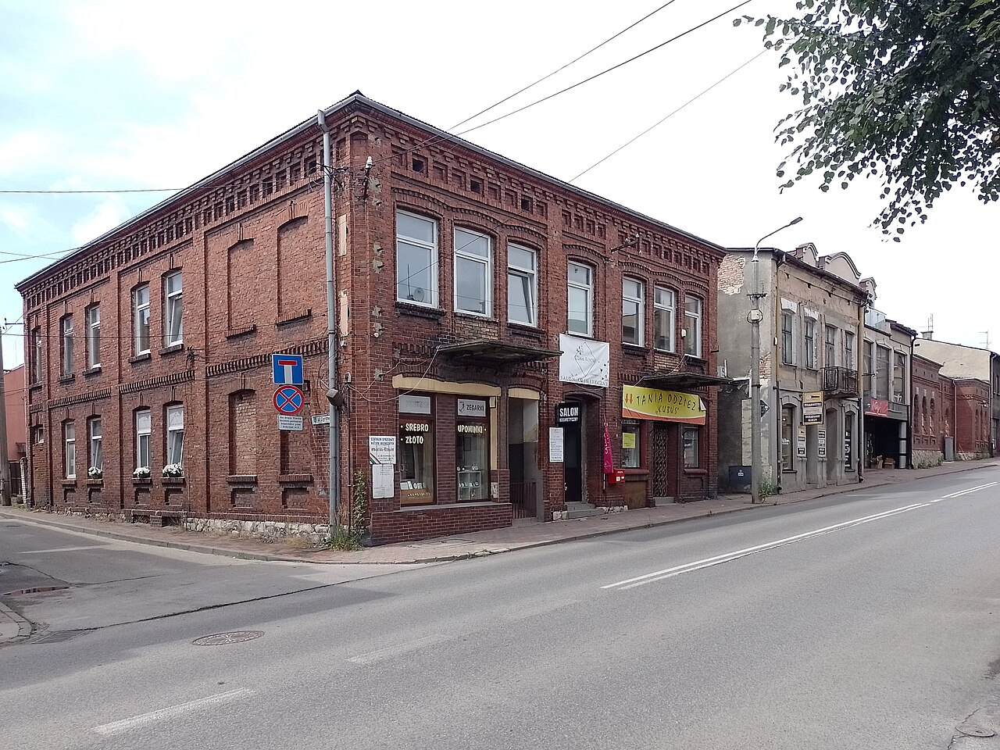<figcaption>Ulica Krakowska · 2024</figcaption></figure>

<h2>Mała ojczyzna to…</h2>
bliskie miejsca, ludzie i ich historie.

Może łączyć nas z miastem, wsią albo całą okolicą.

notes:
0:35–1:15. „Ojczyzna może oznaczać cały kraj. Małą ojczyzną nazywamy bliską nam okolicę: miejsce, z którym łączą nas wspomnienia i ludzie. Nie trzeba urodzić się w samym Wolbromiu. Ktoś mieszka w Łobzowie lub innej miejscowości gminy, a do Wolbromia przyjeżdża. Te miejsca też mogą być dla niego ważne”. Zapytaj: „Jakie jedno miejsce z naszej okolicy pokazalibyście gościowi?”. Przyjmij dwie odpowiedzi, nie oceniaj więzi dzieci z miejscem. „Widzimy prawdziwą ulicę Krakowską. Zwykła ulica też może być częścią naszej małej ojczyzny, bo łączy miejsca i ludzkie wspomnienia”. Fotografia z 22 czerwca 2024; nie domysł o dawnym wyglądzie.

---

<!-- .slide: id="urodziny" class="anniversary-slide" data-purpose="explanation" data-layout="timeline-band" data-goals="G1" -->

Rocznica ma swoją datę
<h2>Dlaczego właśnie 700?</h2>

<strong>1327</strong>
Początek dziejów miasta przyjęty dla jubileuszu.

→
<strong>2027</strong>
700. rocznica.

2027 − 1327 = <b>700 lat</b>

Miasto ma długą historię. Nie każdy jego budynek ma 700 lat!
<figure class="date-panorama">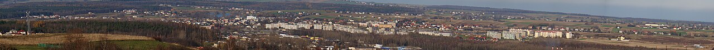<figcaption>Wolbrom z Kamiennej Góry</figcaption></figure>

notes:
1:15–2:05. „Wiek człowieka liczymy od urodzenia. Miasto nie rodzi się tak jak człowiek. Jego rozwój trwa wiele lat, ale ważny dawny dokument może wyznaczać datę, do której nawiązujemy podczas rocznicy. Wolbrom odnosi swoje 700-lecie do roku 1327”. Poproś o wspólne odczytanie działania. „Który rok wpiszemy więc na urodzinowej pocztówce?” — 2027. Wyraźnie dodaj: „Nie oznacza to, że każdy dom, drzewo i kościół powstały w 1327 roku”. W 2026 roku powiedz, że miasto dopiero przygotowuje się do tej rocznicy. Zapis 1327–2027 dotyczy jubileuszu miasta, nie datowania pokazanego budynku.

---

<!-- .slide: id="poczatek" class="founding-slide" data-purpose="explanation" data-layout="process" data-goals="G1 G2" -->

<figure class="">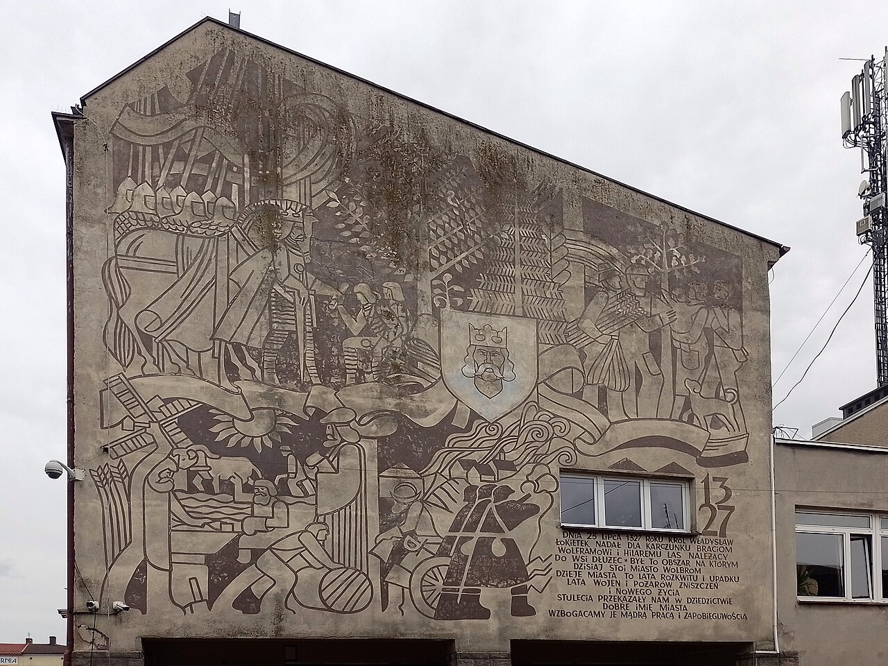<figcaption>Współczesny mural o początkach Wolbromia</figcaption></figure>

Pamięć w przestrzeni miasta
<h2>Wolbrom pamięta o początkach.</h2>
1327

<b>Łokietek</b> nadaje las.

<b>Wolfram i Hilary</b> organizują osadnictwo.

notes:
2:05–2:55. „Wyobraźcie sobie, ile trzeba przygotować, żeby mogła rozwinąć się osada: miejsce na domy, drogi i pracę. Według historii miasta w 1327 roku król Władysław Łokietek nadał Wolframowi i Hilaremu las na terenie dzisiejszego Wolbromia. Bracia mieli organizować osadnictwo, czyli sprowadzać i urządzać życie mieszkańców. Nazwę Wolbrom wiąże się z imieniem Wolframa”. Zapytaj: „Czy od samego nadania ziemi od razu stoją wszystkie domy?” — nie, to początek procesu. Nie pokazujemy wymyślonego dokumentu, portretu braci ani rekonstrukcji dawnej puszczy. Nie rozwijaj problematycznego opisu 1311 r. z miejskiego opracowania. Mural jest współczesną formą upamiętnienia, nie średniowiecznym obrazem ani wiernym portretem Łokietka. Pokaż datę na ścianie. To przykład, jak mieszkańcy przypominają o dawnych postaciach. Fotografia 22 VI 2024. Opis źródła nazywa to nadaniem praw, ale w narracji zachowujemy ostrożniejsze określenie: nadanie lasu i jubileuszowe początki miasta.

---

<!-- .slide: id="handel" class="market-photo" data-purpose="evidence" data-layout="hero-source" data-goals="G2" -->
<figure class="">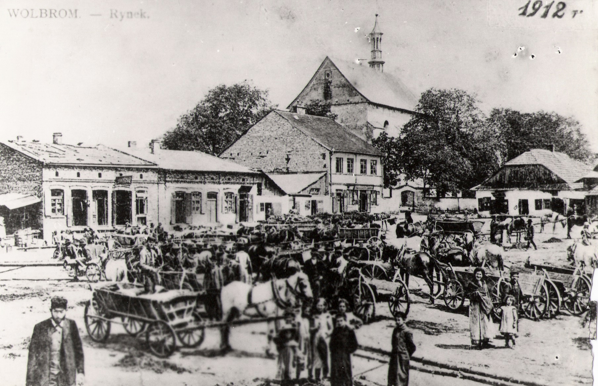<figcaption>Rynek · zdjęcie opisane jako 1912 r.</figcaption></figure>
<h2>Rynek: tu spotykali się ludzie</h2>
Kupić. Sprzedać. Porozmawiać.

notes:
2:55–3:50. „Przyjrzyjcie się temu dawnemu widokowi. Co pomaga rozpoznać targ?” Dzieci wskazują wozy, konie i ludzi. „Rolnicy przywozili to, co wyhodowali, rzemieślnicy oferowali wyroby, kupcy sprzedawali towary. Rynek był miejscem wymiany, ale też spotkań i wiadomości. Handel pomagał miastu się rozwijać”. Władysław Jagiełło nadał Wolbromiowi przywileje handlowe w 1400 r. — wystarczy w opowieści, bez dodatkowej daty do zapamiętania. Podkreśl: „Fotografia jest dużo późniejsza niż początki miasta. Miejska reprodukcja opisuje ją rokiem 1912; nie jest to niezależnie zbadane datowanie. Nie pokazuje targu w średniowieczu”. Nie odgaduj czwartku na podstawie samych wozów.

---

<!-- .slide: id="czwartek" class="market-day-slide" data-purpose="explanation" data-layout="statement" data-goals="G2" -->

Przywilej — specjalne uprawnienie
<h2>Stały dzień ułatwiał handel.</h2>
1485

Ustanowiono <b>czwartkowe targi</b>.

Wiadomo, kiedy przyjechać i spotkać kupujących.

<figure class="">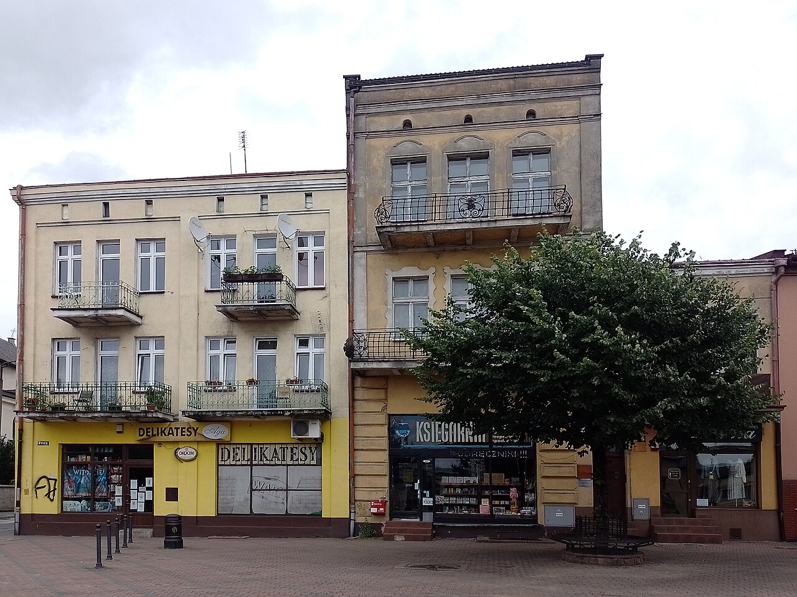<figcaption>Sklepy przy rynku · 2024</figcaption></figure>

notes:
3:50–4:35. „Co by się stało, gdyby sprzedawca przyjechał we wtorek, a wszyscy kupujący w piątek?” Daj dzieciom chwilę na krótką odpowiedź. „Właśnie dlatego wspólny termin był ważny. W 1485 roku Wolbrom otrzymał uprawnienie do targów w czwartki. Ktoś mógł przygotować towar i zaplanować drogę, bo wiedział, kiedy spotka innych”. Przywilej objaśnij jako specjalne uprawnienie nadane miastu. Nie buduj dodatkowego ćwiczenia z dat. Nie twierdź, że przez wszystkie następne stulecia targ odbywał się bez żadnej przerwy, ani że dawne zdjęcie zostało na pewno zrobione w czwartek. Chodzi o zrozumienie, jak stały termin pomagał w handlu. Zdjęcie sklepów jest współczesne, z 2024 r.; pokazuje dzisiejsze funkcje centrum, nie sam przywilej ani targ w 1485 r.

---

<!-- .slide: id="zrodlo" class="full-source" data-purpose="evidence" data-layout="evidence" data-goals="G2" -->
<h2>Co opowiada dawne zdjęcie?</h2><figure class="">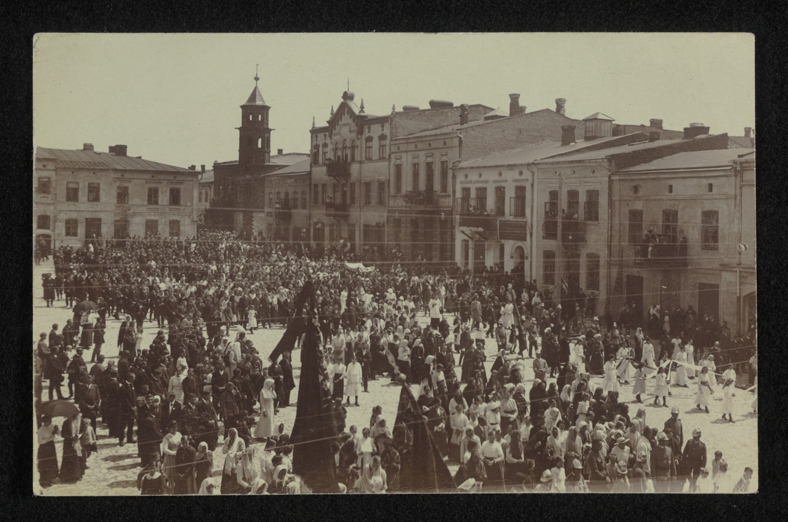<figcaption>Uroczystości na rynku · 1916</figcaption></figure>
Wskaż dwa szczegóły. Co widzisz, a czego tylko się domyślasz?

notes:
4:35–5:35. Daj 10 sekund cichego oglądania. „Dziś można zrobić zdjęcie telefonem. Dawne fotografie też zatrzymywały chwilę. Ta pochodzi z 1916 roku. Widzimy duże zgromadzenie na rynku, ale katalog nie mówi, jakie to były uroczystości”. Zapytaj o dwa szczegóły. Model obserwacji: tłum, stroje, zabudowa, ozdoby i pochód. Jeśli ktoś mówi „to urodziny miasta”, odpowiedz: „To pomysł, ale ze zdjęcia i opisu nie umiemy tego potwierdzić”. Nie wymagaj pełnej krytyki źródła. „Dzięki zdjęciu znamy wygląd tej chwili. Nie dowiadujemy się z niego wszystkiego o ludziach”. Kliknij powiększenie tylko jeśli potrzebne; zamknij Escape.

---

<!-- .slide: id="dawniej-dzis" class="then-now" data-purpose="evidence" data-layout="photo-pair" data-goals="G2" -->
<h2>Ten sam rynek, inne czasy</h2>
<figure class="">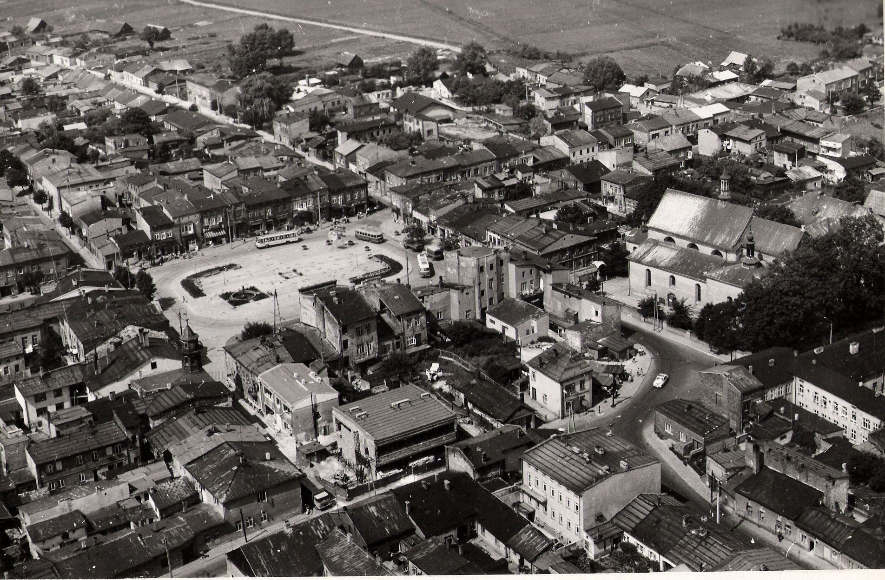<figcaption>DAWNIEJ · lata 70. XX w.</figcaption></figure><figure class="">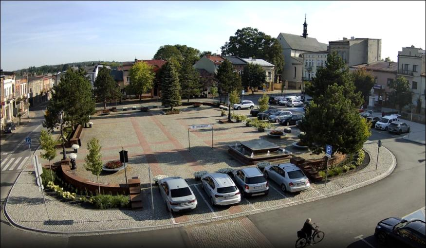<figcaption>WSPÓŁCZEŚNIE</figcaption></figure>

Wskaż rynek i kościół. Co zmieniło się wokół nich?

notes:
5:35–6:25. „To dwa widoki tego samego rynku Wolbromia. Na obu odszukajcie plac i kościół św. Katarzyny. Nie są zrobione z tego samego miejsca: dawniej oglądamy szerszą panoramę z góry”. Datowanie dawnej fotografii „lata 70. XX wieku” pochodzi z tytułu miejskiego załącznika, nie z daty dodania pliku do internetu. Data współczesnego ujęcia nie jest ustalona. Dzieci porównują skalę zieleni, transport i zagospodarowanie placu. Nie dopasowują na siłę wszystkich domów. To porównanie miejsca, a nie identycznych osi fotograficznych. Zdjęcia nie dowodzą wieku każdego budynku.

---

<!-- .slide: id="krakowska-dawniej-dzis" class="archive-compare" data-purpose="evidence" data-layout="photo-pair" data-goals="G2" -->
<h2>Ulica Krakowska — dawniej i dziś</h2>
<figure>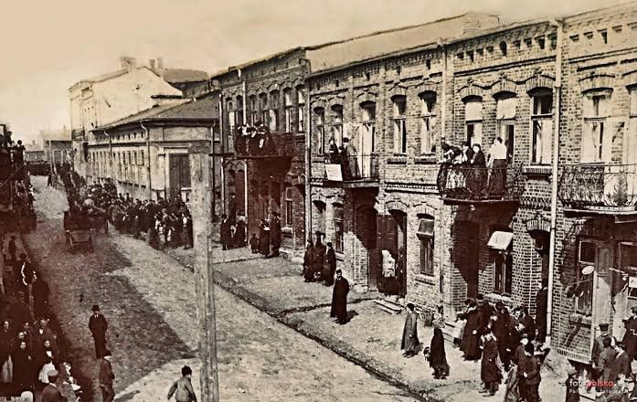<figcaption>DAWNIEJ · ok. 1918</figcaption></figure><figure><figcaption>WSPÓŁCZEŚNIE · 2024</figcaption></figure>

Ulica to także ludzie i ich codzienne sprawy.

notes:
6:25–7:05. „Historia miasta nie mieści się tylko na rynku. Ulicą Krakowską ludzie chodzili, spotykali się i załatwiali codzienne sprawy. Na dawnym zdjęciu można dostrzec osoby na chodniku i balkonach”. Wskaż jeden widoczny szczegół, bez kolejnej rundy zadań. Miejsce rozpoznano przez porównanie z wcześniej opisaną miejską reprodukcją tej samej sceny. Około 1918 to datowanie przekazane przez nauczyciela, niezweryfikowane niezależnie; zachowaj „około”. Przesłany wariant zastępuje miejską reprodukcję, nie jest kolejnym dawnym widokiem. Znak fotopolska.eu pozostawiono bez zmian. Współczesne ujęcie z 22 VI 2024 przedstawia ulicę między Ogrodową a Rynkiem; nie jest to potwierdzona para tych samych kamienic ani identycznego punktu widzenia. Pierwszy raz współczesny kadr służył objaśnieniu małej ojczyzny, teraz porównujemy wygląd tej ulicy.

---

<!-- .slide: id="dawne-ulice" class="archive-compare" data-purpose="evidence" data-layout="photo-pair" data-goals="G2" -->
<h2>Dawne ulice, zwyczajne życie</h2>
<figure>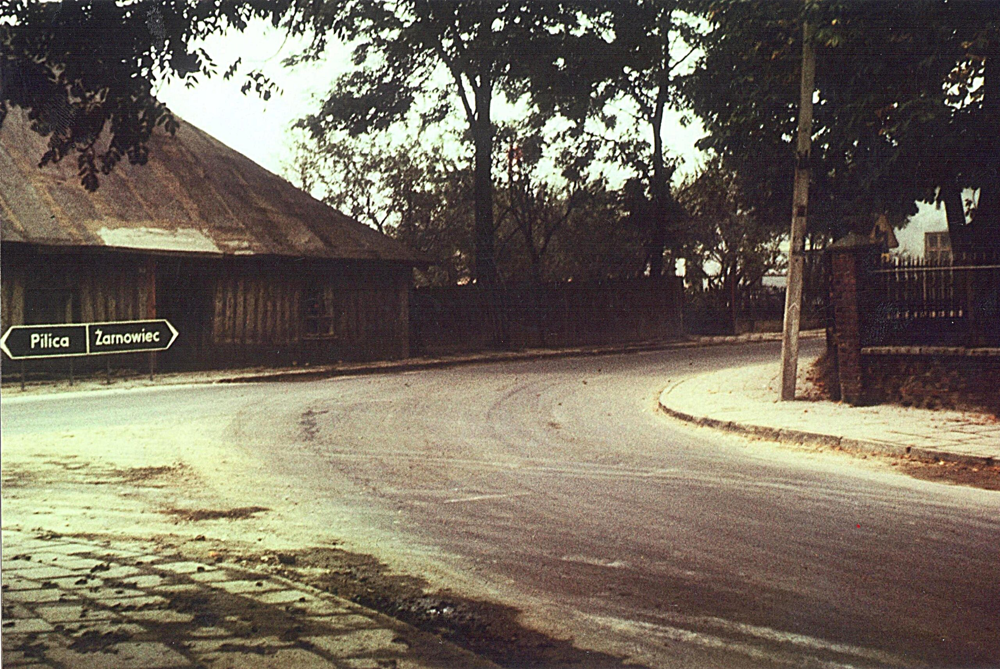<figcaption>Kleparz · dawna fotografia</figcaption></figure><figure>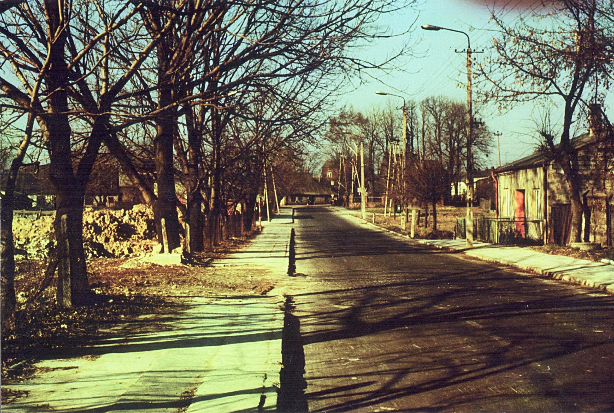<figcaption>Ulica Mariacka · lata 80. XX w.</figcaption></figure>

Domy, drogi i drzewa też tworzą historię miasta.

notes:
7:05–7:45. „W mieście stały również niskie drewniane domy. Na zdjęciach Kleparza i Mariackiej widzimy zwykłe ulice, którymi mieszkańcy chodzili na co dzień. Dawne fotografie pozwalają zachować ich wygląd”. Nie nazywaj całej zabudowy drewnianą ani nie zakładaj, że wszystkie pokazane domy już nie istnieją. Kleparz: data nieustalona. Mariacka: lata 80. XX w. według tytułu miejskiego załącznika, nie niezależnego datowania. Zdjęcia dwóch różnych ulic nie są parą „przed i po”. Zieleń na Kleparzu nie oznacza, że to park.

---

<!-- .slide: id="praca" class="industry" data-purpose="explanation" data-layout="hero-source" data-goals="G2" -->
<h2>Miasto zmieniała też praca.</h2>
<figure class="">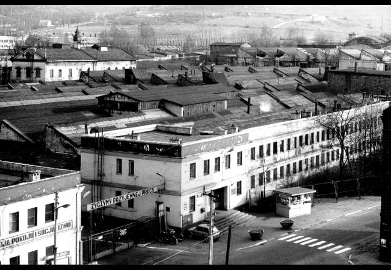<figcaption>Dawny zakład · wejście i portiernia</figcaption></figure><figure class="">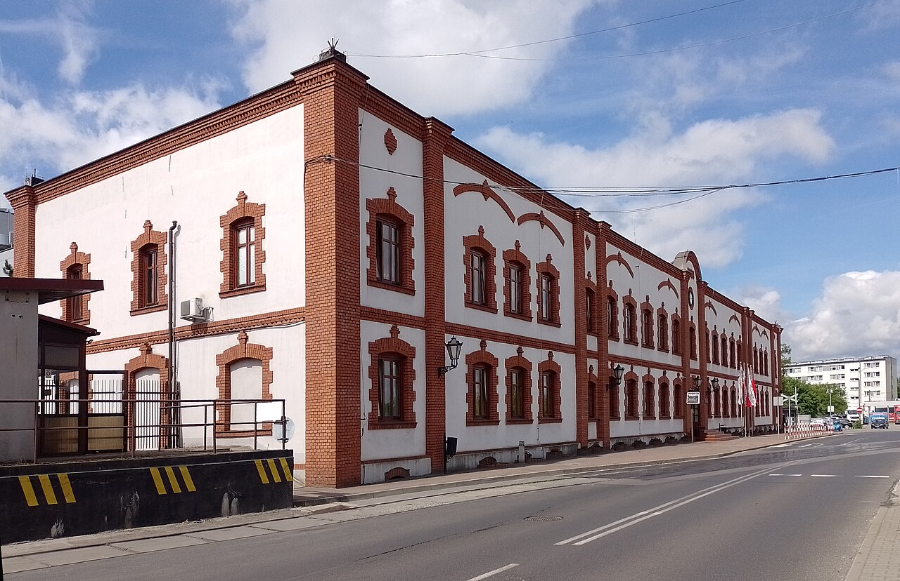<figcaption>Fabryka Taśm Transporterowych · 2024</figcaption></figure>

Zakłady dawały pracę mieszkańcom.

notes:
7:45–8:30. „Historia miasta to nie tylko królowie i bardzo dawne czasy. W Wolbromiu rozwijał się również przemysł, zwłaszcza związany z wyrobami gumowymi. Wielu mieszkańców pracowało w zakładach. Praca miała wpływ na życie rodzin i całej miejscowości”. Na fotografii wskaż wejście, portiernię i hale. Dawny widok z góry zastąpiono przekazanym przez nauczyciela zdjęciem codziennego miejsca pracy; data, fotograf i prawa nieustalone. Nie przypisuj konkretnej daty zdjęciu i nie nazywaj pokazanej hali bez potwierdzenia. Zapytaj: „Jakie miejsca pracy znacie w naszej okolicy?”. Wystarczą dwa przykłady. Nie przekształcaj w wykład o technice ani nie powtarzaj promocyjnych ocen dotyczących środowiska. Przykład ma pokazać zmianę miasta i udział zwykłych mieszkańców w jego historii. Fotografie zakładów pokazują rozwój przemysłu w tym samym mieście; nie twierdzimy, że to ten sam budynek dawniej i dziś. O kolei opowiedz na następnym slajdzie; tu pozostań przy pracy mieszkańców.

---

<!-- .slide: id="dworzec-dawniej-dzis" class="archive-compare" data-purpose="evidence" data-layout="photo-pair" data-goals="G2" -->
<h2>Kolej łączyła Wolbrom z innymi miejscami</h2>
<figure>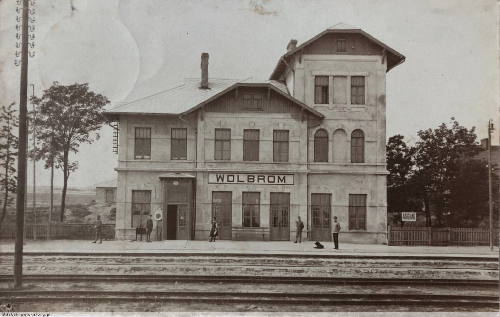<figcaption>Dawny dworzec</figcaption></figure><figure>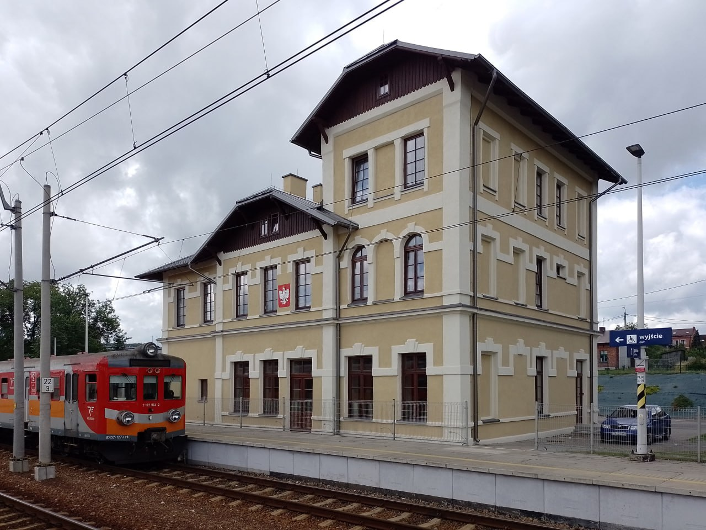<figcaption>Dworzec kolejowy · współcześnie</figcaption></figure>

Pociągi przewoziły ludzi i towary.

notes:
8:30–9:15. „Dworzec był miejscem wyjazdów, powrotów i przewozu towarów. Kolej łączyła miasto z innymi miejscowościami. Na dawnym zdjęciu widać nazwę WOLBROM i ludzi na peronie, a na współczesnym — stację z pociągiem”. Porównujemy kolej i codzienne podróże, nie zniszczenia wojenne. Oba pliki przekazał nauczyciel; współczesność drugiego potwierdził w korekcie. Daty wykonania, fotografowie i prawa nieustalone. Znak „Alistair polska-org.pl” na dawnej reprodukcji zachowany, nie jest dowodem autorstwa oryginału. Nie utożsamiaj dwóch ujęć z potwierdzonym tym samym zachowanym budynkiem ani identycznym punktem fotografowania. Nie używaj datowania 1914 z usuniętej fotografii ÖNB dla nowego zdjęcia.

---

<!-- .slide: id="katarzyna-dawniej-dzis" class="church-compare" data-purpose="evidence" data-layout="photo-pair" data-goals="G2 G3" -->
<h2>Kościół św. Katarzyny — dawniej i dziś</h2>
<figure class="">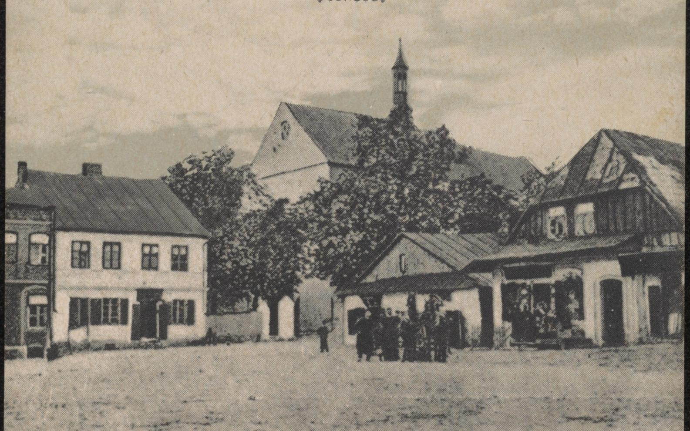<figcaption>DAWNIEJ · pocztówka wydana w latach 1918–1939</figcaption></figure><figure class="">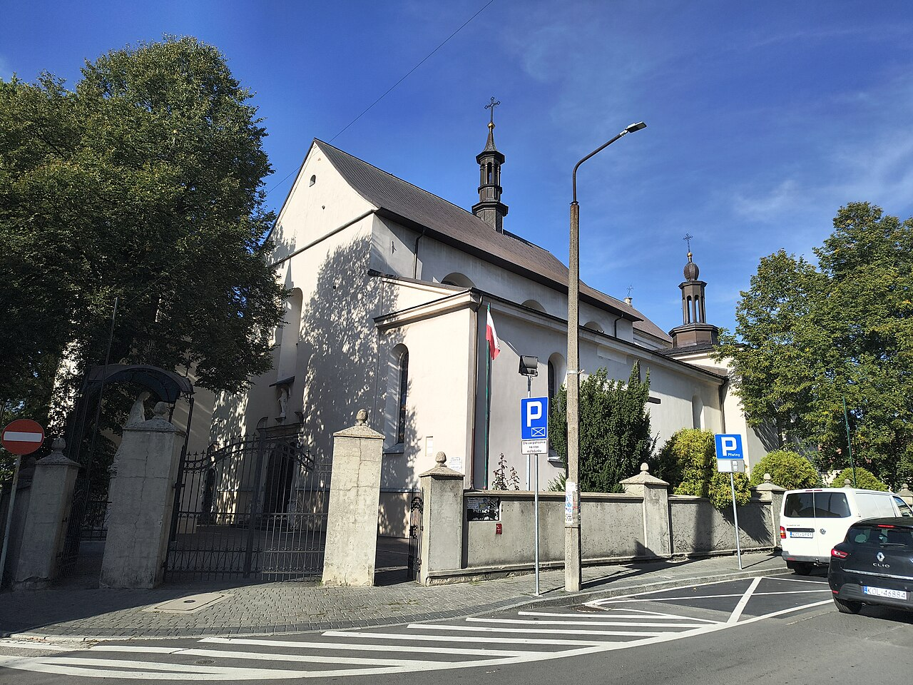<figcaption>DZISIAJ · 2026</figcaption></figure>

Ten sam kościół. Co pomaga go rozpoznać?

notes:
9:15–9:55. Obejrzyjcie kościół św. Katarzyny w dwóch ujęciach, od strony rynku, ale pod różnymi kątami. Uczniowie wskazują bryłę i wieżyczkę; nie trzeba oceniać przebudów na podstawie zdjęć. Identyfikacja dawnego widoku opiera się na obiekcie Polony, kategoriach jego reprodukcji Commons i porównaniu architektury; nie mylimy go z drewnianym NMP. 1918–1939 to czas wydania pocztówki, nie pewna data wykonania ujęcia. Fotografia FFugi z 8 IX 2026 pokazuje obecny zespół kościoła od rynku. Zabytek jest rzeczywistym śladem przeszłości i wymaga ochrony.

---

<!-- .slide: id="drewniany-zabytek" class="wooden" data-purpose="explanation" data-layout="source-split" data-goals="G2 G3" -->

<figure class="">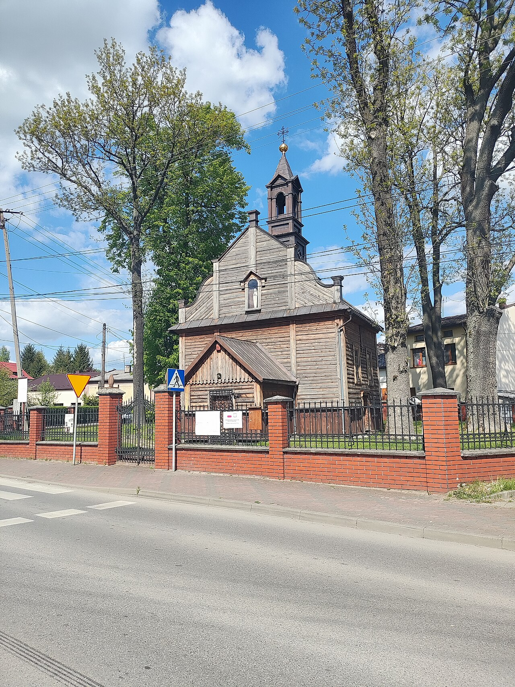<figcaption>Drewniany kościół Niepokalanego Poczęcia NMP</figcaption></figure>

Zabytek — wartościowy ślad przeszłości
<h2>Dawny budynek potrzebuje troski.</h2>
Drewniany kościół Niepokalanego Poczęcia NMP.

<b>Poznajemy. Nie niszczymy. Dbamy, by przetrwał.</b>

notes:
9:55–10:35. „To inny zabytek: drewniany kościół Niepokalanego Poczęcia Najświętszej Maryi Panny. Czy 700-lecie miasta oznacza, że on też ma dokładnie 700 lat?” — nie. Nie uczymy dodatkowej daty budowy. „Dlaczego warto zachować sam budynek, a nie tylko jego zdjęcie?” Zabytek pozwala poznawać dawne materiały i umiejętności. Dzieci nie wykonują remontów, ale mogą nie niszczyć, poznawać historię i zgłaszać uszkodzenia dorosłym. Nie myl go z kaplicą cmentarną. Obiekt figuruje w miejskim wykazie zabytków. Fotografia Michała Bulsy z 1 maja 2025.

---

<!-- .slide: id="pamiec-mieszkancow" class="memory-place" data-purpose="explanation" data-layout="source-split" data-goals="G2 G3" -->

<figure>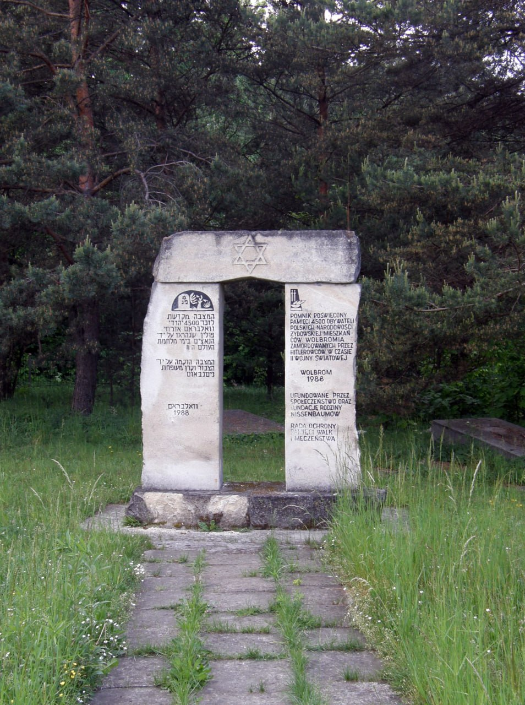<figcaption>Pomnik na cmentarzu żydowskim w Wolbromiu</figcaption></figure>

Pamięć o ludziach
<h2>Miasto to także dawni mieszkańcy.</h2>
W Wolbromiu mieszkali również Żydzi.

Pomnik przypomina o nich.

<b>Cmentarzom należy się szacunek i troska.</b>

notes:
10:35–11:20. „W Wolbromiu mieszkali także Żydzi. Ten pomnik na cmentarzu przypomina o żydowskich mieszkańcach miasta zamordowanych podczas II wojny światowej. Pamiętamy o ludziach, którzy tworzyli naszą okolicę. Na każdym cmentarzu zachowujemy spokój, nie niszczymy pomników i szanujemy miejsce pochówku”. Bez rozwijania wojennej dygresji, bez liczby ofiar do zapamiętania. Współczesna fotografia przekazana przez nauczyciela; autor, prawa i data zdjęcia nieustalone. Rok 1988 jest wyryty na pomniku, NIE jest datą fotografii. Nie traktuj liczby w inskrypcji jako niezależnie zweryfikowanej statystyki; nie jest potrzebna w tej lekcji. Gwiazda Dawida jest widocznym elementem pomnika; nie zastępuje opowieści o mieszkańcach.

---

<!-- .slide: id="dom-kultury" class="local-life" data-purpose="explanation" data-layout="hero-source" data-goals="G2 G3" -->
<h2>Mała ojczyzna żyje także dziś</h2><figure>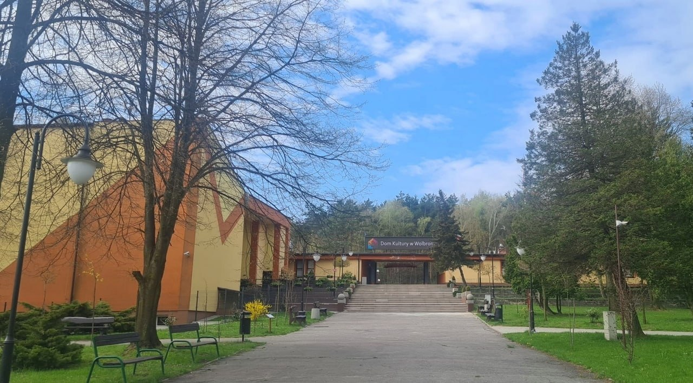<figcaption>Dom Kultury w Wolbromiu · współcześnie</figcaption></figure>
Miejsce spotkań, kultury i wspólnego działania.

notes:
11:20–12:00. „Historia nie kończy się na dawnych zdjęciach. Dom Kultury to jedno z miejsc, w których mieszkańcy spotykają się i uczestniczą w kulturze. Dzisiejsze spotkania też staną się kiedyś częścią historii”. Nie rozpoczynaj nowej rundy wypowiedzi ani katalogu wydarzeń. Nazwę widać nad wejściem. Nauczyciel wyraźnie potwierdził, że to fotografia współczesna; dokładnej daty, autora i praw nie ustalono. Nie nazywaj jej dawnym zdjęciem ani nie dopisuj daty budowy czy remontu.

---

<!-- .slide: id="zalew-park" class="archive-compare" data-purpose="explanation" data-layout="photo-pair" data-goals="G2 G3" -->
<h2>Zieleń i woda — miejsca odpoczynku</h2>
<figure>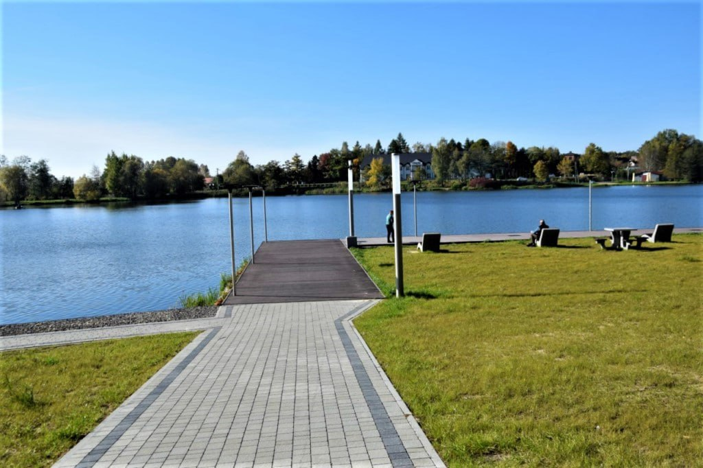<figcaption>Zalew · współcześnie</figcaption></figure><figure>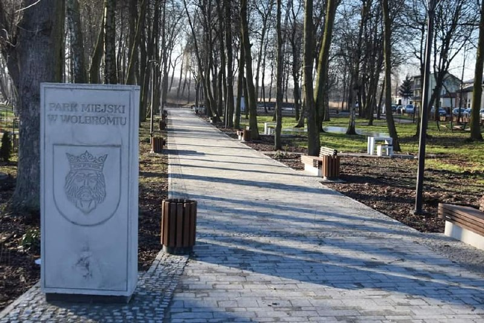<figcaption>Park miejski · współcześnie</figcaption></figure>

Dbamy o wspólne miejsca, żeby służyły następnym mieszkańcom.

notes:
12:00–12:45. „Zalew i park to miejsca, w których można odpoczywać i spacerować. One też należą do naszej małej ojczyzny. Dbając o wodę, drzewa i czystość, myślimy o dzisiejszych i przyszłych mieszkańcach”. Wskaż różnicę: nad zalewem widzimy wodę i pomost, w parku alejkę i drzewa. To dwa różne współczesne miejsca, nie para „przed i po”. Oba rzeczywiste zdjęcia przekazał nauczyciel i potwierdził ich współczesność; autorzy, dokładne daty i prawa nieustalone. Nie są to wizualizacje projektu. Nie dopisuj dat zagospodarowania.

---

<!-- .slide: id="basen" class="local-life pool-life" data-purpose="explanation" data-layout="hero-source" data-goals="G2 G3" -->
<h2>Sport i odpoczynek</h2><figure><figcaption>Basen odkryty w Wolbromiu · współcześnie</figcaption></figure>
Sport i odpoczynek też tworzą codzienne życie miasta.

notes:
12:45–13:20. „Tu mieszkańcy pływają i odpoczywają. Mała ojczyzna to nie tylko stare mury: to również ludzie i ich wspólne miejsca. Życzenie dla miasta może dotyczyć tego, żeby miejsca te były zadbane i dobrze służyły mieszkańcom”. Bez nowego zadania i bez daty otwarcia czy remontu. Nauczyciel potwierdził współczesność fotografii; autor, dokładna data i prawa nieustalone. Nie nazywaj jej archiwalną na podstawie wyglądu basenu.

---

<!-- .slide: id="pamiec" class="postcard-slide" data-purpose="evidence" data-layout="source-split" data-goals="G2 G3" -->

<figure class="">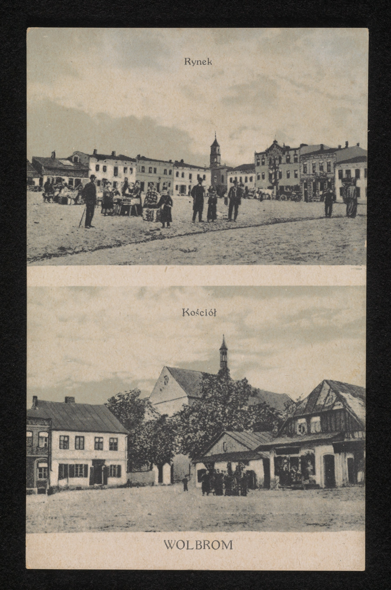<figcaption>Pocztówka z Wolbromia · wydanie 1918–1939</figcaption></figure>

Mały przedmiot, duża historia
<h2>Pocztówka też przechowuje pamięć.</h2>
Pokazuje miejsce. Niesie wiadomość. Może przetrwać wiele lat.

notes:
13:20–14:05. Pokaż całą pocztówkę. „Wcześniej oglądaliśmy zbliżenie kościoła. Teraz widzicie całą pocztówkę z dwoma widokami. Ktoś chciał pokazać Wolbrom innym ludziom. Takie drobne przedmioty mogą przetrwać dłużej niż nasze wspomnienia”. Wyjaśnij różnicę: nie jest to rysunek wykonany przez dzisiejsze dziecko ani fotografia średniowiecza, lecz dawna drukowana pocztówka. „My też możemy stworzyć wiadomość o mieście. Nasza będzie urodzinowa. Dobierzemy do niej miejsce i życzenie, które wynikają z poznanej historii”. Nie trzeba omawiać znaczków, adresowania i działania poczty; to nie cel zadania.

---

<!-- .slide: id="przyszlosc" class="future" data-purpose="explanation" data-layout="process" data-goals="G2 G3" -->

<figure class="">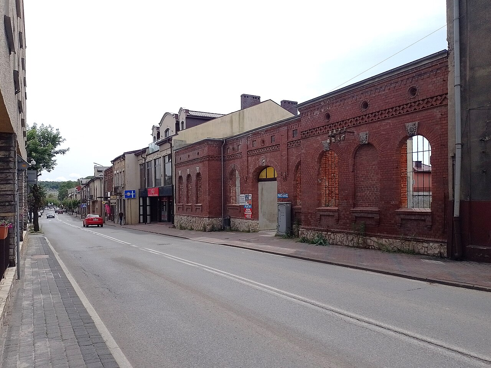<figcaption>Ulica Krakowska · zachowana fasada Starej Poczty</figcaption></figure>

<h2>Co zachowamy dla przyszłych mieszkańców?</h2>
<b>Pamiętam</b> miejsce i jego historię.

<b>Życzę</b> mu dobrej przyszłości.

Historia podpowiada, o co warto zadbać.

notes:
14:05–15:00. „Znamy już kilka fragmentów historii: początek miasta, rynek i handel, pracę mieszkańców, zabytki, pamięć o dawnych mieszkańcach i dzisiejsze miejsca spotkań oraz odpoczynku. Nie musimy umieć opowiedzieć wszystkiego, żeby złożyć miastu sensowne życzenie. Wystarczy połączyć jeden fakt z troską o przyszłość”. Zapytaj: „Czego może potrzebować ważne dawne miejsce, żeby poznali je ludzie za wiele lat?”. Przyjmij różne pomysły: troski, ochrony, odwiedzających, wiedzy o historii. Nie pokazuj gotowego tekstu pocztówki. Poproś, żeby każde dziecko w myślach wybrało miejsce. Na kolejnym slajdzie pojawi się dokładna instrukcja, a podczas pracy możesz indywidualnie pomóc powiązać pomysł z faktem. Widzimy zachowaną fasadę Starej Poczty przy Krakowskiej. To przykład, że śladem przeszłości bywa również część dawnego budynku. Miejski wykaz wymienia część elewacji frontowej przy Krakowskiej 6. Nie nazywaj zdjęcia zachowanym całym budynkiem. W razie braku czasu wystarczy jedno zdanie, bez dodatkowego zadania.

---

<!-- .slide: id="pocztowka-zadanie" class="task-slide" data-purpose="practice" data-layout="task-board" data-goals="G1 G2 G3" -->

Każdy samodzielnie · 16 minut · jedna kartka A4
<h2>Pocztówka na 700-lecie</h2>

<h3>Na okładce</h3>
Narysuj i podpisz <b>jedno poznane miejsce</b>.

Dodaj: <b>1327–2027 · 700 lat</b>.

<h3>W środku · 2–3 zdania</h3>
Przypomnij <b>jeden fakt z lekcji</b>.

Złóż miastu <b>życzenie, które do tego faktu pasuje</b>.

Złóż A4 na pół. Bez wycinania. Rysunek może być prosty.

notes:
15:00–17:00 instrukcja i rozdanie; 17:00–33:00 praca. Rozdaj 18 czystych kartek A4 i przybory, bez dodatkowej karty pracy. „Każdy robi własną pocztówkę. Złóżcie kartkę na pół. Na okładce narysujcie jedno miejsce z Wolbromia, podpiszcie je i dodajcie daty jubileuszu. W środku w dwóch lub trzech zdaniach przypomnijcie jeden fakt z lekcji, a potem złóżcie życzenie, które do niego pasuje”. Poproś jedną osobę o powtórzenie zadania własnymi słowami. Dopiero wtedy rozpocznij 16 minut pracy. Najpierw sens i tekst, potem dopracowanie koloru. Po 8 minutach przypomnij o życzeniu. Nie wymagaj idealnej architektury ani odwzorowania fotografii. Nie kopiują modelu, nie pracują grupowo, nic nie wycinają.

---

<!-- .slide: id="pomoc" class="support-slide" data-purpose="practice" data-layout="task-board" data-goals="G1 G2 G3" -->
<h2 data-task-role="prompt">Sprawdź, czy to naprawdę o Wolbromiu</h2>
<ol class="checklist"><li><b>Miejsce</b> — ma podpis.</li><li><b>Rocznica</b> — 1327–2027, czyli 700 lat.</li><li><b>Wiadomość</b> — fakt i pasujące do niego życzenie.</li></ol>

Potrzebujesz początku?

„Wolbromiu, pamiętam, że… Życzę Ci…”

notes:
Slajd pomocniczy podczas tych samych 16 minut, nie nowy etap. Uczeń potrzebujący wsparcia może połączyć fakt i życzenie w jednym pełnym zdaniu lub podyktować je dorosłemu. Dla szybszych: „Dopisz, co sam możesz zrobić dla wybranego miejsca”. Przykład tylko w notatkach, po własnej próbie dziecka: „Wolbromiu, Twój rynek od dawna służył handlowi i spotkaniom. Życzę Ci troski o to miejsce, żeby nadal łączyło mieszkańców”. Dopuszczalne są inne fakty i życzenia. Poprawiaj „kościół ma 700 lat”, wskazując różnicę między wiekiem miasta i budynku. Nie oceniaj zdolności plastycznych.

---

<!-- .slide: id="wyjscie" class="exit-slide" data-purpose="exit-ticket" data-layout="task-board" data-goals="G1 G2 G3" -->

Na zakończenie
<h2>Pamięć + dobre życzenie</h2>

<strong>Pokaż osobie obok.</strong>
Wskaż fakt i powiedz, dlaczego wybrałeś takie życzenie.

<h3>Każdy na odwrocie</h3>
700-lecie Wolbromia przypada w roku <b>…</b>

Warto chronić <b>…</b>, ponieważ <b>…</b>

notes:
33:00–36:00: dzieci pokazują sobie prace bez zmiany miejsc, potem tylko dwie chętne osoby przedstawiają je klasie. Nie wywołuj po kolei wszystkich 18, bo zabraknie czasu. Synteza ustna: miasto ma długą historię, poznajemy ją ze śladów i źródeł, a rocznica zachęca do troski o przyszłość. 36:00–38:00: każdy zapisuje dwa krótkie uzupełnienia na odwrocie — rok 2027 i konkretne miejsce z sensownym powodem ochrony. Zbierz 18 prac do przejrzenia, a nie tylko dwie prezentowane. 38:00–40:00: bufor i porządkowanie. Służy przejściom i dokończeniu zapisu, nie dodatkowej aktywności.
