<!-- .slide: id="otwarcie" data-purpose="opening" data-layout="hero-source" data-goals="G1 G3" -->

Starożytna Grecja · klasa V
<h1>Sparta i wojny z Persami</h1>
Greckie polis wobec wielkiego imperium

490–479 r. p.n.e.

<figure class="opening-art">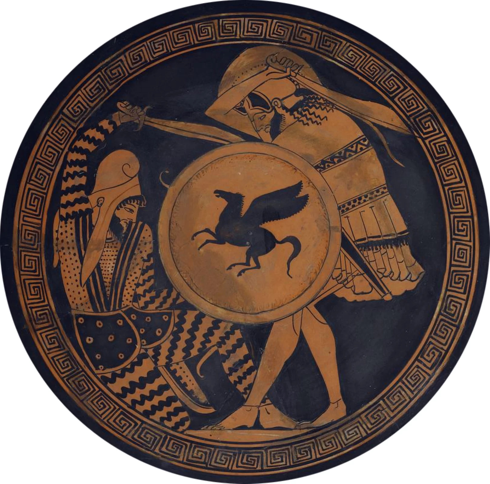<figcaption>Walka Greka z Persem. Malowidło wazowe, ok. 480 r. p.n.e.</figcaption></figure>

notes:
Wyjaśnij: to przedstawienie walki na greckim naczyniu, nie fotografia ani zapis konkretnej bitwy. Pytanie główne lekcji: Jak niewielkie greckie polis obroniły niezależność przed imperium perskim? Nie rozpoczynaj od legendy o samotnych 300.

---

<!-- .slide: id="sparta-mapa" class="map-slide locator" data-purpose="evidence" data-layout="map-focus" data-goals="G1" -->

<h2>Gdzie leżała Sparta?</h2>
Grecja

<b>Peloponez</b> półwysep na południu Grecji

<b>Lakonia</b> kraina, w której leżała Sparta

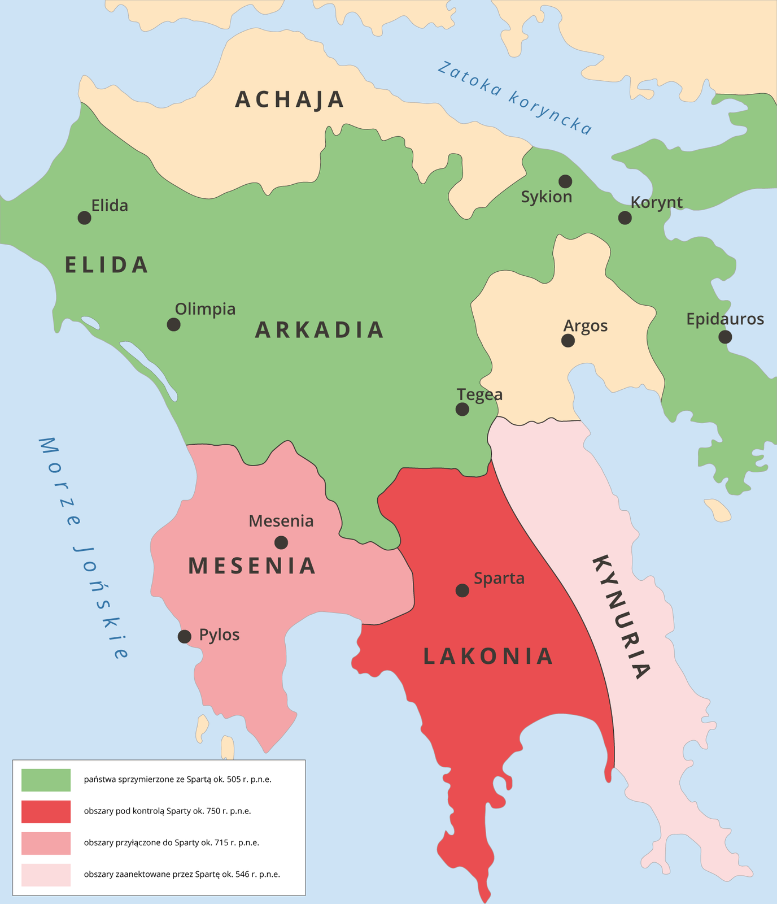

notes:
Wskaż cały półwysep, potem Lakonię i punkt Sparta. Mapa przedstawia rozwój obszaru i wpływów Sparty, nie jednolite greckie państwo. Czytaj legendę: zielony obszar to sprzymierzeńcy, a nie ziemie wcielone do Sparty. Mapa jest na maksymalnej wysokości; po kliknięciu zajmuje cały możliwy ekran bez podpisu.

---

<!-- .slide: id="polis-i-podboje" data-purpose="explanation" data-layout="comparison" data-goals="G1" -->
<h2>Sparta była jedną z greckich polis</h2>

<b>Polis</b>
miasto-państwo: miasto i otaczające je ziemie

Lakonianie to mieszkańcy Lakonii. Ich nazwę spotkamy jeszcze w dzisiejszym języku.

Grecy mieli wspólny język i wierzenia, ale <b>nie tworzyli jednego państwa</b>. Ateny i Sparta miały własne prawa i władze.

Spartanie podbili ziemie w Lakonii i sąsiedniej <b>Mesenii</b>. Część ludności podporządkowali sobie jako helotów.

Sparta miała jednocześnie <b>dwóch królów z dwóch dynastii</b>. Ich władzę ograniczały rada starszych i urzędnicy — eforowie.

notes:
Nie utożsamiaj wszystkich mieszkańców z obywatelami. Podboje wyjaśniają zależność helotów, ale geneza wszystkich grup była bardziej złożona. Królowie: Agiadowie i Eurypontydzi; nazwy nie są do pamięciowego opanowania w klasie V. Rada starszych to geruzja, eforów było pięciu. Wystarczy zrozumienie: dwóch królów naraz i brak nieograniczonej władzy.

---

<!-- .slide: id="spoleczenstwo" data-purpose="explanation" data-layout="matrix" data-goals="G1" -->
<h2>Mieszkaniec nie zawsze był obywatelem</h2>

<figure>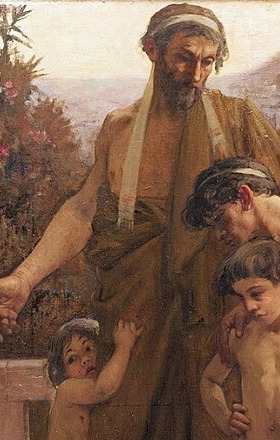<figcaption>Spartiata — wizja z 1900 r.</figcaption></figure>
<h3>Spartiaci</h3>
Pełne prawa obywatelskie mieli dorośli mężczyźni. Decydowali o sprawach polis i przygotowywali się do wojny.

<figure>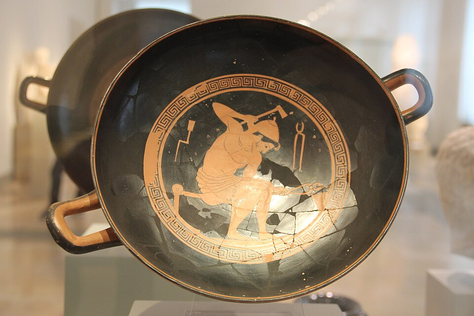<figcaption>Rzemieślnik, nie portret periojka.</figcaption></figure>
<h3>Periojkowie</h3>
Ludzie wolni, lecz bez praw politycznych w Sparcie. Zajmowali się rzemiosłem i handlem; również służyli w wojsku.

<figure>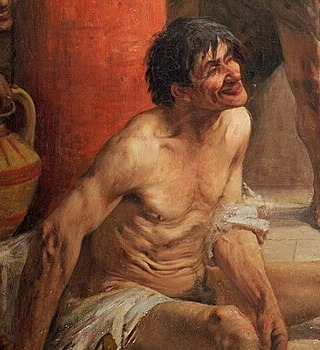<figcaption>Helota — wizja z 1900 r.</figcaption></figure>
<h3>Heloci</h3>
Ludność podporządkowana. Uprawiali pola i oddawali część plonów Spartiatom, utrzymując ich rodziny.

Spartanki ćwiczyły sprawność i zarządzały domem, ale <b>nie były hoplitami</b> ani nie uczestniczyły w zgromadzeniu obywateli.

notes:
Spartiaci skupiali się na wojsku dzięki pracy podporządkowanej ludności. Nie chwal tego systemu bez zaznaczenia nierównych praw. Obywatelstwo pełne w modelu szkolnym od 30 lat; okres 20–30 to służba młodego Spartiaty. Służba wojskowa nie była wyłącznym przywilejem pełnoprawnych obywateli: periojkowie również byli żołnierzami.

Ilustracje nie są pewnymi portretami grup. Spartiata i helota to kadry z obrazu Fernanda Sabattégo z 1900 r. Obraz przedstawia upokarzanie heloty; nie uogólniaj sceny na charakter wszystkich helotów ani nie pochwalaj przemocy. Ateński wizerunek kowala ilustruje rzemiosło, jedno z zajęć periojków; nie identyfikuje jego statusu ani pochodzenia jako periojka.

---

<!-- .slide: id="zycie-spartanina" data-purpose="explanation" data-layout="timeline-band" data-goals="G1" -->
<h2>Od chłopca do obywatela</h2>

Model życia chłopca z rodziny Spartiatów

<ol class="life-axis"><li><b>Do 7 lat</b>Wychowanie w domu, pod opieką rodziny.</li><li><b>Od 7 lat</b>Wspólne wychowanie chłopców: ćwiczenia, posłuszeństwo, czytanie, pisanie i zwięzłe wypowiedzi.</li><li><b>Od 12 lat</b>Surowsze warunki życia i intensywne przygotowanie wojskowe.</li><li><b>Od 20 lat</b>Służba wojskowa; życie związane z oddziałem.</li><li><b>Od 30 lat</b>Pełne prawa obywatelskie i życie rodzinne; nadal obowiązek służby.</li><li><b>Od 60 lat</b>Koniec obowiązkowej służby. Wybrani obywatele mogli wejść do rady starszych.</li></ol><figure>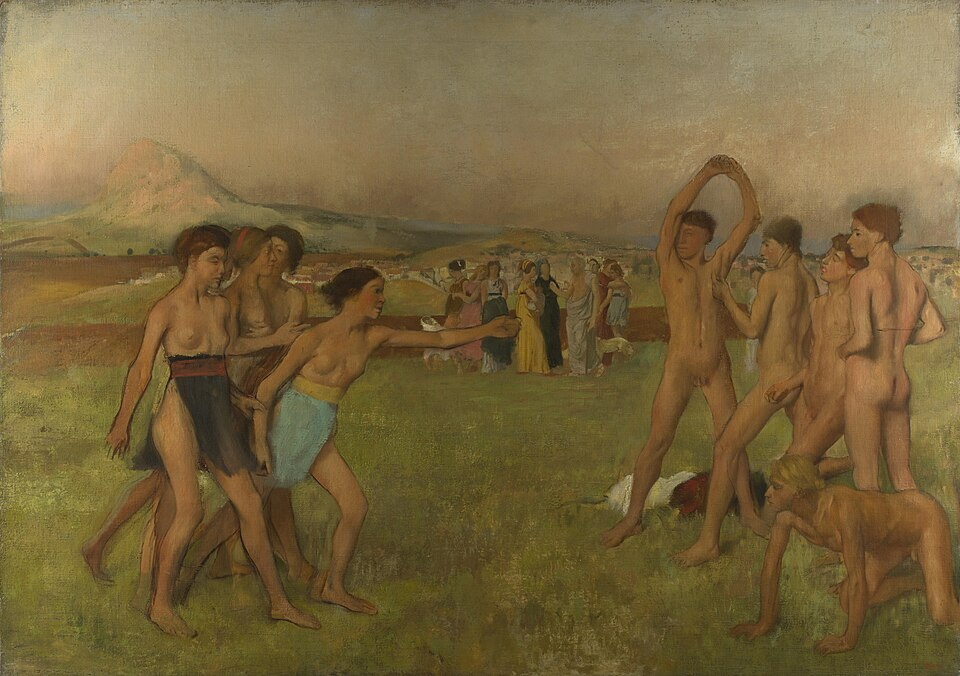<figcaption>„Młodzi Spartanie ćwiczący”, ok. 1860 r. Późniejsza wizja, nie obraz z epoki.</figcaption></figure>

notes:
To model szkolny na podstawie s. 50, nie dokładna biografia każdego człowieka. ZPE przedstawia wyjście z koszar i pełne uczestnictwo około 30 roku życia. Nie przedstawiaj późnej opowieści Plutarcha o porzucaniu słabych noworodków jako pewnego, powszechnego faktu: jej historyczność i zakres są dyskutowane. Nie rozwijaj drastycznych szczegółów. Pełny cytat po slajdzie pytań pokazuje ideał wychowania opisywany znacznie później.

Degas przedstawia chłopców i dziewczęta; malarstwo nie jest fotograficzną dokumentacją agoge. Nie ucz z niego dokładnego stroju ani etapów edukacji.

---

<!-- .slide: id="pytania-do-zrodla" class="task-slide" data-purpose="practice" data-layout="task-board" data-goals="G1" -->
<h2>Co wynika z opisu wychowania?</h2>

Podczas czytania poszukasz odpowiedzi na te pytania. Po lekturze porozmawiasz z osobą obok i uzasadnisz odpowiedzi fragmentami tekstu.
<ol><li>Określ, jakie były warunki życia młodych Spartan. <b>Uzasadnij</b> swoją odpowiedź dwoma szczegółami z tekstu.</li><li>Jaki powinien być przyszły wojownik Sparty? Wymień <b>dwie cechy</b> i połącz je ze sposobem wychowania.</li></ol>

Odpowiedzi zapisz krótko w zeszycie.

notes:
Najpierw pokaż pytania, potem przejdź do pełnego źródła. Pozostaw tekst na ekranie podczas szukania szczegółów; nie potrzebują książki ani wydruku. Model: warunki surowe, skromne ubranie, bose chodzenie, niewiele jedzenia, rzadkie kąpiele. Wojownik zdyscyplinowany, wytrzymały, odważny i zaradny — każda poprawna para cecha + szczegół jest wartościowa. Nie oceniaj odpowiedzi według jednego przymiotnika. W skróconym wariancie 30 min: krótka rozmowa i dwie wypowiedzi w bloku lektury; w 45 min pełny blok 7 min na pytania, czytanie i uzasadnienia.

---

<!-- .slide: id="wychowanie-zrodlo" class="reading-slide" data-purpose="evidence" data-layout="evidence" data-goals="G1" -->
<h2>Wychowanie młodych Spartan</h2>
<blockquote class="full-quote">Pisania uczyli się jako rzeczy przydatnej; zresztą całe wychowanie miało na celu karność, wytrwałość w trudach i waleczność. Z postępem wieku zaostrzano metodę hartowania, strzyżono do skóry, przyuczano chodzić boso […]. Od 12 roku życia stale już chodzili bez tuniki¹, otrzymywali jedno himation² na rok; skóra pozbawiona kąpieli i olejków twardniała im. Tylko kilka razy do roku dozwalano im tej uciechy, by mogli się wykąpać i natrzeć ciało. […] Wieczerza była skąpa, aby walka z niedostatkiem zmuszała ich do odwagi i przemyślności. […] Pieśni spartańskie, których nie mniej starannie uczono, sławiły przeważnie poległych za Spartę lub ganiły tchórzów, przedstawiając nędzę ich życia, oraz zawierały przyrzeczenie mężnej postawy w życiu dojrzałym lub wyraz dumy z powodu życia już minionego – stosownie do wieku.</blockquote>

¹ Tunika — przewiązany w pasie wełniany ubiór z krótkimi rękawami. ² Himation — rodzaj płaszcza.

Plutarch, „Żywot Likurga” — fragment późniejszej relacji o spartańskim wychowaniu.

notes:
Pełny fragment z fotografii ćwiczeniówki dostarczonej przez nauczyciela; zachowano wszystkie wewnętrzne opuszczenia, nie dodano własnych. Nie jest to cały utwór Plutarcha. Powiązanie z Plutarchem potwierdza instytucjonalny materiał Muzeum Narodowego w Szczecinie; nazwisko tłumacza nie jest widoczne i pozostaje nieustalone. Plutarch żył w I–II w. n.e., wiele stuleci później niż wojny perskie. Pytania uczniowie poznali przed lekturą. Teraz czytają z nastawieniem na szukanie szczegółów; po lekturze porozmawiajcie o odpowiedziach. Karność oznacza dyscyplinę, przemyślność — zaradność, dozwalano — pozwalano. Czytaj spokojnie, nie oceniaj współczesnych dzieci przez ten ideał.

---

<!-- .slide: id="hoplita" data-purpose="explanation" data-layout="split" data-goals="G1" -->
<h2>Hoplita walczył w falandze</h2>

<figure>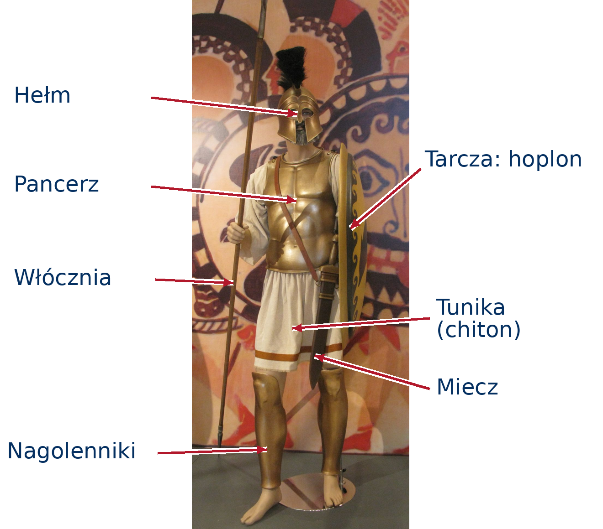<figcaption>Współczesna rekonstrukcja wyposażenia ateńskiego hoplity.</figcaption></figure>

<b>Hoplita</b> — ciężkozbrojny żołnierz greckiej piechoty.
<dl class="equipment"><dt>Ochrona</dt><dd>hełm, pancerz, nagolenniki i duża okrągła tarcza — <b>hoplon</b></dd><dt>Broń</dt><dd>włócznia; miecz do walki z bliska</dd><dt>Strój</dt><dd>tunika (chiton) pod pancerzem</dd></dl>
<b>Falanga</b>
Zwarty szyk hoplitów. Tarcza osłaniała wojownika i częściowo sąsiada z lewej. Utrzymanie szyku wymagało współpracy.

notes:
Pokaż całą sylwetkę — nie używaj popiersia do nauczania pełnego uzbrojenia. Fotografia repliki z wystawy w Zappeionie, Ateny, 2010, nie antyczny przedmiot. Hoplon to tradycyjna nazwa szkolna, aspis jest precyzyjniejszym terminem dla tarczy. Górny czubek włóczni nie mieści się w fotografii, ale trzon i dolny kolec są widoczne; nie twierdź, że fotografia pokazuje każdy szczegół broni. Hoplici nie byli wyłącznie Spartanami; walczyli tak też Ateńczycy i inne polis. Unikamy rysowania wymyślonej falangi. Strój jest rekonstrukcją — nie każdy hoplita miał identyczne wyposażenie.

Strzałki to objaśnienie dodane do pełnego, nieprzyciętego zdjęcia; końce wskazują rzeczywiste elementy. Miecz pokazujemy przez widoczną pochwę, nie trzon włóczni; strzałka nagolenników wskazuje metalową osłonę goleni, nie stopę. Kliknięcie powiększa tę samą wersję z etykietami.

---

<!-- .slide: id="persja-mapa" class="map-slide" data-purpose="evidence" data-layout="map-focus" data-goals="G2" -->

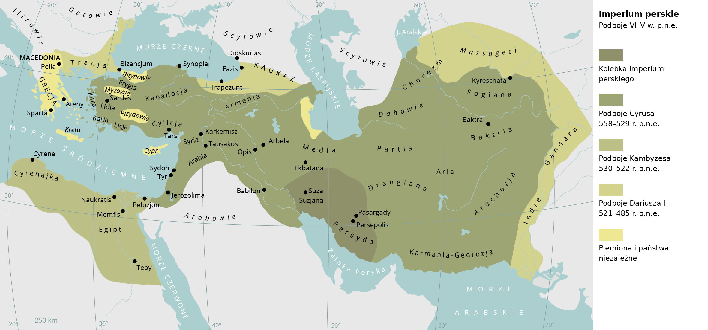

notes:
Mapa ZPE, Contentplus.pl, CC BY-SA 3.0: spłaszczono istniejące warstwy mapy, bez nowego rysowania geografii. Zachowano nazwy i kolory legendy. Wskaż Grecję na zachodzie, Persydę w dzisiejszym Iranie, Babilon w Mezopotamii między Tygrysem i Eufratem, Egipt i zachodnie wybrzeże Azji Mniejszej. Nazwa źródła „Imperium perskie w VI w. p.n.e.” obejmuje warstwę Dariusza do 485 r. p.n.e.; nie udawaj mapy jednego roku. Wyjaśnij różnicę między historycznym zasięgiem a współczesnymi granicami Iranu. Nie trzeba uczyć satrapii ani wszystkich nazw.

---

<!-- .slide: id="imperium" data-purpose="explanation" data-layout="source-split" data-goals="G2" -->
<h2>Wielkie imperium na wschód od Grecji</h2>

<b>Imperium</b> to rozległe państwo podporządkowujące sobie wiele ludów i ziem.

Persowie pochodzili z obszaru dzisiejszego <b>Iranu</b>. Podbili m.in. Mezopotamię, Azję Mniejszą i Egipt.

W ich państwie znalazły się także <b>greckie miasta na wybrzeżu Azji Mniejszej</b>.

<b>Danina</b>
Obowiązkowa opłata dla władcy, np. w zbożu, innych dobrach lub pieniądzach.

<figure>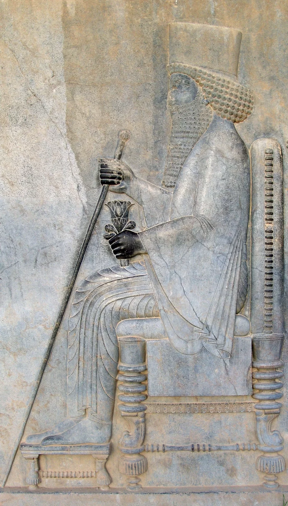<figcaption>Dariusz I na tronie. Relief z Persepolis, ok. 500 r. p.n.e.</figcaption></figure>

notes:
Greccy mieszkańcy Azji Mniejszej byli poddanymi króla perskiego, a nie częścią jednej niepodległej „Grecji”. Musieli płacić daniny i dostarczać siły zbrojne. Ilustracja: Darafsh Kaviyani, CC BY-SA 3.0, dokładny wpis w sources.md.

---

<!-- .slide: id="przyczyny" data-purpose="explanation" data-layout="impact-flow" data-goals="G2" -->
<h2>Dlaczego doszło do wojny?</h2>
<ol class="cause-flow"><li><b>Podporządkowanie</b>Greckie miasta w Azji Mniejszej musiały uznawać władzę Persów i płacić daniny.</li><li><b>Bunt joński <small>499–494 r. p.n.e.</small></b>Miasta zbuntowały się przeciw Persji. Ateny udzieliły powstańcom pomocy.</li><li><b>Wyprawa Dariusza</b>Po stłumieniu buntu król chciał ukarać Ateny i podporządkować sobie kolejne greckie polis.</li></ol>

W 490 r. p.n.e. perskie wojsko wylądowało pod Maratonem.

notes:
Jonia była krainą na zachodnim wybrzeżu Azji Mniejszej. Pomogła też Eretria — do wyjaśnienia ustnego, nie do dodatkowej listy nazw. Bezpośredni powód odwetu to pomoc Aten, szerszy cel — rozszerzenie perskiej władzy. Nie mów o wojnie Greków ze Spartą: Sparta należała do greckich polis. Dariusz rozkazał wyprawę, nie dowodził osobiście pod Maratonem.

---

<!-- .slide: id="mapa-bitew" class="map-slide" data-purpose="evidence" data-layout="map-focus" data-goals="G2 G3" -->

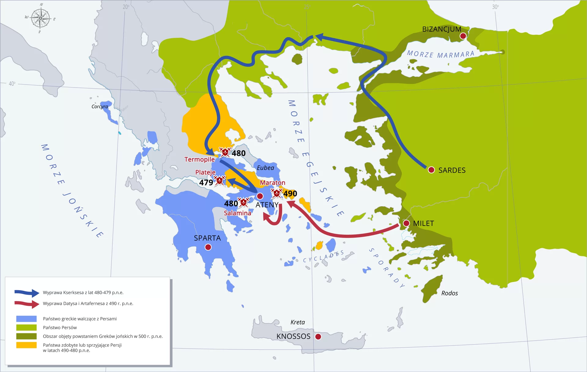

notes:
Mapa z dokładnego linku użytkownika https://zpe.gov.pl/a/wojny-perskie/DIEuiF2Kg, online-skills, CC BY 3.0. Wskaż wszystkie trzy wymagane miejsca: Maraton, Termopile, Salamina; dodatkowo Plateje. Czerwona trasa dotyczy wyprawy 490, niebieska — 480–479. Mapa to teatr wojny, nie pełny zasięg Persji. Nie powtarzamy jej jako dekoracji: w razie potrzeby wróć do niej strzałką.

---

<!-- .slide: id="maraton" data-purpose="explanation" data-layout="process" data-goals="G2 G3" -->

490 r. p.n.e.
<h2>Maraton: zwycięstwo na lądzie</h2>

<b>Ateńczycy i Platejczycy</b>przeciw wojsku perskiemu

<ol class="battle-sequence"><li><b>Przed bitwą</b>
Persowie wylądowali niedaleko Aten. Miltiades należał do greckich dowódców i przekonał ich do ataku.
</li><li><b>Walka</b>
Greccy hoplici zaatakowali. Ich silne skrzydła pokonały przeciwników, a następnie uderzyły na perski środek.
</li><li><b>Wynik</b>
Persowie wycofali się na okręty. Grecy obronili Ateny i przekonali się, że mogą pokonać armię perską.
</li></ol>

notes:
Miltiades nie był jedynym greckim dowódcą, lecz odgrywał kluczową rolę. Wojsko szybko wróciło do Aten, udaremniając perską próbę ataku od morza. Spartanie przybyli po bitwie; nie dopisuj ich do zwycięskiej armii pod Maratonem. Nie buduj wyjaśnienia na niepewnych dokładnych liczebnościach lub dacie dziennej. Plan skrzydeł i okrążenia: Herodot VI.111–113; ZPE Maraton jest opracowaniem.

---

<!-- .slide: id="legenda-maratonu" data-purpose="explanation" data-layout="photo-pair" data-goals="G2" -->
<h2>Dlaczego dziś biegamy maratony?</h2>

Legenda

Po bitwie posłaniec przebiegł z Maratonu do Aten, ogłosił zwycięstwo Greków i <b>padł martwy z wyczerpania</b>.

Dzisiejsze biegi maratońskie nawiązują do tej opowieści.

<b>Historia a legenda:</b> brak pewnego potwierdzenia tego biegu. Herodot opisuje inną misję: bieg Filippidesa do Sparty po pomoc <b>przed bitwą</b>.

<figure>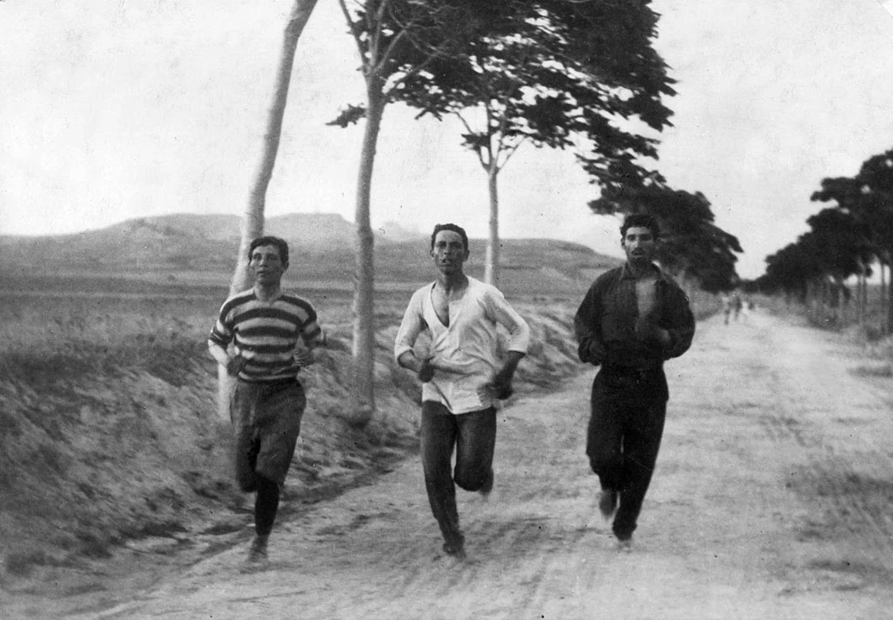<figcaption>Biegacze przygotowujący się do maratonu, Ateny, 1896 r.</figcaption></figure>

notes:
Opowiedz całą legendę, nie usuwaj pointy. Opowieść o śmierci posła pojawia się w późnych przekazach i nie jest relacją Herodota z V w. p.n.e. Filippides był zawodowym gońcem; Herodot VI.105–106 opisuje wyprawę Ateny–Sparta przed bitwą. Współczesny maraton ma 42 km 195 m; dystans nie dowodzi dokładnej długości legendarnej trasy. Burton Holmes, fotografia z 1896, domena publiczna. Nie przedstawiaj maratonu jako dyscypliny starożytnych igrzysk.

---

<!-- .slide: id="kserkses" data-purpose="explanation" data-layout="split" data-goals="G2" -->

480 r. p.n.e.
<h2>Nowa wyprawa: Kserkses</h2>

<figure>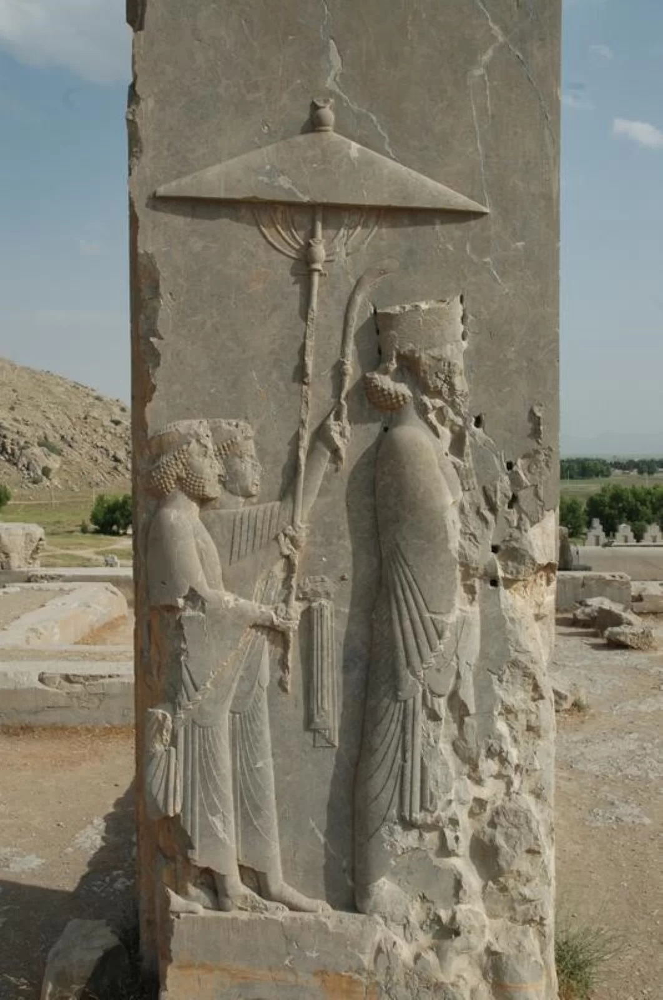<figcaption>Kserkses na reliefie z Persepolis, V w. p.n.e.</figcaption></figure>

<b>Kserkses</b>, syn i następca Dariusza, ponownie ruszył przeciw Grekom.

Persowie przybywali <b>lądem i morzem</b>. Greckie polis musiały współdziałać, by zatrzymać armię i flotę.

Na lądzie wybrano do obrony wąskie przejście pod Termopilami.

notes:
Kserkses osobiście uczestniczył w wyprawie, w odróżnieniu od Dariusza pod Maratonem. Grecja nie była zjednoczona: nie wszystkie polis przystąpiły do sojuszu, część była neutralna lub wspierała Persję. Uczniowie mają rozróżnić dwóch królów perskich, nie zapamiętywać listy wszystkich dowódców.

---

<!-- .slide: id="termopile" data-purpose="explanation" data-layout="source-split" data-goals="G2 G3" -->

480 r. p.n.e.
<h2>Termopile: obrona wąskiej drogi</h2>

<figure>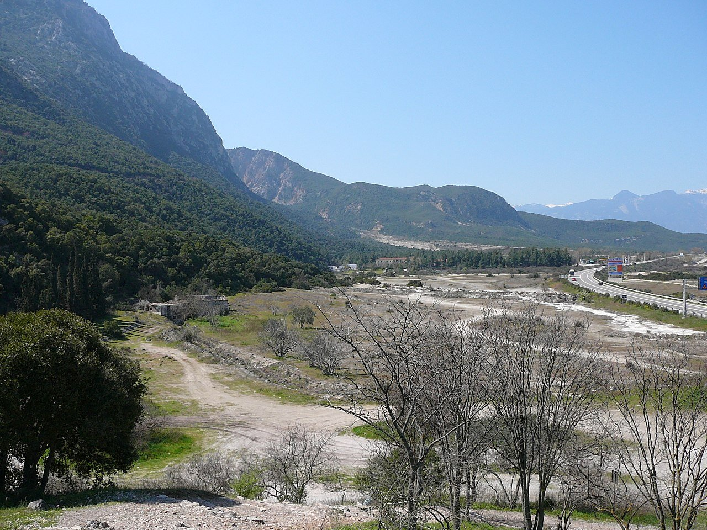<figcaption>Termopile współcześnie. W starożytności morze było bliżej gór; dziś linia brzegowa leży dalej.</figcaption></figure><ol><li><b>Teren:</b> droga między górami a morzem ograniczała przewagę liczebną Persów.</li><li><b>Obejście:</b> Persowie przeszli górską ścieżką i zagrozili Grekom od tyłu.</li><li><b>Wynik:</b> Leonidas, król Sparty, zginął z obrońcami. Bitwę wygrali Persowie.</li></ol>

<b>Nie tylko 300:</b> ze Spartanami walczyli żołnierze innych greckich polis.

notes:
Początkowo kilka tysięcy Greków; w końcowej walce oprócz 300 Spartiatów uczestniczyli m.in. Tespijczycy i Tebańczycy. Większość armii wycofała się po rozpoznaniu obejścia. Nie mów o zwycięstwie 300 ani o pewnym strategicznym „uratowaniu całej Grecji przez zyskanie czasu”: zakres tego skutku jest przedmiotem dyskusji. Wąskie przejście nadmorskie nie było współczesnym szerokim polem; fotografię objaśniaj przez zmianę linii brzegowej, bez rysowania fałszywej rekonstrukcji.

---

<!-- .slide: id="pamiec-termopil" data-purpose="explanation" data-layout="statement" data-goals="G3" -->
<h2>Dlaczego pamiętamy przegraną bitwę?</h2>
<blockquote class="epitaph">„Przechodniu, powiedz Sparcie, tu leżym jej syny, prawom jej do ostatniej posłuszni godziny.”</blockquote>

Szymonides · przekład Jana Czubka, 1882 r.

Termopile stały się <b>symbolem odwagi, wierności obowiązkowi i poświęcenia</b>. Pamiętamy postawę obrońców, choć wojskowe zwycięstwo odnieśli Persowie.

notes:
Przekład sprawdzono na dokładnie podanej stronie ZPE „Wojny perskie”, odwołanie: Jan Czubek, Lirycy greccy (doby klasycznej), Kraków 1882, s. 89. Dawne „syny” oznacza synów. Nie podawaj tłumacza jako autora antycznego epigramu. Zwiąż pamięć z modelem wychowania, nie z gloryfikacją śmierci dzieci ani przemocą. Symbol odwagi nie zmienia wyniku bitwy.

---

<!-- .slide: id="polskie-termopile" data-purpose="explanation" data-layout="source-split" data-goals="G3" -->
<h2>„Polskie Termopile”: Wizna</h2>

<figure>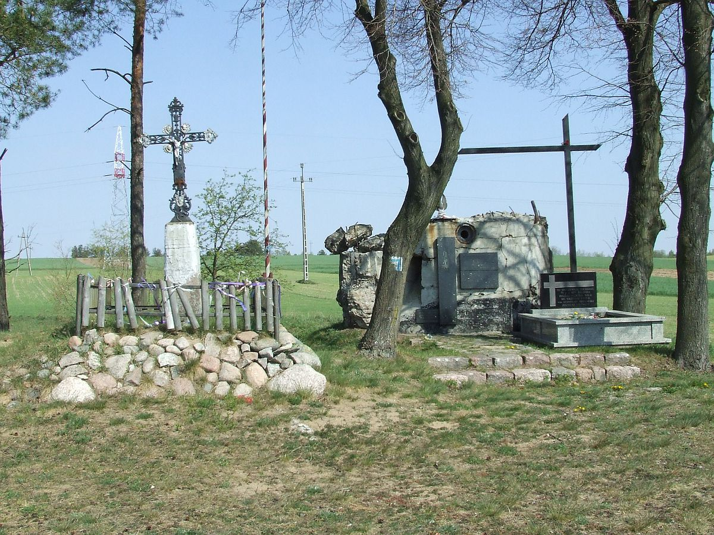<figcaption>Miejsce pamięci obrony Wizny u podnóża Góry Strękowej.</figcaption></figure>

7–10 września 1939 r.

Polscy żołnierze pod dowództwem <b>kapitana Władysława Raginisa</b> bronili umocnień pod Wizną przed znacznie silniejszym wojskiem niemieckim.

Niemcy przełamali obronę. Raginis zginął, a <b>opór obrońców</b> stał się symbolem odwagi.

Porównanie z Termopilami dotyczy <b>oporu wobec przewagi przeciwnika</b>. To inne wojny i epoki — Wizna nie jest wydarzeniem starożytnym.

notes:
Krótki przykład recepcji symbolu, nie osobna lekcja o II wojnie światowej. IPN opisuje walki od 7 do 10 września 1939 i dowództwo Raginisa. Nie podawaj popularnego stosunku liczebności ani nie myl klęski ze zwycięstwem. Zdjęcie Hiuppo CC BY-SA 3.0: miejsce pamięci zawiera element schronu z bitwy pod Nowogrodem, nie zachowany schron Raginisa. W 45 min około 1 min na powiązanie z symbolem; w 30 min jedno zdanie porównania.

---

<!-- .slide: id="salamina" data-purpose="explanation" data-layout="source-split" data-goals="G2 G3" -->

480 r. p.n.e.
<h2>Salamina: zwycięstwo na morzu</h2>

<figure>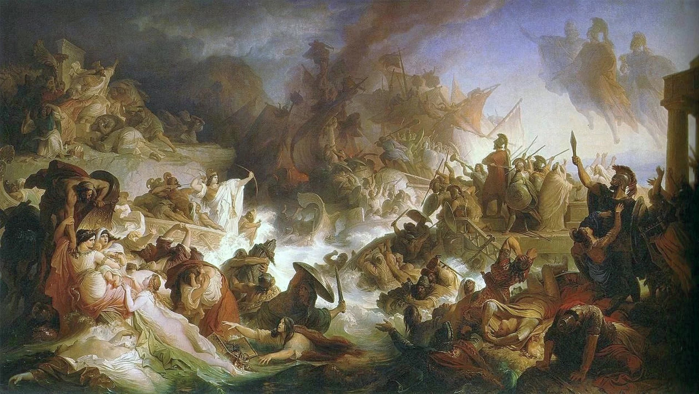<figcaption>„Bitwa pod Salaminą”, 1868 r. Późniejsza wizja artystyczna.</figcaption></figure>

<b>Temistokles</b> przekonywał Greków do walki w wąskiej cieśninie przy wyspie Salamina.

W tłoku perskie okręty miały trudności z manewrowaniem. Greckie okręty uderzały <b>taranem</b> — wzmocnionym dziobem — w burty przeciwnika.

Grecka flota zwyciężyła. Persowie nie zdołali opanować Grecji.

notes:
Temistokles był ateńskim politykiem i dowódcą, ważnym twórcą planu walki; formalnym naczelnym dowódcą sprzymierzonej floty był Spartanin Eurybiades. Nie mów „Temistokles dowodził całą flotą”. Nie każ zapamiętywać obu nazwisk, jeśli to przeciąży klasę. Po Salaminie zagrożenie nie znikło: perska armia pozostała w Grecji do następnego roku. Obraz Kaulbacha, 1868, nie jest rekonstrukcją techniczną okrętów — taran wyjaśnia tekst.

---

<!-- .slide: id="odparcie-inwazji" data-purpose="synthesis" data-layout="timeline-band" data-goals="G2 G3" -->
<h2>Grecy odparli perską inwazję</h2>

<b>490</b>
Maraton
Grecy wygrywają na lądzie

<b>480</b>
Termopile
Persowie przełamują obronę

<b>480</b>
Salamina
Grecy wygrywają na morzu

<b>479</b>
Plateje
Grecy pokonują pozostałą armię perską

Wszystkie daty: lata p.n.e.

W 479 r. p.n.e. zwycięstwo pod <b>Platejami</b> pomogło zakończyć inwazję.

Grekom pomogły współpraca polis, wyszkolenie hoplitów, flota i wykorzystanie terenu. <b>Zachowali niezależność.</b>

notes:
To oś kolejności, nie proporcjonalna skala lat; Termopile i Salamina dzieliły tygodnie, nie osobny rok. Malejące liczby lat p.n.e. prowadzą ku późniejszym wydarzeniom. Plateje: 479, greckie zwycięstwo, ważna rola spartańskiego dowódcy Pauzaniasza. Równolegle zwycięstwo pod Mykale; nie wprowadzaj kolejnej obowiązkowej daty/miejsca. Wojny z Persją trwały dalej, zakończyła się inwazja na Grecję, nie cała historia konfliktów. Synteza nie jest zadaniem z odpowiedziami obok pytań.

---

<!-- .slide: id="jezyk-sparty" data-purpose="synthesis" data-layout="matrix" data-goals="G1 G3" -->
<h2>Co zostało w naszym języku?</h2>

<h3>Spartańskie wychowanie</h3>
Surowe wychowanie, wymagające dyscypliny i wytrzymałości.

„Dziadek wspominał spartańskie wychowanie: obowiązki i mało wygód.”

<h3>Spartańskie warunki</h3>
Skromne warunki życia, bez wygód.

„W schronisku były spartańskie warunki: prycze i zimna woda.”

<h3>Lakoniczna odpowiedź / mowa</h3>
Krótka i zwięzła. Nazwa pochodzi od <b>Lakonii</b>, krainy Sparty.

„Czy przyjdziesz?” — „Tak.” To lakoniczna odpowiedź.

notes:
To współczesne przykłady ułożone dla uczniów, nie antyczne cytaty. Nie myl lakoniczności z byciem nieuprzejmym ani nazwy z błędnym „lakońska”. Zwroty pomagają zapamiętać kulturę; nie zalecamy surowego traktowania dzieci. W 45 min uczeń wyjaśnia jeden przykład własnymi słowami, w 30 min krótko odczytaj znaczenia. Maraton pozostaje osobnym przykładem wpływu tradycji.

---

<!-- .slide: id="notatka" data-purpose="synthesis" data-layout="takeaways" data-goals="G1 G2 G3" -->
<h2>Notatka do zeszytu</h2>

<h3>Sparta</h3>
1. Sparta była grecką <b>polis w Lakonii na Peloponezie</b>. Miała dwóch królów o ograniczonej władzy.

2. <b>Spartiaci</b> rządzili i służyli w wojsku. <b>Periojkowie</b> byli wolni, lecz bez praw politycznych; również byli żołnierzami. <b>Heloci</b> uprawiali pola i oddawali plony.

3. Wychowanie chłopców miało rozwijać dyscyplinę, wytrzymałość i odwagę. <b>Lakoniczny</b> znaczy zwięzły; nazwa pochodzi od Lakonii, której mieszkańcy to Lakonianie.

4. <b>Hoplita</b> — ciężkozbrojny piechur — walczył w <b>falandze</b>, zwartym szyku osłanianym tarczami.

<h3>Wojny z Persami</h3>
5. Persja podbiła greckie miasta w Azji Mniejszej. Bunt joński i pomoc Aten stały się przyczyną perskiego odwetu.

6. <b>490 r. p.n.e. — Maraton:</b> Ateńczycy i Platejczycy pokonali Persów.

7. <b>480 r. p.n.e. — Termopile:</b> klęska Greków i śmierć Leonidasa; symbol odwagi. <b>Salamina:</b> greckie zwycięstwo w cieśninie.

8. <b>479 r. p.n.e. — Plateje:</b> odparcie perskiej inwazji. Współpraca i wykorzystanie terenu pomogły Grekom obronić niezależność.

notes:
W rdzeniu 30 min nie dyktuj całej notatki: uczeń zapisuje punkty 4 i 6–8, a resztę otrzymuje jako student-summary.md po lekcji. Pełna notatka na ekranie jest samowystarczalna. W wariancie 45 min zostaw 5 min na uporządkowanie zeszytu. Lakonianie to mieszkańcy Lakonii; „lakoniczny” od zwięzłego stylu przypisywanego Spartanom. Daj ustny przykład zwykłej krótkiej odpowiedzi, nie przypisuj wymyślonego powiedzenia Leonidasowi.

---

<!-- .slide: id="bilet" class="task-slide" data-purpose="exit-ticket" data-layout="activity-brief" data-goals="G1 G2 G3" -->
<h2>Sprawdź, czy rozumiesz</h2>

<ol><li>Kto w Sparcie uprawiał pola i oddawał część plonów?</li><li>Podaj nazwę greckiego zwycięstwa z 480 r. p.n.e. i powiedz, czy walczono na lądzie, czy na morzu.</li><li>Wyjaśnij na przykładzie jednej bitwy, jak teren wpłynął na walkę.</li></ol>

Odpowiedz samodzielnie, krótko, w zeszycie.

notes:
Klucz tylko nauczycielski: 1 heloci; 2 Salamina, morze; 3 np. Salamina — cieśnina utrudniła manewry perskiej flocie albo Termopile — wąska droga ograniczała przewagę liczebną Persów. Oceń zdanie przyczynowe, nie tylko nazwę. Zbierz odpowiedzi bez wyświetlania modelu. Wspólny bilet ma jedną ramę i trzy oddzielone wiersze.

---

<!-- .slide: id="zrodla" data-purpose="reference" data-layout="plain" -->
<h2>Źródła i ilustracje</h2>

Zakres: „Wczoraj i dziś”, klasa 5, s. 49–54; fragment ćwiczeniówki przekazany przez nauczyciela.

Treść i mapy: Zintegrowana Platforma Edukacyjna, materiały o Sparcie i wojnach perskich. Dokładne adresy, licencje i zakres użycia znajdują się w <b>sources.md</b>.

Mapy: Contentplus / ZPE, CC BY-SA 3.0; online-skills / ZPE, CC BY 3.0. Mapa Persji jest spłaszczeniem oryginalnych warstw źródłowych.

Hoplita: Tilemahos Efthimiadis, 2010, CC BY-SA 2.0. Dariusz: Darafsh Kaviyani, CC BY-SA 3.0. Kserkses: Jona Lendering, CC BY-SA 3.0. Termopile: Fkerasar, CC BY-SA 3.0.

Malowidło wazowe, fotografia Burtona Holmesa (1896), obraz Wilhelma von Kaulbacha (1868) i przekład Jana Czubka (1882): domena publiczna. Plutarch: identyfikacja utworu sprawdzona; tłumacz fragmentu ćwiczeniówki nieustalony.

Nowe ilustracje: Fernand Sabatté (1900), Edgar Degas (ok. 1860) — domena publiczna; kowal: Gary Todd, CC0; Wizna: Hiuppo, CC BY-SA 3.0. Strzałki na zdjęciu hoplity: adaptacja CC BY-SA 2.0. Treść: IPN, słowniki PWN i WSJP PAN.

notes:
Slajd informacyjny poza czasem prowadzenia. Nie wymagaj od uczniów lektury źródeł ani dostępu do ZPE w sali. Prawa i dokładne pliki są w źródłach pakietu; publiczna redystrybucja cytatu o nieustalonym tłumaczu wymaga osobnej decyzji, nie wynika z technicznego sprawdzenia offline.
