<!-- .slide: id="otwarcie" class="" data-purpose="opening" data-layout="hero-source" -->

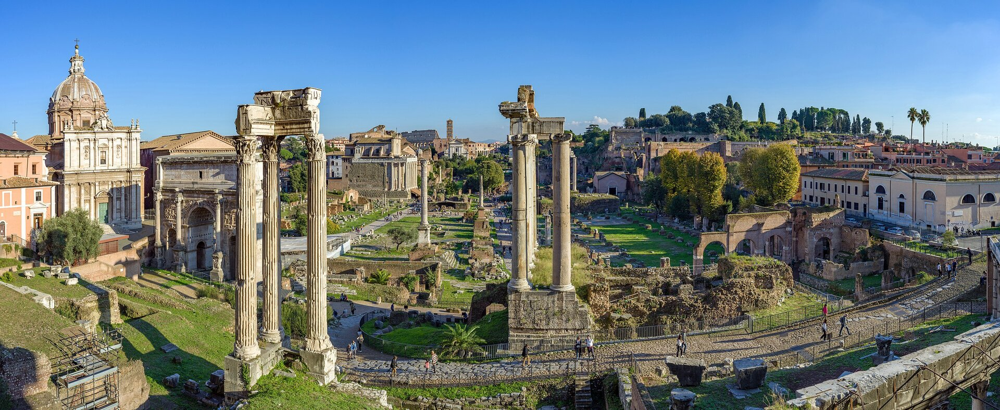

Historia · klasa V
<h1>Ustrój starożytnego Rzymu</h1>
Kto naprawdę rządził Rzymem?

Forum Romanum dzisiaj

notes:
0:00–3:00. Powiedz: „Stoimy na Forum Romanum — dawnym centrum życia publicznego Rzymu. Wyobraźcie sobie, że trzeba zdecydować o wojnie, pieniądzach i prawach. Czy wystarczy oddać wszystko jednej osobie? Dziś sprawdzimy, jak Rzymianie dzielili władzę i dlaczego znów skupiła się ona w jednych rękach”. Daj 20 sekund każdemu na własną hipotezę, potem przyjmij dwie odpowiedzi. Zapowiedz: po lekcji każdy wyjaśni różnicę między republiką a cesarstwem i rozwiąże trzy sprawy. Fotografia pokazuje dzisiejsze ruiny, nie wygląd republikańskiego Forum. Źródło: ZPE „Ustrój w Rzymie…”, pełna atrybucja w sources.md.

---

<!-- .slide: id="italia-rzym-tyber" class="" data-purpose="evidence" data-layout="map-focus" -->

Miejsce
<h2>Rzym nad Tybrem</h2>
<b>Italia</b> — starożytna nazwa Półwyspu Apenińskiego.

<b>Rzym</b> powstał w środkowej części półwyspu, nad <b>Tybrem</b>.

Wskaż półwysep, rzekę i miasto.

<figure class="italia-map">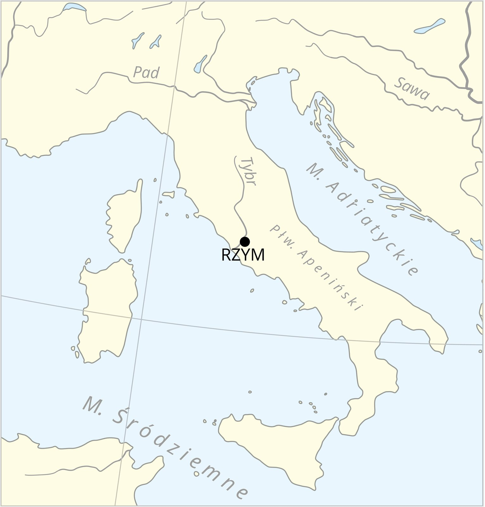</figure>

notes:
3:00–5:00. Najpierw poproś o wskazanie kształtu „buta”, potem punktu Rzym i rzeki Tyber. Na mapie rzeka została podpisana „Tybr” — chodzi o ten sam Tyber. Pytanie: „Dlaczego rzeka mogła pomagać mieszkańcom?” Odpowiedź: dawała wodę i ułatwiała transport oraz handel. Nie przypisuj wszystkim ruinom na zdjęciu daty republikańskiej. Mapa orientacyjna, nie mapa granic państwa w jednym roku. ZPE „Rzym — od osady do imperium”, Contentplus.pl, CC BY 3.0.

---

<!-- .slide: id="romulus-remus" class="" data-purpose="explanation" data-layout="source-split" -->

Legenda o założeniu miasta
<h2>Romulus i Remus — początki Rzymu</h2>

<ol class="legend-story"><li>Bliźnięta porzucono w koszyku nad <b>Tybrem</b>.</li><li>Ocaliła i wykarmiła je <b>wilczyca</b>. Później wychował je pasterz.</li><li>Dorośli bracia chcieli założyć miasto, ale pokłócili się o władzę.</li><li><b>Romulus zabił Remusa</b> i został pierwszym królem Rzymu.</li></ol>
<b>753 r. p.n.e.</b>tradycyjna data założenia Rzymu

To legenda, nie pewny zapis wydarzeń.

<a href="https://www.youtube.com/watch?v=NKVr4Byy0PU" target="_blank" rel="noopener noreferrer">▶ Film o początkach Rzymu</a>Opcjonalnie · potrzebny internet

<figure>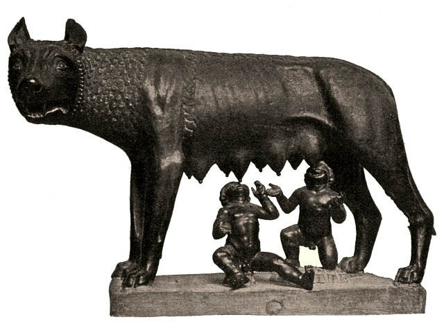<figcaption>Wilczyca kapitolińska — symbol legendy.</figcaption></figure>

notes:
5:00–7:30. Opowiedz legendę pełnymi zdaniami, wskazując cztery krótkie etapy: „Romulus i Remus byli bliźniętami. Porzucono ich w koszyku nad Tybrem. Według legendy znalazła ich wilczyca i wykarmiła własnym mlekiem. Później wychował ich pasterz. Gdy dorośli, postanowili założyć miasto, lecz pokłócili się o władzę. Romulus zabił Remusa, a następnie został pierwszym królem Rzymu”. Nie podawaj drastycznych szczegółów. Dopowiedz: „Tak Rzymianie opowiadali o początkach swojego miasta. Historycy wiedzą jednak, że osady rozwijały się stopniowo. Nie możemy potraktować całej opowieści jak pewnej biografii”. 753 r. p.n.e. to data tradycyjna. Nie dodawaj osobnej opowieści o Eneaszu. Pytanie: „Dlaczego wilczyca stała się symbolem Rzymu?” Ponieważ w legendzie uratowała przyszłego założyciela miasta. Nie nazywaj całej rzeźby pewnym dziełem z VIII w. p.n.e.: datowanie wilczycy jest dyskutowane, figurki bliźniąt są późniejszym dodatkiem. Źródło opowieści i zdjęcia: ZPE „Rzym — od osady do imperium”. Na slajdzie jest bezpośredni link https://www.youtube.com/watch?v=NKVr4Byy0PU, wskazany przez nauczyciela. Film jest opcjonalny i wymaga internetu; nie uruchamia się automatycznie. Ocena czasu i zakresu po kontroli filmu w przewodniku. Plan B bez internetu: opowieść powyżej. Nie dodawaj filmu kosztem końcowego sprawdzenia.

---

<!-- .slide: id="krolestwo-republika" class="" data-purpose="explanation" data-layout="timeline-band" -->

Zmiana ustroju
<h2>Od króla do republiki</h2>

753r. p.n.e. · tradycyjnie<h3>Królestwo</h3>
Na czele państwa stoi król.

→

509r. p.n.e. · tradycyjnie<h3>Republika</h3>
Nie ma króla. Władza jest dzielona między instytucje.

<b>res publica</b> = rzecz wspólna

notes:
7:30–8:45. Według rzymskiej tradycji w 509 r. p.n.e. wypędzono ostatniego króla, Tarkwiniusza Pysznego. Zmiana była procesem; obie wczesne daty traktujemy jako tradycyjne. Wyjaśnij: ustrój to sposób organizowania władzy. Republika nie znaczy „wszyscy ludzie rządzili tak samo” i nie jest dokładnie dzisiejszą demokracją. Zadaj: „Co miało zapobiegać rządom jednej osoby?” Przyjmij hipotezę podziału władzy, przejdź do mechanizmu. Daty potwierdzone w podręczniku s. 76–77 i ZPE „Rzym — od osady do imperium”.

---

<!-- .slide: id="siedmiu-krolow" class="" data-purpose="explanation" data-layout="source-split" -->

Ciekawostka · monarchia
<h2>Siedmiu królów według rzymskiej tradycji</h2>

<ol class="kings-list"><li><b>Romulus</b></li><li>Numa Pompiliusz</li><li>Tullus Hostiliusz</li><li>Ankus Marcjusz</li><li>Tarkwiniusz Stary</li><li>Serwiusz Tuliusz</li><li><b>Tarkwiniusz Pyszny</b></li></ol>
To tradycyjna lista władców. Dokładne daty ich panowania nie są pewne.

<figure>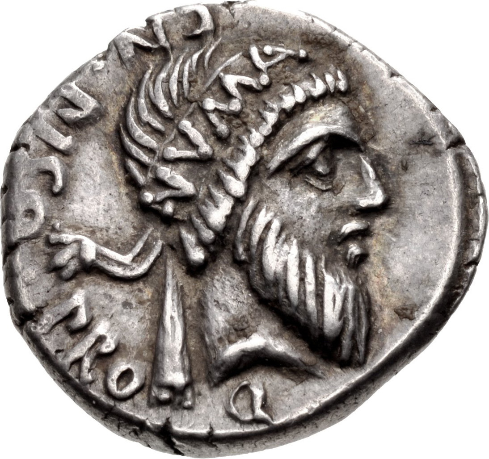<figcaption>Numa Pompiliusz na rzymskim denarze, I w. p.n.e. To późniejsze wyobrażenie króla, nie portret z jego czasów.</figcaption></figure>

notes:
8:45–9:30. Krótka ciekawostka: „Według rzymskiej tradycji przed republiką miastem rządziło siedmiu królów. Pierwszy to znany z legendy Romulus, ostatni — Tarkwiniusz Pyszny. Rzymianie opowiadali, że wypędzili go i zrezygnowali z królewskich rządów”. Wskaż imiona w kolejności, bez wymagania zapamiętania całej listy. Dokładne daty ich panowania nie są pewne; nie przepisujemy przedziałów do notatki. Królowie są znani z późniejszych przekazów, w których historia łączy się z legendą. Na zdjęciu jest rzeczywista srebrna moneta rzymska z wyobrażeniem Numy Pompiliusza, wybita w I w. p.n.e., wiele stuleci po tradycyjnym okresie jego rządów. Nie traktuj jej jako wiarygodnego portretu z życia króla. Przedstawiony egzemplarz jest datowany przez CNG na wiosnę 48 r. p.n.e.; dla typu RRC 446/1 katalogi podają też 49 r. p.n.e. — na slajdzie celowo szerzej „I w. p.n.e.”. Zdjęcie: Classical Numismatic Group, Inc., CC BY-SA 2.5, pełna atrybucja i adres w sources.md. Lista: https://en.wikipedia.org/wiki/Roman_Kingdom. Ciekawostka mieści się w 40-minutowym przebiegu.

---

<!-- .slide: id="gesi-kapitolinskie" class="" data-purpose="explanation" data-layout="source-split" -->

Wczesna republika · legenda
<h2>Gęsi, które ocaliły Kapitol</h2>

<figure>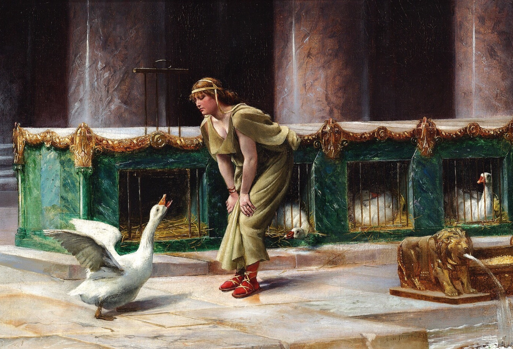<figcaption>Święte gęsi Junony — późniejsza wizja malarska.</figcaption></figure>
<ol class="geese-story"><li><b>Galowie</b> zajęli Rzym. Kapitol nadal się bronił.</li><li>Nocą napastnicy próbowali wspiąć się na wzgórze.</li><li><b>Gęganie gęsi</b> obudziło rzymskich obrońców.</li><li>Manliusz i pozostali Rzymianie <b>odparli atak na Kapitol.</b></li></ol>
Tak opowiada legenda. Nie znamy pewnego przebiegu tej nocy.

notes:
9:30–10:15. Opowiedz, nie dyktuj: „Już za republiki Galowie zdobyli większą część Rzymu. Bronił się jeszcze Kapitol — jedno ze wzgórz miasta. Według legendy nocą wrogowie próbowali wspiąć się po zboczu. Strażnicy i psy ich nie usłyszeli, ale święte gęsi bogini Junony zaczęły gęgać i trzepotać skrzydłami. Obudziły Marka Manliusza. On i pozostali obrońcy odparli atak”. To opowieść o ocaleniu Kapitolu, nie zapobieżeniu wcześniejszemu zdobyciu miasta. Galowie to ludy celtyckie, nie późniejsze państwo francuskie. Tradycyjnie najazd datuje się na 390 r. p.n.e.; spotyka się też 387/386. Data nie jest wymagana i nie trafia na slajd. Liwiusz, Dzieje Rzymu od założenia miasta V.47, opisuje gęsi, Junonę, Manliusza i odparcie ataku; pisał wiele wieków później. Nie traktujemy szczegółów tej nocy jako potwierdzonego zapisu. Obraz Henriego-Paula Motte'a z 1889 r. ukazuje opiekę nad świętymi gęśmi, nie sam nocny szturm. Nie jest zabytkiem z czasów najazdu. Pełna proweniencja w sources.md. 45 sekund odzyskano z opowiadania legendy początków (30 s) i wyjaśnienia schematu republiki (15 s); nie z pracy uczniów.

---

<!-- .slide: id="mechanizm-republiki" class="" data-purpose="explanation" data-layout="process" -->

Republika · mechanizm
<h2>Władza była podzielona</h2>

<h3>Zgromadzenia obywateli</h3>
Obywatele-mężczyźni głosują nad prawami i wybierają urzędników.

wybierają ↓

<h3>Urzędnicy</h3>
Konsulowie, pretorzy, kwestorzy wykonują zadania państwa.

<h3>Senat</h3>
Rada złożona głównie z byłych urzędników.

Doradza urzędnikom; ma wielki wpływ na finanse i politykę zagraniczną.
<b>Nie ma rocznej kadencji.</b>

← doradza

Nie głosowali wszyscy mieszkańcy: wykluczone były m.in. kobiety i osoby zniewolone.

notes:
10:15–13:00. W sketchnotce każdy dopisuje „obywatele-mężczyźni”, „wybór urzędników” i „uchwalanie praw” — 30 sekund wliczone w ten blok. Czytaj schemat od zgromadzeń do urzędników. Strzałka „wybierają” nie prowadzi do senatu. Różne zgromadzenia wybierały różne urzędy; głosowanie nie dawało każdemu równego wpływu, zamożni mieli przewagę. Senat był radą wpływowych polityków, zwykle byłych urzędników. Nie był corocznie wybieranym parlamentem; skład uzupełniali cenzorzy, a liczba senatorów zmieniała się w dziejach. Nie ucz stałych „300 przez całą starożytność”. Pytanie: „Czy senator po roku musiał kończyć pracę?” Nie; roczność dotyczyła wielu urzędów, nie senatu. Schemat autorski — pomoc objaśniająca na podstawie podręcznika i opracowań, nie źródło antyczne.

---

<!-- .slide: id="urzednicy" class="" data-purpose="explanation" data-layout="comparison" -->

Republika · urzędy
<h2>Dwóch konsulów — na rok</h2>

2 / 1<h3>Dwóch konsulów na jeden rok</h3>
Kierują państwem i dowodzą wojskiem.

Krótka kadencja i dwóch urzędników ograniczają skupienie władzy.

<h3>Pretorzy</h3>
Zajmują się sądownictwem.

<h3>Kwestorzy</h3>
Zajmują się finansami państwa.

<b>Kadencja</b> — określony czas sprawowania urzędu.

notes:
13:00–15:00. W sketchnotce po wyjaśnieniu dopiszcie hasła „rządy i armia”, „sądy”, „finanse” — 20 sekund wliczone w blok. Wprowadź tylko cztery słowa: konsul, pretor, kwestor, kadencja. „Dwa” dotyczy konsulów, nie wszystkich urzędów; liczba pretorów i kwestorów zmieniała się. Roczna kadencja to zasada wielu urzędów, z wyjątkami i możliwością późniejszego sprawowania kolejnego urzędu. Pytanie: „Dlaczego dwóch konsulów na rok, a nie jeden na całe życie?” Odpowiedź: aby ograniczać samowolę i utrudnić przejęcie całej władzy. Rozróżnij starożytnego konsula od współczesnego dyplomaty. Zakres: podręcznik s. 77–78; ZPE „Ustrój w Rzymie…”.

---

<!-- .slide: id="nierowne-prawa" class="" data-purpose="explanation" data-layout="source-split" -->

Społeczeństwo · konflikt
<h2>Wolni, lecz z nierównymi prawami</h2>

<h3>Patrycjusze</h3>
Członkowie uprzywilejowanych rodów.

Początkowo mają przewagę polityczną i dostęp do najważniejszych urzędów.

<h3>Plebejusze</h3>
Pozostali wolni obywatele.

Początkowo mają ograniczony dostęp do urzędów. Stopniowo zdobywają prawa.

To podział według <b>pochodzenia i praw</b>, nie po prostu na bogatych i biednych. Istnieli także bogaci plebejusze.

notes:
15:00–17:00. W karcie dopiszcie krótko: „uprzywilejowane rody” oraz „pozostali obywatele, bogaci i biedni” — 20 sekund wliczone w blok. Nie mów, że plebejusze byli niewolnikami albo nie mieli żadnych praw obywatelskich. Byli wolnymi obywatelami, ale początkowo pozbawionymi części praw politycznych, zwłaszcza dostępu do najważniejszych urzędów. Konflikt trwał wiele pokoleń; jego skutkiem były stopniowe ustępstwa, np. trybunat, spisanie prawa i szerszy dostęp do urzędów. To nie jednorazowa zmiana w 509 r. Pytanie: „Czy bogaty kupiec musiał być patrycjuszem?” Nie: o przynależności decydowało pochodzenie, nie sam majątek. Źródła: podręcznik s. 78 i krytycznie użyte ZPE, które miejscami zbyt mocno upraszcza podział.

---

<!-- .slide: id="trybun-dyktator" class="" data-purpose="explanation" data-layout="comparison" -->

Republika · ograniczenia i wyjątek
<h2>Obrona praw. Wyjątek na czas zagrożenia.</h2>

Ochrona plebejuszy
<h3>Trybun plebejski</h3>
Wybierany przez plebejuszy.

Może zgłosić <b>veto</b> — sprzeciw, by zablokować krzywdzącą decyzję.

Poważne zagrożenie państwa
<h3>Dyktator</h3>
Mianowany przez konsula, zwykle na wniosek senatu.

Nadzwyczajna władza: co do zasady najwyżej <b>6 miesięcy</b>.

Zwykłe urzędy miały ograniczać władzę. Dyktatura była wyjątkiem.

notes:
17:00–19:00. W karcie dopiszcie zadanie trybuna: „obrona plebejuszy; veto” — 15 sekund wliczone w blok. Veto to łacińskie „nie pozwalam”. Trybun chronił plebejuszy przed działaniami władz; to nie urząd wyłącznie finansowy ani osobisty pomocnik konsula. Zgromadzenie plebejskie wybierało trybunów. W tradycyjnej dyktaturze konsul mianował dyktatora, zwykle po uchwale/na wniosek senatu. Poprawiamy popularny skrót „senat wybiera dyktatora”. Limit sześciu miesięcy lub wykonanie zadania to model zwykłej republikańskiej dyktatury; późniejsza dożywotnia dyktatura Cezara łamała ten model. Nie rozwijaj innych urzędów. Pytanie: „Dlaczego limit czasu jest ważny?” Bo nadzwyczajna władza mogłaby utrwalić się w jednych rękach.

---

<!-- .slide: id="trzy-sprawy" class="" data-purpose="practice" data-layout="task-board" -->

Zastosuj wiedzę · 5 minut
<h2>Do kogo należy ta sprawa?</h2>

W parze wybierzcie <b>instytucję lub urząd</b> i uzasadnijcie wybór. <b>Każdy zapisuje własne trzy odpowiedzi</b>: „… — ponieważ …”.
<ol class="case-list"><li>Trzeba wybrać konsulów na następny rok. <b>Kto o tym głosuje?</b></li><li>Wojsko wyrusza na wyprawę. <b>Jaki urząd odpowiada za dowodzenie?</b></li><li>Decyzja urzędnika krzywdzi plebejuszy. <b>Kto może się jej sprzeciwić?</b></li></ol>

notes:
19:00–24:00. Powiedz: „Macie trzy sprawy. Nie przepisujcie definicji — dopasujcie władzę i pokażcie, dlaczego pasuje. Każdy zapisuje trzy własne zdania”. 30 s przeczytanie; 45 s indywidualny wybór; 2 min rozmowa i własny zapis; 1 min wspólne sprawdzenie; 45 s poprawa i przejście. Przy 15 osobach: 6 par i jedna trójka; każda osoba w trójce wyjaśnia jeden przypadek, ale zapisuje wszystkie trzy. Do 20: maksymalnie 10 par. Klucz: 1 zgromadzenia obywateli — wybierają konsulów; 2 konsulowie — dowodzą wojskiem; 3 trybun plebejski — broni plebejuszy i może zgłosić veto. Nie wymagaj wszystkich nazw rodzajów zgromadzeń. Zbierz dowód od wszystkich: przejdź między ławkami i obejrzyj trzy zapisy; nie oceniaj wyłącznie wypowiedzi reprezentantów. Wsparcie: wróć do slajdów 7–10, pozwól użyć banku nazw. Szybsi: dlaczego ani konsul, ani trybun nie powinien rządzić bez ograniczeń?

---

<!-- .slide: id="rozrost-rzymu" class="expansion-map" data-purpose="evidence" data-layout="map-focus" -->
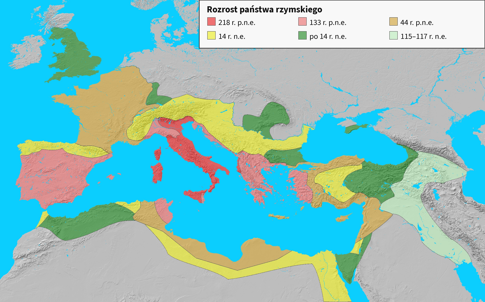

notes:
24:00–25:00. „Zaczęliśmy od jednego miasta w Italii. Teraz zobaczmy, jak Rzym podporządkowywał sobie kolejne ziemie wokół Morza Śródziemnego”. Najpierw wskaż Italię oraz czerwony obszar z 218 r. p.n.e., potem różowe i pomarańczowe przyrosty do 133 i 44 r. p.n.e. To ekspansja republiki. Następnie wskaż żółte ziemie do 14 r. n.e. (koniec rządów Augusta), zielone nabytki po tej dacie i jasnozielone podboje Trajana z lat 115–117 n.e. Są to podboje cesarstwa, późniejsze od Cezara; nie przypisuj Cezarowi całego pokazanego zasięgu. Kolory pokazują kolejne przyrosty: wcześniejsze obszary nie znikają; suma barw daje terytorium danego etapu. Wschodnie podboje Trajana były krótkotrwałe, nie trwała granica na resztę dziejów. Mapa jest współczesnym uogólnieniem, nie pokazuje każdego wycofania ani wszystkich zmian granic. Polecenie ustne: „Porównajcie początkowy obszar z całym państwem: jakie morze znalazło się między jego ziemiami?”. Odpowiedź: Morze Śródziemne. Przejście: „Podboje dawały bogactwo, lecz także wzmacniały dowódców — co to oznaczało dla republiki?”. Mapa pełnoekranowa i powiększana w tym samym oknie, bez podpisu pod obrazem. Autor: Varana, podkład Natural Earth, CC BY-SA 3.0; polska legenda jako oznaczona pochodna w sources.md. Minuta mapy jest wliczona w 40-minutowy przebieg.

---

<!-- .slide: id="kryzys" class="" data-purpose="explanation" data-layout="impact-flow" -->

Koniec republiki · przyczyny
<h2>Podboje wzmacniały Rzym — i wodzów</h2>
<figure>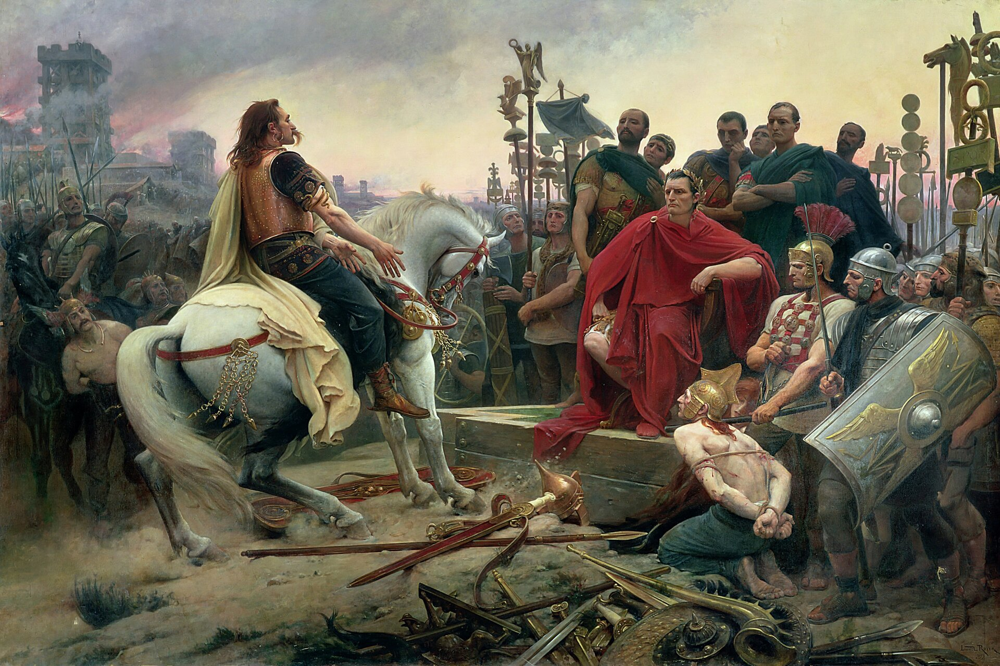<figcaption>Kapitulacja Wercyngetoryksa przed Cezarem — późniejsza wizja malarska.</figcaption></figure><ol class="causal-chain"><li>Podboje: wielkie zyski, ale też rosnące nierówności.</li><li>Żołnierze wiążą nadzieje na nagrody ze swoimi wodzami.</li><li>Wodzowie walczą o władzę. <b>Wybuchają wojny domowe.</b></li></ol>

notes:
25:00–26:10. Wyjaśnij mechanizm, nie listę dat: łupy i ziemie wzmacniały najpotężniejszych; długie wojny pogarszały położenie części drobnych rolników; wodzowie zapewniali żołnierzom nagrody i budowali osobistą lojalność. Konflikty polityczne przeradzały się w walki rzymskich wojsk ze sobą — wojny domowe. Nie twierdź, że każdy plebejusz tracił na podbojach albo że podboje automatycznie musiały zniszczyć republikę. Obraz Royera z 1899 r. jest późniejszą wizją kapitulacji Wercyngetoryksa w 52 r. p.n.e., nie relacją naoczną. ZPE „Narodziny cesarstwa rzymskiego”.

---

<!-- .slide: id="cezar" class="" data-purpose="explanation" data-layout="source-split" -->

<figure class="bio-art">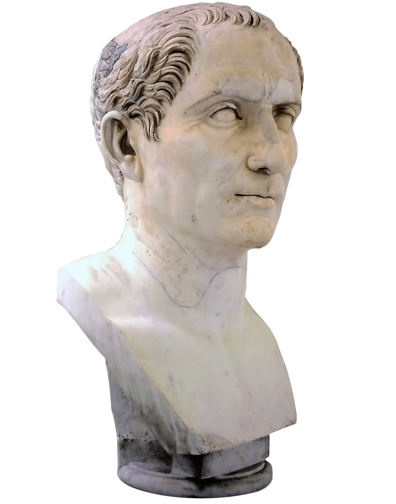<figcaption>Popiersie Juliusza Cezara</figcaption></figure>

Wódz i polityk
<h2>Gajusz Juliusz Cezar</h2>
100–44 r. p.n.e.
<ul><li>Podbił Galię; zdobył sławę i lojalność żołnierzy.</li><li><b>49 r. p.n.e.</b> — przekroczył Rubikon z wojskiem: rozpoczął wojnę domową.</li><li>Skupił władzę jako dyktator. <b>Nie był pierwszym cesarzem.</b></li></ul>
Do dziś: „przekroczyć Rubikon” to podjąć decyzję, od której trudno się wycofać.

notes:
26:10–28:10. Cezar urodził się w 100, zginął w 44 r. p.n.e. Podbił większą część Galii (ziemie głównie dzisiejszej Francji). W 49 r. p.n.e. przekroczył z wojskiem Rubikon — granicę między swoją prowincją a Italią — wbrew przeciwnikom politycznym; nie ucz nieprawdziwego zakazu pobytu wszelkich legionów na terenie całej Italii. Zdobył władzę i dożywotnią dyktaturę. Ciekawostka 1: „przekroczyć Rubikon” oznacza podjąć decyzję, od której trudno się wycofać. Cezar przeprowadził reformę kalendarza. Źródło popiersia: ZPE „Narodziny cesarstwa…”, domena publiczna; dokładniejsza identyfikacja obiektu niepodana — nie dopisujemy muzeum z sąsiedniego zdjęcia.

---

<!-- .slide: id="cezar-ciekawostki" class="" data-purpose="explanation" data-layout="statement" -->

Cezar · ciekawostki
<h2>Słowa i pomysły, które przetrwały</h2>

<h3>„Kości zostały rzucone”</h3>
Tak miał powiedzieć przed przekroczeniem Rubikonu. Dziś: <b>decyzja zapadła — trudno już się wycofać.</b>

<h3>„Przybyłem, zobaczyłem, zwyciężyłem”</h3>
<i>Veni, vidi, vici</i> — trzy słowa przypisywane Cezarowi po szybkim zwycięstwie nad królem Farnakesem.

<h3>Uporządkował kalendarz</h3>
Wprowadził kalendarz juliański: <b>365 dni w roku</b> i dodatkowy dzień co cztery lata.

notes:
28:10–29:10. Trzy krótkie ciekawostki, bez przepisywania: 1. „Kości zostały rzucone” to tradycyjnie przypisywane Cezarowi słowa przy Rubikonie w 49 r. p.n.e.; wyrażają podjęcie ryzyka i decyzję, od której trudno się wycofać. Przykład współczesny: „Wysłałem zgłoszenie do konkursu — kości zostały rzucone”. Nie sugeruj, że Cezar dosłownie grał wtedy w kości. Swetoniusz, Boski Juliusz 32, przekazuje formułę; Plutarch opisuje ją inaczej. Autorzy pisali później — nie mamy stenogramu ani pewności dokładnego brzmienia i języka. 2. „Veni, vidi, vici” wiąże się ze zwycięstwem nad Farnakesem pod Zelą w 47 r. p.n.e., nie z podbojem Galii ani Rubikonem. Swetoniusz 37 podaje te słowa na napisie w pochodzie triumfalnym; Plutarch, Cezar 50, jako zwięzłą wiadomość o zwycięstwie. To przekaz antycznych autorów. Nie wymagaj daty bitwy. 3. Reforma weszła w życie w 45 r. p.n.e. Kalendarz juliański przewidywał 365 dni i dodatkowy dzień co cztery lata; Cezar korzystał z pomocy uczonych. Nie ucz, że sam wynalazł rok przestępny ani że nasz dzisiejszy kalendarz gregoriański jest dokładnie tym samym systemem. Podstawa: Swetoniusz 40; Plutarch 59. Przeczytano trzy strony wskazane przez nauczyciela, ale nie przeniesiono niepotwierdzonych liczb bitew ani opowieści o ostatnim ciosie Brutusa. Ciekawostki mieszczą się w 40-minutowym przebiegu.

---

<!-- .slide: id="zamach" class="" data-purpose="explanation" data-layout="evidence" -->

44 r. p.n.e. · wydarzenie i skutek
<h2>Zamach nie ocalił republiki</h2><figure class="assassination">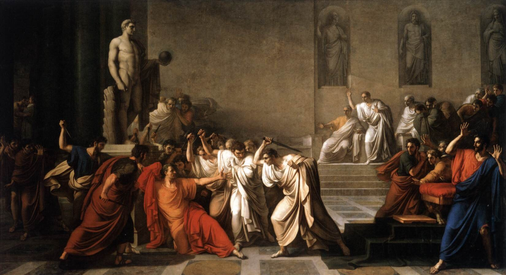<figcaption>Zabójstwo Cezara — późniejsza wizja malarska.</figcaption></figure>
Spiskowcy zabili Cezara, obawiając się jego władzy. Skutek: kolejne walki o władzę, nie trwałe odnowienie republiki.

notes:
29:10–30:10. 15 marca 44 r. p.n.e. spiskowcy zamordowali Cezara. Wielu przedstawiało się jako obrońcy republiki, lecz nie przywrócili jej stabilności. Nie opowiadaj drastycznych szczegółów ani nie buduj nauczania na niepotwierdzonych ostatnich słowach Cezara. Obraz jest późniejszym wyobrażeniem, nie fotografią miejsca zamachu. Datę pracy podajemy za konkretnym materiałem ZPE (1805), nie uogólniamy na każdą wersję obrazu. Pytanie: „Czy śmierć jednej osoby usunęła przyczyny konfliktu?” Nie: pozostała rywalizacja o wojsko i władzę.

---

<!-- .slide: id="oktawian" class="" data-purpose="explanation" data-layout="source-split" -->

Pierwszy cesarz
<h2>Oktawian August</h2>
63 r. p.n.e. – 14 r. n.e.
<ul><li>Wnuk siostry Cezara; adoptowany w jego testamencie.</li><li>Pokonał rywali w wojnach domowych.</li><li><b>27 r. p.n.e.</b> — otrzymał tytuł Augusta. Umowny początek cesarstwa.</li></ul>
Kleopatra była związana z Cezarem, później z Antoniuszem — nie z Augustem.

<figure class="bio-art">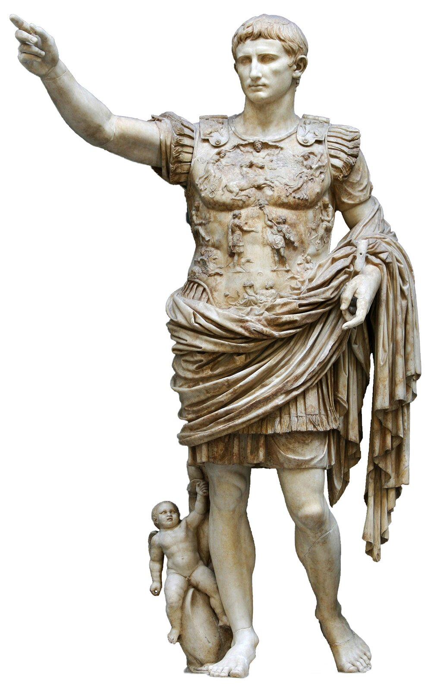<figcaption>August z Prima Porta — antyczny posąg cesarza.</figcaption></figure>

notes:
30:10–31:10. Oktawian był wnukiem siostry Cezara, nie jego siostrzeńcem. Cezar adoptował go testamentem i uczynił spadkobiercą. Po kolejnych walkach Oktawian pokonał Marka Antoniusza i Kleopatrę; 31 r. p.n.e. zwyciężył pod Akcjum (data dodatkowa, nie do opanowania w rdzeniu). W 27 r. p.n.e. otrzymał od senatu tytuł Augustus — „wywyższony/dostojny”. Uznajemy go za pierwszego cesarza, choć nie ogłosił po prostu zniesienia wszystkich urzędów republikańskich. Biografia: 63 p.n.e.–14 n.e.; zwróć uwagę na zmianę ery. Krótko dopowiedz, jeśli padnie pytanie: Kleopatra była związana z Cezarem, potem Antoniuszem, nie z Augustem. Posąg jest autentycznym antycznym wizerunkiem idealizującym władcę, nie AI. Źródło: ZPE „Rzym — od osady do imperium”; korekta pokrewieństwa: Britannica, Augustus Timeline.

---

<!-- .slide: id="august-ciekawostki" class="" data-purpose="explanation" data-layout="statement" -->

August · ciekawostki
<h2>Cesarz nie tylko z posągu</h2>

<h3>Rzym „z cegły w marmur”</h3>
Rozbudowywał miasto i odnawiał świątynie. Przypisywano mu słowa, że <b>zostawił Rzym marmurowy.</b>

<h3>Proste jedzenie</h3>
Według jego biografa lubił zwykły chleb, małe ryby, świeży ser i figi.

<h3>Pisał po swojemu</h3>
Biograf podaje, że nie zawsze przestrzegał ortografii: <b>wolał pisać tak, jak wymawiał słowa.</b>

notes:
31:10–32:00. Trzy ciekawostki w 50 sekund, bez przepisywania. „August dbał o wielkie budowle, ale jego biograf zapamiętał także drobiazgi: cesarz lubił proste potrawy i pisał według własnego uznania”. 1. Swetoniusz, Boski August 28.3: przypisywana władcy chluba, że zastał miasto ceglane, a zostawił marmurowe; 29: konkretne budowle. To obrazowe podkreślenie przebudowy i autoprezentacji, nie stwierdzenie, że każdą cegłę wymieniono na marmur. Nie podajemy jako stenograficznego cytatu. 2. Ten sam autor 76.1: chleb, małe ryby, świeży ser i figi. To relacja biografa o upodobaniach, nie dowód, że cesarz żył jak ubogi albo nie korzystał z luksusu. 3. Rozdział 88.1: niedokładne przestrzeganie reguł gramatyków i skłonność do pisania według wymowy. Nie utożsamiaj starożytnych sporów o pisownię z dzisiejszym szkolnym dyktandem; nie rób z tego zachęty do błędów. Wszystkie trzy wątki są we wskazanym artykule National Geographic (Magdalena Salik) i zostały porównane z pełnymi ustępami Swetoniusza. Nie kopiujemy z artykułu ogólnych twierdzeń o bezdzietności Cezara, wszystkich potomkach Augusta ani jego skromnym domu jako pewnych ustaleń. Źródła wyłącznie w dokumentacji nauczyciela. Te 50 sekund mieści się w dotychczasowym bloku o Auguście.

---

<!-- .slide: id="pryncypat" class="" data-purpose="explanation" data-layout="comparison" -->

Cesarstwo · pryncypat
<h2>Stare instytucje, nowy ośrodek władzy</h2>
<figure>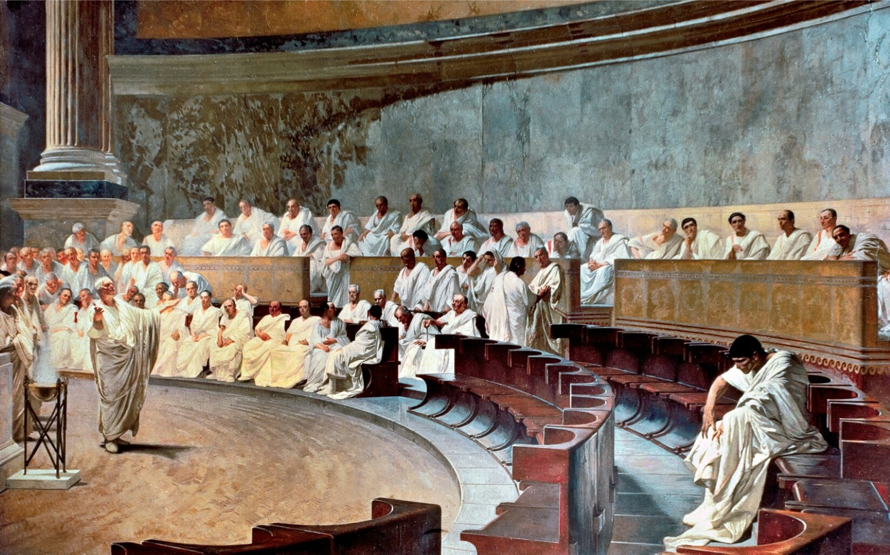<figcaption>Obrady senatu w czasach republiki — późniejsza wizja malarska.</figcaption></figure>
<h3>Pozostają</h3>
senat i urzędy republikańskie
<h3>Naprawdę przeważa</h3>
<b>August</b> — skupia najważniejsze uprawnienia i kontroluje armię.

<b>Pryncypat</b> — rządy cesarza z zachowaniem pozorów republiki.

<b>Wojny domowe</b> → <b>27 r. p.n.e.: August</b> → <b>przewaga cesarza</b>

notes:
32:00–33:00. Odwołaj się do pytania „kto naprawdę rządził?”. Senat nadal obradował, konsulowie nadal istnieli, ale August kumulował uprawnienia i kontrolował siłę wojskową. Princeps oznaczał „pierwszego”; w praktyce był dominującym władcą. To nie zbiorowy rząd wszystkich dawnych urzędów na równych zasadach. Ilustracja pokazuje wyobrażenie obrad z czasów republiki (Cyceron i Katylina, 63 p.n.e.), a nie posiedzenie za Augusta — jej funkcja: przypomnieć zachowaną instytucję. Maccari: ZPE podaje niespójne dane miejsca i daty; nie przenosimy ich do podpisu. Pozostawiamy pewny zakres „XIX w.”. Temat obrazu to Cyceron i Katylina, nie początek cesarstwa.

---

<!-- .slide: id="notatka" class="" data-purpose="synthesis" data-layout="takeaways" -->

Notatka do zeszytu · 4 minuty
<h2>Jak zmieniała się władza w Rzymie?</h2><ol class="notebook"><li><b>753 r. p.n.e.</b> — tradycyjne założenie Rzymu nad Tybrem. <b>509 r. p.n.e.</b> — tradycyjny początek republiki.</li><li>W republice władzę dzielono: zgromadzenia wybierały urzędników, senat doradzał; <b>dwaj konsulowie</b> rządzili przez <b>rok</b>.</li><li>Plebejusze stopniowo zdobywali prawa. Ich obrońca, <b>trybun</b>, mógł zgłosić <b>veto</b>.</li><li>Wojny domowe osłabiły republikę. <b>Cezar</b> został dyktatorem. <b>August</b> skupił władzę — od <b>27 r. p.n.e.</b> liczymy cesarstwo.</li></ol>

notes:
33:00–37:00. Uczniowie nie przepisują czterech punktów: to synteza do przeczytania. Przez lekcję uzupełniali sketchnotkę republiki krótkimi hasłami: po slajdzie 7 skład i dwie kompetencje zgromadzeń, po 8 zadania trzech urzędów, po 9 dwie grupy, po 10 trybun. Teraz 2 minuty na sprawdzenie braków w swojej karcie z osobą obok, 1 minuta na zapis na odwrocie: „Cezar — dyktator. August — pierwszy cesarz, 27 r. p.n.e.”, 1 minuta na ustne podsumowanie. Pozostałe trzy daty i pełne cztery punkty są w student-summary.html, gotowe do wklejenia lub późniejszej powtórki, nie drugi obowiązkowy zapis. Nie wymagaj wypełniania całej karty od zera w cztery minuty. Na koniec: „Rzymianie ograniczali władzę przez podział zadań i krótką kadencję. Wojny domowe otworzyły drogę do przewagi Augusta, chociaż dawne instytucje pozostały”.

---

<!-- .slide: id="bilet-wyjscia" class="" data-purpose="exit-ticket" data-layout="statement" -->

Samodzielnie · 2 minuty
<h2>Kto naprawdę rządził?</h2><ol class="exit-list"><li>Podaj <b>jeden sposób ograniczania władzy</b> w republice i wyjaśnij, jak działał.</li><li><b>Cezar czy August?</b> Kto był pierwszym cesarzem? Dopisz rok umownego początku cesarstwa.</li></ol>
Zapisz dwie odpowiedzi na małej kartce. Oddaj przy wyjściu.

notes:
37:00–40:00: 30 s polecenie i kartki, 90 s samodzielny zapis, 30 s zebranie, 30 s bufor. Nie odsłaniaj klucza przed zebraniem. Odpowiedź 1: np. dwóch konsulów wzajemnie ogranicza władzę; roczna kadencja uniemożliwia stałe sprawowanie urzędu; veto trybuna blokuje krzywdzącą decyzję. Nie zaliczaj samego hasła bez mechanizmu. Odpowiedź 2: August, 27 r. p.n.e. Każdy uczeń oddaje własną kartkę. Skala 0–3: mechanizm 1, uzasadnienie 1, August + data łącznie 1. Po zebraniu powiedz: „W republice władzę dzielono, w pryncypacie naprawdę przeważał cesarz. Po nazwie instytucji nie zawsze poznamy, kto ma największą siłę”. Chroniony finał: nie rezygnuj z niego dla ciekawostek albo filmu.

---

<!-- .slide: id="karta-ilustrowana" class="optional-note" data-purpose="synthesis" data-layout="evidence" -->

Karta do zeszytu · uzupełniamy hasłami w czasie lekcji

<figure class="note-full"><figcaption>Republika rzymska — karta do uzupełnienia.</figcaption></figure>

notes:
Slajd zaplecza: nie nowa aktywność. Karta jest rozdana przed lekcją i uzupełniana podczas slajdów 7–10; można do tego podglądu przejść tylko w razie potrzeby. Wersja ucznia nie zawiera klucza. Jedna czarno-biała A4 poziomo na osobę: sketchnote.html. Osobny klucz sketchnote-key.html tylko dla nauczyciela. Kartka jest o republice; na odwrocie uczeń dopisuje rozróżnienie Cezar/August z datą 27 r. p.n.e. Szczegóły korekt w sketchnote-corrections.md. Nie przepisujemy dodatkowo całej notatki.
