<!-- .slide: id="otwarcie" class="" data-purpose="opening" data-layout="hero-source" data-goals="G1 G3" -->

<figure class="">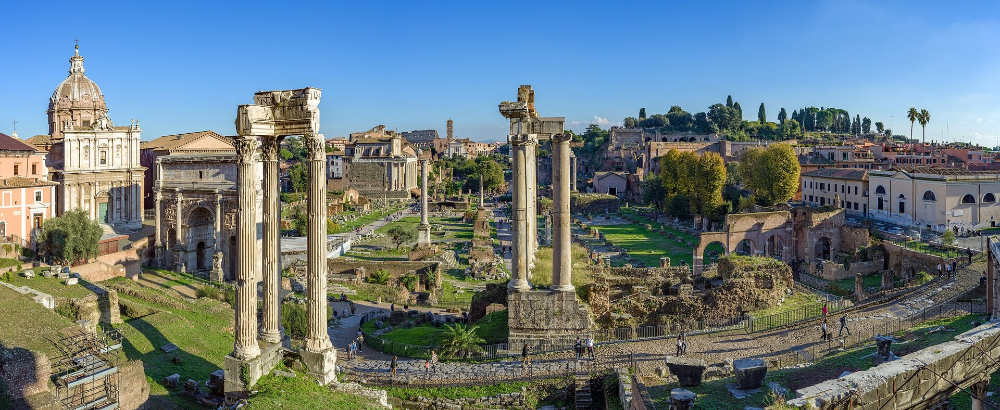</figure>

Starożytny Rzym · klasa V
<h1>Imperium Rzymskie</h1>
Jak zbudowano wielkie państwo i dlaczego osłabł jego Zachód?

notes:
Czas: 0.5 min rdzenia.
Gotowe otwarcie: „Te kolumny stoją dziś w Rzymie, ale kiedyś stąd rządzono ziemiami na trzech kontynentach. Sama odwaga żołnierzy nie wystarczała. Sprawdzimy, co spajało tak wielkie państwo — i co działo się, gdy te połączenia słabły”. Fotografia pokazuje współczesny stan antycznych ruin, nie wygląd całego starożytnego miasta. Poproś o 10 sekund samodzielnego namysłu; zbierz jedną hipotezę bez oceniania. Zeszyty otwarte; cztery krótkie zapisy nastąpią po kolejnych etapach, nie na końcu.

---

<!-- .slide: id="italia" class="" data-purpose="evidence" data-layout="map-focus" data-goals="G1" -->
<h2>Najpierw Italia</h2>

<figure class="">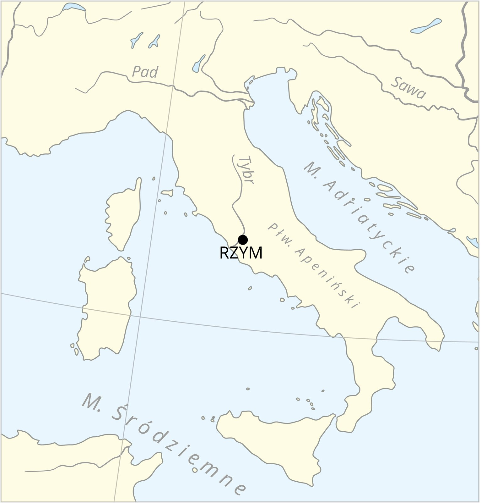</figure>

Zanim powstało cesarstwo

Rzym leżał nad <b>Tybrem</b>, na Półwyspie Apenińskim.

Do III w. p.n.e. Rzymianie podporządkowali sobie większość Italii.

Wskaż Rzym, półwysep i wyspę na jego południu.

notes:
Czas: 1 min rdzenia.
Orientacja poprzedza opowieść o wojnach, jak w benchmarku Sparty. Wskaż punkt Rzym i cały półwysep, nie dzisiejsze granice Włoch. Oczekiwane odpowiedzi: Półwysep Apeniński i Sycylia. Mapa jest orientacyjna: nie koduje etapów podboju ani dat granic. Podporządkowanie większości Italii nastąpiło za republiki; Italia nie znaczy w każdym okresie dokładnie dzisiejszych Włoch. Zapowiedz, że kontrola nad pobliską wyspą doprowadzi do konfliktu z Kartaginą.

---

<!-- .slide: id="wojny-punickie-przyczyny" class="" data-purpose="explanation" data-layout="plain" data-goals="G1" -->
<h2>Rzym kontra Kartagina</h2>

<h3>RZYM</h3>
Państwo w Italii, coraz silniejsze na morzu.

<b class="versus">↔</b>
<h3>KARTAGINA</h3>
Potęga morska i handlowa w Afryce Północnej.

<b>Sycylia i szlaki morskie</b>→<b>handel i bogactwo</b>→<b>rywalizacja o przewagę</b>

Stawka: panowanie w zachodniej części Morza Śródziemnego.

Kartagińczyków Rzymianie nazywali Punijczykami — stąd „wojny punickie”.

notes:
Czas: 1 min rdzenia.
Po opanowaniu Italii Rzym wszedł w strefę interesów Kartaginy. Wyjaśnij, że Sycylia leży między Italią i Afryką Północną: kontrola portów i szlaków oznaczała wpływy, handel i siłę. To przyczyny długiej rywalizacji, nie jedna przyczyna wszystkich trzech wybuchów wojny. Miejsca zaraz pokażesz na zachowanej mapie.

---

<!-- .slide: id="wojny-punickie-przebieg" class="" data-purpose="explanation" data-layout="plain" data-goals="G1" -->
<h2>Trzy wojny punickie</h2>

I<h3>264–241 p.n.e.</h3>
Walki o Sycylię, także na morzu.

<b>Rzym zdobył Sycylię.</b>

II<h3>218–201 p.n.e.</h3>
Hannibal przez Alpy → walki w Italii → zwycięstwo Rzymu pod Zamą (202).

<b>Kartagina utraciła posiadłości w Hiszpanii.</b>

III<h3>149–146 p.n.e.</h3>
Rzym obległ i zdobył Kartaginę.

<b>Miasto zniszczono; Rzym usunął rywala.</b>

Skutek: Rzym stał się główną potęgą zachodniego Morza Śródziemnego.

notes:
Czas: 1.75 min rdzenia.
To trzy wojny, nie trzy bitwy. Czytaj oś od lewej: pierwsza daje Sycylię, druga łamie przewagę Kartaginy, trzecia niszczy miasto. Pod Zamą w 202 p.n.e. Scypion pokonał Hannibala; pokój w 201 zakończył II wojnę. Nie cała Hiszpania została wówczas podbita. III wojna była następstwem rzymskiego dążenia do usunięcia rywala i konfliktu Kartaginy z Numidią. Bez mitu o posypaniu ziemi solą. Daty pokazujemy jako porządek, nie wymagamy wykucia wszystkich sześciu.

---

<!-- .slide: id="wojny-punickie" class="full-map" data-purpose="evidence" data-layout="map-focus" data-goals="G1" -->
<figure class="">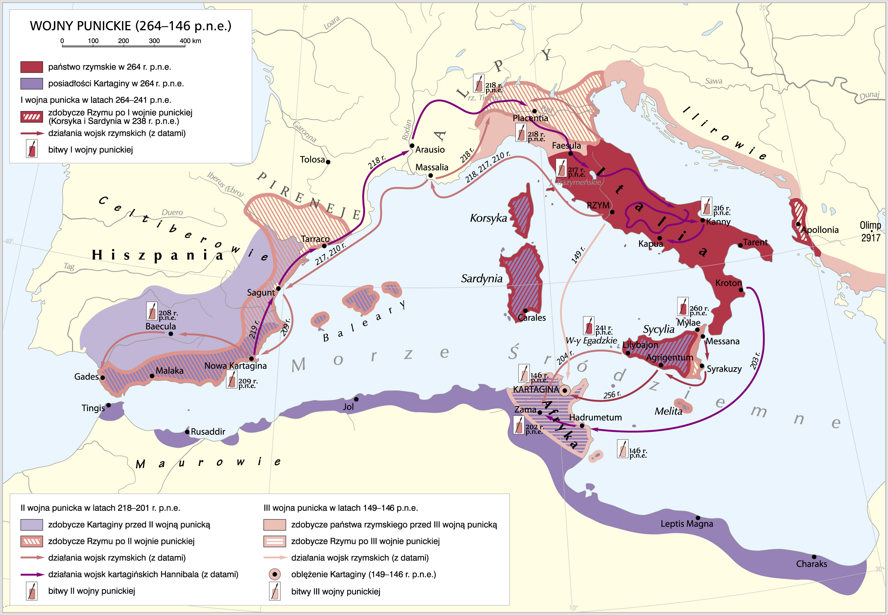</figure>

notes:
Czas: 1 min rdzenia.
Po wyjaśnieniu przyczyn i przebiegu pokaż pełną polską mapę. Wskaż Rzym, Kartaginę w Afryce Północnej, Sycylię i trasę Hannibala. Odczytaj tylko potrzebne znaki legendy. Mapa obejmuje wszystkie trzy wojny (264–146 p.n.e.), nie jeden rok. Sardynia i Korsyka zostały przejęte w 238 p.n.e., a nie na mocy pokoju kończącego I wojnę. Nie powtarzaj już całej narracji — mapa lokalizuje poznane wydarzenia.

---

<!-- .slide: id="hannibal" class="" data-purpose="explanation" data-layout="plain" data-goals="G1" -->
<h2>Hannibal przeszedł przez Alpy</h2>

<figure class="">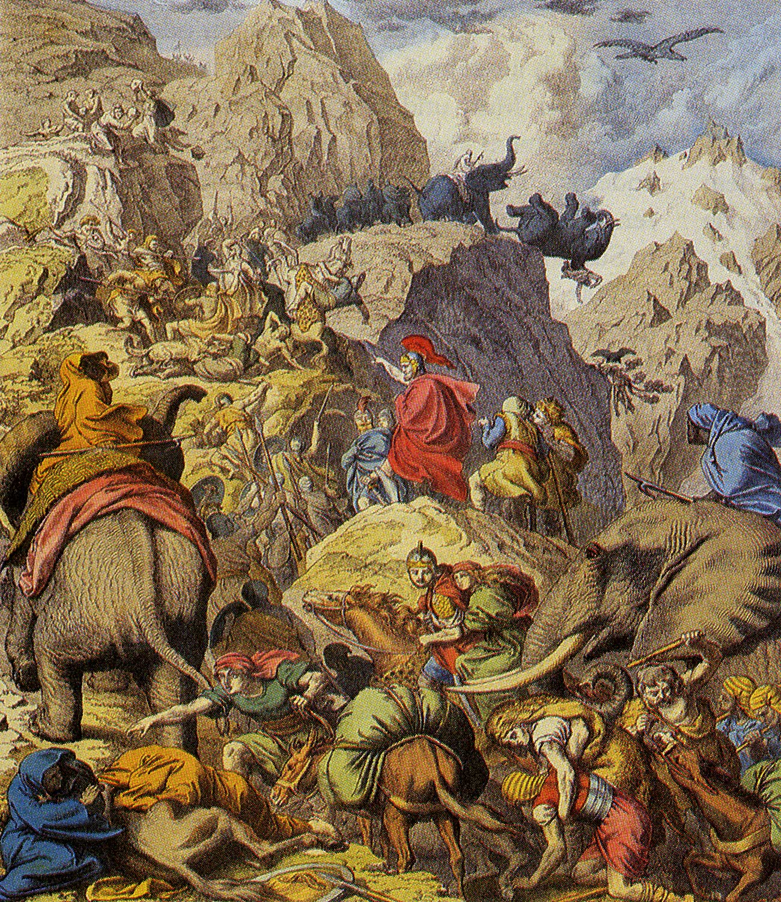<figcaption>XIX-wieczna ilustracja wydarzeń z 218 r. p.n.e.</figcaption></figure>

218 r. p.n.e.

Wódz Kartaginy poprowadził armię do Italii <b>drogą lądową przez Alpy</b>.

W wyprawie uczestniczyły też <b>słonie bojowe</b>.

Odnosił zwycięstwa, ale <b>nie pokonał ostatecznie Rzymu</b>.

notes:
Czas: 0.5 min rdzenia.
Ciekawostka 1: słonie w Alpach są prawdziwym elementem wyprawy, nie wymysłem filmu. Nie podawaj liczby zwierząt ani dokładnej trasy jako pewnych. Kolorowany drzeworyt Heinricha Leutemanna jest dużo późniejszy; pokazuje wyobrażenie trudów przejścia, nie dokumentację pogody i ubioru. Zapytaj krótko: „Co mogło utrudniać tę drogę?”. Góry, zimno i zaopatrzenie to sensowne odpowiedzi. Nie dodawaj osobnej opowieści o każdej bitwie. Podkreśl różnicę między wygraną bitwą a wygraną wojną.

---

<!-- .slide: id="jerozolima-63" class="" data-purpose="explanation" data-layout="plain" data-goals="G1" -->

Jeszcze za republiki · wschodnie podboje
<h2>Jerozolima i Judea</h2>
<strong>63r. p.n.e.</strong>
<h3>Pompejusz zdobył Jerozolimę.</h3>
Judea znalazła się pod kontrolą Rzymu.

Nie była jeszcze wtedy bezpośrednio zarządzaną rzymską prowincją.

Najpierw Pompejusz w Judei → później Cezar w Galii.

notes:
Czas: 0.75 min rdzenia.
Pompejusz był rzymskim wodzem, nie cesarzem. W 63 p.n.e., podczas rywalizacji o władzę w Judei, zdobył Jerozolimę. Rzymska kontrola mogła oznaczać zależnych miejscowych władców; formalna prowincja Judea powstała dopiero w 6 n.e. Judea jest tu nazwą starożytnej krainy na wschodnim wybrzeżu Morza Śródziemnego. Palestyna może służyć jako szersze współczesne określenie geograficzne, ale nazwy prowincji Syria Palaestina nie przenosimy do 63 p.n.e. Nie używamy dzisiejszego państwa jako nazwy antycznej krainy. Zaznacz kolejność: 63 przed 58–51 p.n.e. Jezus pojawi się osobno dopiero po Auguście, w I w. n.e.

---

<!-- .slide: id="republika-podboje" class="" data-purpose="explanation" data-layout="plain" data-goals="G1" -->
<h2>Galia: prawdziwy podbój, fikcyjna wioska</h2>
<figure>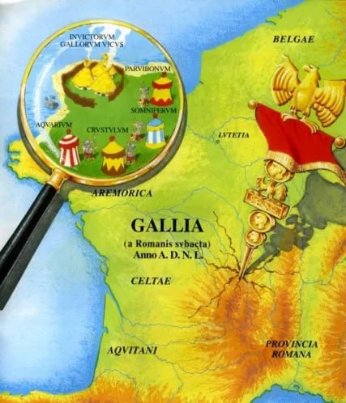<figcaption>Mapa komiksowa — nie dowód historyczny.</figcaption></figure>

58–51 r. p.n.e.

<b>Juliusz Cezar podbił Galię</b> — głównie ziemie dzisiejszej Francji.

Po lewej: Atlantyk; na południowym wschodzie: Alpy.

<b>Asteriks i niezwyciężona wioska to fikcja.</b> Galowie nie mieli magicznego napoju.

notes:
Czas: 1 min rdzenia.
Pokaż dostarczoną mapę, nie zastępuj jej własnym rysunkiem. Wskaż napis GALLIA oraz kształt ziem odpowiadających głównie dzisiejszej Francji; po lewej wybrzeże Atlantyku, po prawej Alpy. Historyczna Galia wykraczała poza dzisiejsze granice Francji. Powiększenie mapy kliknięciem. Komiksowa lupa pokazuje fikcyjną wioskę i obozy — nie korzystamy z nich jako dowodu historycznego. Faktyczny podbój Cezara datujemy 58–51 p.n.e.; w 52 p.n.e. pokonał opór pod Alezją. Dostarczona reprodukcja pozostaje prywatna; prawa nieustalone.

---

<!-- .slide: id="galia-obraz" class="" data-purpose="explanation" data-layout="plain" data-goals="G1" -->
<h2>Cezar i pokonani Galowie</h2>
<figure>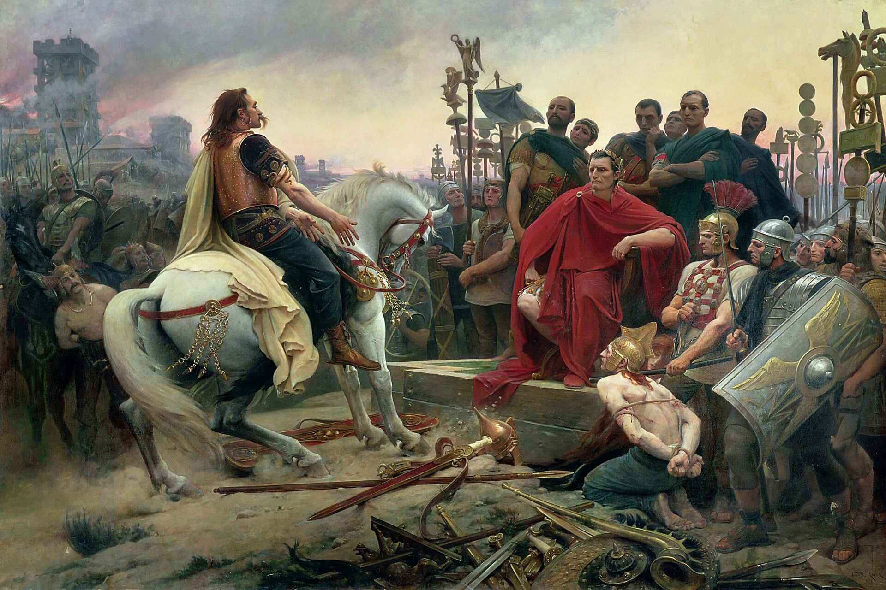<figcaption>Późniejsza wizja wydarzeń: obraz z 1899 r.</figcaption></figure>

Po zwycięstwie pod <b>Alezją w 52 r. p.n.e.</b> Cezar podporządkował sobie powstanie Galów.

Wódz Galów <b>Wercyngetoryks</b> trafił do niewoli.

Podbój oznaczał nie tylko większą mapę Rzymu, lecz także przemoc i utratę wolności pokonanych.

notes:
Czas: 0.5 min rdzenia.
Zachowany pełny obraz Royera. Pokaż Cezara i wodza Galów; to artystyczne wyobrażenie malarza żyjącego wiele stuleci później, nie dokument wyglądu sceny. Jedno krótkie zdanie o skutku podboju, bez analizy całego obrazu. Nie dokładamy nazwiska ani 52 p.n.e. do obowiązkowego zapisu.

---

<!-- .slide: id="kleopatra" class="" data-purpose="explanation" data-layout="plain" data-goals="G1" -->
<h2>Egipt: Kleopatra i rzymska polityka</h2>

<figure class="">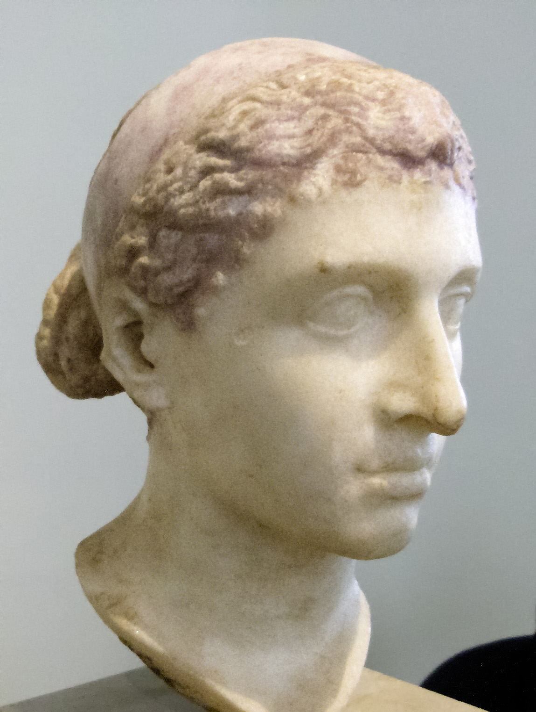<figcaption>Antyczny wizerunek Kleopatry, ok. 40–30 r. p.n.e.</figcaption></figure>

<b>Kleopatra VII</b> była królową Egiptu.

Łączyły ją związki <b>polityczne i osobiste</b> najpierw z Juliuszem Cezarem, potem z Markiem Antoniuszem.

<b>Oktawian pokonał Antoniusza i Kleopatrę.</b> W 30 r. p.n.e. Egipt znalazł się pod władzą Rzymu.

notes:
Czas: 0.75 min rdzenia.
Nie przedstawiaj Kleopatry jako partnerki Augusta. Związki z Cezarem, następnie Antoniuszem łączyły uczucia z walką o władzę i utrzymaniem Egiptu. Oktawian był przeciwnikiem. Zwycięstwo pod Akcjum 31 p.n.e. i przejęcie Egiptu 30 p.n.e.; nie dodawaj niepewnej historii o wężu. Nie wymagać nowych dat do zeszytu. Fotografia przedstawia antyczną rzeźbę, nie współczesną królowej fotografię.

---

<!-- .slide: id="august" class="" data-purpose="explanation" data-layout="plain" data-goals="G1" -->
<h2>Od republiki do cesarstwa</h2>
<figure>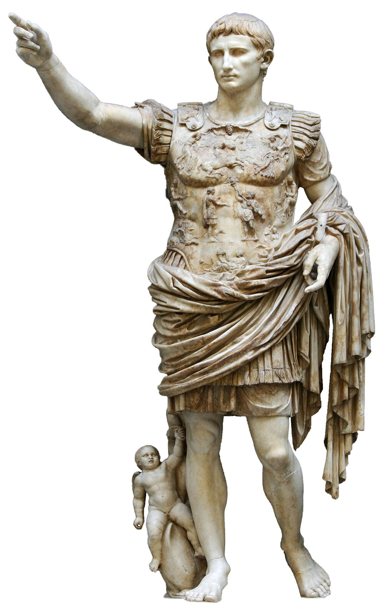<figcaption>August z Prima Porta — antyczny posąg.</figcaption></figure>

27 r. p.n.e.

<b>Oktawian otrzymał tytuł Augusta.</b> To umowny początek cesarstwa.

Najważniejsza władza skupiała się w rękach <b>cesarza</b>.

Wiele ziem podbito wcześniej, jeszcze <b>za republiki</b>.

notes:
Czas: 0.75 min rdzenia.
Przypomnij poprzednią lekcję jednym zdaniem: republika miała urzędników, a cesarstwo skupiało władzę w rękach cesarza. Nie nazywaj Cezara pierwszym cesarzem. W 27 p.n.e. Oktawian otrzymał tytuł Augusta; to umowny początek pryncypatu, nie nagłe zniesienie wszystkich instytucji republiki. Egipt przejął w 30 p.n.e. po zwycięstwie nad Antoniuszem i Kleopatrą. Nie trzeba powtarzać pełnej wojny domowej. Posąg pokazuje cesarza jako wodza; zbroja w sztuce nie jest katalogiem wyposażenia każdego legionisty.

---

<!-- .slide: id="jezus" class="" data-purpose="explanation" data-layout="plain" data-goals="G1" -->
<h2>Galilea i Judea: tu żył Jezus</h2>

<figure class="">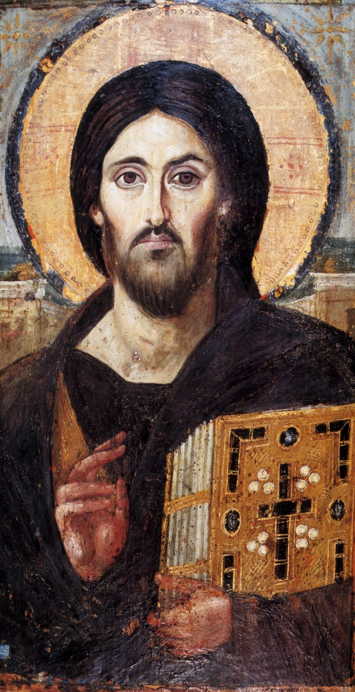<figcaption>Późniejszy wizerunek religijny, VI w. — nie portret z życia.</figcaption></figure>

I wiek n.e.

<b>Jezus był żydowskim nauczycielem</b> działającym w Galilei i Judei, na ziemiach pod wpływem Rzymu.

Został ukrzyżowany w Jerozolimie z rozkazu rzymskiego prefekta <b>Poncjusza Piłata</b>.

To także część historii ziem rzymskiego imperium.

notes:
Czas: 0.5 min rdzenia.
Przypomnij wcześniejsze zdobycie Jerozolimy przez Pompejusza; teraz jesteśmy już w I w. n.e., po początku rządów Augusta. Podaj kontekst: Galilea i Judea nie miały zawsze identycznego statusu administracyjnego, ale należały do rzymskiej strefy władzy. Mówimy o I w. n.e., nie o współczesnym państwie Izrael. Jezus był Żydem; nie przypisuj zbiorowej winy Żydom. Wyrok ukrzyżowania zarządził rzymski prefekt Piłat, ok. 30 r. n.e. To krótkie osadzenie znanej postaci w historii, nie cała lekcja o chrześcijaństwie. Obraz z VI w. jest późniejszą ikoną religijną, a nie świadectwem wyglądu Jezusa.

---

<!-- .slide: id="rozrost" class="full-map" data-purpose="evidence" data-layout="map-focus" data-goals="G1" -->
<figure class="">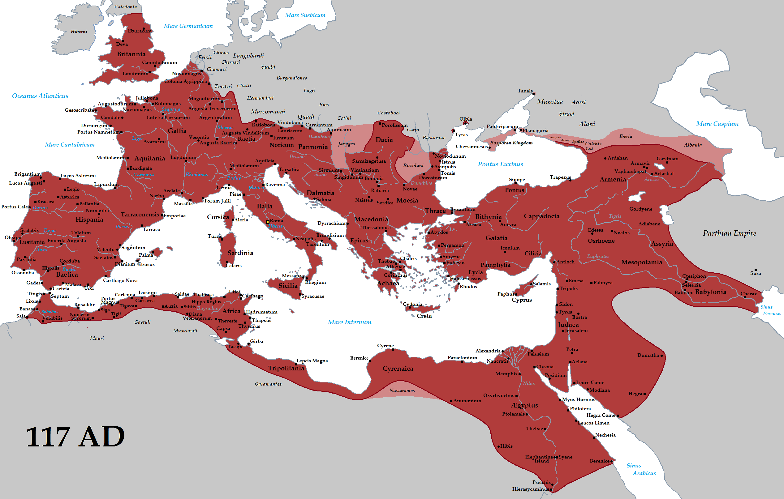</figure>

117 r. n.e.
<h2>Trajan</h2>
Największy zasięg imperium.

<b>Czerwony</b> — cesarstwo <b>Różowy</b> — państwa zależne, nie prowincje

Części <b>Europy, Azji i Afryki</b>.

notes:
Czas: 1.5 min rdzenia.
POKAŻ mapę podczas zdania: „Największy zasięg Rzym osiągnął za cesarza Trajana w 117 roku naszej ery”. Odczytaj legendę: czerwony oznacza cesarstwo, różowy państwa zależne — nie doliczaj ich do prowincji. Wskaż Rzym i Italię, Hispanię, Galię, ziemie greckie, Azję Mniejszą, Syrię, Judeę i Egipt. Wyjaśnij: imperium to rozległe państwo obejmujące wiele ziem i ludów. Wskaż po jednym obszarze w Europie, Azji i Afryce; NIE podbito całych kontynentów. Podbój części Brytanii rozpoczął się w 43 n.e.; nie całej wyspy. Zdobycze Trajana na wschodzie były krótkotrwałe. Nie myl mapy 117 z granicami Hadriana od 122 ani z podziałem 395. Roma = Rzym; Gallia = Galia; Aegyptus = Egipt. Poproś o jedno wskazanie z ławki, nie odpytuj z każdej nazwy.

---

<!-- .slide: id="notatka-1" class="note" data-purpose="synthesis" data-layout="takeaways" data-goals="G1" -->

Do zeszytu · narysuj i podpisz · 1½ min
<h2>Podboje i cesarstwo</h2>

<b>264–146 p.n.e.</b>wojny punickie

<b>63 p.n.e.</b>Pompejusz Jerozolima

<b>27 p.n.e.</b>August cesarstwo

<b>117 n.e.</b>Trajan największy zasięg

IMPERIUM

<b>część Europy</b><b>część Azji</b><b>część Afryki</b>

notes:
Czas: 1.5 min rdzenia.
Notatka dopiero po omówieniu tego etapu. Daj 1,5 min ciszy. Uczniowie rysują połączenia i przepisują tylko tytuł oraz podpisy: nie kopiują etykiety czasu ani ramek. To połączenia znaczeń, nie ozdobne ikonki. Odczytaj raz, potem nie mów podczas pisania. Cztery zapisy razem: 5,5 min; bez par, kart i wydruków.

---

<!-- .slide: id="legionista" class="annotated-equipment" data-purpose="evidence" data-layout="source-split" data-goals="G2" -->
<h2>Wyposażenie legionisty</h2><figure>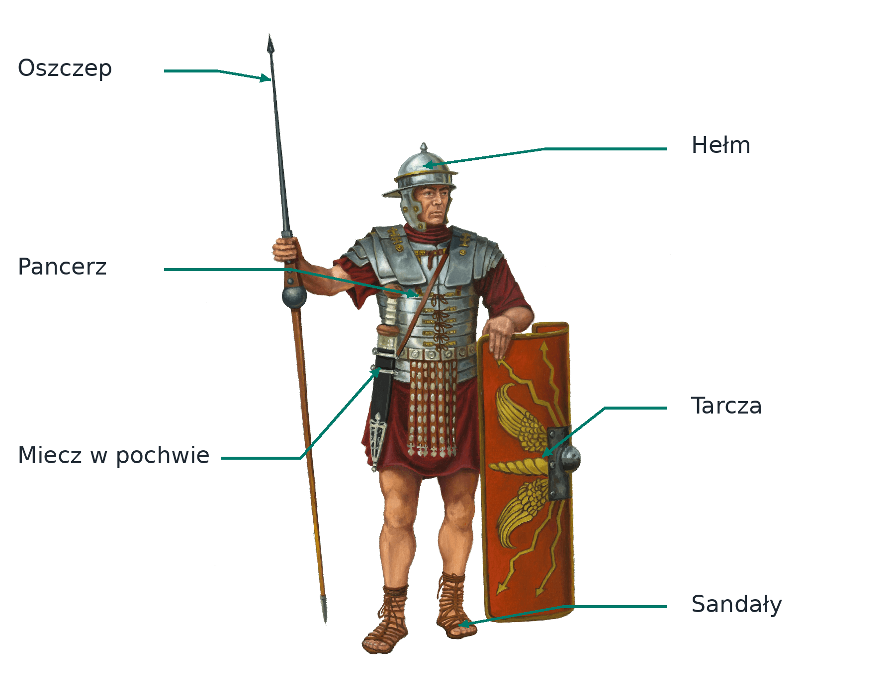</figure>

notes:
Czas: 0.75 min rdzenia.
Legionista to żołnierz legionu, dużego oddziału armii rzymskiej. Wyposażenie zmieniało się przez stulecia; rysunek z pancerzem pasmowym odpowiada wczesnemu cesarstwu, nie każdemu żołnierzowi Hannibala ani schyłku V wieku. Nie podawaj jednego stałego stanu liczebnego legionu dla całej historii. Najpierw 10 s obserwacji, potem 2 odpowiedzi. Podpisy i strzałki wskazują rzeczywiste elementy; miecz jest w pochwie, nie pokazujemy odsłoniętego ostrza. Hełm, pancerz i tarcza osłaniały ciało; oszczep i miecz służyły do ataku, sandały do marszu. Następny slajd daje opcjonalne dwa fragmenty animacji. Jeśli wybierasz film, skróć ten komentarz do rozpoznania jednej osłony i jednej broni. Jeśli nie — lokalna postać i krótkie wyjaśnienie wyczerpują cel.

---

<!-- .slide: id="film-legionista" class="" data-purpose="evidence" data-layout="source-split" data-goals="G2" -->
<h2>Legionista nie tylko walczył</h2>

Opcjonalnie · animacja · angielski z polskimi napisami

<lesson-video><button type="button" data-video-play aria-label="Wczytaj film: 1. Marsz i wyposażenie · 0:55–1:31">1. Marsz i wyposażenie · 0:55–1:31 <small>Kliknij, aby połączyć z YouTube</small></button><iframe hidden title="1. Marsz i wyposażenie · 0:55–1:31" data-video-src="https://www.youtube-nocookie.com/embed/P5e7cl19Ha0?start=55&amp;end=91&amp;cc_load_policy=1&amp;cc_lang_pref=pl&amp;hl=pl&amp;autoplay=1" allow="autoplay; encrypted-media; picture-in-picture" allowfullscreen></iframe></lesson-video><lesson-video><button type="button" data-video-play aria-label="Wczytaj film: 2. Drogi i mosty · 3:12–3:28">2. Drogi i mosty · 3:12–3:28 <small>Kliknij, aby połączyć z YouTube</small></button><iframe hidden title="2. Drogi i mosty · 3:12–3:28" data-video-src="https://www.youtube-nocookie.com/embed/P5e7cl19Ha0?start=192&amp;end=208&amp;cc_load_policy=1&amp;cc_lang_pref=pl&amp;hl=pl&amp;autoplay=1" allow="autoplay; encrypted-media; picture-in-picture" allowfullscreen></iframe></lesson-video>

Po każdym fragmencie — pauza i krótkie objaśnienie po polsku.

Bez Internetu: wróć do lokalnej postaci legionisty. <a href="https://www.youtube.com/watch?v=P5e7cl19Ha0" target="_blank" rel="noopener">Pełny film ok. 5 min — dodatkowo, poza rdzeniem lekcji</a>

notes:
Czas: 0 min rdzenia. Opcjonalny film 2 min ZAMIAST łącznego komentarza o wyposażeniu i dyscyplinie; nie doliczaj go do rdzenia.
Film jest ZAMIENNIKIEM części objaśnienia, nie dodatkowymi minutami. Przed: „Zwróćcie uwagę, co poza walką należało do obowiązków legionisty. Teraz nie piszemy”. Pierwszy fragment 36 s, drugi 16 s. Po pierwszym: „Żołnierz nosił wyposażenie i narzędzia do budowy obozu”. Po drugim: „Żołnierze budowali też drogi i mosty”. Dwie pauzy po 15 s i 20 s na jedną odpowiedź: 102 s, łącznie z przejściem 2 min. Jeśli sieć lub przełączanie zawodzi, pomiń film — nie czekaj. Przyciski dopiero po kliknięciu tworzą połączenie z youtube-nocookie; start i end są ustawione. Mimo końca zakresu zatrzymaj odtwarzanie ręcznie i nie zostawiaj obu odtwarzaczy aktywnych. Ręczne polskie napisy i próbki obrazu sprawdzone wcześniej, pełnego audio nie odsłuchano. Można wyciszyć i wyjaśnić sens po polsku. Servius jest bohaterem ilustracyjnym. Pełny film nie należy do 40-minutowego planu.

---

<!-- .slide: id="dyscyplina" class="" data-purpose="explanation" data-layout="plain" data-goals="G2" -->

Nie tylko broń
<h2>Ćwiczenia · rozkazy · współpraca</h2>

1<h3>Ćwiczenia</h3>
Powtarzane marsze i manewry przygotowywały do wspólnego działania.

2<h3>Dyscyplina</h3>
Żołnierze wykonywali rozkazy i utrzymywali szyk.

3<h3>Obóz</h3>
Budowali umocnione obozy, które chroniły podczas postoju.

notes:
Czas: 1.25 min rdzenia.
Legion był organizacją, a nie zbiorowiskiem najsilniejszych ludzi. Wyjaśnij dyscyplinę jako przestrzeganie zasad i wykonywanie rozkazów, nie wyłącznie strach przed karą. W armii występowały surowe i brutalne kary, lecz nie opisuj uczniom drastycznych szczegółów dziesiątkowania. Obóz i zaopatrzenie były równie ważne jak walka. Nie przedstawiaj „żółwia” jako szyku używanego w każdej bitwie. Pytanie: „Dlaczego dobra tarcza nie wystarczy, gdy oddział nie współpracuje?”. Oczekiwane: powstają luki, żołnierze się nie osłaniają.

---

<!-- .slide: id="drogi" class="" data-purpose="explanation" data-layout="plain" data-goals="G2" -->
<h2>Droga łączyła odległe prowincje</h2>

<figure class="">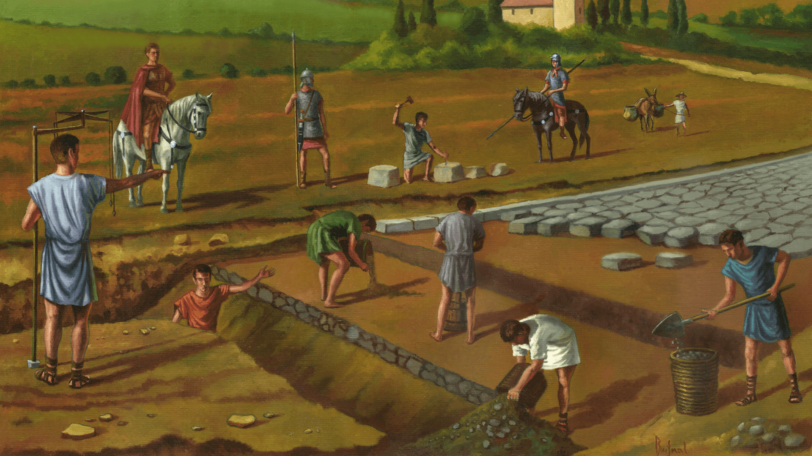<figcaption>Budowa rzymskiej drogi — współczesna ilustracja.</figcaption></figure>
<ul><li>Wojsko mogło sprawniej przemieszczać się między regionami.</li><li>Posłańcy przenosili rozkazy i wiadomości.</li><li>Kupcy docierali do kolejnych miast.</li></ul>
Co stałoby się, gdyby wiadomość o zagrożeniu szła zbyt długo?

notes:
Czas: 1 min rdzenia.
Ilustracja jest współczesnym objaśnieniem budowy drogi, nie fotografią zabytku ani rysunkiem z epoki. Nie dowodzi jednego sposobu budowania wszystkich dróg. Rzymianie nie wynaleźli samej drogi; budowali rozległą sieć, która pomagała kontrolować państwo. Oczekiwany związek: spóźniona wiadomość opóźnia wysłanie pomocy. Nie obiecuj natychmiastowego transportu i nie pomijaj znaczenia żeglugi. Ciekawostka 2 do powiedzenia: kamienie milowe przy drogach informowały m.in. o odległościach; podróżnik nie miał nawigacji w telefonie. To krótki fakt, nie dodatkowe zadanie ani powszechna zasada jednego punktu początkowego dla wszystkich dróg.

---

<!-- .slide: id="limes" class="full-map" data-purpose="evidence" data-layout="map-focus" data-goals="G2" -->
<figure class="">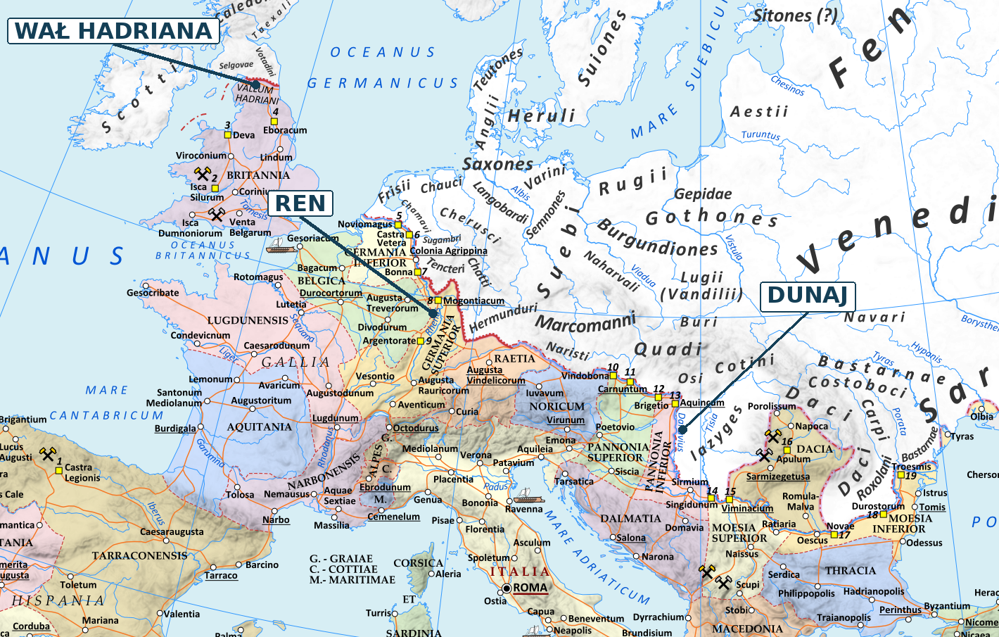</figure>

ok. 125 r. n.e.
<h2>Limes</h2>
System ochrony i kontroli pogranicza.

<b>Ren i Dunaj</b> — granice rzeczne. <b>Wał Hadriana</b> — od 122 r.

Czerwone odcinki: umocnienia. Linia przerywana: granica imperium. Nie jeden mur wokół państwa.

notes:
Czas: 1 min rdzenia.
Nie rysuj jednego muru opasującego imperium. Limes jest współczesnym zbiorczym określeniem różnych stref i urządzeń granicznych; część granic opierała się o rzeki i pustynie. Ren i Dunaj wyznaczały ważne odcinki europejskiego pogranicza; nie każdy odcinek przez całe stulecia był identyczny. Wał Hadriana budowano od 122 n.e., a więc po szczytowym zasięgu Trajana z poprzedniej mapy. Funkcja obejmowała kontrolę ruchu i ochronę, nie absolutną szczelność. Nie myl go z wałem Antonina dalej na północy. W TRAKCIE wyjaśnienia wskaż na mapie Ren, Dunaj i wał Hadriana w Brytanii. Nazwij je po polsku, nie poprzestawaj na samym wymienieniu w tekście.

---

<!-- .slide: id="wal-hadriana" class="" data-purpose="evidence" data-layout="source-split" data-goals="G2" -->
<h2>Wał Hadriana w Brytanii</h2>
<figure>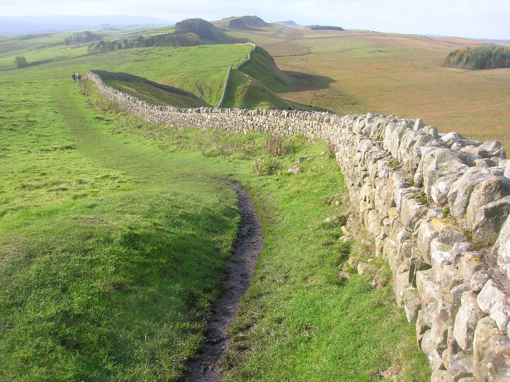<figcaption>Tak wygląda dziś zachowany fragment umocnień.</figcaption></figure>

Budowa od 122 r. n.e.

Mur, forty i strażnice pomagały <b>chronić pogranicze i kontrolować przejścia</b>.

Nie otaczał całego imperium i nie zatrzymywał każdego zagrożenia.

notes:
Czas: 0.5 min rdzenia.
Zaraz po mapie limesu pokaż rzeczywistą fotografię. Wskaż kamienny mur, nie myl pozostałości z pierwotną pełną wysokością. Ten odcinek w północnej Anglii pokazuje materialne umocnienie; inne granice opierały się np. na Renie i Dunaju. Nie nazywaj fotografii rekonstrukcją. Pół minuty obserwacji i jedno wyjaśnienie, bez kolejnego zadania.

---

<!-- .slide: id="prowincje" class="" data-purpose="explanation" data-layout="plain" data-goals="G2" -->
<h2>Jak zarządzano zdobytymi ziemiami?</h2>

Prowincja

podbita ziemia zarządzana przez Rzym

→

Podatki

pieniądze i świadczenia na rzecz państwa

→

Utrzymanie państwa

wojsko, urzędnicy, budowle

Podboje oznaczały też przemoc, niewolę i ciężary dla pokonanych.

notes:
Czas: 1 min rdzenia.
Prowincja to nie dzisiejsze województwo i nie każda kraina została od razu prowincją. Rzym wyznaczał namiestników, czyli zarządców. Wyjaśnij podatki jako obowiązkowe świadczenia, nie dobrowolne prezenty. Zyski z łupów, ziem i pracy niewolników nie były jednakowym dobrobytem dla wszystkich. Nie przedstawiaj podbojów jako cywilizacyjnego dobrodziejstwa bez kosztów. Schemat pokazuje jedną ważną zależność, nie pełny rzymski budżet. Zwróć uwagę na paradoks: ziemie przynoszą dochody, ale trzeba ich też bronić.

---

<!-- .slide: id="notatka-2" class="note" data-purpose="synthesis" data-layout="takeaways" data-goals="G2" -->

Do zeszytu · narysuj i podpisz · 1½ min
<h2>Co spajało imperium?</h2>

<b>ARMIA</b>obrona i podboje

<b>DROGI</b>wojsko i wiadomości
<b class="spoke-center">RZYM</b>
<b>LIMES</b>ochrona granic

<b>PROWINCJE</b>podbite ziemie → podatki

notes:
Czas: 1.5 min rdzenia.
Notatka dopiero po omówieniu tego etapu. Daj 1,5 min ciszy. Uczniowie rysują połączenia i przepisują tylko tytuł oraz podpisy: nie kopiują etykiety czasu ani ramek. To połączenia znaczeń, nie ozdobne ikonki. Odczytaj raz, potem nie mów podczas pisania. Cztery zapisy razem: 5,5 min; bez par, kart i wydruków.

---

<!-- .slide: id="pax" class="" data-purpose="explanation" data-layout="plain" data-goals="G2" -->
<h2>Pax Romana — pokój rzymski</h2>
<b>Okres względnego pokoju i stabilności wewnątrz cesarstwa, od panowania Augusta do końca II w. n.e.</b>

<figure>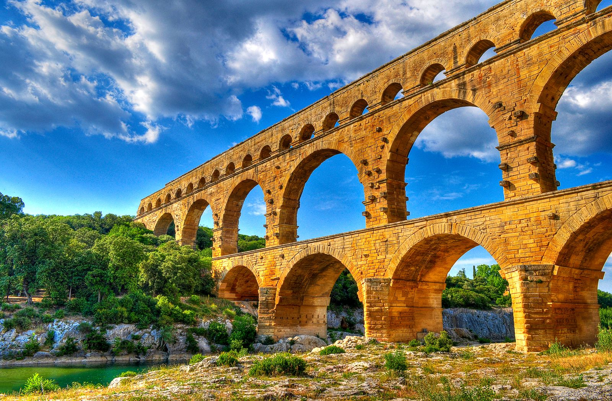<figcaption>Akwedukt doprowadzał wodę do miasta.</figcaption></figure>

<b>Mniej walk + ochrona szlaków</b> → bezpieczniejszy handel → rozwój miast i budownictwa.

Kupcy dowozili towary; miasta mogły budować drogi i akwedukty.

<b>Wojny na granicach i bunty nie zniknęły.</b>

notes:
Czas: 1.5 min rdzenia.
Pokój jest tu względny: długi okres większej stabilności w znacznej części państwa, nie brak przemocy na całym świecie. Początek wiąże się z Augustem, a umowny koniec często z końcem II wieku; nie dokładaj nowej obowiązkowej daty. Wojny toczyły się na granicach, a bunty również wewnątrz imperium. Akwedukt to urządzenie doprowadzające wodę, a nie most drogowy; fotografia konkretnego zabytku ilustruje skalę budownictwa, nie dowodzi, że wszędzie żyło się wygodnie. Nie wymieniaj wszystkich osiągnięć kultury, bo to nie cała lekcja o życiu Rzymian. Wyjaśnij mechanizm zamiast samego tłumaczenia nazwy: gdy rzadziej wybuchają walki i szlaki są lepiej strzeżone, kupiec ma większą szansę dowieźć zboże lub oliwę do miasta. Handel daje utrzymanie rzemieślnikom i sprzedawcom; stabilniejsze dochody i porządek pozwalają planować budowę. Przykład ze zdjęcia: Pont du Gard doprowadzał wodę do Nîmes w Galii. To przykład miejskiej infrastruktury, nie dowód powszechnego dobrobytu. Pokój utrzymywano także siłą rzymskiej armii.

---

<!-- .slide: id="romanizacja" class="" data-purpose="explanation" data-layout="plain" data-goals="G2" -->
<h2>Jak prowincje stawały się rzymskie?</h2>

<figure class="">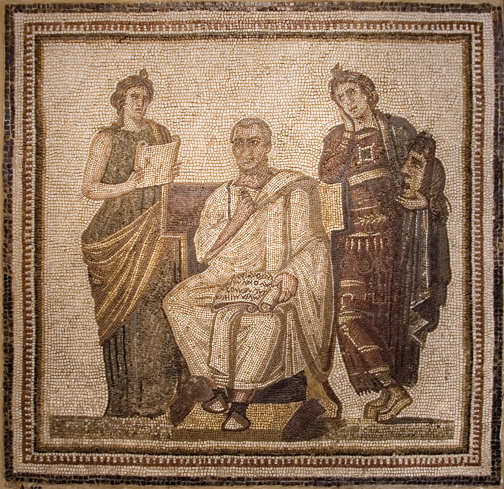<figcaption>Wergiliusz i muzy — mozaika z III w. z Afryki Północnej.</figcaption></figure>

<b>Romanizacja</b> — przejmowanie rzymskich zwyczajów, języka i sposobów życia przez ludność prowincji.
<ul><li>Miasta i budowle na rzymski wzór.</li><li>Rzymskie prawo i obyczaje.</li><li>Łacina, zwłaszcza na zachodzie.</li></ul>
Na Zachodzie silniejsza była <b>łacina</b>, na Wschodzie <b>greka</b>. Zmiany były stopniowe.

notes:
Czas: 1.25 min rdzenia.
Romanizacja nie jest germanizacją ani zmianą wszystkich ludzi w jednakowych „Rzymian”. Na Wschodzie bardzo ważna pozostawała greka; lokalne tradycje i języki trwały obok rzymskich. Nie sugeruj wyłącznie dobrowolnego kopiowania mody: władza, wojsko, podatki i korzyści społeczne sprzyjały przyjmowaniu rzymskich wzorów. Na obrazku jest zabytkowa mozaika, nie wykres stopnia romanizacji. Wystarczy pytanie: „Czy przyjęcie rzymskiego stroju musi oznaczać zapomnienie własnego języka?” — nie. Nie rozwijaj tego w debatę zabierającą czas notatki. Konkretny zabytek to mozaika Wergiliusza z Hadrumetum (Susa w dzisiejszej Tunezji), obecnie w muzeum Bardo. Łaciński poeta w afrykańskiej prowincji to konkretny przykład obecności rzymskich wzorów; obiekt jest z III w., nie dokumentem początku Pax Romana. Z łaciny wywodzą się m.in. włoski, francuski i hiszpański; przez stulecia miała międzynarodową rolę w Europie. Nie oznacza to, że każdy mieszkaniec mówił po łacinie.

---

<!-- .slide: id="notatka-3" class="note" data-purpose="synthesis" data-layout="takeaways" data-goals="G2" -->

Do zeszytu · narysuj i podpisz · 1¼ min
<h2>Pokój i kultura</h2>

<b>PAX ROMANA</b>→<b>względny pokój</b>→<b>bezpieczniejszy handel</b>→<b>rozwój miast</b>

<b>ROMANIZACJA</b>przejmowanie rzymskiej kultury

<b>Zachód → łacina</b><b>Wschód → greka</b>

notes:
Czas: 1.25 min rdzenia.
Notatka dopiero po omówieniu tego etapu. Daj 1,25 min ciszy. Uczniowie rysują połączenia i przepisują tylko tytuł oraz podpisy: nie kopiują etykiety czasu ani ramek. To połączenia znaczeń, nie ozdobne ikonki. Odczytaj raz, potem nie mów podczas pisania. Cztery zapisy razem: 5,5 min; bez par, kart i wydruków.

---

<!-- .slide: id="kryzys" class="" data-purpose="explanation" data-layout="plain" data-goals="G3" -->
<h2>Dlaczego coraz trudniej było rządzić?</h2>

<h3>Walka o władzę</h3>
Rywalizujący wodzowie kierowali wojska przeciw sobie.

<h3>Koszty obrony</h3>
Długie granice i utrzymanie armii wymagały wielkich wydatków.

<h3>Słabsze dochody</h3>
Wojny i utrata ziem utrudniały pobór podatków.

Mniej pieniędzy i więcej konfliktów → trudniejsza obrona.

notes:
Czas: 1.25 min rdzenia.
W III wieku narastały walki o tron i problemy gospodarcze, ale imperium nie upadło od razu. Późniejsi cesarze przeprowadzali reformy, a państwo trwało jeszcze przez stulecia. Wyjaśnij kryzys jako nałożenie się poważnych problemów. Łańcuch nie jest jedyną przyczyną każdego wydarzenia: wojny niszczą gospodarkę, słabsze dochody utrudniają obronę, utrata ziem zmniejsza dochody. Unikaj prostego „podatki były wysokie, więc imperium upadło”. Nie przypisuj osłabienia pochodzeniu etnicznemu żołnierzy. W armii rzymskiej ludzie różnego pochodzenia mogli walczyć skutecznie i lojalnie.

---

<!-- .slide: id="konstantynopol" class="" data-purpose="explanation" data-layout="plain" data-goals="G3" -->
<h2>Dlaczego cesarz wybrał Wschód?</h2>
<figure>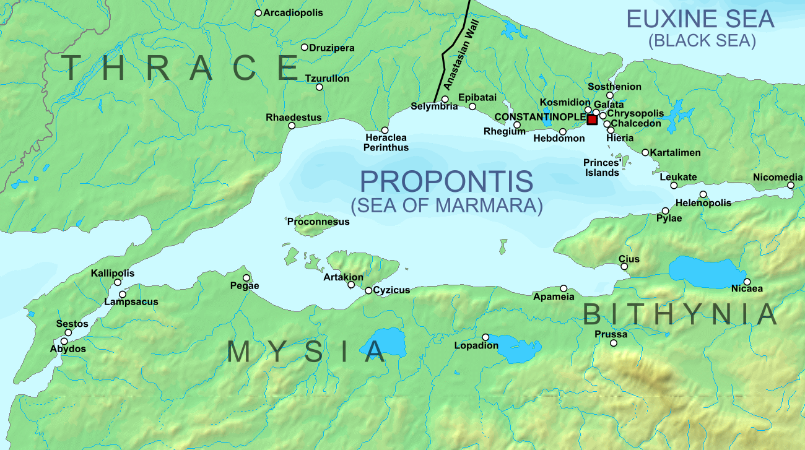<figcaption>Mapa późniejszego miasta — służy lokalizacji.</figcaption></figure>

330 r. — inauguracja stolicy

<b>Konstantyn Wielki</b> rozbudował istniejące <b>Bizancjum (Byzantion)</b> jako Konstantynopol.
<ul><li>Bogate wschodnie prowincje i handel.</li><li>Bosfor: szlaki Europa–Azja i Morze Czarne–Śródziemne.</li><li>Dogodna obrona i bliżej wschodnich granic.</li></ul>

notes:
Czas: 1.5 min rdzenia.
Konstantyn Wielki rządził wcześniej niż Teodozjusz I i jego synowie. W 330 nastąpiła uroczysta inauguracja Konstantynopola jako nowej cesarskiej stolicy. Nie zbudował miasta na pustym polu: rozbudował greckie Byzantion. Wyjaśnij decyzję przez bogate prowincje Wschodu, handel i obronę. Bosfor kontrolował drogę morską z Morza Czarnego przez Morze Marmara i Dardanele ku Śródziemnemu oraz połączenia Europy i Azji. Lokalizacja była bliższa ważnym wschodnim frontom. Półwysep z trzech stron osłaniało morze. Mapa pokazuje późniejsze miasto, nie budynki wzniesione wyłącznie przez Konstantyna. Dziś to Stambuł.

---

<!-- .slide: id="podzial-przyczyny" class="" data-purpose="explanation" data-layout="plain" data-goals="G3" -->
<h2>Jedno wielkie państwo — dwa dwory</h2>
Ogromnym cesarstwem trudno było zarządzać i bronić odległych granic z jednego ośrodka.

<b>Wcześniej</b> Cesarze już dzielili się rządami.
→
<b>395 r.: śmierć Teodozjusza I</b> Rządy przejęli jego synowie.

<h3>Honoriusz → Zachód</h3>
Oddzielny dwór i administracja.

<h3>Arkadiusz → Wschód</h3>
Oddzielny dwór i administracja.

Mieli współrządzić rzymskim światem. Z czasem współpraca słabła; bogatszy Wschód trwał dłużej.

notes:
Czas: 1.5 min rdzenia.
Najpierw przypomnij Konstantyna z 330, potem Teodozjusza I z końca IV wieku. Nie są to dwaj cesarze rządzący jednocześnie. Współrządy istniały wcześniej, m.in. za Dioklecjana, więc w 395 nie wynaleziono podziału po raz pierwszy. Po śmierci Teodozjusza syn Honoriusz rządził na Zachodzie, Arkadiusz na Wschodzie. Były to dwory i administracje w tradycji jednego cesarstwa, nie dwie nowe obce cywilizacje. Bogatszy i bardziej zurbanizowany Wschód miał silniejsze zaplecze; sam podział nie wyjaśnia całego upadku Zachodu. Różne decyzje dworów utrudniały wspólne reagowanie. Zaraz wskaż obie części na mapie.

---

<!-- .slide: id="podzial" class="full-map" data-purpose="evidence" data-layout="map-focus" data-goals="G1 G3" -->
<figure class="">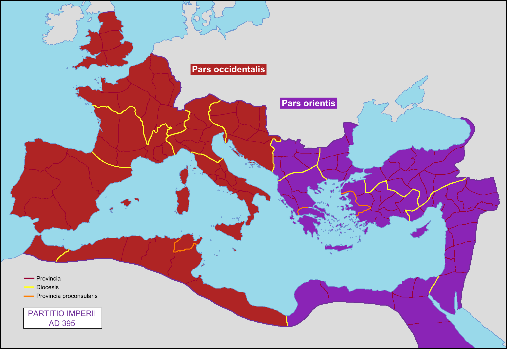</figure>

395 r.
<h2>Dwie części cesarstwa</h2>
<b>Czerwony: Zachód</b> silniejsza łacina

<b>Fioletowy: Wschód</b> silniejsza greka

notes:
Czas: 1.25 min rdzenia.
Duża mapa ma pokazać DWIE części, nie tylko linię. Wskaż Italię i zachodnią część oraz wschodnią część przy Bosforze. Mapa nie ma punktu Konstantynopola — jego lokalizację pokazano na poprzednim slajdzie, nie udawaj istniejącej tu sygnatury miasta. W 395 po śmierci Teodozjusza władzę przejęli jego synowie: Honoriusz na Zachodzie i Arkadiusz na Wschodzie. Nazwiska synów nie są obowiązkowe. Podział rządów miał dłuższą historię; data 395 jest szkolnym punktem orientacyjnym, nie powstaniem dwóch całkowicie obcych cywilizacji jednej nocy. Zachód — przeważnie łacina; Wschód — silna greka. Rzym był symbolicznym centrum, ale rezydencją dworu zachodniego w 395 był Mediolan, od 402 Rawenna. Nie kopiuj podręcznikowego skrótu „stolica Zachodu w Rzymie”. Pytanie: „Do której części należał Egipt?”. Daj 10 s; oczekiwane Wschód, wskazanie północno-wschodniej Afryki. Pars occidentalis = część zachodnia; Pars orientis = część wschodnia. Drobne linie to podziały administracyjne, nie dzisiejsze granice.

---

<!-- .slide: id="stambul-dzis" class="" data-purpose="evidence" data-layout="comparison" data-goals="G3" -->
<h2>Konstantynopol to dzisiejszy Stambuł</h2>
<figure><figcaption>Stambuł — panorama ze Złotym Rogiem.</figcaption></figure><figure><figcaption>Hagia Sophia — budowla z 537 r., za Justyniana.</figcaption></figure>

<b>Bizancjum</b>→<b>330: Konstantynopol</b>→<b>1453: podbój osmański</b>→<b>dziś: Stambuł</b>

notes:
Czas: 0.5 min rdzenia.
Krótka ciekawostka w istniejącym bloku o stolicy i podziale, nie kolejny wykład. Zestaw dwa rzeczywiste współczesne zdjęcia. Nazwy oznaczają kolejne etapy dziejów jednego miasta, nie cztery różne miejsca. Konstantynopol zdobyli Osmanowie w 1453. Hagia Sophia widoczna dziś pochodzi z VI wieku: ukończono ją w 537 za cesarza Justyniana, nie za Konstantyna. Nie przypisuj wszystkich dzisiejszych minaretów czasom rzymskim. Nie wymagaj dat 537 i 1453 w zeszycie; obowiązkowe są wnioski o dalszym trwaniu Wschodu.

---

<!-- .slide: id="wedrowki" class="full-map" data-purpose="evidence" data-layout="map-focus" data-goals="G3" -->
<figure class="">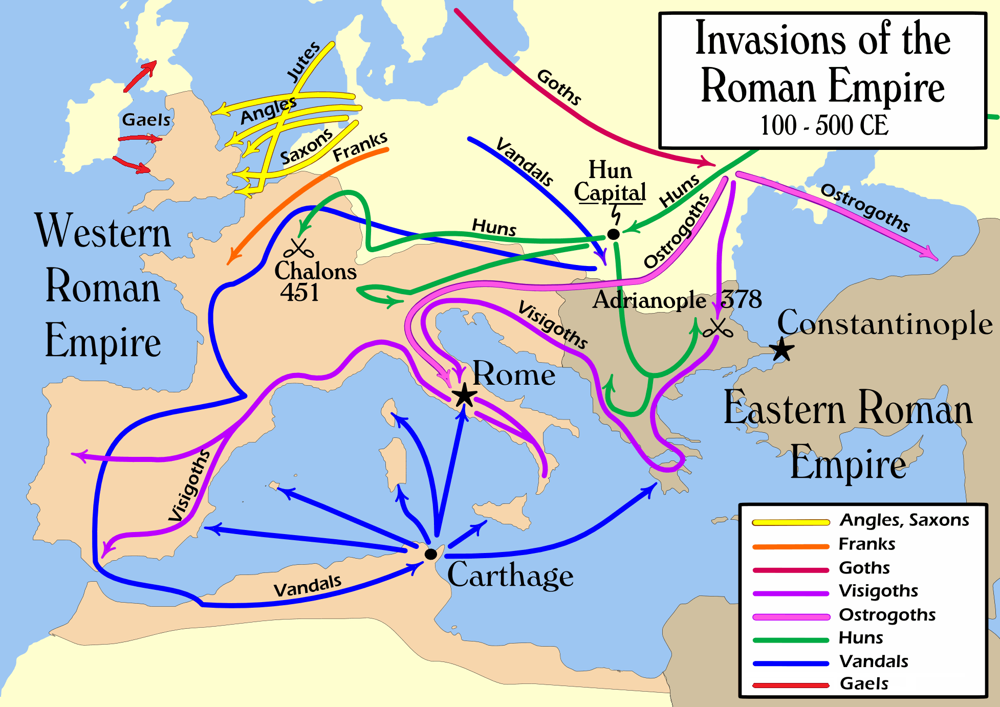</figure>
<h2>Wędrówki ludów</h2>
100–500 n.e.

Omawiamy głównie IV–V wiek.

<b>Huns</b> — Hunowie <b>Vandals</b> — Wandalowie

Strzałki łączą wydarzenia z różnych lat.

notes:
Czas: 1.5 min rdzenia.
Odczytaj z mapy zakres czasu, legendę i dwa wybrane kierunki, nie wszystkie szlaki. Wskaż Hunów przybywających ze wschodu i wybrany lud germański: Gotów lub Wandalów. Wyjaśnij: przemieszczali się wojownicy i całe społeczności; część uciekała przed zagrożeniem, część szukała ziemi lub służby, dochodziło do wojen, ugód i osiedlania w granicach cesarstwa. Hunowie zwiększyli presję na inne ludy, ale nie są jedyną przyczyną upadku. „Barbarzyńca” to dawne rzymskie określenie ludzi spoza ich kręgu, nie nasza ocena wartości innych ludów. Pytanie po 10 s obserwacji: „Czy ruch odbywał się tylko w jednym kierunku?”. Odpowiedź ma wynikać z widocznych strzałek. Mapa późnoantyczna, nie ta z 117 r. Oryginał MapMastera ma zakres 100–500 n.e.; świadomie omawiamy późną część tego przedziału, nie nazywamy całej mapy obrazem jednego wieku. Rome = Rzym; Constantinople = Konstantynopol; Carthage = Kartagina. Kolory strzałek rozróżniają ludy, nie fazy rozrostu Rzymu.

---

<!-- .slide: id="upadek" class="" data-purpose="explanation" data-layout="plain" data-goals="G3" -->

476r. n.e.

<h2>Odoaker pozbawił władzy Romulusa Augustulusa.</h2>
Zakończyły się rządy cesarza na Zachodzie.

To <b>umowny koniec starożytności</b>.

<h3>A Wschód?</h3>
Cesarstwo ze stolicą w Konstantynopolu <b>trwało nadal</b>.

notes:
Czas: 1 min rdzenia.
Odoaker był wodzem wojsk w Italii. W 476 usunął z tronu Romulusa Augustulusa; nie opisuj dosłownego zdjęcia korony. To tradycyjny punkt zamykający zachodnie cesarstwo i starożytność w szkolnej periodyzacji, nie dzień zniknięcia wszystkich miast, praw i mieszkańców. Wschód przetrwał, a wiele elementów rzymskiej kultury zachowało się na Zachodzie. Istniał też uznawany przez Konstantynopol Juliusz Nepos, lecz nie obciążaj tym podstawowej notatki; na pytanie ambitnego ucznia wyjaśnij, że historycy przyjmują konwencjonalną datę mimo złożoności roszczeń. Nie łącz 476 ze zdobyciem i spaleniem miasta Rzymu na obrazie z 455.

---

<!-- .slide: id="notatka-4" class="note" data-purpose="synthesis" data-layout="takeaways" data-goals="G3" -->

Do zeszytu · narysuj i podpisz · 1¼ min
<h2>Podział i dalsze losy</h2>

<b>395</b>śmierć Teodozjusza I

<b>ZACHÓD</b>Honoriusz<i>↓</i><b>476</b>koniec cesarstwa zachodniego

<b>WSCHÓD</b>Arkadiusz<i>↓</i><b>trwa nadal</b>Konstantynopol

notes:
Czas: 1.25 min rdzenia.
Notatka dopiero po omówieniu tego etapu. Daj 1,25 min ciszy. Uczniowie rysują połączenia i przepisują tylko tytuł oraz podpisy: nie kopiują etykiety czasu ani ramek. To połączenia znaczeń, nie ozdobne ikonki. Odczytaj raz, potem nie mów podczas pisania. Cztery zapisy razem: 5,5 min; bez par, kart i wydruków.

---

<!-- .slide: id="synteza" class="" data-purpose="synthesis" data-layout="comparison" data-goals="G2 G3" -->
<h2>Dlaczego Rzym mógł rządzić tak wielkim państwem?</h2>

<h3>Budowanie potęgi</h3>
Sprawna armia

Drogi i wiadomości

Podatki z prowincji

Wspólne wzory kultury

<h3>Osłabienie Zachodu</h3>
Walki o władzę

Kosztowna obrona granic

Utrata ziem i dochodów

Najazdy i wędrówki ludów

Połącz jeden element z lewej i jeden z prawej. Wyjaśnij związek własnymi słowami.

notes:
Czas: 1.75 min rdzenia.
Daj 15 s samodzielnego przygotowania zdania, potem dwie różne odpowiedzi. Klucz przykładowy: armia chroniła ziemie, ale wymagała pieniędzy; gdy ubywało podatków, trudniej było ją utrzymać. Albo: dobra sieć dróg pomagała rządzić, ale nie usuwała konfliktów między dowódcami. Nie uznawaj każdego zestawienia za historycznie oczywisty mechanizm; poproś o „bo” lub „dlatego”. To synteza, nie drugi długi wykład. Gotowe zamknięcie: „Rzym nie utrzymał imperium samym mieczem: potrzebował ludzi, pieniędzy, łączności i współpracy. Gdy te elementy osłabły jednocześnie, Zachód utracił cesarską władzę. Rzymski Wschód i wiele rzymskich osiągnięć trwały dalej”.

---

<!-- .slide: id="bilet" class="task" data-purpose="exit-ticket" data-layout="activity-brief" data-goals="G2 G3" -->
<h2>Sprawdź, czy rozumiesz</h2>
<ol><li>Co znaczy <b>romanizacja</b>?</li><li>Wyjaśnij, dlaczego armia potrzebowała nie tylko broni, ale też podatków i dróg.</li><li>Co zakończyło się w <b>476 r.</b>, a co trwało dalej?</li></ol>

Najpierw odpowiedz w myślach. Potem odpowiadamy ustnie.

notes:
Czas: 1.75 min rdzenia.
Bez nowego przepisywania. Każdy przez 15 s przygotowuje odpowiedzi w myślach; trzy osoby odpowiadają na trzy punkty, pozostałe porównują z własnymi. Klucz: 1 przejmowanie rzymskiej kultury przez ludność prowincji; 2 podatki utrzymywały i zaopatrywały wojsko, drogi pomagały przenosić rozkazy i przemieszczać oddziały; 3 skończyła się władza cesarska na Zachodzie, a cesarstwo wschodnie trwało. Nie wyświetlaj klucza. Ustne sprawdzenie nie dowodzi osobno opanowania celu przez wszystkich 18–20 uczniów: zanotuj dla siebie, kogo trzeba dopytać na początku następnej lekcji. Przy czasie granicznym chroń pytania 2 i 3. Zakończ bez slajdu kredytów: pełne źródła są w materiałach nauczyciela.
