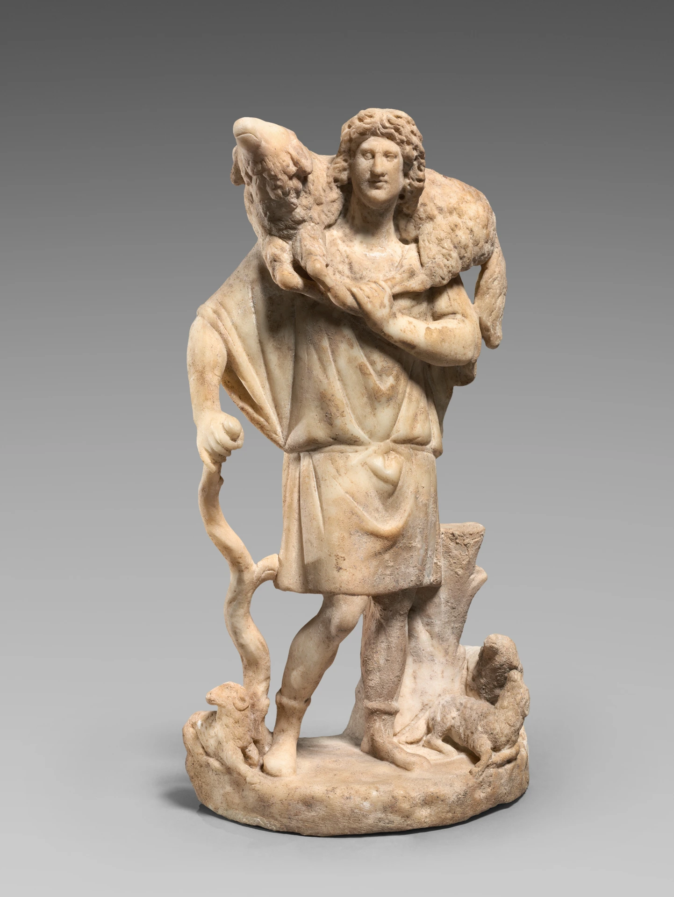
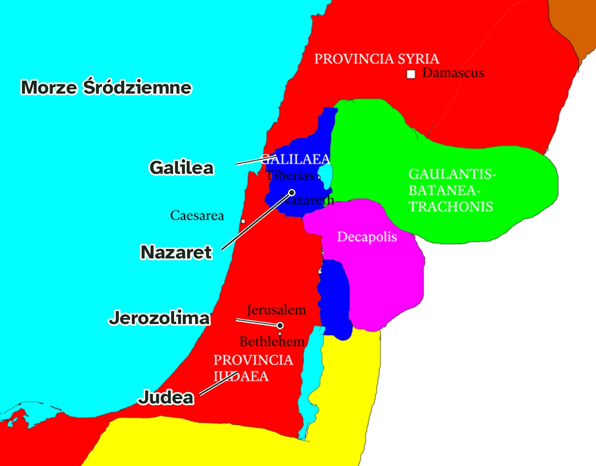
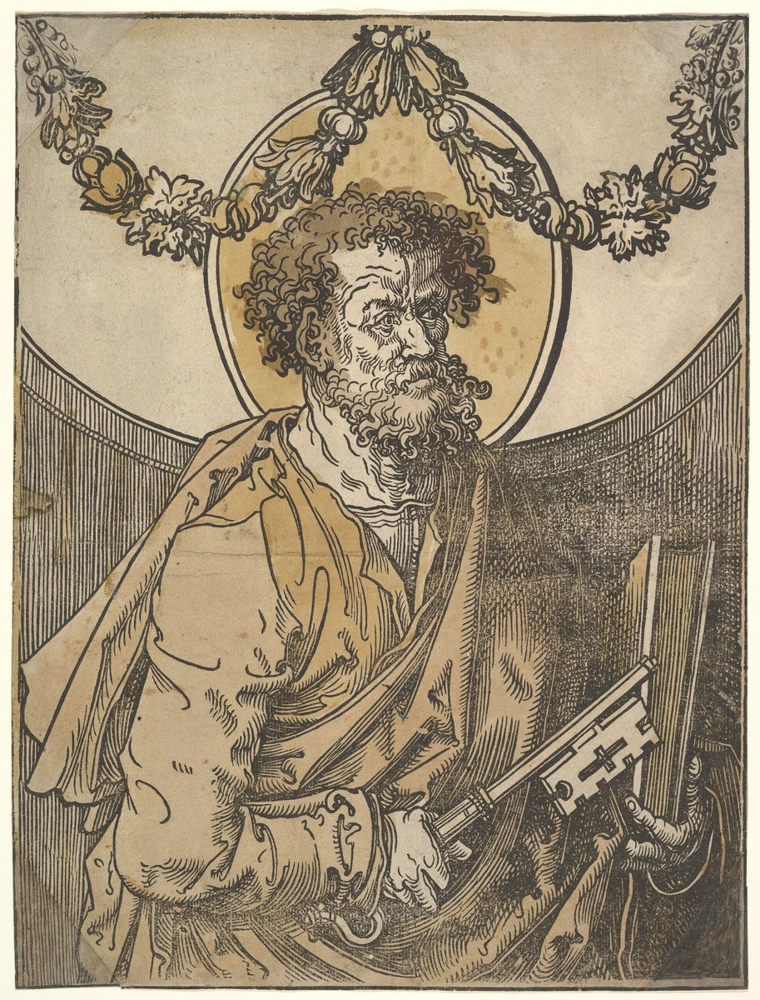
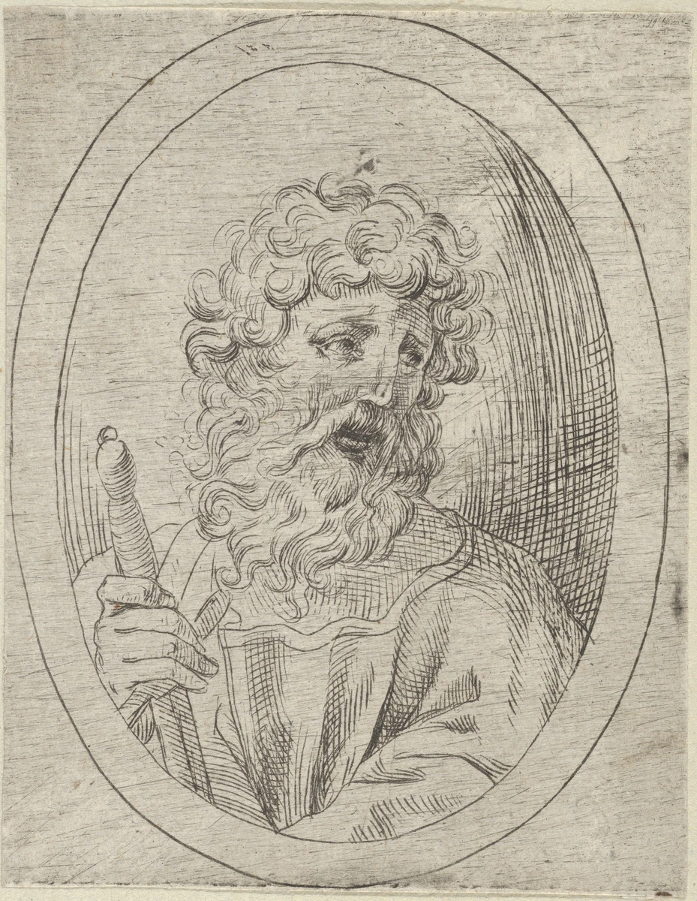
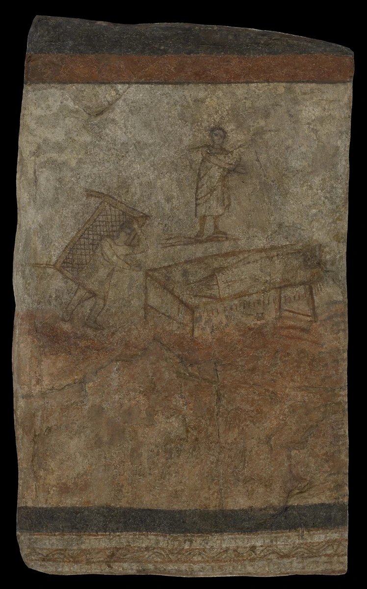
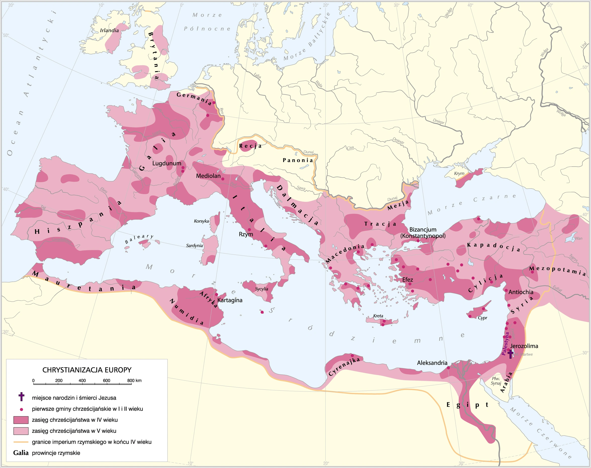
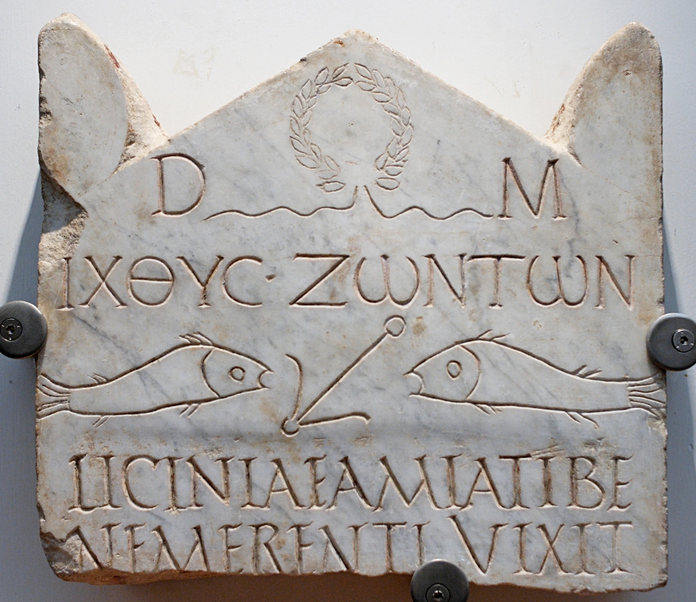
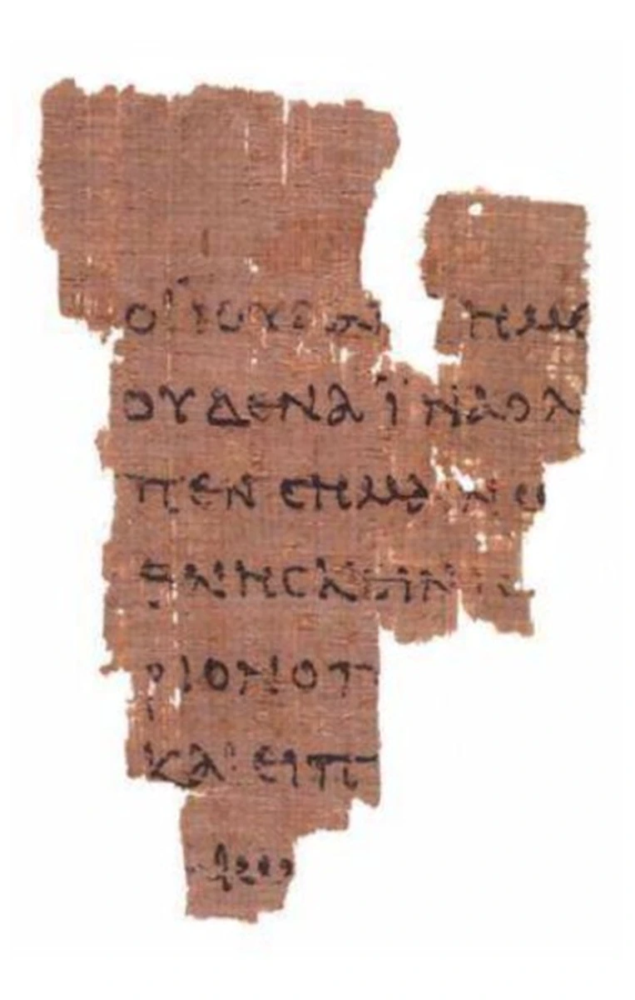
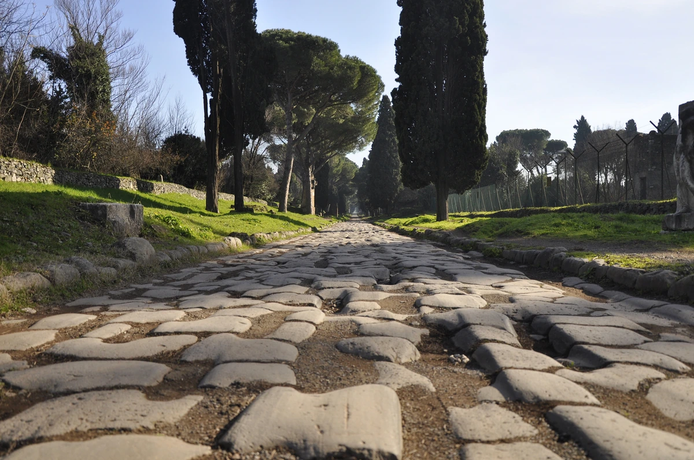
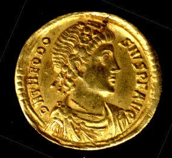

<!-- .slide: id="otwarcie" data-purpose="opening" data-layout="hero-source" -->

<header>
Starożytny Rzym · klasa V
<h1>Początki chrześcijaństwa</h1>
Od pierwszej wspólnoty w Jerozolimie do decyzji rzymskich cesarzy
</header><figure class="source-figure"><figcaption>Marmurowa figurka pasterza · ok. 280–290 r.</figcaption></figure>

notes:
1 min. Zapisz temat. Figurka to starożytny zabytek, nie portret Jezusa; motyw pasterza był znany także poza chrześcijaństwem.

---

<!-- .slide: id="cele" data-purpose="explanation" data-layout="plain" -->
## Cele lekcji

- Ustalimy, kiedy i jak Rzym podporządkował sobie Judeę.
- Poznamy nauczanie Jezusa i odróżnimy wydarzenia historyczne od treści wiary.
- Sprawdzimy, jak żyli pierwsi chrześcijanie i jak ich religia dotarła do innych miast.
- Wyjaśnimy znaczenie ryby i krzyża oraz poznamy budowę Biblii.
- Wyjaśnimy, dlaczego dochodziło do prześladowań. Odczytamy edykt mediolański i porównamy go z decyzjami Teodozjusza.

notes:
1 min. Zapowiedz, że przy edykcie uczniowie sami poszukają odpowiedzi w tekście.

---

<!-- .slide: id="podboj" data-purpose="explanation" data-layout="plain" data-goals="G1" -->
## Kiedy Rzym podporządkował sobie Judeę?

<h3>63 r. p.n.e.</h3>
Rzymski wódz <strong>Pompejusz</strong> zdobył Jerozolimę. Judea utraciła niezależność, ale Rzym wciąż mógł rządzić przez miejscowych władców.

<h3>6 r. n.e.</h3>
Rzym odsunął władcę Judei i ustanowił tam <strong>bezpośredni zarząd rzymski</strong>. Galileą nadal rządził zależny od Rzymu Herod Antypas.

notes:
2 min. Pompejusz wykorzystał walkę o władzę między braćmi z dynastii hasmonejskiej. Na osi: przejęcie kontroli i wprowadzenie rzymskiego zarządcy to osobne wydarzenia. Nie podawaj 63 r. p.n.e. jako daty utworzenia prowincji obejmującej całą Palestynę.

---

<!-- .slide: id="judea-galilea" data-purpose="evidence" data-layout="map-focus" data-goals="G1" -->

<figure class="source-figure"></figure>

Palestyna · I w. n.e.
<h2>Judea i Galilea</h2>
<strong>Judea (czerwona):</strong> zarząd rzymski. W Jerozolimie stała świątynia ważna dla Żydów.

<strong>Galilea (niebieska):</strong> rządy Heroda Antypasa. W Nazarecie dorastał Jezus.

<strong>Wskaż oba miasta.</strong> Które leży dalej na północ?

notes:
2 min. Wskaż wschodni brzeg Morza Śródziemnego. Nazaret leży dalej na północ. Mapa pokazuje podział w czasach Jezusa, nie sytuację z 63 r. p.n.e. Nie utożsamiaj całej czerwieni z Judeą.

---

<!-- .slide: id="jezus" data-purpose="explanation" data-layout="plain" data-goals="G1" -->
## Czego nauczał Jezus?

Jezus z Nazaretu był Żydem. Wychował się w <strong>judaizmie</strong>, religii, która głosi wiarę w jednego Boga.

<h3>Nauka</h3>
Jezus głosił nadejście Królestwa Bożego. Uczył miłości do Boga i bliźniego oraz przebaczania.

<h3>Przykład</h3>
W przypowieści o miłosiernym Samarytaninie przechodzień pomaga rannemu nieznajomemu. Miłość bliźniego widać w tym, co człowiek robi.

notes:
2 min. Przypowieść to krótka historia z przesłaniem; nie jest relacją z konkretnego zdarzenia. W I w. część Żydów oczekiwała Mesjasza, którego Bóg miał posłać. Nie przeciwstawiaj „surowego judaizmu” i „miłosiernego chrześcijaństwa”.

---

<!-- .slide: id="ukrzyzowanie" data-purpose="explanation" data-layout="comparison" data-goals="G1" -->
## Śmierć Jezusa i wiara jego uczniów

<h3>Wydarzenie historyczne</h3>
Około <strong>30 r. n.e.</strong> Jezus został ukrzyżowany w <strong>Jerozolimie</strong> za rządów rzymskiego namiestnika Poncjusza Piłata. Ewangelie podają, że oskarżono Jezusa o to, że uważał się za króla Żydów.

<h3>Wiara chrześcijan</h3>
Po jego śmierci uczniowie głosili, że Jezus <strong>zmartwychwstał</strong>. Wierzyli, że jest Synem Bożym i obiecanym przez Boga <strong>Mesjaszem</strong>. „Chrystus” to grecki odpowiednik słowa „Mesjasz”.

notes:
2 min. Dokładny rok śmierci nie jest pewny; Nowa Era podaje około 33 r., drugi podręcznik około 30 r. Wspomnij, że w relacjach ewangelicznych pojawiają się spór z częścią przywódców i oskarżenie o roszczenia królewskie; to nie zbiorowa odpowiedzialność Żydów. Rozróżnij wydarzenie badane przez historyka od treści wiary, bez ankietowania klasy.

---

<!-- .slide: id="zapis-1" data-purpose="synthesis" data-layout="plain" data-goals="G1" -->

<h2>PAMIĘTAJ!</h2><ul><li><strong>63 r. p.n.e.</strong> – Pompejusz zdobył Jerozolimę.</li><li><strong>6 r. n.e.</strong> – Rzym objął bezpośredni zarząd w Judei.</li><li><strong>I w. n.e.</strong> – chrześcijaństwo wyrosło z judaizmu w Palestynie i opiera się na nauczaniu Jezusa.</li></ul>

notes:
2 min. Cichy zapis. Nie dyktuj nowych szczegółów.

---

<!-- .slide: id="apostolowie" data-purpose="explanation" data-layout="plain" data-goals="G2" -->
## Piotr i Paweł: jak przekazywano naukę?

<h3>Św. Piotr</h3>
Jeden z <strong>Dwunastu</strong> najbliższych uczniów Jezusa. Był jednym z przywódców pierwszej wspólnoty w Jerozolimie. <strong>Apostoł</strong> to wysłannik, który głosi naukę Jezusa.

<h3>Św. Paweł z Tarsu</h3>
Najpierw zwalczał chrześcijan, potem sam przyjął ich wiarę. Nie należał do Dwunastu. W miastach Azji Mniejszej i Grecji głosił naukę także <strong>nie-Żydom</strong>, zakładał wspólnoty i podtrzymywał z nimi kontakt listami.

notes:
2 min. Paweł był apostołem w szerszym znaczeniu niż „jeden z Dwunastu”. Listy pozwalały wyjaśniać sprawy wspólnoty z daleka. Nie przypisuj Pawłowi założenia wszystkich gmin.

---

<!-- .slide: id="atrybuty" data-purpose="evidence" data-layout="plain" data-goals="G2" -->
## Jak rozpoznać Piotra i Pawła?

<article><figure></figure>
<h3>Św. Piotr</h3>
<strong>Klucze</strong> przypominają słowa Jezusa o „kluczach królestwa niebieskiego”. To znak zadania powierzonego Piotrowi.

Drzeworyt z 1515 r.

</article><article><figure></figure>
<h3>Św. Paweł</h3>
<strong>Miecz</strong> nawiązuje do tradycji o jego męczeńskiej śmierci. Pawła przedstawia się też z <strong>księgą</strong>, która przypomina o jego listach.

Rycina z XVII w.

</article>

<strong>Atrybut</strong> to znak, który pomaga rozpoznać postać w sztuce. Te wizerunki powstały wiele wieków po śmierci apostołów.

notes:
1 min. Wskaż duży klucz na dole po prawej i rękojeść po lewej na rycinie Pawła. Księga to inny częsty atrybut Pawła, nie element widoczny na tej rycinie. Klucze nawiązują do Mt 16,19; o męczeństwie Pawła mów jako o tradycji, bez szczegółów egzekucji.

---

<!-- .slide: id="gminy" data-purpose="evidence" data-layout="plain" data-goals="G2" -->

<h2>Życie pierwszych chrześcijan</h2>
<strong>Gmina</strong> to miejscowa wspólnota wiernych. Na początku chrześcijanie spotykali się często w prywatnych domach.
<ul><li>Razem się modlili i słuchali nauczania.</li><li>Łamali chleb na pamiątkę Ostatniej Wieczerzy.</li><li>Przyjmowali nowych wiernych przez chrzest i wspierali potrzebujących.</li></ul>
<figure class="source-figure"><figcaption>Malowidło z miejsca chrztu w domu chrześcijan · Dura Europos (Syria), III w.</figcaption></figure>

notes:
2 min. To znacznie późniejszy przykład niż pierwsza wspólnota w Jerozolimie: dom przystosowano około 240 r. Nazwij baptysterium miejscem przeznaczonym do chrztu. Wczesne domowe spotkania nie oznaczają, że wszyscy chrześcijanie na co dzień spotykali się w katakumbach.

---

<!-- .slide: id="biskup" data-purpose="explanation" data-layout="plain" data-goals="G2" -->
## Od gminy do biskupa Rzymu

<h3>Gmina</h3>
Miejscowa wspólnota. Razem z innymi gminami tworzyła <strong>Kościół</strong>, czyli wspólnotę chrześcijan.

<h3>Biskup</h3>
Z czasem biskup kierował lokalną wspólnotą: czuwał nad nauczaniem i organizacją jej życia.

<h3>Biskup Rzymu</h3>
Jego znaczenie rosło stopniowo. W Kościele katolickim biskup Rzymu to <strong>papież</strong>.

Tradycja katolicka uznaje św. Piotra za pierwszego biskupa Rzymu i pierwszego papieża. Za jego życia urząd nie wyglądał tak jak dzisiaj.

notes:
1 min. „Kościół” w tym znaczeniu to ludzie, nie budynek. Nie wszyscy chrześcijanie dziś podlegają papieżowi. O roli Piotra w pierwszej wspólnocie i tradycji rzymskiej mów oddzielnie.

---

<!-- .slide: id="mapa-gmin" data-purpose="evidence" data-layout="map-focus" data-goals="G2" -->

<figure class="source-figure"></figure>
<h2>Gdzie powstawały gminy?</h2>
Drogi i podróże morskie ułatwiały głoszenie nauki w kolejnych miastach.
<ul class="map-key"><li><b>Punkty</b> – gminy w I–II w.</li><li><b>Ciemny róż</b> – zasięg w IV w.</li><li><b>Jasny róż</b> – zasięg w V w.</li><li><b>Złota linia</b> – granica cesarstwa pod koniec IV w.</li></ul>
Wskaż Jerozolimę i Rzym. W którym wieku zasięg jest największy?

notes:
2 min. Powiększ mapę. Największy z przedstawionych zasięgów – w V w. Podróże drogami i statkami ułatwiały przekazywanie nauki między miastami. Punkty nie oznaczają trasy Pawła, kolor nie oznacza, że wszyscy mieszkańcy zmienili wyznanie. Krzyż wskazuje okolice wydarzeń z życia Jezusa, a nie Jerozolimę jako miejsce narodzin.

---

<!-- .slide: id="stela" data-purpose="evidence" data-layout="plain" data-goals="G2" -->

<figure class="source-figure"><figcaption>Nagrobek Licinii Amias z Rzymu · II–III w.</figcaption></figure>
<h2>Ryba i krzyż</h2>
<strong>Ryba.</strong> Po grecku <em>ichthys</em> (ΙΧΘΥΣ). Chrześcijanie odczytywali litery tego słowa jako początek słów: „Jezus Chrystus, Syn Boży, Zbawiciel”.

<strong>Krzyż</strong> przypomina o ukrzyżowaniu Jezusa. Dla chrześcijan oznacza też nadzieję zbawienia.

<strong>Na zdjęciu:</strong> odszukaj dwie ryby. Co widać między nimi?

notes:
2 min. Pokaż najpierw kamień: ryby i kotwica. Kotwica mogła wyrażać nadzieję. Same znaki nie dowodzą wyznania Licinii ani tego, że ryba była wszędzie używana jako tajne hasło.

---

<!-- .slide: id="biblia" data-purpose="explanation" data-layout="plain" data-goals="G2" -->

<h2>Biblia chrześcijan</h2>
<strong>Biblia</strong>, czyli Pismo Święte chrześcijan, jest zbiorem ksiąg.

<strong>Stary Testament:</strong> księgi powstałe przed czasami Jezusa, m.in. opowieści o dziejach Izraela, prawo i psalmy. Wiele z nich jest świętych także w judaizmie.

<strong>Nowy Testament:</strong> m.in. cztery <strong>Ewangelie</strong> o życiu i nauczaniu Jezusa oraz <strong>listy</strong>, w tym listy Pawła do wspólnot.

<figure class="source-figure"><figcaption>Fragment Ewangelii według Jana · grecki papirus, ok. II–III w.</figcaption></figure>

notes:
1 min. Pokaż, że papirus to dawna kopia fragmentu Ewangelii, nie kartka napisana przez Jezusa. Nie utożsamiaj całego chrześcijańskiego Starego Testamentu z identycznym zestawem ksiąg dla wszystkich wyznań.

---

<!-- .slide: id="zapis-2" data-purpose="synthesis" data-layout="plain" data-goals="G2" -->

<h2>PAMIĘTAJ!</h2><ul><li><strong>Apostołowie</strong> głosili naukę Jezusa. Paweł docierał też do nie-Żydów.</li><li><strong>Gmina</strong> to miejscowa wspólnota. Z czasem kierował nią <strong>biskup</strong>. Papież to biskup Rzymu.</li><li><strong>Biblia</strong> składa się ze Starego i Nowego Testamentu.</li></ul>

notes:
2 min. Cichy zapis, bez dodatkowych zdań do dyktowania.

---

<!-- .slide: id="przesladowania" data-purpose="explanation" data-layout="comparison" data-goals="G3" -->
## Dlaczego dochodziło do prześladowań?

Chrześcijanie wierzyli w jednego Boga i odmawiali składania ofiar rzymskim bogom. Władze mogły uznać taką odmowę za brak lojalności wobec państwa.

<h3>64 r. · Rzym</h3>
Po wielkim pożarze <strong>Neron</strong> obwinił chrześcijan. Prześladowania dotknęły wiernych w samym Rzymie.

<h3>Od 303 r. · cesarstwo</h3>
Za <strong>Dioklecjana</strong> nakazywano m.in. zamykanie lub niszczenie miejsc modlitwy. Przepisy miały szeroki zasięg, lecz nie wszędzie stosowano je tak samo.

<strong>Męczennik</strong> to człowiek, który poniósł śmierć za wiarę.

notes:
2 min. Zestaw skalę obu fal. Oskarżenie Nerona to nie dowód winy. Wczesne prześladowania nie były stałe ani jednakowe w całym państwie.

---

<!-- .slide: id="via-appia" data-purpose="explanation" data-layout="plain" data-goals="G3" -->

<h2>Dwie drogi, dwie opowieści</h2>
<strong>Via Appia · Rzym.</strong> Starożytna droga. Według legendy <em>Quo vadis?</em> uciekający Piotr spotkał tu Jezusa i zawrócił do Rzymu.

<strong>Via Dolorosa · Jerozolima.</strong> „Droga cierpienia” – później wyznaczony szlak upamiętniający drogę Jezusa na ukrzyżowanie.

<figure class="source-figure"><figcaption>Via Appia pod Rzymem · współczesne zdjęcie starożytnej drogi</figcaption></figure>

notes:
1 min. Quo vadis? znaczy „Dokąd idziesz?”. Opcjonalnie: przy Via Appia ukrzyżowano jeńców po powstaniu Spartakusa (71 r. p.n.e.) – to inna historia, sprzed narodzin chrześcijaństwa. Przy poślizgu pomiń tę dygresję, nie lekturę edyktu.

---

<!-- .slide: id="wstep-edykt" data-purpose="explanation" data-layout="plain" data-goals="G4" -->
## Zanim przeczytamy edykt

Na początku IV w. chrześcijanie w cesarstwie doświadczyli kolejnej fali prześladowań. Po kilku latach rzymscy władcy zaczęli zmieniać prawo. Zaraz sprawdzimy, <strong>co postanowili</strong>.

<strong>Edykt</strong> to rozporządzenie władcy. W źródle <strong>bóstwo</strong> oznacza istotę boską.

notes:
1 min. Przypomnij prześladowania od 303 r. i wyjaśnij pojęcia edyktu i bóstwa. Nie zdradzaj nazwisk władców, miejsca, daty ani ustaleń – odczytają je uczniowie.

---

<!-- .slide: id="pytanie-list" data-purpose="question" data-layout="statement-centered" data-goals="G4" -->
## Czego szukać w edykcie?

<ol><li>Kto, kiedy i gdzie wydał edykt mediolański?</li><li>Jakie prawo dawał mieszkańcom cesarstwa? Komu je przyznano? Wskaż słowa, na których opierasz odpowiedź.</li></ol>

notes:
1 min. Uczniowie czytają pytania przed pokazaniem źródła. Przypomnij, że wskazówki słownikowe były na poprzednim slajdzie. Nie czytaj wstępu z podręcznika, bo udziela odpowiedzi.

---

<!-- .slide: id="list-313" data-purpose="evidence" data-layout="evidence" data-goals="G4" -->
## Edykt mediolański · 313 r.

<figure class="document"><blockquote>Kiedy spotkaliśmy się w Mediolanie — ja, cesarz Konstantyn, i ja, cesarz Licyniusz — omawialiśmy sprawy pomyślności i bezpieczeństwa publicznego. Uznaliśmy, że przede wszystkim trzeba ustalić zasady dotyczące czci oddawanej bóstwu: dać chrześcijanom oraz wszystkim pozostałym swobodę wyboru religii. Dzięki temu bóstwo w niebie może okazać życzliwość nam i wszystkim, którzy podlegają naszej władzy.</blockquote><figcaption>Laktancjusz, <i>O śmierci prześladowców</i> · rozdz. 48, § 2 · opracowanie na podstawie łaciny</figcaption></figure>

notes:
5 min. Dwie minuty cichej lektury, dwie na zapis dwóch odpowiedzi, jedna na wskazanie słów stanowiących dowód. Datę uczniowie biorą z nagłówka, nie z akapitu. Dopiero potem przejdź do slajdu z ustaleniami.

---

<!-- .slide: id="decyzje-313" data-purpose="explanation" data-layout="plain" data-goals="G4" -->
## 313 r. – co postanowiono?

<strong>Konstantyn Wielki i Licyniusz</strong> spotkali się w Mediolanie.

<ul class="provisions"><li><strong>Swoboda wyznania:</strong> chrześcijanie i inni mieszkańcy mogli wybrać religię. W tekście: „chrześcijanom oraz wszystkim pozostałym”.</li><li><strong>Zwrot mienia:</strong> chrześcijańskim wspólnotom nakazano oddać zabrane miejsca spotkań i majątek. Ten zapis jest w dalszej części dokumentu, poza naszym fragmentem.</li></ul>

Chrześcijanie mogli otwarcie praktykować swoją wiarę. Nie był to nakaz przyjęcia chrześcijaństwa.

notes:
1 min. Potwierdź odpowiedzi. Zwrot mienia to osobna decyzja, niewidoczna w pokazanym fragmencie. Uzgodnienia z Mediolanu znamy z listu wykonawczego zachowanego u Laktancjusza. Tolerancja ogłoszona przez Galeriusza w 311 r. to kontekst dla nauczyciela.

---

<!-- .slide: id="status-religii" data-purpose="explanation" data-layout="plain" data-goals="G4" -->

<h2>Co zmienił Teodozjusz I?</h2>
Rzymski cesarz panujący w latach <strong>379–395</strong>.

<strong>380 r.</strong> — wskazał chrześcijaństwo nicejskie (jedną postać chrześcijaństwa) jako <strong>wyznanie oficjalne</strong>.

<strong>391–392 r.</strong> — kolejne przepisy <strong>zakazały składania ofiar dawnym bogom</strong> i wielu tradycyjnych obrzędów.

Zmiana prawa nie oznaczała, że wszyscy od razu zmienili wiarę.

<figure class="source-figure"><figcaption>Teodozjusz I na złotej monecie z końca IV w.</figcaption></figure>

notes:
2 min. Wskaż na monecie profil i diadem cesarza. To oficjalny wizerunek z epoki, nie fotografia człowieka. Dopytaj: która decyzja dawała wszystkim wybór, a która wskazywała oficjalne wyznanie? Nie utożsamiaj późniejszych przepisów z zakazem wszystkich innych religii.

---

<!-- .slide: id="zapis-3" data-purpose="synthesis" data-layout="plain" data-goals="G3 G4" -->

<h2>PAMIĘTAJ!</h2><ul><li>Prześladowania chrześcijan wracały w różnych miejscach i okresach.</li><li><strong>313 r.</strong> – edykt mediolański: swoboda wyznania.</li><li><strong>380 r.</strong> – Teodozjusz I: chrześcijaństwo nicejskie wyznaniem oficjalnym.</li><li><strong>391–392 r.</strong> – zakaz tradycyjnych ofiar i wielu obrzędów.</li></ul>

notes:
2 min. Cichy zapis. Przy poślizgu pozwól zapisać trzy linie z datami.

---

<!-- .slide: id="bilet" data-purpose="exit-ticket" data-layout="plain" data-goals="G1 G2 G4" -->
## Bilet wyjścia

<ol><li>Podaj wiek i miasto, w którym działała pierwsza wspólnota.</li><li>Podaj jeden sposób, w jaki Paweł pomagał nauce Jezusa dotrzeć dalej.</li><li>Która data oznacza swobodę wyznania, a która oficjalne poparcie chrześcijaństwa nicejskiego: <strong>313</strong> czy <strong>380</strong>?</li></ol>

notes:
2 min. Każdy zapisuje trzy krótkie odpowiedzi. Klucz: I w. n.e., Jerozolima; głosił naukę w podróżach także nie-Żydom albo wspierał oddalone wspólnoty listami; 313 – swoboda, 380 – oficjalne wyznanie.

---

<!-- .slide: id="synteza" data-purpose="synthesis" data-layout="plain" data-goals="G1 G2 G3 G4" -->
## Podsumowanie

- Chrześcijaństwo wyrosło **w I w. n.e. z judaizmu**, w Palestynie pod władzą Rzymu.
- Jezus uczył miłości bliźniego i przebaczenia. Po jego ukrzyżowaniu uczniowie głosili, że zmartwychwstał.
- Piotr i inni apostołowie głosili naukę Jezusa. Paweł docierał też do nie-Żydów. W miastach powstawały **gminy**. Kierowali nimi biskupi; papież to biskup Rzymu.
- **Ryba i krzyż** to symbole chrześcijaństwa. **Biblia** obejmuje Stary i Nowy Testament.
- Po falach prześladowań edykt z **313 r.** zapewnił swobodę wyznania. W **380 r.** Teodozjusz I wskazał chrześcijaństwo nicejskie jako wyznanie oficjalne, a później zakazał m.in. ofiar dawnym bogom.

notes:
1 min. Przeczytaj z klasą dwa ostatnie punkty. To podsumowanie do powtórki, bez kolejnego przepisywania.
