<!-- .slide: id="otwarcie" class="opening-slide" data-purpose="opening" data-layout="hero-source" data-goals="G1" -->

<figure class="source-figure ">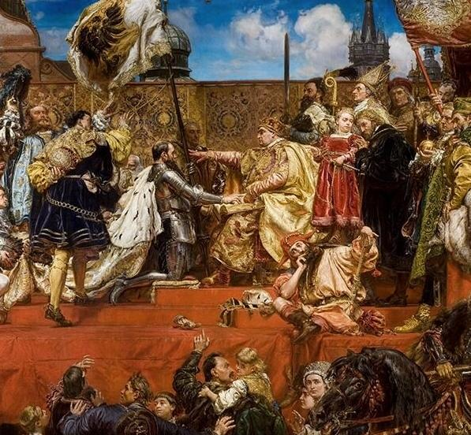</figure>

Polska i Litwa w XVI wieku
<h1>W czasach ostatnich Jagiellonów</h1>
Jak dawny przeciwnik stał się lennikiem polskiego króla?

notes:
Wejście: „Dlaczego książę klęczy przed innym władcą?”. Przyjmij dwie hipotezy bez wykładu. Wrócimy do całego obrazu. Kadr z późniejszego obrazu Jana Matejki Hołd pruski (1882), nie fotografia z 1525 r.

---

<!-- .slide: id="rodzina" class="genealogy full-map" data-purpose="explanation" data-layout="map-focus" data-goals="G1" -->

<h2>Drzewo Jagiellonów</h2>
<figure class="source-figure">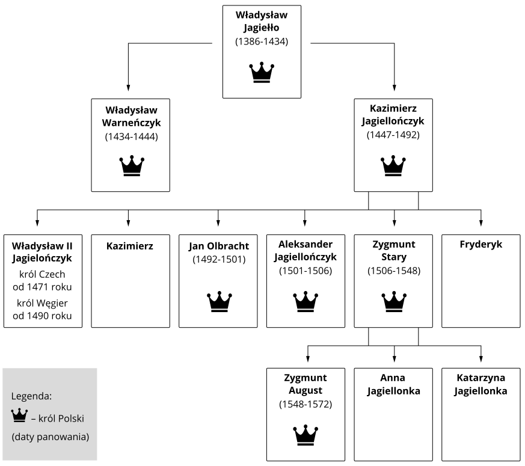</figure>

notes:
Dynastia to rodzina, której członkowie sprawują władzę. Jagiellonowie wywodzili się z Litwy. Jagiełło został królem Polski w 1386 r. Wskaż Kazimierza, jego trzech synów będących kolejnymi królami Polski i Augusta. Korony i legenda oznaczają panowanie w Polsce, nie lata życia. To drzewo wybranych członków, nie wszystkich dzieci: nie ma tu Bony ani Zofii, matki Albrechta. Bona była matką Augusta, Anny i Katarzyny. Powiększ drzewo kliknięciem lub Enter. Osobną oś królów usunięto; kolejność można odczytać z dat w drzewie. Źródło: dokładny SVG wskazany przez nauczycielkę, ZPE RkJWYbOAeEHmA.

---

<!-- .slide: id="stary-i-bona" class="royal-pair" data-purpose="explanation" data-layout="photo-pair" data-goals="G1" -->

<h2>Zygmunt Stary i Bona</h2>

<strong>1506:</strong> Zygmunt objął tron po Aleksandrze; koronacja w 1507 r.
<h3>Bona: nie tylko „włoszczyzna”</h3><ul><li><strong>Włoskie ogrody:</strong> zakładała je w Krakowie i Niepołomicach. Do dziś kojarzona z włoską kuchnią i „włoszczyzną”.</li><li><strong>Wykształcenie:</strong> uczyła się historii, prawa i zarządzania.</li><li><strong>Gospodarka:</strong> rozwijała majątki — budowała mosty, młyny i tartaki.</li></ul>

<figure class="source-figure">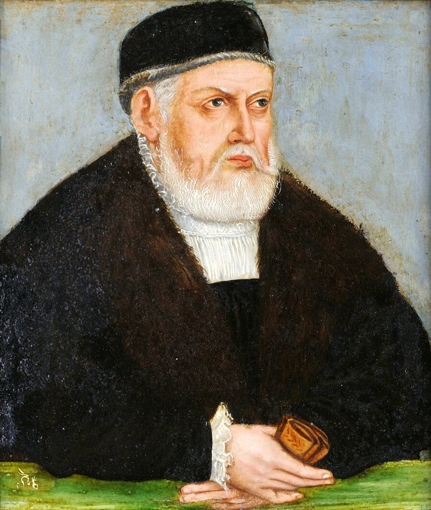<figcaption>Zygmunt I Stary, miniatura z 1553 r.</figcaption></figure><figure class="source-figure">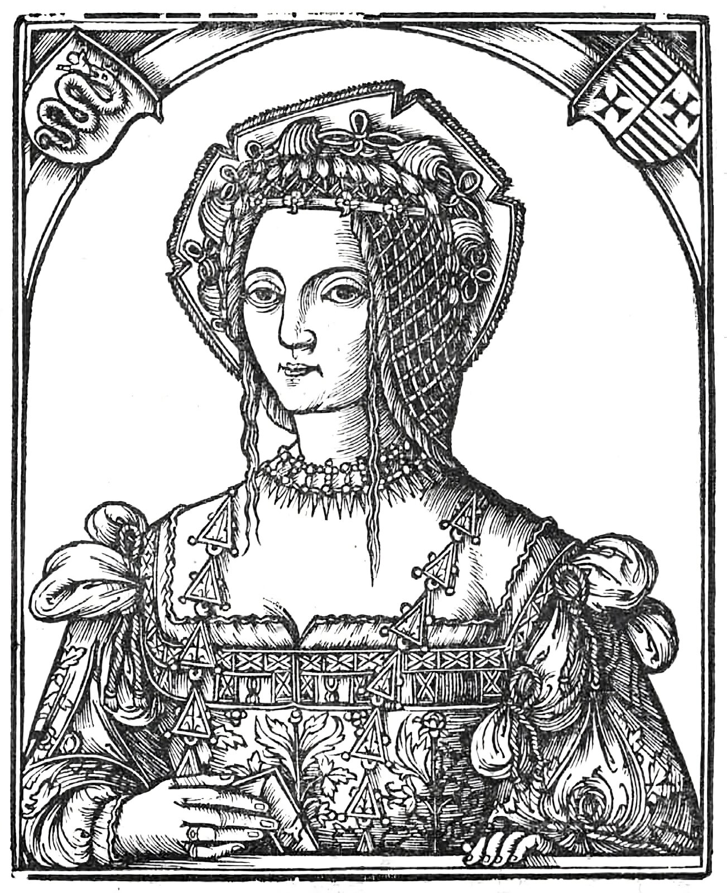<figcaption>Bona Sforza — Włoszka, żona króla i matka Augusta. Drzeworyt z 1521 r.</figcaption></figure>

notes:
Bona pochodziła z Włoch, była żoną Starego i matką Augusta. Trzy krótkie ciekawostki: włoskie ogrody w Krakowie i Niepołomicach (Muzeum w Wilanowie), nauka historii, prawa i administracji oraz budowa mostów, młynów i tartaków (ZPE D12LkQne7). „Włoszczyzna” to kulinarne skojarzenie z Boną; nie mów, że przed nią Polska nie znała warzyw, ani nie powtarzaj niepewnej anegdoty o pomidorach. Polska i Litwa miały wspólnego władcę, lecz pozostawały odrębne. Szersza unia lubelska należy do innego tematu. Opcjonalnie Bona wspierała kulturę renesansu i studia za granicą; ruch egzekucyjny żądał zwrotu bezprawnie przejętych królewszczyzn, czyli majątków monarchy.

---

<!-- .slide: id="mapa-prus" class="full-map" data-purpose="evidence" data-layout="map-focus" data-goals="G1" -->

<h2>Prusy w 1525 roku</h2>
<figure class="source-figure ">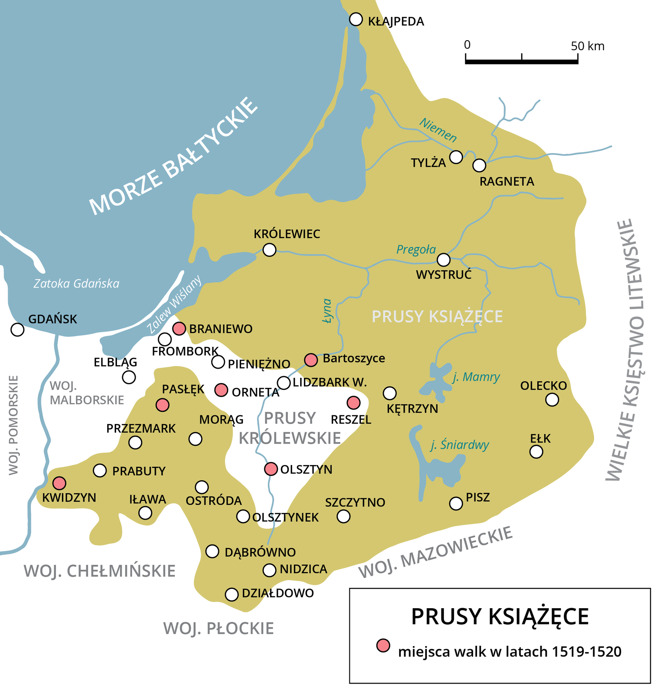</figure>

notes:
Najpierw orientacja: wskaż Bałtyk, Gdańsk i Królewiec. Potem białą część wokół Olsztyna i żółte Prusy Książęce. Mapa pokazuje rok 1525, przed omówieniem cofamy się do 1466. Biała część wokół Olsztyna to Warmia w Prusach Królewskich; to nie Mazury. Czerwone punkty to miejsca walk 1519–1520, nie granice. Źródło: Contentplus.pl na podstawie Wikimedia Commons, ZPE ROSKbjbwjU4Rm, CC BY-SA 3.0.

---

<!-- .slide: id="prusy-1466" class="full-map" data-purpose="explanation" data-layout="map-focus" data-goals="G1" -->

<h2>1466 · II pokój toruński</h2>
<figure class="source-figure">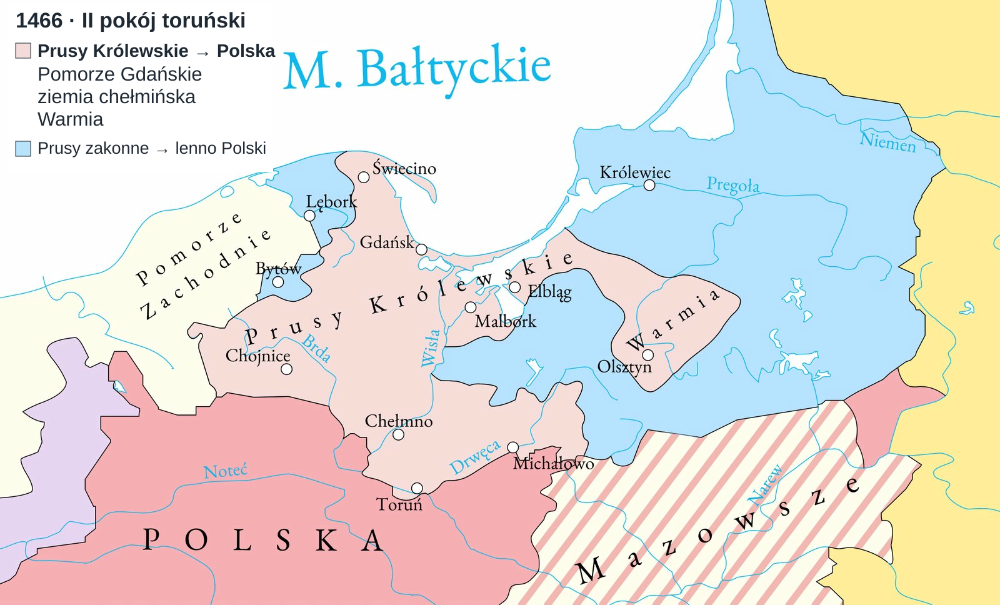</figure>

notes:
Mapa ZPE przedstawia postanowienia drugiego pokoju toruńskiego w 1466 r., nie rok 1525. Za Kazimierza IV Polska odzyskała Pomorze Gdańskie i ziemię chełmińską oraz otrzymała Warmię. Wskaż Gdańsk i pas Pomorza; Chełmno i Toruń w ziemi chełmińskiej; podpisaną Warmię z Olsztynem. Jasnoróżowe Prusy Królewskie weszły bezpośrednio do Polski (starszy obszar Polski jest ciemnoróżowy); niebieski wschodni obszar pozostaje państwem zakonnym, lennem polskiego króla. Na mapie nie ma jeszcze Prus Książęcych — powstaną w 1525. Zakon kwestionował pokój i żądał zwrotu ziem, także Gdańska. Nie przypisuj 1466 Zygmuntowi. Warmia to nie Mazury. Źródło: Learnetic SA, ZPE DVhXDJsl3, figura R1cn1lTYNr1Mx, CC BY 4.0. Powiększ przez klik lub Enter.

---

<!-- .slide: id="wojna-z-zakonem" class="portrait-side" data-purpose="explanation" data-layout="split" data-goals="G1" -->

<h2>Ostatnia wojna z Krzyżakami</h2>

1519–1521
<ul><li><strong>Albrecht Hohenzollern</strong>, wielki mistrz zakonu, domagał się zwrotu ziem utraconych przez zakon.</li><li>Polskie wojsko zdobywało twierdze. Albrecht nie zdołał pokonać Polski.</li><li>W <strong>1521 r.</strong> zawarto <strong>rozejm na cztery lata</strong> – czasową przerwę w walce, nie ostateczny pokój.</li></ul>
<figure class="source-figure ">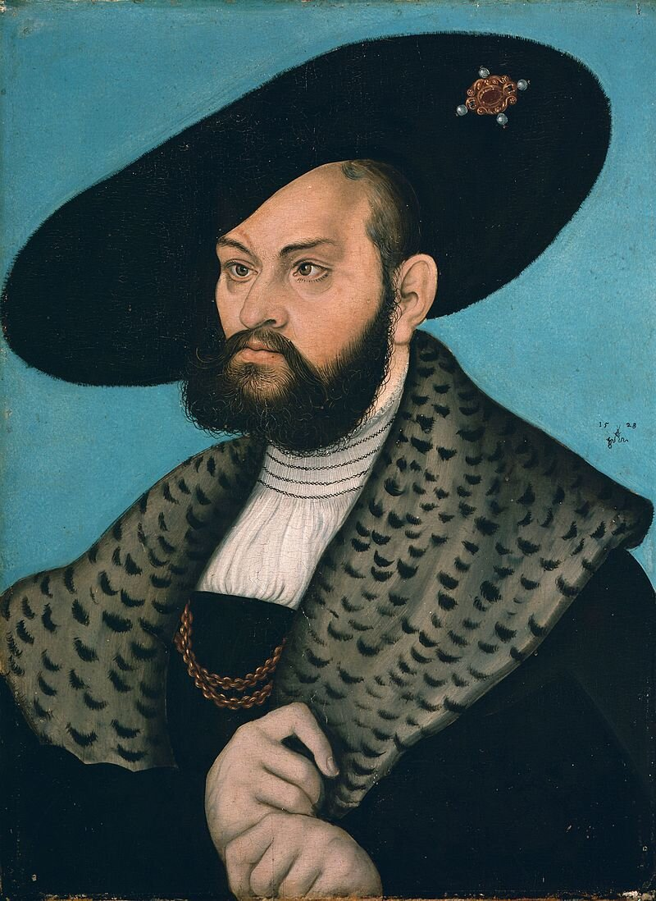<figcaption>Albrecht Hohenzollern, portret Cranacha Starszego</figcaption></figure>

notes:
Ciąg: żądania ziem → wojna → rozejm. Wielki mistrz to najwyższy przełożony zakonu. Ciekawostka źródłowa 1: Albrecht był siostrzeńcem Zygmunta Starego; jego matką była Zofia Jagiellonka, siostra króla (ZPE D15TRDKIg). Krewni mogli być przeciwnikami.

---

<!-- .slide: id="sekularyzacja" class="change" data-purpose="explanation" data-layout="impact-flow" data-goals="G1" -->

<h2>Od wielkiego mistrza do księcia</h2>

Po trudnej wojnie Albrecht chciał zachować władzę i zakończyć spór z Polską.

<h3>Państwo zakonne</h3>
Albrecht rządzi jako wielki mistrz katolickiego zakonu.

Reformacja

→

Sekularyzacja

<h3>Świeckie księstwo</h3>
Albrecht przyjmuje luteranizm i chce rządzić jako dziedziczny książę.

<figure class="source-figure ">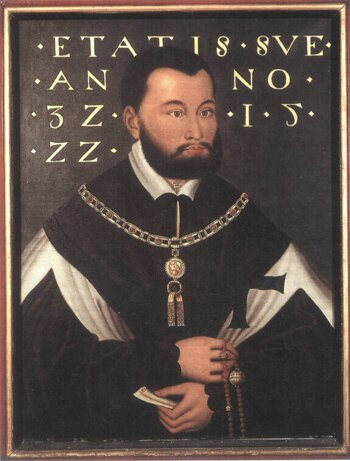<figcaption>Albrecht jako wielki mistrz, 1522 r.</figcaption></figure>

<strong>Sekularyzacja</strong> oznacza tu zamianę państwa zakonnego w świeckie księstwo.

„Świeckie” nie znaczy „bez religii”. Książę i poddani mogli być luteranami.

<strong>Luteranizm</strong> – chrześcijański nurt reformacji Marcina Lutra.

notes:
Luteranizm to nurt chrześcijaństwa związany z reformacją Marcina Lutra. Po trudnej wojnie Albrecht szukał sposobu utrzymania władzy i zakończenia konfliktu. Przejście na luteranizm umożliwiło porzucenie formy państwa zakonnego; dla uznania świeckiego księstwa potrzebował porozumienia z polskim królem. Papież i cesarz nie uznali tej przemiany.

---

<!-- .slide: id="uklad-i-hold" class="two-dates" data-purpose="explanation" data-layout="timeline-band" data-goals="G1" -->

<h2>Dwa dni, dwa działania</h2>
<lesson-timeline><lesson-event year="8 kwietnia 1525"><h3>Układ krakowski</h3>
Zygmunt Stary uznał świeckie Prusy Książęce pod władzą Albrechta, zależne od Polski.
</lesson-event><lesson-event year="10 kwietnia 1525"><h3>Hołd na rynku w Krakowie</h3>
Albrecht uroczyście przysiągł wierność polskiemu królowi.
</lesson-event></lesson-timeline>
<strong>Lenno</strong> – ziemia pod władzą lennika, który uznaje zwierzchnictwo seniora. Tu: Albrecht to lennik, a Zygmunt Stary to senior.

notes:
Oddziel traktat od ceremonii. Skutek: nie ma już państwa zakonnego w Prusach, jest świeckie lenno Polski. Nie mów „Prusy Książęce stały się zwykłą częścią Polski”: miały własnego księcia. Senior to władca zwierzchni. Ciekawostka 2: układ i hołd dzieliły dwa dni.

---

<!-- .slide: id="matejko" class="painting" data-purpose="practice" data-layout="source-split" data-goals="G2" -->

<h2>Hołd pruski: zobacz gesty</h2>

<figure class="source-figure ">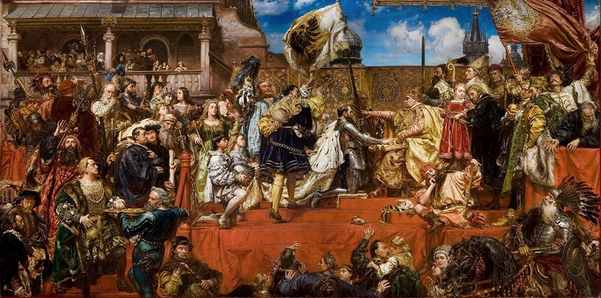<figcaption>Jan Matejko, „Hołd pruski”, 1882 – późniejszy obraz wydarzenia z 1525 r.</figcaption></figure>

Kto klęczy i przed kim?

Jaki przedmiot trzyma Albrecht?

Jak gesty pokazują zależność?

notes:
Praca siedmiu par: 40 s obserwacji, potem po jednym wskazaniu, bez długich wystąpień. Model: Albrecht klęczy przed siedzącym Zygmuntem Starym; sztandar i przysięga wyrażają zależność lenną. Powiększ przez klik/Enter. Ciekawostka 3: obraz powstał w 1882, ponad 350 lat po hołdzie. Bona znajduje się na scenie w kompozycji Matejki; podręcznik s.54 mówi, że obserwowała uroczystość z okna kamienicy. Nie uznawaj jej usytuowania na obrazie za potwierdzony fakt ceremonii.

---

<!-- .slide: id="pytania-do-zrodla" class="source-task" data-purpose="practice" data-layout="task-board" data-goals="G2" -->

<h2>Przeczytaj umowę i znajdź odpowiedzi</h2>

<ol data-task-role="prompt" class="source-questions"><li>Powiedz, w jakiej sytuacji książę Albrecht był zobowiązany przybyć polskiemu królowi na pomoc.</li><li>Wskaż, co świadczy o tym, że zawarta umowa miała trwać także po śmierci księcia Albrechta.</li></ol>
Na następnym slajdzie szukaj zdań o pomocy i o następcach.

<figure class="source-figure "><figcaption>Albrecht i polski król – fragment obrazu Matejki</figcaption></figure>

notes:
Dwa pełne pytania z podręcznika s.55 pokazujemy PRZED cytatem. Poproś, aby każda para odnalazła fragment tekstu, a nie zgadywała z obrazu. Zapowiedz objaśnienie słowa „powinności” – obowiązki.

---

<!-- .slide: id="dokument-1525" class="document" data-purpose="evidence" data-layout="evidence" data-goals="G2" -->

<h2>Powstanie księstwa pruskiego w 1525 roku</h2>

Akt utworzenia Prus Książęcych określał między innymi powinności jego władców wobec królów polskich.

<blockquote>Albrecht, książę pruski, oraz jego następcy i dziedzice lenna będą obowiązani za wyświadczone im przez Nas dobrodziejstwo składać Nam takie przyrzeczenie uległości, że gdybyśmy z racji owej ugody lub nadania lenna zostali zaatakowani przez jakiegokolwiek księcia lub państwo, wtedy [książę] Albrecht, względnie jego następcy, książęta pruscy, mają Nam i Naszemu Królestwu przyjść wszędzie z pomocą we własnej osobie wraz ze wszystkimi swymi poddanymi i z całą swą siłą. Nawzajem zaś My i Nasi Następcy będziemy obowiązani w podobnym wypadku to samo uczynić.</blockquote><figure class="source-figure "></figure>

Źródło: T. Maresz, K. Juszczyk, <em>Historia w źródłach. Starożytność i średniowiecze</em>, Toruń 2004, s. 155.

notes:
Pełny widoczny cytat z s.55, bez skracania i podziału, z zachowanym [książę]. 40 s cichego czytania, potem 60 s odpowiedzi w parze i 30 s sprawdzenia. Model: pomoc w razie ataku z powodu ugody lub nadania lenna; sformułowania „następcy i dziedzice”, „Nasi Następcy” wskazują trwanie. Zwróć uwagę na wzajemność pomocy („Nawzajem”). Cytat to przekład/wybór w podręczniku, nie oryginał łaciński ani cały traktat. Tekst tylko do prywatnego podglądu edukacyjnego; nie publikować bez ustalenia praw do przekładu.

---

<!-- .slide: id="mapa-wschodu" class="full-map" data-purpose="evidence" data-layout="map-focus" data-goals="G3" -->

<h2>Polska, Litwa i wschodni sąsiad</h2>
<figure class="source-figure ">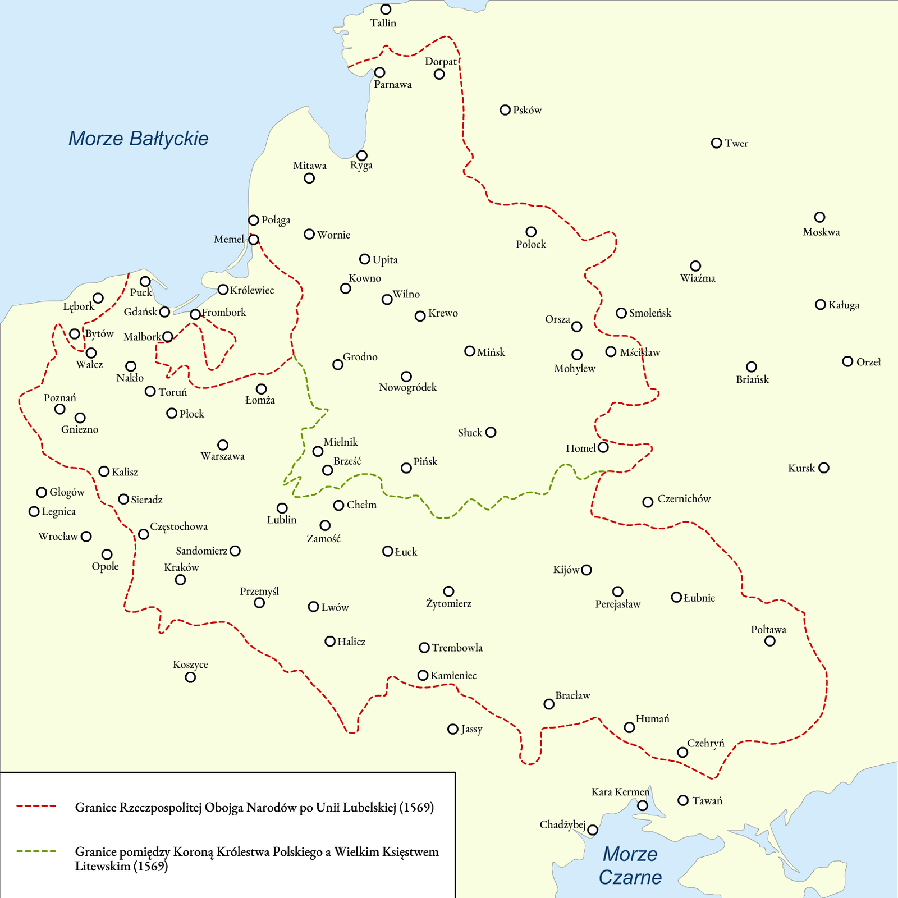</figure>

notes:
Mapa orientacyjna pokazuje STAN Z 1569 r. – data jest w jej legendzie; nie służy do odtwarzania granic w 1514. Wskaż Moskwę na wschodzie, Wilno, Smoleńsk i Orszę. Zanim opowiesz wcześniejszą wojnę, powiedz: „Teraz cofamy się do 1514 roku”. Moskwa to nazwa miasta i państwa moskiewskiego, z którego rozwijała się Rosja. Źródło: Learnetic SA, ZPE R10NoDGrwRfAd, CC BY 4.0.

---

<!-- .slide: id="moskwa-1514" class="eastern-axis" data-purpose="explanation" data-layout="timeline-band" data-goals="G3" -->

<h2>Zwycięstwo nie zawsze zwraca ziemie</h2>

Na wschód od Litwy leżało państwo moskiewskie – z niego rozwijała się Rosja.

<lesson-timeline><lesson-event year="1514"><h3>Utrata Smoleńska</h3>
Wojska moskiewskie zdobyły ważną litewską twierdzę.
</lesson-event><lesson-event year="1514"><h3>Zwycięstwo pod Orszą</h3>
Wojska polsko-litewskie pokonały Moskwę, ale Smoleńska nie odzyskano.
</lesson-event><lesson-event year="1522"><h3>Rozejm</h3>
Moskwa zachowała wcześniej zdobyte ziemie, także Smoleńsk.
</lesson-event></lesson-timeline>
Bitwa to pojedyncze starcie. Wynik wojny oceniamy także po tym, kto zachował ziemie.

notes:
Uczniowie wskazali miasta na poprzedniej mapie. Moskwa zagrażała zwłaszcza wschodnim ziemiom Litwy. Nie mów, że wygrana pod Orszą odzyskała Smoleńsk. Zadaj krótkie „Czy zwycięstwo w jednej bitwie oznacza odzyskanie miasta?” – odpowiedź „nie” musi odwołać się do Smoleńska.

---

<!-- .slide: id="august" class="portrait-side" data-purpose="explanation" data-layout="split" data-goals="G1 G3" -->

<h2>Zygmunt II August przejmuje rządy</h2>

1548–1572
<ul><li>Po śmierci Zygmunta Starego jego syn <strong>Zygmunt II August</strong> zaczął rządzić samodzielnie.</li><li>Był synem Starego i Bony. Musiał bronić interesów Polski i Litwy nad Bałtykiem.</li><li>Zmarł bez potomstwa w <strong>1572 r.</strong> Był ostatnim królem z męskiej linii Jagiellonów.</li></ul>
<figure class="source-figure "><figcaption>Zygmunt II August, miniatura z 1553 r.</figcaption></figure>

notes:
Wróć do drzewa rodzinnego. Opcjonalna ciekawostka: August był koronowany już w 1530 r., za życia ojca, lecz samodzielne rządy rozpoczął w 1548. Anna Jagiellonka żyła dalej – koniec królów tej dynastii nie oznacza, że wszyscy członkowie rodziny zmarli.

---

<!-- .slide: id="mapa-inflant" class="full-map" data-purpose="evidence" data-layout="map-focus" data-goals="G3" -->

<h2>Inflanty nad Bałtykiem</h2>
<figure class="source-figure ">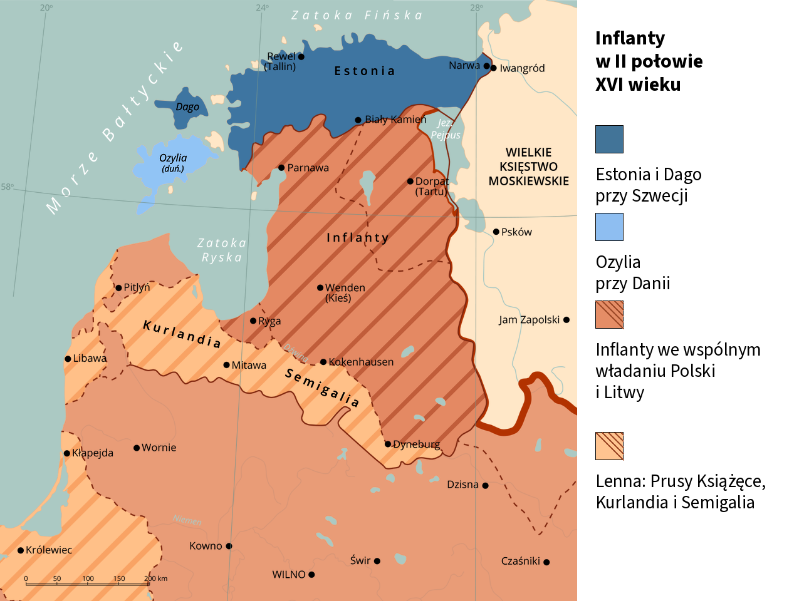</figure>

notes:
Najpierw wskaż Bałtyk, Rygę, Rewel (Tallin) i państwo moskiewskie. Inflanty to dawny region dzisiejszej Łotwy i Estonii. Mapa źródłowa przedstawia II połowę XVI w.; pokazuje polityczne obszary, nie przebieg każdego frontu w jednym dniu 1570. Legenda: większość z Rygą wspólnie Polska i Litwa, Estonia i Dago Szwecja, Ozylia Dania; jaśniejsze szrafy – lenna. Źródło: Contentplus.sp. z o.o., ZPE DVkavsFuX, mapa R1XSpXWq2DiMx na podstawie atlasu Nowej Ery 2019, CC BY-SA 3.0. Statycznie złożono oryginalne warstwy mapy i dodano legendę na osobnym marginesie, bez zmiany granic.

---

<!-- .slide: id="inflanty-wojna" class="baltic-war" data-purpose="explanation" data-layout="split" data-goals="G3" -->

<h2>Dlaczego walczono o Inflanty?</h2>

1558 → 1563–1570
<ul><li>Car <strong>Iwan IV Groźny</strong> zaatakował Inflanty w <strong>1558 r.</strong>, walcząc o dostęp do Bałtyku.</li><li>W <strong>1561 r.</strong> znaczna część Inflant poddała się władzy Zygmunta Augusta; Kurlandia stała się lennem.</li><li><strong>1563–1570:</strong> Polska i Litwa, Moskwa, Szwecja i Dania walczyły o wpływy. Moskwa zdobyła Połock (1563).</li></ul>
Sojusze się zmieniały. Polska i Litwa początkowo walczyły razem z Danią.

<figure class="source-figure ">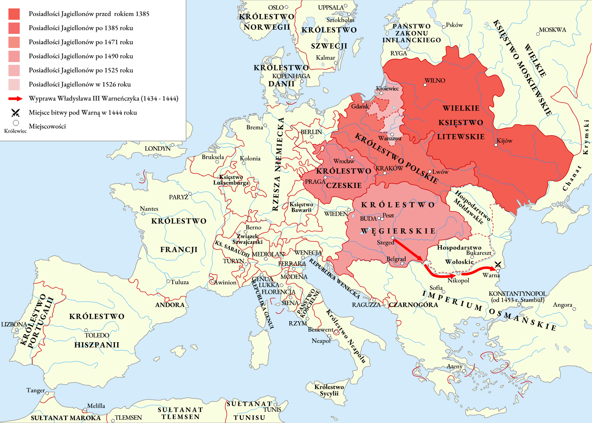<figcaption>Mapa orientacyjna: ziemie Jagiellonów w XIV–XVI w.</figcaption></figure>

notes:
Wskaż czterech uczestników, nie opowiadaj o jednej stałej stronie „trzy państwa przeciw Polsce”. Polska-Litwa sprzymierzyła się z Danią, Szwecja walczyła też z Danią; stosunki Szwecji z Moskwą zmieniały się. Mapa ma legendę wieloletniego rozwoju dynastii do 1526; używamy jej do położenia państw, NIE granic wojny 1563–1570. Car to tytuł władcy Rosji. Atak Iwana IV w 1558 poprzedzał omawiany etap 1563–1570. W 1568 Polska i Litwa sprzymierzyły się ze Szwecją.

---

<!-- .slide: id="inflanty-podzial" class="outcome" data-purpose="explanation" data-layout="comparison" data-goals="G3" -->

<h2>Podział Inflant po wojnie</h2>

<figure class="source-figure ">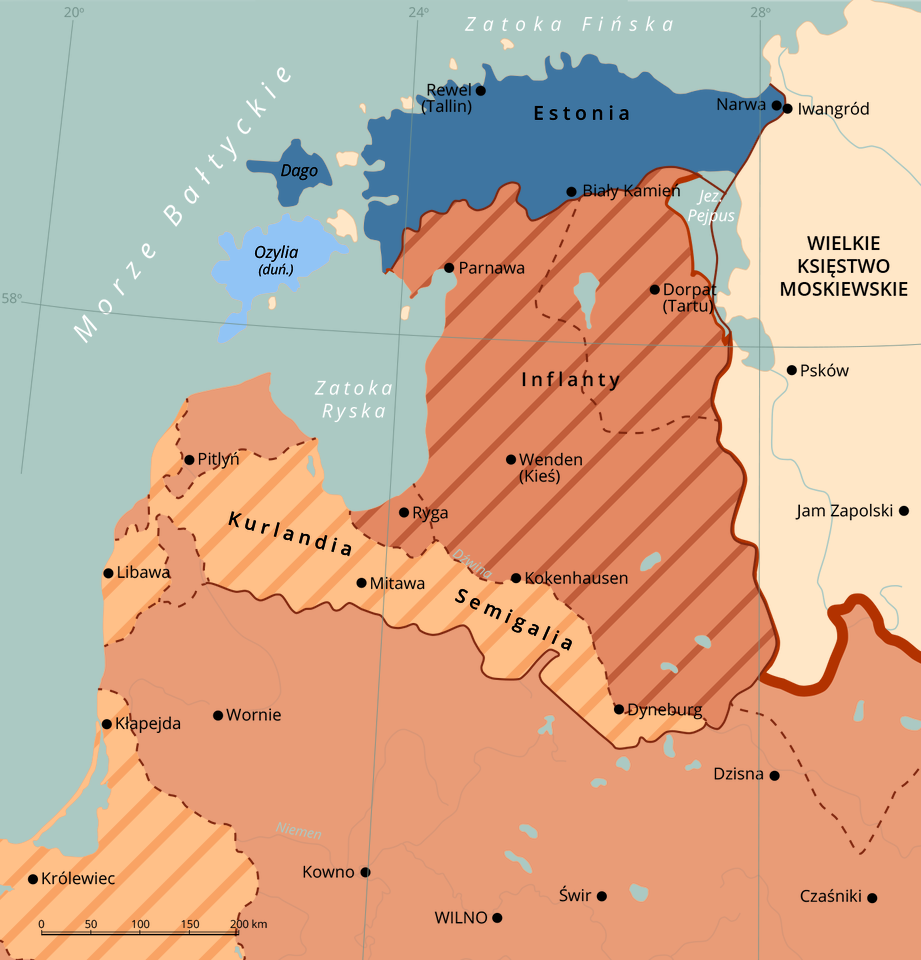<figcaption>Inflanty w II połowie XVI wieku</figcaption></figure>

1570 · zakończenie wojny
<dl><dt>Polska i Litwa</dt><dd>Największa część Inflant z portem w Rydze.</dd><dt>Szwecja</dt><dd>Północna część – Estonia.</dd><dt>Dania</dt><dd>Wyspa Ozylia.</dd></dl>
Moskwa zachowała część zdobyczy, m.in. Narwę. Rywalizacja trwała dalej.

notes:
Wskaż Rygę, północną Estonię i Ozylię; nie mów, że wszystkie wyspy przypadły Danii – mapa pokazuje także Dago przy Szwecji. Wynik podziału zgodny z s.56 w podręcznikowym skrócie i ZPE DVkavsFuX. Estonia oznacza szwedzką północną część, nie całość dzisiejszego państwa. Mapa II połowy XVI wieku nie rekonstruuje wszystkich linii frontów jednego roku. Wojna miała kilka frontów i porozumień, nie jedną stałą koalicję. W 1570 zawarto rozejm państwa polsko-litewskiego z Moskwą oraz pokój Szwecji z Danią w Szczecinie: nie był to jeden traktat wszystkich czterech państw. Moskwa zachowała Narwę i część Inflant. Nie rozszerzaj core o kampanie Batorego.

---

<!-- .slide: id="podsumowanie" class="synthesis" data-purpose="synthesis" data-layout="comparison" data-goals="G1 G3" -->

<h2>Trzy kierunki, różne skutki</h2>

<h3>Prusy</h3>
Wojna i porozumienie → w 1525 r. świeckie księstwo zostaje lennem Polski.

<h3>Wschód</h3>
Zwycięstwo pod Orszą nie przywraca Smoleńska. Moskwa zachowuje zdobycze.

<h3>Bałtyk</h3>
Rywalizacja o Inflanty → podział regionu; największa część z Rygą przy Polsce i Litwie.

<figure class="source-figure ">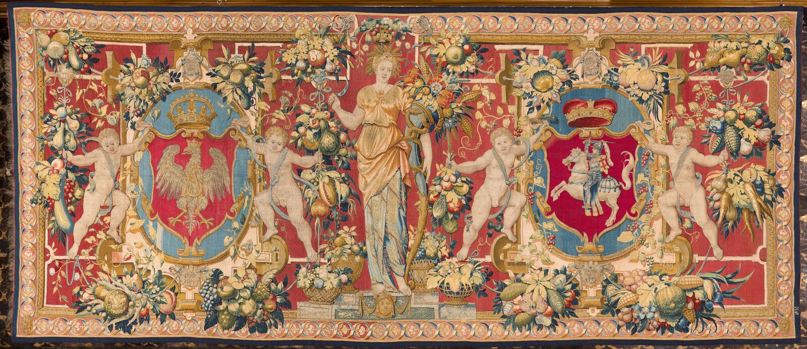<figcaption>Herby Polski i Litwy na arrasie z 1560 r.</figcaption></figure>

notes:
Poproś o jedno zdanie odpowiadające pytaniu głównemu: dawny wróg stał się lennikiem dzięki sekularyzacji, układowi i hołdowi. Herby na arrasie łączą polsko-litewski zasięg działań. To synteza porównawcza, nie nowe szczegóły.

---

<!-- .slide: id="zrodla" class="credits" data-purpose="reference" data-layout="split" data-goals="G1" -->

<h2>Źródła lekcji</h2>

<strong>Podręcznik:</strong> „Wczoraj i dziś”, klasa 6, s. 53–57, materiał dostarczony przez nauczycielkę.

<strong>ZPE:</strong> „Polskie dynastie: Jagiellonowie”; „Hołd pruski i jego ocena”; „Od Prus Zakonnych do Książęcych”.

<strong>Obrazy i mapy:</strong> Matejko, Cranach Starszy i Młodszy; mapy Learnetic SA (CC BY 4.0) i Contentplus.pl (CC BY-SA 3.0).

<strong>Dokładne adresy, autorzy i prawa:</strong> lokalny plik <code>sources.md</code>. Cytat z podręcznika jest ograniczony do prywatnego podglądu edukacyjnego.

<figure class="source-figure ">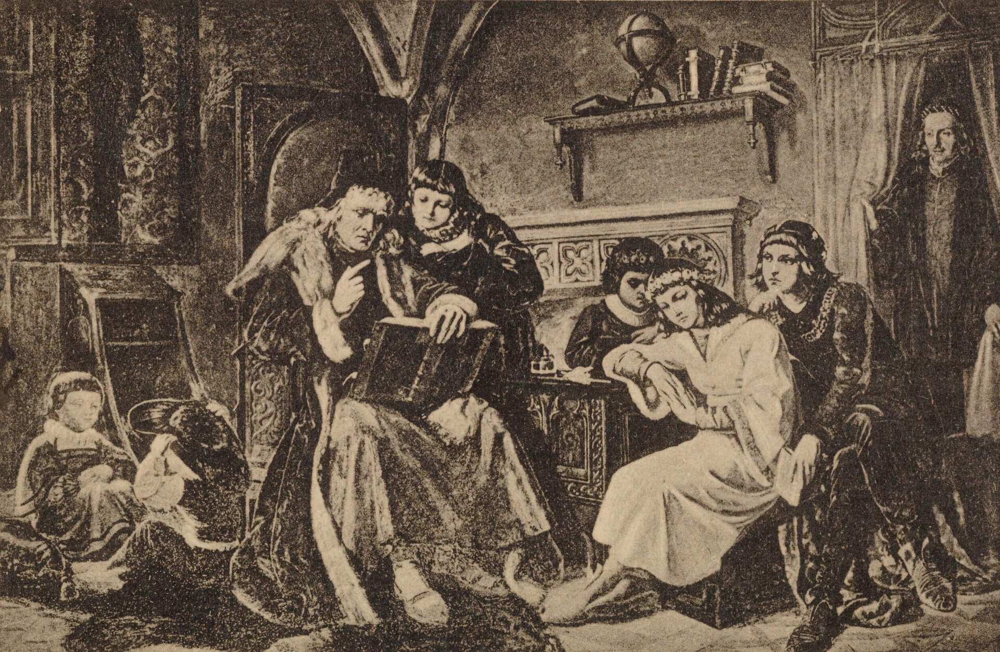<figcaption>Florian Cynk, „Długosz nauczający…”, 1912</figcaption></figure>

notes:
Slajd informacyjny, bez wykładu i bez dodatkowego czasu core. Pełne URL-e, skróty hash, prawa każdego pliku i ograniczenie przekładu są w sources.md. Nie publikować skanów podręcznika. Ilustracja dotyczy uczenia królewskiej rodziny, nie jest źródłem z XV wieku.

---

<!-- .slide: id="bilet-wyjscia" class="exit" data-purpose="exit-ticket" data-layout="activity-brief" data-goals="G1 G3" -->

<h2>Sprawdź, czy rozumiesz</h2>

<ol data-task-role="prompt"><li>Wyjaśnij, dlaczego Prusy Książęce były lennem, a nie zwykłą częścią Polski.</li><li>Czy zwycięstwo pod Orszą przywróciło Litwie Smoleńsk? Uzasadnij.</li><li>Komu po wojnie przypadła największa część Inflant z Rygą?</li></ol>
Każdy odpowiada sam: krótko w zeszycie lub ustnie na wskazane pytanie.

<figure class="source-figure "><figcaption>Zygmunt I Stary</figcaption></figure>

notes:
90 s: każdy pisze jedną krótką odpowiedź na każde pytanie; nie żądaj przepisywania poleceń. Odczytaj po jednej odpowiedzi. Jeśli czasu brakuje, wszyscy piszą pytanie 1, a 2 i 3 sprawdź ustnie. Model i kryteria w assessment.md. Portret wskazuje króla z pytania głównego; powtórne użycie ma funkcję zamknięcia.

---

<!-- .slide: id="notatka" class="notebook-slide" data-purpose="synthesis" data-layout="takeaways" data-goals="G1 G3" -->

<h2>Notatka do zeszytu</h2>

<ol><li>Ostatni królowie Jagiellonowie: <strong>Zygmunt I Stary</strong> (rządy od 1506 r.) i jego syn <strong>Zygmunt II August</strong> (samodzielnie od 1548 r.).</li><li>Po wojnie 1519–1521 Albrecht zmienił państwo zakonne w świeckie <strong>Prusy Książęce</strong>. Układ i <strong>hołd w Krakowie w 1525 r.</strong> uczyniły je lennem Polski.</li><li><strong>Prusy Królewskie</strong> należały bezpośrednio do Polski; <strong>Książęce</strong> miały własnego księcia zależnego od polskiego króla.</li><li>W <strong>1514 r.</strong> Litwa straciła Smoleńsk. Zwycięstwo pod Orszą nie zwróciło miasta; rozejm w 1522 r. pozostawił je Moskwie.</li><li>Po wojnie o Inflanty <strong>1563–1570</strong>: większość z Rygą – Polska i Litwa, północna Estonia – Szwecja, Ozylia – Dania.</li></ol><figure class="source-figure ">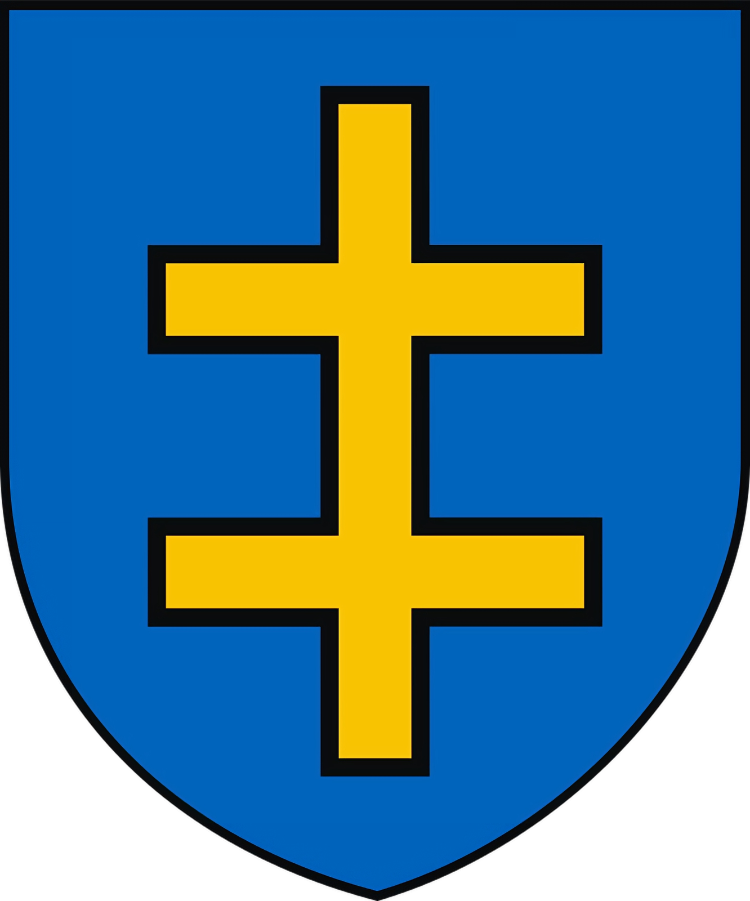</figure>

notes:
Przeznacz pełne 4 min na zapis tych pięciu punktów; nie przepisujemy innych slajdów. Uczniowi piszącemu wolno daj opcjonalną blankietową notatkę graficzną z worksheet.md i poleć wpisać same relacje. Zamknięcie: „Król nie musi zdobyć ziemi, by mieć nad nią zwierzchnictwo – pokaż to na przykładzie Prus”. To ostatni slajd uczniowski.
