<!-- .slide: id="otwarcie" class="" data-purpose="opening" data-layout="hero-source" data-goals="G1" -->

<figure class="source-figure">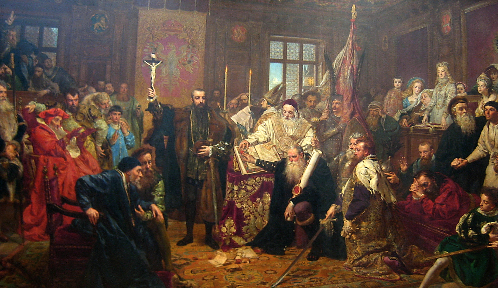</figure>

Polska i Litwa · 1569
<h1>Rzeczpospolita Obojga Narodów</h1>
Jak połączyć dwa państwa, nie znosząc wszystkich różnic?

Jan Matejko, 1869 · późniejsza wizja unii

notes:
2 min. Zapytaj: „Czy wspólne państwo musi mieć wszystko wspólne?”. Dwie hipotezy bez zapisu. Obraz jest późniejszą wizją, nie relacją świadka. Ciekawostka 1: Matejko namalował go w 1869 r., w 300. rocznicę unii (podręcznik s.67). Nie analizuj wszystkich postaci; rdzeń nie wymaga filmu.

---

<!-- .slide: id="krewo" class="" data-purpose="explanation" data-layout="timeline-band" data-goals="G1" -->

<h2>Najpierw połączył ich władca</h2>

1385 · Krewo

Jagiełło zobowiązał się przyjąć chrzest, poślubić Jadwigę i związać Litwę z Polską.

1386 · Kraków

Chrzest Jagiełły, małżeństwo z Jadwigą i koronacja na króla Polski.

<strong>Unia personalna</strong> — dwa odrębne państwa połączone osobą wspólnego władcy.

<figure class="source-figure"><figcaption>Herby Korony i Litwy na arrasie z 1560 r. — jeszcze przed unią lubelską.</figcaption></figure>

notes:
4 min. Unia znaczy związek. W 1385 złożono zobowiązania, w 1386 nastąpiły chrzest, ślub i koronacja. Nie mów, że od 1385 istniało nieprzerwanie jedno państwo. Kolejne porozumienia odnawiały i zmieniały związek; nie wprowadzaj listy dat. Ciekawostka 2: projekt ściślejszej unii z 1501 r. nie wszedł w życie (s.66). Arras to ozdobna tkanina; dwa godła świadczą o związku przed 1569, nie o identycznych instytucjach.

---

<!-- .slide: id="przyczyny" class="" data-purpose="explanation" data-layout="argument" data-goals="G1" -->

<h2>Dlaczego potrzebowano trwalszego związku?</h2>

<b>Zagrożenie</b>
Moskwa zdobyła litewski <strong>Połock w 1563 r.</strong> Litwa potrzebowała pomocy Korony.

<b>Dynastia</b>
Zygmunt II August nie miał dzieci. Obawiano się rozpadu związku po jego śmierci.

<b>Interesy</b>
Szlachta litewska chciała praw takich jak polska. Polscy możni liczyli na majątki na wschodzie.

<figure class="source-figure">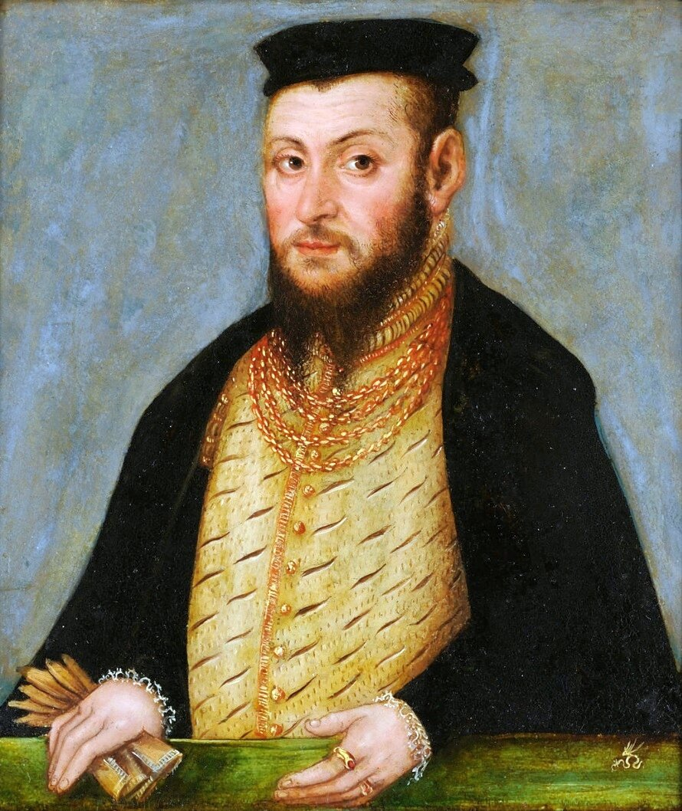<figcaption>Zygmunt II August · miniatura Cranacha Młodszego, 1553</figcaption></figure>

notes:
4 min z sześciominutowego bloku przyczyn. Wyjaśnij: szlachta to uprzywilejowana warstwa, a magnaci to najbogatsi i najpotężniejsi spośród niej. Połock to przykład realnego zagrożenia. Kryzys dynastyczny jest obawą PRZED śmiercią; August umarł dopiero w 1572. Polskie interesy ziemskie nie są tym samym co potrzeba litewskiej obrony. Nie każ uczniom przepisywać trzech akapitów.

---

<!-- .slide: id="spor" class="" data-purpose="explanation" data-layout="source-split" data-goals="G1" -->

<h2>Porozumienie nie przyszło łatwo</h2>

<figure class="source-figure">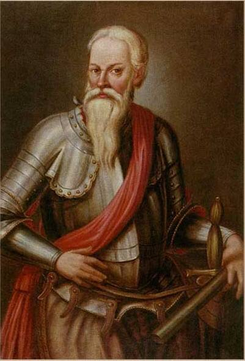<figcaption>Mikołaj Radziwiłł Rudy — przeciwnik ściślejszej unii</figcaption></figure>

<strong>Magnaci litewscy</strong> obawiali się utraty wpływów i dominacji Korony.

Część z nich wyjechała z obrad w Lublinie.

Król przyłączył do Korony <strong>Podlasie, Wołyń, Bracławszczyznę i Kijowszczyznę</strong>.

Był to nacisk na powrót do negocjacji.

notes:
2 min. Zakończenie bloku przyczyn. Korona oznacza Królestwo Polskie, nie przedmiot na głowie króla. Inkorporacja to włączenie ziem. Nie przedstawiaj wydarzenia jako bezkonfliktowej zgody wszystkich Litwinów ani podboju całej Litwy. Król działał jako dziedziczny władca Litwy, a miejscowa szlachta popierała włączenie; wracający przedstawiciele negocjowali warunki. Rudy nie podpisał aktu. Źródło portretu i ograniczenie datowania w sources.md.

---

<!-- .slide: id="lublin" class="" data-purpose="explanation" data-layout="source-split" data-goals="G1 G2" -->

<h2>1 lipca 1569 · Lublin</h2>

Powstaje <strong>Rzeczpospolita Obojga Narodów</strong>.

Dwie części: <strong>Korona Królestwa Polskiego</strong> i <strong>Wielkie Księstwo Litewskie</strong>.

<strong>Unia realna</strong> — związek oparty na wspólnym władcy i instytucjach, nie tylko na osobie monarchy.

<figure class="source-figure">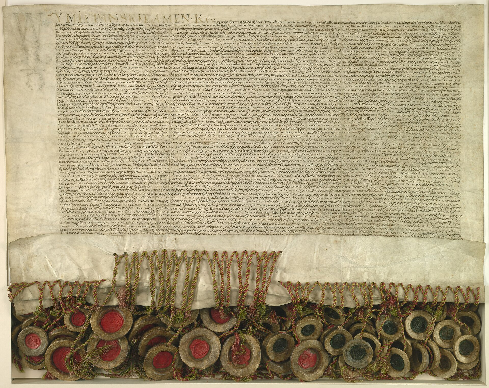<figcaption>Akt unii lubelskiej, 1569 · Archiwum Główne Akt Dawnych</figcaption></figure>

notes:
1 min z siedmiominutowego bloku instytucji i zapisu. Akt to dokument prawny. Ciekawostka 3: dokument potwierdzono 78 pieczęciami możnych (podręcznik s.68); nie wymagaj liczby w bilecie. Otwórz fotografię tylko jeśli potrzeba dostrzec pieczęcie, nie zabieraj czasu na odczytywanie rękopisu.

---

<!-- .slide: id="diagram-praca" class="" data-purpose="practice" data-layout="task-board" data-goals="G2" -->

<h2>Uzupełnij diagram z podręcznika</h2>

Przeczytaj na s. 67 fragment „Unia lubelska i jej skutki”. Uzupełnij diagram: wspólne w środku, odrębne po bokach.
<figure class="source-figure">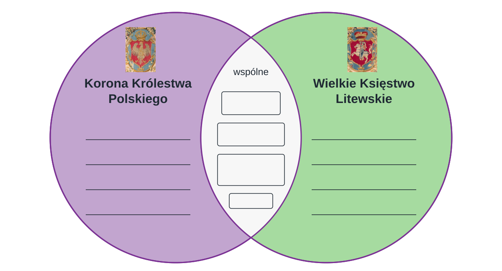</figure>
Najpierw pracuj samodzielnie. Potem wspólnie omówimy odpowiedzi.

notes:
4 min. Po slajdzie o zawarciu unii poleć otworzyć podręcznik na s. 67, fragment „Unia lubelska i jej skutki”. Każdy najpierw czyta sam i wpisuje wspólne oraz odrębne elementy do własnego diagramu. Nie pokazuj jeszcze slajdów z odpowiedziami ani modelu. 1 min lektury i 3 min zapisu; wsparcie: wskaż właściwy akapit i strefy diagramu, bez podawania haseł. Następne dwa slajdy służą wspólnemu omówieniu i korekcie, nie poprzedzają pracy.

---

<!-- .slide: id="wspolne" class="" data-purpose="explanation" data-layout="comparison" data-goals="G2" -->

<h2>Co miało być wspólne?</h2>

<dl><dt>Władca</dt><dd>Wspólnie wybierany król Polski i wielki książę litewski.</dd><dt>Sejm</dt><dd>Król, senat i posłowie obu części decydowali o prawach i podatkach.</dd><dt>Polityka zagraniczna</dt><dd>Wspólne działania wobec innych państw.</dd><dt>Moneta</dt><dd>Miała być wspólna; bito ją w różnych mennicach, z różnymi znakami.</dd></dl>
<figure class="source-figure">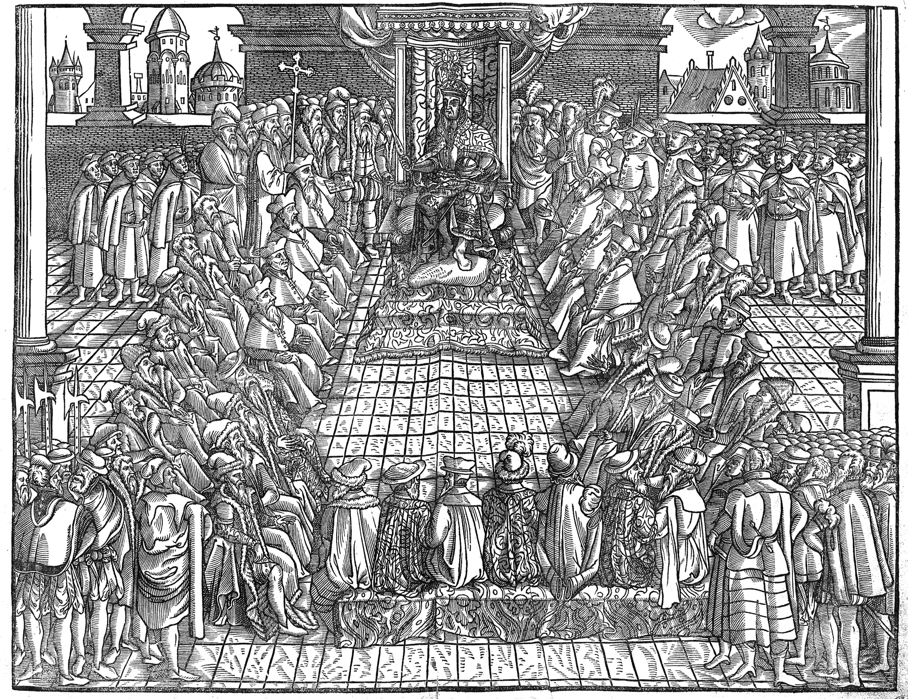<figcaption>Sejm za Zygmunta Augusta · przedstawienie z epoki</figcaption></figure>

notes:
1 min. Po samodzielnej lekturze i uzupełnieniu diagramu poproś uczniów o odczytanie wspólnych elementów. Odsłoń ten slajd do sprawdzenia odpowiedzi, wyjaśnij niejasne pojęcia i pozwól poprawić zapis. Senat to izba sejmu z najwyższymi dostojnikami. Sejm nie reprezentował na równych prawach całej ludności; dominowała szlachta. Polityka zagraniczna: np. zawieranie sojuszy. Mennica to miejsce bicia monet. Zachowujemy podręcznikowe „moneta”, lecz ZPE Dp4AUEAul precyzuje różne mennice i symbole: nie mów o jednej identycznej walucie jak współczesne euro. Nie dyktuj odpowiedzi przed samodzielną pracą; dłuższe objaśnienia przenieś do pięciominutowego buforu wersji 40-minutowej.

---

<!-- .slide: id="odrebne" class="" data-purpose="explanation" data-layout="photo-pair" data-goals="G2" -->

<h2>Co pozostało odrębne?</h2>

<figure class="source-figure">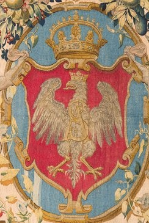<figcaption>Korona · Orzeł z arrasu, 1560</figcaption></figure><figure class="source-figure">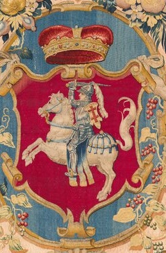<figcaption>Litwa · Pogoń z arrasu, 1560</figcaption></figure>
<dl><dt>Urzędy</dt><dd>Własni urzędnicy kierujący sprawami każdej części.</dd><dt>Wojsko</dt><dd>Odrębne armie i ich dowódcy.</dd><dt>Skarb</dt><dd>Osobne dochody z podatków i wydatki.</dd><dt>Sądownictwo</dt><dd>Własne sądy i prawo.</dd></dl>

notes:
1 min. Poproś uczniów o wskazanie odrębnych elementów znalezionych w podręczniku. Omów odpowiedzi na tym slajdzie; uczniowie sprawdzają i poprawiają obie strony już uzupełnionego diagramu. Skarb to nie skrzynia skarbów, lecz pieniądze publiczne i zarządzanie nimi. Własne armie mogły współdziałać. Herby są wiernymi kadrami z arrasu datowanego na 1560 (ZPE Rf9iPk0dCMVVV), nie współczesnym orłem i nie autorskim przerysowaniem. Klik/Enter powiększa każdy osobno; bez podpisu w lightboxie.

---

<!-- .slide: id="pytania-zrodlo" class="" data-purpose="practice" data-layout="activity-brief" data-goals="G3" -->

<h2>Przeczytajcie akt w parach</h2>

<ol data-task-role="prompt"><li>Opowiedz, w którym mieście miał być koronowany nowo wybrany król.</li><li>Powiedz, jaki obowiązek spoczywał na każdym władcy podczas koronacji.</li></ol>
Najpierw przeczytajcie pytania. Na następnym slajdzie znajdźcie fragmenty, które uzasadniają odpowiedzi.
<figure class="source-figure">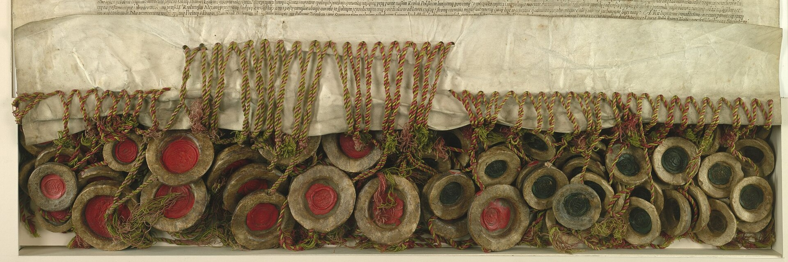</figure>

notes:
30 s instrukcji w pięciominutowym bloku. Dwie dokładne kwestie z podręcznika s.68 są PRZED tekstem. Dobierz 6 par i jedną trójkę przy 15 osobach; do20 osób — do10 par. Nie przestawiamy ławek. Każdy najpierw czyta sam, dopiero potem porównuje z partnerem. Odpowiedzi tylko w notatkach i assessment.md. Model: Kraków; poprzysiężenie i potwierdzenie praw, przywilejów i wolności obu części na jednym dokumencie.

---

<!-- .slide: id="akt-zrodlo" class="" data-purpose="evidence" data-layout="evidence" data-goals="G3" -->

<h2>Akt unii lubelskiej z 1569 roku</h2>

W dokumencie, który zawierał postanowienia unii realnej z 1569 roku, opisano zasady połączenia Polski i Litwy. Wśród zapisów znalazły się ustalenia dotyczące wyboru władcy oraz obowiązków nowego monarchy.

<b>3.</b> Iż już Korona i Wielkie Księstwo Litewskie jest jedno nierozdzielone i nieróżne ciało, a także nieróżna, ale jedna spólna [wspólna] Rzeczpospolita, która się ze dwu państw i narodów w jeden lud zniosła i spoiła.

<b>4.</b> A temu obojem narodowi, żeby już wiecznymi czasy jedna głowa, jeden pan i jeden król spólny rozkazował, który spólnymi głosy od Polaków i od Litwy obran [wybrany], a miejsce obierania w Polszcze, a po tym na Królestwo Polskie pomazan [namaszczony] i koronowan w Krakowie będzie [...].

<b>7.</b> A przy koronacji nowego króla mają być przez króla koronowanego poprzysiężone i zaraz konfirmowane [zatwierdzone] na jednym liście [...] na wieczne czasy prawa, przywileje i wolności poddanych wszystkich obojga narodów i państw tak złączonych.

Źródło: Ustrój Polski w XVI–XVIII wieku, [w:] Teksty źródłowe do nauczania historii w szkole, z. 20, Warszawa 1960, s. 7.
<figure class="source-figure"></figure>

notes:
4 min 30 s razem: 90 s lektury indywidualnej z objaśnieniami, 90 s rozmowy w parze (zamiana mówiącego), 60 s wskazania fragmentu przez dwie pary, 30 s omówienia. Cały dostarczony fragment pkt3,4,7, wstęp i kredyt z s.68; usunięto wyłącznie dzielenie wyrazów. Spólna= wspólna; obojem=obu; obran=wybrany; Polszcze=Polsce; pomazan=namaszczony; konfirmowane=zatwierdzone; list=dokument. Nawiasy kwadratowe są objaśnieniami i opuszczeniami w podręczniku, NIE lukami do uzupełnienia. Odpowiedzi: Kraków (pkt4); władca ma przysiąc i potwierdzić prawa, przywileje i wolności poddanych obu części (pkt7). Nie odczytuj pkt7 jako równości praw chłopa i szlachcica. Fragment nie jest całym aktem. Zacytowany przekład/wybór służy prywatnemu podglądowi edukacyjnemu; nie publikować bez wyjaśnienia praw.

---

<!-- .slide: id="mapa-1569" class="full-map" data-purpose="evidence" data-layout="map-focus" data-goals="G1 G4" -->

<figure class="source-figure">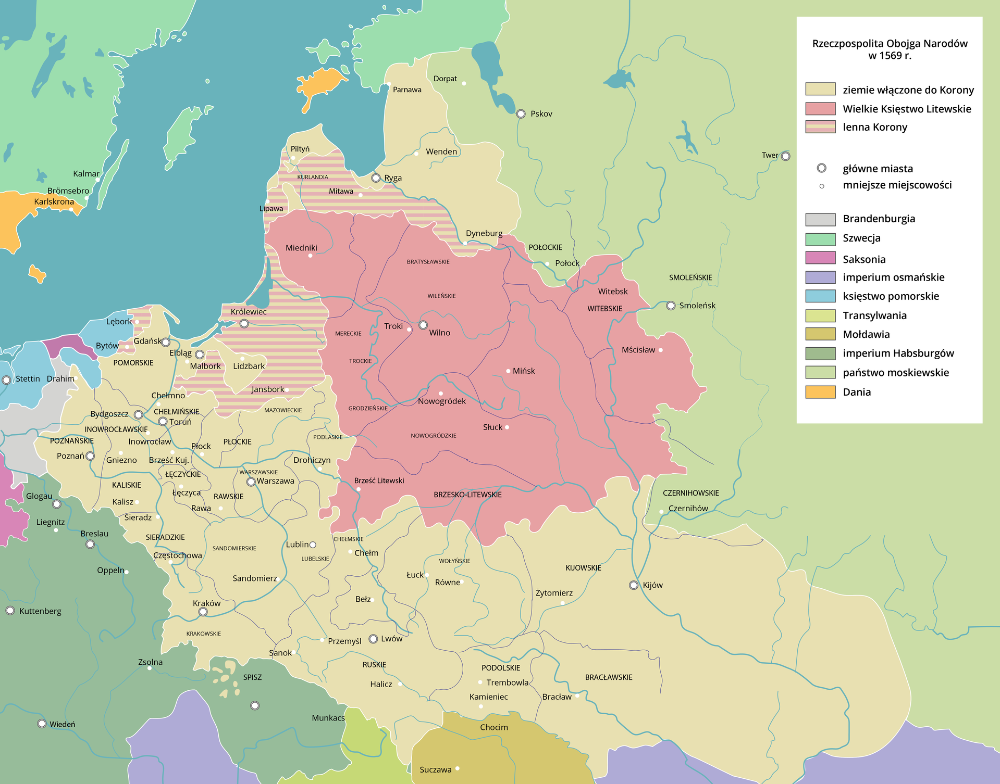</figure>

notes:
3 min. Mapa na cały użyteczny obszar, bez podpisu pod nią. Powiększ klik/Enter, Escape wraca. Wskaż Lublin, Koronę i Wielkie Księstwo, potem cztery województwa: podlaskie przy Drohiczynie, wołyńskie przy Łucku, bracławskie przy Bracławiu, kijowskie przy Kijowie. To orientacja prowadzona przez nauczyciela, nie dodatkowa karta zadań. Żółty obszar obejmuje CAŁĄ Koronę, nie tylko nabytki1569 — legenda ma skrót „ziemie włączone do Korony”. Różowe obszary to Litwa; pasy to lenna, nie zwykłe województwa. Nie używaj automatycznego opisu ZPE do odczytywania granic; nie utożsamiaj ich z dzisiejszą Polską ani Litwą. Autor: Contentplus.pl na podstawie Halibutt i Macieja Szczepańczyka, CC BY-SA3.0.

---

<!-- .slide: id="mapa-jezykow" class="full-map" data-purpose="evidence" data-layout="map-focus" data-goals="G4" -->

<figure class="source-figure">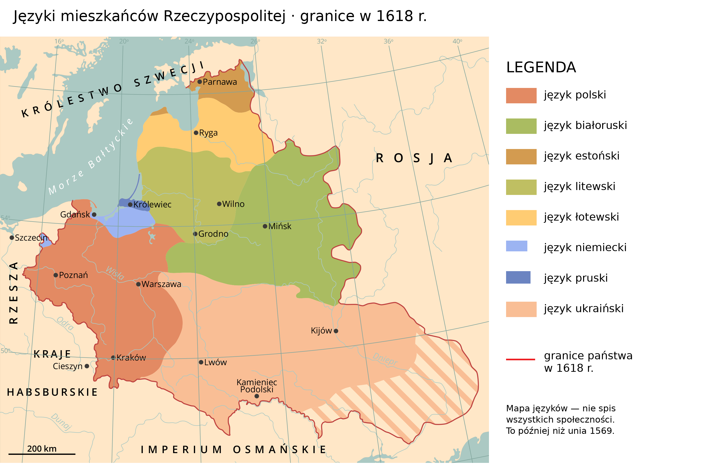</figure>

notes:
3 min. Nowa mapa ZPE pokazuje języki i granice w1618 roku — niemal pół wieku PO unii lubelskiej. Nie zastępuje mapy granic1569. To mapa językowa pomagająca zobaczyć różnorodność, nie dokładny spis narodowości i nie wyłączne strefy zamieszkania. Wskaż polski na zachodzie i w centrum, litewski na północy oraz białoruski i ukraiński na wschodzie; szkolne określenie Rusini obejmuje historyczne społeczności związane z przodkami dzisiejszych Białorusinów i Ukraińców. Zwróć uwagę na niemiecki w Prusach i miastach oraz łotewski i estoński na północy. Kolor nie mówi, że każdy mieszkaniec danego obszaru używał jednego języka. Nie przenoś opisów alternatywnych ZPE na konkretne miasta: np. kolor obszaru przy Wilnie nie określa całej ludności miejskiej. Żydzi, Ormianie i Tatarzy nie mają osobnych pól na tej mapie, choć tam żyli; wyjaśnia ich następny slajd. Jidysz nie jest w legendzie, a pruski oznacza dawny język bałtyjski, nie synonim niemieckiego. Uczeń wskazuje dwa różne języki; bez dodatkowego zadania pisemnego. Autor Contentplus.pl, CC BY-SA3.0; spłaszczenie oryginalnych warstw z dodaną legendą i tytułem, bez przerysowania granic.

---

<!-- .slide: id="mieszkancy" class="" data-purpose="explanation" data-layout="matrix" data-goals="G4" -->

<h2>Dwie części państwa, wielu mieszkańców</h2>

Rzeczpospolita wielu społeczności
<ul class="community-list"><li><strong>Polacy, Litwini, Rusini</strong> — różne języki i tradycje.</li><li><strong>Niemcy</strong> — m.in. Prusy Królewskie i miasta.</li><li><strong>Żydzi</strong> — gminy w miastach i miasteczkach; własna religia i obyczaje.</li><li><strong>Ormianie</strong> — m.in. Lwów i Kamieniec Podolski; handel ze Wschodem.</li><li><strong>Tatarzy</strong> — osadnictwo na Litwie; wyznawcy islamu.</li></ul>
<strong>Wielowyznaniowe</strong> — m.in. katolicy, prawosławni, protestanci, wyznawcy judaizmu i muzułmanie.

<figure class="source-figure">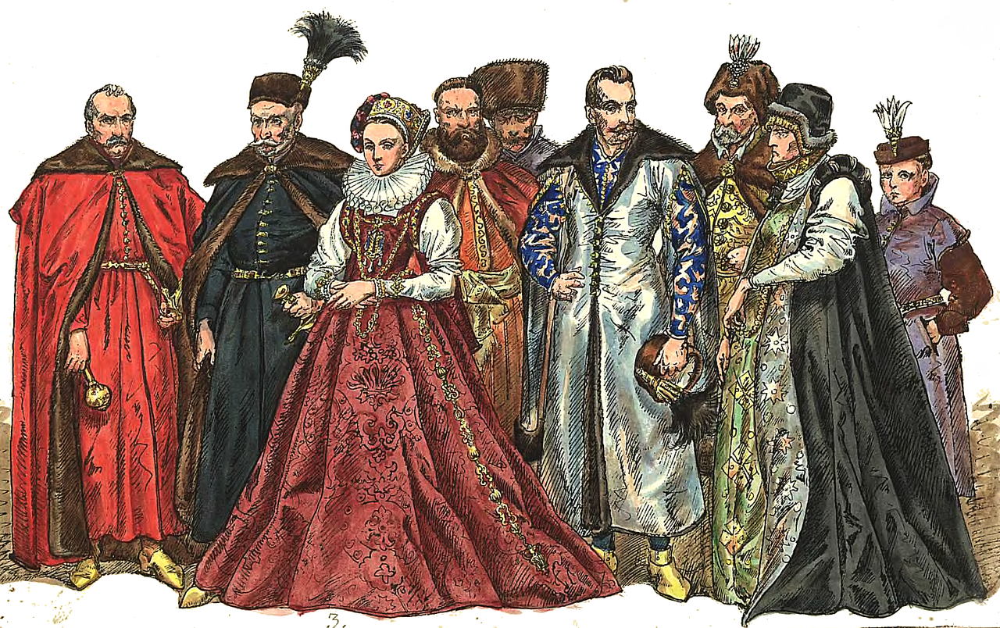<figcaption>Magnaci w wizji Matejki — tylko jedna warstwa społeczna, nie wszyscy mieszkańcy</figcaption></figure>

„Obojga” nie znaczy: tylko dwie narodowości ani równe prawa wszystkich mieszkańców.

notes:
2 min. Dopowiedz: wielonarodowość to różne języki, tradycje i wspólnoty pochodzenia; wielowyznaniowość to różne religie i wyznania. Nie są tym samym. Przykłady z ZPE D1GnMKwri: gminy żydowskie organizowały własne życie religijne i społeczne; kupcy ormiańscy pośredniczyli w handlu z imperium osmańskim i Persją. Nie każdy Żyd czy Ormianin był kupcem — to przykład działalności, nie cecha wszystkich ludzi. Tatarzy to kolejna społeczność wymieniona w podręczniku s.69; ich osadnictwo na Litwie i islam pokazują różnicę między pochodzeniem a wyznaniem. Nie przypisuj podręcznikowi informacji o ich służbie wojskowej. Pokaż na wcześniejszej mapie Lwów lub Kamieniec tylko przez krótkie cofnięcie, jeśli klasa pyta; nie dodawaj nowej pracy. Współżycie oznaczało kontakty, handel i wymianę kultury, ale również konflikty oraz nierówne prawa. Rusini to historyczne społeczności wschodniosłowiańskie związane m.in. z przodkami dzisiejszych Ukraińców i Białorusinów, NIE po prostu Rosjanie. Naród w nazwie unii nie jest współczesną jednolitą narodowością wszystkich obywateli. Różnorodność dawała kontakty kultur, ale rodziła napięcia. Prawa zależały od stanu i religii; nie opowiadaj o idealnej tolerancji ani o równym udziale wszystkich w rządzeniu. Ilustracja to późniejsze opracowanie ubiorów elit, nie zestaw portretów grup etnicznych. Nie przypisuj religii każdemu narodowi jeden do jednego. Szczegółowe gwarancje konfederacji warszawskiej1573 i wolna elekcja należą do następnej lekcji, nie są tu dopisane do IX.7.

---

<!-- .slide: id="diagram-model" class="" data-purpose="synthesis" data-layout="takeaways" data-goals="G1 G2 G4" -->

<h2>Notatka: wspólne państwo, zachowane różnice</h2>

<strong>1 VII 1569 · Lublin</strong> — unia realna Korony i Litwy.
<figure class="source-figure">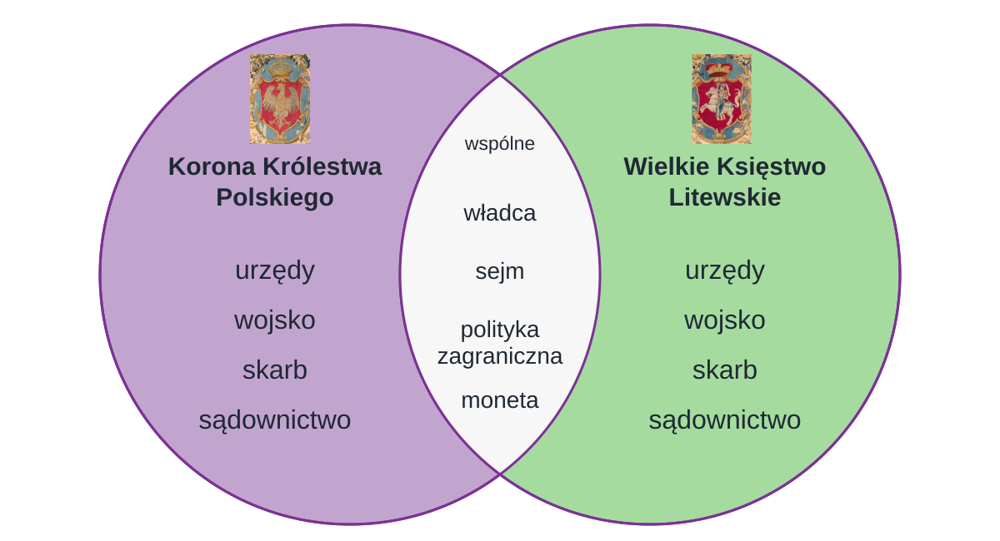</figure>
Moneta miała być wspólna; różne mennice i znaki. Państwo wielu narodów i wyznań.

notes:
4 min. Model kontrolny dopiero po indywidualnej pracy i analizie źródła. 1min uczniowie sami porównują i poprawiają, 1min wskaż jedno wspólne i jedno odrębne, 1min dopisz datę/miejsce i zdanie o unii realnej w nagłówku notatki, 1min odpowiedzcie na pytanie główne. Uzupełniony diagram jest jedyną właściwą notatką, nie dokładamy tabeli lub przepisywania akapitów. Ustnie przypomnij przejście od związku personalnego do realnego, przyczyny i różnorodność mieszkańców; nie ma osobnego paska tych informacji na karcie. Nie pokazuj modelu przed pracą. Wcześniej niewypełnione pola można dokończyć teraz.

---

<!-- .slide: id="zrodla" class="" data-purpose="evidence" data-layout="source-split" data-goals="G1 G2 G3 G4" -->

<h2>Źródła tekstów i ilustracji</h2>

<strong>Treść i fragment aktu:</strong> przesłany podręcznik, s. 66–70; <em>Ustrój Polski w XVI–XVIII wieku</em>, Warszawa 1960, s. 7.

<strong>Opracowania ZPE:</strong> „Rzeczpospolita Obojga Narodów”, „Droga do unii realnej”, materiały o ustroju, ludności i terytorium.

<strong>Mapy:</strong> mapa1569 — Contentplus.pl na podstawie Halibutt i Macieja Szczepańczyka; mapa języków (granice1618) — Contentplus.pl, <a href="https://creativecommons.org/licenses/by-sa/3.0/">CC BY-SA 3.0</a>; <a href="https://zpe.gov.pl/a/przeczytaj/Dp4AUEAul">ZPE</a>.

<figure class="source-figure"></figure>
<strong>Herby:</strong> kadry arrasu z Cererą, 1560, domena publiczna. Diagram objaśniający według przesłanego wzoru.

<strong>Pozostałe ilustracje:</strong> Jan Matejko (obraz 1869 i stroje), Lucas Cranach Młodszy (1553), akt z AGAD, XVI-wieczny sejm i portret Radziwiłła — reprodukcje ZPE, domena publiczna.

notes:
Plansza dokumentacyjna poza czasem rdzenia. Nie odczytuj jej klasie; przejdź do biletu i tam zakończ lekcję. Pełne adresy, pochodzenie, licencje i ograniczenia w sources.md oraz assets/provenance.json. Filmy tylko jako opcjonalne zaplecze nauczyciela, bez embedu i bez deklaracji pełnego odsłuchu. Prywatny podgląd nie rozstrzyga praw do współczesnego opracowania źródła.

---

<!-- .slide: id="bilet" class="" data-purpose="exit-ticket" data-layout="activity-brief" data-goals="G1 G2 G4" -->

<h2>Co zmieniło się w 1569 roku?</h2>

Samodzielnie, w dwóch krótkich zdaniach:
<ol data-task-role="prompt"><li>Podaj jedną przyczynę unii lubelskiej.</li><li>Wyjaśnij, dlaczego była unią realną, choć Korona i Litwa zachowały różnice.</li></ol>
Wspólne państwo nie musi oznaczać jednakowych instytucji i zwyczajów.

<figure class="source-figure"></figure><figure class="source-figure"></figure>

notes:
2 min. Każdy odpowiada sam w zeszycie pod wklejoną kartą, bez przepisywania pytań. 75s zapis, 45s dwie odpowiedzi i zebranie informacji od pozostałych. Klucz: dowolna uzasadniona przyczyna; np. wspólny sejm i władca, ale oddzielne armie. Rozpoznanie wielonarodowości sprawdź krótkim ustnym domknięciem: „Czy Obojga oznacza tylko dwie narodowości?” — nie. To nie trzecia obowiązkowa praca pisemna. Herby powracają jako klamra do nazwania dwóch części, nie jako nowy materiał. Zakończ pytaniem głównym, a nie ekranem źródeł.
