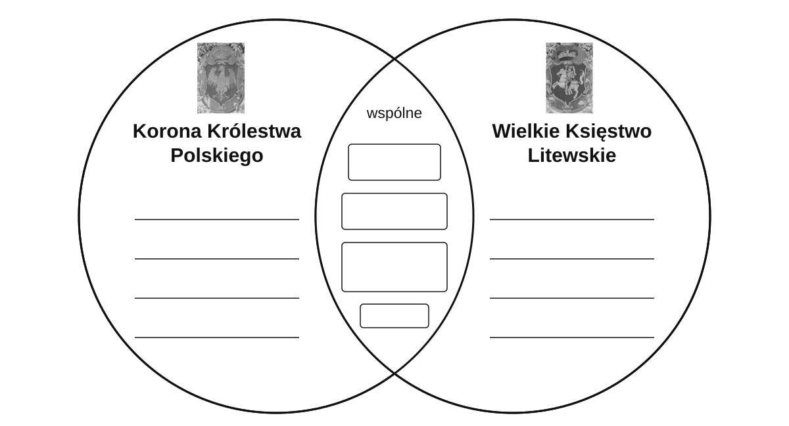

# Rzeczpospolita Obojga Narodów — notatka ucznia

Druk: [worksheet.html](worksheet.html), jedna strona A4 poziomo, czarno-biało,100%, bez nagłówka i stopki przeglądarki. Każdy uczeń otrzymuje własny blankiet; bez tabeli zastępczej i bez klucza. Najpierw czyta fragment „Unia lubelska i jej skutki” na s. 67 i samodzielnie wpisuje hasła, nie definicje; potem uczestniczy w omówieniu. Miejsce i datę uzupełnia w syntezie.

Unia realna zawarta w .................................... dnia ....................................

W części wspólnej zapisz to, co łączyło obie części państwa. Po bokach — to, co każda zachowała osobno. Uzupełnij na podstawie lektury s. 67; potem sprawdzisz odpowiedzi podczas wspólnego omówienia.
