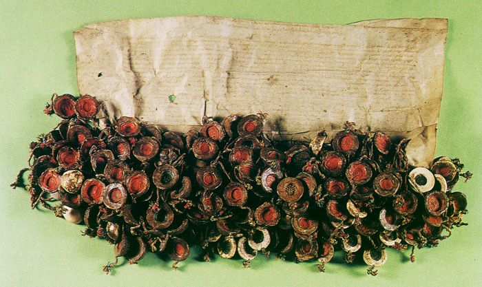
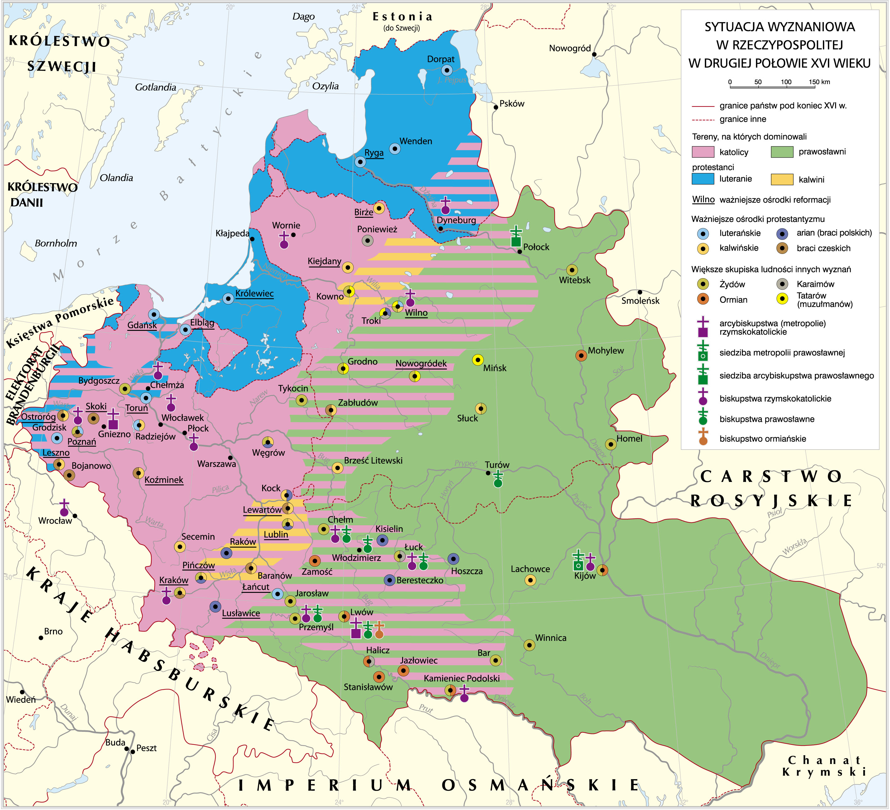
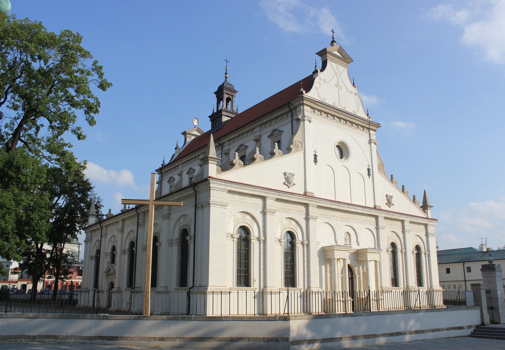
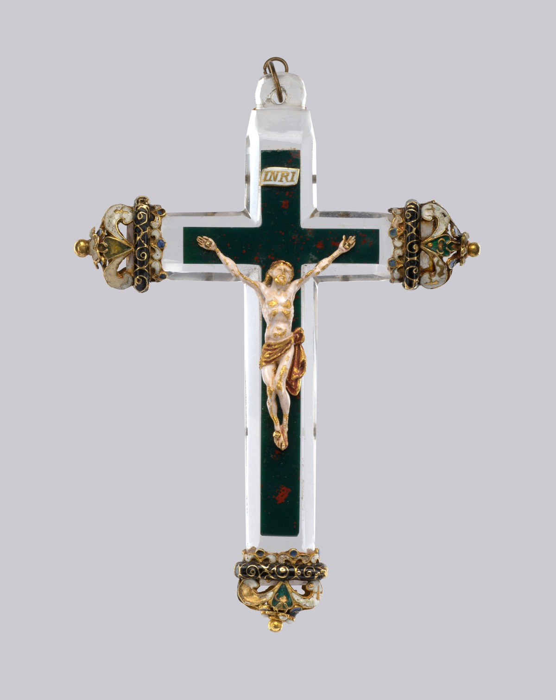
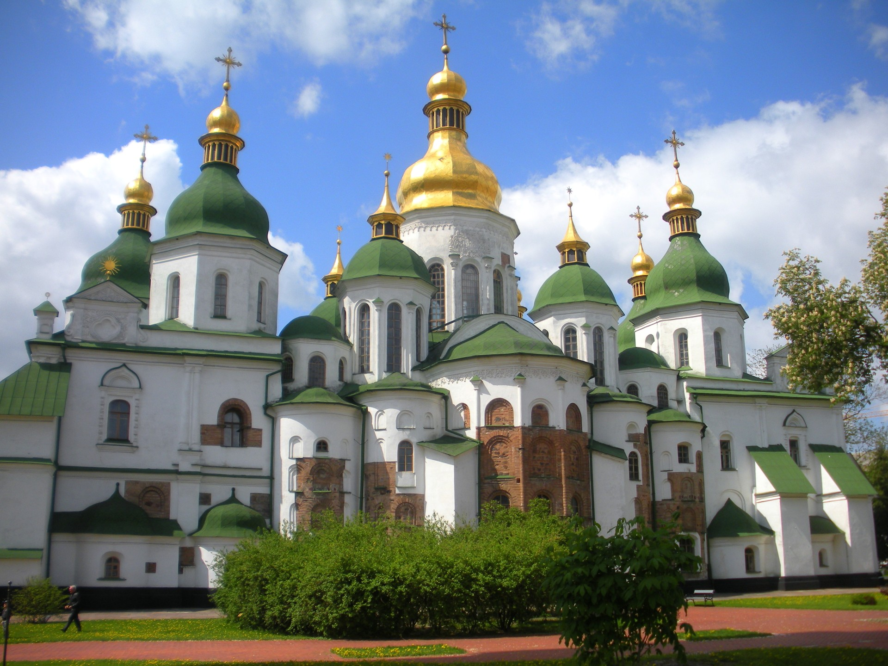
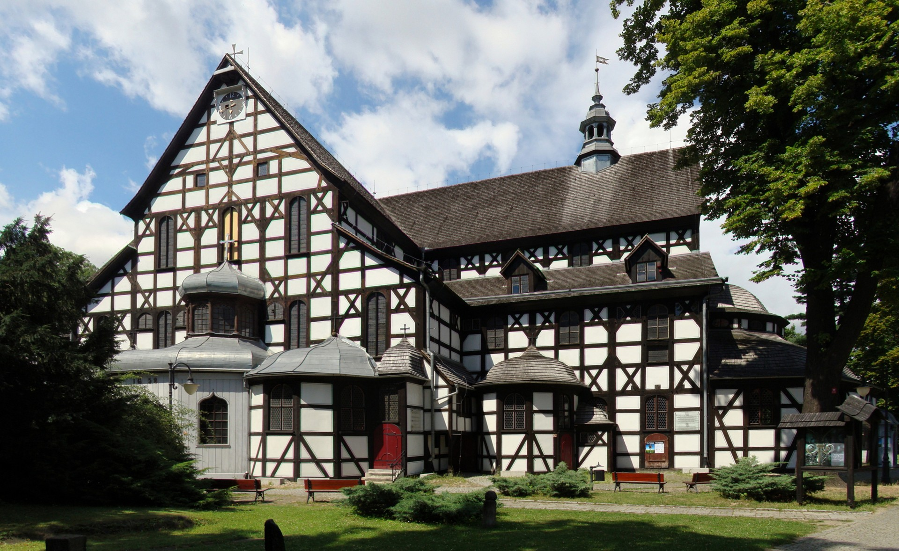
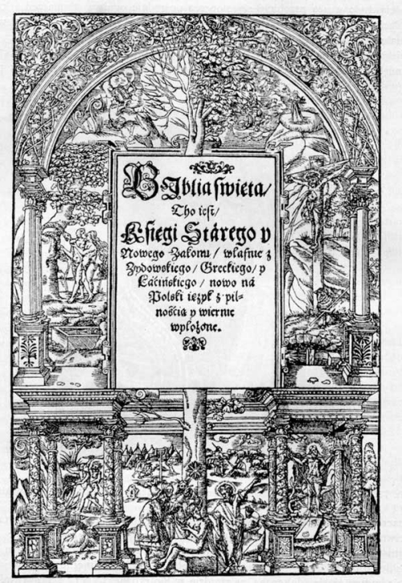
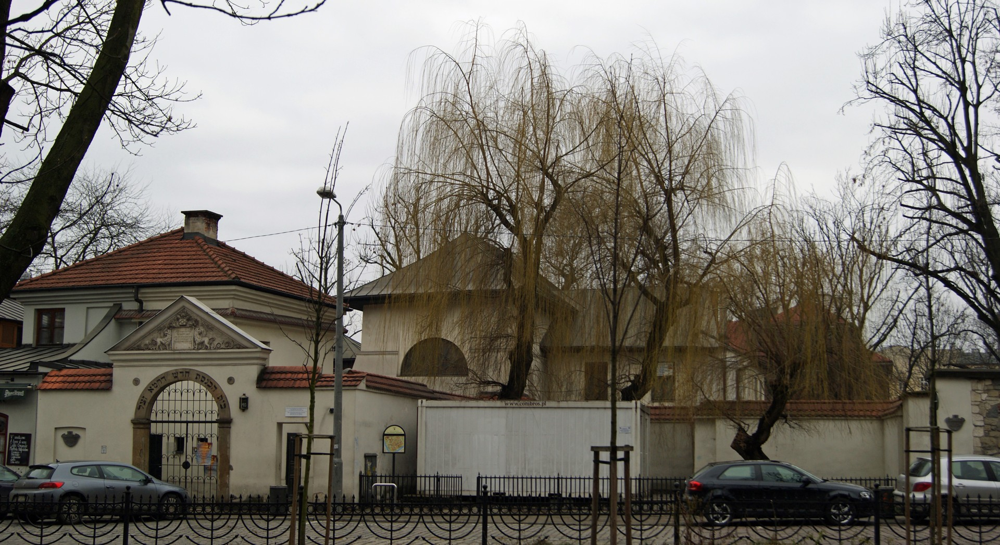
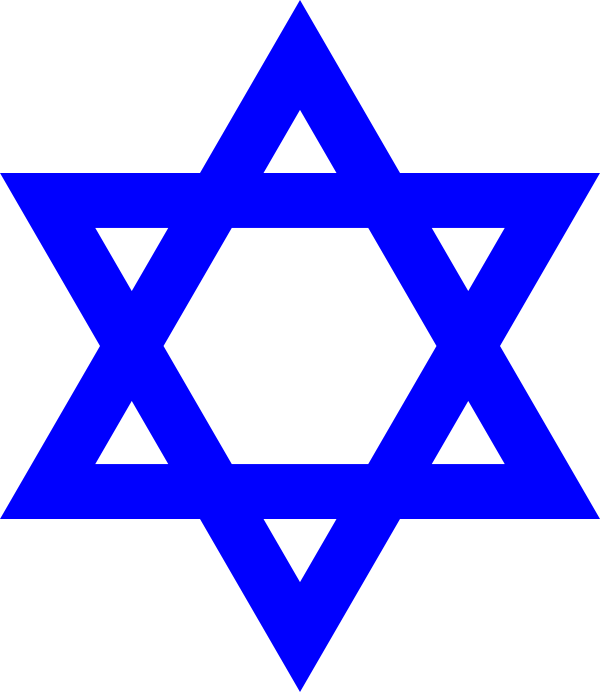
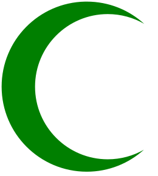

<!-- .slide: id="otwarcie" data-purpose="opening" data-layout="hero-source" -->

Rzeczpospolita · XVI wiek
<h1>„Państwo bez stosów”</h1>
Różne wyznania. Wspólne państwo.

1573

<figure><figcaption>Akt konfederacji warszawskiej</figcaption></figure>

notes:
0:00–1:00. Ciekawostka: opis oryginału wymienia 206 pieczęci; świadczą o zbiorowym zobowiązaniu, nie o 206 różnych wyznaniach. Otwarcie: „Spójrzcie na dokument i przywieszone do niego pieczęcie. Każda przypomina, że porozumienie wymagało zobowiązań wielu ludzi. W XVI wieku mieszkańcy jednego państwa różnili się wiarą. Dziś sprawdzimy, jak próbowali żyć obok siebie i dlaczego Rzeczpospolitą nazwano państwem bez stosów”. Nie zadawaj dodatkowej zagadki. Zdjęcie dokumentu otwiera się kliknięciem lub Enter; Escape wraca do slajdu.

---

<!-- .slide: id="wspolne-panstwo" data-purpose="question" data-layout="statement" -->

Pytanie główne
<h2>Jak zachować pokój, gdy ludzie różnią się wiarą?</h2>

<b>Rzeczpospolita Obojga Narodów</b> była państwem wielu narodowości i wyznań.

Największe wspólnoty chrześcijańskie tworzyli <b>katolicy i prawosławni</b>.

notes:
1:00–2:00. Przypomnij unię Polski i Litwy z 1569 r. Nazwa „Obojga Narodów” nie oznacza, że mieszkali tu wyłącznie Polacy i Litwini. Przyjmij dwie krótkie propozycje pokojowego współżycia. Katolicy i prawosławni byli największymi wspólnotami; nie wprowadzaj procentów ani rankingu mniejszych grup. Zróżnicowanie terytorialne i zmienność szacunków wyjaśnia przewodnik.

---

<!-- .slide: id="mapa-wyznan" class="full-map" data-purpose="evidence" data-layout="evidence" -->

notes:
2:00–5:00. Wspólne czytanie mapy, bez kart i przepisywania. Najpierw Bałtyk, Korona, Litwa oraz granica państwa, potem legenda. Zapytaj: „Gdzie przeważał katolicyzm, a gdzie prawosławie?”. Model: katolicyzm w zachodniej i środkowej części Korony, prawosławie na ziemiach ruskich na wschodzie i południowym wschodzie. Wskaż Gdańsk, Toruń i Elbląg jako ważne ośrodki luteranizmu. Zapytaj o widoczne skupiska ludności żydowskiej; na mapie podręcznika m.in. Kraków i Lublin, nie żądaj pełnej listy. Kolor dominującego wyznania nie oznacza, że wszyscy mieszkańcy tak wierzyli. Mapa opracowana współcześnie, pokazuje drugą połowę XVI w. i granice państwa pod koniec tego wieku, nie dokładnie rok 1573. Powiększ w tej samej karcie; bez podpisu w modalu.

---

<!-- .slide: id="religia-narodowosc" data-purpose="explanation" data-layout="comparison" -->
<h2>Wyznanie to nie narodowość</h2>

<h3>Wspólnota wiary</h3>
Religia i wyznanie mówią o wierzeniach oraz praktykach religijnych.

<b>Chrześcijaństwo:</b> katolicyzm, prawosławie oraz wyznania protestanckie.

<h3>Wspólnota pochodzenia i kultury</h3>
W Rzeczypospolitej mieszkali m.in. Polacy, Litwini, Rusini, Niemcy, Żydzi i Tatarzy.

Jedna narodowość nie oznaczała zawsze jednego wyznania.

Judaizm i islam to odrębne religie, nie wyznania chrześcijańskie.

notes:
5:00–6:00. Rusini to historyczna ludność ziem ruskich; nie utożsamiaj tej nazwy po prostu z dzisiejszymi Rosjanami. Większość Polaków była katolikami, ale niektórzy zostawali protestantami. Wielu mieszczan niemieckojęzycznych przyjęło luteranizm. Wyznanie nie jest automatycznym dowodem narodowości. Kolejne plansze są krótkim objaśnieniem, nie katalogiem do przepisywania.

---

<!-- .slide: id="katolicyzm" class="faith photo-right" data-purpose="explanation" data-layout="split" -->

Chrześcijaństwo
<h2>Katolicyzm</h2>
Katolicy uznają zwierzchnictwo <b>papieża</b> i wierzą w Trójcę Świętą.

Ich świątynią jest <b>kościół</b>; ważnym symbolem jest <b>krucyfiks</b>.

Katolikami byli m.in. liczni Polacy i Litwini.

<figure class="faith-photo"><figcaption>Kolegiata w Zamościu, budowa 1587–1598; dziś katedra.</figcaption></figure>
<figure class="faith-symbol"><figcaption>Krucyfiks — zabytek z XVI w.</figcaption></figure>

notes:
6:00–7:00. Katolicyzm to jedno z wyznań chrześcijańskich. Wspólna wiara w Jezusa Chrystusa łączy katolików z prawosławnymi i protestantami, choć dzielą ich ważne różnice. Fotografia pokazuje współczesny wygląd świątyni wybudowanej pod koniec XVI w., po 1573 r.; budynek był później zmieniany. Wskaż krucyfiks pod zdjęciem: to krzyż z postacią ukrzyżowanego Chrystusa. Nie ucz, że tylko katolicy używają krucyfiksów.

---

<!-- .slide: id="prawoslawie" class="faith photo-left" data-purpose="explanation" data-layout="split" -->

<figure class="faith-photo"><figcaption>Sobór Mądrości Bożej w Kijowie; początki XI w., późniejsze przebudowy.</figcaption></figure>
<figure class="faith-symbol"><figcaption>Krzyż prawosławny</figcaption></figure>

Chrześcijaństwo
<h2>Prawosławie</h2>
Prawosławni wierzą w Trójcę Świętą, ale <b>nie uznają zwierzchnictwa papieża</b>.

Modlą się w <b>cerkwiach</b>; ważne miejsce zajmują w nich ikony — święte obrazy.

Prawosławie przeważało wśród <b>Rusinów</b> na wschodzie państwa.

notes:
7:00–8:00. Pokaż krzyż prawosławny z trzema belkami, w tym ukośną dolną belką — podnóżkiem. Nie nazywaj go „złamanym”; to zamierzony kształt, nie uszkodzenie. Istnieją także inne formy krzyży prawosławnych. Nie myl ikony z dowolną dekoracją. Kopuły pomagają rozpoznać tę konkretną cerkiew, ale sama kopuła nie rozstrzyga wyznania każdego budynku. Zdjęcie współczesne; początki soboru sięgają XI w., a dzisiejszy wygląd jest wynikiem późniejszych przebudów. Na Litwie byli zarówno katolicy, jak i prawosławni; unikaj równania „Litwin = prawosławny”.

---

<!-- .slide: id="luteranizm" class="faith photo-right" data-purpose="explanation" data-layout="split" -->

Chrześcijaństwo · reformacja
<h2>Luteranizm</h2>
Nurt protestantyzmu związany z <b>Marcinem Lutrem</b>. Podkreśla znaczenie Biblii i wiary; nie uznaje władzy papieża.

Wspólnota modli się w <b>kościele lub zborze</b>.

W XVI w. przyjmowali go zwłaszcza mieszczanie <b>Gdańska, Torunia i Elbląga</b>.

<figure class="faith-photo"><figcaption>Kościół Pokoju w Świdnicy, XVII w. Śląsk leżał wówczas poza Rzecząpospolitą.</figcaption></figure>

notes:
8:00–9:00. Reformacja była ruchem zmian w zachodnim chrześcijaństwie zapoczątkowanym w XVI w.; prowadziła do powstania wyznań protestanckich. Nie redukuj jej tylko do walki z bogactwem duchownych. W miastach rozwijały się szkoły i druk książek protestanckich. Świdnica jest późniejszym przykładem świątyni luterańskiej, nie dowodem jej położenia w Rzeczypospolitej XVI w. Zbór oznacza wspólnotę protestancką, potocznie także miejsce jej modlitwy.

---

<!-- .slide: id="kalwinizm" class="faith photo-left" data-purpose="explanation" data-layout="split" -->
<figure class="faith-photo"><figcaption>Biblia brzeska, 1563 — polski druk związany z kalwinizmem.</figcaption></figure>

Chrześcijaństwo · reformacja
<h2>Kalwinizm</h2>
Nurt protestantyzmu związany z <b>Janem Kalwinem</b>. Podstawą nauczania jest Biblia; kalwini nie uznają władzy papieża.

Ich wspólnoty to <b>zbory</b>; wystrój świątyń jest zwykle skromny.

Kalwinizm przyjmowała część <b>szlachty Małopolski i Litwy</b>. Ważnym ośrodkiem był <b>Pińczów</b>.

notes:
9:00–10:00. Ciekawostka: widoczna Biblia brzeska była drukowana po polsku już w 1563 r., przed konfederacją. Reformacja rozwijała też przekłady i drukarstwo. Przypomnij, że luteranizm i kalwinizm to dwa różne nurty protestantyzmu, nie dwie nazwy tej samej wspólnoty. Nie wymagaj definicji predestynacji. Szlachta fundowała zbory i szkoły; Pińczów był ośrodkiem nauki oraz reformacji. Widoczna jest karta tytułowa Biblii brzeskiej z 1563 r., autentyczny druk reformacyjny, nie świątynia. Nie mów, że Jan Kalwin sam przetłumaczył tę Biblię.

---

<!-- .slide: id="bracia-polscy" data-purpose="explanation" data-layout="split" -->

Radykalny nurt reformacji
<h2>Bracia polscy</h2>
Nazywani też <b>arianami</b>. Wyodrębnili się z polskiego kalwinizmu w XVI w.

<b>Odrzucali dogmat Trójcy Świętej.</b> Wielu sprzeciwiało się wojnie i przemocy.

Rozwijali szkoły i drukarstwo. Ich ważnym ośrodkiem był <b>Raków</b>.

Miejsce
<h3>Raków</h3>
Małopolska

Wspólnota, szkoła, drukarnia.

notes:
10:00–11:30. Wyjaśnij, że słowo „bracia” jest nazwą wspólnoty, nie pokrewieństwem. Wspólnota nie była jednolita we wszystkich poglądach społecznych; nie mów, że wszyscy zawsze znosili pańszczyznę albo byli bezwzględnymi pacyfistami. Odrzucenie Trójcy dotyczy tutaj braci polskich; judaizm i islam nie stają się przez to ich odmianami. Akademia Rakowska powstała w 1602 r. — jeśli pada ta nazwa, wyraźnie dodaj: to już XVII wiek, poza głównym zakresem lekcji.

---

<!-- .slide: id="judaizm" class="faith photo-right" data-purpose="explanation" data-layout="split" -->

Odrębna religia
<h2>Judaizm</h2>
Religia Żydów, oparta na wierze w <b>jednego Boga</b>. Jej świętym tekstem jest <b>Tora</b>.

Dom modlitwy to <b>synagoga</b>. Z judaizmem wiąże się m.in. menora — siedmioramienny świecznik.

Żydzi tworzyli własne gminy; mieszkali m.in. w <b>Krakowie i Lublinie</b>.

<figure class="faith-photo"><figcaption>Synagoga Remu na Kazimierzu w Krakowie — fundacja XVI w., późniejsze przebudowy.</figcaption></figure>
<figure class="faith-symbol"><figcaption>Menora</figcaption></figure><figure class="faith-symbol"><figcaption>Gwiazda Dawida</figcaption></figure>

notes:
11:30–12:30. Judaizm nie jest wyznaniem chrześcijańskim. Tora to pierwsze pięć ksiąg Biblii hebrajskiej, a nie całość wszystkich tekstów judaizmu. Gmina organizowała życie religijne, szkołę i pomoc wspólnocie. Nie sprowadzaj wszystkich Żydów do jednego zawodu ani stereotypu. Pokaż też Gwiazdę Dawida — sześciopromienny znak kojarzony z judaizmem; nie przedstawiaj go jako jednakowo powszechnego w każdej gminie XVI w. Menora ma siedem ramion; świecznik chanukowy na zdjęciu podręcznika s.75 jest innego typu, nie nazywaj go siedmioramienną menorą.

---

<!-- .slide: id="islam" class="faith photo-left" data-purpose="explanation" data-layout="split" -->

<figure class="faith-photo"><figcaption>Meczet w Bohonikach — zachowany budynek z XIX w.</figcaption></figure>
<figure class="faith-symbol"><figcaption>Półksiężyc</figcaption></figure>

Odrębna religia
<h2>Islam</h2>
Muzułmanie wierzą w <b>jednego Boga</b>. Ich świętą księgą jest <b>Koran</b>, a prorokiem — Mahomet.

Modlą się w <b>meczecie</b>. Półksiężyc kojarzy się z wieloma wspólnotami muzułmańskimi.

Islam wyznawali <b>Tatarzy</b>, osiedlający się m.in. na Litwie i służący w wojsku.

notes:
12:30–13:30. Ciekawostka: muzułmańscy Tatarzy służyli w wojsku wspólnego państwa; inna wiara nie oznaczała automatycznie wroga. Półksiężyc nie jest obowiązkowym znakiem wszystkich muzułmanów. Nie utożsamiaj Tatarów mieszkających w Rzeczypospolitej z każdym przeciwnikiem tatarskim w wojnach. Bohoniki są przykładem późniejszego osadnictwa i zachowanej XIX-wiecznej budowli. Nie przedstawiaj jej jako meczetu stojącego tu w 1573 r. Pełne prawa do budynku i datowanie w sources-assets.md.

---

<!-- .slide: id="wspolzycie" data-purpose="synthesis" data-layout="matrix" -->
<h2>Obok siebie, nie tak samo</h2>

Wiara
Różne modlitwy, święta i świątynie.

Codzienność
Wspólne miasta, handel i służba państwu.

Nauka
Szkoły i drukarnie różnych wspólnot.

Różnorodność mogła wzbogacać państwo, ale wymagała zasad rozwiązywania sporów.

notes:
13:30–15:00. Zadaj pytanie kontrolne 1: „Dlaczego same słowa Polak i katolik nie znaczą tego samego?”. Odpowiedź: pierwsze dotyczy narodowości, drugie wyznania; część Polaków była protestantami. Następnie pytanie 2: „Gdzie kalwinizm, a gdzie luteranizm znajdowały zwolenników?”. Model: kalwinizm wśród części szlachty Małopolski i Litwy; luteranizm zwłaszcza wśród mieszczan Gdańska, Torunia i Elbląga. Nie odpytuj każdego z siedmiu definicji. Każdy myśli sam, potem nauczyciel przyjmuje krótkie odpowiedzi.

---

<!-- .slide: id="europa-konfliktow" data-purpose="explanation" data-layout="statement" -->

Europa · XVI wiek
<h2>Spór o wiarę stawał się wojną</h2>

W części Europy katolicy i protestanci walczyli ze sobą i prześladowali przeciwników.

Ludzie uciekali przed przemocą. Niektórzy znajdowali schronienie w Rzeczypospolitej.

<b>Stos</b> stał się symbolem karania za przekonania religijne.

notes:
15:00–17:00. Nie pokazuj drastycznych scen i nie sugeruj, że każde państwo zachodnie lub każdy wierzący postępował jednakowo. W razie potrzeby podaj krótki przykład: noc św. Bartłomieja we Francji w 1572 r. — masakra protestantów, nie wojna polska. Pytanie 3: „Dlaczego uchodźca religijny mógł szukać schronienia w innym państwie?”. Model: chciał uniknąć prześladowania i móc praktykować swoją wiarę. To wprowadza motywację do prawnej ochrony pokoju, nie współczesną kategorię prawną azylu.

---

<!-- .slide: id="rok-1573" data-purpose="explanation" data-layout="timeline-band" -->
<h2>Pokój przed wyborem króla</h2>

<b>1572</b><h3>Śmierć Zygmunta Augusta</h3>
Bezkrólewie: nie ma monarchy. Szlachta przygotowuje wybór następcy.

<b>28 stycznia 1573</b><h3>Konfederacja warszawska</h3>
Porozumienie szlachty ma chronić pokój mimo różnic wyznaniowych.

<b>Konfederacja</b> — związek zawarty dla wspólnego celu.

notes:
17:00–19:00. Nie rozwijaj przebiegu wolnej elekcji — będzie w kolejnym temacie. Wyjaśnij bezkrólewie i wzajemność zobowiązania: ludzie różnych wyznań przyrzekają sobie pokój. Akt przyjęto 28 stycznia 1573 r. podczas sejmu konwokacyjnego. Nie przypisuj jego wydania urzędującemu królowi ani jednej religii. Prawna ochrona dotyczyła przede wszystkim chrześcijańskiej szlachty; zakres doprecyzujemy po lekturze, aby nie podać odpowiedzi przed pytaniem.

---

<!-- .slide: id="pytania-do-aktu" data-purpose="practice" data-layout="activity-brief" -->

Przeczytamy dokument
<h2>Szukamy celu i zobowiązań</h2>
<ol><li>Powiedz, w jakim celu został wydany <i>Akt konfederacji warszawskiej</i>.</li><li>Wymień kary, jakich zobowiązali się nie stosować wobec innowierców autorzy tego dokumentu.</li></ol>

<b>Innowierca</b> — osoba innego wyznania niż nasze. <b>Konfiskata dóbr</b> — odebranie majątku.

notes:
19:00–20:00. Pytania są dosłownym zapisem dwóch pytań z podręcznika s.73. Przeczytaj je przed pokazaniem źródła. Powiedz: „Za chwilę przeczytam tekst na głos. Śledźcie go i znajdźcie słowa, które pomogą odpowiedzieć. Odpowiadamy ustnie; niczego teraz nie przepisujemy”. Wyjaśnij konfiskatę i innowiercę, nie podawaj klucza. Cały blok analizy slajdów 15–16 trwa 6 minut; po pytaniach pozostaje 5 minut na czytanie, namysł i rozmowę.

---

<!-- .slide: id="akt-konfederacji" data-purpose="evidence" data-layout="evidence" -->
<h2>Akt konfederacji warszawskiej</h2>
Warszawa, 1573 r. · fragment
<figure class="document-reading"><blockquote class="source-excerpt full-passage">A iż w Rzeczypospolitej naszej jest niezgoda niemała w sprawie religii chrześcijańskiej, zapobiegając temu, aby się z tej przyczyny między ludźmi rozterka [konflikt] jaka szkodliwa nie wszczęła, którą po inszych królestwach jaśnie widzimy, obiecujemy to sobie wspólnie [...] pokój między sobą zachować, a dla różnej wiary i odmiany w kościołach krwi nie przelewać, ani się karać konfiskatą dóbr, więzieniem i wygnaniem, i zwierzchności żadnej ani urzędowi do takowego postępowania żadnym sposobem nie pomagać. [...]</blockquote></figure>

notes:
20:00–25:00. Odczytaj pełny fragment spokojnie, ok. 1,5 minuty; zachowaj 30 sekund namysłu i ok. 3 minuty rozmowy. Nie pokazuj odpowiedzi na slajdzie. Pytanie 1: dokument ma zapobiec konfliktom i przelewowi krwi z powodu różnic religijnych oraz zachować pokój. Pytanie 2: wymieniono konfiskatę dóbr, więzienie i wygnanie; tekst dodatkowo zakazuje przelewu krwi z powodów wyznaniowych i wspierania władz w prześladowaniu. Poproś ucznia o odczytanie odpowiedniego zwrotu jako uzasadnienia, potem drugiego ucznia o dopowiedzenie. Pomoc: „Znajdź słowo pokój”, „Zacznij od ani się karać”. Zachowano cały dostarczony fragment, objaśnienie [konflikt], oba [...] oraz formę „inszych”; usunięto jedynie mechaniczne dzielenie słów na końcach wierszy. To nie cały akt. Nie zamieniaj zakresu „religii chrześcijańskiej” na bezwarunkowe równouprawnienie wszystkich ludzi.

---

<!-- .slide: id="znaczenie-aktu" data-purpose="explanation" data-layout="comparison" -->
<h2>Co oznaczał ten pokój?</h2>

<h3>Zobowiązanie</h3>
Nie prześladować za różnice wiary: nie przelewać krwi, nie odbierać majątku, nie więzić ani nie wypędzać.

<h3>Zakres</h3>
Gwarancja dotyczyła przede wszystkim szlachty różnych wyznań chrześcijańskich.

Nie była dzisiejszą równością praw wszystkich mieszkańców.

Żydzi i muzułmanie korzystali także z odrębnych przywilejów i zasad.

notes:
25:00–27:00. Podsumuj odpowiedzi dopiero po analizie. Akt nie stworzył od zera wszystkich swobód ani nie był jedyną podstawą położenia Żydów i muzułmanów. Nierówność stanów i władza właściciela nad poddanymi pozostały. Nie opowiadaj o dzisiejszej konstytucji jako bezpośrednim skutku jednego dokumentu. Uczniowi wystarczy: znacząca ochrona pokoju, lecz nie jednakowe prawa każdego człowieka.

---

<!-- .slide: id="tytul-i-granice" data-purpose="synthesis" data-layout="statement" -->

Wracamy do tytułu
<h2>„Bez stosów” nie znaczy „bez konfliktów”</h2>

Na tle krwawych konfliktów w Europie XVI-wieczna Rzeczpospolita wyróżniała się <b>tolerancją religijną</b>.

Istniały jednak uprzedzenia, spory i przypadki przemocy.

<b>Tolerancja religijna</b> to poszanowanie odmiennych przekonań i praktyk religijnych.

notes:
27:00–29:00. Pytanie 4: „Czy określenie państwo bez stosów dowodzi, że nie było żadnej przemocy religijnej?”. Model: nie; podkreśla względną tolerancję na tle ówczesnej Europy, nie idealne bezpieczeństwo każdego. Nie wymagaj listy wyjątków ani liczb ofiar. Nie odwracaj uproszczenia w tezę, że tolerancja była fikcją — porozumienie miało realne znaczenie. Przy wolniejszej klasie skróć wypowiedzi o przykładach, zachowaj definicję i wniosek.

---

<!-- .slide: id="dzisiaj" data-purpose="explanation" data-layout="comparison" -->
<h2>Wolność religii dzisiaj</h2>

Dziś w Polsce wolność sumienia i religii gwarantuje <b>Konstytucja</b>.

Chroni każdego człowieka, nie tylko jeden stan społeczny.

Obejmuje wyznawanie religii, zmianę przekonań oraz niewyznawanie religii.

Nie wolno zmuszać do udziału ani do nieuczestniczenia w praktykach religijnych.

notes:
29:00–30:00. Nawiązanie do podręcznika s.75; art.53 Konstytucji RP. Nie proś dzieci o deklaracje osobistej wiary. Wyjaśnij różnicę historyczną bez oceniania przekonań uczniów: w XVI w. przywileje związane ze stanem, dziś prawo przysługuje każdemu. Zasady bezpieczeństwa i prawa innych osób również obowiązują; lekcja nie jest pełnym wykładem prawa konstytucyjnego.

---

<!-- .slide: id="notatka" data-purpose="synthesis" data-layout="takeaways" -->
<h2>Notatka do zeszytu</h2><ol class="notebook"><li>Rzeczpospolita w XVI w. była państwem wielu narodowości i wyznań. Największe wspólnoty tworzyli katolicy i prawosławni.</li><li>Żyli tu także luteranie, kalwini, bracia polscy, Żydzi wyznający judaizm oraz Tatarzy wyznający islam.</li><li>Luteranizm rozwijał się w Gdańsku, Toruniu i Elblągu, a kalwinizm wśród części szlachty Małopolski i Litwy.</li><li>Konfederacja warszawska z <b>1573 r.</b> zobowiązywała do pokoju mimo różnic wiary; chroniła przede wszystkim chrześcijańską szlachtę.</li><li>Tolerancja religijna oznacza poszanowanie odmiennych przekonań. Nazwa „państwo bez stosów” nie oznacza braku wszelkich konfliktów.</li></ol>

notes:
30:00–35:00. Pięć minut wyłącznie na krótki zapis i sprawdzenie, nie dodatkowy wykład. Uczniowie przepisują pięć punktów, nie poprzednie slajdy. Wolniej piszącemu pozwól zapisać skrót punktu 3: „luteranizm — miasta; kalwinizm — część szlachty”. Dyktuj z pauzami, gdy projekcja jest słabsza. To jedyny obowiązkowy zapis obok tematu; nie rozdawaj karty pracy. Skrócenie wcześniejszych przykładów odzyskuje czas, nie zabieraj go z notatki.

---

<!-- .slide: id="odpowiedz-na-pytanie" data-purpose="synthesis" data-layout="statement" -->

Wspólne państwo
<h2>Pokój wymagał wzajemnego zobowiązania</h2>
Różnice wiary nie zniknęły. W 1573 r. szlachta przyrzekła, że nie staną się powodem prześladowań.

notes:
35:00–36:00. Zakończenie: „Rzeczpospolita nie była państwem jednej wiary. Jej mieszkańcy różnili się modlitwą, językiem i obyczajami, a jednak mogli budować wspólne państwo. Konfederacja warszawska nie usunęła wszystkich konfliktów i nie dała wszystkim równych praw. Była jednak ważnym zobowiązaniem, by sporu o wiarę nie rozstrzygać przemocą”. To odpowiedź na pytanie główne, nie kolejna notatka.

---

<!-- .slide: id="ustne-podsumowanie" data-purpose="exit-ticket" data-layout="activity-brief" -->
<h2>Na zakończenie — ustnie</h2>

Podaj rok konfederacji warszawskiej.

Wymień dwie kary zakazane w przeczytanym fragmencie.

Wyjaśnij, dlaczego Rzeczpospolitą nazywamy „państwem bez stosów”.

Chwila namysłu, potem krótkie odpowiedzi. Niczego nie dopisujemy.

notes:
36:00–38:00. Każdy zastanawia się sam przez około 15 sekund. Wywołaj trzy różne osoby, po jednej odpowiedzi; poproś pozostałych o ciche porównanie z własną odpowiedzią. Klucz: 1573; dowolne dwie spośród konfiskaty dóbr, więzienia i wygnania (uznaj też przelew krwi jako zakazaną przemoc); względna tolerancja i prawne zobowiązanie do pokoju, nie całkowity brak konfliktów. Pytanie 5 z przewodnika to trzecie pytanie tego slajdu. Przy 15–20 uczniach nie odpytuj całej klasy po kolei. Ostatnie 30 sekund tego bloku stanowi bufor na sprostowanie jednej pomyłki. Brak pisemnego biletu, karty i zbierania zeszytów; to ustne sprawdzenie, nie dowód ocenienia każdego ucznia.
