<!-- .slide: id="otwarcie" class="cover" data-purpose="opening" data-layout="hero-source" -->

<figure></figure>

1575–1634 · Od Bałtyku do Kremla
<h1>Wojny z Rosją</h1>
Od walk o Inflanty do walk o tron w Moskwie.

Późniejszy obraz z 1872 r.

notes:
0:30. Powiedz na otwarcie: „Najpierw chodziło o porty nad Bałtykiem. Potem pojawiła się szansa na tron w Moskwie. Wojsko może wygrać bitwę — ale czy to wystarczy, żeby ludzie uznali nowego władcę? Dzisiaj sprawdzimy, co udało się zdobyć, a czego nie udało się utrzymać”. Nie zbieraj tu długiej dyskusji. Zapisz temat. Obraz Jana Matejki z 1872 r. jest późniejszą interpretacją, nie zapisem kapitulacji Pskowa: miasta nie zdobyto. Materiały: tylko zeszyt i długopis; nie rozdajemy karty pracy.

---

<!-- .slide: id="batory" class="portrait" data-purpose="explanation" data-layout="split" -->

<h2>Nowy król: Stefan Batory</h2>

Król w latach 1576–1586

Od <strong>1571 r. był księciem Siedmiogrodu</strong> — krainy związanej z dziejami Węgier.

Po ucieczce Henryka Walezego <strong>szlachta wybrała go w 1575 r.</strong> Nie odziedziczył polskiej korony.

W <strong>1576 r.</strong> poślubił Annę Jagiellonkę i został koronowany.

Był doświadczonym wodzem. Chciał <strong>odzyskać Inflanty</strong> zajęte przez Moskwę.

<figure>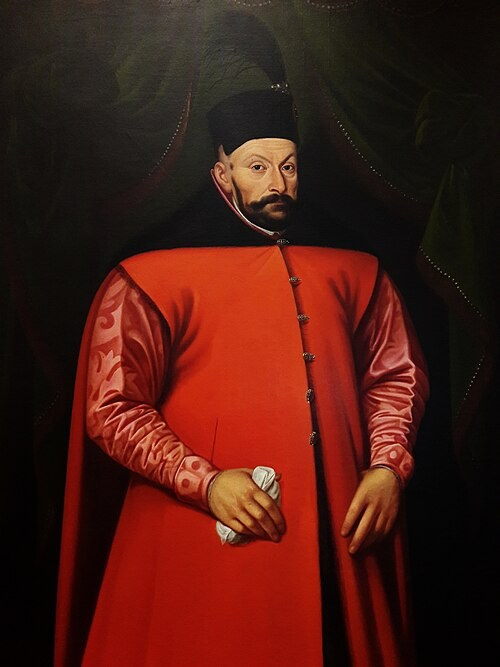<figcaption>Stefan Batory · późniejsza kopia portretu z 1583 r.</figcaption></figure>

notes:
1:00. Nawiąż do wolnej elekcji: po ucieczce Henryka Walezego doszło do podwójnego wyboru; szlachta popierająca Annę Jagiellonkę wskazała Batorego na jej męża. Dla ucznia kluczowe rozróżnienie: elekcja 1575, ślub i koronacja 1576, nie jedna data. Batory od 1571 r. był władcą Siedmiogrodu, kraju związanego z węgierską tradycją polityczną. Nie przedstawiaj go jako króla współczesnej Rumunii; taka Rumunia wówczas nie istniała. Był doświadczonym wodzem, co łączy jego wcześniejsze życie z wyprawami o Inflanty. Portret jest XIX-wieczną kopią według obrazu z 1583 r.; nie podpisujemy go jako oryginału Kobera. Na następnym ekranie zlokalizuj Siedmiogród, potem wyjaśnij obie funkcje Zamoyskiego.

---

<!-- .slide: id="siedmiogrod" class="map-board" data-purpose="evidence" data-layout="map-focus" -->

<figure>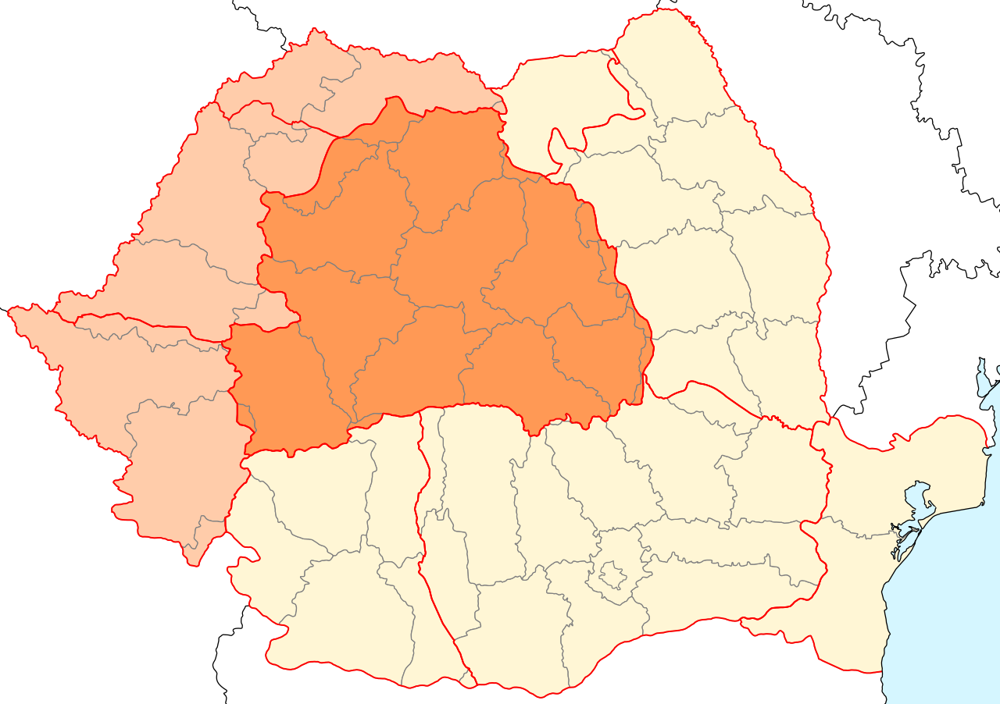</figure>
<h2>Skąd przybył Batory?</h2>
<strong>Siedmiogród = Transylwania</strong>

Na południowy wschód od Polski, <strong>wewnątrz łuku Karpat</strong>. Dziś to środkowa część Rumunii.

<i class="swatch transylvania"></i>Siedmiogród <i class="swatch neighbours"></i>sąsiednie regiony: Banat, Kriszana i Marmarosz <i class="swatch rest-romania"></i>pozostała Rumunia

Orientacja na mapie dzisiejszej Rumunii — <strong>nie granice księstwa w XVI w.</strong>

notes:
1:00. Najpierw nazwij obrys całego kraju: współczesna Rumunia. Pomarańczowe pole w jej środku to historyczny Siedmiogród, czyli Transylwania; jaśniejsze pola na zachodzie i północy to sąsiednie krainy, nie ten sam obszar. Szare linie oznaczają rumuńskie jednostki administracyjne, czerwone rozdzielają regiony i obrys kraju; nie traktujemy ich jako granic państwa Batorego. Mapę wykorzystujemy tylko do lokalizacji: na południowy wschód od Polski, wewnątrz łuku Karpat. W XVI w. księstwo było związane z dziejami Węgier i uznawało zwierzchnictwo sułtana osmańskiego; nie było częścią istniejącej dziś Rumunii. Nie wymagaj od uczniów nazw sąsiednich krain. Powiększ mapę po kliknięciu, jeśli trzeba. Autor Andrein/ArdadN, Commons, CC BY-SA 4.0; pełna dokumentacja nauczyciela w sources.md. Nie dorysowano granic ani tras.

---

<!-- .slide: id="zamoyski" class="office-portrait" data-purpose="explanation" data-layout="source-split" -->

<h2>Jan Zamoyski — dwie ważne funkcje</h2>
<figure><figcaption>Jan Zamoyski · późniejszy portret malarski</figcaption></figure>

<h3>Od 1578 r. · kanclerz wielki koronny</h3>
Kierował <strong>kancelarią królewską</strong>, gdzie przygotowywano dokumenty państwowe. Uwierzytelniał je pieczęcią i współtworzył <strong>politykę zagraniczną</strong> — stosunki z innymi państwami.

<h3>Od 1581 r. · także hetman wielki koronny</h3>
Był <strong>najwyższym dowódcą wojsk Korony</strong> pod zwierzchnictwem króla. Organizował wojsko, planował działania i dowodził podczas wypraw.

Nie zamienił jednego urzędu na drugi. <strong>Od 1581 r. pełnił obie funkcje jednocześnie.</strong>

notes:
1:30. Najpierw zdefiniuj urząd, dopiero potem odczytaj datę dotyczącą Zamoyskiego. Kanclerz nie był jedynie pisarzem króla: kierował kancelarią, miał pieczęć do uwierzytelniania aktów i wpływał na politykę zagraniczną. Hetman to urząd wojskowy: dowodzenie, organizacja i planowanie działań. Zamoyski był kanclerzem wielkim koronnym od 1578 i hetmanem wielkim koronnym od 1581; od tego drugiego roku łączył oba urzędy, aż do śmierci w 1605. Nie mów, że po 1581 przestał być kanclerzem. Korona oznacza tu polską część Rzeczypospolitej, nie samą osobę króla; Litwa miała własne urzędy kanclerskie i hetmańskie. Król mógł osobiście dowodzić wyprawą, więc hetman nie zastępował monarchy jako zwierzchnika wszystkich sił zbrojnych. Nie rozszerzaj krótkiej definicji na bezwarunkowe dowodzenie każdym rodzajem wojsk, np. pospolitym ruszeniem. Współpracę urzędnika i wodza połącz z późniejszym przygotowaniem wypraw Batorego. Obraz jest późniejszym portretem Marcelego Bacciarellego, nie fotografią ani wizerunkiem wykonanym za życia Zamoyskiego. Księga pomaga mówić o sprawach państwa, ale nie przedstawia konkretnego rozpoznanego dokumentu. Pełne źródła i prawa poza ekranem ucznia.

---

<!-- .slide: id="baltyk" class="map-board" data-purpose="evidence" data-layout="map-focus" -->

<figure>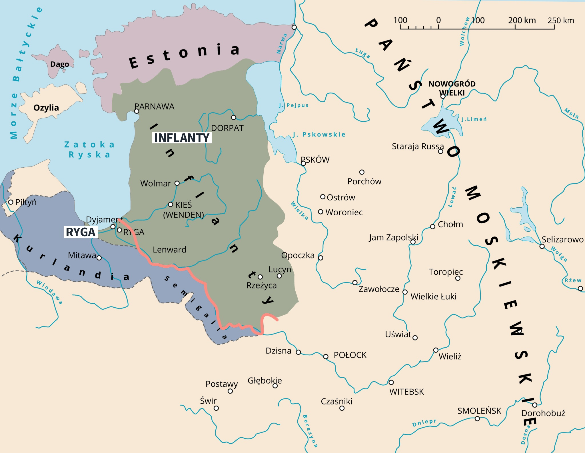</figure>
<h2>Dlaczego car chciał Inflant?</h2>
Porty = <strong>handel morski</strong> i kontakty z Zachodem.

<strong>1577:</strong> Iwan IV zajął większość Inflant.

<i class="swatch inflanty"></i>Inflanty ······ zasięg zdobyczy cara 1572–1577

notes:
1:00. Wskaż Bałtyk, Inflanty, Rygę oraz państwo moskiewskie. Wyjaśnij, że port to nie tylko fragment brzegu: to miejsce przeładunku, dochody z handlu i połączenie z innymi krajami. Iwan IV Groźny dążył do dostępu do Bałtyku, a Rzeczpospolita chciała odzyskać utracone ziemie i obronić własne wpływy. Wojna o Inflanty trwała już wcześniej, od 1558 r.; rok 1577 oznacza zajęcie ich większości przez cara, nie początek całej wojny. Nie utożsamiaj Inflant z całym wybrzeżem Bałtyku ani współczesną Łotwą w jej obecnych granicach. Używaj legendy dostarczonej mapy.

---

<!-- .slide: id="piechota" class="soldier-slide" data-purpose="explanation" data-layout="source-split" -->

<h2>1578 · Piechota wybraniecka</h2>
<figure class="soldier-mount">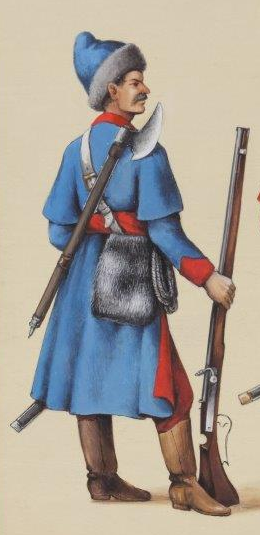<figcaption>Wybraniec — późniejsza rekonstrukcja żołnierza XVII w.</figcaption></figure>

<strong>Piechota wybraniecka</strong> to oddziały żołnierzy walczących pieszo, utworzone przez Batorego w <strong>1578 r.</strong> z chłopów mieszkających w dobrach królewskich.

<strong>20 łanów ziemi → 1 wybraniec</strong> Łan był miarą powierzchni ziemi, nie liczbą osób.

<strong>Rusznica przy dłoni</strong> — ręczna broń palna; <strong>szabla</strong> — broń do walki wręcz; <strong>siekiera na ramieniu</strong> — także do prac polowych.

Piechurzy pomagali <strong>bronić i zdobywać twierdze</strong>.

notes:
1:30. Definicja musi wybrzmieć przed pokazaniem wyposażenia. Jeden wybraniec przypadał na 20 łanów ziemi królewskiej, nie 20 osób. Pozostali gospodarze przejmowali jego powinności. To nie była cała armia. Rysunek Bohdana Wróblewskiego przedstawia rekonstrukcję wybrańca XVII wieku, nie udokumentowany mundur z 1578. Wskaż rusznicę po prawej stronie postaci oraz siekierę opartą na ramieniu. Szabla jest wymieniona w przepisie, ale na tym kadrze nie pokazujemy jej jako pewnie rozpoznanego przedmiotu. Powiększenie otwiera zachowany pełny oryginał: wybraniec z lewej, dragon z prawej; nie utożsamiaj obu formacji. Data wykonania rysunku i otwarta licencja nieustalone; tylko prywatny przegląd i użytek dydaktyczny. Nie dopisywać piki, zbroi ani mechanizmu zamka z domysłu.

---

<!-- .slide: id="wyprawy" class="map-board campaign-map" data-purpose="evidence" data-layout="map-focus" -->

<figure>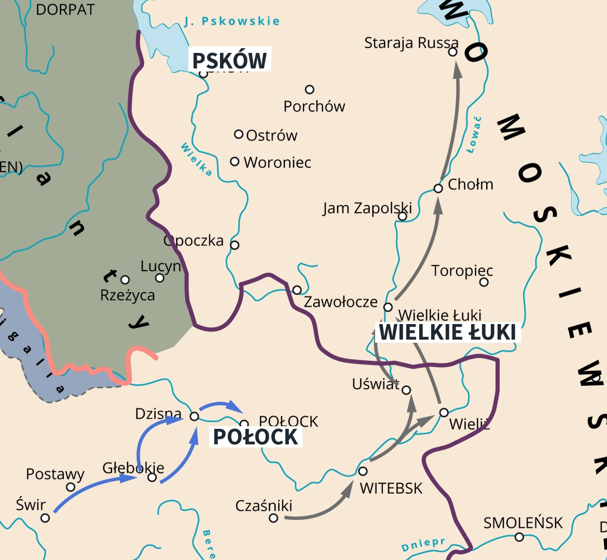</figure>
<h2>Trzy wyprawy Batorego</h2>
<strong>Cel: odzyskać Inflanty</strong> zajęte przez Iwana IV.
<ol class="campaign-list"><li><b>1579 · Połock</b> Wojska obległy i zdobyły twierdzę.</li><li><b>1580 · Wielkie Łuki</b> Zdobyły miasto, zagrażając zapleczu wojsk moskiewskich.</li><li><b>1581–1582 · Psków</b> Silne mury, opór i mróz utrudniały oblężenie. Miasta nie zdobyto.</li></ol>
→ 1579 · → 1580 ━ granica po rozejmie 1582 ···· zdobycze cara 1572–1577

notes:
2:00. Połącz cel, trzy działania i wynik. Oblężenie to otoczenie twierdzy i próba zmuszenia załogi do poddania się. Uderzenia na twierdze zagrażały zaopatrzeniu i połączeniom wojsk moskiewskich w Inflantach. Mapa nie ma strzałki trzeciej wyprawy: wskaż Psków, ale nie dorysowuj trasy z pamięci. Nie utożsamiaj zdobycia Wielkich Łuk z pozostawieniem ich przy Rzeczypospolitej; zwrot wyjaśnimy przy rozejmie. Obraz na otwarciu powstał w 1872 r. i nie dowodzi kapitulacji Pskowa.

---

<!-- .slide: id="jam" class="oral" data-purpose="practice" data-layout="task-board" -->

<h2>Rozejm mimo niezdobytego Pskowa?</h2>

Powiedz i uzasadnij · 45 sekund

Dlaczego car mógł zgodzić się na rozejm, chociaż Psków się obronił?

Po odpowiedziach: Jam Zapolski, 1582

Rzeczpospolita odzyskała <strong>Inflanty zajęte przez Moskwę i ziemię połocką</strong>. Zwróciła Moskwie <strong>Wielkie Łuki</strong>.

Pskowa nie zdobyto. Nie opanowano całego Bałtyku.

notes:
1:30. Aktywność ustna 1 z 3. Każdy najpierw układa zdanie w myśli, potem dwie osoby odpowiadają. Bez par. Klucz: straty innych twierdz, koszty wojny i groźba dalszego nacisku. Przed wypowiedziami details pozostaje zamknięte; ekran nie podaje przesłanek jako gotowej odpowiedzi. Następnie otwórz wynik i wyjaśnij: rozejm to czasowe zawieszenie działań. W 1582 r. odzyskano Inflanty zajęte przez Moskwę i ziemię połocką, zwrócono Wielkie Łuki. Psków się obronił; północ Inflant była w rękach szwedzkich. Sukces wojny nie oznacza zdobycia każdej twierdzy ani całego Bałtyku.

---

<!-- .slide: id="bilans-batorego" class="reign-balance sea" data-purpose="synthesis" data-layout="plain" -->

Stefan Batory · 1576–1586
<h2>Skuteczny wódz, nie tylko wojna</h2>

Batory wzmocnił piechotę i odzyskał ziemie utracone na rzecz Moskwy, choć nie zdobył Pskowa ani panowania nad całym Bałtykiem.

Za jego panowania powstały też <strong>Trybunał Koronny (1578)</strong> — najwyższy sąd rozpatrujący odwołania od wyroków sądów szlacheckich w Koronie — oraz <strong>Akademia Wileńska (1579)</strong>, czyli uczelnia wyższa.

notes:
1:00. Dwa zdania to krótki bilans panowania, nie nowy katalog reform. Wyjaśnij sąd odwoławczy: ponownie rozpatruje sprawę po odwołaniu od wyroku. Akademia jest uczelnią, nie szkołą wojskową. Nie wymagaj dodatkowo dat Trybunału Litewskiego ani listy wszystkich reform. Źródłowo potwierdzone: kalendarium Batorego i przepis o piechocie. Po bilansie przejdź do zapisu pierwszej notatki, a dopiero potem do następnej elekcji i drzewa.

---

<!-- .slide: id="notatka-1" class="notebook" data-purpose="synthesis" data-layout="plain" -->

<h2>Do zeszytu: Batory i Inflanty</h2>
Zapisz krótkie zdania i połącz je strzałkami · 3 minuty

<b>Cel:</b> odzyskać Inflanty i porty zajęte przez Moskwę.

<b>1579</b> zdobycie Połocka → <b>1580</b> zdobycie Wielkich Łuk → <b>1581–1582</b> oblężenie Pskowa — miasta nie zdobyto.

<b>Jam Zapolski, 1582:</b> odzyskano Inflanty zajęte przez Moskwę i ziemię połocką; Wielkie Łuki zwrócono.

notes:
3:00. Pierwsza notatka do zeszytu. Trzy krótkie połączone fragmenty, bez baszt, koron i kopiowania ilustracji. Tekst na ekranie jest pełnym modelem do zapisu po wyjaśnieniu wydarzeń. Daj ciszę i czas na kończenie. Uczeń może skrócić zdania, ale musi zachować niezdobyty Psków i zwrot Wielkich Łuk. Nie dopisuj biogramów ani nowego katalogu reform. To chronione trzy minuty, nie pozostałość czasu po opowieści.

---

<!-- .slide: id="waza" class="genealogy-explanation" data-purpose="explanation" data-layout="plain" -->

Po śmierci Batorego w 1586 r. — nowa elekcja
<h2>Jak Wazowie łączyli się z Jagiellonami?</h2>

<strong>Zygmunt I Stary</strong> był ojcem <strong>Katarzyny Jagiellonki</strong>. Jej mężem był <strong>Jan III Waza</strong>, król Szwecji. Ich syn to <strong>Zygmunt III Waza</strong>.

<strong>Anna Jagiellonka</strong>, żona Stefana Batorego, była siostrą Katarzyny i ciotką Zygmunta III.

Pokrewieństwo wspierało jego kandydaturę, ale nie dawało automatycznie polskiej korony: <strong>wybrano go w elekcji w 1587 r.</strong>

notes:
1:00. Przygotuj odczyt całego dostarczonego drzewa na kolejnym ekranie: od Zygmunta I Starego przejdź do Katarzyny i Jana III, potem do ich syna. Anna nie była matką Zygmunta, a Batory nie był jego ojcem. Jej poparcie pomagało kandydaturze siostrzeńca. Korona Rzeczypospolitej była elekcyjna, nie dziedziczona automatycznie. Nie dopisuj nowej wojny o Szwecję. Na drzewie daty przy † oznaczają śmierć, a nie panowanie.

---

<!-- .slide: id="drzewo" class="source-tree" data-purpose="evidence" data-layout="evidence" -->

<figure>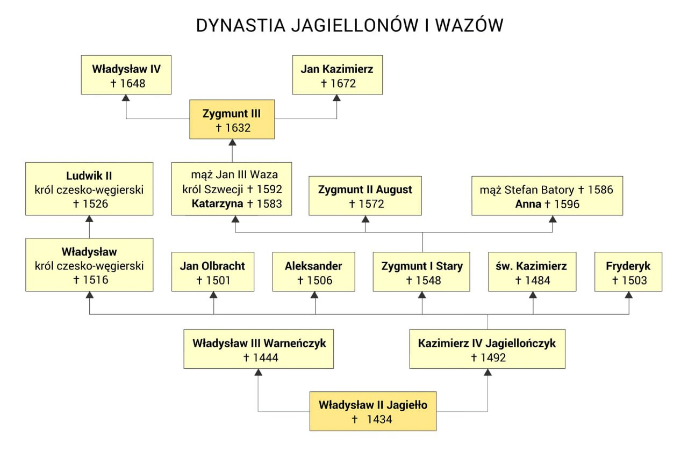</figure>

notes:
0:30. Cały dostarczony obraz, bez przerysowania i bez obcinania gałęzi. Wskaż relacje wyjaśnione na poprzednim ekranie. Krzyżyki † to daty śmierci, nie panowania. Klik lub Enter powiększa tę samą pełną grafikę; nie rób z drzewa kolejnego zadania ani katalogu wszystkich Jagiellonów. Autorstwo i prawa przesłanego materiału są nieustalone, użycie tylko w prywatnej rewizji.

---

<!-- .slide: id="warszawa" class="wawel-story" data-purpose="explanation" data-layout="source-split" -->

<h2>Dlaczego dwór przenosił się do Warszawy?</h2>
<figure>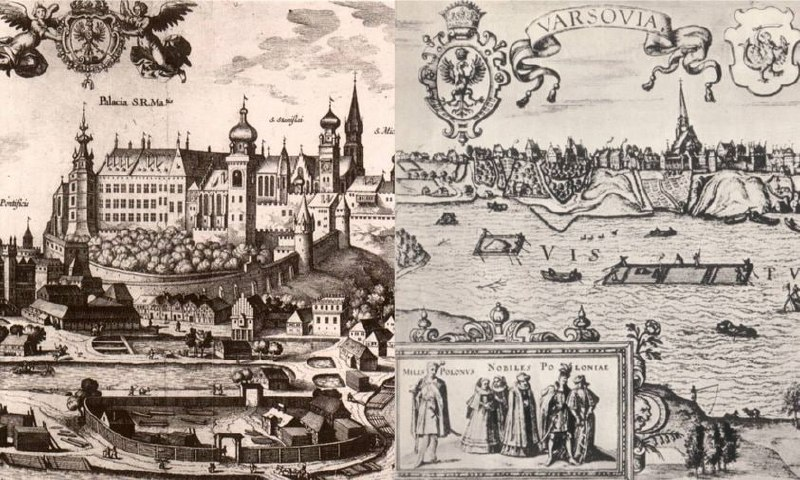<figcaption>Dawne widoki: zamek i Warszawa</figcaption></figure>

<strong>Pożar części Wawelu w 1595 r.</strong> bywa wymieniany jako jedna z okoliczności sprzyjających przenosinom.

Wybór Warszawy miał też powody polityczne i sejmowe: odbywały się tu <strong>sejmy</strong>, leżała dogodnie między Koroną a Litwą i bliżej spraw szwedzkich.

<b>1596</b> — tradycyjna, umowna data przenosin. <b>1611</b> — stałe zamieszkanie króla w Warszawie.

To był proces. Kraków nadal pozostawał miejscem koronacji.

notes:
1:30. Fakt pożaru części Wawelu w styczniu 1595 r. potwierdza oficjalny materiał Wawelu, s. 3; nie spłonął cały zamek. Związek pożaru z wyborem Warszawy jest sporny: oficjalna historia Zamku Królewskiego w Warszawie wymienia podróże sejmowe, położenie i sprawy szwedzkie, ale nie pożar jako przyczynę. Słowa „bywa wymieniany” opisują tradycyjną interpretację, nie pewny rozstrzygający powód. Nie opowiadaj legendy alchemicznej. Zestawienie dawnych widoków dostarczył nauczyciel. Autorstwo i data wykonania tej reprodukcji nieustalone; nie traktujemy jej jako dokumentacji pożaru. Prawy widok ma napis VARSOVIA. Współczesne zdjęcie Wawelu usunięto z prezentacji zgodnie z nową uwagą. Przenosiny nie były jednym aktem prawnym zmiany stolicy: 1596 to data tradycyjna, 1611 stałe zamieszkanie króla; Kraków zachował koronacje.

---

<!-- .slide: id="smuta" class="crisis-slide" data-purpose="explanation" data-layout="plain" -->

<h2>Wielka smuta — kryzys państwa moskiewskiego</h2>

1598 · śmierć cara Fiodora I

Wygasła panująca dynastia <strong>Rurykowiczów</strong>. Tron objął <strong>Borys Godunow</strong>, ale część możnych podważała jego władzę.

Spory o tron i walki wewnętrzne

Głód, epidemie i niepokoje społeczne

Osłabione państwo stało się miejscem walk o władzę i obcych interwencji. Ten okres nazywamy <strong>wielką smutą</strong>.

notes:
1:00. Iwan IV zmarł w 1584 r.; kryzys następstwa wyjaśniamy śmiercią jego syna Fiodora I w 1598. Godunow nie był synem Iwana ani teściem Fiodora — nie powtarzaj błędu ZPE. Smuta to okres kryzysu, nie nazwa bitwy ani wyłącznie skutek obcych interwencji. Głód i spory istniały niezależnie od wypraw z Rzeczypospolitej. Przygotuj rozróżnienie między prawdziwym Dymitrem a człowiekiem podszywającym się pod niego.

---

<!-- .slide: id="dymitr" class="pretender-story" data-purpose="explanation" data-layout="source-split" -->

<h2>Pierwszy Dymitr Samozwaniec</h2>
<figure>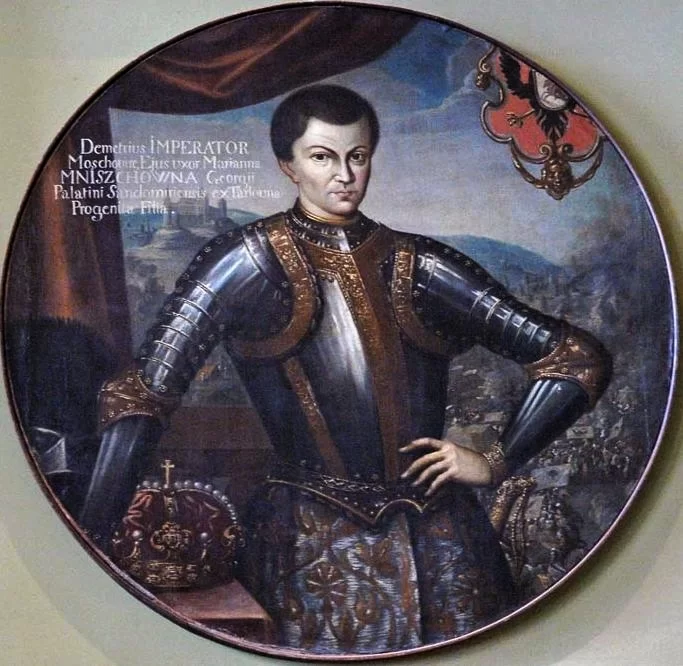</figure>

Prawdziwy <strong>Dymitr</strong>, syn Iwana IV, zmarł w <strong>1591 r.</strong> Inny człowiek twierdził, że jest ocalałym carewiczem.

<strong>Samozwaniec</strong> podszywa się pod kogoś innego, aby zdobyć władzę.

Pomagali mu niektórzy <strong>magnaci</strong> — najbogatsi panowie Rzeczypospolitej — liczący na ziemie i wpływy. Wspierał go <strong>Jerzy Mniszech</strong>; jego córka Maryna została żoną Samozwańca.

<b>1604</b> Wyprawa wsparta przez magnatów.

<b>1605</b> Po śmierci Godunowa Dymitr objął tron w Moskwie.

notes:
2:00. Pokaż uczniowi, pod kogo podszywał się pretendent; nie przedstawiaj opowieści o cudownym ocaleniu jako faktu. Jego rzeczywiste pochodzenie jest niepewne, wersja o zbiegłym mnichu nie jest tu wymagana. Po śmierci Godunowa krótko panował jeszcze Fiodor II; to dopowiedzenie, nie kolejna data do zapisu. Część magnatów i żołnierzy poparła prywatne przedsięwzięcie, ale nie cała szlachta ani całe państwo. Portret identyfikuje pretendenta, nie prawdziwego carewicza. Dymitriada 1604 nie jest oficjalną wojną królewską z 1609.

---

<!-- .slide: id="upadek-dymitra" class="campaign editorial-timeline" data-purpose="explanation" data-layout="timeline-band" -->

<h2>Przewrót nie zakończył walk o tron</h2><ol class="editorial-axis"><li><b>1606</b>
Wasyl Szujski wykorzystał niechęć do otoczenia Dymitra i obawy prawosławnych przed katolicyzacją. Dymitr zginął w przewrocie; Szujski został carem.
</li><li><b>1607–1608</b>
W 1607 r. pojawił się <strong>drugi Samozwaniec</strong>. Twierdził, że przeżył zamach. W 1608 r. założył obóz w Tuszynie pod Moskwą; poparli go przeciwnicy Szujskiego i część magnatów oraz żołnierzy z Rzeczypospolitej.
</li></ol>
<strong>Dymitriady</strong> zaczynały się jako prywatne wyprawy wspierające samozwańców. Nie były jeszcze wojną prowadzoną przez króla.

notes:
1:30. Bojarzy to najwyższa warstwa możnych państwa moskiewskiego; byli podzieleni. Szujski walczył o władzę, wykorzystywał obawy religijne i niechęć do dworu, nie jednolitą postawę wszystkich mieszkańców. Drugi Samozwaniec pojawił się w 1607 r., obóz w Tuszynie utworzył w 1608. To nie był ten sam człowiek, który rzeczywiście przeżył zamach: tak twierdził pretendent. Maryna i jej ojciec poparli także drugiego. Wyjaśnienie jest na ekranie, a nie tylko w notatkach. Teraz przejdź od wypraw prywatnych do decyzji królewskiej.

---

<!-- .slide: id="przyczyny-1609" class="sea war-reasons" data-purpose="explanation" data-layout="plain" -->

1609 · od wypraw prywatnych do wojny królewskiej
<h2>Dlaczego Zygmunt III rozpoczął wojnę?</h2>

<b>Szujski szukał pomocy.</b> Zawarł sojusz ze Szwecją, aby pokonać przeciwników i utrzymać tron.

<b>Zygmunt III interweniował.</b> Wykorzystał sojusz cara ze swoim szwedzkim przeciwnikiem jako uzasadnienie wojny.

Król chciał zdobyć <strong>Smoleńsk</strong> i ziemie oraz zwiększyć wpływ swojej dynastii na władzę w Moskwie. <strong>Oblężenie Smoleńska trwało od 1609 do 1611 r.</strong>

Na następnej mapie czytamy trasy z lat 1609–1611 i 1617–1618. Czerwona granica pokazuje późniejszy stan z <b>1637 r.</b>, nie początek wojny.

notes:
1:00. Sojusz ze Szwecją poprzedzał polskie oblężenie; nie był odpowiedzią na już oblegany przez Zygmunta Smoleńsk. Odróżnij oficjalną interwencję od magnackich wypraw 1604 i późniejszych. Król uzasadniał wojnę przymierzem cara ze Szwecją, lecz miał też cele terytorialne i dynastyczne. Przed mapą wyjaśnij różne daty jej tras i granicy. Nie żądaj analizy całej mapy ani jej dodatkowej trasy tureckiej 1620.

---

<!-- .slide: id="wojna-1609" class="full-map" data-purpose="evidence" data-layout="map-focus" -->

<figure>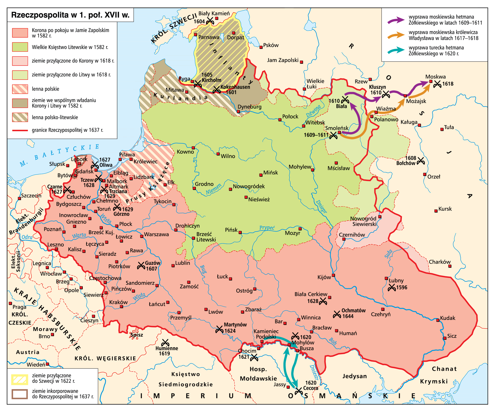</figure>

notes:
1:00. Pełna źródłowa mapa kontekstowa wojny, bez przerabiania legendy: fioletowa trasa Żółkiewskiego 1609–1611, pomarańczowa Władysława 1617–1618; Smoleńsk 1609–1611, Kłuszyn 1610, Moskwa 1618. Czerwona granica to 1637, nie 1609; barwy obejmują stan 1582 i nabytki 1618. Zachowana trasa turecka 1620 nie należy do dzisiejszego zadania. Mapa nie oznacza osobno Kremla, nie jest jego planem. Klik lub Enter powiększa cały oryginalny obraz w tej samej karcie. Wskaż tylko drogę od Smoleńska przez Kłuszyn do Moskwy, nie przedstawiaj jej jako jednej nieprzerwanej kampanii z jednej daty. Smoleńsk padł w 1611, rok po bitwie pod Kłuszynem.

---

<!-- .slide: id="kluszyn" class="battle" data-purpose="explanation" data-layout="source-split" -->

<h2>4 lipca 1610 · Kłuszyn</h2>
<figure><figcaption>Kłuszyn 1610 — obraz z ok. 1620 r.</figcaption></figure>
<figure class="small-portrait"></figure><h3>Stanisław Żółkiewski</h3>
Hetman i doświadczony dowódca. Pokonał armię rosyjsko-szwedzką.

<strong>Husaria</strong> ponawiała szarże; znaczenie miały także dowodzenie i wykorzystanie sytuacji na polu walki.

notes:
1:30. Żółkiewski (1547–1620) był hetmanem polnym koronnym i współpracownikiem Zamoyskiego, później hetmanem wielkim i kanclerzem. Dziś skupiamy się na zwycięstwie pod Kłuszynem. Husaria to ciężkozbrojna jazda, nie piechota; kopia służyła do uderzenia w szarży. Oddziały wielokrotnie ponawiały ataki, a dowódca wykorzystał słabość obrony i rozbieżne interesy przeciwników. Nie podawaj niezweryfikowanych dokładnych liczebności ani legend o niezwyciężoności skrzydeł. Obraz Boguszowicza jest wczesną XVII-wieczną reprezentacją bitwy, ale nie precyzyjnym planem każdej fazy; podobizna Żółkiewskiego pochodzi z XIX-wiecznego dzieła Matejki. Film nie jest potrzebny do zrozumienia tej planszy.

---

<!-- .slide: id="moskwa" class="sea editorial-timeline" data-purpose="explanation" data-layout="timeline-band" -->

<h2>1610 · Z bitwy do układu w Moskwie</h2><ol class="editorial-axis"><li><b>Po Kłuszynie</b>
Bojarzy, czyli najwyżsi możni państwa moskiewskiego, obalili cara Szujskiego.
</li><li><b>Układ</b>
Żółkiewski porozumiał się z częścią bojarów w sprawie oferty tronu dla królewicza Władysława.
</li><li><b>Załoga</b>
Jesienią oddziały Rzeczypospolitej weszły do Moskwy na podstawie układu, <strong>nie po szturmie na Kreml</strong>.
</li></ol>
Kreml to ufortyfikowany zespół murów i budowli, nie jeden pałac. Załoga w mieście nie oznaczała władzy nad całą Rosją.

notes:
1:00. Podkreśl, że bojarzy nie byli jednomyślni i nie reprezentowali automatycznie zgody całej ludności. Wojsko weszło za zgodą części miejscowej elity, nie zdobyło Kremla szturmem. Kreml obejmuje mury, pałace, cerkwie i inne budynki. Na poprzedniej mapie jest Moskwa, ale Kreml nie ma osobnej etykiety. Warunki oferty tronu wyjaśni następny ekran; nie przyspieszaj od oferty do rzeczywistych rządów.

---

<!-- .slide: id="wladyslaw" class="portrait reverse" data-purpose="explanation" data-layout="split" -->

<h2>Piętnastolatek kandydatem na cara</h2>

1610 · królewicz Władysław

Część bojarów zaoferowała tron synowi Zygmunta III.

Warunek: miał przyjąć <strong>prawosławie</strong> i respektować miejscowe prawa.

Zygmunt III nie zgodził się na zmianę wyznania syna. Układu nie zrealizowano.

Władysław nie został koronowany i nie sprawował rządów w Rosji.

<figure>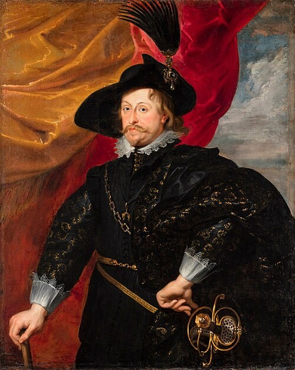<figcaption>Władysław Waza · późniejszy król Władysław IV</figcaption></figure>

notes:
1:00. Władysław urodził się w 1595 r., zatem w 1610 r. miał 15 lat. Był wybrany/uznany za kandydata na cara przez część bojarów i złożono mu przysięgi, ale warunki objęcia władzy nie zostały spełnione. Można mówić o wyborze na cara, koniecznie dodając: niekoronowany, nigdy faktycznie nie rządził Rosją. Zygmunt III nie zgodził się na przejście syna na prawosławie, sam też dążył do wpływu na władzę moskiewską. Nie sprowadzaj wszystkich przyczyn fiaska tylko do jednej osobistej decyzji: rosła nieufność, trwała wojna i opór. Widoczny portret jest późniejszy o kilkanaście lat; nie przedstawia piętnastolatka. To pierwsza ciekawostka sprawdzona w źródłach, nie legenda.

---

<!-- .slide: id="szujscy" class="painting" data-purpose="evidence" data-layout="evidence" -->

<h2>29 października 1611 · Warszawa</h2><figure>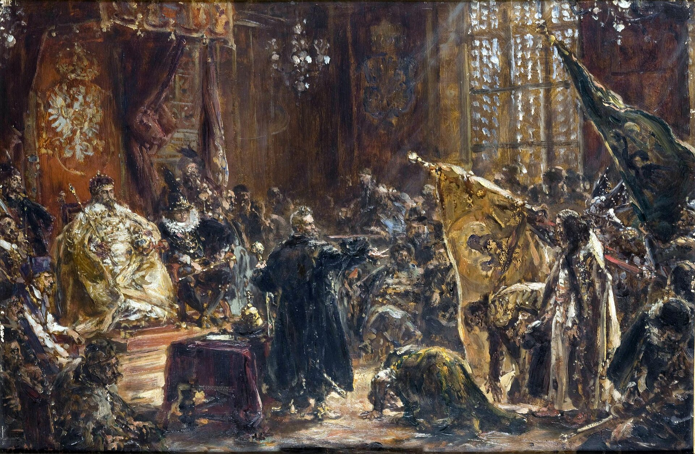<figcaption>Pojmany Wasyl Szujski z braćmi przed Zygmuntem III · późniejszy obraz z 1892 r.</figcaption></figure>
Ceremonia upokorzenia jeńców — <strong>nie oddanie całej Rosji w polskie lenno</strong>.

notes:
0:30. Żółkiewski przedstawił królowi i sejmowi w Warszawie pojmanego, już obalonego cara Wasyla Szujskiego wraz z braćmi. Scenę nazywa się „hołdem Szujskich”; nie był to odpowiednik hołdu pruskiego, w którym całe państwo staje się lennem. Nie mów „Rosja złożyła hołd Polsce”. Oddziel wydarzenie z 1611 r. od obrazu Matejki z 1892 r. Artysta pokazuje triumf i gesty podporządkowania, ale obraz nie dowodzi trwałej władzy nad Rosją. To krótki przykład różnicy między sukcesem widowiskowym a politycznym.

---

<!-- .slide: id="trzy-zdania" class="oral correction-task" data-purpose="practice" data-layout="task-board" -->

<h2>Napraw wiadomość z Moskwy</h2>

Wybierz jeden błąd · przygotuj krótką odpowiedź ustną
<blockquote>„W 1610 r. zdobyto Kreml szturmem, Władysław zaczął rządzić Rosją, a hołd Szujskich uczynił ją polskim lennem”.</blockquote>
Wskaż jeden błąd i powiedz, jak było naprawdę.

notes:
1:00. Aktywność ustna 2 z 3, indywidualnie i bez par. Najpierw chwila cichego przygotowania, potem trzy krótkie korekty. Klucz: wejście na mocy układu z częścią bojarów; Władysław nie był koronowany i nie rządził; ceremonia z 1611 dotyczyła jeńców, nie lenna całego państwa. Ekran pytania nie zawiera gotowego modelu ani diagramu podpowiadającego odpowiedź. Pomoc: „Nie…, lecz…”.

---

<!-- .slide: id="kapitulacja" class="editorial-timeline" data-purpose="explanation" data-layout="timeline-band" -->

<h2>1611–1612 · Dlaczego załoga skapitulowała?</h2><ol class="editorial-axis"><li><b>1611</b>
Wybuchło powstanie przeciw załodze i obcej ingerencji. Zajmowaną przez nią część Moskwy otoczono.
</li><li><b>1612</b>
Brakowało żywności. Odsiecz, czyli pomoc dla oblężonych, pod wodzą Jana Karola Chodkiewicza nie przełamała blokady. Załoga skapitulowała.
</li></ol>

notes:
1:00. Na wyraźne polecenie nauczyciela usunięto osobny temat o Romanowach; omów tylko opór, brak zaopatrzenia i kapitulację. Kapitulacja nastąpiła w listopadzie 1612; nie podawaj mylących dat dziennych bez kalendarza. Nie rozwijaj drastycznych historii głodu. Chodkiewicz dowodził nieudaną odsieczą — nie mylić ze skuteczną odsieczą Władysława w kolejnej wojnie smoleńskiej. W 1613 r. wybrano Michała Romanowa na cara, ale wojna z Rzecząpospolitą trwała dalej.

---

<!-- .slide: id="dywilino" class="map-board" data-purpose="evidence" data-layout="map-focus" -->

<figure></figure>
<h2>Dywilino: ziemie zamiast korony</h2>
<strong>Grudzień 1618:</strong> rozejm, obowiązujący od 1619 r.

<i class="swatch gains"></i>Nabytki: <strong>ziemie smoleńska, czernihowska i siewierska.</strong>

<i class="swatch commonwealth"></i>Wcześniejsze ziemie Rzeczypospolitej

Po rozejmie obszar państwa wynosił około <strong>miliona km²</strong>.

notes:
1:00. Po dalszych walkach, w tym nieudanej wyprawie Władysława na Moskwę w 1618 r., zawarto rozejm w Dywilinie w grudniu 1618 r. Wchodził w życie w 1619 r., stąd mapy i opracowania często używają 1619. Uczeń nie ma uczyć się dwóch sprzecznych „dat zawarcia”: rozróżniamy podpisanie i obowiązywanie. Wskaż Smoleńsk, ziemię czernihowską i siewierską. Nie pokazuj Moskwy jako nabytku terytorialnego — utracona załoga nie jest granicą państwa. Rozejm zawiesza działania na ustalony czas; później odrębny pokój potwierdził zasadnicze zdobycze. Mapę odczytuj według legendy, nie kolorów współczesnych państw.
Osobną mapę maksimum obszaru pominięto jako powtórzenie; przybliżenie około miliona km² pozostaje na ekranie. To nie dokładny pomiar sumujący lenna. Wyprawa Władysława z lat 1617–1618 nie zdobyła Moskwy.

---

<!-- .slide: id="polanowo" class="sea treaty-text" data-purpose="explanation" data-layout="plain" -->

<h2>1634 · Pokój w Polanowie</h2>
<strong>1632–1634: wojna smoleńska.</strong> Po śmierci Zygmunta III Rosja próbowała odzyskać utracone ziemie. Nowy król Władysław IV skutecznie bronił Smoleńska.
<dl class="treaty-rows">
<dt>Ziemie</dt><dd>Rzeczpospolita zachowała główne nabytki: ziemie smoleńską, czernihowską i siewierską.</dd>

<dt>Korona</dt><dd>Władysław IV zrzekł się roszczeń do tronu Rosji.</dd>

<dt>Odszkodowanie</dt><dd>Rosja zobowiązała się wypłacić odszkodowanie.</dd>
</dl>

notes:
1:30. Pokój kończył kolejną wojnę smoleńską. Zygmunt III zmarł w 1632; Rosja zaatakowała w czasie bezkrólewia. Władysław IV przyszedł z odsieczą Smoleńskowi i doprowadził do korzystnego pokoju. Potwierdzono zasadnicze nabytki Dywilina; niewielki rejon Sierpiejska pozostał po stronie rosyjskiej, więc nie obiecuj zachowania każdej kreski granicy. Nie wymagaj kwoty odszkodowania. Ostateczna rezygnacja z roszczeń do korony nie oznacza, że wcześniej faktycznie rządził. Rozejm i pokój to różne porozumienia.

---

<!-- .slide: id="najwieksza" class="map-board extent-map" data-purpose="evidence" data-layout="map-focus" -->

<figure>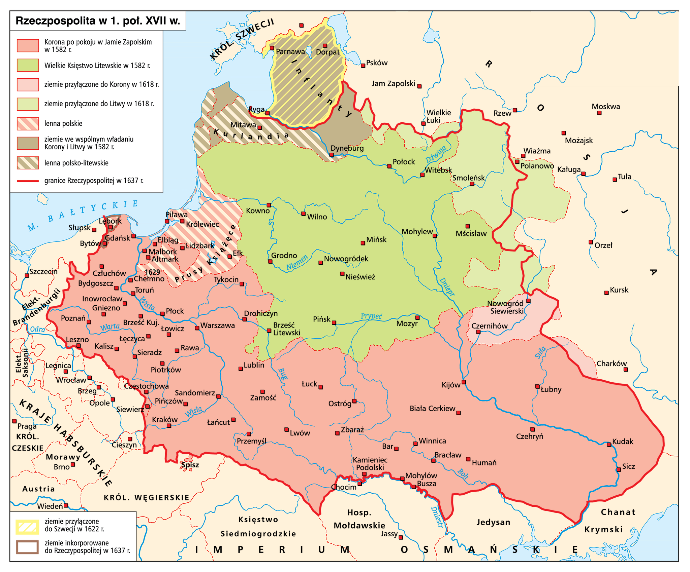</figure>
<h2>Rzeczpospolita po pokoju w Polanowie</h2>
<strong>Granice na mapie: 1637 r.</strong>

Przykłady zasięgu: od <b>Gdańska nad Bałtykiem</b> po <b>Smoleńsk</b>; od <b>Dyneburga</b> po <b>Kudak nad Dnieprem</b>.

<b>Prusy Książęce i Kurlandia</b> były lennami, nie zwykłymi prowincjami.

W pierwszej połowie XVII w. obszar państwa wynosił <b>około miliona km²</b>.

Nie obejmował pokazanego pasa wybrzeża <b>Morza Czarnego</b>.

notes:
1:00. Mapa pokazuje granicę z 1637, czyli stan po pokoju w Polanowie 1634, nie dokładnie mapę 1634 ani 1619. Polanowo potwierdziło główne nabytki z 1618, nie przyniosło nowej ogromnej ekspansji. Wskaż Gdańsk nad Bałtykiem, Dyneburg w zachowanej części Inflant, Smoleńsk na wschodzie i Kudak nad Dnieprem. To przykłady rozległości, nie wyliczone skrajne punkty. Szrafowane Prusy Książęce i Kurlandia to lenna, nie zwykłe prowincje; Gdańsk leży w Prusach Królewskich, nie Książęcych. Większość północno-zachodnich Inflant jest oznaczona jako szwedzka; nie dawaj całych Inflant Rzeczypospolitej. Nie głosimy granic od morza do morza: mapa nie pokazuje polskiego pasa otwartego wybrzeża czarnomorskiego. Około miliona km² to przybliżenie z opracowań, nie pomiar z tej mapy i nie suma terytorium z lennami bez wyjaśnienia; spotyka się odniesienie do 1618/1619 albo potwierdzenia stanu w 1634. Nie wymagaj rozstrzygania rachunku od klasy VI. Kompozycja zachowuje oryginalne warstwy terytorialne, nie rysuje granic z pamięci; prawa i zakres zmian w sources.md. Klik lub Enter powiększa mapę w tej samej karcie.

---

<!-- .slide: id="notatka-2" class="notebook" data-purpose="synthesis" data-layout="plain" -->

<h2>Do zeszytu: ziemie, nie rosyjska korona</h2>
Zapisz dwa powiązane ciągi · 3 minuty

<b>1610:</b> zwycięstwo pod Kłuszynem → układ z częścią bojarów i załoga w Moskwie → <b>1612:</b> kapitulacja załogi. Władysław nie został koronowany i nie rządził Rosją.

<b>Dywilino, 1618:</b> ziemie smoleńska, czernihowska i siewierska → <b>Polanowo, 1634:</b> zachowanie głównych nabytków i rezygnacja Władysława IV z roszczeń do tronu Rosji.

notes:
3:00. Druga chroniona notatka. Uczeń przepisuje dwa krótkie ciągi, bez rysowania korony i mapopodobnych ziem. Strzałki łączą następstwo i wynik, nie dowodzą, że każde wydarzenie miało jedną przyczynę. Zapis jest modelem po wyjaśnieniu, nie odpowiedzią do wyświetlenia przed aktywnością. Zostaw ciszę i czas na kończenie. Daty dymitriad i Romanowa pozostają w podsumowaniu ucznia, nie dopisuj ich w pośpiechu. Sprawdź brak rządów Władysława oraz różnicę Dywilino/Polanowo.

---

<!-- .slide: id="bilans-zadanie" class="oral sea" data-purpose="practice" data-layout="task-board" -->

<h2>Czy te wojny były sukcesem?</h2>

Najpierw pomyśl samodzielnie, potem odpowiedz ustnie

Podaj jeden osiągnięty cel i jeden cel, którego nie osiągnięto.

Każde zdanie poprzyj wydarzeniem lub postanowieniem rozejmu albo pokoju.

notes:
1:30. Aktywność ustna 3 z 3 i główne zadanie zastosowania. Chwila indywidualnego przygotowania, potem 2–3 wypowiedzi. Model: odzyskano Inflanty w Jamie Zapolskim 1582 lub uzyskano Smoleńszczyznę w Dywilinie; nie osadzono trwale Władysława na tronie Rosji — nie rządził, załoga skapitulowała w 1612, roszczeń zrzekł się w 1634. Sama nazwa wygranej bitwy bez związku z celem nie wystarcza. Bez par, bez kartek. Domknij dwoma zdaniami: „Zwycięstwa i nabytki ziem — tak. Trwała władza nad Rosją — nie”. Osobny slajd z tą samą syntezą usunięto, żeby nie mnożyć powtórek. Następnie przejdź do pisemnego biletu, niczego nowego nie każ przepisywać.

---

<!-- .slide: id="wyjscie" class="exit" data-purpose="exit-ticket" data-layout="plain" -->

<h2>Na koniec: dwa zdania w zeszycie</h2>

1
Dlaczego Rosji zależało na Inflantach?

2
Podaj dowód, że zwycięstwo wojskowe nie zapewniło trwałego panowania nad Rosją.

Użyj konkretu: miejsca, roku albo postanowienia układu.

Samodzielnie · zeszyt · 1,5 minuty

notes:
1:30. Indywidualny pisemny bilet wyjścia w zeszycie, nie czwarta aktywność ustna i nie karta pracy. Daj 60 sekund na dwa krótkie zdania. Klucz: 1) dostęp do portów Bałtyku, handel i kontakty z Zachodem; 2) np. mimo Kłuszyna 1610 załoga skapitulowała w 1612; Władysław nie objął rzeczywistych rządów i zrzekł się roszczeń w 1634. Sprawdź wzrokiem 3–4 zeszyty podczas pisania i poproś uczniów o podkreślenie konkretu. Brak szczegółowego roku przy poprawnym związku nie unieważnia rozumienia. Po lekcji można udostępnić student-summary.md. Zaplanowany osobno dwuminutowy bufor służy opóźnieniom i dokończeniu notatek, nie dodatkowemu filmowi.
