<!-- .slide: id="otwarcie" class="cover" data-purpose="opening" data-layout="hero-source" -->

<figure>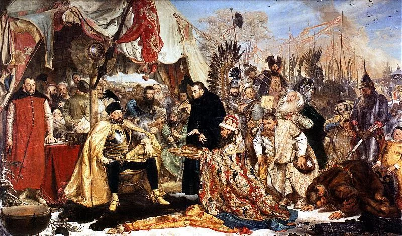</figure>

1575–1634 · Od Bałtyku do Kremla
<h1>Wojny z Rosją</h1>
Czy wygrana bitwa wystarczy, żeby rządzić sąsiednim państwem?

notes:
0:30. Powiedz na otwarcie: „Najpierw chodziło o porty nad Bałtykiem. Potem pojawiła się szansa na tron w Moskwie. Wojsko może wygrać bitwę — ale czy to wystarczy, żeby ludzie uznali nowego władcę? Dzisiaj sprawdzimy, co udało się zdobyć, a czego nie udało się utrzymać”. Nie zbieraj tu długiej dyskusji. Zapisz temat. Obraz Jana Matejki z 1872 r. jest późniejszą interpretacją, nie zapisem kapitulacji Pskowa: miasta nie zdobyto. Materiały: tylko zeszyt i długopis; nie rozdajemy karty pracy.

---

<!-- .slide: id="batory" class="portrait" data-purpose="explanation" data-layout="split" -->

<h2>Nowy król: Stefan Batory</h2>

1575 → 1576

<strong>Wybrany w 1575 r.</strong> Koronowany w 1576 r.

Książę <strong>Siedmiogrodu</strong> — krainy związanej z dawnym Królestwem Węgier.

Poślubił Annę Jagiellonkę. Musiał obronić ziemie Rzeczypospolitej przed Iwanem IV.

<figure><figcaption>Stefan Batory · król w latach 1576–1586</figcaption></figure>

notes:
1:00. Nawiąż do wolnej elekcji: po ucieczce Henryka Walezego doszło do podwójnego wyboru; szlachta popierająca Annę Jagiellonkę wskazała Batorego na jej męża. Dla ucznia kluczowe rozróżnienie: elekcja 1575, koronacja 1576, nie jedna data. Siedmiogród leży przede wszystkim na obszarze dzisiejszej Rumunii, był związany z kulturą i dziejami Węgier; nie sprowadzaj pochodzenia do dzisiejszej granicy. Batory był doświadczonym wodzem. Portret jest XIX-wieczną kopią według obrazu z 1583 r.; nie podpisujemy go jako oryginału Kobera.

---

<!-- .slide: id="baltyk" class="map-board" data-purpose="evidence" data-layout="map-focus" -->

<figure></figure>
<h2>Dlaczego car chciał Inflant?</h2>
Porty = <strong>handel morski</strong> i kontakty z Zachodem.

<strong>1577:</strong> Iwan IV zajął większość Inflant.

<i class="swatch inflanty"></i>Inflanty ······ zasięg zdobyczy cara 1572–1577

notes:
1:30. Wskaż Bałtyk, Inflanty, Rygę oraz państwo moskiewskie. Wyjaśnij, że port to nie tylko fragment brzegu: to miejsce przeładunku, dochody z handlu i połączenie z innymi krajami. Iwan IV Groźny dążył do dostępu do Bałtyku, a Rzeczpospolita chciała odzyskać utracone ziemie i obronić własne wpływy. Wojna o Inflanty trwała już wcześniej, od 1558 r.; rok 1577 oznacza zajęcie ich większości przez cara, nie początek całej wojny. Nie utożsamiaj Inflant z całym wybrzeżem Bałtyku ani współczesną Łotwą w jej obecnych granicach. Używaj legendy dostarczonej mapy.

---

<!-- .slide: id="piechota" class="diagram-slide" data-purpose="explanation" data-layout="plain" -->

<h2>1578 · Piechota wybraniecka</h2>
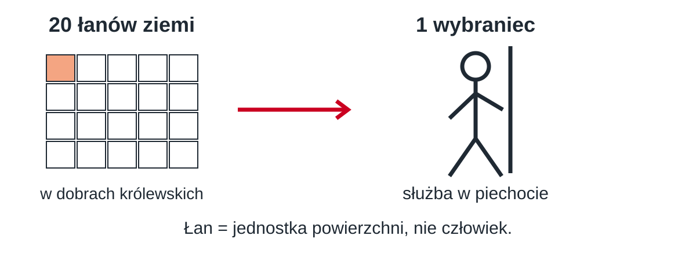

Wybrani chłopi z <strong>dóbr królewskich</strong> służyli pieszo. Pozostali gospodarze pomagali ich utrzymać.

notes:
1:00. Wyjaśnij trzy rzeczy: piechota walczy pieszo, „wybraniec” to wybrany do służby chłop, łan jest jednostką powierzchni gruntu, a nie osobą. Zasada: jeden wybraniec z 20 łanów w dobrach królewskich, nie jeden z 20 chłopów i nie z całego kraju. Formację ustanowiono w 1578 r. Jej liczebność była ograniczona; nie była całą armią Batorego ani przyczyną wszystkich zwycięstw. Żołnierze korzystali z broni palnej i wykonywali także prace oblężnicze. Schemat jest współczesnym objaśnieniem zasady poboru, nie przedstawia autentycznego rozkładu pól.

---

<!-- .slide: id="zamoyski" class="portrait reverse" data-purpose="explanation" data-layout="split" -->

<h2>Król i jego ważny współpracownik</h2>

<h3>Jan Zamoyski</h3>
<strong>Kanclerz</strong> — prowadził ważne sprawy państwa i dyplomację.

Od 1581 r. także <strong>hetman wielki koronny</strong> — jeden z najwyższych dowódców wojskowych.

Pomagał Batoremu w organizacji wypraw. Po wyjeździe króla kontynuował oblężenie Pskowa.

<figure>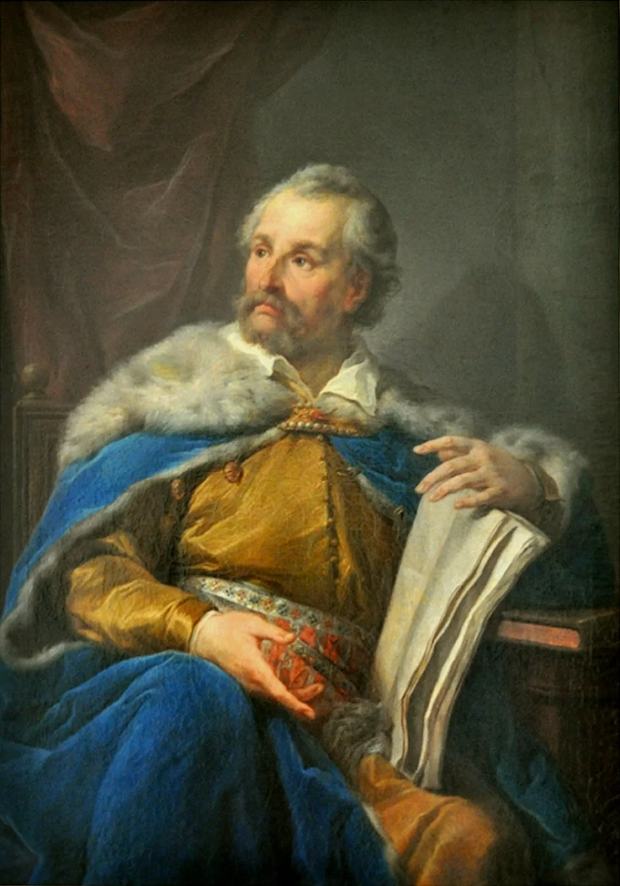<figcaption>Jan Zamoyski · 1542–1605</figcaption></figure>

notes:
0:45. Krótki biogram: wykształcony magnat i polityk, założyciel Zamościa, bliski współpracownik Batorego. W 1578 r. został kanclerzem wielkim koronnym, w 1581 r. hetmanem wielkim koronnym. Nie przypisuj mu samodzielnego dowodzenia wszystkimi trzema wyprawami: kierował nimi Batory, współdziałając z wieloma dowódcami koronnymi i litewskimi. Pod Pskowem Zamoyski prowadził dalsze działania po odjeździe króla. Portret Bacciarellego jest późniejszy i idealizowany; księga uwydatnia rolę kanclerza.

---

<!-- .slide: id="wyprawy" class="map-board" data-purpose="evidence" data-layout="map-focus" -->

<figure></figure>
<h2>Trzy wyprawy Batorego</h2>
<strong>1579 · Połock</strong> zdobyty

<strong>1580 · Wielkie Łuki</strong> zdobyte

<strong>1581–82 · Psków</strong> niezdobyty

→ wyprawa 1579 → wyprawa 1580 ━ granica po rozejmie 1582 ···· zdobycze cara 1572–77

notes:
1:30. Prowadź wzrok po trzech nazwach i latach. Batory nie ruszył po prostu wzdłuż wybrzeża: uderzał na ważne twierdze, osłabiał siły i połączenia przeciwnika. Połock odzyskano w 1579 r.; Wielkie Łuki zdobyto w 1580 r.; Psków oblegano od 1581 do 1582 r., lecz go nie zdobyto. Oblężenie oznacza otoczenie umocnionego miasta i próbę zmuszenia załogi do poddania się. Psków bronił się skutecznie, ale koszt wojny i nacisk wojsk skłaniały cara do rozmów. Nie pokazuj Matejki jako dowodu kapitulacji miasta.

---

<!-- .slide: id="jam" class="oral campaign" data-purpose="practice" data-layout="task-board" -->

<h2>Rozejm mimo niezdobytego Pskowa?</h2>
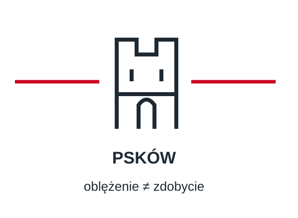

Powiedz i uzasadnij · 45 sekund

Dlaczego car mógł zgodzić się na rozejm, chociaż Psków się obronił?

Po odpowiedziach: wynik rozmów

<strong>Jam Zapolski, 1582:</strong> Rosja wycofała się z Inflant i oddała Połock. Nie cały Bałtyk znalazł się pod władzą Rzeczypospolitej.

notes:
1:30. Aktywność ustna 1 z 3. Daj każdemu 10 sekund na ułożenie zdania w myśli, następnie poproś dwie osoby o krótkie uzasadnienia. Nie dobieraj w pary. Oczekiwane: Rosja straciła inne twierdze, ponosiła koszty wojny, musiała liczyć się z dalszym naciskiem. Dopiero po wypowiedziach otwórz wynik rozmów. Rozejm w Jamie Zapolskim w 1582 r. kończył ten etap walk: Rzeczpospolita odzyskała Połock i prawa do Inflant zajętych przez Rosję, zwracała zdobycze w głębi państwa carskiego, m.in. Wielkie Łuki. Rozejm nie przekazywał Rzeczypospolitej całego wybrzeża, a północ Inflant pozostawała w rękach szwedzkich. Uczeń ma odróżnić zwycięski wynik wojny od zdobycia każdej twierdzy.

---

<!-- .slide: id="notatka-1" class="notebook" data-purpose="synthesis" data-layout="plain" -->

<h2>Do zeszytu: droga do odzyskania Inflant</h2>
Trzy fale, trzy baszty, jedna oś. Przerysuj i dopisz hasła · 3 minuty
<figure>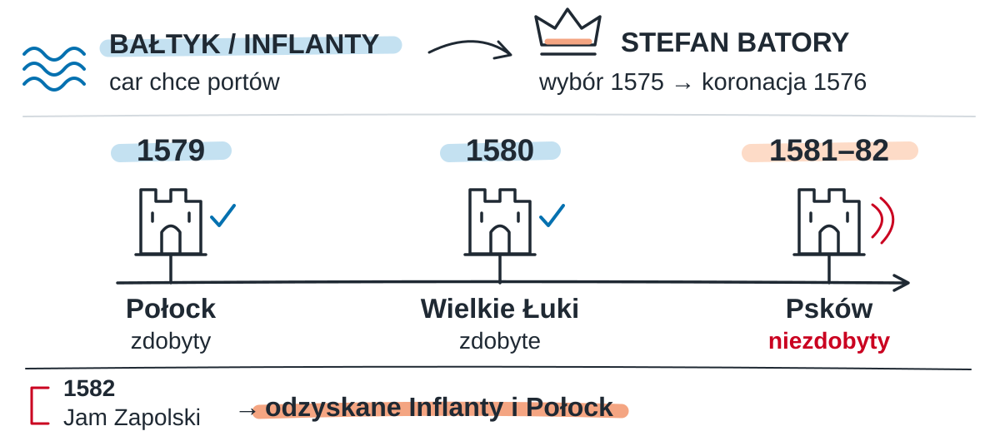</figure>

notes:
3:00. Pierwsza rzeczywiście rysowana notatka, bez wydruku. Powiedz: „Nie przerysowujcie obrazu. Wystarczą trzy fale, trzy proste baszty i linia czasu. Przy Pskowie postawcie znak ≠ albo dopiszcie »niezdobyty«”. Tekst do zapisu jest w całości na schemacie: car chce portów; Batory — elekcja 1575, koronacja 1576; 1579 Połock, 1580 Wielkie Łuki, 1581–82 Psków niezdobyty; Jam Zapolski 1582 — odzyskane Inflanty i Połock. Nie wymagaj cieniowania ani dokładnej kopii. Przez 2 minuty zachowaj ciszę, ostatnią minutę przeznacz na kończenie i sprawdzenie Pskowa. Pomoc: uczeń może zapisać oś i dorysować baszty później; sens nie zależy od zdolności plastycznych. Nie dopisuj tu drugiej długiej notatki o dowódcach.

---

<!-- .slide: id="waza" class="portrait" data-purpose="explanation" data-layout="split" -->

<h2>1587 · Zygmunt III Waza</h2>

Nowa dynastia, rodzinny łącznik

Ojciec: <strong>Jan III Waza</strong>, król Szwecji.

Matka: <strong>Katarzyna Jagiellonka</strong>, siostra Zygmunta Augusta.

Wybrany królem Rzeczypospolitej w 1587 r. Jego polityka obejmowała sprawy Bałtyku i rywalizację o tron moskiewski.

<figure>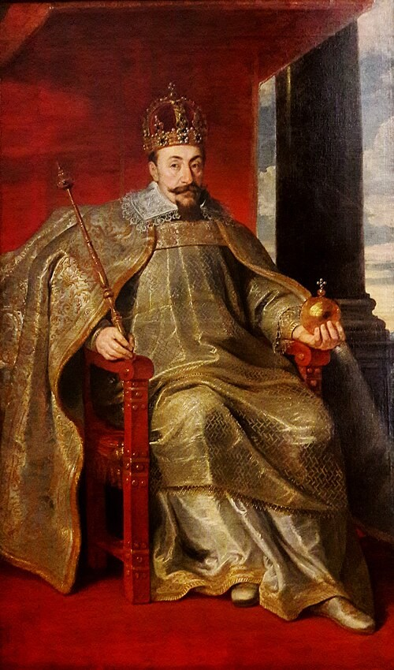<figcaption>Zygmunt III Waza · król w latach 1587–1632</figcaption></figure>

notes:
1:00. Batory umarł w 1586 r., a w następnej elekcji zwyciężył Zygmunt. Rodzina matki wiązała go z Jagiellonami; po ojcu należał do szwedzkiej dynastii Wazów. Nie myl Katarzyny Jagiellonki z Anną Jagiellonką, żoną Batorego i ciotką Zygmunta. Władca dążył do silnej pozycji dynastii, ale szwedzki tron nie będzie głównym tematem dzisiejszej lekcji. Portret z około 1624 r. nie dokumentuje wyglądu w dniu wyboru w 1587 r.

---

<!-- .slide: id="warszawa" class="diagram-slide sea" data-purpose="explanation" data-layout="plain" -->

<h2>Warszawa: bliżej spraw całego państwa</h2>
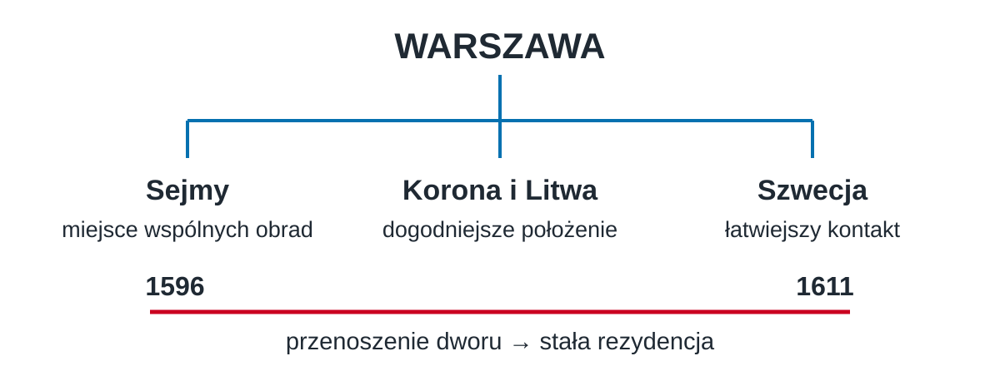

<strong>1596</strong> — umowna data przenoszenia ośrodka rządów. <strong>1611</strong> — król zamieszkał na stałe w warszawskim zamku.

notes:
1:00. Wyjaśnij proces, nie jednodniowy akt prawny zmieniający stolicę. W Warszawie już wcześniej zbierał się sejm; leżała dogodniej względem Korony i Litwy oraz zapewniała łatwiejszy kontakt ze Szwecją niż Kraków. Rok 1596 jest tradycyjną datą przenoszenia dworu i ważnych urzędów; stała rezydencja króla w przebudowanym Zamku Królewskim została ustanowiona w 1611 r. Kraków zachował funkcję koronacyjną. Nie tłumacz zmiany wyłącznie pożarem Wawelu ani legendą o alchemii. Diagram nie jest mapą i nie pokazuje odległości.

---

<!-- .slide: id="smuta" class="diagram-slide" data-purpose="explanation" data-layout="plain" -->

<h2>Rosja bez pewnego następcy tronu</h2>
<figure>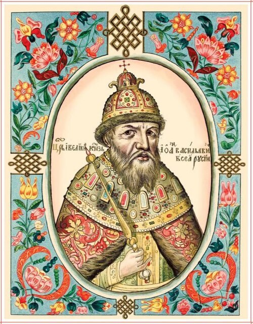<figcaption>Iwan IV Groźny</figcaption></figure>

1598 · koniec carów z dynastii Rurykowiczów
<h3>Wielka smuta</h3>
Kryzys władzy: spory o tron, walki wewnętrzne, głód i obce interwencje.

Po śmierci cara Fiodora I władzę objął <strong>Borys Godunow</strong>. Jego pozycja była podważana.

notes:
1:00. Sukcesja to następstwo tronu. Iwan IV zmarł w 1584 r.; koniec panującej w Moskwie linii Rurykowiczów wiążemy ze śmiercią jego syna Fiodora I w 1598 r., nie z samą śmiercią Iwana. Borys Godunow nie był synem Iwana. Wielka smuta to nazwa okresu głębokiego kryzysu, a nie rosyjska nazwa jednej bitwy czy wyłącznie skutek działań polskich. Głód i konflikty społeczne osłabiały władzę niezależnie od obcych interwencji. Wizerunek Iwana jest pośmiertny i służy tylko identyfikacji postaci, nie ocenie jego wyglądu za życia.

---

<!-- .slide: id="dymitr" class="chronology" data-purpose="explanation" data-layout="timeline-band" -->

<h2>Dymitr Samozwaniec: wyprawa i tron</h2>
<figure><figcaption>Pretendent podawał się za syna Iwana IV.</figcaption></figure><ol class="date-list"><li><strong>1604</strong>Prywatna wyprawa wsparta przez część magnatów z Rzeczypospolitej — pierwsza dymitriada.</li><li><strong>1605</strong>Śmierć Borysa Godunowa; krótkie rządy jego syna. Dymitr wchodzi do Moskwy i zostaje carem.</li></ol>

Dymitriada nie była jeszcze oficjalną wojną Rzeczypospolitej z Rosją.

notes:
1:30. Samozwaniec podawał się za cudownie ocalałego Dymitra, młodszego syna Iwana IV. Wsparli go niektórzy magnaci, m.in. Jerzy Mniszech, liczący na wpływy, urzędy i ziemie; część duchowieństwa wiązała z nim nadzieje religijne. Nie popierała go cała szlachta ani wszyscy mieszkańcy Rosji. Wyprawa ruszyła w 1604 r.; wejście do Moskwy i koronacja nastąpiły w 1605 r. Po śmierci Borysa Godunowa przez krótki czas rządził Fiodor II, później zamordowany. Nie rozwijaj drastycznych szczegółów. Najważniejsza granica pojęciowa: prywatne przedsięwzięcie niektórych poddanych nie jest tym samym co oficjalna wojna prowadzona przez państwo.

---

<!-- .slide: id="upadek-dymitra" class="campaign" data-purpose="explanation" data-layout="plain" -->

<h2>Dlaczego Dymitr stracił władzę?</h2>
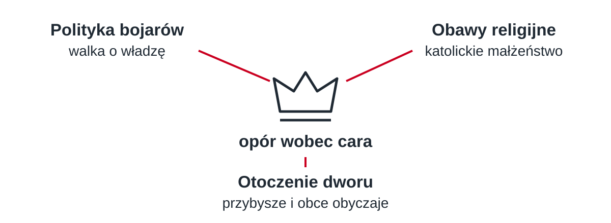

<strong>1606:</strong> Dymitr został zabity podczas przewrotu. Nowym carem został <strong>Wasyl Szujski</strong>.

notes:
0:45. Wyjaśnij „bojarzy”: możnowładcy rosyjscy, wpływowa elita uczestnicząca w walce o władzę. Sprzeciw wobec Dymitra łączył politykę bojarów z obawami o prawosławie oraz niechęcią do części przybyszów i dworskich obyczajów. Małżeństwo cara z katoliczką Maryną Mniszchówną wzmacniało podejrzenia. Nie mów „Rosjanie nienawidzili Polaków”: postawy nie były jednolite, a sam Dymitr miał wcześniej rosyjskich stronników. Kolejni samozwańcy i dalsze wyprawy pogłębiały chaos; nie wymagaj zapamiętywania ich imion. Diagram jest syntezą przyczyn, nie źródłem z epoki.

---

<!-- .slide: id="wojna-1609" class="map-board" data-purpose="evidence" data-layout="map-focus" -->

<figure>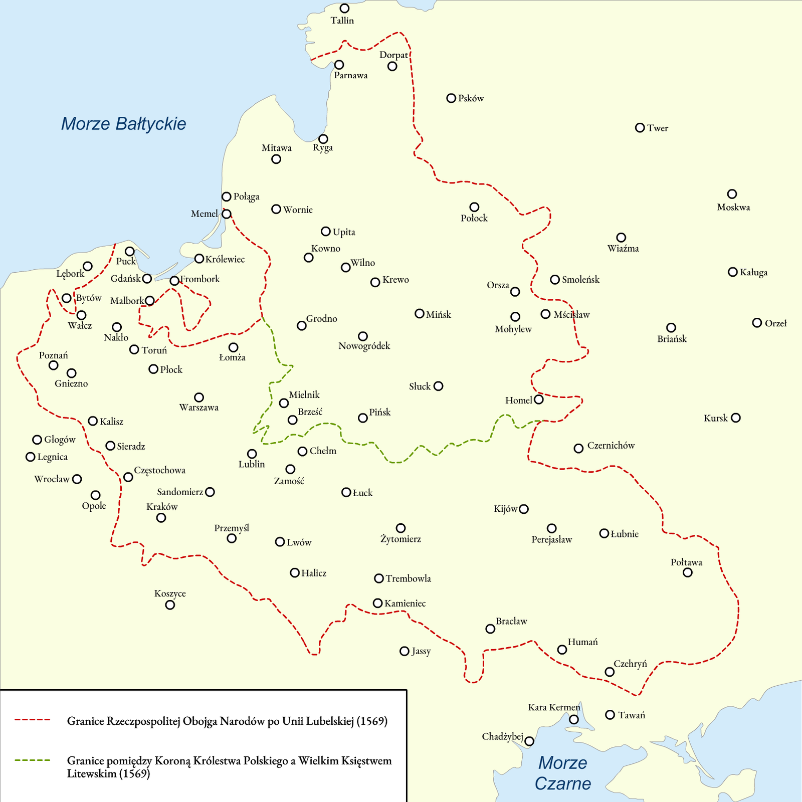</figure>
<h2>1609 · Wojna królewska</h2>
Zygmunt III rozpoczyna <strong>oficjalną wojnę</strong>.

<strong>1609–1611:</strong> oblężenie Smoleńska, ważnej twierdzy na wschodzie.

Cel: ziemie i wpływ na władzę w Moskwie.

Mapa orientacyjna: państwo po 1569 r., przed wojną.

notes:
1:00. Wskaż Smoleńsk jako twierdzę na drodze między ziemiami Wielkiego Księstwa Litewskiego a Moskwą. Oficjalna wojna rozpoczęła się w 1609 r., gdy Zygmunt III obległ Smoleńsk. Cele: zdobycie ważnej twierdzy i ziem, wzmocnienie dynastii oraz wykorzystanie kryzysu w Rosji. Szujski zawarł sojusz ze Szwecją, przeciwniczką Zygmunta III, co również wpłynęło na decyzję. Smoleńsk został zdobyty dopiero w 1611 r.; nie łącz jego upadku bezpośrednio z datą Kłuszyna 1610. Mapa przedstawia stan po 1569 r. i służy tylko orientacji. Nabytki późniejszego rozejmu pokażemy na odrębnej mapie.

---

<!-- .slide: id="kluszyn" class="battle" data-purpose="explanation" data-layout="source-split" -->

<h2>4 lipca 1610 · Kłuszyn</h2>
<figure>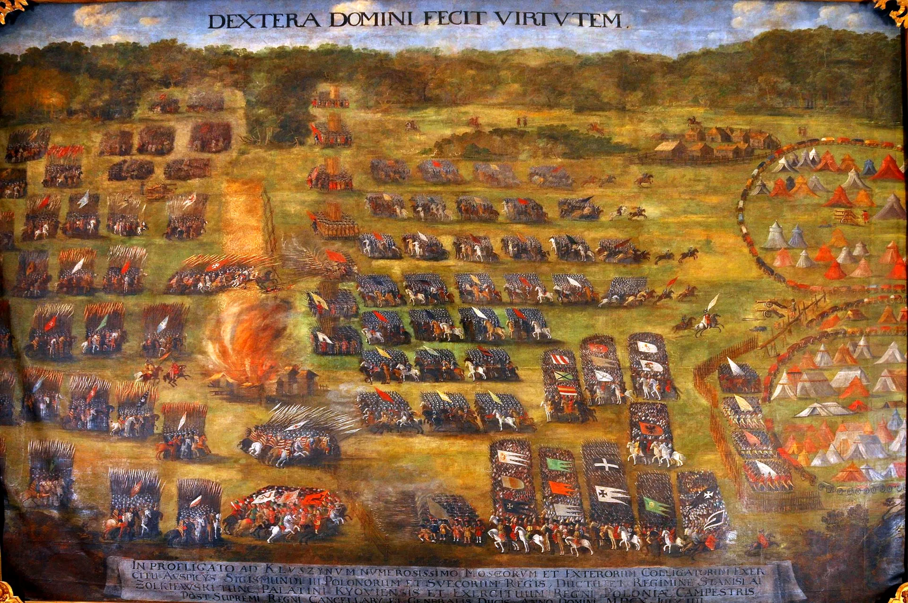<figcaption>Kłuszyn — malarska panorama bitwy</figcaption></figure>
<figure class="small-portrait">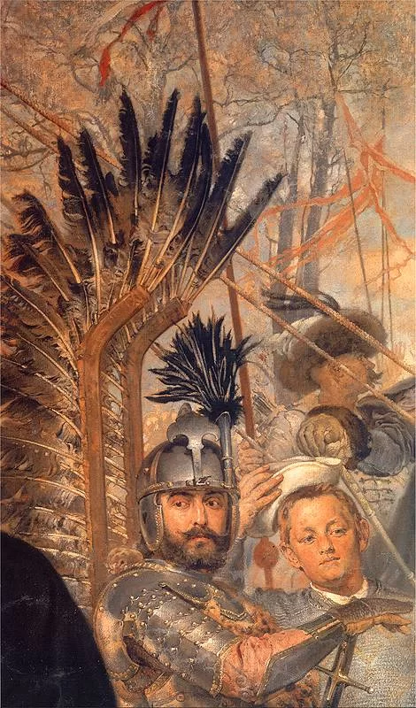</figure><h3>Stanisław Żółkiewski</h3>
Hetman i doświadczony dowódca. Pokonał armię rosyjsko-szwedzką.

<strong>Husaria</strong> ponawiała szarże; znaczenie miały także dowodzenie i wykorzystanie sytuacji na polu walki.

notes:
1:30. Żółkiewski (1547–1620) był hetmanem polnym koronnym i współpracownikiem Zamoyskiego, później hetmanem wielkim i kanclerzem. Dziś skupiamy się na zwycięstwie pod Kłuszynem. Husaria to ciężkozbrojna jazda, nie piechota; kopia służyła do uderzenia w szarży. Oddziały wielokrotnie ponawiały ataki, a dowódca wykorzystał słabość obrony i rozbieżne interesy przeciwników. Nie podawaj niezweryfikowanych dokładnych liczebności ani legend o niezwyciężoności skrzydeł. Obraz Boguszowicza jest wczesną XVII-wieczną reprezentacją bitwy, ale nie precyzyjnym planem każdej fazy; podobizna Żółkiewskiego pochodzi z XIX-wiecznego dzieła Matejki. Film nie jest potrzebny do zrozumienia tej planszy.

---

<!-- .slide: id="moskwa" class="diagram-slide sea" data-purpose="explanation" data-layout="plain" -->

<h2>1610 · Droga do Moskwy</h2>
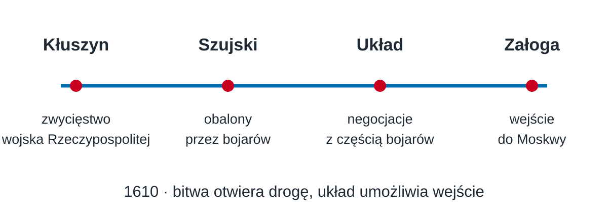

Załoga weszła do Moskwy <strong>na podstawie układu z bojarami</strong>, nie po szturmie na Kreml.

notes:
1:00. Po klęsce wojsk cara Szujski został zdetronizowany przez bojarów. Żółkiewski prowadził negocjacje, a oddziały Rzeczypospolitej weszły do Moskwy jesienią 1610 r. za zgodą części bojarów. W mieście pozostawiono załogę; nie było zwycięskiej bitwy-szturmu na Kreml, która automatycznie uczyniłaby Rosję polską. Kreml to ufortyfikowany zespół budowli — murów, pałaców, cerkwi i innych zabudowań — nie jeden pałac. Podpisz sens układu: miejscowa elita dopuszczała obcego kandydata do tronu pod określonymi warunkami. To jeszcze nie trwała zgoda całej ludności.

---

<!-- .slide: id="wladyslaw" class="portrait reverse" data-purpose="explanation" data-layout="split" -->

<h2>Piętnastolatek kandydatem na cara</h2>

1610 · królewicz Władysław

Część bojarów zaoferowała tron synowi Zygmunta III.

Warunek: miał przyjąć <strong>prawosławie</strong> i respektować miejscowe prawa.

Zygmunt III nie zgodził się na zmianę wyznania syna. Układu nie zrealizowano.

Władysław nie został koronowany i nie sprawował rządów w Rosji.

<figure><figcaption>Władysław Waza · późniejszy król Władysław IV</figcaption></figure>

notes:
1:15. Władysław urodził się w 1595 r., zatem w 1610 r. miał 15 lat. Był wybrany/uznany za kandydata na cara przez część bojarów i złożono mu przysięgi, ale warunki objęcia władzy nie zostały spełnione. Można mówić o wyborze na cara, koniecznie dodając: niekoronowany, nigdy faktycznie nie rządził Rosją. Zygmunt III nie zgodził się na przejście syna na prawosławie, sam też dążył do wpływu na władzę moskiewską. Nie sprowadzaj wszystkich przyczyn fiaska tylko do jednej osobistej decyzji: rosła nieufność, trwała wojna i opór. Widoczny portret jest późniejszy o kilkanaście lat; nie przedstawia piętnastolatka. To pierwsza ciekawostka sprawdzona w źródłach, nie legenda.

---

<!-- .slide: id="szujscy" class="painting" data-purpose="evidence" data-layout="evidence" -->

<h2>29 października 1611 · Warszawa</h2><figure><figcaption>Zdetronizowany i pojmany Wasyl Szujski z braćmi przed Zygmuntem III.</figcaption></figure>
Ceremonia upokorzenia jeńców — <strong>nie oddanie całej Rosji w polskie lenno</strong>.

notes:
1:00. Żółkiewski przedstawił królowi i sejmowi w Warszawie pojmanego, już obalonego cara Wasyla Szujskiego wraz z braćmi. Scenę nazywa się „hołdem Szujskich”; nie był to odpowiednik hołdu pruskiego, w którym całe państwo staje się lennem. Nie mów „Rosja złożyła hołd Polsce”. Oddziel wydarzenie z 1611 r. od obrazu Matejki z 1892 r. Artysta pokazuje triumf i gesty podporządkowania, ale obraz nie dowodzi trwałej władzy nad Rosją. To krótki przykład różnicy między sukcesem widowiskowym a politycznym.

---

<!-- .slide: id="trzy-zdania" class="oral campaign" data-purpose="practice" data-layout="task-board" -->

<h2>Napraw wiadomość z Moskwy</h2>

Każdy wybiera jeden błąd · krótka odpowiedź ustna

„W 1610 r. zdobyto Kreml szturmem, Władysław zaczął rządzić Rosją, a hołd Szujskich uczynił ją polskim lennem”.

Wskaż jeden błąd i powiedz, jak było naprawdę.

notes:
1:00. Aktywność ustna 2 z 3, indywidualna. 15 sekund ciszy: każdy wybiera jeden błąd; potem trzy różne osoby poprawiają po jednym zdaniu. Klucz: wejście do Moskwy na mocy porozumienia z częścią bojarów; Władysław nie został koronowany i nie rządził Rosją; ceremonia z 1611 r. dotyczyła jeńców, nie ustanawiała zależności lennej państwa. Nie wymagaj powtarzania całej błędnej wypowiedzi. Pomoc: zacznij „Nie…, lecz…”. Rozszerzenie: odróżnij zwycięstwo wojskowe, warunkową ofertę i rzeczywistą władzę. Nie odkrywaj modelu przed wypowiedziami; diagram pokazuje kategorie, nie gotową korektę zdania.

---

<!-- .slide: id="kapitulacja" class="campaign" data-purpose="explanation" data-layout="timeline-band" -->

<h2>Dlaczego załoga nie utrzymała Moskwy?</h2>
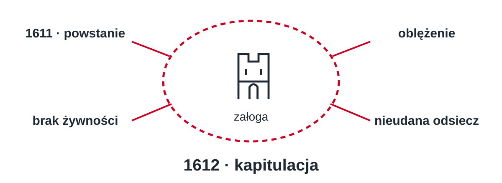

<strong>1612:</strong> po długim oblężeniu i głodzie załoga skapitulowała. Odsiecz Jana Karola Chodkiewicza nie przełamała oblężenia.

notes:
1:30. W 1611 r. wybuchło powstanie przeciw załodze i obcej ingerencji. Kolejne siły rosyjskie otaczały zajmowaną przez nią część miasta, a w 1612 r. położenie załogi stało się rozpaczliwe. Brakowało żywności; nie rozwijaj drastycznych relacji o głodzie. Jan Karol Chodkiewicz, hetman litewski, próbował przyjść z odsieczą, czyli pomocą dla oblężonych, lecz nie zdołał jej skutecznie dostarczyć. W listopadzie 1612 r. doszło do kapitulacji. W prezentacji zachowujemy rok, bo źródła podają różne daty dzienne według użytego kalendarza i etapu kapitulacji. Nie myl powstania 1611, kapitulacji 1612 i wyboru Romanowa 1613. Wojna nie skończyła się wraz z wyjściem z Kremla.

---

<!-- .slide: id="romanow" class="diagram-slide" data-purpose="explanation" data-layout="plain" -->

<h2>1613 · Nowa dynastia w Rosji</h2>

Michał Romanow

Wybrany na cara w 1613 r. Odbudowa władzy po wielkiej smucie.

Romanowowie rządzili Rosją aż do 1917 r.

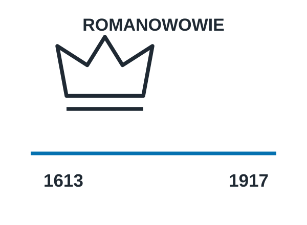

Nowa dynastia kończy kryzys następstwa, ale <strong>wojna z Rzecząpospolitą trwa dalej</strong>.

notes:
0:45. Michała Romanowa wybrał sobór ziemski, zgromadzenie przedstawicieli stanów. Przywrócenie uznawanej władzy pomagało wychodzić z kryzysu, nie oznaczało natychmiastowego usunięcia wszystkich problemów. Krótko podaj, że jego dynastia panowała do 1917 r.; nie przechodź do współczesnej Rosji ani politycznych porównań. Oś jest syntetyczna, nie zachowuje skali lat. Nie twierdź, że Romanow został carem w 1612 r. lub że zakończył wtedy wojnę z Rzecząpospolitą.

---

<!-- .slide: id="dywilino" class="map-board" data-purpose="evidence" data-layout="map-focus" -->

<figure>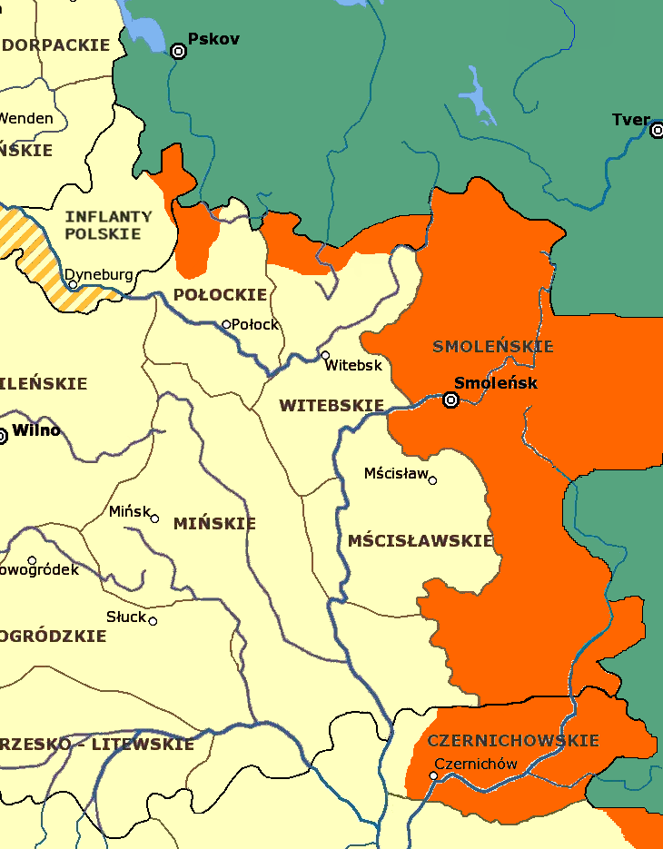</figure>
<h2>Dywilino: ziemie zamiast korony</h2>
<strong>Grudzień 1618:</strong> rozejm, obowiązujący od 1619 r.

<i class="swatch gains"></i>Nabytki: <strong>ziemie smoleńska, czernihowska i siewierska.</strong>

<i class="swatch commonwealth"></i>Wcześniejsze ziemie Rzeczypospolitej

Kliknij, aby zobaczyć całą mapę.

notes:
1:15. Po dalszych walkach, w tym nieudanej wyprawie Władysława na Moskwę w 1618 r., zawarto rozejm w Dywilinie w grudniu 1618 r. Wchodził w życie w 1619 r., stąd mapy i opracowania często używają 1619. Uczeń nie ma uczyć się dwóch sprzecznych „dat zawarcia”: rozróżniamy podpisanie i obowiązywanie. Wskaż Smoleńsk, ziemię czernihowską i siewierską. Nie pokazuj Moskwy jako nabytku terytorialnego — utracona załoga nie jest granicą państwa. Rozejm zawiesza działania na ustalony czas; później odrębny pokój potwierdził zasadnicze zdobycze. Mapę odczytuj według legendy, nie kolorów współczesnych państw.

---

<!-- .slide: id="najwieksza" class="map-board" data-purpose="evidence" data-layout="map-focus" -->

<figure>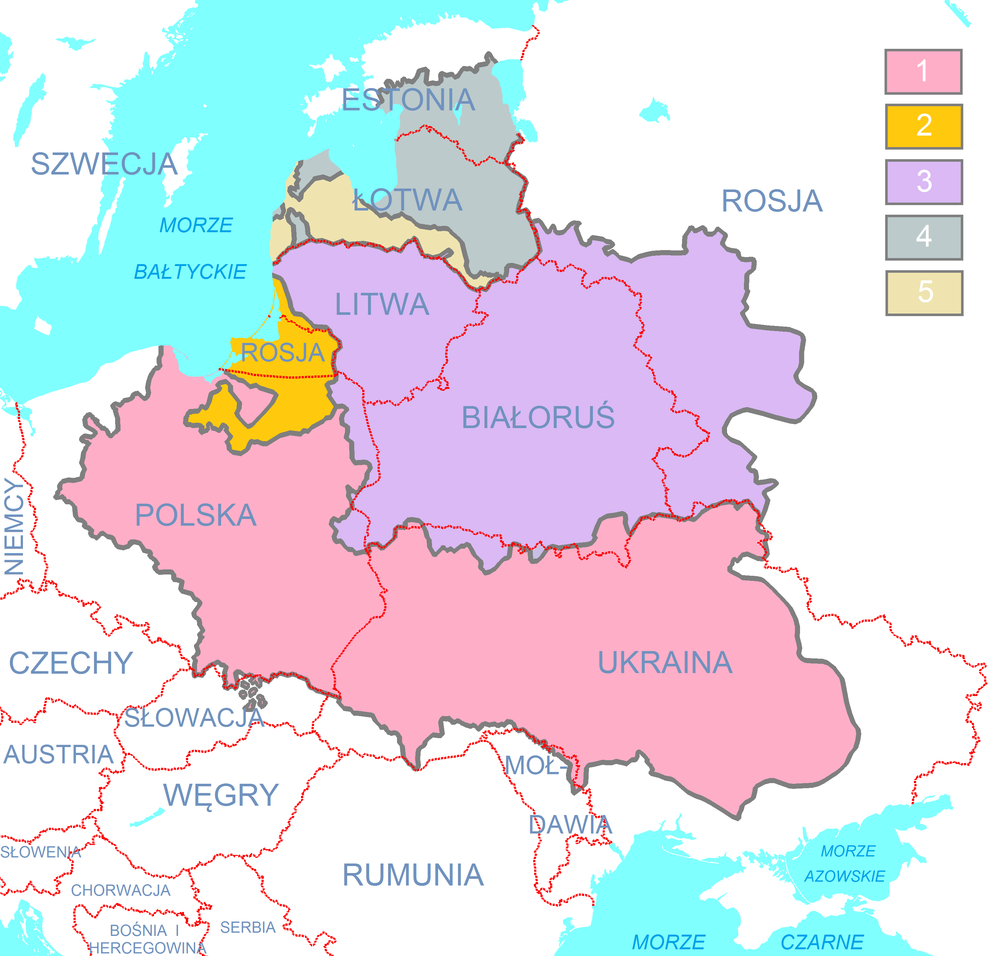</figure>
<h2>Około miliona km²</h2>
Jeden z największych obszarów w dziejach państwa.

<strong>Mapa: Rzeczpospolita i jej lenna, ok. 1619</strong> 1 · Korona 2 · Prusy Książęce — lenno 3 · Wielkie Księstwo Litewskie 4 · Inflanty 5 · Kurlandia — lenno

······ dzisiejsze granice ━ granice historyczne

Współczesne nazwy państw służą porównaniu.

notes:
1:15. Poproś, by uczniowie wzrokiem porównali współczesną Polskę z obszarem wspólnego państwa polsko-litewskiego, nie liczyli dokładnego stosunku powierzchni z rysunku. To nie „dzisiejsza Polska powiększona o całą Ukrainę”: dawne państwo obejmowało obszary należące obecnie do kilku państw i tylko części ich terytoriów. Używamy przybliżenia około miliona km². Histmag wiąże maksimum z rozejmem 1618/1619; Ciekawostki Historyczne podają często spotykane 990 tys. km² przy 1634, akcentując pokój i różnice rachunku terytoriów. Nie podajemy pozornej dokładności ani nie sumujemy lenn bez wyjaśnienia. Szczegóły tej rozbieżności są w sources.md, nie na slajdzie. Nie kopiujemy komercyjnej mapy EXGEO.

---

<!-- .slide: id="polanowo" class="diagram-slide sea" data-purpose="explanation" data-layout="plain" -->

<h2>1634 · Pokój w Polanowie</h2>

1632–1634
<h3>Wojna smoleńska</h3>
Rosja próbuje odzyskać utracone ziemie. Władysław IV broni Smoleńska.

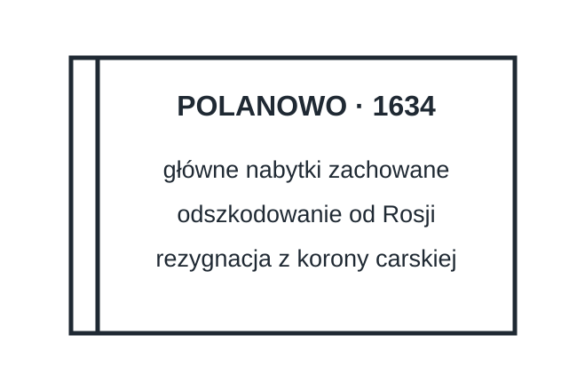

Zachowane ziemie smoleńska, czernihowska i siewierska. Władysław IV zrzeka się roszczeń do tronu Rosji.

notes:
1:30. Po śmierci Zygmunta III w 1632 r. Rosja zaatakowała, licząc na osłabienie państwa podczas bezkrólewia. Władysław IV jako nowy król poprowadził skuteczną odsiecz Smoleńska. Pokój w Polanowie w 1634 r. potwierdzał zasadniczy stan nabytków z Dywilina; Rosja wypłacała odszkodowanie, bez potrzeby pamięciowego opanowania kwoty. Władysław wyrzekał się pretensji do rosyjskiej korony. Niewielki rejon Sierpiejska pozostał przy Rosji; nie mów więc o idealnie niezmienionej każdej kresce granicy. To doprecyzowanie nauczycielskie, nie kolejna data do zapisu. Rosja odzyska część utraconych ziem w późniejszych wojnach, ale nie nastąpiło to już w 1634 r. Nie ogłaszaj jej od razu dominującym zwycięzcą tego pokoju.

---

<!-- .slide: id="notatka-2" class="notebook" data-purpose="synthesis" data-layout="plain" -->

<h2>Do zeszytu: korona czy ziemie?</h2>
Korona ≠ ziemie. Przerysuj dwa odgałęzienia i oś · 3 minuty
<figure>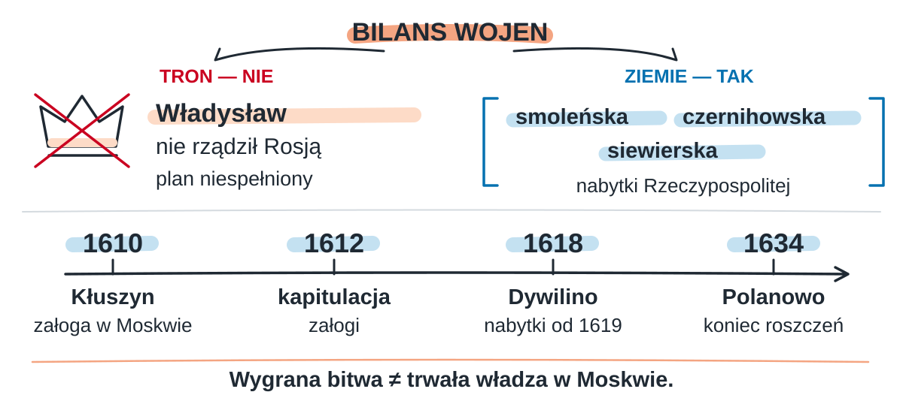</figure>

notes:
3:00. Druga rysowana notatka rozłożona w toku lekcji, nie na ostatnim ekranie. Powiedz: „Korona z krzyżykiem oznacza niezrealizowany plan, nie śmierć Władysława. Obok korony zapiszcie trzy nazwy ziem pod wspólnym nawiasem. Na dole wystarczy prosta oś i cztery daty”. Władysław nie rządził Rosją; 1610 Kłuszyn i załoga w Moskwie, 1612 kapitulacja, 1618 Dywilino, 1634 Polanowo i rezygnacja z roszczeń. Zapisy o 1604, 1609 i 1613 pozostają w podsumowaniu ucznia — nie dopisujemy ich w pośpiechu do rysunku. Najpierw 2 minuty ciszy, potem minuta na kończenie i szybkie sprawdzenie. Pomoc: zamiast rysować ozdobną koronę wystarczą trzy ząbki. Nie oczekuj kolorowania.

---

<!-- .slide: id="bilans-zadanie" class="oral" data-purpose="practice" data-layout="task-board" -->

<h2>Czy te wojny były sukcesem?</h2>
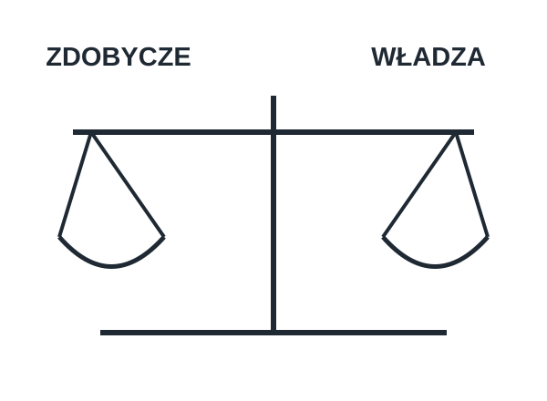

Ułóż dwa zdania · najpierw samodzielnie

Podaj <strong>jeden osiągnięty cel</strong> i <strong>jeden cel, którego nie osiągnięto</strong>.

Każde zdanie poprzyj wydarzeniem lub postanowieniem rozejmu albo pokoju.

notes:
1:30. Aktywność ustna 3 z 3 i główne zadanie zastosowania. 20 sekund cichego przygotowania dla każdego, 2–3 wypowiedzi, krótkie podsumowanie. Model: „Osiągnięto odzyskanie Inflant po rozejmie w Jamie Zapolskim 1582” albo „uzyskano Smoleńszczyznę w Dywilinie”. „Nie osiągnięto trwałego osadzenia Władysława na tronie rosyjskim: nie rządził, załoga skapitulowała w 1612, roszczeń zrzekł się w 1634”. Przyjmij też poprawny argument o niezdobyciu Pskowa, ale skieruj do pytania o cel polityczny. Nie oceniaj jako dostatecznego samego „wygrano Kłuszyn”, jeśli brak związku z osiągniętym celem. Pomoc: początek „Udało się…, ponieważ…; nie udało się…, o czym świadczy…”. Rozszerzenie: wyjaśnij różnicę między zajęciem miasta a trwałym panowaniem. Bez rozmowy w parze, bez kartek.

---

<!-- .slide: id="synteza" class="diagram-slide campaign" data-purpose="synthesis" data-layout="plain" -->

<h2>Od Bałtyku do Kremla — i do granicy</h2>
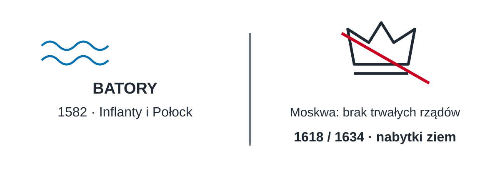

Zwycięstwa i zdobycze terytorialne — tak. Trwała władza nad Rosją — nie.

notes:
1:00. Gotowe zamknięcie: „Batory obronił pozycję Rzeczypospolitej nad Bałtykiem. Za Wazów wojsko dotarło do Moskwy, lecz nie udało się utrzymać tam władzy ani osadzić Władysława na tronie. Trwalszym wynikiem były nabytki ziem, potwierdzone w 1634 roku. Wygrana bitwa to zatem nie to samo co trwały sukces polityczny”. Uczeń tylko sprawdza dwie notatki, niczego nowego teraz nie przepisuje. Jeśli zostało mało czasu, przeczytaj te trzy zdania i przejdź do wyjścia; nie rezygnuj ze sprawdzenia rozumienia.

---

<!-- .slide: id="wyjscie" class="exit" data-purpose="exit-ticket" data-layout="plain" -->

<h2>Na koniec: dwa zdania w zeszycie</h2>
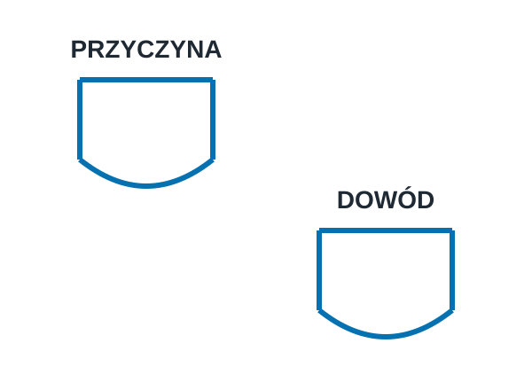
<ol><li>Dlaczego Rosji zależało na Inflantach?</li><li>Podaj jeden dowód, że zwycięstwo wojskowe nie zapewniło trwałego panowania nad Rosją.</li></ol>
Użyj konkretu: miejsce, rok albo postanowienie układu.

notes:
1:30. Indywidualny pisemny bilet wyjścia w zeszycie, nie czwarta aktywność ustna i nie karta pracy. Daj 60 sekund na dwa krótkie zdania. Klucz: 1) dostęp do portów Bałtyku, handel i kontakty z Zachodem; 2) np. mimo Kłuszyna 1610 załoga skapitulowała w 1612; Władysław nie objął rzeczywistych rządów i zrzekł się roszczeń w 1634. Sprawdź wzrokiem 3–4 zeszyty podczas pisania i poproś uczniów o podkreślenie konkretu. Brak szczegółowego roku przy poprawnym związku nie unieważnia rozumienia. Po lekcji można udostępnić student-summary.md. Zaplanowany osobno dwuminutowy bufor służy opóźnieniom i dokończeniu notatek, nie dodatkowemu filmowi.
