<!-- .slide: id="otwarcie" data-purpose="opening" data-layout="hero-source" class="" -->

Historia · klasa VII
<h1>Kultura polska pod zaborami</h1>
Jak zachować wspólnotę bez własnego państwa?

<figure class="art">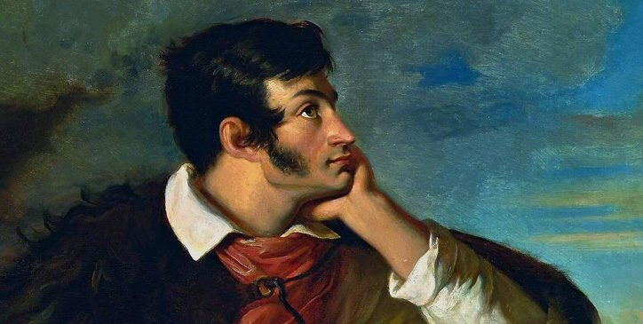<figcaption>Walenty Wańkowicz, Mickiewicz na Judahu skale, 1827–1828 · fragment</figcaption></figure>

notes:
1 min. Zapowiedz dwa równoległe sposoby działania: instytucje i twórczość. To fragment portretu, nie fotografia ani obraz emigracji paryskiej. Po zakończonym intake obejrzano dostarczone s.55–59 i porównano zakres. Wydanie nieustalone; skanów nie reprodukujemy.

**Proweniencja obrazu:**
 Obraz przedstawia mężczyznę. Widoczny jest jego prawy profil. Podpiera głowę lewą ręką. Ma on ciemne, gęste włosy wraz z bokobrodami. Nos jest prosty i długi. Usta są małe i zaciśnięte w wąską linię. Wzrok skierowany jest do góry. Mężczyzna ma na sobie futro i koszulę. Wokół kołnierza koszuli owinięta jest chusta przyciskana przez sznurek od saszetki przewieszonej przez ramię. Rękawy od koszuli ma podwinięte. Na jego tle widoczne jest niebo. Ziemie polskie i ich mieszkańcy w latach 1815–1849 Walenty Wańkowicz, Portret Adama Mickiewicza na Judahu skale . Obraz namalowany w latach 1827‑28, przedstawiający zadumanego poetę na Krymie. Źródło: Wikimedia Commons , domena publiczna.
Strona: https://zpe.gov.pl/a/dorobek-kultury-polskiej-w-i-polowie-xix-wieku/D77FNR137
Plik: https://static.zpe.gov.pl/portal/f/res-minimized/RjODNo6LFEBhm/1652786235/15n7600ZBsMO2lOCzTdu88Uyj1WsGNjM.jpg
SHA-256: 01216f1906bae060f39c54a04507056b22dab2f433053575e126a77cde2ab407

**Kroje:** Source Sans 3 i Source Serif 4, lokalna kolekcja Google Fonts.

Copyright 2018 The Lexend Project Authors (https://github.com/googlefonts/lexend), with Reserved Font Name “RevReading Lexend”.

This Font Software is licensed under the SIL Open Font License, Version 1.1.
This license is copied below, and is also available with a FAQ at:
https://scripts.sil.org/OFL

-----------------------------------------------------------
SIL OPEN FONT LICENSE Version 1.1 - 26 February 2007
-----------------------------------------------------------

PREAMBLE
The goals of the Open Font License (OFL) are to stimulate worldwide
development of collaborative font projects, to support the font creation
efforts of academic and linguistic communities, and to provide a free and
open framework in which fonts may be shared and improved in partnership
with others.

The OFL allows the licensed fonts to be used, studied, modified and
redistributed freely as long as they are not sold by themselves. The
fonts, including any derivative works, can be bundled, embedded,
redistributed and/or sold with any software provided that any reserved
names are not used by derivative works. The fonts and derivatives,
however, cannot be released under any other type of license. The
requirement for fonts to remain under this license does not apply
to any document created using the fonts or their derivatives.

DEFINITIONS
"Font Software" refers to the set of files released by the Copyright
Holder(s) under this license and clearly marked as such. This may
include source files, build scripts and documentation.

"Reserved Font Name" refers to any names specified as such after the
copyright statement(s).

"Original Version" refers to the collection of Font Software components as
distributed by the Copyright Holder(s).

"Modified Version" refers to any derivative made by adding to, deleting,
or substituting -- in part or in whole -- any of the components of the
Original Version, by changing formats or by porting the Font Software to a
new environment.

"Author" refers to any designer, engineer, programmer, technical
writer or other person who contributed to the Font Software.

PERMISSION & CONDITIONS
Permission is hereby granted, free of charge, to any person obtaining
a copy of the Font Software, to use, study, copy, merge, embed, modify,
redistribute, and sell modified and unmodified copies of the Font
Software, subject to the following conditions:

1) Neither the Font Software nor any of its individual components,
in Original or Modified Versions, may be sold by itself.

2) Original or Modified Versions of the Font Software may be bundled,
redistributed and/or sold with any software, provided that each copy
contains the above copyright notice and this license. These can be
included either as stand-alone text files, human-readable headers or
in the appropriate machine-readable metadata fields within text or
binary files as long as those fields can be easily viewed by the user.

3) No Modified Version of the Font Software may use the Reserved Font
Name(s) unless explicit written permission is granted by the corresponding
Copyright Holder. This restriction only applies to the primary font name as
presented to the users.

4) The name(s) of the Copyright Holder(s) or the Author(s) of the Font
Software shall not be used to promote, endorse or advertise any
Modified Version, except to acknowledge the contribution(s) of the
Copyright Holder(s) and the Author(s) or with their explicit written
permission.

5) The Font Software, modified or unmodified, in part or in whole,
must be distributed entirely under this license, and must not be
distributed under any other license. The requirement for fonts to
remain under this license does not apply to any document created
using the Font Software.

TERMINATION
This license becomes null and void if any of the above conditions are
not met.

DISCLAIMER
THE FONT SOFTWARE IS PROVIDED "AS IS", WITHOUT WARRANTY OF ANY KIND,
EXPRESS OR IMPLIED, INCLUDING BUT NOT LIMITED TO ANY WARRANTIES OF
MERCHANTABILITY, FITNESS FOR A PARTICULAR PURPOSE AND NONINFRINGEMENT
OF COPYRIGHT, PATENT, TRADEMARK, OR OTHER RIGHT. IN NO EVENT SHALL THE
COPYRIGHT HOLDER BE LIABLE FOR ANY CLAIM, DAMAGES OR OTHER LIABILITY,
INCLUDING ANY GENERAL, SPECIAL, INDIRECT, INCIDENTAL, OR CONSEQUENTIAL
DAMAGES, WHETHER IN AN ACTION OF CONTRACT, TORT OR OTHERWISE, ARISING
FROM, OUT OF THE USE OR INABILITY TO USE THE FONT SOFTWARE OR FROM
OTHER DEALINGS IN THE FONT SOFTWARE.

---

<!-- .slide: id="wspolnota" data-purpose="explanation" data-layout="impact-flow" class="" -->
<h2>Państwo zniknęło. Wspólnota pozostała.</h2>
Po trzecim rozbiorze w 1795 r. nie było niepodległej Rzeczypospolitej.

<h3>Język</h3>
Dom, książka i teatr przekazywały polszczyznę kolejnym pokoleniom.

<h3>Pamięć</h3>
Biblioteki, muzea i historycy chronili dorobek oraz wiedzę o przeszłości.

<h3>Więź</h3>
Poezja, muzyka i obrazy łączyły ludzi ponad granicami zaborów.

Kultura nie zastępowała państwa, ale pomagała przetrwać narodowi.

notes:
1,5 min. Rozróżnij naród i państwo. Uczeń nie musi wnioskować, że wszyscy mieszkańcy dawnych ziem mieli jedną tożsamość; pokazujemy działania na rzecz kultury polskiej.

---

<!-- .slide: id="osrodki" data-purpose="explanation" data-layout="matrix" class="" -->
<h2>Kultura miała wiele ośrodków</h2><table class="centres"><tbody><tr><th>Warszawa</th><td>Uniwersytet, Towarzystwo Przyjaciół Nauk, teatr i wydawnictwa.</td></tr><tr><th>Wilno i Krzemieniec</th><td>Uczelnia i szkoły; środowisko uczonych oraz młodych romantyków.</td></tr><tr><th>Kraków i Lwów</th><td>Uniwersytety, teatry, biblioteki; we Lwowie także Ossolineum.</td></tr><tr><th>Poznań i Puławy</th><td>Poznań: prasa i inicjatywy społeczne; Puławy: zbiory i mecenat Czartoryskich.</td></tr></tbody></table>
Ich możliwości zmieniały się wraz z polityką zaborców.

notes:
1,5 min. To zestawienie funkcji, nie mapa polityczna. Wilno i Krzemieniec leżały w zaborze rosyjskim, poza Królestwem Polskim. Kraków był do 1846 r. Wolnym Miastem, później w Austrii. Nie przypisuj całej epoce jednego statusu miast.

---

<!-- .slide: id="szkoly" data-purpose="explanation" data-layout="comparison" class="" -->
<h2>Od czytania do umiejętności zawodowych</h2>

<h3>Szkoły elementarne</h3><ul><li>Uczyły podstaw: czytania, pisania i rachunków.</li><li>W Królestwie Polskim po 1815 r. rozbudowywano ich sieć, m.in. dzięki Stanisławowi Kostce Potockiemu.</li></ul>

<h3>Szkoły zawodowe</h3><ul><li>Przygotowywały do rzemiosła i pracy w rozwijającej się gospodarce.</li><li>Stanisław Staszic wspierał kształcenie techniczne; w 1816 r. powstała szkoła górnicza w Kielcach.</li></ul>

Szkolnictwo w zaborach pruskim i austriackim przeżywało kryzys. W Wielkim Księstwie Poznańskim w 1825 r. wprowadzono obowiązek szkolny od 6 lat. Nie oznaczało to wszędzie równego dostępu ani prawa do polszczyzny.

notes:
2 min. Nie utożsamiaj szkoły elementarnej z zawodową ani dzisiejszym obowiązkiem szkolnym. Zabór pruski rozbudowywał szkolnictwo, ale ograniczał polszczyznę; w Galicji w pierwszej połowie XIX w. działała germanizacja. Represje po 1831 ograniczały wcześniejsze osiągnięcia. ZPE DxhNYkHwh, część o oświacie; odrzucamy błędne zdanie o prostym przekształceniu Towarzystwa do Ksiąg Elementarnych w TPN.

---

<!-- .slide: id="uniwersytet" data-purpose="explanation" data-layout="timeline-band" class="" -->
<h2>Uniwersytet Warszawski: 1816</h2>
Wyższe wykształcenie pozwalało kształcić lekarzy, prawników, nauczycieli i uczonych.
<ol class="axis"><li><b>1816</b>19 listopada: Aleksander I wydał akt założenia UW.</li><li><b>1818</b>14 maja: uroczyste otwarcie Królewskiego Uniwersytetu Warszawskiego.</li><li><b>1831</b>Po powstaniu listopadowym władze rosyjskie zamknęły uczelnię.</li></ol>
Założenie uczelni i jej uroczyste otwarcie to różne daty.

notes:
1,5 min. Koryguj skrót z briefu: rok 1816 oznacza założenie, nie uroczystą inaugurację. Oficjalna historia UW https://en.uw.edu.pl/about-university/history podaje obie daty, pięć wydziałów i zamknięcie po klęsce powstania. Nie wymagać zapamiętywania dni i miesięcy.

---

<!-- .slide: id="tpn" data-purpose="explanation" data-layout="statement" class="" -->
<h2>Towarzystwo Przyjaciół Nauk</h2>
Warszawa · 1800

Uczeni współpracowali także poza uniwersytetem.
<ul><li>Badali polski język i dzieje, gromadzili zbiory, publikowali wyniki badań.</li><li>Stanisław Staszic jako prezes wspierał rozwój nauki i jej praktycznych zastosowań.</li><li>Chronili i rozwijali dorobek narodu, mimo braku niepodległego państwa.</li></ul>

notes:
1 min. Podstawa: ZPE D11Hy12ZH, część o TPN. Nie przedstawiaj TPN jako tajnej organizacji ani kontynuacji tożsamej instytucjonalnie z Towarzystwem do Ksiąg Elementarnych. Uczony, nie tylko poeta, mógł służyć kulturze.

---

<!-- .slide: id="czartoryski" data-purpose="explanation" data-layout="split" class="" -->
<h2>Adam Jerzy Czartoryski</h2>
<figure class="art">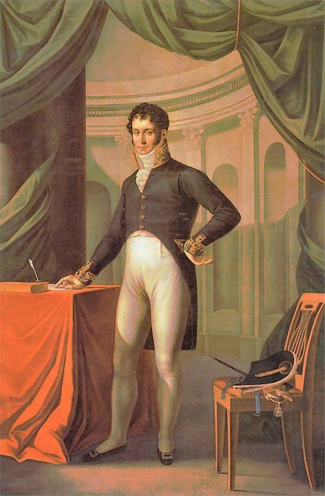<figcaption>Józef Oleszkiewicz, portret, 1810</figcaption></figure>

Książę, polityk, dyplomata i mecenas kultury.
<ul><li>Jako kurator wileńskiego okręgu naukowego (1803–1824) reformował Uniwersytet Wileński i rozwijał sieć szkół z językiem polskim.</li><li>Na emigracji współtworzył Towarzystwo Literackie i Bibliotekę Polską w Paryżu.</li><li>Pomagał organizować naukę oraz zachować polskie książki i pamięć.</li></ul>

notes:
2 min. To Adam JERZY, nie jego ojciec Adam Kazimierz. Puławskie muzealnictwo wiąż przede wszystkim z matką Izabelą. Biogram https://pl.wikipedia.org/wiki/Adam_Jerzy_Czartoryski: przeczytane akapity o kuratorii i działalności kulturalnej; fakty z biogramu odrębne od dowodu z portretu.

**Proweniencja obrazu:**
### czartoryski.jpg
- Tytuł: Portret Adama Jerzego Czartoryskiego; typ: malarstwo z epoki.
- Autor / instytucja: Józef Oleszkiewicz; data: 1810.
- Strona sprawdzona2026-10-08: https://zpe.gov.pl/a/przeczytaj/Du8MtYJOY.
- IDfigury: `Res85jufqIHGT`; bezpośredni oryginał: https://static.zpe.gov.pl/portal/f/res/Res85jufqIHGT/1642516787/29MasheoHlJ6gt0xbNbF16C0Oskys9i7.jpg.
- Prawa: **domena publiczna**, https://creativecommons.org/publicdomain/mark/1.0/. Licencja potwierdzona w tej konkretnej figurze, nie sąsiedniej. Lelewel i biblioteka mają niepełne metadane autora, jawnie zachowane.
- Rola / ograniczenie: Wizerunek przed emigracją.
- Lokalny plik: `assets/czartoryski.jpg`; zmiany: Bez zmian treści.
- SHA-256 pobranego oryginału: `3442a7bead149b7bf8c86d4a63558553ccbab6fa913d36f5b52443b83e18af8f`.
- SHA-256 pliku dostarczanego: `3442a7bead149b7bf8c86d4a63558553ccbab6fa913d36f5b52443b83e18af8f`.

---

<!-- .slide: id="ossolineum" data-purpose="explanation" data-layout="process" class="" -->
<h2>Księgozbiór dla przyszłych pokoleń</h2>
Lwów · zabór austriacki
<h3>Zakład Narodowy im. Ossolińskich — 1817</h3>
Józef Maksymilian Ossoliński przeznaczył swoje zbiory na publiczną bibliotekę.

<h3>Gromadzić</h3>
Książki, rękopisy, ryciny i inne pamiątki.

<h3>Chronić</h3>
Ocalić dorobek przed rozproszeniem i utratą.

<h3>Udostępniać</h3>
Biblioteka i wydawnictwo: materiał do badań, czytania i publikacji.

notes:
1,5 min. Oficjalne Kalendarium Ossolineum: 1817 zatwierdzenie fundacji; zbiory przywieziono do Lwowa w 1827. Nie utożsamiać daty fundacji z pełnym otwarciem wszystkich działów ani z dzisiejszą siedzibą we Wrocławiu. https://www.ossolineum.pl/o-nas/kalendarium-ossolineum/.

---

<!-- .slide: id="mecenat" data-purpose="explanation" data-layout="matrix" -->
<h2>Mecenat: dwór i biblioteka</h2>
Mecenas wspiera kulturę: finansuje twórców, chroni zbiory, udostępnia książki.

<h3>Puławy</h3>
Czartoryscy gromadzili pamiątki i wspierali twórców.

<h3>Łańcut</h3>
Potoccy tworzyli ośrodek życia kulturalnego wokół rezydencji.

<h3>Kórnik</h3>
Działyńscy gromadzili dzieła sztuki i zbiory biblioteczne.

Prywatne środki mogły służyć ochronie wspólnego dziedzictwa.

notes:
1 min. Źródło: dostarczona fotografia podręcznika s.55, img_25001b85e8ed.jpg. Nie kopiujemy ilustracji ani układu podręcznika. Nie każde zbiory były od razu szeroko dostępne. Nie przenoś działań matki Izabeli na Adama Jerzego.

---

<!-- .slide: id="romantyzm" data-purpose="explanation" data-layout="comparison" class="" -->
<h2>Romantyzm: uczucie, wyobraźnia, wolność</h2>
<b>Romantyzm</b> to nurt w kulturze przełomu XVIII i XIX w., narodzony w Wielkiej Brytanii i Niemczech.

<h3>Nowe spojrzenie</h3><ul><li>Uczucie i intuicja obok rozumu.</li><li>Tajemnica, potęga natury, niezwykła jednostka.</li><li>Ludowe wierzenia, tradycja i średniowiecze.</li></ul>

<h3>Polskie doświadczenie</h3><ul><li>Pragnienie wolności narodu bez państwa.</li><li>Tęsknota za ojczyzną i pytanie o sens klęsk.</li><li>1822: Ballady i romanse — początek polskiej epoki; 1864: jej umowny koniec po klęsce powstania styczniowego.</li></ul>

notes:
2 min. Reakcja na sztywne reguły klasycyzmu i przekonanie, że sam rozum wyjaśnia wszystko; nie oznacza odrzucenia każdego rozumowania. To europejski nurt, nie wynalazek jednego Polaka. Rok 1822 dotyczy tomu, a nie wszystkich dzieł romantycznych. ZPE D11Hy12ZH.

---

<!-- .slide: id="romantycznosc" data-purpose="evidence" data-layout="evidence" -->
<h2>Romantyczność: jak poznawać świat?</h2>
Co poeta przeciwstawia „szkiełku i oku”? Wskaż słowa wiersza i wyjaśnij ich sens.
<figure class="poem-source"><blockquote class="poem">Słuchaj dzieweczko! — Ona nie słucha — To dzień biały! to miasteczko! Przy tobie nie ma żywego ducha, Co tam wkoło siebie chwytasz? Kogo wołasz, z kim się witasz? — Ona nie słucha — [...] — „Słuchaj, dzieweczko!” — krzyknie śród zgiełku Starzec, i na lud zawoła: „Ufajcie memu oku i szkiełku, Nic tu nie widzę dokoła. — Duchy karczemnej tworem gawiedzi [gapiów], W głupstwa wywarzone kuźni. Dziewczyna duby smalone bredzi [mówi głupstwa], A gmin [lud] rozumowi bluźni”. „Dziewczyna czuje — odpowiadam skromnie — A gawiedź wierzy głęboko; Czucie i wiara silniej mówi do mnie, Niż mędrca szkiełko i oko. Martwe znasz prawdy, nieznane dla ludu, Widzisz świat w proszku, w każdej gwiazd iskierce; Nie znasz prawd żywych, nie obaczysz cudu! Miej serce i patrzaj w serce!”</blockquote><figcaption class="poem-credit">Adam Mickiewicz, Romantyczność · fragment z podręcznika, s.58</figcaption></figure>

notes:
1 min w ramach bloku romantyzmu. Najpierw odczytaj pytanie, potem fragment. Kontekst: starzec ufa obserwacji i rozumowi, narrator podkreśla czucie i wiarę. Model: uczucie, wiara i intuicja mają wartość poznawczą. To stanowisko poety, nie obiektywne obalenie nauki. S.58 podręcznika datuje powstanie ballady na1821; publikacja tomu Ballady i romanse nastąpiła1822. Nie utożsamiamy obu dat.
Pełny fragment z dostarczonej s.58 odtworzono bez dodatkowych skrótów, zachowując pierwotne [...] i objaśnienia w nawiasach. Porównano słowa utworu z https://wolnelektury.pl/media/book/txt/ballady-i-romanse-romantycznosc.txt; szkolne objaśnienia pochodzą z podręcznika. Utwór w domenie publicznej; opracowanie Wolne Lektury na podstawie: Adam Mickiewicz, Poezje, tom1, wyd.2 zwiększone, Krakowska Spółdzielnia Wydawnicza, Kraków1922. Przypisów i motywów redakcyjnych nie kopiowano. Materiały dodatkowe Wolnych Lektur mają odrębną Licencję Wolnej Sztuki1.3. Strona: https://wolnelektury.pl/katalog/lektura/ballady-i-romanse-romantycznosc/ ; zasady https://wolnelektury.pl/info/zasady-wykorzystania/. Zachowano pełny dostarczony fragment, nie cały utwór. Odstępy i układ ujednolicono dla jednej pionowej powierzchni czytania.

---

<!-- .slide: id="mickiewicz" data-purpose="explanation" data-layout="split" class="" -->
<h2>Mickiewicz: język wspólnej pamięci</h2>
<figure class="art">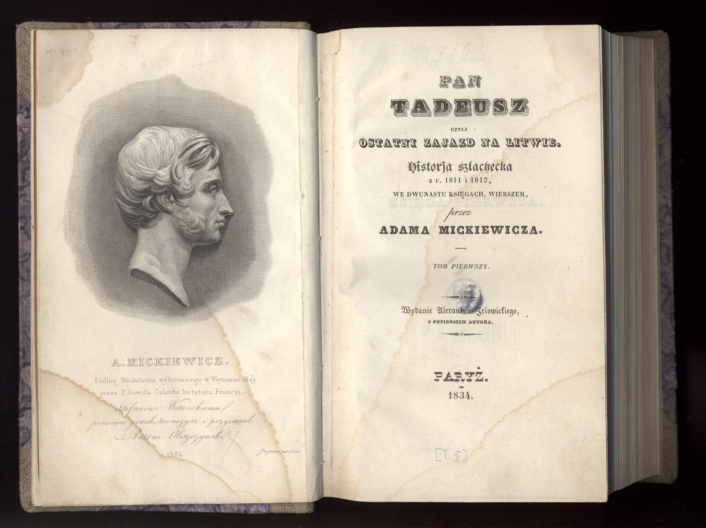<figcaption>Pan Tadeusz, wydanie paryskie, 1834 · Polona</figcaption></figure>
<ul><li><b>Ballady i romanse (1822)</b> — ludowe opowieści, wiara i uczucie.</li><li><b>Dziady, część III (1832)</b> — prześladowania i pytania o los narodu.</li><li><b>Pan Tadeusz (1834)</b> — obraz utraconej ojczyzny, obyczajów i nadziei.</li><li>Poeta dawał emigrantom i czytelnikom w kraju wspólny język pamięci.</li></ul>

notes:
1,5 min. Pokaż Paryż i 1834 na prawdziwej stronie tytułowej. Nie czytamy całego poematu. Treść utworów parafrazujemy; żadnych wymyślonych cytatów.

**Proweniencja obrazu:**
 Zdjęcie przedstawia otwartą księgę. Na prawej kartce znajduje się na górze napis Pan Tadeusz czyli ostatni zajazd na Litwie. Poniżej znajdują się kolejno napisy: historia szlachecka z roku 1811 i 1812, w dwunastu księgach, wierszem przez Adama Mickiewicza, tom pierwszy, Paryż, 1834. Na lewej kartce widoczny jest zaś szkic prawego profilu mężczyzny, jest to Adam Mickiewicz. Ma on gęste włosy oraz bokobrody. Nos jest długi i prosty. Na stronach widoczne są plamy. Pan Tadeusz, czyli ostatni zajazd na Litwie – poemat epicki Adama Mickiewicza, wydany w dwóch tomach w 1834 r. w Paryżu (strona tytułowa). Wkrótce po wydaniu okrzyknięty epopeją narodową. Składa się z 12 ksiąg pisanych wierszem trzynastozgłoskowym. Czas trwania akcji to pięć dni z roku 1811 i jeden dzień z roku 1812. Źródło: Polona.pl, domena publiczna.
Strona: https://zpe.gov.pl/a/przeczytaj/D11Hy12ZH
Plik: https://static.zpe.gov.pl/portal/f/res-minimized/R1HEQ8o2EtqN5/1727099494/1Qv7LpxcVaBOj8I8K8BFmwMfNwhprx8A.jpg
SHA-256: f57005fc3f53ac2792fe744ca16d342fbe5c825535112204b4b0b55d15ed4567

---

<!-- .slide: id="slowacki" data-purpose="explanation" data-layout="split" class="" -->
<h2>Słowacki: nie tylko pochwała bohaterstwa</h2>
<figure class="art">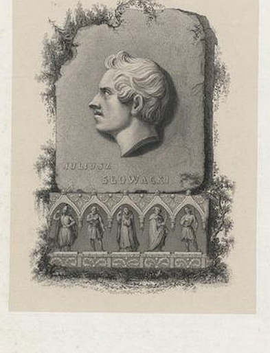<figcaption>Antoni Oleszczyński, Juliusz Słowacki, 1852 · detal</figcaption></figure>
<ul><li><b>Kordian (1834)</b> — dramat o odpowiedzialności jednostki i trudności działania dla ojczyzny.</li><li><b>Balladyna (1839)</b> — fantastyczny świat, żądza władzy i odpowiedzialność za zbrodnię.</li><li><b>Lilla Weneda</b> — dramat o legendarnych początkach Polski.</li><li>Słowacki, Mickiewicz i Krasiński byli uznawani za <b>wieszczów</b> — poetów i duchowych przewodników narodu.</li></ul>

notes:
1,5 min. Nie sprowadzaj romantyzmu do bezkrytycznego kultu walki. Portret pośmiertny, nie fotografia; zachowany pełny oryginał w assets/slowacki.jpg. Daty wydań: Kordian potwierdzony w poprzedniej lekcji, Balladyna w osi ZPE D77FNR137.

**Proweniencja obrazu:**
### slowacki.jpg
- Tytuł: Juliusz Słowacki; typ: staloryt popiersia, pośmiertny portret.
- Autor / instytucja: Antoni Oleszczyński, według wzoru Władysława Oleszczyńskiego; Biblioteka Narodowa, G.3460; data: 1852.
- Strona sprawdzona2026-10-08: https://zpe.gov.pl/kronika/656991.
- IDfigury: `885679`; bezpośredni oryginał: https://kronika.gov.pl/image/full/885679/.
- Prawa: **domena publiczna**, https://creativecommons.org/publicdomain/mark/1.0/. Licencja potwierdzona w tej konkretnej figurze, nie sąsiedniej. Lelewel i biblioteka mają niepełne metadane autora, jawnie zachowane.
- Rola / ograniczenie: Oryginał zachowany; na slajdzie autorski detal popiersia.
- Lokalny plik: `assets/slowacki.jpg`; zmiany: Bez zmian treści; osobny detal slowacki-detal.jpg: wycięcie samego popiersia, bez dopisywania elementów.
- SHA-256 pobranego oryginału: `788f2575fbcc4cdee051e72bae7b95a2b5d2ecd8ab1a2235cf14638b79852f7a`.
- SHA-256 pliku dostarczanego: `788f2575fbcc4cdee051e72bae7b95a2b5d2ecd8ab1a2235cf14638b79852f7a`.

Detal: `assets/slowacki-detal.jpg`, SHA-256 `4d9283bc0ae83db3bbbdc9dd78a6c02a569350ce3599c0abbd1186e68b19dbb3`. Granice kadru: popiersie z tej samej ryciny; pełny plik zachowany w assets/slowacki.jpg.

**Proweniencja obrazu:**
### slowacki.jpg
- Tytuł: Juliusz Słowacki; typ: staloryt popiersia, pośmiertny portret.
- Autor / instytucja: Antoni Oleszczyński, według wzoru Władysława Oleszczyńskiego; Biblioteka Narodowa, G.3460; data: 1852.
- Strona sprawdzona2026-10-08: https://zpe.gov.pl/kronika/656991.
- IDfigury: `885679`; bezpośredni oryginał: https://kronika.gov.pl/image/full/885679/.
- Prawa: **domena publiczna**, https://creativecommons.org/publicdomain/mark/1.0/. Licencja potwierdzona w tej konkretnej figurze, nie sąsiedniej. Lelewel i biblioteka mają niepełne metadane autora, jawnie zachowane.
- Rola / ograniczenie: Oryginał zachowany; na slajdzie autorski detal popiersia.
- Lokalny plik: `assets/slowacki.jpg`; zmiany: Bez zmian treści; osobny detal slowacki-detal.jpg: wycięcie samego popiersia, bez dopisywania elementów.
- SHA-256 pobranego oryginału: `788f2575fbcc4cdee051e72bae7b95a2b5d2ecd8ab1a2235cf14638b79852f7a`.
- SHA-256 pliku dostarczanego: `788f2575fbcc4cdee051e72bae7b95a2b5d2ecd8ab1a2235cf14638b79852f7a`.

Detal: `assets/slowacki-detal.jpg`, SHA-256 `4d9283bc0ae83db3bbbdc9dd78a6c02a569350ce3599c0abbd1186e68b19dbb3`. Granice kadru: popiersie z tej samej ryciny; pełny plik zachowany w assets/slowacki.jpg.

---

<!-- .slide: id="paryz" data-purpose="explanation" data-layout="split" class="" -->
<h2>Paryż: polska kultura poza krajem</h2>
<figure class="art">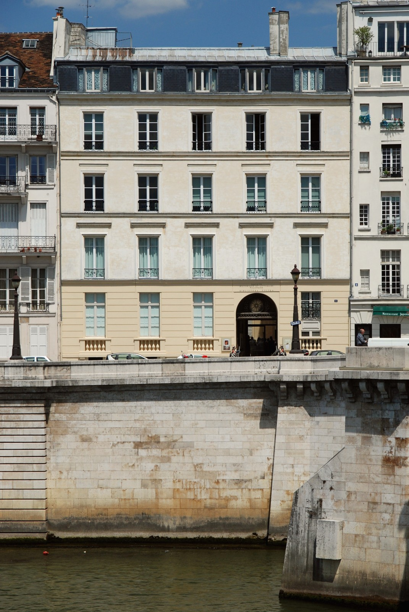<figcaption>Biblioteka Polska w Paryżu · fotografia z 2011 r.</figcaption></figure>
<ul><li>Po 1831 r. skupiał emigrantów, pisarzy, wydawców i odbiorców polskiej sztuki.</li><li>Tam ukazywały się polskie książki, m.in. Pan Tadeusz i Kordian.</li><li>Biblioteka Polska (1838) gromadziła książki i archiwalia.</li><li>Twórczość emigracyjna docierała także pod zabory, choć przeszkodą była cenzura.</li></ul>

notes:
1,5 min. Paryż był ważnym centrum, nie jedynym miejscem kultury polskiej. Zdjęcie współczesne nie dowodzi wyglądu budynku w 1838. Rola miasta: ZPE D11Hy12ZH; biblioteka: ZPE D1AdKA3qM.

**Proweniencja obrazu:**
### biblioteka.jpg
- Tytuł: Paryż2011, Biblioteka Polska w Paryżu. Quai d’Orléans; typ: fotografia współczesna.
- Autor / instytucja: oznaczenie źródłaZPE: Paryż2011; personalny autor niepodany; data: 2011.
- Strona sprawdzona2026-10-08: https://zpe.gov.pl/a/emigracja-polakow-w-xix-wieku/D1AdKA3qM.
- IDfigury: `RkPsWcc2mVmVt`; bezpośredni oryginał: https://static.zpe.gov.pl/portal/f/res/RkPsWcc2mVmVt/1727099493/1XygeAfb73DY0sN5aCcrSQQ271Vma1z6.jpg.
- Prawa: **CC BY-SA 4.0**, https://creativecommons.org/licenses/by-sa/4.0/. Licencja potwierdzona w tej konkretnej figurze, nie sąsiedniej. Lelewel i biblioteka mają niepełne metadane autora, jawnie zachowane.
- Rola / ograniczenie: Istniejąca instytucja; nie fotografia z1838.
- Lokalny plik: `assets/biblioteka.jpg`; zmiany: Zmniejszenie reprodukcji do maks.1600px (bez zmiany treści).
- SHA-256 pobranego oryginału: `54a85ae323063edf2c83d701c5109453c503da5ee2662a11f1452a6f27f23e67`.
- SHA-256 pliku dostarczanego: `038cac314b74990a43e842478735b526f3edaf09d51c912f55c2df4d49b1d576`.

---

<!-- .slide: id="mesjanizm" data-purpose="explanation" data-layout="statement" class="" -->
<h2>Mesjanizm: jak nadawano sens klęsce?</h2>
<b>Polski mesjanizm</b> był ideą, że cierpienie narodu ma szczególny sens i może przynieść wolność także innym narodom.

W jednej z jego wersji Polskę porównywano do <b>„Chrystusa narodów”</b>: cierpienie miało poprzedzać odrodzenie.

<ul><li>Taka wizja dawała części emigrantów nadzieję po klęskach.</li><li>To przekonanie religijno-filozoficzne i literackie, nie obiektywny los Polski ani pogląd wszystkich Polaków.</li></ul>

notes:
2 min. Wyjaśniaj ideę w trybie „wierzyli / uważali”, nie „Polska musiała cierpieć”. Odwołanie do Dziadów III to przykład mesjanicznej interpretacji. Materiał ZPE D9FtgXW2U użyty wybiórczo: odrzucamy jego błędną datę początku polskiego romantyzmu 1831 w podpisie Rosena. Nie powielamy oceniającego języka o sekcie.

---

<!-- .slide: id="towianski" data-purpose="explanation" data-layout="split" class="" -->
<h2>Towiański i towianizm</h2>
<figure class="art">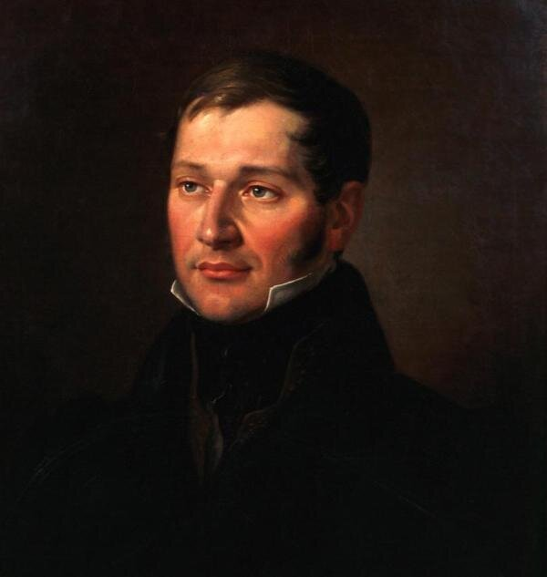<figcaption>Andrzej Towiański · portret z XIX w.</figcaption></figure>
<ul><li><b>Andrzej Towiański</b> — polski mistyk i działacz religijny, przywódca Koła Sprawy Bożej w Paryżu (1841).</li><li><b>Towianizm</b> — jego nauka religijno-mistyczna: duchowe doskonalenie ludzi miało przygotować odnowę świata.</li><li>Z Kołem związali się m.in. Mickiewicz i przez pewien czas Słowacki.</li><li>Towianizm to odrębny nurt, nie synonim całego romantyzmu lub mesjanizmu.</li></ul>

notes:
2 min. „Mistyk” oznacza odwołanie do osobistego doświadczenia rzeczywistości duchowej. Nie przedstawiaj objawień jako faktów nadprzyrodzonych. Towiański nie wymyślił sam całego polskiego mesjanizmu. ZPE D9FtgXW2U; nazwę skracamy do Koło Sprawy Bożej, w źródle Koło Sług Sprawy Bożej. Datę1841 potwierdza także tekst PDF strony; omijamy sprzeczne daty objawień w różnych materiałach.

**Proweniencja obrazu:**
 Obraz przedstawia portret młodego mężczyzny. Ma on owalną twarz. Jego włosy są krótkie, gładkie, ciemne, zaczesane na bok. Mężczyzna ma wydatny nos i bokobrody. Mężczyzna ubrany jest w surdut, koszulę ze stójką. Andrzej Towiański (1798/1799–1878) Działacz religijny dążący do reformy Kościoła, przekonany o jego skostniałości i potrzebie dostosowania go do nowych czasów. Inicjator i duchowy przywódca Koła Sług Sprawy Bożej, antyfilozoficznej i antyracjonalistycznej organizacji religijnej przypominającej sektę. Należeli do niej m.in. Adam Mickiewicz i Juliusz Słowacki. Źródło: domena publiczna.
Strona: https://zpe.gov.pl/a/przeczytaj/D9FtgXW2U
Plik: https://static.zpe.gov.pl/portal/f/res-minimized/R1Kw1TbYltScP/1645111290/1va4Xb8YD6WE4mPmh3qSwXb6kqvONta0.jpg
SHA-256: 663d4fd53ed2e6491da40b64c2b2294881b11213e8edd7e37d7d30c6b728f7ec

---

<!-- .slide: id="lelewel" data-purpose="explanation" data-layout="split" class="" -->
<h2>Lelewel: pamięć wymaga badań</h2>
<figure class="art">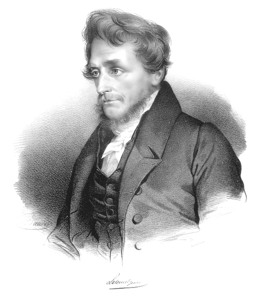<figcaption>Joachim Lelewel · portret, XIX w.</figcaption></figure>

Historyk, badacz dawnych map, nauczyciel i działacz emigracyjny.
<ul><li>Wykładał w Wilnie i Warszawie; inspirował Mickiewicza.</li><li>W pracy <b>Historyka (1815)</b> zajmował się zasadami poznawania przeszłości.</li><li>Rozwijał badania historii, chronologii i genealogii oraz publikował po polsku.</li><li>Podczas powstania listopadowego należał do Rządu Narodowego, później działał na emigracji.</li></ul>

notes:
1,5 min. Nowa Panorama Literatury Polskiej, https://nplp.pl/artykul/lelewel-joachim/ — przeczytany biogram: Wilno, Historyka1815, krytyka źródeł i prace kartograficzne. ZPE D3lr4Qfk2 służy tylko proweniencji portretu, nie metodologii. Oddziel działalność naukową od politycznej. Nie przedstawiaj go jako twórcy TDP.

**Proweniencja obrazu:**
### lelewel.png
- Tytuł: Joachim Lelewel; typ: portret.
- Autor / instytucja: autor nieustalony; ZPE wskazuje Wikimedia Commons; data: dokładny rok nieustalony, XIX wiek.
- Strona sprawdzona2026-10-08: https://zpe.gov.pl/a/przeczytaj/D3lr4Qfk2.
- IDfigury: `RMaEGwd1gFWD3`; bezpośredni oryginał: https://static.zpe.gov.pl/portal/f/res/RMaEGwd1gFWD3/1636418633/15CvunQR8sZK5WZT1RIiW7W80KV5JW1D.png.
- Prawa: **domena publiczna**, https://creativecommons.org/publicdomain/mark/1.0/. Licencja potwierdzona w tej konkretnej figurze, nie sąsiedniej. Lelewel i biblioteka mają niepełne metadane autora, jawnie zachowane.
- Rola / ograniczenie: Identyfikacja historyka, nie dowód wszystkich działań politycznych.
- Lokalny plik: `assets/lelewel.png`; zmiany: Bez zmian treści.
- SHA-256 pobranego oryginału: `73bfff58a35bec8aaf39d0633adb95f1923f5915d5bc5f80d5162d3a06f20fa7`.
- SHA-256 pliku dostarczanego: `73bfff58a35bec8aaf39d0633adb95f1923f5915d5bc5f80d5162d3a06f20fa7`.

---

<!-- .slide: id="chopin" data-purpose="explanation" data-layout="split" class="" -->
<h2>Chopin: polskie rytmy w muzyce Europy</h2>
<figure class="art">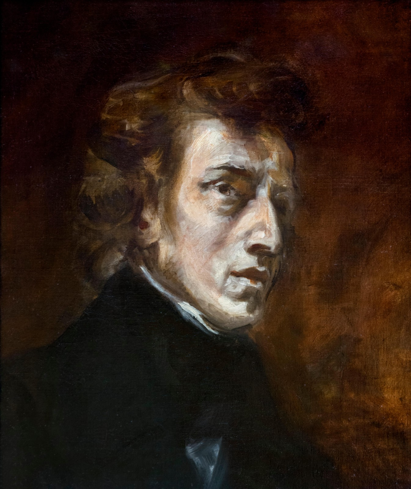<figcaption>Eugène Delacroix, Fryderyk Chopin, 1838</figcaption></figure>
<ul><li><b>Fryderyk Chopin</b> — kompozytor i pianista, od lat 30. XIX w. związany z Paryżem.</li><li><b>Mazurki i polonezy</b> przetwarzały rytmy polskich tańców w muzykę artystyczną.</li><li><b>Koncerty fortepianowe e-moll i f-moll</b> oraz etiudy ukazywały kunszt twórcy.</li><li>Jego utwory upowszechniały polskie inspiracje daleko poza ziemiami polskimi.</li></ul>

notes:
1,5 min. Nie każdy utwór jest programem politycznym. Nie wymagamy odsłuchu z Internetu ani filmu. Wsparcie: wystarczy rozpoznanie dwóch typów tańców i znaczenia twórczości. ZPE DeoY4I6LS oraz D11Hy12ZH.

**Proweniencja obrazu:**
### chopin.jpg
- Tytuł: Portret Chopina; typ: malarstwo z epoki, reprodukcja edukacyjna.
- Autor / instytucja: Eugène Delacroix; reprodukcja online-skills; data: 1838.
- Strona sprawdzona2026-10-08: https://zpe.gov.pl/a/wybrani-kompozytorzy-xix-wieku---fryderyk-chopin/DeoY4I6LS.
- IDfigury: `RoNNCX4JI9XZA`; bezpośredni oryginał: https://static.zpe.gov.pl/portal/f/res/RoNNCX4JI9XZA/1/230vQuOLJpRIUa3dvq79k016JCuQc259.jpg.
- Prawa: **CC BY 3.0**, https://creativecommons.org/licenses/by/3.0/. Licencja potwierdzona w tej konkretnej figurze, nie sąsiedniej. Lelewel i biblioteka mają niepełne metadane autora, jawnie zachowane.
- Rola / ograniczenie: Zachowujemy podaną przez ZPE licencję reprodukcji, mimo domeny publicznej oryginału.
- Lokalny plik: `assets/chopin.jpg`; zmiany: Zmniejszenie reprodukcji do maks.1600px (bez zmiany treści).
- SHA-256 pobranego oryginału: `0d32727ae1d540f244f167eec79092c380c560aeab4203e9c720f202e787115e`.
- SHA-256 pliku dostarczanego: `e4a68c9776d930de9e8f221658f90762241841f91ed9914df01b9d9cc4af0bac`.

---

<!-- .slide: id="moniuszko" data-purpose="explanation" data-layout="split" class="" -->
<h2>Moniuszko: polszczyzna na scenie i w domu</h2>
<figure class="art">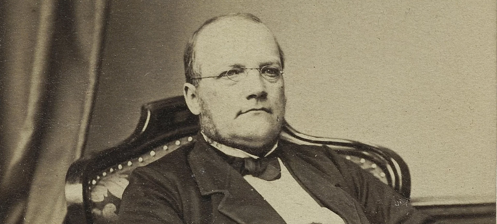<figcaption>Stanisław Moniuszko · fotografia, XIX w.</figcaption></figure>
<ul><li><b>Stanisław Moniuszko</b> tworzył opery i pieśni do polskich tekstów.</li><li><b>Śpiewniki domowe</b> pozwalały wykonywać polskie pieśni także poza teatrem.</li><li><b>Halka</b>: Wilno 1848; wersja czteroaktowa — Warszawa 1858.</li><li><b>Straszny dwór (1865)</b> — polskie obyczaje i akcenty patriotyczne.</li></ul>

notes:
1,5 min. Tu świadomie wychodzimy poza pierwszą połowę XIX w.: ciągłość kultury pod zaborami. Nie przesuwaj Strasznego dworu do 1840 r. ZPE DTVE7f8Zg: chronologia oraz omówienie oper i pieśni.

**Proweniencja obrazu:**
   zdjęcie przedstawia Stanisława Moniuszkę siedzącego na fotelu. Fotografia jest czarno-biała. Kompozytor jest łysiejący. Na nosie ma okulary z okrągłymi soczewkami. Temat lekcji: Opera narodowa – Stanisław Moniuszko.    Opera narodowa – Stanisław Moniuszko         Źródło:   Stanisław Moniuszko , domena publiczna.
Strona: https://zpe.gov.pl/a/opera-narodowa---stanislaw-moniuszko/DTVE7f8Zg
Plik: https://static.zpe.gov.pl/portal/f/res-minimized/RJ2MKdkA2RiCD/1/1jJgomIcf15HVs4Hi9LFs50DqHr46gVS.jpg.webp
SHA-256: 4781aecd4f5a6c1ca9d175012ca89ddeb5ccb9acd1b7d5865615c19a925db750

---

<!-- .slide: id="michalowski" data-purpose="evidence" data-layout="split" class="" -->
<h2>Michałowski: ruch i emocja</h2>
<figure class="art">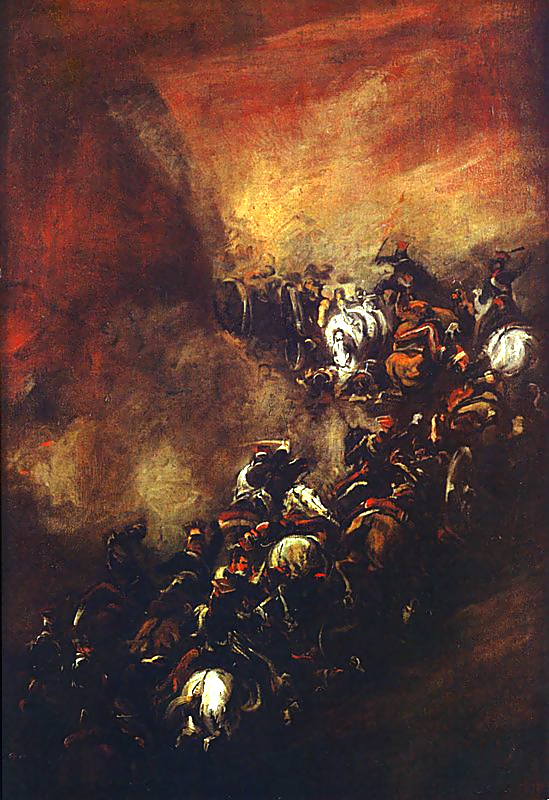<figcaption>Piotr Michałowski, Szarża w wąwozie Somosierry, XIX w. · scena z 1808 r.</figcaption></figure>
<ul><li><b>Piotr Michałowski</b> był malarzem romantycznym.</li><li>W Somosierze ukazał pęd koni, napięcie i niebezpieczeństwo szarży.</li><li>Obraz budował wyobrażenie o bohaterstwie polskich żołnierzy.</li><li>To artystyczna wizja wydarzenia, a nie fotografia bitwy.</li></ul>

notes:
1,5 min. Poproś o wskazanie jednego elementu ruchu (ukośny układ, sylwetki koni, dym). ZPE D11Hy12ZH wskazuje tytuł i muzeum, ale nie dokładny rok namalowania tej wersji: pozostawiamy XIX w.; nie wymyślamy daty. Nie powielamy wątpliwych szczegółowych liczebności z podpisu ZPE.

**Proweniencja obrazu:**
 Obraz przedstawia szarżę. Postaci oraz konie są niewyraźnie namalowane. Biegną w ciągu. Dominuje ciepła paleta barw. Obraz Piotra Michałowskiego Szarża w wąwozie Somosierry . W tej bitwie, trwającej 8‑10 minut polscy szwoleżerowie 30 listopada 1808 r. roznieśli przeciwników; ok. 125 Polaków przy stratach 25 zabitych wzięło do niewoli 3 tysiące Hiszpanów (kilkudziesięciu zginęło). Źródło: Muzeum Narodowe w Krakowie, domena publiczna.
Strona: https://zpe.gov.pl/a/przeczytaj/D11Hy12ZH
Plik: https://static.zpe.gov.pl/portal/f/res-minimized/R120x60G4RY2B/1652786240/1pptrJZy21NI3IqKrbjfczxMsi9szxgR.png
SHA-256: 29031fcdd10f9e388e00a1518a59faee6852b440d0933b137ab1088f2b781c57

---

<!-- .slide: id="grottger" data-purpose="evidence" data-layout="evidence" class="" -->
<h2>Grottger: pamięć o powstaniu</h2>
<figure class="art">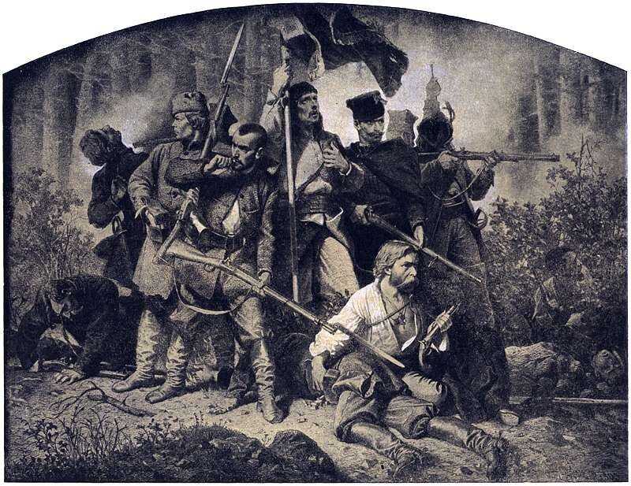<figcaption>Artur Grottger, Bitwa z cyklu Polonia, 1863</figcaption></figure>

<b>Polonia</b> opowiadała obrazami o doświadczeniu powstania styczniowego.

Grottger łączył bohaterstwo z cierpieniem i stratą; kształtował pamięć o walce.

1863: dalsze trwanie romantycznych motywów, już poza I połową XIX w.

notes:
1,5 min. Nie omawiaj przebiegu całego powstania styczniowego. Rysunek z cyklu to opracowana artystycznie scena, nie reportaż fotograficzny. Wskaż emocję bez drastycznych opisów. ZPE DC6CBZM9L figura R196BUUT6N1PD.

**Proweniencja obrazu:**
 W centrum obrazu widoczna jest uzbrojona grupa powstańców: dziewięciu żywych i trzech zabitych, zgromadzonych wokół sztandaru. Jeden z żołnierzy siedzi w rozpiętej koszuli, opiera się na leżącym towarzyszu. Inni stoją, w rękach trzymają karabiny, na broni widać bagnety. Głowy maja zwrócone w różne strony. W tle krzaki i drzewa. Cykl „Polonia”, IV, „Bitwa” Źródło: Artur Grottger , Bitwa , 1863, domena publiczna.
Strona: https://zpe.gov.pl/a/tesknota-za-wolnoscia-polacy-i-powstanie-styczniowe/DC6CBZM9L
Plik: https://static.zpe.gov.pl/portal/f/res-minimized/R196BUUT6N1PD/1784287697/Qmk3O2adBuM3ssCwLCbHSezp2qnyUgGa.jpg
SHA-256: 591db24350a0b5750a8f2a4e5b1991cfdf60f6e2e76444f598d99cc37b0b6669

---

<!-- .slide: id="zadanie" data-purpose="practice" data-layout="task-board" class="" -->
<h2>Co skuteczniej chroniło kulturę?</h2>

Książki i szkoły czy sztuka i muzyka?
<ol><li><b>Samodzielnie (1 min):</b> zapisz przykład instytucji i dzieła. Przy każdym wyjaśnij, jak pomagało zachować kulturę.</li><li><b>W parze (2 min):</b> porównajcie odpowiedzi. Czy te sposoby musiały ze sobą konkurować? Uzasadnijcie jednym zdaniem.</li></ol>
Wystarczy zeszyt. Nie ma jednej obowiązkowej hierarchii.

notes:
4 min razem z dwiema krótkimi wypowiedziami. Każdy najpierw pisze sam. Model: szkoła umożliwia czytanie po polsku, a Pan Tadeusz daje treść wspólnej pamięci; działania uzupełniają się. Pomoc: „… pomagało, ponieważ…”. Nie punktuj preferencji, tylko poprawny przykład i mechanizm.

---

<!-- .slide: id="synteza" data-purpose="synthesis" data-layout="takeaways" class="" -->
<h2>Różne działania, wspólna więź</h2>
Kultura przetrwała dzięki <b>przekazywaniu języka</b>, <b>ochronie dorobku</b> i <b>tworzeniu nowych dzieł</b>.

<h3>Instytucje dawały ciągłość</h3>
Szkoły uczyły. Uczelnie i towarzystwa badały. Biblioteki chroniły i udostępniały.

<h3>Twórcy nadawali znaczenie</h3>
Pokazywali ojczyznę, emocje i idee. Łączyli odbiorców pod zaborami i na emigracji.

Nie wszyscy myśleli jednakowo. Wspólna kultura nie oznaczała jednej ideologii.

notes:
2 min. Wracamy do pytania otwarcia. Zadanie porównywało mechanizmy, a nie urządzało konkursu na najważniejsze nazwisko. Poproś, by uczeń powiązał instytucję i dzieło.

---

<!-- .slide: id="bilet" data-purpose="exit-ticket" data-layout="plain" class="" -->
<h2>Bilet wyjścia</h2><ol class="exit"><li>Wybierz jedną instytucję. Podaj jej nazwę lub miasto i wyjaśnij, jak chroniła kulturę.</li><li>Podaj twórcę i jego dzieło lub gatunek muzyczny. Wyjaśnij jego znaczenie.</li><li>Popraw zdanie: „Mesjanizm to udowodniony los Polski, a Towiański stworzył cały romantyzm”.</li></ol>
3 minuty · samodzielnie, przed przepisaniem notatki

notes:
3 min. Zbierz odpowiedzi przed udostępnieniem notatki. Klucz w assessment.md. Pytanie3 bada rozróżnienie faktu i idei oraz odrębność towianizmu. Nie oceniaj przekonań religijnych ucznia.

---

<!-- .slide: id="notatka-instytucje" data-purpose="reference" data-layout="plain" class="" -->
<h2>Notatka do zeszytu · instytucje</h2><ol class="notebook"><li>Po utracie niepodległości w <b>1795 r.</b> język, edukacja, nauka i sztuka podtrzymywały więź narodową.</li><li>Ośrodki kultury: <b>Warszawa, Wilno, Krzemieniec, Kraków, Lwów, Poznań i Puławy</b>; po 1831 r. również emigracyjny Paryż.</li><li>Rozwijano sieć szkół elementarnych i zawodowych, ale dostęp do nauki i polszczyzny zależał od miejsca i polityki zaborcy.</li><li><b>TPN — Warszawa, 1800; UW — założony w 1816</b> (uroczyste otwarcie 1818); <b>Ossolineum — Lwów, 1817</b>: badania, kształcenie, ochrona zbiorów.</li><li><b>Adam Jerzy Czartoryski</b> wspierał szkoły i uczelnię w Wilnie oraz Bibliotekę Polską w Paryżu; <b>Joachim Lelewel</b> badał i upowszechniał historię.</li></ol>

notes:
2 min na tę część. Nie kopiujemy wcześniejszych slajdów. Dla uczniów potrzebujących pomocy udostępnij student-summary.md zamiast wymagania szybkiego przepisywania.

---

<!-- .slide: id="notatka-tworcy" data-purpose="reference" data-layout="plain" class="" -->
<h2>Notatka do zeszytu · twórcy i idee</h2><ol class="notebook"><li><b>Romantyzm</b> cenił uczucie, wyobraźnię, ludowość i wolność. Polski początek symbolizują <b>Ballady i romanse (1822)</b>.</li><li><b>Mickiewicz</b> — Dziady III, Pan Tadeusz; <b>Słowacki</b> — Kordian, Balladyna: pamięć ojczyzny i pytania o wybory człowieka.</li><li><b>Chopin</b> — mazurki i polonezy; <b>Moniuszko</b> — Śpiewniki domowe, Halka, Straszny dwór: polskie inspiracje i język w muzyce.</li><li><b>Michałowski</b> — Somosierra; <b>Grottger</b> — Polonia (1863): emocje, bohaterstwo i pamięć walki.</li><li><b>Mesjanizm</b> to idea szczególnej misji i sensu cierpienia narodu, nie fakt. <b>Towiański</b> głosił towianizm — odrębną naukę o duchowej odnowie ludzi i świata.</li></ol>

notes:
2 min. Ostatni slajd merytoryczny: notatka następuje po bilecie. Moniuszko i Grottger świadomie ilustrują kontynuację poza I połową XIX w. Nazwy dzieł są przykładami, nie katalogiem do odtworzenia wszystkich dat.
