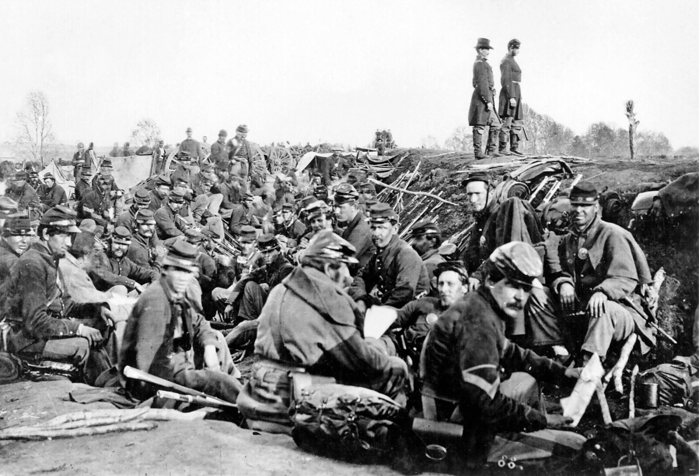
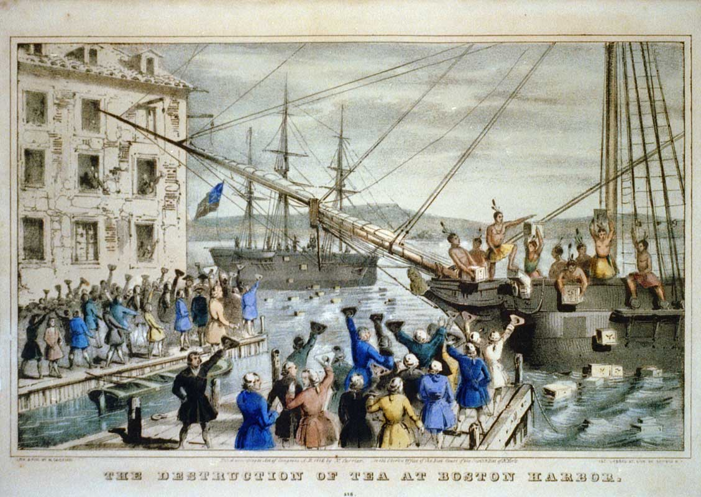
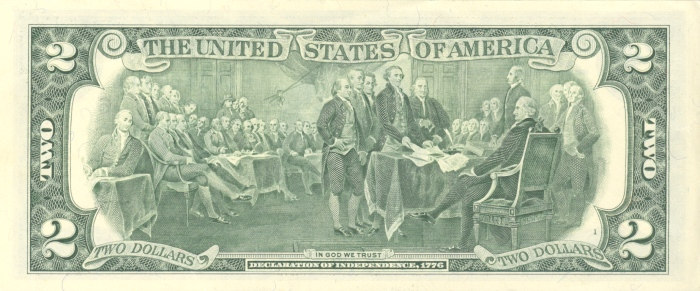
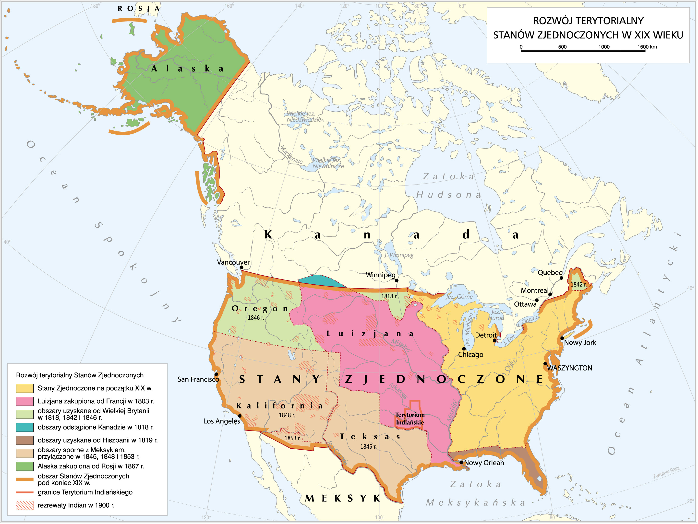
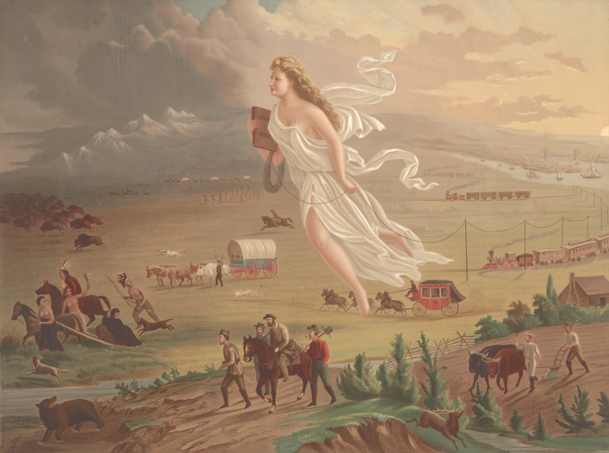
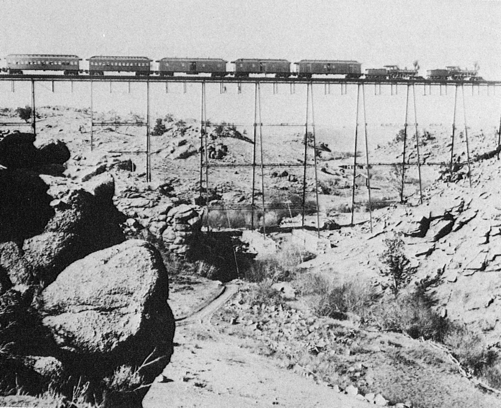
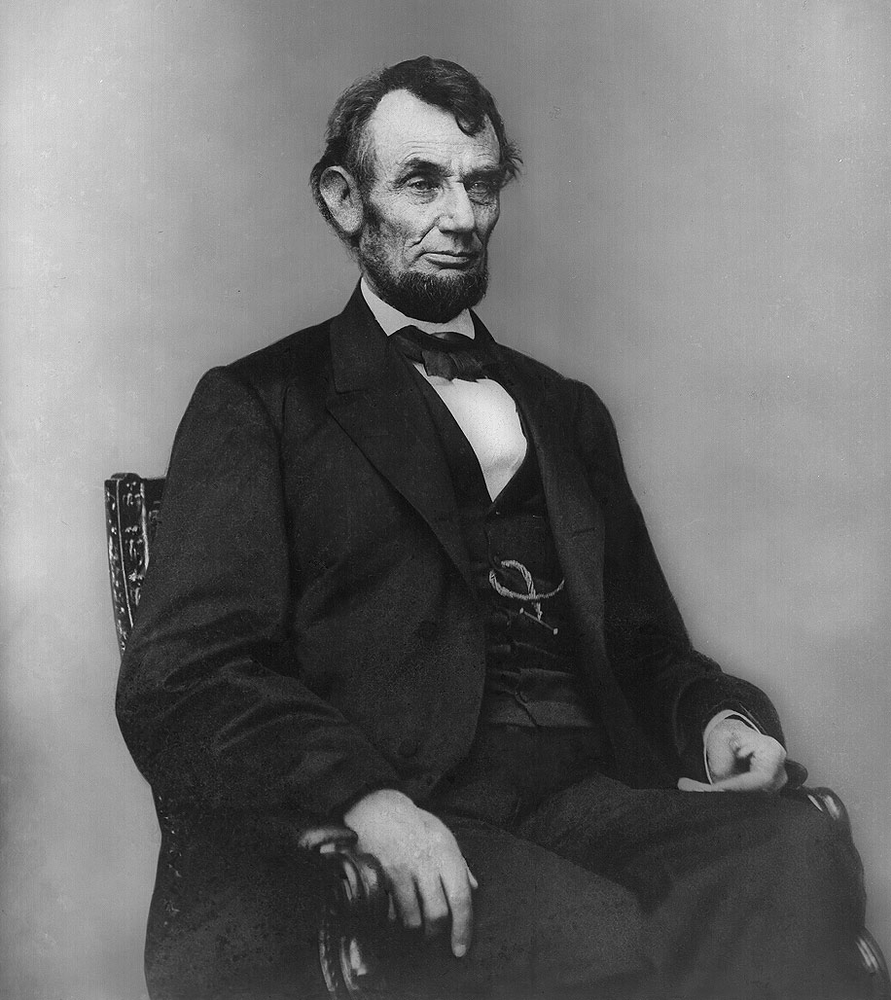
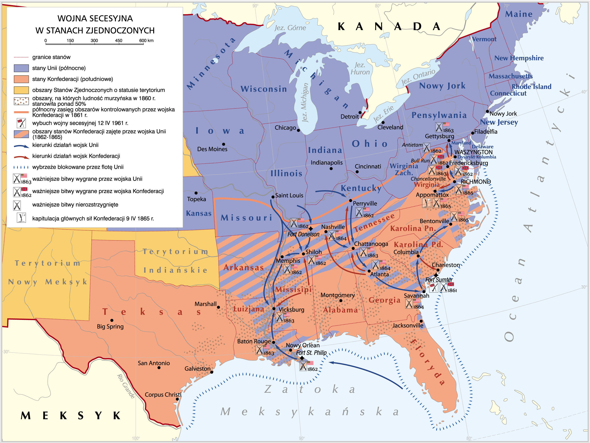
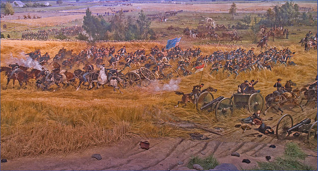

<!-- .slide: id="otwarcie" data-purpose="opening" data-layout="hero-source" class="question-slide" -->

Historia · klasa VII
<h1>Stany Zjednoczone w XIX wieku</h1>
Dlaczego kraj wolności stoczył wojnę o niewolnictwo?

Rozwój → podział → wojna → zmiana

<figure class="cover-photo"><figcaption>A. J. Russell, żołnierze Unii we Fredericksburgu, 1863</figcaption></figure>

notes:
2 min, w tym rozdanie jednej karty każdemu uczniowi. Pokaż ludzi, nie tylko mundury. Zbierz dwie hipotezy do pytania głównego, bez oceniania ich na starcie. Zapowiedz jedną analizę dokumentu w parach. Przy 14 osobach siedem par; przy 13 pięć par i jedna trójka. W trójce każdy najpierw czyta sam, potem każdy wnosi jeden argument. S otwiera krótką notatkę do aktualnego slajdu.

---

<!-- .slide: id="kolonie" data-purpose="explanation" data-layout="source-split" class="context-slide" data-goals="G1" -->
<h2>Najpierw: od kolonii do państwa</h2>
<figure><figcaption>„Bostońskie picie herbaty”, 1773 · późniejsza ilustracja</figcaption></figure>

Trzynaście kolonii sprzeciwiło się rządom Wielkiej Brytanii.
<ul><li>Podatki bez udziału kolonistów w brytyjskim parlamencie.</li><li>Ograniczenia handlu i samodzielności kolonii.</li><li>Idee wolności i prawa do własnych rządów.</li></ul>

notes:
2 min. To przypomnienie, nie druga lekcja o XVIII wieku. Wyjaśnij związek: Londyn narzucał decyzje, a koloniści nie mieli reprezentacji w jego parlamencie. Herbatka to przykład protestu, nie jedyna przyczyna wojny. Ilustracja powstała później niż wydarzenie. Zapytaj ustnie: przeciw komu walczyli koloniści? Nie mylić z późniejszą wojną domową.

---

<!-- .slide: id="niepodleglosc" data-purpose="explanation" data-layout="timeline-band" class="context-slide" data-goals="G1" -->
<h2>1776: ogłoszenie nie kończy wojny</h2><lesson-timeline><lesson-event year="1775–1783"><h3>Walka o niepodległość</h3>
Armią kolonistów dowodził Jerzy Waszyngton.
</lesson-event><lesson-event year="1776"><h3>Deklaracja niepodległości</h3>
4 lipca kolonie ogłosiły powstanie niezależnego państwa.
</lesson-event><lesson-event year="1783"><h3>Pokój w Paryżu</h3>
Wielka Brytania uznała niepodległość USA.
</lesson-event></lesson-timeline>

<b>Ciekawostka:</b> obraz o początkach USA trafił na banknot 2 dolarów.

notes:
2 min. Oś porządkuje pojęcia, nie jest skalą długości wojny. Wojna zaczęła się przed deklaracją. Waszyngton był dowódcą i później pierwszym prezydentem USA. Kościuszkę i Pułaskiego można przypomnieć jednym zdaniem, bez nowego zadania. Banknot pokazuje późniejsze przedstawienie złożenia projektu deklaracji, nie fotograficzny zapis podpisywania 4 lipca. To pierwsza z dwóch krótkich ciekawostek.

---

<!-- .slide: id="rozwoj-mapa" data-purpose="evidence" data-layout="map-focus" class="map-slide" data-goals="G1" -->

<figure></figure>
<h2>Od Atlantyku do Pacyfiku</h2>
Rozwój terytorialny · XIX w.

Zakupy ziem, traktaty i wojny przesuwały granice na zachód.

<b>Początek XIX w.</b> USA na wschodzie.

<b>1803</b> — Luizjana od Francji.

<b>1845–1848</b> — Teksas i ziemie odebrane Meksykowi.

<b>1867</b> — Alaska od Rosji.

Kliknij mapę, aby powiększyć.

notes:
2 min. Wskaż najpierw Atlantyk, obszar USA na początku XIX w., potem Pacyfik i Alaskę. Uczniowie śledzą palcem lub wzrokiem kierunek rozwoju, jedna osoba nazywa sposób pozyskania Alaski. Korzystaj z pełnej legendy w mapie; kolory nie oznaczają stanów Unii i Konfederacji. To mapa procesu, a rezerwaty pokazano dla 1900 r., nie dla 1861. Błędne „zachodnie wybrzeże” w opisie alternatywnym ZPE zostało odrzucone: początki leżały na wschodzie. Alaska nie jest ostatnim nabytkiem USA w całych ich dziejach. W powiększeniu brak podpisów i źródeł; pełne prawa w sources.md.

---

<!-- .slide: id="rdzenni" data-purpose="explanation" data-layout="source-split" class="explanation-slide" data-goals="G1" -->
<h2>Rozwój miał swoją cenę</h2>
<figure><figcaption>John Gast, „Amerykański postęp”, 1872 · alegoria ekspansji</figcaption></figure>
<ul><li>Osadnicy zajmowali ziemie rdzennych mieszkańców.</li><li>Wojny, choroby i przymusowe przesiedlenia niszczyły ich wspólnoty.</li><li>Wielu zamknięto w <b>rezerwatach</b> — wyznaczonych obszarach osiedlenia.</li></ul>
Little Bighorn, 1876: zwycięstwo rdzennych wojowników nie zatrzymało podboju.

notes:
1,5 min. Obraz pokazuje pochwałę ekspansji z perspektywy osadników; kobieta jest alegorią, nie postacią historyczną. Nie zamieniaj go w drugą analizę źródłową. Wskaż wypieranych ludzi po lewej. Little Bighorn: Lakotowie i Czejenowie pokonali oddziały Custera; nie twierdzić, że zginęli wszyscy żołnierze całej armii USA ani że rdzenni mieszkańcy zniknęli. Ich społeczności żyją nadal. Nazwa „Indianie” występuje w źródłach i podręczniku; używamy też „rdzenni mieszkańcy”.

---

<!-- .slide: id="imigranci" data-purpose="explanation" data-layout="source-split" class="explanation-slide" data-goals="G1" -->
<h2>Więcej ziemi, więcej mieszkańców</h2>

<b>Imigranci</b> przybywali do USA, głównie z Europy.
<ul><li>Szukali pracy, ziemi i lepszych warunków życia.</li><li>Zasilali fabryki, budowę kolei i osadnictwo.</li><li>Tworzyli wielokulturowe społeczeństwo, ale spotykali się też z uprzedzeniami.</li></ul>
Kolej łączyła rynek: przewoziła ludzi, surowce i towary.

<figure><figcaption>Charles Roscoe Savage, żelazny wiadukt · fotografia z XIX w.</figcaption></figure>

notes:
1,5 min. Rozróżnij emigrację z kraju i imigrację do USA. „Darmowa ziemia” dla części osadników nie oznaczała ziemi niczyjej: była związana z wypieraniem rdzennych mieszkańców. Ciekawostka druga, tylko jedno zdanie: telegraf pozwalał przekazać wiadomość szybciej niż pociąg lub konny posłaniec. Powróci jako przykład nowoczesnej techniki w wojnie. Fotografia dowodzi istnienia kolei, nie przedstawia wszystkich imigrantów.

---

<!-- .slide: id="polnoc-poludnie" data-purpose="explanation" data-layout="comparison" class="compare-slide" data-goals="G2" -->
<h2>Jedno państwo, dwa modele gospodarki</h2>

<h3>Północ</h3><ul><li>Przewaga przemysłu, miast i pracy najemnej.</li><li>Więcej ludności i gęstsza sieć kolei.</li><li>Rósł ruch na rzecz zniesienia niewolnictwa.</li></ul>

<h3>Południe</h3><ul><li>Rolnictwo i wielkie plantacje, zwłaszcza bawełny.</li><li>Gospodarka plantacyjna korzystała z pracy osób zniewolonych.</li><li>Plantatorzy bronili systemu dającego im dochody i władzę.</li></ul>

<b>Abolicjonizm</b> — ruch dążący do zniesienia niewolnictwa.

Nie wszyscy mieszkańcy Północy byli abolicjonistami. Niewolnicze stany graniczne pozostały w Unii.

notes:
2,5 min. Niewolnictwo to przemoc i pozbawienie człowieka wolności, nie „zwykły rodzaj pracy”. Północ miała także rolnictwo, Południe także miasta; porównujemy dominujące cechy. Nie przedstawiaj wszystkich białych mieszkańców Północy jako zwolenników równości. Pytanie ustne: dlaczego plantatorzy obawiali się zniesienia niewolnictwa? Wystarczy związek z przymusową pracą i zyskami. Spór dotyczył też tego, czy niewolnictwo będzie rozszerzane na nowe terytoria.

---

<!-- .slide: id="notatka-podzial" data-purpose="synthesis" data-layout="takeaways" class="notebook" data-goals="G2" -->

Warto zanotować · 1
<h2>Skąd wziął się konflikt?</h2>

USA rozszerzały terytorium na zachód; w <b>1867 r.</b> kupiły Alaskę od Rosji. Rozwój wypierał rdzennych mieszkańców.

<b>Północ</b> — przemysł i praca najemna. <b>Południe</b> — plantacje i niewolnictwo.

<b>Abolicjonizm</b> to ruch na rzecz zniesienia niewolnictwa. Spór o niewolnictwo i władzę stanów dzielił państwo.

notes:
1,5 min na zapis krótkiego bloku, bez dyktowania dodatkowych zdań. Uczniowie mogą stosować skróty i strzałki. Zaznacz, że zakup Alaski nastąpił po wojnie; kolejność slajdów rozwoju jest tematyczna. To pierwsza część notatki, nie zadanie źródłowe i nie koniec lekcji.

---

<!-- .slide: id="lincoln-secesja" data-purpose="explanation" data-layout="split" class="explanation-slide" data-goals="G2" -->
<h2>Wybór prezydenta → secesja</h2>
<figure><figcaption>Anthony Berger, Abraham Lincoln, 1864</figcaption></figure>

<b>1860</b> — Abraham Lincoln wygrywa wybory. <b>1861</b> — obejmuje urząd prezydenta.

Sprzeciwiał się rozszerzaniu niewolnictwa. Przywódcy Południa obawiali się utraty wpływów.

<b>Secesja</b> = wystąpienie z państwa.

Jedenaście stanów południowych odłączyło się od USA i utworzyło <b>Konfederację</b>. Stany wierne USA tworzyły <b>Unię</b>.

notes:
1,25 min. Karolina Południowa wystąpiła w grudniu 1860; Konfederację utworzono w lutym 1861, a dołączały kolejne stany. Nie wszystkie jedenaście odłączyło się naraz. Lincoln początkowo chciał przede wszystkim utrzymać jedność USA i powstrzymać rozszerzanie niewolnictwa, nie wprowadził powszechnego zniesienia niewolnictwa w dniu wyborów. Wymowa: Linkoln. Lee: Li; Grant: Grant. Tych dwóch dowódców wprowadzimy przy przebiegu wojny.

---

<!-- .slide: id="wojna-mapa" data-purpose="evidence" data-layout="map-focus" class="map-slide" data-goals="G2" -->

<figure></figure>
<h2>Wojna domowa 1861–1865</h2>

<b>Unia</b> — utrzymanie jedności USA.

<b>Konfederacja</b> — odrębne państwo broniące niewolnictwa.

<b>Fort Sumter, 1861</b> Atak konfederatów rozpoczął wojnę.

Kolory i znaki odczytuj z legendy. Kliknij mapę, aby powiększyć.

notes:
1,5 min. Pokaż Fort Sumter koło Charleston i dwa obozy. Uczniowie nie uczą się wszystkich zaznaczonych bitew. Niewolnicze stany graniczne m.in. Kentucky i Missouri są po stronie Unii. Opracowanie łączy różne etapy1861–65, pasy pokazują późniejsze zajęcie obszarów przez Unię, nie osobny obóz. Legenda zawiera dziś przestarzałe określenie ludności czarnoskórej; nie powtarzaj go jako własnego języka. Data9IV1865 w legendzie oznacza kapitulację armii Lee, nie wszystkich armii Konfederacji.

---

<!-- .slide: id="gettysburg" data-purpose="explanation" data-layout="source-split" class="explanation-slide" data-goals="G2" -->
<h2>1863: wojna jeszcze się nie kończy</h2><figure class="battle"><figcaption>Bitwa pod Gettysburgiem, 1–3 lipca 1863 · późniejsze przedstawienie</figcaption></figure>

<b>Robert E. Lee</b> dowodził główną armią Konfederacji na wschodzie. Pod Gettysburgiem poniosła ona klęskę.

<b>Ulysses S. Grant</b> odnosił zwycięstwa Unii; w 1864 r. stanął na czele jej armii.

notes:
1,5 min. Gettysburg był ważnym przełomem, ale do zakończenia wojny zostały dwa lata. Nie przypisuj Grantowi dowodzenia pod Gettysburgiem: dowódcą Unii był tam Meade; jego nazwisko nie jest wymagane do zapamiętania. Nie przejmuj z licealnego ZPE liczby „50tys. zabitych”: chodzi o łączne straty, w tym rannych i zaginionych. Oglądamy późniejsze przedstawienie, nie fotografię walk. Nie rozszerzaj o katalog bitew.

---

<!-- .slide: id="przewaga-unii" data-purpose="explanation" data-layout="process" class="explanation-slide" data-goals="G2" -->
<h2>Dlaczego zwyciężyła Unia?</h2>

<b>Fabryki + ludność + kolej</b>
Więcej broni, żołnierzy i sprawniejszy transport.

<b>Blokada morska</b>
Mniej eksportu bawełny i dostaw dla Konfederacji.

<b>Taktyka spalonej ziemi</b>
Niszczenie kolei, zapasów i gospodarstw osłabiało Południe oraz krzywdziło cywilów.

<b>1865</b> — kapitulacje armii Konfederacji i zwycięstwo Unii.
<lesson-disclosure>

Technika skraca drogę wiadomości

Telegraf przyspieszał przekazywanie rozkazów; kolej przewoziła wojsko i zaopatrzenie.

</lesson-disclosure>

notes:
1,5 min. Początkowe sukcesy Południa nie znosiły przewagi gospodarczej Unii. „Spalona ziemia” to uderzenie w zdolność dalszego prowadzenia wojny, z ciężkimi skutkami dla ludności; nie używaj języka pochwały. Marsz Shermana jest przykładem nauczycielskim, bez kolejnego nazwiska do zapamiętania. Lee skapitulował przed Grantem9IV1865 w Appomattox, a inne armie poddawały się później. Otwórz krótkie dopowiedzenie o technice tylko jeśli czas pozwala; nie liczy się jako osobne zadanie.

---

<!-- .slide: id="notatka-wojna" data-purpose="synthesis" data-layout="timeline-band" class="notebook" data-goals="G2" -->

Warto zanotować · 2
<h2>Od wyborów do zwycięstwa Unii</h2>

<b>1860</b> — wybór Lincolna → secesja Południa.

<b>1861–1865</b> — wojna secesyjna: Unia przeciw Konfederacji; początek — Fort Sumter.

<b>1863</b> — proklamacja emancypacji i klęska Lee pod Gettysburgiem.

<b>1865</b> — zwycięstwo Unii. Przewaga przemysłu i ludności, blokada oraz niszczenie zaplecza osłabiły Konfederację.

notes:
1,25 min na zapis. W drugim zdaniu nie dopisuj szczegółowych dat bitew. Przed następnym slajdem wyjaśnij: proklamacja z1I1863 ogłaszała wolność na wskazanych zbuntowanych obszarach, nie we wszystkich USA. Nie obejmowała lojalnych stanów granicznych i wyłączała część zajętych już ziem Konfederacji. W praktyce realizacja wolności zależała od postępów Unii. Nie uprzedzaj odpowiedzi o oczekiwaniach wobec wyzwolonych — te mają odczytać uczniowie.

---

<!-- .slide: id="pytania-zrodlo" data-purpose="practice" data-layout="activity-brief" class="practice-slide" data-goals="G3" -->

Jedno źródło · praca w parach · 5 min razem z lekturą
<h2>Przeczytajcie dekret i uzasadnijcie odpowiedzi</h2>

<ol><li>Odpowiedz, czego oczekiwały władze Unii od wyzwolonych niewolników.</li><li>Wyjaśnij, jakie konsekwencje dla dalszego przebiegu wojny miał wydany dekret o zniesieniu niewolnictwa.</li></ol>

Najpierw każdy czyta sam. Potem porozmawiajcie i wskażcie fragment na poparcie odpowiedzi. Każdy zapisuje własną odpowiedź na karcie.

notes:
0,5 min instrukcji w ramach5min zadania. Karty mają oba pytania w identycznym brzmieniu. Przejdź do pełnego tekstu na kolejnym slajdzie; nie trzeba podręcznika. Organizacja jest już ustalona:7par przy14;5par i trójka przy13. W trójce każda osoba wnosi jedno spostrzeżenie, każdy zapisuje sam. Nie pokazuj klucza ani nie wyjaśniaj jeszcze drugiego i trzeciego akapitu.

---

<!-- .slide: id="zrodlo" data-purpose="evidence" data-layout="evidence" class="source-slide" data-goals="G3" -->
<h2>Zniesienie niewolnictwa</h2>
Abraham Lincoln · proklamacja emancypacji · 1 stycznia 1863 r.
<figure class="document"><blockquote>
Ja, Abraham Lincoln, prezydent Stanów Zjednoczonych, [...] polecam i ogłaszam, że wszystkie osoby trzymane w niewoli w wymienionych stanach i ich częściach będą odtąd wolne, a rząd Stanów Zjednoczonych wraz z władzami Armii i Marynarki Wojennej uznawać i strzec będzie ich wolności.

Niniejszym nakazuję też wyzwolonym w ten sposób, by powstrzymali się od wszelkiej przemocy, z wyjątkiem koniecznej samoobrony, i polecam im, by we wszystkich przypadkach, w których jest to możliwe, pracowali z oddaniem, w zamian za rozsądne wynagrodzenie.

Ogłaszam również, że osoby takie, jeśli spełnią określone warunki, przyjmowane będą w szeregi sił zbrojnych Stanów Zjednoczonych dla obsadzenia fortów, placówek, stacji i innych obiektów wojskowych oraz dla wcielenia do załóg wszelkiego rodzaju okrętów.
</blockquote><figcaption>Źródło: Wiek XIX w źródłach, oprac. M. Sobańska-Bondaruk, S.B. Lenard, Warszawa 2002, s. 259–260.</figcaption></figure>

notes:
4,5 min: około1,5min cichego czytania,1,5min rozmowy i zapisu,1,5min omówienia dwóch odpowiedzi. Pozostań na slajdzie z pełnym tekstem. Pomoc dopiero w razie potrzeby: szukajcie czasowników w akapicie2 i warunku w akapicie3. Klucz: powstrzymanie od przemocy z wyjątkiem koniecznej samoobrony; praca za wynagrodzeniem tam, gdzie możliwa; możliwość służby dla spełniających warunki. Nie ma obowiązku służby wszystkich. Skutek wojenny: otwarcie drogi do wzmocnienia sił Unii i osłabienia systemu pracy Konfederacji; realizacja zależała od kontroli terytorium. Sam cytat nie podaje liczby rekrutów. Dopuść różne poprawne sformułowania poparte fragmentem. Pełny fragment i [...] zachowane dosłownie z fotografii; status praw tłumaczenia nieustalony, wyłącznie prywatny przegląd dydaktyczny.

---

<!-- .slide: id="skutki" data-purpose="explanation" data-layout="impact-flow" class="explanation-slide" data-goals="G4" -->
<h2>Jedność państwa, wolność — ale nie równość</h2>

<h3>Koszt wojny</h3>
Ponad 620 tys.

zmarłych żołnierzy — według danych podręcznika.

Zniszczone miasta, gospodarstwa i kolej Południa.

<h3>Zmiany po wojnie</h3><ul><li>Unia przetrwała, a władza centralna się wzmocniła.</li><li><b>XIII poprawka, 1865</b> — zniesienie niewolnictwa w USA.</li><li>Trwały rasizm, przemoc i dyskryminacja.</li><li>Po zniszczeniach wojennych rozwijały się przemysł i wspólny rynek.</li></ul>

notes:
1,5 min. Rozróżnij zmarłych od rannych: nie sumujemy obu kategorii jako ofiar śmiertelnych. Podręcznik stosuje tradycyjny szacunek ponad620tys.; NPS podaje nowsze szacunki co najmniej750tys. Nie wymagaj porównania szacunków. XIII poprawkę ratyfikowano6XII1865; zawiera wyjątek dotyczący kary za przestępstwo. W klasie wystarczy rok i istota. Prawa obywatelskie i wyborcze były rozszerzane kolejnymi poprawkami, nie wszystkie od razu w1865; nie utożsamiać tego z rzeczywistą równością. Lincoln zginął w zamachu w kwietniu1865; szczegóły poza rdzeniem.

---

<!-- .slide: id="notatka-skutki" data-purpose="synthesis" data-layout="takeaways" class="notebook" data-goals="G4" -->

Warto zanotować · 3
<h2>Co zmieniła wojna?</h2>

Wojna ocaliła <b>jedność USA</b>, wzmocniła władzę centralną i osłabiła Południe.

<b>1863</b> — proklamacja emancypacji na wskazanych zbuntowanych obszarach. <b>1865</b> — XIII poprawka zniosła niewolnictwo w USA.

Wolność nie oznaczała końca <b>dyskryminacji</b>. Po wojnie USA weszły na drogę szybkiego rozwoju gospodarczego.

notes:
1,5 min na zapis oraz jednozdaniową odpowiedź do pytania otwierającego. Zwróć uwagę na rozróżnienie1863/1865. Dyskryminacja oznacza nierówne traktowanie i ograniczanie praw; podaj prosty przykład utrudniania dostępu do szkoły lub głosowania, bez stwierdzenia, że wszyscy mieli jednakowe prawa od1865. Ostatnia część notatki wynika ze skutków; nie dodawaj na końcu nowej długiej notatki.

---

<!-- .slide: id="bilet" data-purpose="exit-ticket" data-layout="plain" class="exit-ticket-slide" data-goals="G2 G4" -->

Samodzielnie · 2 min
<h2>Dokończ dwa zdania</h2>

Spór o niewolnictwo prowadził do wojny, ponieważ…

Zwycięstwo Unii zmieniło USA, ponieważ… Dodaj, czego nie rozwiązało.

Zapisz na dole karty. Oddaj ją przed wyjściem.

notes:
2 min. Każdy pisze sam, także osoby pracujące w trójce. Nie podpowiadaj odpowiedzi. Odczytaj po lekcji pod kątem przyczyny i skutku oraz zastrzeżenia wolność≠równość. Klucz i prosta skala w assessment.md. Jeśli zostały3min buforu, wróć do niezrozumianego pojęcia lub dokończ zapis, nie uruchamiaj dodatkowego zadania ani filmu. Zbierz karty, nie oceniaj publicznie konkretnych uczniów.

---

<!-- .slide: id="zrodla" data-purpose="reference" data-layout="plain" class="context-slide" -->
<h2>Źródła i materiały</h2>
<ul><li>Podręcznik „Wczoraj i dziś”, klasa VII, s. 66–70; zeszyt ćwiczeń, s. 30–31 — materiały przekazane przez nauczycielkę.</li><li>ZPE: „Porachunki. Wojna secesyjna” i „Narodziny mocarstwa” — mapy, fotografie i reprodukcje.</li><li>National Archives — proklamacja emancypacji i XIII poprawka; National Park Service — przebieg i skutki wojny.</li><li>Fragment dokumentu: <i>Wiek XIX w źródłach</i>, oprac. M. Sobańska-Bondaruk, S.B. Lenard, Warszawa 2002, s. 259–260.</li></ul>

Mapy: Krystian Chariza i zespół · CC BY 3.0. Fotografie i reprodukcje: domena publiczna według wskazanych zasobów. Pełne adresy i opisy: sources.md w pakiecie.

notes:
Plansza informacyjna po zakończeniu pracy, bez dodatkowego zadania ani czasu nauczania. Pełne dane wszystkich dziewięciu mediów i czterech wskazanych adresów ZPE są w sources.md; dla map Krystian Chariza i zespół, CC BY 3.0. Pozostałe wykorzystane reprodukcje mają przy poszczególnych zasobach oznaczenie domeny publicznej. Status praw polskiego tłumaczenia nieustalony — materiał do prywatnego przeglądu dydaktycznego, nie zgoda na publikację. Pełny rejestr sources.md jest oddzielnym materiałem nauczycielskim; tekst planszy i podstawowe kredyty pozostają dostępne w pliku offline bez sieci.
