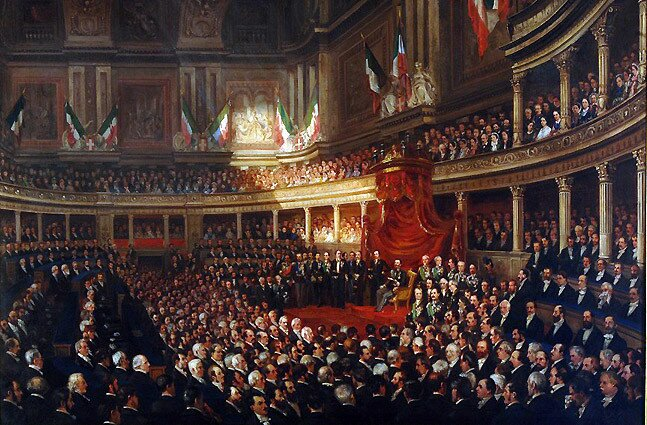
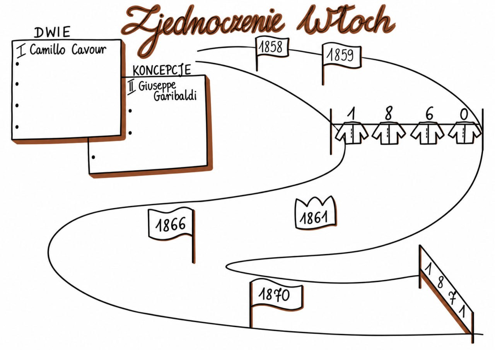
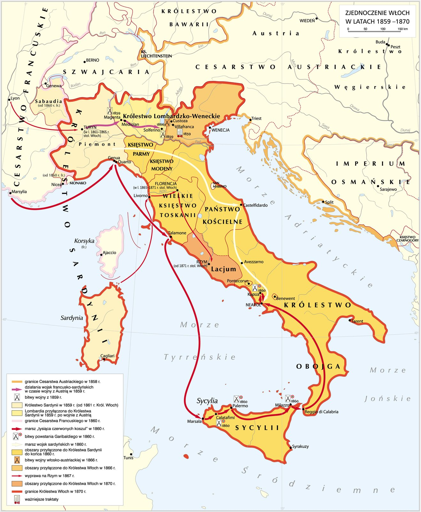
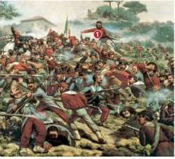
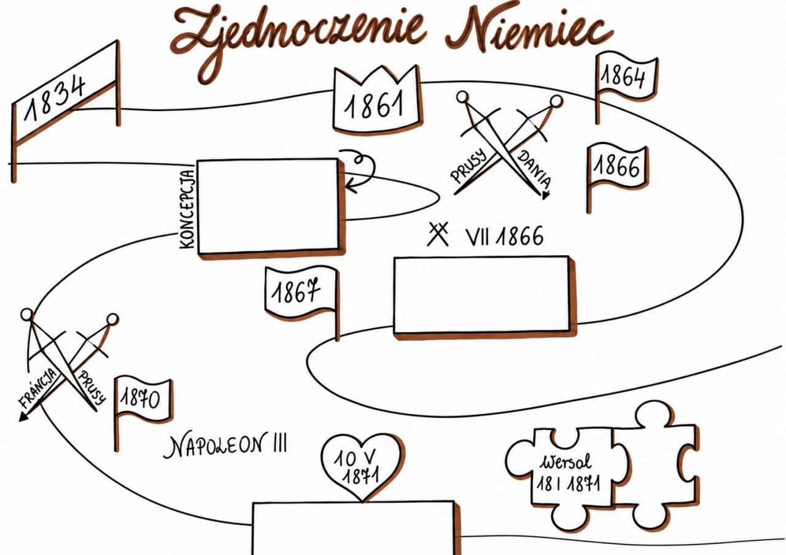
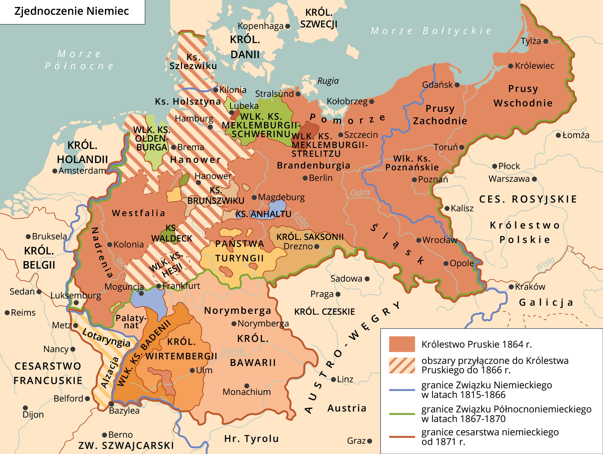
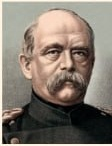
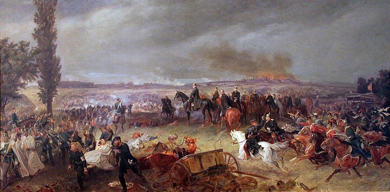
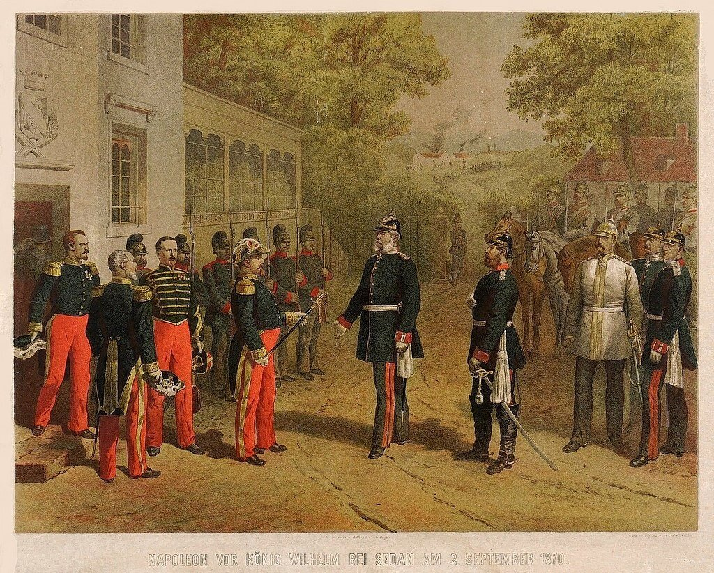

<!-- .slide: id="otwarcie" data-purpose="opening" data-layout="hero-source" -->

<figure><figcaption>Parlament w Turynie · obraz z 1861 r.</figcaption></figure>

Historia · klasa VII
<h1>Zjednoczenie Włoch i Niemiec</h1>
Jak z wielu państw powstały dwa mocarstwa?

Dwie drogi do jedności. Dwie karty pracy.

notes:
1 min. Rozdaj lub poleć przygotować OBIE DOSTARCZONE karty. Powiedz: „Będziemy dopisywać krótkie hasła przy kolejnych datach. Nie przepisujcie wszystkich zdań. Zatrzymamy się na samodzielne próby i sprawdzenie”. Nie pokazuj wypełnionych kart. Obraz Domenica Induna pokazuje parlament w Turynie w 1861 r.; nie nazywamy go koronacją z 17 marca. ZPE błędnie zrównuje parlamentarne wydarzenie z koronacją. Wydania podręcznika nie ustalono; treść odczytano z dostarczonych s.71–75.

---

<!-- .slide: id="wiele-panstw" data-purpose="explanation" data-layout="comparison" -->
<h2>Wspólnota nie oznaczała jednego państwa</h2>
W połowie XIX w. Włosi i Niemcy żyli w wielu państwach. Dążenie do ich połączenia nazywamy <b>zjednoczeniem</b>.

Półwysep Apeniński
<h3>Królestwo Sardynii zwane Piemontem</h3>
Rozwinięta północ, słabsze gospodarczo południe. Austria posiadała Lombardię i Wenecję.

Państwa niemieckie
<h3>Prusy rywalizowały z Austrią</h3>
Oba państwa chciały przewodzić Niemcom. Prusy wzmacniały gospodarkę i armię.

W obu procesach liczyły się: silne państwo, politycy, wojsko i sytuacja międzynarodowa.

notes:
1 min. Podręcznik s.71 i73. Sardynia to nie tylko wyspa: nazwa królestwa obejmowała też Piemont na północnym zachodzie półwyspu. Włoch i Niemiec nie przedstawiaj jako gotowych państw istniejących już w 1850 r. Związek Niemiecki nie był jednolitym państwem narodowym.

---

<!-- .slide: id="karta-wlochy-pusta" data-purpose="reference" data-layout="evidence" class="blank-worksheet" -->
<figure class="blank-worksheet-figure"></figure>

<a href="https://www.youtube.com/watch?v=yv1hWfNozx8&amp;t" target="_blank" rel="noopener noreferrer">Film: Zjednoczenie Włoch w XIX wieku · 6:07 ↗</a>

notes:
0,25 min (15 sekund, z dotychczasowego buforu). Pokaż pustą, oryginalną kartę przed rozpoczęciem części o zjednoczeniu Włoch. Poleć odnaleźć odpowiedni arkusz i zwrócić uwagę na jego pola. Nie dyktuj odpowiedzi i nie wymagaj teraz wypełnienia całej karty: wpisy powstają stopniowo podczas dalszych objaśnień. Kartę można powiększyć kliknięciem. To prywatnie dostarczony materiał nauczycielki, bez ustalonej otwartej licencji; nie jest nową kartą ani wypełnionym kluczem.

---

<!-- .slide: id="wlochy-mapa" data-purpose="evidence" data-layout="map-focus" class="map-slide" -->

<figure></figure>

Włochy · 1859–1870
<h2>Od północy do południa</h2>
Znajdź <b>Piemont, Sycylię, Wenecję i Rzym</b>.

Wskaż, gdzie znajdowały się ziemie austriackie oraz Państwo Kościelne.

Przyjrzyj się barwom etapów i granicy z 1870 r. Mapę można powiększyć.

Piemont: ośrodek działań. Sycylia: początek wyprawy. Rzym: późne dopełnienie.

notes:
2 min. Najpierw30 sekund cichego szukania, potem wskaż miejsca. Mapa opracowana przez Krystiana Charizę i zespół, CC BY-SA3.0, ZPE R7J3a9MPOAekr. Obraz jest poprawnym opracowaniem historycznym; tekst alternatywny na portalu zawiera błędne daty Wenecji i innych przyłączeń — nie przejmujemy go. Używamy własnego alt. Nie żądamy odczytywania najmniejszej legendy z końca sali; kliknij mapę i nazwij główne etapy. To mapa historyczna, nie granice współczesne. Ustnie: w 1861 r. poza królestwem pozostaną Wenecja i Rzym. Jest to zapowiedź do sprawdzenia później.

---

<!-- .slide: id="dwie-koncepcje" data-purpose="explanation" data-layout="comparison" -->
<h2>Dwie koncepcje — jeden cel</h2>

I · Camillo Cavour
<h3>Dyplomacja i silne państwo</h3><ul><li>Premier Królestwa Sardynii.</li><li>Zjednoczenie pod władzą Wiktora Emanuela II — <b>monarchia</b>.</li><li>Początkowo planował przede wszystkim powiększenie Piemontu na północy Włoch.</li><li>Sojusze, zwłaszcza z Francją, i wojna z Austrią.</li></ul>

II · Giuseppe Garibaldi
<h3>Powstania i ochotnicy</h3><ul><li>Rewolucjonista; zwolennik republiki.</li><li>Oddolna walka, powstania i „czerwone koszule”.</li><li>Dla jedności przekazał zdobyte południe królowi.</li></ul>

Różnili się metodą i poglądami. Ich działania ostatecznie się uzupełniły.

notes:
3 min z zapisem. Karta Włoch: Cavour ma4 punktory, Garibaldi3. Po krótkim objaśnieniu daj60–75 sekund na wpisy w tych dwóch polach. To zestaw propozycji, nie obowiązek przepisania dosłownie ani w określonej długości. Podręcznik s.71–72 uzupełniony biogramami: Cavour był premierem, Garibaldi miał republikańskie przekonania, ale poparł rozwiązanie monarchiczne dla jedności. Nie przypisuj mu założenia republiki w 1861. Pomoc: „kto? jaki ustrój? jakie działania?”. Rozróżnij poglądy i ostateczny kompromis.

---

<!-- .slide: id="plombieres-wojna" data-purpose="explanation" data-layout="timeline-band" -->
<h2>Najpierw sojusz, potem wojna</h2><ol class="axis two-stops"><li><b>1858</b><h3>Plombières</h3>
Cavour uzgodnił z Napoleonem III francuską pomoc przeciw Austrii.

W zamian: Sabaudia i Nicea dla Francji.
</li><li><b>1859</b><h3>Wojna z Austrią</h3>
Piemont i Francja zwyciężyły m.in. pod <b>Magentą i Solferino</b>.

Piemont otrzymał Lombardię, ale jeszcze nie Wenecję.
</li></ol>
Piemont był zbyt słaby na samodzielne pokonanie Austrii. Sojusz zmienił układ sił.

notes:
2 min. Karta1858 i1859. Plombières to tajne porozumienie z lipca1858, nie walna bitwa ani powstanie państwa. Formalny sojusz nastąpił w1859. Podręcznik s.71–72 opisuje sojusz i wojnę; rok1858 sprawdzono niezależnie. Sabaudię i Niceę przekazano Francji w1860; obietnica1858 i wykonanie1860 to różne wydarzenia. Ciekawostka ustna, bez dodatkowego zadania: cierpienie rannych pod Solferino skłoniło Henryka Dunanta do działań, które doprowadziły do powstania Czerwonego Krzyża w1863 r. (podręcznik s.72). Nie utożsamiaj tego z datą bitwy1859.

---

<!-- .slide: id="czerwone-koszule" data-purpose="explanation" data-layout="source-split" -->
<h2>1860: „tysiąc czerwonych koszul”</h2>
<figure><figcaption>Bitwa pod Calatafimi, 1860 · obraz z XIX w.</figcaption></figure>

<b>Giuseppe Garibaldi</b> wsparł powstanie w Królestwie Obojga Sycylii.
<ol class="route-list"><li>Lądowanie na Sycylii.</li><li>Zdobycie Neapolu i południa.</li><li>Przekazanie zdobyczy Wiktorowi Emanuelowi II.</li></ol>
W środkowych Włoszech powstania i głosowania również prowadziły do przyłączeń do Piemontu.

notes:
2 min. Podręcznik s.72, dokładnie obejrzany kadr dostarczonej rozkładówki. Nie twierdzimy, że obraz jest fotografią. Autor i dokładny rok obrazu niepodane na stronie — nie uzupełniamy domysłem. Czerwone koszule to ubiór ochotników, nie nazwa państwa ani armii Napoleona III. Karta: dopisz przy1860 Garibaldiego, wyprawę i południe. Nie wymagaj dokładnej liczby ochotników. Przypomnij trasę z wcześniejszej mapy zamiast powtarzać tę samą mapę na kolejnym slajdzie.

---

<!-- .slide: id="krolestwo-1861" data-purpose="explanation" data-layout="statement-centered" -->

Korona na karcie Włoch

1861
<h2>Powstało Królestwo Włoch</h2>
<b>Wiktor Emanuel II</b> został królem zjednoczonego państwa.

Jeszcze bez Wenecji i Rzymu.

Powstanie królestwa nie oznaczało zakończenia wszystkich przyłączeń.

notes:
1 min. Podręcznik s.72. Ogłoszenie Królestwa Włoch17 marca1861, nie objęcie Rzymu. Ikona korony na karcie oznacza władzę królewską i powstanie królestwa; nie nakazujemy uczniom wpisu „koronacja17 marca”, który byłby mylący. Pierwszą stolicą był Turyn (do1865), potem Florencja, a od1871 Rzym. Dwie pierwsze stolice są dopowiedzeniem nauczyciela, nie dodatkowym obowiązkiem na karcie.

---

<!-- .slide: id="wenecja-rzym" data-purpose="explanation" data-layout="process" -->
<h2>Państwo już było. Granice się zmieniały.</h2>

<b>1866</b><h3>Wenecja</h3>
Włochy poparły Prusy w wojnie z Austrią. Klęska Austrii umożliwiła przyłączenie Wenecji.

<b>1870</b><h3>Rzym</h3>
Francja wycofała wojska chroniące papieża. Wojska włoskie zajęły Rzym.

<b>1871</b><h3>Stolica</h3>
Rzym został stolicą Królestwa Włoch.

Wojny Prus z Austrią i Francją pomogły także dokończyć zjednoczenie Włoch.

notes:
2 min. Podręcznik s.72. Związek przyczynowy jest ważniejszy niż sama lista dat. W1866 Włosi nie pokonali samodzielnie Austrii; przegrywali pod Custozą i Lissą, ale wygrany sojusz umożliwił zdobycz. W1870 Francja walczyła z Prusami i wycofała ochronę Rzymu. Nie mów, że w 1870 powstało Królestwo Włoch albo że Watykan był już odrębnym państwem takim jak po1929. Karta: trzy daty, trzy odrębne wpisy.1871 przy mecie = Rzym stolicą.

---

<!-- .slide: id="proba-wlochy" data-purpose="practice" data-layout="task-board" class="task-slide" -->

Karta Włoch · samodzielnie · 2 min
<h2>Połącz datę z wydarzeniem</h2>

Uzupełnij lub sprawdź hasła przy datach <b>1858, 1859, 1860, 1861, 1866, 1870 i 1871</b>.

Zakryj na chwilę dotychczasowe wpisy. Wyjaśnij własnymi słowami, czym różnią się <b>1861, 1870 i 1871</b>.

Przy koncepcjach wystarczą krótkie, poprawne hasła. Brakujące pole zaznacz ołówkiem — zaraz je omówimy.

notes:
2,5 min łącznie z przejściem. Nie cofaj od razu do gotowych odpowiedzi. Karty są dostarczone, nie trzeba drukować nowej. Uczniowie uzupełniają swoje wpisy, a nie tworzą drugą notatkę w zeszycie. Po2 minutach zapytaj jedną osobę o trzy różne etapy; model dopiero na następnym slajdzie. Wsparcie: pozwól zerknąć w podręcznik s.72. Szybsi: dlaczego Francja najpierw pomogła, a później blokowała zjednoczenie?

---

<!-- .slide: id="sprawdzenie-wlochy" data-purpose="reference" data-layout="timeline-band" -->
<h2>Sprawdź drogę Włoch do jedności</h2>
<ol class="check-axis"><li><b>1858</b>Plombières: Cavour + Napoleon III, obietnica pomocy.</li><li><b>1859</b>Wojna z Austrią; Lombardia dla Piemontu.</li><li><b>1860</b>Garibaldi i „czerwone koszule”; południe dla króla.</li><li><b>1861</b>Królestwo Włoch; król Wiktor Emanuel II.</li></ol><ol class="check-axis"><li><b>1866</b>Przyłączenie Wenecji.</li><li><b>1870</b>Zajęcie i przyłączenie Rzymu.</li><li><b>1871</b>Rzym stolicą Włoch.</li></ol>

<b>Cavour:</b> dyplomacja i monarchia. <b>Garibaldi:</b> powstania i ochotnicy; kompromis dla jedności.

notes:
1 min. To sprawdzenie po próbie, nie nowa treść do przepisywania. Uczniowie poprawiają tylko braki/błędy. Inne brzmienie poprawnej odpowiedzi jest dopuszczalne. Przy1859 można dopisać Magentę i Solferino; przy1860 Sycylię i Neapol. Pełny nauczycielski klucz każdego pola znajduje się w teacher-guide.md.

---

<!-- .slide: id="karta-niemcy-pusta" data-purpose="reference" data-layout="evidence" class="blank-worksheet" -->
<figure class="blank-worksheet-figure"></figure>

<a href="https://www.youtube.com/watch?v=1NU476P9lsc" target="_blank" rel="noopener noreferrer">Film: Zjednoczenie Niemiec w XIX wieku · 8:40 ↗</a>

notes:
0,25 min (15 sekund, z dotychczasowego buforu). Pokaż pustą, oryginalną kartę przed rozpoczęciem części o zjednoczeniu Niemiec. Poleć odnaleźć odpowiedni arkusz i zwrócić uwagę na jego pola. Nie dyktuj odpowiedzi i nie wymagaj teraz wypełnienia całej karty: wpisy powstają stopniowo podczas dalszych objaśnień. Kartę można powiększyć kliknięciem. To prywatnie dostarczony materiał nauczycielki, bez ustalonej otwartej licencji; nie jest nową kartą ani wypełnionym kluczem.

---

<!-- .slide: id="niemcy-mapa" data-purpose="evidence" data-layout="map-focus" class="map-slide" -->

<figure></figure>
<h2>Niemcy: kto przewodzi?</h2>
Znajdź <b>Prusy, Austrię, Danię i Francję</b>. Porównaj zieloną granicę Związku Północnoniemieckiego z brązową granicą cesarstwa z 1871 r.

notes:
2 min. Najpierw orientacja przestrzenna, dopiero potem trzy wojny. Mapa Stentor, CC BY-SA3.0, ZPE R1K6IUi9wVG4w. Powiększ kliknięciem dla nazw. Prusy nie były całymi Niemcami: mapa pokazuje wschodnią i zachodnią część państwa oraz ziemie włączone później. Austria pozostaje poza granicą cesarstwa1871. Zwróć uwagę na Bawarię, Badenię i Wirtembergię na południu; dołączą w końcowej fazie. Mapa obejmuje też ziemie polskie pod zaborem pruskim; „państwo niemieckie” nie oznacza, że wszyscy jego mieszkańcy byli Niemcami.

---

<!-- .slide: id="zwiazek-celny" data-purpose="explanation" data-layout="impact-flow" -->

Pierwsza data na karcie Niemiec
<h2>1834: wspólny rynek przed wspólnym państwem</h2>

<h3>Niemiecki Związek Celny</h3>
Powstał pod przewodnictwem Prus. <b>Austria do niego nie należała.</b>

mniej barier

<h3>Więcej powiązań gospodarczych</h3>
Zniesienie ceł między członkami ułatwiało handel. Rosło znaczenie Prus.

Wspólnota gospodarcza ułatwiła późniejsze zjednoczenie polityczne — ale sama nie była jednym państwem.

notes:
1 min. Podręcznik s.73. Cło to opłata pobierana przy przewozie towaru przez granicę celną. Przykład ustny: kupiec nie płaci kolejnych ceł wewnętrznych na drodze przez państwa członkowskie. Nie mów, że w1834 zniknęły wszystkie granice albo powstało cesarstwo. Karta1834: „Niemiecki Związek Celny pod przewodnictwem Prus”.

---

<!-- .slide: id="wilhelm-bismarck" data-purpose="explanation" data-layout="source-split" -->
<h2>Król i polityk — różne role</h2>
<figure><figcaption>Otto von Bismarck · portret z podręcznika</figcaption></figure>

<b class="role-date">1861</b><strong>Wilhelm I</strong> objął tron Prus — to jego oznacza korona na karcie.

<b class="role-date">1862</b><strong>Otto von Bismarck</strong> został szefem rządu Prus; kierował polityką zjednoczenia.

Dopiero w 1871 r. Wilhelm I został cesarzem niemieckim, a Bismarck kanclerzem Rzeszy.

notes:
1,5 min. Podręcznik s.73–74. Rozdziel1861 (król),1862 (powołanie Bismarcka) i1871 (cesarz). Podręcznik szkolnie nazywa Bismarcka kanclerzem Prus; urzędowo był premierem, potem kanclerzem Związku Północnoniemieckiego i Rzeszy. Nie poprawiaj uczniowi bez potrzeby zgodnego z podręcznikiem słowa „kanclerz”, lecz nie łącz tej nominacji z koroną1861. Portret wycięty z dostarczonej s.73; autor w dostarczonym materiale niewskazany.

---

<!-- .slide: id="krew-zelazo" data-purpose="explanation" data-layout="statement" -->

Pole „KONCEPCJA” na karcie Niemiec
<h2>„Krwią i żelazem”</h2>
Pod przewodnictwem <b>Prus</b>. Bez <b>Austrii</b>.

<b>Krew i żelazo</b> oznaczały oparcie polityki na sile armii i wojnach, a nie tylko na debatach.

<b>Małe Niemcy</b> — zjednoczenie bez Austrii; „małe” nie znaczy: słabe.

Bismarck łączył przewagę wojskową z dyplomacją. Celem było wzmocnienie Prus.

notes:
1,5 min. Podręcznik s.73 i75; pojęcie małoniemieckie doprecyzowuje pole KONCEPCJA. Karta nie zawiera pełnego polecenia do pustego prostokąta ani podpisu identyfikującego obowiązkową postać, więc nie narzucaj jedynego tekstu. Przyjmij dowolny poprawny zestaw: Bismarck, Prusy, bez Austrii, „krwią i żelazem”, odgórnie/małoniemiecka. Wyjaśnij związek, a nie samo hasło. Nie przedstawiaj wojny jako bezkosztowej skuteczności; „krew” oznacza realne ofiary. W kontraście Cavour też wykorzystywał wojny, nie wyłącznie pokojowe rozmowy.

---

<!-- .slide: id="dania-1864" data-purpose="explanation" data-layout="process" -->

Pierwsza wojna
<h2>1864: Prusy i Austria przeciw Danii</h2>
1864

<h3>Wspólny przeciwnik</h3>
Prusy i Austria razem pokonały Danię.

<h3>Zdobycz</h3>
Dania utraciła Szlezwik i Holsztyn. Zarząd nad księstwami podzielili zwycięzcy.

Dzisiejsi sojusznicy wkrótce zostaną rywalami.

notes:
1 min. Podręcznik s.73. Na karcie przy skrzyżowanych mieczach wydrukowano Prusy i Dania — dopowiedz udział Austrii, a nie usuwaj go, aby dopasować się do uproszczonego rysunku. Do karty wystarczy wojna z Danią i zdobycie księstw. Prusy zarządzały Szlezwikiem, Austria Holsztynem. Szczegóły nie są dodatkowym obowiązkiem, ale są podane w kluczu. Wskaż u góry wcześniejszej mapy, jeśli uczeń potrzebuje orientacji, bez powtarzania całego slajdu.

---

<!-- .slide: id="sadowa-1866" data-purpose="explanation" data-layout="evidence" -->
<h2>3 VII 1866: zwycięstwo pod Sadową</h2><figure class="wide-source"><figcaption>Georg Bleibtreu, Bitwa pod Sadową · obraz po 1869 r.</figcaption></figure>

<b>Prusy pokonały Austrię.</b> Zlikwidowano Związek Niemiecki.

Austria utraciła wpływ na jednoczenie Niemiec.

notes:
1,5 min. Podręcznik s.73 podaje rok i bitwę; niezależna kontrola3 lipca1866. Inna nazwa: Königgrätz. Karta ma osobno chorągiewkę1866 i pole przyVII 1866: pierwsza = wojna Prus z Austrią, prostokąt = Sadowa, zwycięstwo Prus i wyłączenie Austrii. Prusy miały m.in. nowoczesne karabiny, sprawną mobilizację i dowodzenie; obraz nie jest dowodem parametrów broni. Przegrana Austrii pomogła też Włochom uzyskać Wenecję. Obraz jest późniejszym przedstawieniem, nie fotografią1866. Nie wykładaj osobnego tematu Austro-Węgier; wzmianka s.74 to kontekst, nie kolejna część karty.

---

<!-- .slide: id="polnoc-1867" data-purpose="explanation" data-layout="statement-centered" -->

Częściowe zjednoczenie

1867
<h2>Związek Północnoniemiecki</h2>
Państwa północnych Niemiec połączyły się <b>pod przewodnictwem Prus</b>.

Bez Austrii. Jeszcze bez państw południowych.

Do pełnego zjednoczenia potrzebny był kolejny krok.

notes:
1 min. Podręcznik s.73. Karta1867. Nie myl Związku Niemieckiego1815–1866 ze Związkiem Północnoniemieckim1867–1870 ani ze Związkiem Celnym1834. Krótko przywołaj zieloną linię z mapy i południowe państwa. Bismarck był kanclerzem Związku; Wilhelm jego przewodniczącym jako król Prus.

---

<!-- .slide: id="francja-1870" data-purpose="explanation" data-layout="source-split" -->
<h2>1870: Francja przeciw Prusom</h2>
<figure><figcaption>Napoleon III i Wilhelm I pod Sedanem · przedstawienie z XIX w.</figcaption></figure>
<ul><li>Bismarck zaostrzył opublikowaną <b>depeszę emską</b>. Francja wypowiedziała wojnę Prusom.</li><li>Prusy poparły również państwa południowoniemieckie.</li><li>Klęska Francji pod <b>Sedanem</b>; <b>Napoleon III</b> dostał się do niewoli.</li></ul>
Wspólna wojna przyspieszyła dołączenie południa.

notes:
1,5 min. Podręcznik s.73–74. Karta1870 oraz wydrukowane nazwisko Napoleon III. Nie myl z Napoleonem I. Bitwa1 września, kapitulacja i niewola2 września1870; na slajdzie wymagamy tylko roku. Źródłowy podpis ZPE wiąże kapitulację z1 września; nie powielamy tego uproszczenia. Depesza emska jest możliwym krótkim dopowiedzeniem: Bismarck zaostrzył opublikowaną relację z rozmowy króla z ambasadorem Francji. Nie twierdzimy, że sam obraz dowodzi przebiegu dyplomacji. To ten sam konflikt, który pozwolił Włochom zająć Rzym.

---

<!-- .slide: id="dwa-wydarzenia-1871" data-purpose="explanation" data-layout="comparison" -->
<h2>1871: cesarstwo i pokój to nie to samo</h2>

18 I 1871
<h3>Wersal</h3>
Ogłoszono powstanie <b>Cesarstwa Niemieckiego — II Rzeszy</b>.

<b>Wilhelm I</b> został cesarzem. <b>Bismarck</b> — kanclerzem Rzeszy.

10 V 1871
<h3>Frankfurt nad Menem</h3>
Pokój kończący wojnę z Francją.

Francja oddała <b>Alzację i część Lotaryngii</b> oraz miała zapłacić wysokie odszkodowanie.

Wersal: powstanie cesarstwa. Frankfurt: warunki pokoju.

notes:
1,5 min. Podręcznik s.74 wspiera powstanie cesarstwa; dokładne daty/miejsca wymagane przez kartę sprawdzone niezależnie. Uczniowie wpisują sąsiedni pusty puzzel przy Wersalu oraz prostokąt pod10V 1871. Nie zrównuj proklamacji z koronacją w tradycyjnym obrzędzie. Pokój nie został podpisany18 stycznia. Wersal we Francji był demonstracją przewagi nad pokonanym przeciwnikiem. Odszkodowanie można nazwać kontrybucją. Nie wymagaj konkretnej kwoty.

---

<!-- .slide: id="manifest" data-purpose="evidence" data-layout="evidence" -->
<h2>Jak Wilhelm uzasadniał przyjęcie korony?</h2>
Wskaż, na czyje wezwanie się powoływał. Czy uzasadniał władzę wyłącznie zwycięstwem wojennym?
<figure class="document"><blockquote>My Wilhelm, z Bożej łaski król pruski, skoro niemieccy książęta i Wolne Miasta wystosowały do Nas jednomyślne wezwanie, abyśmy spoczywającą od przeszło 60 lat cesarską godność niemiecką wznowili i przyjęli, i skoro w konstytucji Związku Niemieckiego odpowiednie postanowienia zostały przewidziane, przeto niniejszym ogłaszamy, że uznaliśmy za obowiązek względem wspólnej Ojczyzny pójść za tem wezwaniem związkowych niemieckich książąt i Miast i przyjąć godność cesarską. W myśl tego My i Nasi Następcy na tronie pruskim będziemy odtąd we wszystkich Naszych stosunkach i sprawach państwa niemieckiego nosili tytuł cesarski [...].</blockquote><figcaption>Manifest Wilhelma I, fragment z podręcznika, s.75 · pisownia przekładu zachowana</figcaption></figure>

notes:
2 min. Pełny widoczny fragment z dostarczonej s.75, bez skrótu autorskiego; pierwsze i ostatnie słowa oraz wewnętrzne zdania porównane z powiększonym zdjęciem. Na stronie podano C. Nanke, Wypisy do nauki historii nowożytnej, cz.2, Lwów–Warszawa1927, s.180–181. Podręcznik określa manifest jako wydany dzień przed ogłoszeniem cesarstwa; nie zmieniamy tego w datę ceremonii. Najpierw przeczytaj pytanie, daj40 sekund cichej lektury. Odpowiedź: wezwanie niemieckich książąt i Wolnych Miast, przepisy konstytucyjne, obowiązek wobec ojczyzny; Wilhelm pozostawał królem Prus. Nie dopisujemy twierdzenia o bezpośrednich wyborach cesarza przez cały naród. „Tem” to dawna pisownia „tym”. Wyjaśnienie60 lat: dawne cesarstwo rozwiązano w1806, ale nie rozszerzaj zadania na nieomawiany dział. Ten fragment służy pokazaniu deklarowanego uzasadnienia władzy, nie potwierdzeniu, że wszystkie działania były jednomyślne.

---

<!-- .slide: id="proba-niemcy" data-purpose="practice" data-layout="task-board" class="task-slide" -->

Karta Niemiec · samodzielnie · 2 min
<h2>Dopisz skutki, nie tylko nazwy wojen</h2>

Sprawdź wpisy przy <b>1834, 1861, 1864, 1866, VII 1866, 1867 i 1870</b> oraz w polu <b>„KONCEPCJA”</b>.

Uzupełnij pusty puzzel przy <b>Wersalu 18 I 1871</b> i pole pod <b>10 V 1871</b>.

Wybierz jedną wojnę. Powiedz sobie: z kim walczyły Prusy i jak wynik przybliżył zjednoczenie?

notes:
2,5 min z przejściem. Daj2 min pracy, potem krótkie odpowiedzi. Nie wyświetlaj od razu klucza. Pola nie mają narzuconej długości: hasło lub poprawne krótkie zdanie jest wystarczające. „KONCEPCJA” jest otwartym polem: nie zgadujemy intencji autorki z samej strzałki. Wsparcie: odszukaj w podręczniku tabelę trzech wojen s.73. Nie wymagaj dodatkowego wpisu1862 na karcie, której takiej chorągiewki nie ma; trzeba jednak rozumieć różnicę ról.

---

<!-- .slide: id="sprawdzenie-niemcy" data-purpose="reference" data-layout="timeline-band" -->
<h2>Sprawdź drogę Niemiec do jedności</h2>
<ol class="check-axis"><li><b>1834</b>Związek Celny pod przewodnictwem Prus.</li><li><b>1861</b>Wilhelm I królem Prus.</li><li><b>1864</b>Dania pokonana; Szlezwik i Holsztyn.</li><li><b>1866</b>Wojna z Austrią; <b>3 VII: Sadowa</b>, wygrana Prus.</li></ol><ol class="check-axis"><li><b>1867</b>Związek Północnoniemiecki.</li><li><b>1870</b>Wojna z Francją, Sedan; niewola Napoleona III.</li><li><b>18 I 1871</b>Wersal: II Rzesza, cesarz Wilhelm I.</li><li><b>10 V 1871</b>Frankfurt: pokój, Alzacja i część Lotaryngii, odszkodowanie.</li></ol>

Koncepcja: Prusy + Bismarck + „krew i żelazo” + bez Austrii.

notes:
1 min. Sprawdzenie po próbie. Nie poprawiaj dobrych odpowiedzi tylko dlatego, że są inaczej sformułowane. Przypomnij1862 ustnie przy ewentualnej pomyłce: Bismarck nie został królem w 1861. Przy dacie1866 i osobnym prostokącieVII 1866 uczniowie mogą powtórzyć nazwę wojny i bitwy, jeśli zachowują sens. Pełny klucz każdego pola i dopuszczalne warianty w teacher-guide.md.

---

<!-- .slide: id="porownanie" data-purpose="practice" data-layout="task-board" class="task-slide comparison-task" -->

Najpierw samodzielnie, potem w parze · 3 min
<h2>Czy obie drogi były takie same?</h2>

Oceń zdanie: <b>„Włochy i Niemcy zjednoczyły się w taki sam sposób”.</b>
<ol><li>Zapisz pod kartą lub w zeszycie <b>jedno podobieństwo i jedną różnicę</b>. Każde poprzyj wydarzeniem.</li><li>Porównaj odpowiedź z osobą obok. Uzgodnijcie jedno zdanie wyjaśniające, dlaczego sama lista dat nie wystarcza.</li></ol>
Skorzystaj z obu kart. Nie musisz używać tych samych słów co koleżanka lub kolega.

notes:
3 min:1 min zapis indywidualny,1 min para,1 min omówienie. Główne zastosowanie wiedzy, nie kolejne przepisywanie. Model dopiero na następnym slajdzie. Klucz: podobieństwo — wiodące państwo i wojny z Austrią (Piemont1859/Prusy1866); różnica — włoskie powstania Garibaldiego i udział Francji wobec pruskiej odgórnej przewagi i wojny przeciw Francji. Dopuszczaj inne trafne pary. Nie uznawaj „Włochy pokojowo, Niemcy wojennie”. Wsparcie: „Oba procesy…, np.…; różniły się…, ponieważ…”. Szybsi: wyjaśnij, jak jedna wojna1870 zmieniła sytuację obu narodów.

---

<!-- .slide: id="synteza" data-purpose="synthesis" data-layout="takeaways" -->
<h2>Wspólny cel, różne drogi</h2><table class="synthesis-table"><tbody><tr><th></th><th>Włochy</th><th>Niemcy</th></tr><tr><th>Ośrodek</th><td>Piemont i dynastia sabaudzka</td><td>Prusy i Hohenzollernowie</td></tr><tr><th>Droga</th><td>Dyplomacja Cavoura + wojny + ruch Garibaldiego</td><td>Polityka Bismarcka + gospodarka + trzy zwycięskie wojny</td></tr><tr><th>Rezultat</th><td>1861: królestwo; 1870: Rzym;1871: stolica</td><td>1871: cesarstwo; Austria poza Niemcami</td></tr></tbody></table>
Oba państwa powstały wokół silnego ośrodka i dzięki wojnom. We Włoszech ważniejszy był także oddolny ruch powstańczy; w Niemczech decydująca okazała się przewaga Prus.

notes:
1,5 min. Model po zadaniu. Daj30 sekund na sprawdzenie własnego porównania. Nie kopiujemy całej tabeli: obie karty są notatką chronologiczną. Opcjonalnie uczeń dopisuje tylko ostatnie dwa zdania jako wniosek. Skutek europejski: silne Niemcy i Włochy zmieniły układ sił; pozycja Austrii i Francji osłabła. Bez omawiania kolonializmu i kolejnego działu. student-summary.md zawiera pełne jednostronicowe podsumowanie do udostępnienia, nie dodatkowy zapis podczas tej lekcji.

---

<!-- .slide: id="bilet" data-purpose="exit-ticket" data-layout="plain" -->

Na koniec · samodzielnie · 2 min
<h2>Dwie korekty i jeden związek</h2><ol class="exit-questions"><li>Popraw: „Królestwo Włoch powstało w 1870 r., a rok później zdobyto Rzym”.</li><li>Popraw: „W 1861 r. Bismarck został cesarzem Niemiec”.</li><li>Dlaczego klęska Austrii w 1866 r. pomogła <b>zarówno Prusom, jak i Włochom</b>?</li></ol>
Odpowiedz krótko pod kartą lub na osobnej kartce. Oddaj przed końcem lekcji.

notes:
2 min. Przed odebraniem nie pokazuj odpowiedzi. Klucz assessment.md:1) królestwo1861, Rzym przyłączony1870, stolica1871;2) Wilhelm I został w 1861 królem Prus, cesarzem1871; Bismarck szefem rządu Prus1862 i kanclerzem Rzeszy1871;3) Austria straciła wpływ na jednoczenie Niemiec, a Włochy uzyskały Wenecję. Wystarczy wyraźne odróżnienie władcy od polityka bez wymagania wszystkich niepodanych w pytaniu dat. Zbierz krótki indywidualny dowód. Nie pozostawiaj tego zadania wyłącznie dla najszybszych.
