<!-- .slide: id="otwarcie" class="opening-slide " data-purpose="opening" data-layout="hero-source" -->

Polska pod okupacją · 1939–1945
<h1>Polskie Państwo Podziemne</h1>
Jak państwo może działać w okupowanym kraju?

<figure class="art">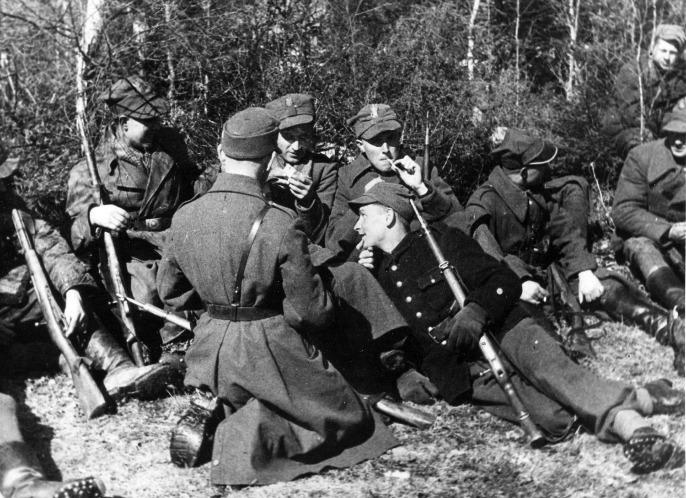<figcaption>Żołnierze AK, okres okupacji. Autor i dokładna data nieustaleni.</figcaption></figure>

notes:
Otwarcie 1 min: nie proś jeszcze o definicję. Zbierz dwie hipotezy: czy samo wojsko wystarczy? Zdjęcie dokumentuje oddział AK, nie wszystkie części państwa.

---

<!-- .slide: id="konspiracja" class="explanation-slide " data-purpose="explanation" data-layout="impact-flow" -->

<h2>Dlaczego w podziemiu?</h2>
<ol class="flow"><li><b>Klęska w 1939 r.</b>Niemcy i ZSRS okupują ziemie polskie. Jawne polskie instytucje nie mogą swobodnie działać.</li><li><b>Konspiracja</b>Tajna działalność: pseudonimy, ukryte lokale, ograniczanie wiedzy o innych osobach.</li><li><b>Ciągłość państwa</b>Rząd RP działa na uchodźstwie. W kraju powstają podległe mu struktury wojskowe i cywilne.</li></ol>
Początek konspiracji: już we wrześniu 1939 r., nie dopiero po utworzeniu AK.

notes:
1 min, do 2:00. Utrata kontroli nad terytorium nie oznaczała rezygnacji z państwa. Na ziemiach pod okupacją sowiecką NKWD rozbijało organizacje przez agenturę i aresztowania. Wyjaśnij pseudonim bez zabawy w instruktaż konspiracyjny.

---

<!-- .slide: id="hubal" class="explanation-slide " data-purpose="explanation" data-layout="timeline-band" -->

<h2>Oddział majora „Hubala”</h2>

<figure class="art">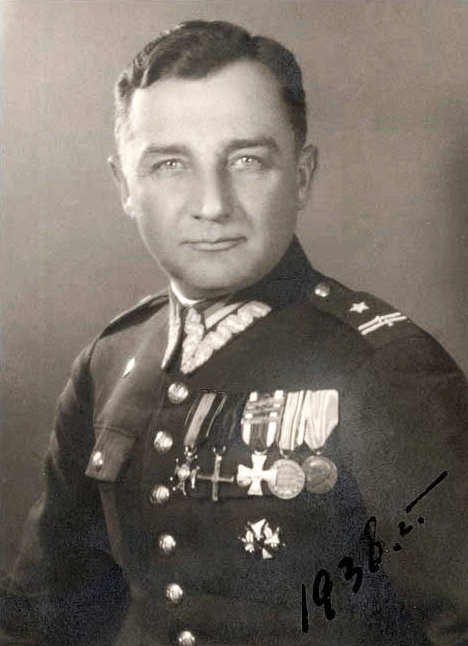<figcaption>Henryk Dobrzański „Hubal”.</figcaption></figure>

Żołnierze nie składają broni po kampanii 1939 r.
<ol class="vertical"><li><b>Jesień 1939</b> — oddział walczy na Kielecczyźnie; korzysta z pomocy mieszkańców.</li><li><b>Wiosna 1940</b> — Niemcy palą wsie i mordują cywilów, aby odciąć partyzantów od wsparcia.</li><li><b>30 IV 1940, okolice Anielina</b> — Hubal ginie w starciu z Niemcami.</li></ol>

To przykład wczesnej partyzantki, nie całego Polskiego Państwa Podziemnego.

notes:
0:50. Nie przypisuj odpowiedzialności za niemieckie zbrodnie ludności pomagającej oddziałowi. Hubal był przedwojennym kawalerzystą, należał do polskiej reprezentacji olimpijskiej; ciekawostka z podręcznika poza obowiązkowym zapisem.

---

<!-- .slide: id="szp-zwz-ak" class="explanation-slide " data-purpose="explanation" data-layout="timeline-band" -->

<h2>Od SZP do Armii Krajowej</h2>

<b>27 IX 1939</b><strong>SZP</strong>Służba Zwycięstwu Polski

<b>13 XI 1939</b><strong>ZWZ</strong>Związek Walki Zbrojnej

<b>14 II 1942</b><strong>AK</strong>Armia Krajowa

Zmiany organizacji i nazwy służyły podporządkowaniu podziemnego wojska władzom RP oraz scalaniu oddziałów.

notes:
0:55. Oś ma proporcjonalne odległości dat (47 i 824 dni); etykiety pierwszych dwóch wydarzeń są rozłożone ponad i pod linią. SZP utworzył w Warszawie gen. Michał Karaszewicz-Tokarzewski. ZWZ powołano 13 listopada 1939, nie w grudniu: błąd opisu alternatywnego osi ZPE nie został powielony.

---

<!-- .slide: id="dowodcy" class="explanation-slide " data-purpose="explanation" data-layout="comparison" -->

<h2>Dowódcy podziemnej armii</h2>

<figure class="art">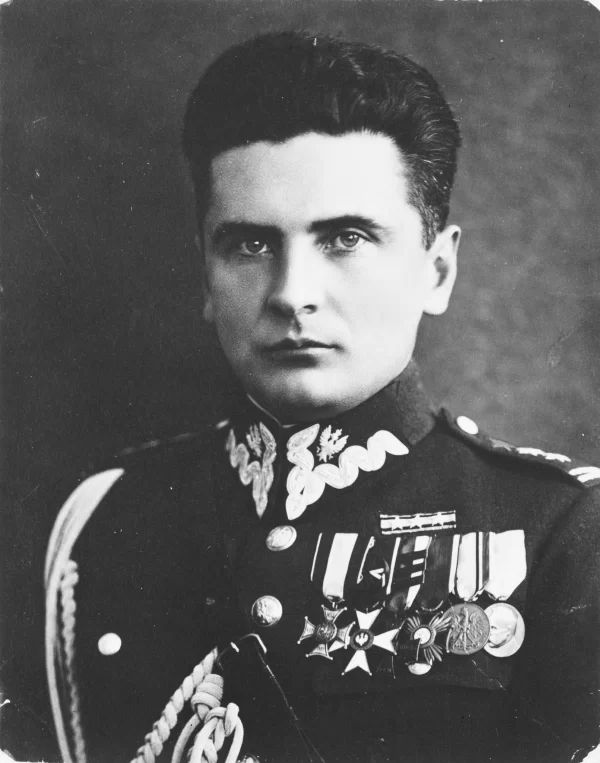<figcaption>Stefan Rowecki „Grot”</figcaption></figure>

<b>„Grot”</b> — od czerwca 1940 r. komendant główny ZWZ, następnie pierwszy dowódca AK.

<b>30 VI 1943</b> Aresztowanie Roweckiego przez Niemców w Warszawie.

Dowodzenie AK przejmuje <b>Tadeusz Komorowski „Bór”</b>.

<figure class="art">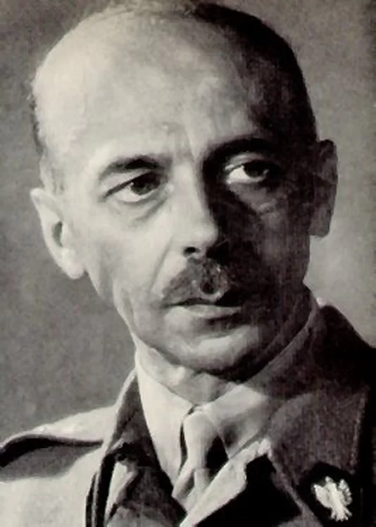<figcaption>Tadeusz Komorowski „Bór”</figcaption></figure>

notes:
0:40. Rowecki został zamordowany w Sachsenhausen w 1944 r. Nie korzystaj z rozbieżnych dat urodzenia w ZPE — nie są potrzebne do celu. Bór objął funkcję formalnie w lipcu 1943 r.; nie przedstawiaj dnia aresztowania jako dnia formalnej nominacji następcy.

---

<!-- .slide: id="mapa" class="evidence-slide " data-purpose="evidence" data-layout="map-focus" -->

<h2>Zasięg struktur AK</h2>
<figure class="map-full">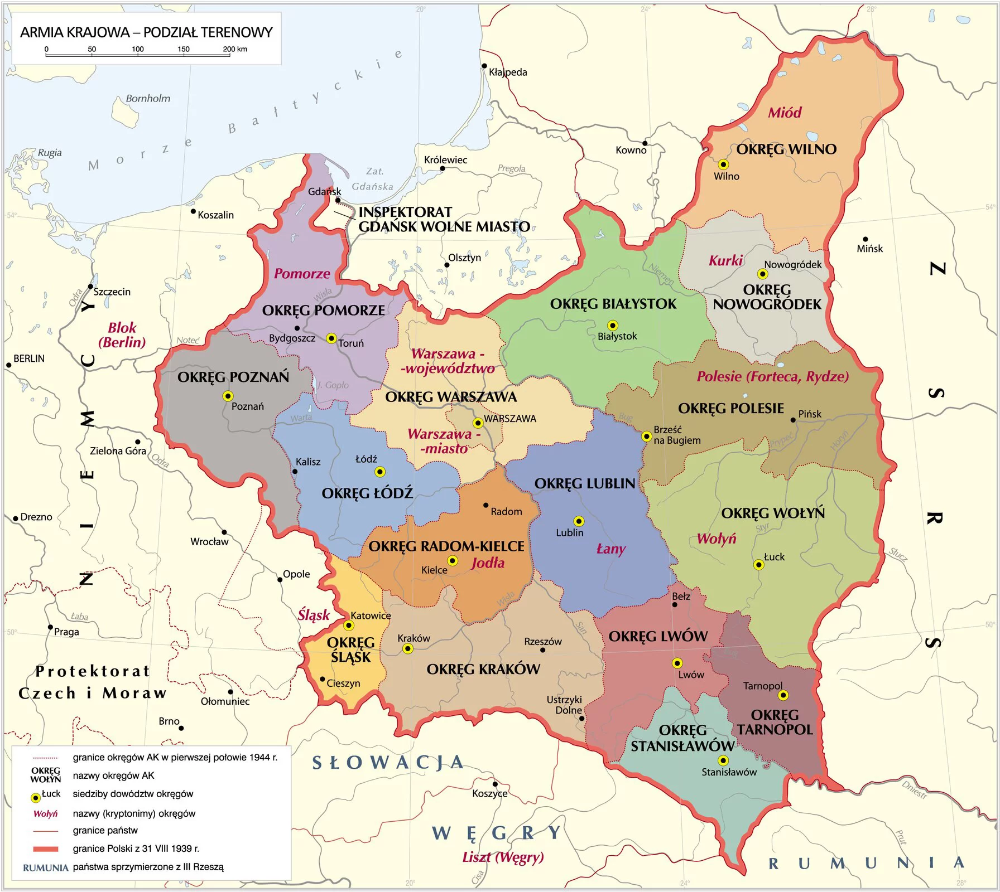</figure>

notes:
0:30. Mapa: Krystian Chariza i zespół, CC BY-SA 4.0, ZPE. Wskaż Warszawę i okręg Radom–Kielce. Mapa przedstawia sieć organizacyjną w I połowie 1944 r., nie wyzwolone terytorium ani stałą kontrolę AK. Bez podpisu na slajdzie i w lightboxie.

---

<!-- .slide: id="cel-armii" class="explanation-slide " data-purpose="explanation" data-layout="process" -->

<h2>Po co tworzono podziemną armię?</h2>
<ol class="flow"><li><b>Łączyć i szkolić</b>Scalać oddziały, gromadzić broń, przygotowywać dowódców.</li><li><b>Osłabiać okupanta</b>Wywiad, sabotaż, dywersja i ochrona ludności.</li><li><b>Przygotować powstanie powszechne</b>Ogólnokrajowe wystąpienie w sprzyjającym momencie wojny.</li></ol>
Plan powstania powszechnego nie oznacza wyłącznie powstania warszawskiego. Akcja „Burza” w 1944 r. była odrębnym planem działań wobec odwrotu Niemców i nadejścia Armii Czerwonej.

notes:
0:45. Nie rozwijaj jeszcze przyczyn i skutków powstania warszawskiego — to odrębny zakres XXXIII.5. Burza łączyła walkę z Niemcami z występowaniem wobec Sowietów jako gospodarze terenu w imieniu władz RP.

---

<!-- .slide: id="szare-szeregi" class="explanation-slide " data-purpose="explanation" data-layout="matrix" -->

<h2>Szare Szeregi</h2>

Konspiracyjny kryptonim Związku Harcerstwa Polskiego. Zadania dostosowywano do wieku.

<h3>Zawisza</h3><b>12–14 lat</b>
Przygotowanie do służby pomocniczej.

<h3>Bojowe Szkoły</h3><b>15–17 lat</b>
Mały sabotaż i działania propagandowe.

<h3>Grupy Szturmowe</h3><b>Od 18 lat</b>
Akcje dywersyjne; współpraca z AK.

Nie każdy harcerz brał udział w walce z bronią.

notes:
0:35. Granice wieku zgodnie z dostarczonym podręcznikiem. Pomoc, propaganda i szkolenie także niosły ryzyko aresztowania. Nie zachęcaj do odtwarzania niebezpiecznych działań.

---

<!-- .slide: id="formy-oporu" class="explanation-slide " data-purpose="explanation" data-layout="source-split" -->

<h2>Nie tylko walka z bronią</h2>

<h3>Propaganda</h3>
Prasa, ulotki i napisy przełamywały niemiecki monopol informacji oraz podtrzymywały opór.
<h3>Sabotaż</h3>
Celowe utrudnianie pracy na rzecz okupanta, np. obniżanie jakości produkcji.
<h3>Dywersja</h3>
Działania uderzające w transport i siły okupanta, np. niszczenie torów.

<figure class="art">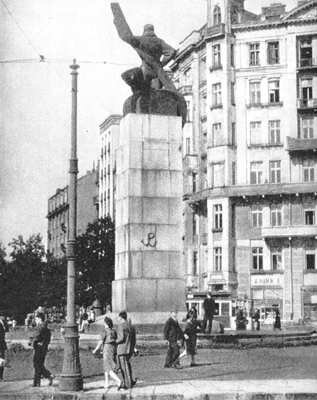<figcaption>Znak Polski Walczącej na pomniku Lotnika, okupowana Warszawa.</figcaption></figure>

notes:
0:45. P + W oznaczają Polskę Walczącą. Kotwica była symbolem oporu społeczeństwa, nie znakiem wyłącznie AK. Mały sabotaż obejmował m.in. napisy i ośmieszanie okupanta; granice szkolnych klasyfikacji nie są sztywne. Nie myl szkodzenia produkcji z sabotażem symbolicznym.

---

<!-- .slide: id="wywiad" class="explanation-slide " data-purpose="explanation" data-layout="process" -->

<h2>Informacja także była bronią</h2>

Wywiad zdobywał wiadomości o niemieckim wojsku, transportach i nowej broni.
<ol class="flow"><li><b>Rozpoznanie</b>Siatki wywiadowcze badają ośrodek w Peenemünde oraz próby broni V-1 i V-2.</li><li><b>Dokumentacja</b>Informacje i części niewybuchu rakiety V-2 pozwalają poznać jej budowę.</li><li><b>Przekazanie aliantom</b>W 1944 r. części V-2 i dokumentacja trafiają do Wielkiej Brytanii w operacji „Most III”.</li></ol>
V-1 — pocisk odrzutowy; V-2 — rakieta balistyczna. Nie były tym samym rodzajem broni.

notes:
0:40. Nie przypisuj AK wyłącznej zasługi za aliancki nalot na Peenemünde ani za poznanie całej broni. Most III: noc 25/26 lipca 1944 r., lądowisko koło Tarnowa; to zweryfikowana ciekawostka do poradnika, nie kolejna data do notowania.

---

<!-- .slide: id="cichociemni" class="explanation-slide " data-purpose="explanation" data-layout="source-split" -->

<h2>Cichociemni</h2>

Polscy żołnierze wyszkoleni na Zachodzie i przerzucani samolotami do okupowanego kraju.

Wzmacniali ZWZ–AK jako instruktorzy, dowódcy, radiotelegrafiści i specjaliści wywiadu oraz dywersji.

Nie stanowili jednego oddziału walczącego stale razem.

<figure class="art">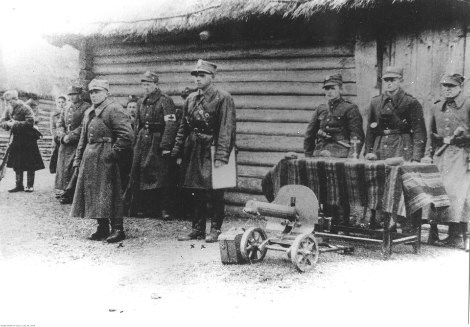<figcaption>Jan Piwnik „Ponury” podczas przysięgi żołnierzy AK, maj 1944 r.</figcaption></figure>

notes:
0:40. Ponury to przykład cichociemnego. NAC 37-1389-1; zdjęcie przedstawia Nowogródczyznę w maju 1944, nie szkolenie w Wielkiej Brytanii. Pierwszy zrzut do kraju odbył się w nocy 15/16 lutego 1941 r.; ciekawostka opcjonalna.

---

<!-- .slide: id="wieniec" class="explanation-slide " data-purpose="explanation" data-layout="impact-flow" -->

<h2>„Wieniec” · 7/8 X 1942</h2>

Warszawski węzeł kolejowy
<ol class="flow"><li><b>Cel</b>Przerwać transport niemiecki, w tym zaopatrzenie frontu wschodniego.</li><li><b>Przebieg</b>Patrole saperskie AK jednocześnie uszkadzają tory na liniach wokół Warszawy.</li><li><b>Skutek</b>Ruch zostaje przejściowo sparaliżowany. Niemcy dokonują represji wobec więźniów i ludności.</li></ol>
Skutek wojskowy i koszt poniesiony przez społeczeństwo trzeba rozpatrywać oddzielnie.

notes:
0:45. Nie mów o trwałym zatrzymaniu frontu. Akcję przeprowadzono bez strat wykonawców, ale nie była bezkosztowa dla ludności. Nie używaj dowolnego zdjęcia wykolejenia jako dokumentacji właśnie tej akcji. Grafika porządkuje fakty, nie odtwarza przebiegu taktycznego.

---

<!-- .slide: id="arsenal" class="explanation-slide " data-purpose="explanation" data-layout="impact-flow" -->

<h2>„Meksyk II” · 26 III 1943</h2>

Warszawa · okolice Arsenału, ulice Długa i Bielańska

<figure class="art">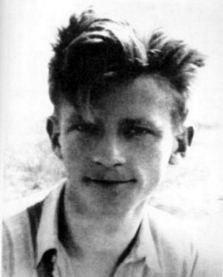<figcaption>Jan Bytnar „Rudy”, ok. 1940 r.</figcaption></figure><ol class="flow"><li><b>Cel</b>Odbić Rudego i innych więźniów wiezionych z przesłuchań gestapo na Pawiak.</li><li><b>Przebieg</b>Grupy Szturmowe Szarych Szeregów atakują transport. Dowodzi Stanisław Broniewski „Orsza”.</li><li><b>Skutek</b>Więźniowie odzyskują wolność. Rudy umiera 30 marca wskutek tortur. Są straty wśród uczestników; Niemcy mordują więźniów w odwecie.</li></ol>

Pod Arsenałem uwolniono więźniów, ale nie zdołano uratować życia Rudego.

notes:
0:50. Nie nazywaj Rudego poległym podczas samej akcji. W ewakuacji ważną rolę odgrywał Tadeusz Zawadzki Zośka. Liczby uwolnionych różnią się między publikacjami; nie są potrzebne w rdzeniu. UdSKiOR i podręcznik potwierdzają odwet na więźniach Pawiaka.

---

<!-- .slide: id="kutschera" class="explanation-slide " data-purpose="explanation" data-layout="impact-flow" -->

<h2>Akcja „Kutschera” · 1 II 1944</h2>

Warszawa · Aleje Ujazdowskie

<figure class="art">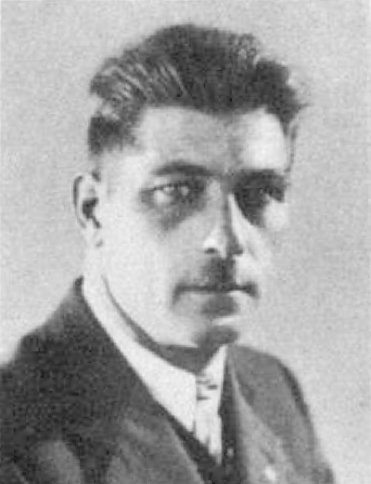<figcaption>Franz Kutschera, fotografia opublikowana w 1938 r.</figcaption></figure><ol class="flow"><li><b>Cel</b>Wykonać wyrok na Kutscherze, dowódcy SS i policji dystryktu warszawskiego, odpowiedzialnym za terror.</li><li><b>Przebieg</b>Po rozpoznaniu jego tożsamości i zwyczajów oddział „Pegaz” Kedywu AK przeprowadza zamach.</li><li><b>Skutek</b>Kutschera ginie. Uczestnicy ponoszą straty podczas akcji i po niej. Niemcy odpowiadają egzekucjami zakładników i karami dla miasta.</li></ol>

Kedyw = Kierownictwo Dywersji Komendy Głównej AK.

notes:
0:45. Bez sensacyjnych szczegółów i instruktażu. Podręcznik upraszcza straty: nie twierdź, że czterech Polaków zginęło na miejscu. Po zamachu ograniczono publiczne egzekucje uliczne, ale niemiecki terror nie ustał.

---

<!-- .slide: id="organizacje-rp" class="explanation-slide " data-purpose="explanation" data-layout="matrix" -->

<h2>Organizacje związane z władzami RP</h2>

<figure class="art"></figure><h3>Armia Krajowa</h3>
Wojsko podległe rządowi RP. Kotwica oznacza Polskę Walczącą — nie tylko AK.

<figure class="art">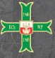</figure><h3>Bataliony Chłopskie</h3>
Ruch ludowy; obrona mieszkańców wsi. Część oddziałów scalono z AK.

<figure class="art"></figure><h3>GL WRN</h3>
Socjalistyczna Gwardia Ludowa WRN: Wolność, Równość, Niepodległość. Współdziałała z ZWZ–AK.

Znaki odróżniały tradycje i środowiska. Wspólny był związek z legalnymi władzami RP.

notes:
0:45. Trzy organizacje z zestawienia s.70. Wyjaśnij, że GL WRN nie jest komunistyczną GL. Emblematy BCh i WRN to wyłącznie małe wycinki symboli z dostarczonego podręcznika: prawa nieustalone, tylko prywatna akceptacja. Nie zgadzaj się na ich publiczną redystrybucję bez wyjaśnienia praw.

---

<!-- .slide: id="organizacje-poza" class="explanation-slide " data-purpose="explanation" data-layout="comparison" -->

<h2>Nie cały ruch oporu podlegał rządowi RP</h2>

<figure class="art">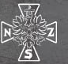</figure><h3>Narodowe Siły Zbrojne</h3>
Środowiska narodowe. Część NSZ podporządkowała się AK, część pozostała poza jej strukturami.

<figure class="art"></figure><h3>Komunistyczna GL → AL</h3>
Gwardia Ludowa utworzona przez PPR w 1942 r., od 1944 r. Armia Ludowa. Związana z ZSRS, nie podlegała rządowi RP w Londynie.

Podobny skrót nie oznacza tej samej organizacji: GL WRN ≠ komunistyczna GL.

notes:
0:45. Nie sprowadzaj NSZ do jednego stosunku do AK ani całego podziemia do jednej organizacji. Komunistyczne GL/AL pozostawały poza Polskim Państwem Podziemnym podporządkowanym legalnym władzom RP. Znaki odczytuj jako emblematy, nie zachętę do identyfikacji politycznej.

---

<!-- .slide: id="delegatura" class="explanation-slide " data-purpose="explanation" data-layout="source-split" -->

<h2>Państwo to więcej niż armia</h2>

<b>Delegatura Rządu RP na Kraj</b>, tworzona od 1940 r., organizowała cywilną administrację podziemia.

Delegat reprezentował w okupowanym kraju rząd RP na uchodźstwie.

Istniały też podziemne sądy i reprezentacja stronnictw politycznych, od 1944 r. <b>Rada Jedności Narodowej</b>.

<figure class="art">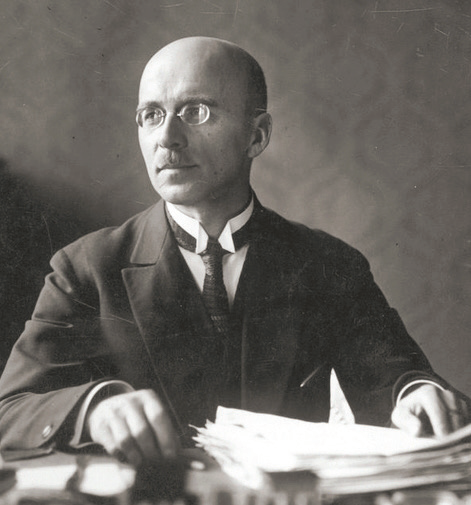<figcaption>Jan Stanisław Jankowski, Delegat Rządu na Kraj w latach 1943–1945.</figcaption></figure>

notes:
0:40. Pierwszym głównym delegatem był Cyryl Ratajski; nie jest potrzebna lista wszystkich delegatów. Legalność i ciągłość władzy, a nie tylko liczba oddziałów, wyjaśnia pojęcie państwa. Przedwojenne spory polityczne nie zniknęły w konspiracji.

---

<!-- .slide: id="departamenty" class="explanation-slide " data-purpose="explanation" data-layout="process" -->

<h2>Cywilne departamenty</h2>

Delegatura Rządu na Kraj

<h3>Departament Informacji i Prasy</h3>
Informował społeczeństwo, organizował prasę podziemną, przeciwstawiał się propagandzie okupanta.

<h3>Departament Oświaty i Kultury</h3>
Wspierał tajne nauczanie, chronił kulturę i przygotowywał odbudowę polskiej oświaty.

To cywilne instytucje Delegatury. <b>BIP AK</b> — Biuro Informacji i Propagandy — należało do pionu wojskowego.

notes:
0:40. Podręcznik s.71 używa krótszej nazwy Departament Informacji. Pełniejszą nazwę potwierdza katalog Rzeczypospolitej Polskiej w Mazowieckiej Bibliotece Cyfrowej. Nie zastępuj obu departamentów Biurem Informacji i Propagandy AK. Prasa nie była wyłączną domeną jednej struktury.

---

<!-- .slide: id="tajne-komplety" class="explanation-slide " data-purpose="explanation" data-layout="impact-flow" -->

<h2>Lekcja, której nie wolno było prowadzić</h2>

Tajne komplety pozwalały kontynuować naukę mimo niemieckich zakazów.

<figure class="art">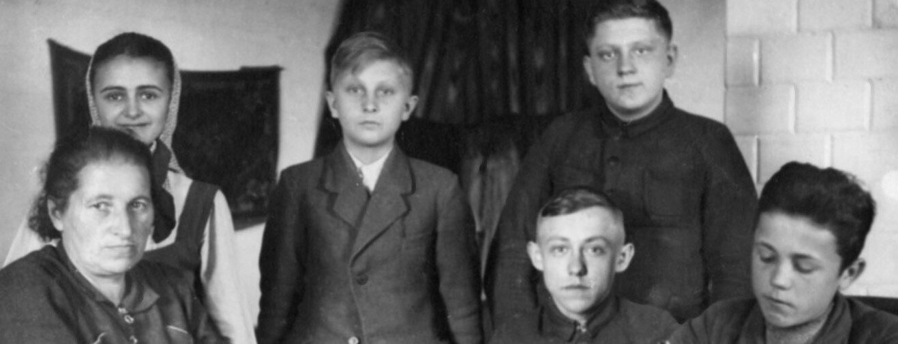<figcaption>Jadwiga Sokirkówna z uczniami, Łopiennik Górny, 1941 r.</figcaption></figure><ul class="teaching-facts"><li>Małe grupy w prywatnych mieszkaniach.</li><li>Historia i literatura polska; tajne szkoły średnie i studia.</li><li>Ciągłość nauki i kultury — mimo ryzyka aresztowania i obozu.</li></ul>

Walka cywilna: przeciwstawianie się okupantowi bez koniecznego użycia broni.

notes:
0:40. Nie nazywaj wszystkich istniejących szkół tajnymi: okupant pozostawił ograniczone szkolnictwo podstawowe i zawodowe. Tajne nauczanie uzupełniało zakazane treści oraz prowadziło szkoły średnie i wyższe. Możesz zapytać retorycznie, jaki sens miała nauka w czasie wojny — bez drugiego zadania pisemnego.

---

<!-- .slide: id="lacznosc" class="explanation-slide " data-purpose="explanation" data-layout="process" -->

<h2>Jak kraj kontaktował się z rządem?</h2>

<b>Okupowany kraj</b>AK i Delegatura

Radiostacje → szyfrowane meldunki

Kurierzy → wiadomości i raporty

<b>Rząd RP</b>na uchodźstwie

<b>Jan Karski</b> — emisariusz podziemia, przekazywał aliantom m.in. informacje o Zagładzie Żydów.

<b>Jan Nowak-Jeziorański</b> — kurier między okupowanym krajem a władzami polskimi na Zachodzie.

Łączność umożliwiała przekazywanie rozkazów, informacji i pieniędzy na działalność podziemia.

notes:
0:40. Jan Karski to Jan Kozielewski. Nie twierdź, że był jedynym źródłem informacji aliantów o Zagładzie. Radiostacje i kurierzy nie zapewniały szybkiego, pewnego ani codziennego kontaktu; praca niosła ryzyko wykrycia.

---

<!-- .slide: id="prawo" class="evidence-slide " data-purpose="evidence" data-layout="source-split" -->

<h2>„W imieniu Rzeczypospolitej Polskiej”</h2>

Podziemne państwo miało także wymiar sprawiedliwości.

Sądy rozpatrywały m.in. sprawy zdrady, donosicielstwa i współpracy z okupantem.

Wyroki ogłaszano w tajnej prasie i obwieszczeniach. Pokazywały, że polskie prawo nie przestało obowiązywać.

<figure class="art">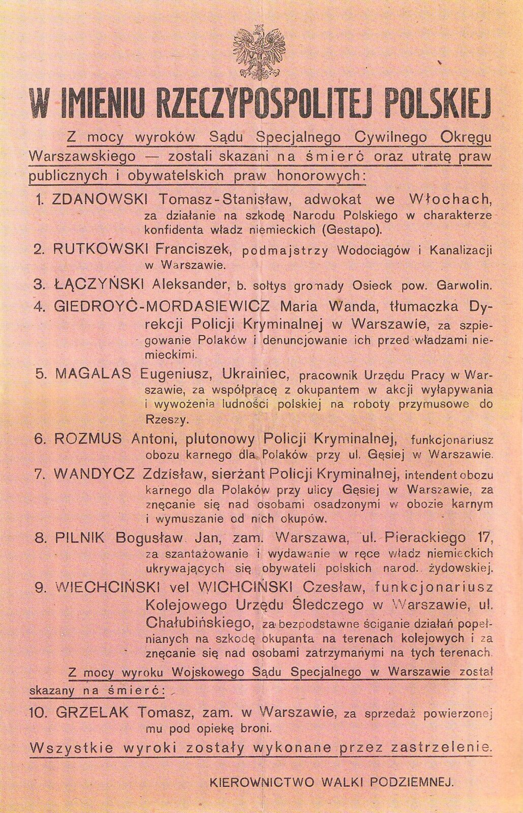<figcaption>Obwieszczenie Kierownictwa Walki Podziemnej, wrzesień 1943 r.</figcaption></figure>

notes:
0:35. To dokument z epoki, nie dowód automatycznej sprawiedliwości każdego rozstrzygnięcia. Nie odczytuj listy nazwisk ani opisów kar; wskazujemy istnienie instytucji prawa. Przejdź do rozróżnienia wyroku na konkretnej osobie i niemieckiej odpowiedzialności zbiorowej.

---

<!-- .slide: id="pytania-zrodlo" class="practice-slide " data-purpose="practice" data-layout="task-board" -->

<h2>„Terror hitlerowski” · praca w parach</h2>

Przeczytajcie fragment z dziennika Hansa Franka, generalnego gubernatora. Każdy zapisuje własne krótkie odpowiedzi.
<ol><li>Wymień działania ruchu oporu, które w dzienniku opisał Hans Frank.</li><li>Wyjaśnij, w jakim celu generalny gubernator stosował odpowiedzialność zbiorową wobec Polaków po atakach podziemia.</li></ol>
5 minut łącznie: lektura, rozmowa, zapis i krótkie omówienie. Tekst na następnym slajdzie oraz w podręczniku, s. 69.

notes:
Zacznij 5-minutowy etap (18:00–23:00). 20 s pytania, 1:30 lektura, 1:30 rozmowa w maks.10 parach, 1 min zapis indywidualny, 40 s omówienie. Nie pokazuj modelu odpowiedzi przed pracą. Wsparcie: wskaż dwa fragmenty o atakach i fragment o rozstrzelaniach; nie podawaj gotowego celu terroru.

---

<!-- .slide: id="terror" class="evidence-slide " data-purpose="evidence" data-layout="evidence" -->

<h2>Terror hitlerowski</h2>

W swoim dzienniku generalny gubernator Hans Frank opisał dokładnie, jakie działania podejmowali Niemcy w odpowiedzi na ataki polskiego podziemia.
<blockquote class="frank">W ostatnich 14 dniach zdarzyło się kilka bardzo niemiłych wypadków. I tak w Warszawie zaatakowano granatami ręcznymi policjantów, gdy przejeżdżali przez miasto; było kilku zabitych. W pobliżu Warszawy wpadł na miny pociąg wiozący urlopowników [żołnierzy niemieckich na urlopie] z frontu, przy czym lokomotywa wykoleiła się, a pociąg ostrzelano wtedy z karabinów maszynowych z odległości 8 m. Było 15 zabitych i 30 ciężej lub lżej rannych. Przed kilku dniami zastrzelono starszego radcę rządu i inspektora rządowego. Policja zareagowała energicznie na te wypadki. [...] Za zamach kolejowy stracono 150, a za obydwu urzędników niemieckich – 50 terrorystów polskich [...]. Należy zważyć, że przez rozstrzelanie 200 ludzi zostaje dotkniętych przynajmniej 3000 osób (z najbliższej rodziny). Osieroceni przypisali sprawcom zamachów odpowiedzialność za śmierć swoich krewnych.</blockquote>
<i>Wiek XX w źródłach</i>, oprac. M. Sobańska-Bondaruk, S. B. Lenard, Warszawa 2002, s. 253–254. Fragment za podręcznikiem <i>Wczoraj i dziś 8</i>, s. 69.

„Terroryści polscy” to język sprawcy. Ostatnie zdanie jest twierdzeniem Franka, nie ustaleniem o postawach wszystkich rodzin.

notes:
Pozostań na slajdzie podczas lektury i rozmowy. Zachowano pełny przesłany fragment, dwa oryginalne opuszczenia i objaśnienie w nawiasie. Liczby to relacja Franka, nie niezależnie zweryfikowany bilans. Po lekturze zapytaj jedną parę o działania oporu, drugą o cel represji. Model tylko w assessment.md. Prawa do polskiego opracowania nieustalone — wyłącznie prywatny nauczycielski review.

---

<!-- .slide: id="synteza" class="synthesis-slide " data-purpose="synthesis" data-layout="equation" -->

<h2>Co czyniło to państwem?</h2>

Wspólna, uznawana władza łączyła opór wojskowy z cywilnymi instytucjami.

<b>Obrona i walka</b>
ZWZ–AK, szkolenie, wywiad, dywersja.

+
<b>Życie społeczeństwa</b>
Administracja, prawo, oświata, informacja.

Nie tylko oddziały leśne, nie tylko Warszawa i nie wszystkie organizacje ruchu oporu.

notes:
0:45 z 3 min podsumowania i exit, od 23:00 do 23:45. To synteza po zadaniu, nie klucz do cytatu. Odpowiedzialność za niemieckie represje ponosili ich sprawcy. Nie buduj fałszywej alternatywy: walka albo edukacja.

---

<!-- .slide: id="notatka-wlasna" class="practice-slide " data-purpose="practice" data-layout="task-board" -->

<h2>Ułóż krótką notatkę</h2>

1939: SZP → ZWZ 1942: AK

<h3>Obszar wojskowy</h3>
Instytucja + dwa przykłady działań

<h3>Obszar cywilny</h3>
Instytucja + dwa przykłady działań

Było to państwo, ponieważ…

Zapisz tylko oś, dwa obszary i jedno zdanie. Nie przepisuj całej prezentacji.

notes:
2 min z 4 min notatki (23:45–27:45). Najpierw własna próba bez gotowych przykładów. Uczeń korzysta z pustej karty lub zeszytu. Oś zawiera nazwy i lata jako wsparcie, daty dzienne można dopisać po pokazaniu wzoru. Nie wymagaj rysowania ozdobników.

---

<!-- .slide: id="notatka" class="synthesis-slide " data-purpose="synthesis" data-layout="takeaways" -->

<h2>Notatka do nauki</h2>

<b>27 IX 1939</b> SZP → <b>13 XI 1939</b> ZWZ → <b>14 II 1942</b> AK

<h3>Wojsko · ZWZ–AK</h3>
Przygotowanie powstania powszechnego.

Wywiad V-1/V-2, dywersja, np. „Wieniec”.

<h3>Cywile · Delegatura</h3>
Tajna administracja i sądy.

Tajne komplety, prasa podziemna.

Polskie Państwo Podziemne tworzyły tajne struktury wojskowe i cywilne podporządkowane rządowi RP na uchodźstwie.

notes:
2 min: odsłoń dopiero po własnej próbie. Uczniowie uzupełniają brakujące elementy, nie przepisują drugi raz. To cała minimalna notatka. Rozszerzona jednostronicowa pomoc jest w student-summary.md.

---

<!-- .slide: id="bilet" class="exit-ticket-slide " data-purpose="exit-ticket" data-layout="activity-brief" -->

<h2>Państwo czy tylko armia?</h2>

Odpowiedz samodzielnie, bez zaglądania do notatki.
<ol><li>Podaj jeden przykład działalności wojskowej i jeden cywilnej.</li><li>Wyjaśnij jednym zdaniem, dlaczego nazywamy te struktury państwem.</li></ol>

Na początku pytaliśmy, czy państwo może działać w ukryciu. Teraz uzasadnij swoją odpowiedź.

notes:
Pozostałe 2:15 z 3 min podsumowania i exit (27:45–30:00; wcześniejsza synteza 23:00–23:45). Każdy zapisuje 2–3 krótkie zdania na karcie; nie wystarczy odpowiedź ochotnika. Zakończ zdaniem: państwo podziemne nie miało jawnych urzędów, ale miało ludzi i instytucje, które podtrzymywały jego działanie. Klucz nauczycielski w assessment.md.

---

<!-- .slide: id="zrodla" class="reference-slide " data-purpose="reference" data-layout="matrix" -->

<h2>Źródła i ilustracje</h2>

<h3>Treść</h3>
<i>Wczoraj i dziś 8</i>, s. 66–71; dodatek s. 72–73. Zdjęcia przekazane przez nauczycielkę.

ZPE: <i>Polskie Państwo Podziemne</i>; <i>Polskie państwo podziemne. Komuniści w czasie okupacji.</i>

Źródło Franka: <i>Wiek XX w źródłach</i>, oprac. M. Sobańska-Bondaruk, S. B. Lenard, 2002, s. 253–254.

<h3>Obrazy</h3>
Fotografie i dokument: ZPE oraz Wikimedia Commons, domena publiczna według metryk plików. „Ponury”: NAC 37-1389-1.

Mapa: Krystian Chariza i zespół, CC BY-SA 4.0. Cztery małe emblematy: podręcznik, prawa nieustalone.

Dokładne pliki, adresy, prawa i ograniczenia: <b>sources.md</b>. Wersja do prywatnej akceptacji nauczycielskiej.

notes:
Slajd referencyjny, bez dodatkowego czasu rdzenia. Nie sugeruj, że wszystkie zasoby ZPE mają jedną licencję. Dwa dokładne linki wskazane przez nauczycielkę oraz pozostałe źródła znajdują się w sources.md. Brak zgody na publiczną redystrybucję pełnego cytatu i emblematów.
