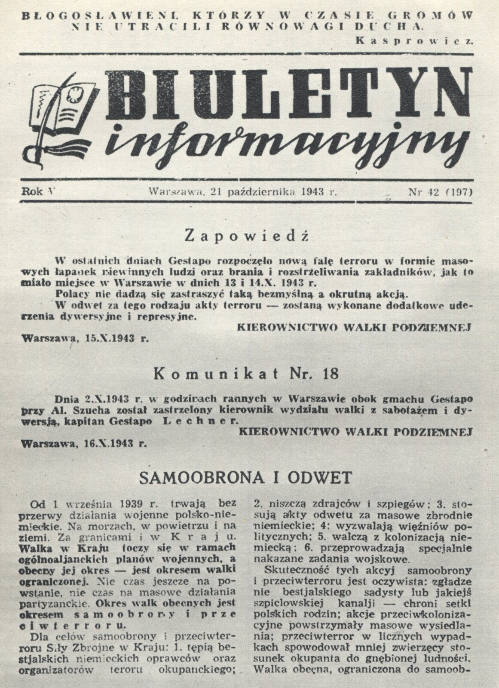
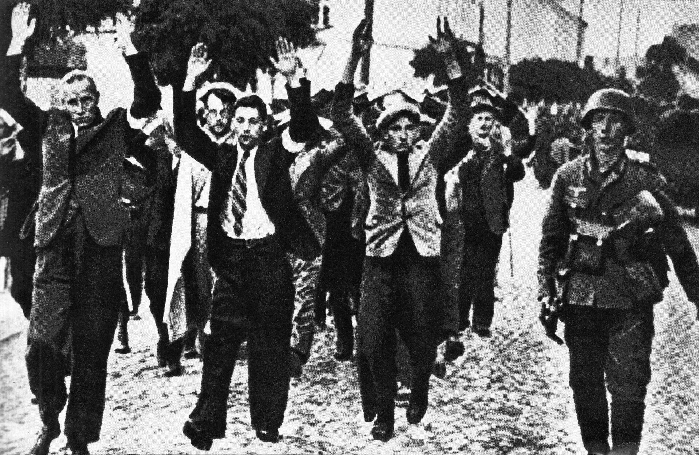
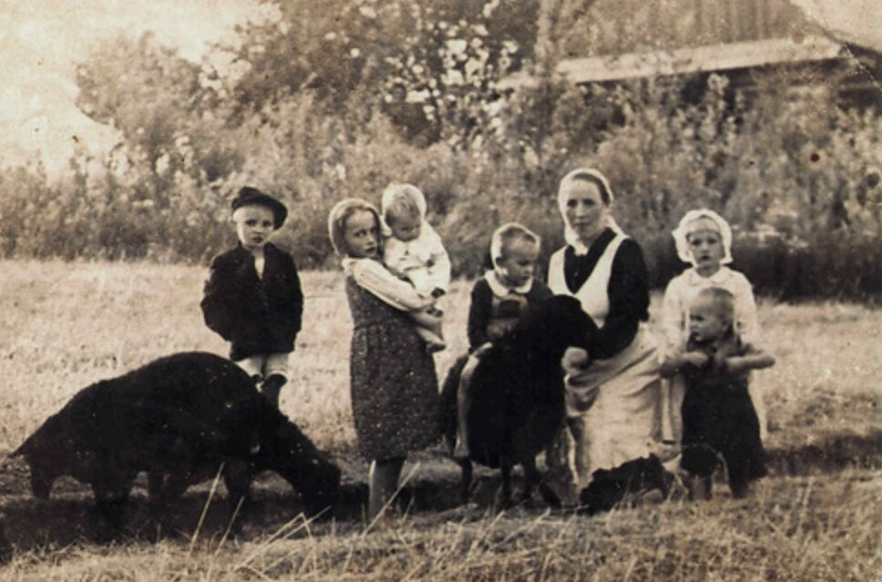
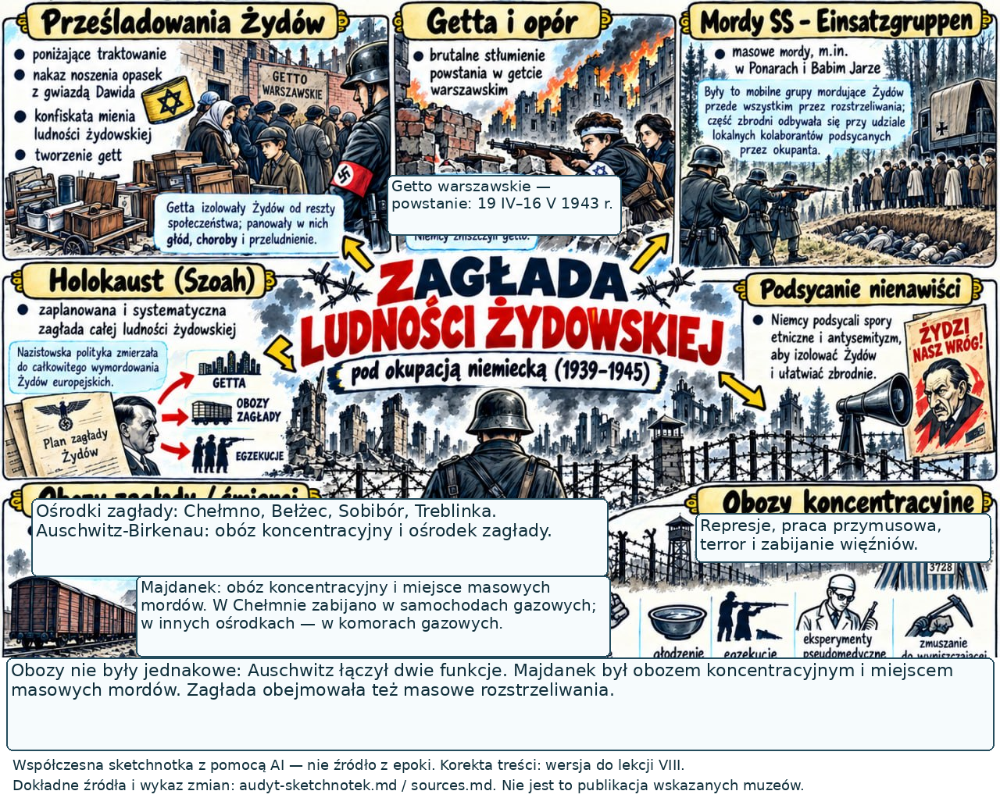
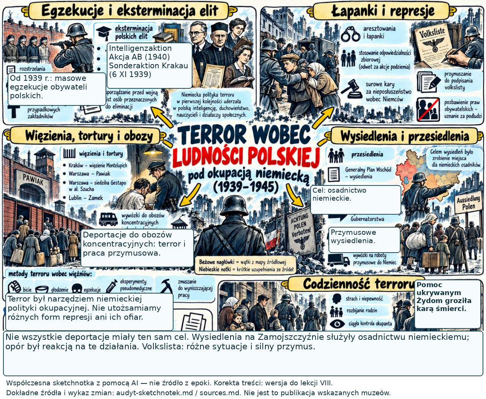
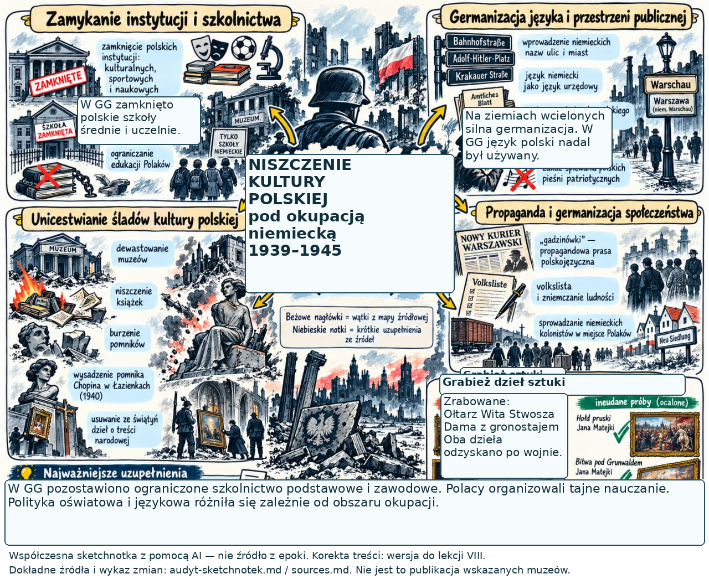
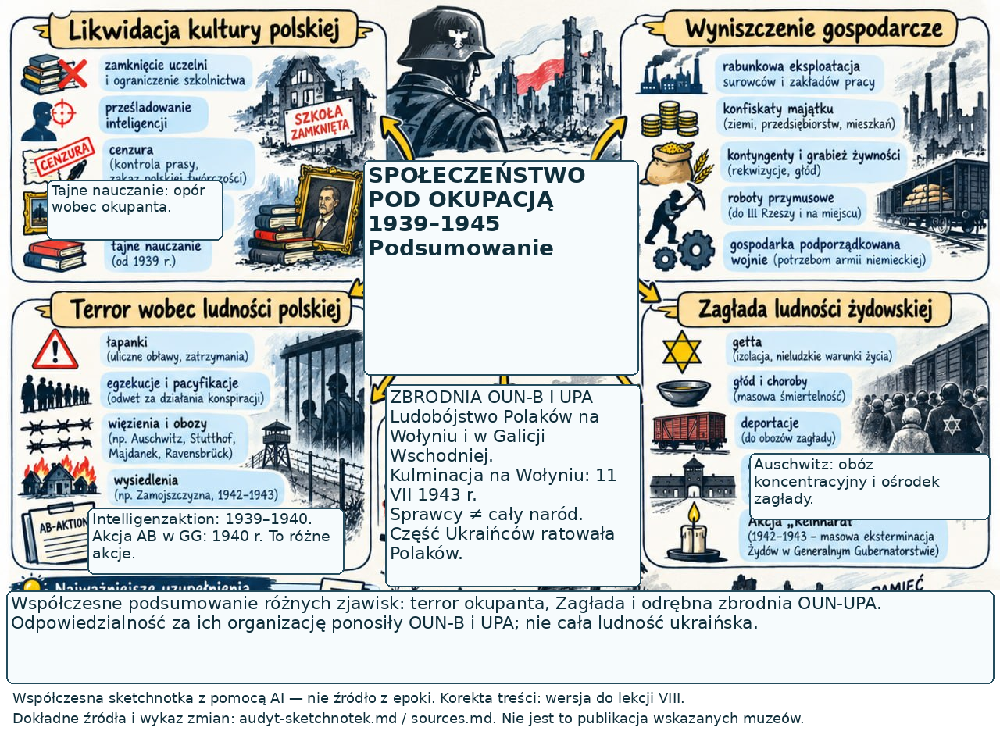
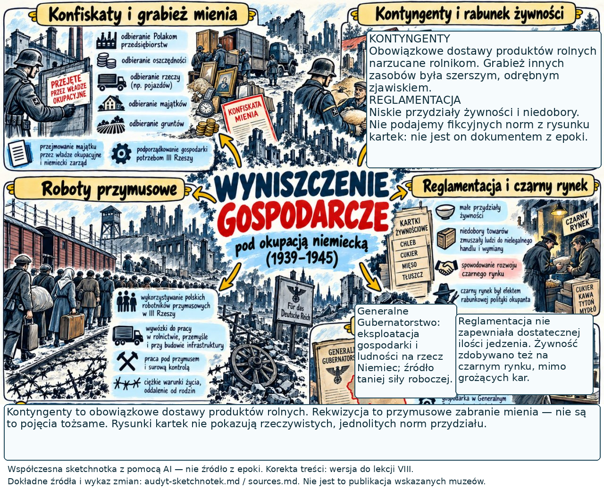
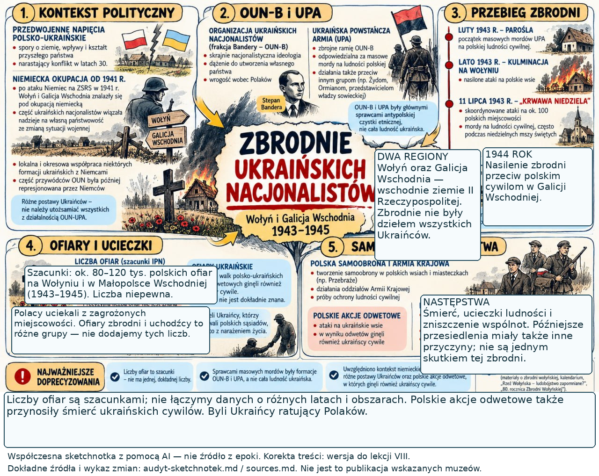

<!-- .slide: id="otwarcie" class="question-slide" data-purpose="opening" data-layout="hero-source" data-goals="G1 G3" -->

Klasa VIII · okupacja niemiecka · 1939–1945
<h1>Społeczeństwo polskie pod okupacją</h1>
Jak terror zmieniał codzienność i możliwości działania ludzi?

Fotografia → głos świadka → porównanie postaw

<figure class="source-figure opening-document"><figcaption>„Biuletyn Informacyjny”, 21 X 1943 · prasa podziemna ZPE / Wikimedia Commons · domena publiczna</figcaption></figure>

notes:
1 min, 0:00–1:00. Zapowiedz: badamy fakty i postawy, nie odgrywamy ofiar ani sprawców. Pytanie główne zostaje otwarte. Przypomnij, że obywatele polscy obejmowali również Żydów, Ukraińców i inne społeczności. Ta lekcja dotyczy głównie okupacji niemieckiej; okupacja sowiecka i organizacja Polskiego Państwa Podziemnego były wcześniej. Strona gazety jest autentycznym dokumentem, nie dekoracją AI; nie trzeba czytać drobnych artykułów. Celowo nie używamy makabrycznych fotografii. Uczeń może zgłosić potrzebę spokojnego wysłuchania bez wypowiedzi publicznej.

---

<!-- .slide: id="pytania-foto" class="practice-slide" data-purpose="practice" data-layout="activity-brief" data-goals="G1 G2" -->

<h2>Co można wyczytać z fotografii?</h2>

Najpierw patrz. Potem wyjaśniaj.
<ol data-task-role="prompt"><li>Wskaż dwa widoczne szczegóły dotyczące ludzi i ich zachowania.</li><li>Wyjaśnij, co te szczegóły mówią o ich sytuacji.</li></ol>
W zeszycie: <strong>„Widzę… Dlatego wnioskuję…”</strong>

notes:
30 s, 1:00–1:30. Przeczytaj pytania PRZED obrazem. Nie zdradzaj jeszcze, że to ofiary łapanki. Poproś o oddzielenie obserwacji od wniosku. Następny slajd pozostaje na ekranie przez całe 2,5 min. Oczekiwany rezultat to krótki indywidualny zapis z jednym uzasadnionym wnioskiem, nie katalog przymiotników. Nie pytaj „co byś czuł/zrobił na ich miejscu”.

---

<!-- .slide: id="warszawa" class="source-slide" data-purpose="evidence" data-layout="map-focus" data-goals="G1 G2" -->

<figure class="source-figure photo-evidence"><figcaption>Warszawa podczas okupacji niemieckiej · autor i dokładna data nieustalone Fotografia z epoki · ZPE / Wikimedia Commons · domena publiczna · kliknij lub Enter: powiększ</figcaption></figure>

notes:
2,5 min, 1:30–4:00. 30 s cichego patrzenia, 45 s zapis każdy dla siebie, 45 s dwie wypowiedzi, 30 s wyjaśnienie. Obserwacje: cywile mają uniesione ręce, obok idzie uzbrojony mężczyzna w mundurze. Wniosek: ludzie działają pod przymusem, ich swoboda jest ograniczona. Dopiero po wypowiedziach podaj opis katalogowy ZPE: „Ofiary łapanki w Warszawie”. Łapanka to nagłe masowe zatrzymanie ludzi, często przypadkowych przechodniów, z groźbą więzienia, robót przymusowych lub deportacji do obozu. Nie ustalamy narodowości ani dalszych losów poszczególnych osób na podstawie wyglądu. Dopuszczaj słowo „zatrzymani”; same ręce w górze nie dowodzą konkretnej kary. Fotografię zachowano w całości, bez kolorowania i kadrowania.

---

<!-- .slide: id="terror" class="explanation-slide" data-purpose="explanation" data-layout="impact-flow" data-goals="G1" -->

<h2>Terror miał podporządkować społeczeństwo</h2>

<h3>Metody</h3>
Łapanki, aresztowania, egzekucje, więzienia i obozy.

Prześladowanie polskich elit oraz odpowiedzialność zbiorowa.

↓ <strong>strach i rozbijanie więzi</strong>

<h3>Zamojszczyzna</h3>
Od jesieni <strong>1942 r.</strong> Niemcy wysiedlali polskie rodziny, by osadzić niemieckich kolonistów.

Do VIII 1943 r. wysiedlono około <strong>110 tys. osób</strong>; rozdzielano rodziny.

notes:
2 min, 4:00–6:00. Wyjaśnij terror: celowe zastraszanie przemocą i groźbą przemocy. Odpowiedzialność zbiorowa oznaczała karanie także ludzi, którzy nie popełnili zarzucanego czynu. To metoda okupanta, nie zasada sprawiedliwości. Prześladowanie elit miało pozbawić społeczeństwo organizatorów życia naukowego, społecznego i politycznego; przykład Akcja AB, Palmiry. Wysiedlenie to przymusowe usunięcie z domu, nie dobrowolna przeprowadzka. Zamojszczyzna to region wokół Zamościa na południowym wschodzie dzisiejszej Polski. Podaj skalę zgodną z s.74: ok.110tys do sierpnia1943, nie dokładny spis. Taki stan utrudniał działanie, ale nie znosił sprawczości wszystkich ludzi. Bez opisu tortur i sposobów zabijania.

---

<!-- .slide: id="codziennosc" class="compare-slide" data-purpose="explanation" data-layout="comparison" data-goals="G1 G3" -->

<h2>Kontrola codzienności — i codzienny opór</h2>

<h3>Co narzucał okupant?</h3>
<strong>Gospodarka:</strong> konfiskaty, obowiązkowe dostawy żywności, kartki i roboty przymusowe.

<strong>Kultura:</strong> rabunek zbiorów, cenzura i ograniczanie nauczania.

<strong>Warszawa:</strong> godzina policyjna i miejsca „tylko dla Niemców”.

<h3>Jak odpowiadali ludzie?</h3>
Tajne nauczanie, prasa podziemna i bojkot propagandowych kin.

Lekarze wydawali fałszywe zaświadczenia o niezdolności do pracy, by chronić przed robotami.

W GG pozostawiono ograniczone szkoły podstawowe i zawodowe; zamknięto polskie średnie i wyższe.

notes:
2 min, 6:00–8:00. Kontyngent=narzucona obowiązkowa dostawa płodów rolnych; reglamentacja=przydziały na kartki, które nie zapewniały dość żywności; konfiskata=odebranie mienia. Tajne komplety to nauka w małych grupach poza kontrolą okupanta. Germanizacja zmieniała język i przestrzeń publiczną, szczególnie na ziemiach wcielonych do Rzeszy; polityka nie była wszędzie identyczna. Zakaz nauczania średniego/wyższego odnosi się do polskich instytucji w GG, a nie do całkowitego braku wszystkich szkół. Wymień choć jeden mechanizm: brak żywności → czarny rynek; zamknięcie szkół → tajna nauka. Mały sabotaż podważał propagandę, np. hasła na murach; nie sprowadzaj całego oporu do walki zbrojnej. Zaznacz, że codzienne zdobywanie jedzenia i opieka nad bliskimi nie są automatycznie kolaboracją. Przykład lekarzy z s.74 posłuży do późniejszego porównania.

---

<!-- .slide: id="zaglada" class="explanation-slide" data-purpose="explanation" data-layout="timeline-band" data-goals="G1" -->

<h2>Zagłada — ludobójstwo europejskich Żydów</h2>
Niemcy nazistowskie dążyły do zamordowania wszystkich Żydów. Żydowscy obywatele Polski byli częścią polskiego społeczeństwa.

<b>1939–1940</b>
Odbieranie praw i mienia. Getta: izolacja, głód i choroby.

<b>1941</b>
Masowe rozstrzeliwania po ataku Niemiec na ZSRS.

<b>1942–1943</b>
Deportacje do ośrodków zagłady, m.in. Treblinki, Bełżca i Sobiboru.

<strong>Getto:</strong> narzucona, odizolowana dzielnica. <strong>Ośrodek zagłady:</strong> miejsce przede wszystkim masowego mordowania. <strong>Obóz koncentracyjny:</strong> uwięzienie, terror i praca przymusowa.

Zamordowano około 6 mln europejskich Żydów, w tym około 3 mln obywateli II RP.

notes:
3 min, 8:00–11:00. Zagłada=Holokaust=Szoa; ludobójstwo to celowe niszczenie grupy narodowej, etnicznej, rasowej lub religijnej. Nie opisuj jej jako zwykłej kolejnej represji ani nie umieszczaj początku zabijania dopiero w1942. Prześladowania eskalowały; od1941 trwały masowe egzekucje, w grudniu1941 działało Chełmno. W1942 deportacje i ośrodki masowego mordowania stały się głównym narzędziem zagłady. Konferencja w Wannsee w1942 koordynowała działania, nie „rozpoczęła Holokaustu”. Plan sprawców nie znosi faktu oporu i prób ratowania życia. Rozróżnij: obóz koncentracyjny służył uwięzieniu, pracy przymusowej i terrorowi; ośrodek zagłady przede wszystkim masowemu mordowaniu. Auschwitz łączył funkcje obozu koncentracyjnego i ośrodka zagłady; Majdanek był obozem koncentracyjnym i miejscem masowych mordów, nie takim samym ośrodkiem jak Treblinka. Romowie oraz inne grupy również byli ofiarami nazistowskich ludobójstw i prześladowań; nie zrównuj automatycznie ich losów. Liczby są szacunkami; nie organizuj konkursu na ich zapamiętanie.

---

<!-- .slide: id="powstanie-getto" class="explanation-slide" data-purpose="explanation" data-layout="statement-centered" data-goals="G1" -->

Warszawa · 19 IV–16 V 1943
<h2>Powstanie w getcie warszawskim</h2>
Zbrojny opór przeciw likwidacji getta i deportacjom na śmierć.

<strong>ŻOB i ŻZW</strong> — żydowskie organizacje walczące z Niemcami.

<strong>Mordechaj Anielewicz</strong> — dowódca ŻOB. <strong>Marek Edelman</strong> — jeden z dowódców i ocalałych.

To inne wydarzenie niż powstanie warszawskie z sierpnia 1944 r.

notes:
1,5 min, 11:00–12:30. Wyjaśnij: Żydowska Organizacja Bojowa i Żydowski Związek Wojskowy. Niemcy wkroczyli19kwietnia1943, by ostatecznie zlikwidować getto; zastali zorganizowany opór. Powstańcy nie mieli realnych szans zwycięstwa militarnego, ale odrzucili narzuconą bierność i walczyli o godność oraz życie. Nie mów, że wszyscy mieszkańcy „wybrali śmierć”, ani że każdy mógł walczyć z bronią. Ukrywanie się, opieka i dokumentowanie także były formami oporu. 16maja to symboliczne niemieckie ogłoszenie końca i wysadzenie Wielkiej Synagogi; pojedynczy ukrywający się i grupy walczące pozostawały dłużej. Uczniowie mówią raz datę1943, bez dodatkowego zapisu. Antyprzykład: nie mylimy kwietnia1943 z sierpniem1944.

---

<!-- .slide: id="pytania-relacja" class="practice-slide" data-purpose="practice" data-layout="activity-brief" data-goals="G2" -->

<h2>Przed lekturą relacji</h2>

Za chwilę przeczytamy krótką powojenną wypowiedź ocalałego z Auschwitz.
<ol data-task-role="prompt"><li>Co świadek uznaje za najgorszy element swojego doświadczenia?</li><li>Wskaż jedno porównanie. Wyjaśnij, co mówi ono o traktowaniu więźniów.</li></ol>
Najpierw przeczytaj samodzielnie. Potem krótko porównaj odpowiedź z sąsiadem.

notes:
30 s, 12:30–13:00. Pytania są przed tekstem, odpowiedzi pozostają nauczycielskie. Zapowiedz, że cytat zawiera pogardliwe porównania przywołane przez świadka w opisie nazistowskiego traktowania ludzi. Nie są naszym językiem o ofiarach. Nie prosimy o utożsamienie się z więźniem ani o ocenę własnej odwagi. Tekst obejmuje dwie pierwsze pełne frazy wypowiedzi z karty Mariana Turskiego; resztę oznaczono […].

---

<!-- .slide: id="relacja" class="source-slide" data-purpose="evidence" data-layout="evidence" data-goals="G2" -->

<h2>Marian Turski o doświadczeniu Auschwitz</h2>
Polski Żyd, wcześniej więzień getta łódzkiego. Do Auschwitz deportowany w 1944 r. Powojenna wypowiedź opublikowana w materiałach Muzeum.
<figure class="witness-document"><blockquote>Najgorsze było PONIŻENIE! To, że nie traktowano cię jak istotę ludzką – zwłaszcza jeżeli byłeś Żydem i dlatego właśnie, że byłeś Żydem, nie traktowano ciebie nawet jak zwierzęcia, tylko jak insekt, jak wesz, jak gnidę, jak karalucha, jak pluskwę. […]</blockquote>
Marian Turski, „Obywatele polscy w KL Auschwitz”, Karty Refleksji, s. 7 PDF. Państwowe Muzeum Auschwitz-Birkenau, 2018. […] oznacza opuszczenie dalszej części wypowiedzi.
</figure>
Wróć do pytań: co wskazuje świadek — i jak to uzasadniasz słowami tekstu?

notes:
3 min, 13:00–16:00. 60 s samodzielna lektura, 45 s rozmowa z sąsiadem, 45 s dwie wypowiedzi z dowodem, 30 s objaśnienie. Klucz: poniżenie; porównanie do insekta pokazuje odmawianie człowieczeństwa i usprawiedliwianie przemocy. Świadek mówi o szczególnym traktowaniu Żydów w nazistowskim systemie; nie każda grupa więźniów miała identyczne położenie. Nie sprowadzaj ludobójstwa do samych obelg: odczłowieczanie to element systemu prześladowania i mordowania. Transkrypcję porównano z obrazem oryginalnej karty. To wypowiedź ocalałego, nie autorskie streszczenie biogramu ani relacja spisana w1944. Wydanie projektu2018 nie dowodzi dokładnej daty wypowiedzenia słów. Zachowano „cię” oraz „ciebie”, interpunkcję i wielkie litery; pominięcie dalszych zdań jawne. Nie trzeba oglądać całego35-minutowego filmu. W razie trudności przeczytaj tekst spokojnie, bez inscenizacji.

---

<!-- .slide: id="pomoc" class="explanation-slide" data-purpose="explanation" data-layout="source-split" data-goals="G3" -->

<h2>Pomoc wymagała sieci ludzi</h2>

<strong>Żegota</strong> — Rada Pomocy Żydom, od 1942 r. w strukturach Polskiego Państwa Podziemnego.

<strong>Irena Sendlerowa i współpracownicy:</strong> ratowanie dzieci, dokumenty, kryjówki i opieka.

<strong>Ulmowie z Markowej:</strong> ukrywali ośmioro Żydów. Niemcy zamordowali ukrywanych i rodzinę w 1944 r.

Za pomoc groziła kara śmierci. Zagrożenie obejmowało także rodziny pomagających.

<figure class="source-figure"><figcaption>Wiktoria Ulma z dziećmi · fotografia przedwojenna lub okupacyjna; dokładna data nieustalona ZPE / Wikimedia Commons · domena publiczna</figcaption></figure>

notes:
2 min, 16:00–18:00. Żegota wspierała finansowo, dostarczała leki i żywność, pomagała w zdobyciu fałszywych dokumentów oraz schronienia. Sendlerowa nie działała samotnie: ratowanie wymagało udziału samych Żydów, rodzin, łączników i instytucji; nie przypisuj jednej osobie całej liczby uratowanych. Fotografia pokazuje rodzinę przed zbrodnią, nie jest obrazem ukrywania.24marca1944 zamordowano Józefa i ciężarną Wiktorię, sześcioro dzieci oraz ośmioro ukrywanych Żydów. Nie rozwijaj drastycznych szczegółów. Kara śmierci za pomoc obowiązywała na tym terenie; nie głosimy, że Polska była jedynym miejscem w całej okupowanej Europie z takim zagrożeniem. Sprawiedliwi wśród Narodów Świata to tytuł przyznawany przez Yad Vashem nie-Żydom ratującym Żydów z narażeniem życia, bez korzyści materialnej. Nie każ uczniom „wybierać, czy pomogliby”.

---

<!-- .slide: id="informowanie" class="compare-slide" data-purpose="explanation" data-layout="argument" data-goals="G3" -->

<h2>Informowanie — i krzywdzenie innych</h2>

<b>Witold Pilecki</b>Zorganizował konspirację w Auschwitz; informacje o zbrodniach przekazywano na zewnątrz, potem sporządził raporty.

<b>Jan Karski</b>Kurier podziemia. Przekazywał władzom na Zachodzie wiadomości o okupacji i Zagładzie Żydów.

<b>Szmalcownictwo</b>Szantażowanie i wydawanie ukrywających się Żydów oraz pomagających im osób. Działanie zwiększające zagrożenie życia.

Nie wszyscy byli bohaterami ani sprawcami. Postawy były różne; nie przypisujemy ich całym narodom.

notes:
1 min, 18:00–19:00. Pilecki celowo znalazł się w niemieckiej łapance w1940, by przeniknąć do Auschwitz; nie był świadkiem każdej późniejszej zbrodni. Jego ucieczka w1943 nie kończy działania obozu. Karski wszedł do getta warszawskiego i obozu przejściowego w Izbicy; NIE do obozu zagłady w Bełżcu. Raporty i misje nie zdołały zatrzymać Zagłady: nie przedstawiaj ich jako uratowania wszystkich ani jako braku jakiejkolwiek wiedzy aliantów. Kolaboracja to świadoma współpraca z okupantem na jego rzecz; szmalcownictwo było krzywdzeniem i zbrodniczym szantażem, nie neutralną strategią przetrwania. Państwo Podziemne wydawało na szmalcowników wyroki, także śmierci, ale to nie eliminowało procederu. Nie wyciągamy z przykładów procentów dla całego społeczeństwa. Ludzie mogli próbować przetrwać, pomagać, opierać się, pozostawać obojętni lub współdziałać ze sprawcami; postawy zmieniały się wraz z sytuacją.

---

<!-- .slide: id="wolyn" class="explanation-slide" data-purpose="explanation" data-layout="process" data-goals="G4" -->

<h2>Wołyń i Galicja Wschodnia · 1943–1944</h2>
<strong>OUN-B i UPA:</strong> ukraińscy nacjonaliści dążyli do usunięcia polskiej ludności z terenów, które chcieli objąć swoim państwem.

<b>Zbrodnia ludobójstwa</b>
Ataki na polskich cywilów. Kulminacja na Wołyniu: <strong>11 VII 1943 r.</strong> W 1944 r. nasilenie zbrodni w Galicji Wschodniej.

<b>Obrona i ratowanie</b>
Polska samoobrona, np. Przebraże. Ucieczki z domów.

<strong>Ukraińcy ratujący Polaków</strong> także narażali życie.

Odpowiadają organizatorzy i uczestnicy zbrodni — nie wszyscy Ukraińcy. Zbrodni nie usprawiedliwiają wcześniejsze konflikty.

notes:
2,5 min, 19:00–21:30. Orientacja: Wołyń i Galicja Wschodnia (w podstawie też Małopolska Wschodnia) to wschodnie ziemie II RP, dziś głównie zachodnia Ukraina; nie dzisiejsze województwo lubelskie. Po1939 znalazły się pod okupacją sowiecką, od1941 niemiecką. Tło: długotrwałe spory narodowe i polityczne oraz wojna, okupacja i program skrajnych nacjonalistów. OUN=Organizacja Ukraińskich Nacjonalistów; OUN-B=frakcja Bandery; UPA=Ukraińska Powstańcza Armia. Dążenie do państwa nie usprawiedliwia czystki etnicznej. Czystka etniczna oznacza przemoc mającą usunąć grupę z danego obszaru; te masowe mordy uznajemy za ludobójstwo. Organizowali je OUN-B/UPA, z udziałem części lokalnej ludności. Samoobrona chroniła skupiska ludności, nie była „wojną wszystkich Polaków ze wszystkimi Ukraińcami”. Były też polskie akcje odwetowe, w których ginęli ukraińscy cywile; nie usprawiedliwia to zbrodni UPA ani nie tworzy fałszywej symetrii. Podręcznik podaje około100tys polskich ofiar na Kresach i około300tys zmuszonych do ucieczki. Liczby w różnych opracowaniach to szacunki o różnym zakresie, nie dokładne zgodne sumy. Bez opisów metod zabijania i bez fotografii ofiar z s.79. Sprawdź ustnie: „Czy możemy przypisać odpowiedzialność każdemu Ukraińcowi?” Nie; wymagana argumentacja: istnieli także Ukraińcy ratujący Polaków.

---

<!-- .slide: id="pary" class="practice-slide" data-purpose="practice" data-layout="task-board" data-goals="G1 G3 G4" -->

<h2>Porównaj dwie drogi pomocy</h2>

8 min · para z sąsiadem · zeszyt każdego ucznia

<h3>Lekarze</h3>
Wystawiali fałszywe świadectwa niezdolności do pracy osobom zagrożonym pracą przymusową.

<h3>Sieć Ireny Sendlerowej</h3>
Organizowała wyprowadzanie dzieci z getta, nowe dokumenty, schronienie i opiekę.

<ol class="pair-steps" data-task-role="prompt"><li>Sam: nazwij cel i sposób działania obu przykładów.</li><li>W parze: wskaż podobieństwo i różnicę. Wyjaśnij, jak terror ograniczał te działania.</li><li>Każdy zapisuje dwa zdania porównania, z konkretnym przykładem.</li></ol>
Jeśli skończycie: wyjaśnijcie na przykładzie z Wołynia, dlaczego narodowość nie przesądzała o postawie.

notes:
8 min, 21:30–29:30. Zostaw ten slajd na ekranie. Pary z sąsiadem; przy nieparzystej liczbie uczniów jedna trójka. Nie znamy liczebności klasy i nie ustalamy fikcyjnej liczby par. 1min każdy analizuje oba przykłady sam; 3min rozmowa, każdy przedstawia jeden przykład, potem zamiana; 2min każdy zapisuje dwa własne zdania; 2min dwie pary odczytują i wspólna korekta. W trójce każdy dodaje jeden element, potem każdy zapisuje. Nie oceniaj deklaracji odwagi, tylko związek fakt–wniosek. Klucz: wspólny cel ochrona ludzi przed polityką okupanta, działania potajemne; lekarze używali swojej wiedzy i dokumentacji przeciw przymusowi pracy, sieć Sendlerowej organizowała długotrwałą pomoc dzieciom skazanym przez Niemców na Zagładę. Różne położenie zagrożonych osób i skala organizacji; nie twórz rankingu cierpienia. Terror: wykrycie mogło sprowadzić represje, a przy pomocy Żydom karę śmierci także na bliskich. Mocna odpowiedź odnosi ryzyko do konkretnego działania. Pomoc: początek „Oba działania…, ale lekarze…, natomiast sieć…”. Szybsi: ratowanie Polaków przez Ukraińców przeczy winie zbiorowej. Obojętność i szmalcownictwo omawiamy jako historyczne postawy, nie jako role do odegrania.

---

<!-- .slide: id="synteza" class="synthesis-slide" data-purpose="synthesis" data-layout="takeaways" data-goals="G1 G2 G3 G4" -->

<h2>Notatka: przymus nie oznaczał jednej postawy</h2><ol class="notebook"><li><strong>Terror i eksploatacja:</strong> łapanki, obozy, wysiedlenia oraz rabunek. Przykład: Zamojszczyzna od 1942 r.</li><li><strong>Zagłada Żydów:</strong> odbieranie praw → getta → masowe mordy i deportacje. Opór: getto warszawskie, 1943 r.</li><li><strong>Postawy:</strong> codzienny opór, ratowanie i informowanie, ale także obojętność, szantaż i współpraca z okupantem.</li><li><strong>Wołyń i Galicja Wschodnia:</strong> ludobójstwo polskiej ludności przez OUN-B/UPA; samoobrona oraz Ukraińcy ratujący Polaków.</li></ol>
Zapisz cztery punkty skrótami. Do punktu 3 dopisz jeden przykład z dzisiejszego porównania.

notes:
4,5 min, 29:30–34:00. 3min zapis skrótami, 1min wspólna odpowiedź na pytanie główne, 30s sprawdzenie pojęć. Nie każ przepisywać literalnie pełnych akapitów: treść kompletnej jednostronicowej notatki jest w student-summary.md. Uczeń ma już porównanie w zeszycie; dopina przykład. Związek główny: terror ograniczał swobodę, niszczył życie i kontakty, ale ludzie różnie działali w bardzo nierównych warunkach. Kierowanie się faktami pozwala odróżnić opór, pomoc i krzywdzenie; nie pozwala z pojedynczego przykładu oceniać całego narodu. Sprawdź różnicę getto–obóz i1943–1944. Chronić ten blok: w razie opóźnienia skróć wypowiedzi na forum, nie pracę własną i nie syntezę. Ostatnie sześć sketchnotek pokażemy dopiero po bilecie; nie służą do zapisywania sześciu kolejnych wykładów.

---

<!-- .slide: id="zrodla" class="source-slide" data-purpose="reference" data-layout="plain" data-goals="G1 G2 G3 G4" -->

<h2>Na czym opiera się lekcja?</h2>

<strong>Podręcznik, s. 74–79</strong> — zakres treści, przykłady postaw i losów ludności.

<strong>ZPE:</strong> „Dlaczego był Holocaust?”; „Eksterminacja ludności żydowskiej przez Niemcy…”; materiały o okupacji i postawach.

<strong>Państwowe Muzeum Auschwitz-Birkenau:</strong> „Obywatele polscy w KL Auschwitz”, Karty Refleksji, s. 7 — wypowiedź Mariana Turskiego.

<strong>Fotografie i dokument:</strong> ZPE / Wikimedia Commons, domena publiczna. Pełne adresy i statusy w sources.md.

<strong>Ostatnie sześć plansz:</strong> współczesne sketchnotki użytkowniczki przygotowane z pomocą AI; nie są świadectwami z epoki ani publikacjami muzeów.

notes:
0min. Plansza dokumentacyjna, przejdź bez odczytywania do biletu. Wszystkie cztery przekazane adresy zachowano literalnie w sources.md. Lekcja internetowa Auschwitz – obóz koncentracyjny i zagłady jest zapleczem nauczyciela; nie zadajemy całej lekcji przeznaczonej zasadniczo dla starszych uczniów. Wybrany krótki tekst pochodzi z osobnego projektu Muzeum dla wieku14–18. Nie potwierdzamy instytucji i linków w stopkach AI jako rzeczywistego autorstwa. Brak publikacji i eksportów PDF/PPTX przed akceptacją; samodzielny HTML służy przeglądowi i pracy offline.

---

<!-- .slide: id="bilet" class="exit-ticket-slide" data-purpose="exit-ticket" data-layout="activity-brief" data-goals="G1 G3" -->

Samodzielnie · 2 min
<h2>Wyjaśnij, nie tylko wymień</h2>
<ol data-task-role="prompt"><li>Wyjaśnij jedną różnicę między gettem a ośrodkiem zagłady.</li><li>Podaj przykład pomocy lub oporu i wyjaśnij, jak terror utrudniał to działanie.</li></ol>
Dwa krótkie zdania w zeszycie. Po zapisie porównamy pojęcia na sześciu planszach podsumowania.

notes:
2min, 34:00–36:00. 90s zapis bez rozmowy, 30s szybki odczyt dwóch odpowiedzi lub obejrzenie kilku zeszytów. Klucz1: getto=odizolowana dzielnica, ośrodek zagłady=przede wszystkim masowe mordowanie; oba były częścią zbrodniczego systemu, getta nie były bezpieczne. Klucz2: prawdziwy przykład i związek z ryzykiem, np. Sendlerowa i sieć schronień działały potajemnie, bo pomoc Żydom była zagrożona śmiercią. Odpowiedź „było trudno” bez mechanizmu wymaga doprecyzowania. Nie wyświetlaj klucza przed zapisem. Jeśli potrzeba wykorzystaj minutę buforu na zebranie odpowiedzi, lecz pozostaw trzy minuty na sześć końcowych sketchnotek.

---

<!-- .slide: id="sketch-1" class="sketch-summary" data-purpose="synthesis" data-layout="source-split" data-goals="G1" -->

<figure class="source-figure"></figure>

Podsumowanie 1/6
<h2>Zagłada</h2>
Chełmno, Bełżec, Sobibór i Treblinka: ośrodki zagłady. Auschwitz łączył funkcje obozu i zagłady. Majdanek: obóz koncentracyjny, także miejsce masowych mordów.

Masowe egzekucje trwały już w 1941 r.

Współczesna sketchnotka przygotowana z pomocą AI — nie źródło z epoki. Kliknij / Enter: pełny obraz.

notes:
30s, 36:00–36:30. Plansza1 z sześciu ostatnich slajdów. Wskaż związek odebranie praw–izolacja–masowe mordy. Nie odczytuj każdego pola. Jawna korekta mylącej kategorii „obozy zagłady/śmierci”: Majdanek nie jest identyczny z Treblinką; Auschwitz miał dwie funkcje. Powstanie w getcie1943, nie1944. Na obrazie są sceny AI, nie źródłowe fotografie; stopka nie potwierdza muzealnego autorstwa. Cała kompozycja planszy jest zachowana; tekst i stopki skorygowano jawnie na kopii, a niezmieniony oryginał pozostaje w assets. Klik/Enter powiększa, Escape zamyka. To podsumowanie, nie nowa analiza.

---

<!-- .slide: id="sketch-2" class="sketch-summary" data-purpose="synthesis" data-layout="source-split" data-goals="G1" -->

<figure class="source-figure"></figure>

Podsumowanie 2/6
<h2>Terror</h2>
Łapanka i odpowiedzialność zbiorowa służyły zastraszaniu.

Zamojszczyzna: wysiedlenia od jesieni 1942 r.; około 110 tys. osób do VIII 1943 r.

Nazistowski przymus nie był dobrowolną współpracą.

Współczesna sketchnotka przygotowana z pomocą AI — nie źródło z epoki. Kliknij / Enter: pełny obraz.

notes:
30s, 36:30–37:00. Wróć jednym zdaniem do fotografii warszawskiej: łapanka pozwalała zatrzymać także przypadkowych ludzi. W oryginale80tys i900tys nie miały dostatecznie jasnego zakresu; usunięto je z poprawionej kopii, nie uznając automatycznie za fałszywe. Zamojszczyzna ma odrębny szacunek110tys doVIII1943. Volkslista to niemiecka lista narodowościowa; jej stosowanie i presja były różne zależnie od terenu, sam wpis nie wyjaśnia każdej indywidualnej historii. Wysiedlenia służyły kolonizacji; opór był reakcją na nie. Nie analizujemy szczegółowych sposobów torturowania z rysunków AI. To podsumowanie poznanego mechanizmu.

---

<!-- .slide: id="sketch-3" class="sketch-summary" data-purpose="synthesis" data-layout="source-split" data-goals="G1 G3" -->

<figure class="source-figure"></figure>

Podsumowanie 3/6
<h2>Kultura i nauka</h2>
Nie zlikwidowano wszędzie wszystkich szkół. W GG pozostawiono ograniczone podstawowe i zawodowe; zamknięto polskie średnie i wyższe.

Tajne nauczanie było formą oporu.

Współczesna sketchnotka przygotowana z pomocą AI — nie źródło z epoki. Kliknij / Enter: pełny obraz.

notes:
30s, 37:00–37:30. Sprostuj literalne uproszczenie „likwidacja polskiego szkolnictwa”. Polityka na terenach wcielonych do Rzeszy i w GG nie była identyczna. Nie wszystkie instytucje kulturalne były zamknięte przez całą okupację: część teatrów i kin działała pod niemiecką kontrolą jako propaganda. Tajne nauczanie w zbiorczej sketchnotce nie jest działaniem okupanta, lecz odpowiedzią społeczeństwa. Nie traktuj AI rysunków dzieł i pomników jako wiernych reprodukcji. Zaznacz różnicę kultury i materialnego rabunku, bez nowego katalogu dzieł.

---

<!-- .slide: id="sketch-4" class="sketch-summary" data-purpose="synthesis" data-layout="source-split" data-goals="G1 G3 G4" -->

<figure class="source-figure"></figure>

Podsumowanie 4/6
<h2>Połącz wątki</h2>
Terror, eksploatacja i ograniczanie kultury były ze sobą związane.

Zbrodnie OUN-B/UPA to odpowiedzialność konkretnych organizacji i sprawców — nie wszystkich Ukraińców.

Żydzi byli częścią polskiego społeczeństwa.

Współczesna sketchnotka przygotowana z pomocą AI — nie źródło z epoki. Kliknij / Enter: pełny obraz.

notes:
30s, 37:30–38:00. To plansza zbiorcza, a nie czwarty nowy wykład. Nie ustawiaj Zagłady „poza” historią społeczeństwa polskiego: około3mln jej ofiar było obywatelami II RP. Zbrodnie nacjonalistów nie są jednym z niemieckich urzędowych działań; umieszczono je w tej planszy w ramach realiów okupacji. Tajne nauczanie, jeśli występuje pod nagłówkiem niszczenia kultury, jest oporem wobec tej polityki, nie narzędziem Niemców. Liczby i daty odnoszą się do różnych procesów. Żadnych podpisów AI nie traktujemy jako historycznego dowodu.

---

<!-- .slide: id="sketch-5" class="sketch-summary" data-purpose="synthesis" data-layout="source-split" data-goals="G1 G3" -->

<figure class="source-figure"></figure>

Podsumowanie 5/6
<h2>Gospodarka</h2>
Kontyngenty i kartki → niedobory → nielegalny handel.

Roboty przymusowe podporządkowywały pracę potrzebom Niemiec.

Szkic GG na planszy nie jest zweryfikowaną mapą granic.

Współczesna sketchnotka przygotowana z pomocą AI — nie źródło z epoki. Kliknij / Enter: pełny obraz.

notes:
30s, 38:00–38:30. Wskaż tylko jeden łańcuch przyczyna–skutek; uczniowie mają już jego wyjaśnienie. Szkic mapy w ilustracji AI nie ma zweryfikowanej geometrii, daty ani legendy. NIE pokazuj na nim lokalizacji ani granic GG. Czarny rynek oznaczał handel poza narzuconymi ograniczeniami, często umożliwiający przetrwanie; nie utożsamiaj go automatycznie ze szmalcownictwem. Robotnik przymusowy nie jest przez sam przymus kolaborantem. Nie każ odczytywać drobnych kartek żywnościowych na obrazie.

---

<!-- .slide: id="sketch-6" class="sketch-summary" data-purpose="synthesis" data-layout="source-split" data-goals="G4" -->

<figure class="source-figure"></figure>

Podsumowanie 6/6
<h2>Wołyń</h2>
Liczby ofiar to szacunki. Podręcznik: około 100 tys. polskich ofiar na Kresach; inne opracowania podają różne zakresy.

OUN-B/UPA ≠ wszyscy Ukraińcy.

Zapamiętaj także samoobronę i ratowanie sąsiadów.

Współczesna sketchnotka przygotowana z pomocą AI — nie źródło z epoki. Kliknij / Enter: pełny obraz.

notes:
30s, 38:30–39:00. Ostatni slajd prezentacji. Wszystkie sześć plansz pozostaje na końcu, po źródłach i bilecie. Poprawiona kopia podaje szacunek 80–120tys polskich ofiar na Wołyniu i w Małopolsce Wschodniej w latach1943–1945, za Filipem Musiałem w publikacji IPN (pełny adres w audycie). Podręcznikowe ok.100tys na Kresach jest innym przybliżeniem; nie pozorujemy dokładnej zgodności i nie wymagamy rozstrzygnięcia liczby przez uczniów. Pierwotne60tys na samym Wołyniu oraz100–120tys łącznie nie są dodawane do nowych danych. Podkreśl odpowiedzialność organizatorów i sprawców, nie narodowości; pomocy udzielali także Ukraińcy. Niewiarygodny szkic zastąpiono tekstem o dwóch regionach. 39:00–40:00 jest chronionym buforem na przejścia, powiększenie lub dokończenie odpowiedzi; nie dodawaj nowej aktywności. Zamknij pytanie główne bez kolejnego slajdu.
