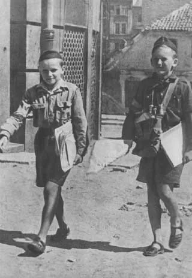

# Stacja 1. Plan „Burza” — depesza z zaszyfrowanej teczki

## Przeczytaj informację
W 1944 r. AK realizowała akcję „Burza”. Jej oddziały miały występować przeciw wycofującym się Niemcom. Równocześnie przedstawiciele Polskiego Państwa Podziemnego chcieli ujawnić się wobec wkraczającej Armii Czerwonej jako polska władza i gospodarze wyzwalanego terenu.

## Wykonaj misję
W teczce Mai, fikcyjnej piętnastoletniej pomocnicy Harcerskiej Poczty Polowej, leży **współczesny szyfr dydaktyczny** — nie autentyczny kod AK. Nie odgrywacie Mai ani walki: odczytujecie dokument jak badacze.

Szyfr przesuwa każdą literę o cztery miejsca. Aby odczytać tekst, znajdź literę w dolnym wierszu i odczytaj literę nad nią.

```text
tekst jawny: A B C D E F G H I J K L M N O P Q R S T U V W X Y Z
szyfr:       E F G H I J K L M N O P Q R S T U V W X Y Z A B C D
```

`EO ACWXITYNI NEOS TSPWOE APEHDE`

1. Odszyfruj meldunek.
2. Wpisz do pieczęci `WOJSKOWA` cel działań AK, a do pieczęci `POLITYCZNA` cel ujawnienia władz podziemnych.

### Wyzwanie dodatkowe ★
Dopisz jedno zdanie: dlaczego cel wojskowy i polityczny nie były tym samym?

**Poziom:** średni → trudny<br>
*Źródło: ZPE, „Plan «Burza» – powstanie warszawskie”, sekcje „Plan «Burza»” i „Cele”.*

<!-- page -->

# Stacja 2. Poczta, która łączyła — filtr cenzora



## Przeczytaj informację
W czasie powstania Harcerska Poczta Polowa pomagała rozdzielonym rodzinom przekazywać wiadomości. Korespondencja była bezpłatna, ograniczona do 25 słów i podlegała cenzurze. Krótki, wiarygodny list mógł zmniejszać niepewność o los bliskich.

## Wykonaj misję
Maja chce przekazać rodzinie wiadomość. Najpierw działacie jak cenzorzy: wybierzcie trzy elementy, które można przekazać bez ujawniania miejsca, tras, nazw oddziałów ani danych mogących narazić innych.

- A. „Jestem z mamą i czekamy na wiadomość.”
- B. „Jesteśmy przy barykadzie na ulicy …”.
- C. „Proszę, dajcie znać, czy u was jest bezpiecznie.”
- D. „Oddział wyrusza o … w kierunku …”.
- E. „Myślimy o was. Nie martwcie się na zapas.”

1. Wpisz trzy litery do ramki „przepuszczone przez cenzurę”.
2. Napisz własny **fikcyjny list do 25 słów** z bezpiecznych informacji.

### Wyzwanie dodatkowe ★
Wyjaśnij, dlaczego wiadomość „Żyję” mogła znaczyć więcej niż długa relacja.

**Poziom:** średni → kreatywny<br>
*Źródło: BohaterON w Twojej Szkole, materiały edukacyjne; Muzeum Warszawy, „Powstańcza poczta polowa”. Fotografia: Tadeusz Bukowski, domena publiczna — metryka w `sources.md`.*

<!-- page -->

# Stacja 3. Punkt pomocy — trzy znaki, trzy funkcje

## Przeczytaj informację
W prowizorycznych punktach pomocy brakowało wody, lekarstw, bandaży i bezpiecznych miejsc dla rannych. Pomoc otrzymywali uczestnicy walk oraz mieszkańcy miasta. Sanitariuszki, sanitariusze i inne osoby wspierające musiały działać w warunkach zniszczeń, niedoboru i zagrożenia.

## Wykonaj misję
Nie ustalacie kolejności leczenia ani nie udajecie medyków. Projektujecie **czytelne znaki informacyjne** do szkolnej gabloty o tym, jakiej pomocy potrzebowano.

1. Na karcie drużyny narysuj po jednym prostym symbolu przy hasłach: `woda`, `bandaż`, `koc`.
2. Połącz każdy symbol z jego historyczną funkcją: `podstawowa higiena i potrzeby`, `opatrunki`, `ciepło / osłona`.
3. Dopisz do jednego symbolu krótki komunikat „Brakuje…”, wykorzystując słowo z informacji.

### Wyzwanie dodatkowe ★
Zapisz jedno pytanie, na które ten tekst **nie pozwala odpowiedzieć** bez dodatkowego źródła (np. dotyczące konkretnej osoby lub decyzji medycznej). Dopisz: „Nie wiem, ponieważ…”.

**Poziom:** średni → analityczny<br>
*Źródło: ZPE, „Powstanie warszawskie”; BohaterON w Twojej Szkole, materiały edukacyjne.*

<!-- page -->

# Stacja 4. Droga pod miastem — misja kartografów

## Przeczytaj informację
Na przełomie sierpnia i września 1944 r. Stare Miasto było odcięte. Niemcy kontrolowali ważne ulice i przejścia naziemne. Część powstańców, rannych i cywilów ewakuowano kanałami do Śródmieścia. Po zdobyciu Pragi wojska sowieckie pozostawały na prawym, czyli wschodnim, brzegu Wisły.

## Wykonaj misję
Na mapie na drugiej stronie karty drużyny:

1. wpisz `S` przy **Starym Mieście** i `Ś` przy **Śródmieściu**;
2. poprowadź od `S` do `Ś` **przerywaną linię** i podpisz ją `kanały`;
3. obwiedź Wisłę, a po jej wschodniej stronie wpisz `Praga`;
4. zaznacz kółkiem Wolę i wpisz `VIII` — miesiąc niemieckich zbrodni na ludności cywilnej.

Nie rekonstruujecie przejścia kanałami. Odczytujecie mapę i pokazujecie, jak położenie dzielnic wpływało na możliwości przemieszczania się.

### Wyzwanie dodatkowe ★
Dokończ podpis do legendy: „Kanały były drogą ratunku, ale jednocześnie…”.

**Poziom:** średni → trudny<br>
*Źródło mapy i informacji: ZPE, „Powstanie warszawskie”, materiał mapowy oraz opis ewakuacji kanałami.*

<!-- page -->

# Stacja 5. 63 dni — redakcja wydania specjalnego

## Przeczytaj informację
Powstanie rozpoczęło się 1 sierpnia 1944 r. o 17.00 — w Godzinie „W”. Trwało 63 dni i zakończyło się kapitulacją 2 października. W czasie powstania Niemcy dokonywali zbrodni na ludności cywilnej, m.in. na Woli. Po kapitulacji większość ocalałych mieszkańców wypędzono, a Niemcy kontynuowali niszczenie Warszawy.

## Wykonaj misję
Redakcja Mai otrzymała pięć depesz. Zbudujcie z nich jedną uczciwą stronę kroniki.

| Znak | Depesza |
|---|---|
| A | 1 sierpnia, godz. 17.00: Godzina „W”, początek powstania. |
| B | Pierwsze dni sierpnia: niemieckie masowe mordy ludności cywilnej na Woli. |
| C | Przełom sierpnia i września: obrona Starówki oraz ewakuacja części ludzi kanałami. |
| D | 18 września: największy amerykański zrzut nad Warszawą. |
| E | 2 października: kapitulacja po 63 dniach. |

1. Wpisz na osi czasu znaki A–E we właściwej kolejności.
2. Obok depeszy dotyczącej bezpośrednio cywilów wpisz `CYW.`.
3. Ułóż nagłówek wydania specjalnego z 5–8 słów i wybierz jeden skutek dla `ludzi` oraz jeden dla `miasta`.

### Wyzwanie dodatkowe ★
Dopisz zdanie: „Faktem jest, że…”, które nie zawiera oceny decyzji dowódców.

**Poziom:** średni → wymagający<br>
*Źródło: ZPE, „Powstanie warszawskie” (kalendarz powstania); Muzeum Powstania Warszawskiego, „Kartki z kalendarza”.*
