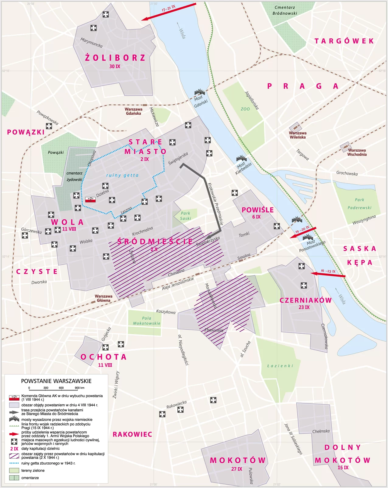

# Akcja „Burza” i powstanie warszawskie — karta drużyny

**Nazwa grupy:** ____________________________________________<br>
**Osoby w grupie:** ______________________________________________________________

**Rama pracy:** Fikcyjna Maja pomaga w Harcerskiej Poczcie Polowej. Nie odgrywamy wydarzeń ani walki — wykonujemy misje na podstawie informacji historycznych.

## 1. Plan „Burza” — depesza z teczki

**Odszyfrowany meldunek:**

`________________________________________________________________________`

| Pieczęć WOJSKOWA — cel AK | Pieczęć POLITYCZNA — cel władz podziemnych |
|---|---|
|  |  |
|  |  |

★ **Dlaczego te cele nie były tym samym?**

`________________________________________________________________________`

## 2. Poczta, która łączyła — filtr cenzora

**Przepuszczone przez cenzurę: trzy litery** `________`

**Fikcyjny list, maks. 25 słów:**

`________________________________________________________________________`

`________________________________________________________________________`

★ **Dlaczego krótka wiadomość mogła mieć wielkie znaczenie?**

`________________________________________________________________________`

## 3. Punkt pomocy — znaki informacyjne

| woda — symbol i funkcja | bandaż — symbol i funkcja | koc — symbol i funkcja |
|---|---|---|
|  |  |  |
|  |  |  |

**Komunikat „Brakuje…”:** `___________________________________________________`

★ **Nie wiem, ponieważ…**

`________________________________________________________________________`

<!-- page -->

# Karta drużyny — mapa i kronika

## 4. Droga pod miastem — misja kartografów

Wykonaj oznaczenia: `S`, `Ś`, przerywana trasa `kanały`, Wisła/`Praga` oraz Wola/`VIII`.



★ **Kanały były drogą ratunku, ale jednocześnie**

`________________________________________________________________________`

## 5. 63 dni — redakcja wydania specjalnego

```text
1 VIII ───────── pierwsze dni VIII ───────── przełom VIII/IX ───────── 18 IX ───────── 2 X
  ______                   ______                    ______                  ______        ______
```

**Depesza o cywilach: ______  Nagłówek (5–8 słów):**

`________________________________________________________________________`

| Skutek dla ludzi | Skutek dla miasta |
|---|---|
|  |  |

★ **Faktem jest, że…**

`________________________________________________________________________`

## Bilet wyjścia — każdy członek grupy zapisuje własne zdanie

**Akcja „Burza” i powstanie warszawskie łączyły się, ponieważ**

`________________________________________________________________________`
