<!-- .slide: id="otwarcie" class="cover" data-purpose="opening" data-layout="hero-source" -->

Polska · 1943–1945
<h1>Sprawa polska pod koniec wojny</h1>
Koniec okupacji. Czy także pełna wolność?

<figure>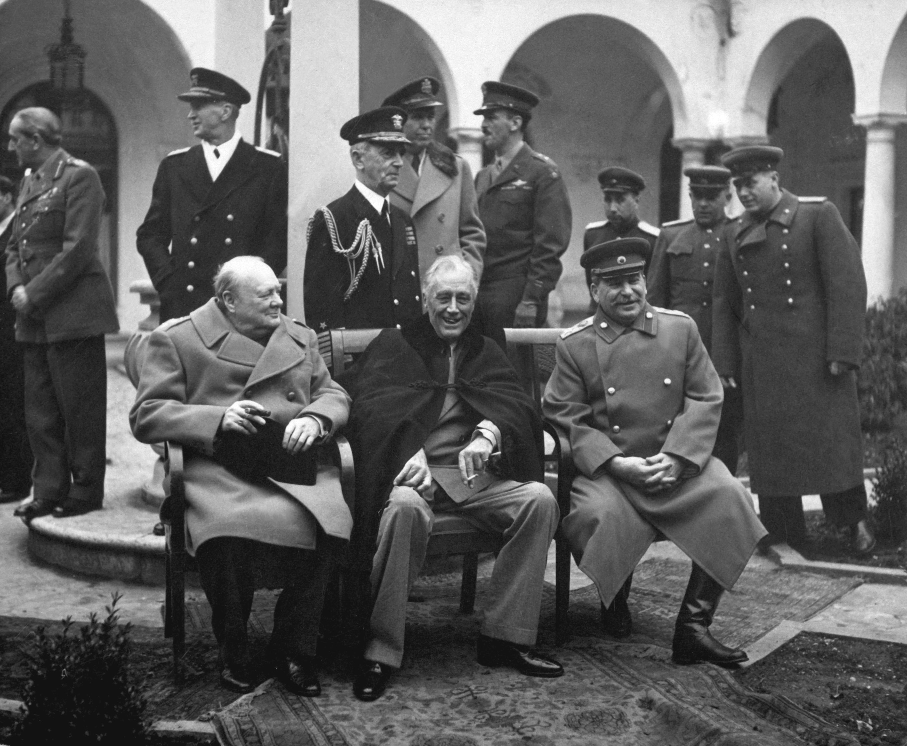</figure>

notes:
0–1 min. Rozpoczęcie: „Wyobraźcie sobie, że kończy się wojna. Niemcy przegrywają, ale o granicach waszego kraju i jego władzach rozmawiają przywódcy innych państw. Czy koniec wojny musi oznaczać odzyskanie wolności? Dzisiaj sprawdzimy to na przykładzie Polski”. Fotografia z Jałty jest zapowiedzią, nie początkiem chronologii. Nie oczekuj jeszcze odpowiedzi.

---

<!-- .slide: id="dwa-pytania" class="" data-purpose="explanation" data-layout="comparison" -->
<h2>Kto wyznaczy granice? Kto obejmie władzę?</h2>

Granice
Gdzie będzie Polska?

Władza
Kto będzie nią rządził?

<b>Suwerenność</b> — możliwość samodzielnego podejmowania decyzji przez państwo.

notes:
1–2 min. Przypomnij: legalne władze RP działały na uchodźstwie w Londynie; w kraju reprezentowały je struktury Polskiego Państwa Podziemnego. Stalin dążył do podporządkowania Polski. Wielka Brytania i USA potrzebowały ZSRS jako sojusznika przeciw Niemcom. Wyjaśnij różnicę między wyzwoleniem spod okupacji a samodzielnością polityczną.

---

<!-- .slide: id="teheran" class="" data-purpose="explanation" data-layout="split" -->
<h2>Teheran: decyzje bez Polski</h2>

28 XI–1 XII 1943
<ul><li><b>Józef Stalin</b> — ZSRS.</li><li><b>Franklin D. Roosevelt</b> — USA.</li><li><b>Winston Churchill</b> — Wielka Brytania.</li><li>Wstępna zgoda na przesunięcie Polski na zachód.</li></ul>
<figure>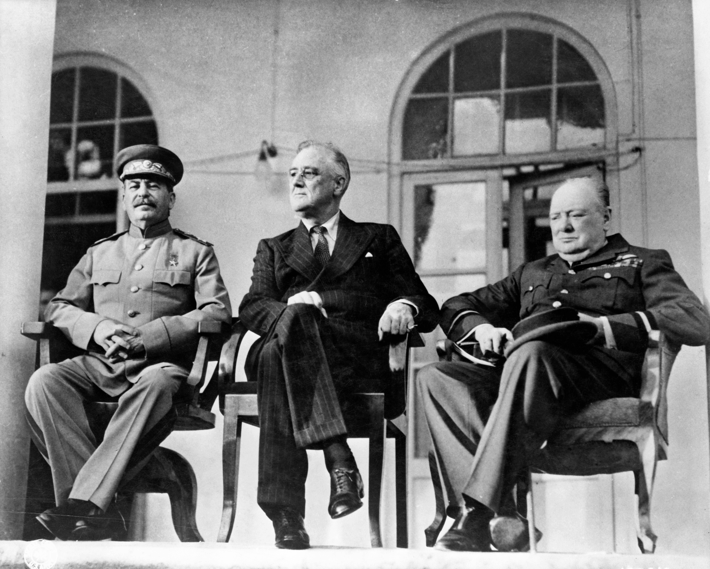<figcaption>W obradach nie uczestniczyli przedstawiciele Polski.</figcaption></figure>

notes:
2–3.5 min. Wyjaśnij: Wielka Trójka to przywódcy trzech mocarstw koalicji antyhitlerowskiej, nie trzy państwa polskie. W Teheranie zaakceptowano kierunek zmian: wschodnia granica wzdłuż linii Curzona, rekompensata kosztem Niemiec. Nie ustalono jeszcze kompletnej, ostatecznie wytyczonej granicy. Linia Curzona była wcześniejszą propozycją granicy; nie była granicą Polski z 1939 r.

---

<!-- .slide: id="mapa-teheran" class="full-map" data-purpose="evidence" data-layout="map-focus" -->
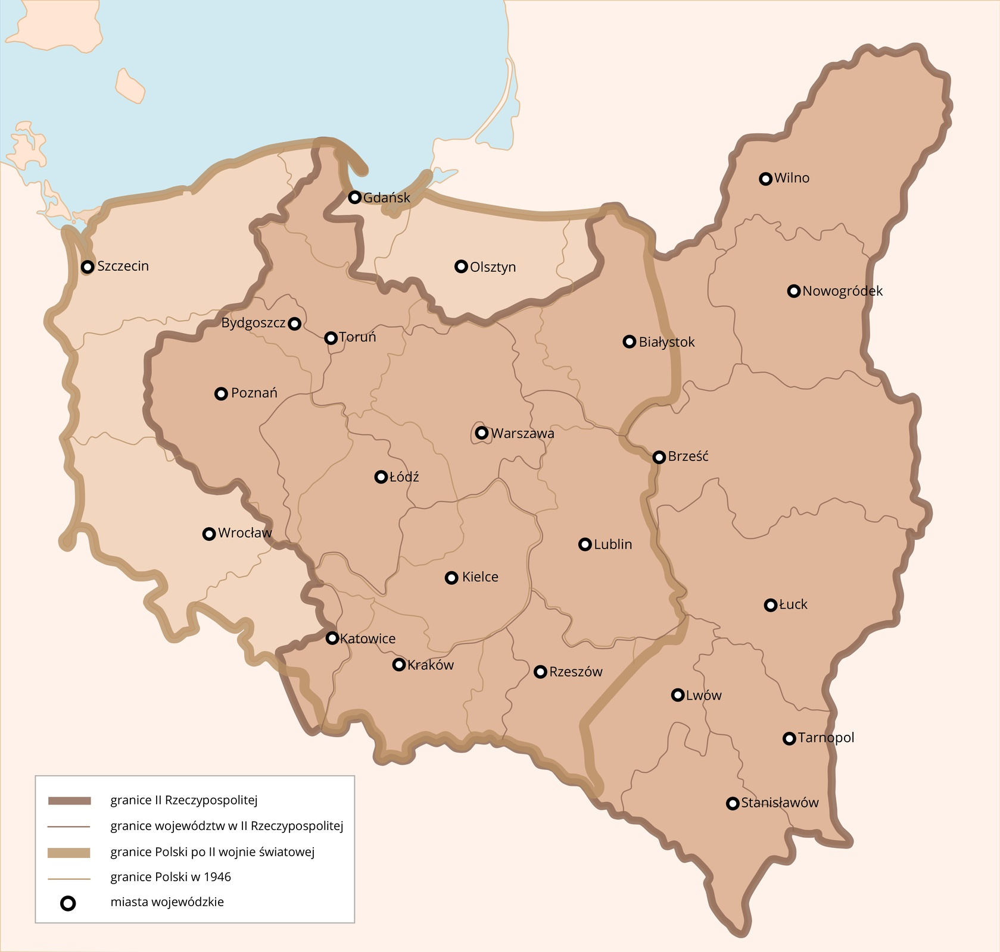

notes:
3.5–4 min. Orientacja po Teheranie: odszukaj w legendzie granice II RP i powojenne. Wskaż kierunek przesunięcia. To współczesne porównanie końcowego efektu, NIE mapa szczegółowych ustaleń Teheranu. Teheran zapoczątkował zgodę na kierunek zmian, nie ustalił wszystkich widocznych granic.

---

<!-- .slide: id="krn" class="" data-purpose="explanation" data-layout="split" -->
<h2>KRN — parlament bez wyborów</h2>

Noc 31 XII 1943 / 1 I 1944 · Warszawa
<ul><li><b>Krajowa Rada Narodowa</b> — samozwańczy organ mający pełnić funkcję parlamentu.</li><li>Utworzona z inicjatywy komunistycznej <b>PPR</b>.</li><li>Na czele: <b>Bolesław Bierut</b>.</li><li>Dominowali komuniści; dołączali związani z nimi działacze lewicowi.</li></ul>
<figure>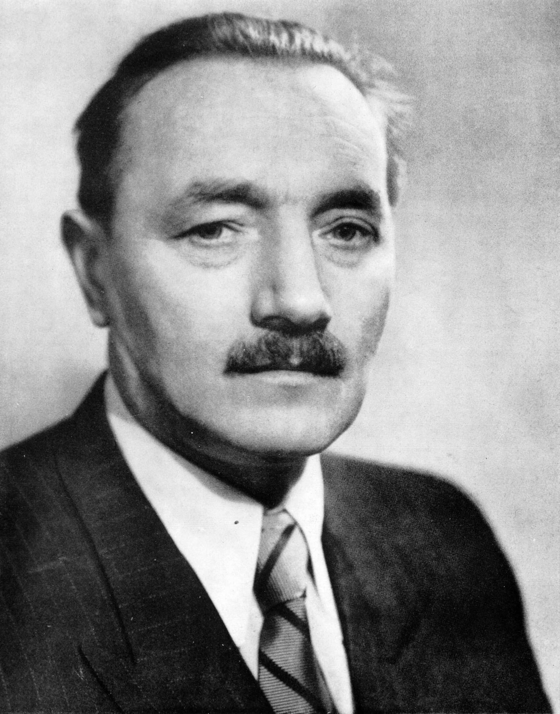<figcaption>Bolesław Bierut</figcaption></figure>

notes:
4–5.5 min. KRN nie została wybrana przez ogół obywateli. Miała stanowić konkurencyjny wobec władz RP i podziemia ośrodek władzy. PPR to Polska Partia Robotnicza. W pierwszym posiedzeniu przeważali działacze PPR; uczestniczyli m.in. Władysław Gomułka i Edward Osóbka-Morawski, działacz socjalistyczny. Nie przedstawiaj początkowego składu jako demokratycznej reprezentacji wszystkich partii. Ciekawostka 1: powołano ją na konspiracyjnym spotkaniu w noc sylwestrową. Portret Bieruta pochodzi z ok.1950 r.; służy identyfikacji osoby, nie dokumentuje powstaniaKRN.

---

<!-- .slide: id="armia-czerwona" class="red-rule" data-purpose="explanation" data-layout="statement" -->
<h2>1944: Niemcy ustępują, Stalin zyskuje wpływy</h2>
1944
<ul><li>Armia Czerwona przekracza <b>przedwojenną granicę Polski</b>.</li><li>Wypiera wojska niemieckie; wraz z nią walczą polskie oddziały utworzone w ZSRS.</li><li>Sowieci wspierają zależne od siebie polskie władze.</li></ul>
Koniec okupacji niemieckiej nie oznacza pełnej suwerenności.

notes:
5.5–6.5 min. Przedwojenną granicę przekroczono na początku stycznia 1944 r. Wyzwalano ziemie spod okupacji niemieckiej, ale ZSRS nie zamierzał oddać władzy legalnemu rządowi RP. Nie utożsamiaj każdego żołnierza Armii Czerwonej z decydentem politycznym; odróżnij wysiłek wojenny od polityki Stalina. Podkreśl, że granica przedwojenna przebiegała dalej na wschód niż obecna.

---

<!-- .slide: id="pkwn" class="" data-purpose="explanation" data-layout="split" -->
<h2>PKWN powstaje w Moskwie</h2>

21 VII 1944
<ul><li><b>Polski Komitet Wyzwolenia Narodowego</b> — tymczasowy organ władzy wykonawczej.</li><li>Powstaje pod patronatem Stalina, formalnie powołany przez KRN.</li><li>Przewodniczący: <b>Edward Osóbka-Morawski</b>.</li><li>Rywalizuje z rządem RP na uchodźstwie.</li></ul>
<figure class="small-portrait">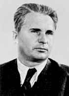<figcaption>Edward Osóbka-Morawski</figcaption></figure>

notes:
6.5–8 min. Oddziel radę od komitetu: KRN miała być parlamentem, PKWN miał wykonywać władzę, pełniąc rolę podobną do rządu. Nie był niezależnym, demokratycznie wybranym rządem. Ciekawostka 2: propaganda łączyła narodziny PKWN z Chełmem, choć rzeczywiście utworzono go w Moskwie. Lublin stał się następnie jego siedzibą.

---

<!-- .slide: id="manifest-pytania" class="" data-purpose="practice" data-layout="activity-brief" -->
<h2>Kto według autorów ma prawo rządzić?</h2>
<ol><li>Wskaż, kogo autorzy uznają za źródło legalnej władzy.</li><li>Jak przedstawiają rząd RP w Londynie?</li></ol>

Przeczytaj fragment Manifestu. Odpowiedz własnymi słowami.

notes:
8–8.5 min. Pokaż pytania przed tekstem. Powiedz, że to deklaracja polityczna nowych władz, a nie bezstronny opis. Nie podawaj odpowiedzi. Kolejny slajd zostaje na czas czytania i rozmowy.

---

<!-- .slide: id="manifest" class="reading" data-purpose="evidence" data-layout="evidence" -->
<h2>Manifest PKWN</h2><figure class="source-document">
22 VII 1944 · fragment, skróty oznaczone […]
<blockquote class="manifest">„Krajowa Rada Narodowa, powołana przez walczący naród, jest jedynym legalnym źródłem władzy w Polsce. Emigracyjny «rząd» w Londynie i jego delegatura w Kraju jest władzą samozwańczą, władzą nielegalną [...]. Dlatego Krajowa Rada Narodowa, tymczasowy parlament narodu polskiego, powołała POLSKI KOMITET WYZWOLENIA NARODOWEGO jako legalną tymczasową władzę wykonawczą [...]”.</blockquote></figure>

notes:
8.5–10.5 min. Odczytaj fragment i zostaw chwilę na namysł. Klucz: KRN została przedstawiona jako jedyne legalne źródło władzy, PKWN jako władza wykonawcza, a legalny rząd emigracyjny jako samozwańczy. To zabieg propagandowy mający uzasadnić przejęcie władzy. Odróżnij twierdzenie autorów od oceny historycznej. Manifest zapowiadał też swobody demokratyczne i reformy, w tym rolną. Nie twierdź, że PKWN w dokumencie nazywa się jedynym niepodległym rządem. Fragment opracowany z pełnego Manifestu; wielkie litery zachowane jako cecha dokumentu.

---

<!-- .slide: id="polska-lubelska" class="" data-purpose="explanation" data-layout="source-split" -->
<h2>Polska Lubelska</h2>
<ul><li><b>Lublin</b> staje się siedzibą PKWN.</li><li>„Polska Lubelska” — obszar pod władzą PKWN w drugiej połowie 1944 r.</li><li>Komuniści budują administrację i aparat bezpieczeństwa.</li><li><b>31 XII 1944:</b> PKWN → Rząd Tymczasowy.</li></ul>
<figure class="lublin-map">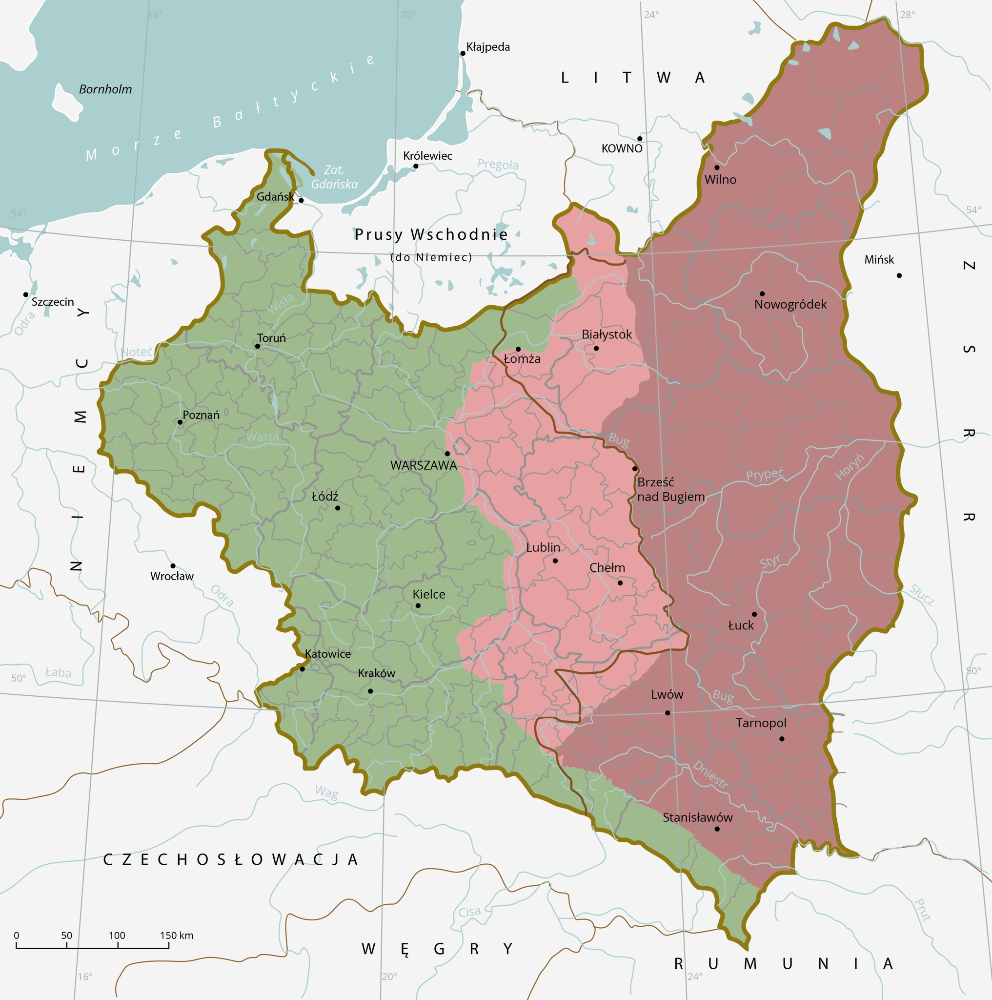<figcaption>Wrzesień 1944 r.  okupacja niemiecka  obszar pod kontrolą PKWN  okupacja sowiecka</figcaption></figure>

notes:
10.5–12 min. Orientacja na mapie: Wisła, Lublin, obszary opanowane we wrześniu 1944. Nie nazywaj Polski Lubelskiej odrębnym państwem. Najpierw Chełm, od początku sierpnia siedziba w Lublinie. Nazwa obejmuje szerszy obszar, nie samo miasto. Rząd Tymczasowy z końca 1944 r. to nie TRJN, który powstanie dopiero w czerwcu 1945 r.

---

<!-- .slide: id="notatka-1" class="note-slide" data-purpose="synthesis" data-layout="takeaways" -->
<h2>Zapisz teraz: droga do władzy</h2>
Notatka · część 1 z 3

<b>1943, Teheran:</b> mocarstwa wstępnie godzą się na przesunięcie Polski na zachód.

<b>1944:</b> KRN (Bierut) i PKWN (Osóbka-Morawski) tworzą zależny od ZSRS ośrodek władzy.

<b>22 VII:</b> Manifest PKWN. Lublin staje się siedzibą nowych władz.

notes:
12–13.5 min. 1,5 minuty na zapis. Nie dyktuj dodatkowych zdań. Uczniowie przepisują tę część lub uzupełniają trzy krótkie pola na karcie. Sprawdź, czy odróżniają Bieruta od Osóbki-Morawskiego. To pierwszy zabezpieczony moment notatki, nie zadanie po lekcji.

---

<!-- .slide: id="ak-przypomnienie" class="" data-purpose="explanation" data-layout="timeline-band" -->
<h2>AK: wojsko Polskiego Państwa Podziemnego</h2>
Armia Krajowa podlegała legalnym władzom RP na uchodźstwie.

<b>Stefan Rowecki</b>„Grot”
1942–1943

<b>Tadeusz Komorowski</b>„Bór”
1943–1944

<b>Leopold Okulicki</b>„Niedźwiadek”
1944–1945

Cel: walka o niepodległość, nie podporządkowanie Polski ZSRS.

notes:
13.5–14.5 min. Krótko przypomnij poprzednie tematy: podziemna armia i cywilne struktury państwa. Rowecki był dowódcą ZWZ przed przemianowaniem na AK; tu daty odnoszą się tylko do AK. Nie wymagaj zapamiętania dodatkowych dat dziennych. W akcji „Burza” oddziały AK podejmowały walkę z Niemcami, ujawniając się jako gospodarze terenu. Sowieci następnie rozbrajali i aresztowali część żołnierzy i dowódców.

---

<!-- .slide: id="ak-nie" class="" data-purpose="explanation" data-layout="photo-pair" -->
<h2>Rozwiązanie AK nie kończy represji</h2>

<figure>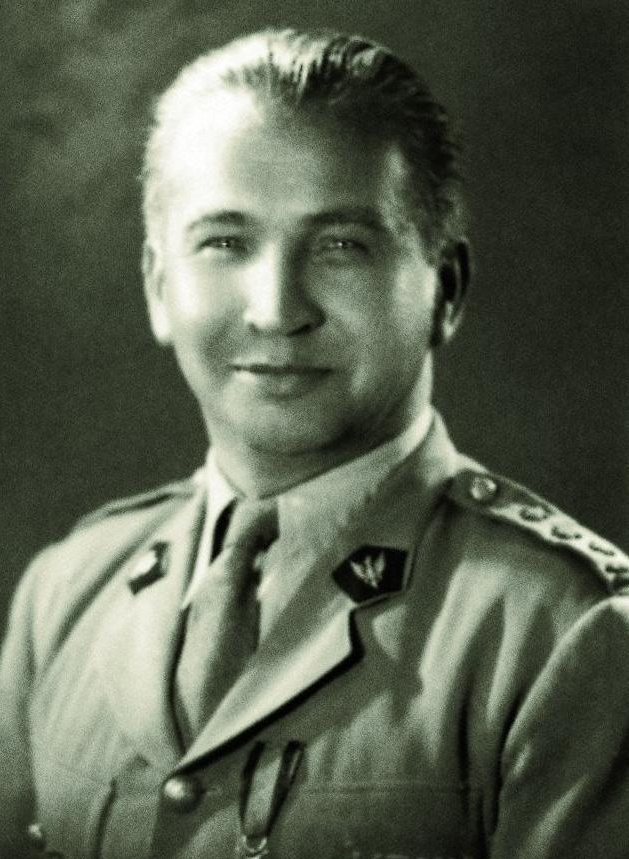<figcaption>Leopold Okulicki „Niedźwiadek”</figcaption></figure>
<b>19 I 1945</b> Rozkaz rozwiązania AK.

<figure>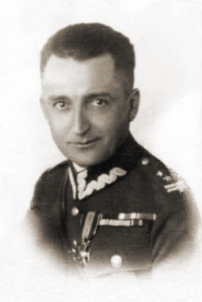<figcaption>August Emil Fieldorf „Nil”</figcaption></figure>
<b>„NIE” — Niepodległość</b> Przygotowania do dalszej konspiracji.

notes:
14.5–16 min. Okulicki rozwiązał AK w obliczu ofensywy sowieckiej, chcąc ograniczyć dalsze straty i represje; nie oznaczało to uznania władzy komunistycznej. Organizację „NIE” przygotowywano od 1943 r. do działalności w razie okupacji sowieckiej; kluczową rolę w jej organizowaniu pełnił Fieldorf. Miała zachować głęboko zakonspirowane kadry. Po aresztowaniach jej możliwości działania były niewielkie. Nie mów, że „NIE” powstała dopiero po rozwiązaniu AK ani że Fieldorf znalazł się w procesie szesnastu.

---

<!-- .slide: id="jalta" class="" data-purpose="explanation" data-layout="split" -->
<h2>Jałta: granica i obietnica wyborów</h2>

4–11 II 1945
<ul><li>Stalin, Roosevelt i Churchill.</li><li>Granica wschodnia zasadniczo wzdłuż <b>linii Curzona</b>.</li><li>Zapowiedź poszerzenia władz o polityków demokratycznych.</li><li>Obietnica <b>wolnych wyborów</b>.</li></ul>
<figure><figcaption>Wielka Trójka w Jałcie, luty 1945 r.</figcaption></figure>

notes:
16–17.5 min. Wróć do fotografii z otwarcia, teraz po poznaniu jej znaczenia. W Jałcie zdecydowano o reorganizacji istniejącego Rządu Tymczasowego, a nie prostym oddaniu władzy rządowi londyńskiemu. Na zachodzie i północy zapowiadano znaczące nabytki, ale szczegóły zachodniej granicy pozostawały do późniejszych ustaleń. Uczniowie nie przepisują; notatka po bloku. Rząd RP protestował przeciw ustaleniom narzuconym bez jego udziału.

---

<!-- .slide: id="mapa-jalta" class="full-map" data-purpose="evidence" data-layout="map-focus" -->

notes:
17.5–18 min. Po Jałcie: wskaż Wilno i Lwów, które pozostały poza powojenną Polską. Wyjaśnij, że granica wschodnia miała zasadniczo odpowiadać liniiCurzona z odchyleniami. Na tej mapie nie ma osobnego oznaczenia projektuCurzona; nie dorysowano go. To retrospektywne porównanie granic, nie mapa sporządzona wJałcie.

---

<!-- .slide: id="aresztowanie" class="" data-purpose="explanation" data-layout="process" -->
<h2>Zaproszenie na rozmowy okazuje się pułapką</h2>

<b>27–28 III 1945</b>
Przywódcy podziemia przybywają na rozmowy z Sowietami.

<b>Pruszków → Moskwa</b>
NKWD aresztuje ich mimo gwarancji bezpieczeństwa.

<b>Cel Stalina</b>
Usunąć niezależne kierownictwo Polskiego Państwa Podziemnego.

notes:
18–19 min. NKWD to sowiecka policja polityczna. Zatrzymano m.in. Okulickiego, delegata rządu Jana Stanisława Jankowskiego i przewodniczącego RJN Kazimierza Pużaka. RJN, Rada Jedności Narodowej, reprezentowała partie podziemia związanego z legalnymi władzami RP; nie mylić z komunistyczną KRN. Zaproszenie wiązało się z rozmowami o realizacji postanowień jałtańskich. Sowieci pozbawili niezależny obóz ważnych przedstawicieli przed tworzeniem nowych władz.

---

<!-- .slide: id="proces" class="" data-purpose="explanation" data-layout="split" -->
<h2>Proces szesnastu</h2>

18–21 VI 1945 · Moskwa
<ul><li><b>Proces pokazowy</b> — służy celom politycznym, nie uczciwemu ustaleniu winy.</li><li>Przywódcom podziemia zarzucono działania przeciw ZSRS.</li><li>Wyroki więzienia; część skazanych nie wróciła do Polski.</li></ul>
<figure>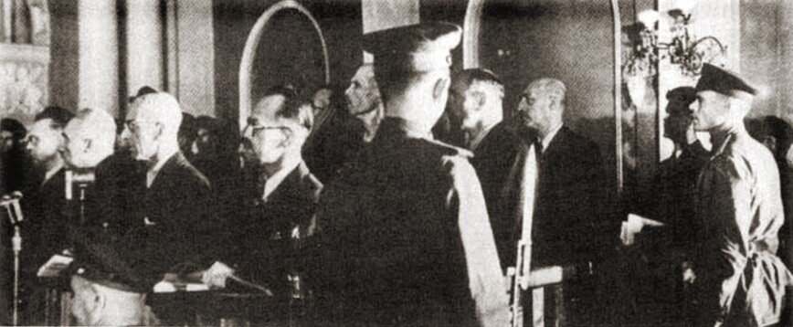<figcaption>Przywódcy Polskiego Państwa Podziemnego przed sowieckim sądem.</figcaption></figure>

notes:
19–20.5 min. Przyczyna: dążenie do usunięcia politycznych przeciwników dominacji ZSRS. Przebieg: podstępne zatrzymanie, wywiezienie, śledztwo i polityczny proces. Skutek: osłabienie niezależnego podziemia i ułatwienie komunistom utrwalania władzy. Okulicki dostał 10 lat, Jankowski 8; obaj zmarli w sowieckich więzieniach. Nie twierdź, że wszyscy otrzymali wyroki: trzech uniewinniono, a Antoniego Pajdaka sądzono oddzielnie. Nazwa „szesnastu” obejmuje grupę zatrzymanych.

---

<!-- .slide: id="film" class="optional" data-purpose="reference" data-layout="activity-brief" -->
<h2>Obejrzyj: jak usuwano przeciwników?</h2>

Krótki film: <b>Początki władzy komunistów w Polsce</b>

Około 1 min 46 s · polskie napisy
<a class="film-link" href="https://zpe.gov.pl/a/przeczytaj/DzBlgNIim" target="_blank" rel="noopener">Otwórz film w ZPE</a>

Po filmie wyjaśnij jednym zdaniem: <b>jak aresztowania pomagały przejmować władzę?</b>

notes:
Opcjonalny film, poza rdzeniem. Opcjonalny dodatek, poza 35,5-minutowym rdzeniem. ZPE, film pod zdjęciem ławy oskarżonych. Zweryfikowane: polskie napisy, długość HLS 105,96 s; bez potwierdzonego odsłuchu. Nie nazywaj go w całości filmem z epoki — to współczesny materiał edukacyjny. Przy braku internetu pomiń i użyj poprzedniego zdjęcia jako planu B. W dostępnym tekście filmu znajduje się zbyt szerokie objaśnienie bezprawności sądzenia przedstawicieli innego państwa; nie powtarzaj go jako ogólnej zasady prawa. Bezpieczniejszy rdzeń to fakt podstępu i politycznego charakteru procesu.

---

<!-- .slide: id="trjn" class="" data-purpose="explanation" data-layout="split" -->
<h2>TRJN: kompromis z przewagą komunistów</h2>

28 VI 1945 · Tymczasowy Rząd Jedności Narodowej
<ul><li>Premier: <b>Edward Osóbka-Morawski</b>.</li><li>Wicepremierzy: <b>Władysław Gomułka</b> i <b>Stanisław Mikołajczyk</b>.</li><li>Mikołajczyk liczy na legalną działalność i wolne wybory.</li><li>Komuniści zachowują przewagę i kontrolę aparatu bezpieczeństwa.</li></ul>

<figure class="small-portrait"><figcaption>Edward Osóbka-Morawski premier</figcaption></figure><figure>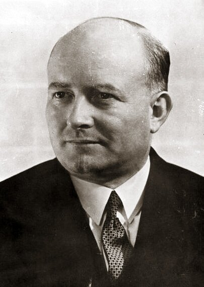<figcaption>Stanisław Mikołajczyk wicepremier</figcaption></figure>

notes:
20.5–22 min. TRJN tworzono po rozmowach moskiewskich, równolegle z procesem przywódców podziemia. Mikołajczyk był byłym premierem na uchodźstwie, ale nie reprezentował zgody całego rządu emigracyjnego na ten kompromis. Został też ministrem rolnictwa. Osóbka-Morawski był socjalistą, nie każdy członek gabinetu był komunistą; mimo koalicyjnej nazwy przewagę mieli komuniści i ich sojusznicy. Nie wymagaj całej listy ministrów. Pokazano dwa osobne portrety, nie fotografię wspólnego wydarzenia.

---

<!-- .slide: id="testament-pytania" class="" data-purpose="practice" data-layout="activity-brief" -->
<h2>Jakiej Polski domagało się podziemie?</h2>
<ol><li>Znajdź dwa postulaty dotyczące niezależności od ZSRS.</li><li>Wskaż postulat dotyczący swobód politycznych.</li></ol>

<b>Postulat</b> — żądanie lub propozycja zmiany.

notes:
22–22.5 min. Najpierw pytania, dopiero potem pełny fragment z dostarczonej s.88. Wyjaśnij: Rada Jedności Narodowej była polityczną reprezentacją Polskiego Państwa Podziemnego; 1 lipca 1945 ogłosiła manifest ze swoim testamentem, kończąc działalność. Pięcioprzymiotnikowe wybory: powszechne, równe, bezpośrednie, tajne i proporcjonalne. Przed lekturą wyjaśnij tylko te terminy, nie wskaż gotowych numerów odpowiedzi.

---

<!-- .slide: id="testament" class="reading testament" data-purpose="evidence" data-layout="evidence" -->
<h2>Testament Polski Walczącej</h2><figure class="source-document">
1 lipca 1945 r. Rada Jedności Narodowej, która była polityczną reprezentacją Polskiego Państwa Podziemnego, wydała manifest do narodu polskiego i państw koalicji antyhitlerowskiej, uznawany za ostatni akt Polskiego Państwa Podziemnego. Manifest kończył się testamentem Polski Walczącej.

<i>Składają się nań następujące postulaty:</i>

1. Opuszczenie terytorium Polski przez wojska sowieckie oraz przez rosyjską policję polityczną.

2. Zaprzestanie prześladowań politycznych [...].

3. Zjednoczenie i uniezależnienie Armii Polskiej [...].

4. Zaprzestanie dewastacji gospodarczej kraju przez władze okupacyjne.

5. Dopuszczenie wszystkich polskich stronnictw demokratycznych do udziału w wyborach pięcioprzymiotnikowych. [...]

10. Swoboda walki dla klasy robotniczej o jej prawa w ramach nieskrępowanego ruchu zawodowego.

11. Sprawiedliwe przeprowadzenie reformy rolnej i kontrola narodu nad akcją osiedleńczą na odzyskanych Ziemiach Zachodnich i w Prusach Wschodnich.

12. Oparcie powszechnego, demokratycznego nauczania i wychowania na zasadach moralnych i duchowych dorobku cywilizacji zachodniej i naszego kraju.

</figure>

notes:
22.5–25.5 min. Zachowano cały fragment i wprowadzenie z podręcznika s.88, numery oraz wszystkie [...] wydawcy; usunięto jedynie dzielenie wyrazów na końcach wierszy. Nie jest to cały dokument historyczny. Daj około 1,5 minuty na czytanie, następnie dwie odpowiedzi z uzasadnieniem w tekście. Klucz: niezależność — np. pkt1 wycofanie wojsk i policji sowieckiej, pkt3 niezależna armia; pkt4 koniec gospodarczego podporządkowania. Swobody polityczne — pkt2 lub5. W razie pytania o podręcznikowe zadanie2: postulaty reformy rolnej i powszechnego nauczania mogły częściowo współbrzmieć z programem komunistów; nie oznacza to realizacji całego postulatu, demokracji ani uznania radzieckiej kontroli. Odpowiedzi nauczyciel-side.

---

<!-- .slide: id="notatka-2" class="note-slide" data-purpose="synthesis" data-layout="takeaways" -->
<h2>Zapisz teraz: obietnice i represje</h2>
Notatka · część 2 z 3

<b>1945, Jałta:</b> linia Curzona i obietnica wolnych wyborów.

<b>Represje:</b> aresztowania podziemia i proces szesnastu w Moskwie.

<b>28 VI:</b> powstaje TRJN. Mikołajczyk podejmuje próbę kompromisu, ale komuniści zachowują przewagę.

notes:
25.5–27 min. 1,5 minuty na zapis lub uzupełnienie pól. Dodatkowo ustnie przypomnij: AK rozwiązano 19 stycznia1945, Testament1lipca1945. Nie dopisuj tych dat jako kolejnych zdań do przepisania. Każdy ma już w zeszycie dwa główne bloki, nawet jeśli dalszy czas się skróci.

---

<!-- .slide: id="poczdam" class="" data-purpose="explanation" data-layout="split" -->
<h2>Poczdam: Polska podąża na zachód</h2>

17 VII–2 VIII 1945
<ul><li><b>Stalin</b> — ZSRS; <b>Harry Truman</b> — USA.</li><li>Wielka Brytania: <b>Churchill</b>, potem <b>Clement Attlee</b>.</li><li>Ziemie na wschód od Odry i Nysy Łużyckiej pod polską administracją.</li><li>Uzgodnienia dotyczą także przesiedlenia ludności niemieckiej.</li></ul>
<figure>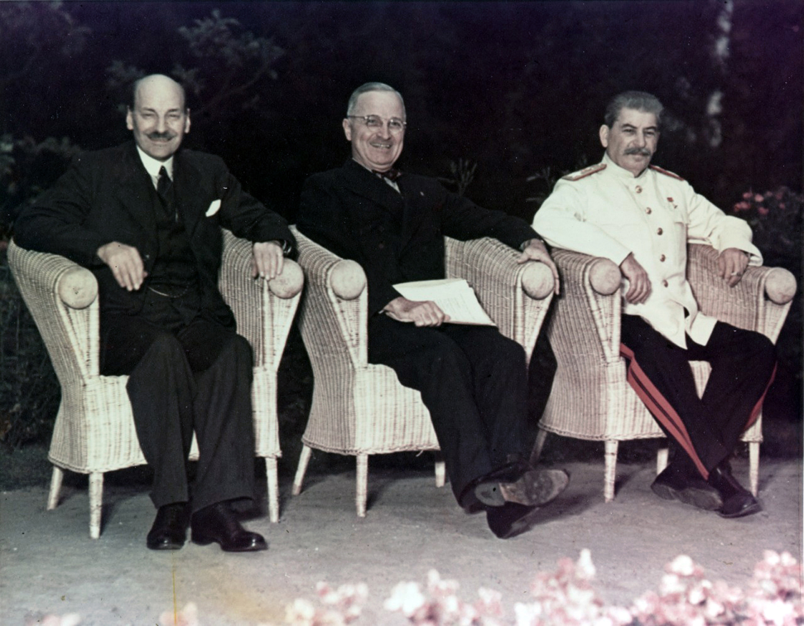<figcaption>Od lewej: Attlee, Truman, Stalin. 1 VIII 1945 r.</figcaption></figure>

notes:
27–28.5 min. Roosevelt zmarł w kwietniu1945, zastąpił go Truman. Ciekawostka3: premier Wielkiej Brytanii zmienił się w trakcie konferencji po wyborach — Churchilla zastąpił Attlee. Na fotografii od lewej Attlee, Truman i Stalin; zdjęcie wykonano1sierpnia1945. W Poczdamie powierzono polskiej administracji dawne ziemie niemieckie i postanowiono o transferach ludności; ostateczne uregulowanie zachodniej granicy odłożono do traktatu pokojowego. Nie przedstawiaj konferencji jako jednego ostatecznego traktatu granicznego.

---

<!-- .slide: id="mapa-granic" class="full-map" data-purpose="evidence" data-layout="map-focus" -->

notes:
28.5–30.5 min. Mapa na całą planszę, bez podpisu zmniejszającego obraz. Wskaż najpierw granicę1939, potem powojenną, utracone ziemie na wschodzie i przyłączone na zachodzie/północy. Zadanie ustne: „Wskaż jedną ziemię utraconą i jedną przyłączoną”. Przykłady: Lwów/Wilno poza Polską; Wrocław/Szczecin w Polsce. Powiąż trzy konferencje: Teheran — wstępny kierunek; Jałta — wschód i sprawa władz; Poczdam — administracja na zachodzie. Sama mapa nie oznacza, że wszystkie decyzje podjęto jednego dnia. Kliknięcie powiększa ją bez źródeł. Mapa ma legendę granicII RP, granic powojennych i województw1946; nie zawiera osobnej liniiCurzona. Nie utożsamiaj każdej linii powojennej z pierwotnym projektemCurzona. Zwróć uwagę na Gdańsk i obszar dawnych PrusWschodnich.

---

<!-- .slide: id="londyn" class="" data-purpose="explanation" data-layout="split" -->
<h2>Rząd na uchodźstwie nie znika</h2>
<ul><li>Większość państw uznaje <b>TRJN</b>.</li><li><b>5 VII 1945:</b> USA i Wielka Brytania cofają uznanie rządowi RP w Londynie.</li><li>Rząd emigracyjny protestuje i nadal działa, lecz traci wpływ na sytuację w kraju.</li><li>Emigracyjne władze RP kończą misję w <b>1990 r.</b></li></ul>
<figure>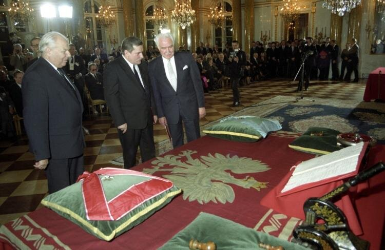<figcaption>22 XII 1990 — symboliczne zakończenie misji władz na uchodźstwie.</figcaption></figure>

notes:
30.5–32 min. Uznanie dyplomatyczne oznacza traktowanie danych władz jako reprezentacji państwa w stosunkach międzynarodowych — nie dowodzi demokratycznego wyboru. Większość mocarstw uznała TRJN, ale nie wszystkie państwa uczyniły to jednocześnie. Rząd londyński, kierowany w1945 przez Tomasza Arciszewskiego, nie zniknął na skutek cofnięcia uznania. Dla klasyVIII odpowiedź: do1990 r.; Rada Narodowa, czyli emigracyjny organ parlamentarny, zakończyła działalność w1991. Nie oznacza to, że rząd zakończył misję dopiero w1991. Nie utożsamiaj prezydenta Kaczorowskiego z premierem.

---

<!-- .slide: id="notatka-3" class="note-slide" data-purpose="synthesis" data-layout="takeaways" -->
<h2>Zapisz teraz: granice i suwerenność</h2>
Notatka · część 3 z 3

<b>1945, Poczdam:</b> ziemie na zachodzie i północy pod polską administracją.

Polska traci Kresy Wschodnie i otrzymuje ziemie kosztem Niemiec.

Okupacja niemiecka kończy się, lecz Polska pozostaje zależna od ZSRS.

notes:
32–33.5 min. Ostatni, krótki zapis. Nie każ przepisywać dodatkowo podsumowania z następnego slajdu. Jeśli uczniowie korzystają z karty, uzupełniają część3. Wskazuj na mapie sens słowa „przesunięcie”, nie przedstawiaj zmiany jako przesunięcia identycznego konturu.

---

<!-- .slide: id="podsumowanie" class="" data-purpose="synthesis" data-layout="takeaways" -->
<h2>Zapamiętaj cztery rzeczy</h2><ol class="recap"><li>O granicach Polski decydowała <b>Wielka Trójka</b>.</li><li><b>KRN i PKWN</b> tworzyły władze zależne od ZSRS.</li><li>Niezależne podziemie osłabiano <b>represjami</b>.</li><li><b>TRJN</b> uzyskał uznanie, ale Polska nie odzyskała pełnej suwerenności.</li></ol>

notes:
33.5–34.5 min. Zakończenie: „W1945 roku skończyła się okupacja niemiecka, ale Polska nie mogła samodzielnie decydować o swoim ustroju i władzach. Mocarstwa przesunęły jej granice, a komuniści przy wsparciu Stalina zdobywali kontrolę nad państwem. Dlatego koniec wojny nie był dla Polski prostym powrotem do pełnej wolności”. Nie otwieraj tematu referendum1946 i sfałszowanych wyborów1947 jako kolejnego pełnego bloku.

---

<!-- .slide: id="na-koniec" class="" data-purpose="exit-ticket" data-layout="activity-brief" -->
<h2>Koniec wojny to nie zawsze pełna wolność</h2>

Wyjaśnij własnymi słowami:

Dlaczego koniec okupacji niemieckiej nie oznaczał pełnej suwerenności Polski?

Podaj <b>jeden konkretny przykład</b> z lekcji.

notes:
34.5–35.5 min. Każdy formułuje odpowiedź w myślach lub jednym zdaniem pod notatką, potem przyjmij2–3 odpowiedzi. Model: o granicach i władzach decydowano pod naciskiem ZSRS, a przeciwników politycznych aresztowano; przykład proces szesnastu albo podporządkowaniePKWN. Nie pokazuj odpowiedzi w widoku ucznia. Gdy brakuje czasu, pytanie ustne, bez kolejnego długiego zapisu.
