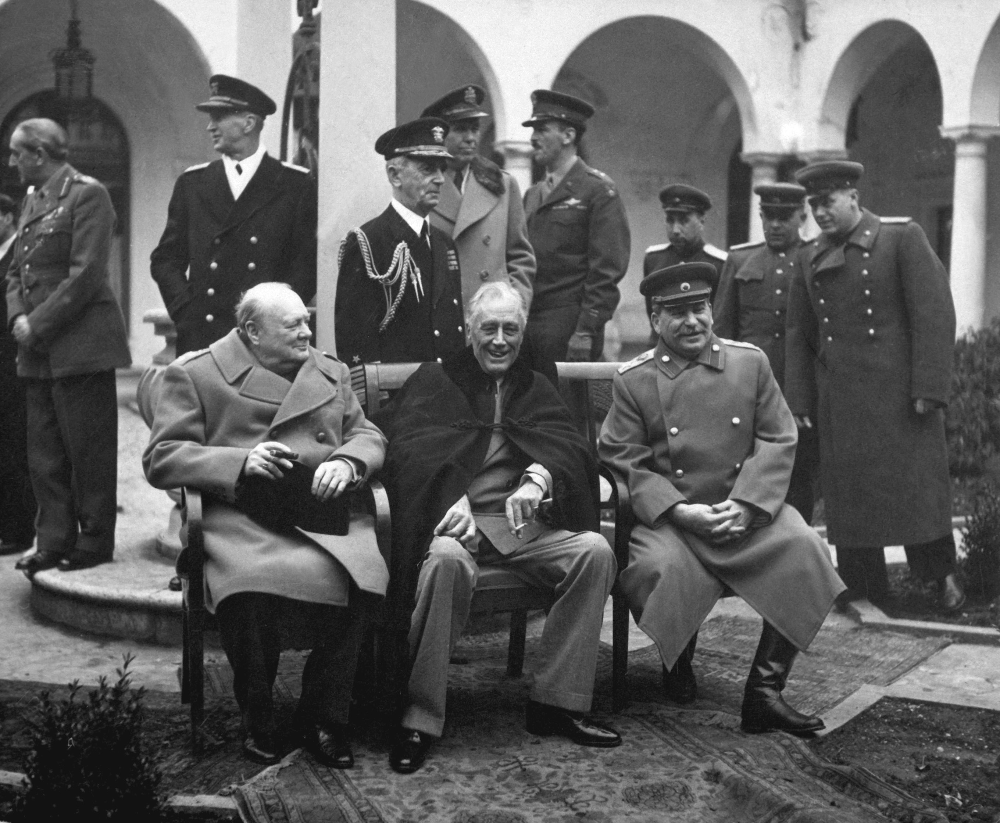

# Sprawa polska pod koniec wojny

Polska 1943–1945 · notatka do zeszytu

Jałta, luty 1945 r. · fotografia z epoki

Uzupełniaj samodzielnie podczas trzech przerw na zapis. Za każdym razem masz 1,5 minuty. Korzystaj ze slajdu; wpisuj tylko brakujące słowa.

## 1. Droga do władzy

Slajd 11 · 12:00–13:30 · 1,5 minuty

**1943, Teheran:** mocarstwa wstępnie godzą się na przesunięcie Polski na zachód.

**1944:** KRN (____________________) i PKWN (____________________________) tworzą zależny od ZSRS ośrodek władzy.

**22 VII:** Manifest PKWN. ____________________ staje się siedzibą nowych władz.

## 2. Obietnice i represje

Slajd 22 · 25:30–27:00 · 1,5 minuty

**1945, Jałta:** linia ____________________ i obietnica wolnych wyborów.

**Represje:** aresztowania podziemia i proces szesnastu w ____________________.

**28 VI:** powstaje TRJN. Mikołajczyk podejmuje próbę kompromisu, ale komuniści zachowują ____________________.

## 3. Granice i suwerenność

Slajd 26 · 32:00–33:30 · 1,5 minuty

**1945, Poczdam:** ziemie na zachodzie i północy pod polską ____________________.

Polska traci Kresy Wschodnie i otrzymuje ziemie kosztem ____________________.

Okupacja niemiecka kończy się, lecz Polska pozostaje zależna od ____________________.

Na zakończenie porównaj wpisy ze slajdami. Ustnie wyjaśnij: dlaczego koniec okupacji nie oznaczał pełnej suwerenności? Podaj jeden przykład.
