<!-- .slide: id="otwarcie" class="cover" data-purpose="opening" data-layout="hero-source" data-goals="G1 G2" -->

Klasa VIII · spotkanie z historią
<h1>Zbrodnie II wojny światowej</h1>
Ludzie, miejsca, wydarzenia. Od Wołynia do naszej okolicy.

<figure>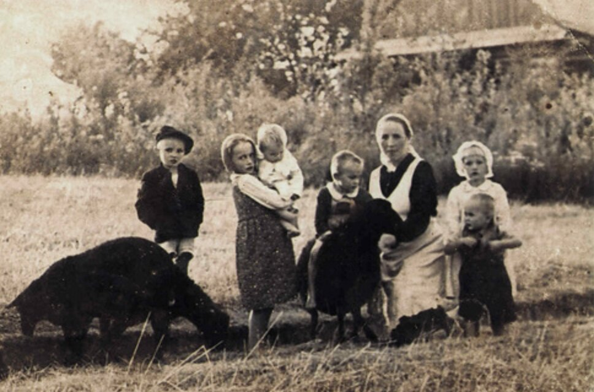</figure>

notes:
0.75 min. Zacznij od zwyczajnego życia, nie od statystyk: „Na zdjęciu jest rodzina, nie anonimowa liczba ofiar. Podczas wojny zamordowano ją za pomoc prześladowanym. Poznamy dziś różne zbrodnie, także bardzo blisko naszego domu”. Powiedz, że nie będzie drastycznych zdjęć. Fotografia przedstawia Wiktorię i sześcioro dzieci, nie wszystkich członków rodziny ani samą egzekucję. Nie prosimy uczniów o wyobrażanie sobie roli ofiary czy sprawcy.

---

<!-- .slide: id="pojecia" class="" data-purpose="explanation" data-layout="statement" data-goals="G1 G2" -->

<h2>Nie każda zbrodnia ma ten sam mechanizm</h2>

<b>Ludobójstwo</b> — działania podjęte z zamiarem zniszczenia w całości lub części grupy narodowej, etnicznej, rasowej albo religijnej.

<b>Terror</b>
Przemoc ma zastraszać ludność i łamać opór.

<b>Zagłada</b>
Niemiecki plan wymordowania europejskich Żydów.

<b>Pacyfikacja</b>
Brutalna akcja represyjna przeciw miejscowości i jej mieszkańcom.

notes:
1.25 min. Wyjaśnij różnicę między nazwą zbrodni a typem ofiar. Cywil to osoba nienależąca do sił zbrojnych; jeniec także podlega ochronie. W Katyniu ofiarami byli jeńcy i więźniowie, dlatego tytuł lekcji jest szerszy niż wyłącznie „ludność cywilna”. Definicja ludobójstwa jest skrótem sensu konwencji1948, nie pełnym wyliczeniem czynów. Pacyfikacja to termin historyczny, nie usprawiedliwienie. Nie wszystkie pokazane wydarzenia były częścią tego samego planu.

---

<!-- .slide: id="palmiry" class="case excerpt-case" data-purpose="explanation" data-layout="split" data-goals="G1 G2" -->

<h2>Palmiry — więźniowie wywożeni na śmierć</h2>

1939–1941 · Puszcza Kampinoska

Niemieckie SS i policja potajemnie rozstrzeliwują więźniów. W samych Palmirach mordują <b>ponad 1700 osób</b>.
<blockquote class="source-reading">„Egzekucje w Puszczy Kampinoskiej były następstwem działań ludobójczych trwających od początku okupacji niemieckiej. Wiosną 1940 roku represje przybrały na sile i rozpoczęła się „nadzwyczajna akcja pacyfikacyjna” (Ausserordentliche Befriedungsaktion). Jej celem była likwidacja wybitnych reprezentantów polskiego społeczeństwa. Przeszła do historii pod kryptonimem „Akcji AB”.”</blockquote>
Fragment współczesnego opracowania historycznego.

<figure>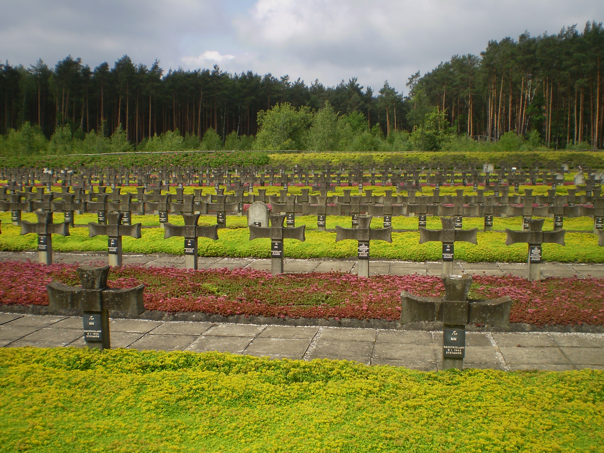<figcaption>Cmentarz — fotografia powojenna.</figcaption></figure>

notes:
1 min. 21 egzekucji, ponad1700ofiar w samych Palmirach1939–41 według MuzeumWarszawy. Pochowani na obecnym cmentarzu pochodzą też z innych miejsc Puszczy, więc nie myl liczby pochowanych z bilansem jednego miejsca.20–21VI1940 zamordowano m.in.MaciejaRataja i JanuszaKusocińskiego. Egzekucje były skrywane; pracownicy leśni zapamiętywali i oznaczali miejsca. Liczby i źródło w źródłach narodowych dołączonych do przewodnika. Cytat dosłowny: https://muzeumwarszawy.pl/83-rocznica-egzekucji-wiezniow-pawiaka-w-palmirach/ Opracowanie współczesne. Wyjaśnić „likwidacja” jako zamordowanie, „reprezentanci” jako m.in. politycy, społecznicy, nauczyciele i ludzie kultury. Nie utożsamiać całego okresu egzekucji 1939–1941 z samą akcją AB.

---

<!-- .slide: id="katyn" class="case" data-purpose="explanation" data-layout="split" data-goals="G1 G2" -->

<h2>Katyń — mord na jeńcach i więźniach</h2>

Kwiecień–maj 1940 · zbrodnia sowiecka
<ul><li>Po agresji ZSRS na Polskę w 1939 r. tysiące polskich obywateli trafiają do niewoli i więzień.</li><li><b>5 III 1940</b> władze ZSRS zatwierdzają ich wymordowanie. Rozkaz wykonuje <b>NKWD</b> — sowiecka policja polityczna.</li><li>Giną <b>blisko 22 tys. osób</b>, m.in. oficerowie, policjanci, lekarze i nauczyciele.</li></ul>
<figure>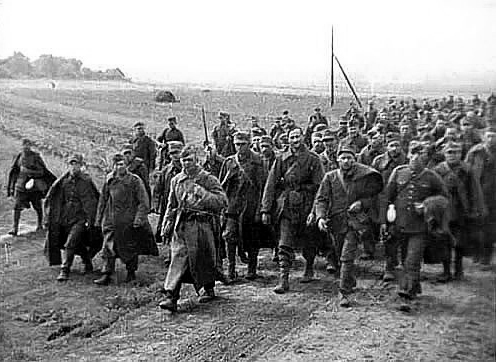<figcaption>Polscy jeńcy w sowieckiej niewoli · 1939</figcaption></figure>

notes:
1.25 min. Agresja17IX1939. Fotografia pokazuje konwojowanych jeńców, ale nie dowodzi, że konkretne widoczne osoby zginęły w zbrodni katyńskiej. Rozdziel to od narracji o późniejszej decyzji władz ZSRS. Oryginał496×362, na slajdzie nie żądaj rozpoznawania szczegółów twarzy. Wśród oficerów rezerwy byli lekarze,nauczyciele i inni wykonujący cywilne zawody. Blisko22tys to cała zbrodnia, nie tylko LasKatyński. Wśród ofiar także więźniowie. Zatwierdzenie decyzji5III1940, likwidacja3obozówIV–V1940; zabijanie więźniów mogło trwać do wczesnego lata.

---

<!-- .slide: id="katyn-dokument" class="case excerpt-case" data-purpose="evidence" data-layout="split" data-goals="G1 G2" -->

<h2>Decyzja zapadła, zanim jeńców wysłuchano</h2>

Notatka Berii do Stalina · marzec 1940
<blockquote class="source-reading">„Jeńcy wojenni, oficerowie i policjanci przebywając w obozach próbują kontynuować działalność k-r [kontrrewolucyjną] i prowadzą antyradziecką agitację. Każdy z nich tylko czeka na uwolnienie, aby mieć możliwość aktywnego włączenia się do walki przeciwko władzy radzieckiej.”</blockquote>
To oskarżenia sprawcy, nie dowód winy jeńców.

<figure>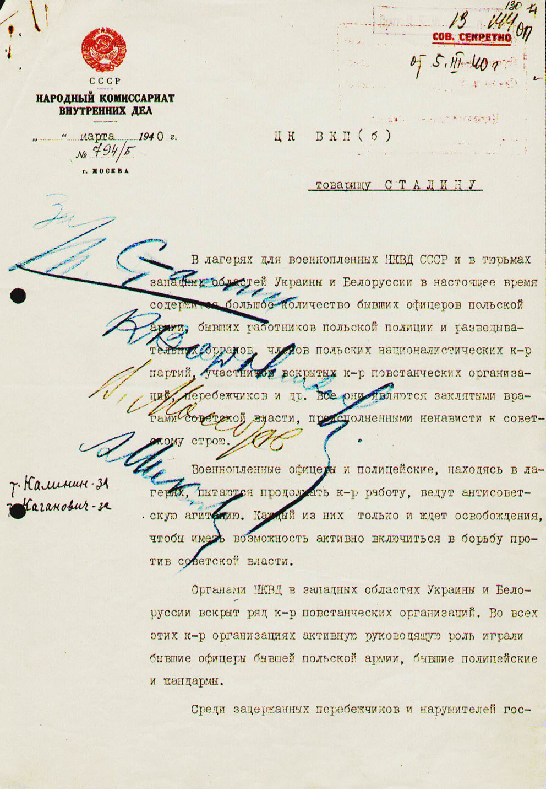<figcaption>Dokument sprawców · zatwierdzenie 5 III 1940</figcaption></figure>

notes:
0.75 min. To oskarżenia i język Berii, nie stwierdzenie udowodnionej winy jeńców. k-r = kontrrewolucyjny. Przed lekturą objaśnić: po notatce przywódcy ZSRS zdecydowali o zamordowaniu jeńców i więźniów bez indywidualnego procesu. Skan strony 1 jest lokalnie. https://katyn.ipn.gov.pl/kat/bibliografia-i-mediatek/dokumentacja-archiwalna/12378,Decyzja-Katynska-z-5-marca-1940-r.html Skan i cytat dotyczą tej samej strony1. Nie wymagaj odczytania cyrylicy. W nawiasie kontrrewolucyjną to rozwinięcie skrótu za opublikowanym przekładem.

---

<!-- .slide: id="katyn-miejsca" class="dark" data-purpose="explanation" data-layout="statement" data-goals="G1 G2" -->

<h2>Katyń to nie jedno miejsce zbrodni</h2>

<b>Kozielsk</b>
Jeńców mordowano w lesie katyńskim.

<b>Starobielsk</b>
Jeńców mordowano w Charkowie.

<b>Ostaszków</b>
Jeńców mordowano w Kalininie (dziś Twer). Pochowano ich w Miednoje.

notes:
0.5 min. Nazwy obozów nie są nazwami wszystkich miejsc egzekucji. Oprócz jeńców mordowano również więźniów. Nie redukuj blisko22tys do samych trzech obozów. ZSRS przez dziesięciolecia zaprzeczał sprawstwu; przyznał odpowiedzialność NKWD w1990. Nie trzeba dodatkowej lekcji pamięci — wystarczy wyjaśnić, dlaczego zbrodnia była ukrywana.

---

<!-- .slide: id="auschwitz" class="case excerpt-case" data-purpose="explanation" data-layout="split" data-goals="G1 G2" -->

<h2>Auschwitz — obóz koncentracyjny i ośrodek Zagłady</h2>

1940–1945 · niemiecki kompleks obozowy
<ul><li>Uwięzienie, terror, przymusowa praca; w Birkenau także masowe mordowanie Żydów.</li><li>Ofiarami byli też m.in. Polacy, Romowie i jeńcy sowieccy.</li></ul><blockquote class="source-reading">„Jesteście w obozie koncentracyjnym, gdzie waszym obowiązkiem jest przestrzegać pilnie wszystkich rozkazów wydawanych i bezwzględne posłuszeństwo. Jest obowiązek pracy. Ta praca służy do tego, aby was nauczyć porządku i bezwzględnego rygoru.”</blockquote>
Roman Trojanowski · wspomnienie o słowach SS, czerwiec 1940.

<figure>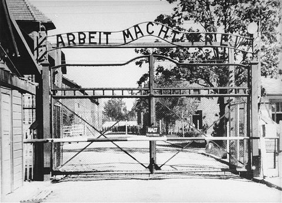<figcaption>Auschwitz I · maj 1945, po wyzwoleniu</figcaption></figure>

notes:
1.25 min. Oddziel funkcję obozu koncentracyjnego od ośrodka masowej zagłady. Auschwitz utworzono1940, nie oznacza to rozpoczęcia wówczas wszystkich form masowego mordowania w Birkenau. Nie nazywaj obozu „polskim”; znajdował się na ziemiach polskich okupowanych przez Niemcy. Użyj poprawnego „niemiecki nazistowski obóz”. Bez licytowania liczb między miejscami. Fotografia pokazuje bramę Auschwitz I po wyzwoleniu, nie rampę Birkenau. Niewielka rozdzielczość480×346; nie rozciągamy fotografii na pełny ekran. To powojenna relacja Trojanowskiego z przemówienia esesmanów, nie zachowany stenogram SS. Dobrowolna „nauka porządku” jest językiem sprawców; nie traktować cytatu jako opisu zwykłej pracy. Dotyczy początków obozu koncentracyjnego w 1940 r., nie selekcji ani fazy masowej zagłady Żydów od 1942 r. https://www.auschwitz.org/muzeum/aktualnosci/nowa-publikacja-muzeum-wspomnienia-romana-trojanowskiego-wieznia-obozu-auschwitz-nr-44,2307.html

---

<!-- .slide: id="jedwabne-ludzie" class="case excerpt-case" data-purpose="evidence" data-layout="split" data-goals="G1 G2" -->

<h2>Jedwabne — żydowscy i polscy sąsiedzi</h2>

Przed wojną dzieci chodziły tu do wspólnej szkoły. Żydzi byli mieszkańcami miasteczka, nie obcymi przybyszami.
<blockquote class="source-reading">„10 lipca 1941 roku kilkuset żydowskich mieszkańców Jedwabnego w powiecie łomżyńskim zostało żywcem spalonych w stodole. Chociaż niemiecka inspiracja tej zbrodni jest niewątpliwa, jej bezpośrednimi wykonawcami byli Polacy z Jedwabnego i okolicznych wsi.”</blockquote>
Fragment współczesnego opracowania historycznego.

<figure>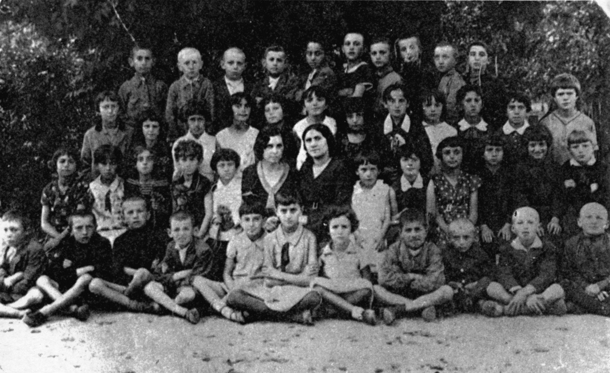<figcaption>Uczniowie szkoły w Jedwabnem · 1933</figcaption></figure>

notes:
1 min. Opracowanie współczesne, nie świadectwo z 1941 r. Uściślenie liczby z komunikatu IPN: nie mniej niż 340; całkowita liczba nieustalona. Cytatu nie zmieniać na 340, bo POLIN napisał „kilkuset”. https://www.polin.pl/pl/rocznica-zbrodni-w-jedwabnem Fotografia przedwojenna nie ustala losów każdego przedstawionego ucznia, nie twierdź że wszyscy zginęli. Cytat odczytany z archiwalnej kopiiPOLIN2025,nie udawana bieżąca strona. Antysemityzm i fałszywe oskarżenie całej społeczności o popieranieSowietów nie usprawiedliwiają zbrodni.

---

<!-- .slide: id="jedwabne" class="case" data-purpose="explanation" data-layout="split" data-goals="G1 G2" -->

<h2>Jedwabne — co wydarzyło się 10 lipca 1941?</h2>

10 VII 1941 · po zajęciu miasta przez Niemców
<ul><li>Żydowskich mieszkańców spędzono na rynek, bito i poniżano. Zabijano już podczas tej akcji.</li><li>Większość ofiar zapędzono do stodoły i spalono. Zamordowano <b>co najmniej 340 osób</b>, także kobiety i dzieci.</li><li>Bezpośredni sprawcy: grupa miejscowych Polaków. Zbrodni dokonano z niemieckiej inspiracji i przyzwolenia.</li></ul>
<figure>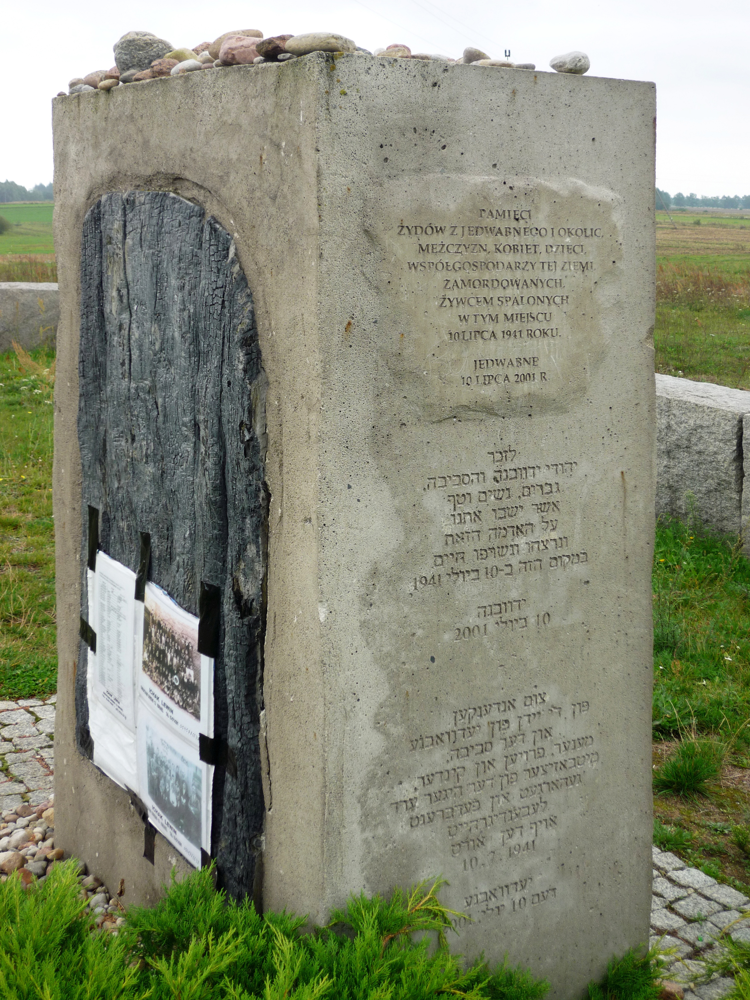<figcaption>Współczesny widok miejsca zbrodni.</figcaption></figure>

notes:
1.25 min. Przedwojenni żydowscy sąsiedzi byli obywatelamiPolski.1939–1941 okupacja sowiecka,po22VI1941 niemiecka. Antysemityzm i oskarżanie całej społeczności o popieranieSowietów pomagały sprawcom podsycać przemoc; nie były prawdą o wszystkich ofiarach ani usprawiedliwieniem. UstaleniaIPN/POLIN: lokalniPolacy bezpośredni wykonawcy,niemiecka inspiracja i przyzwolenie,niepełne ustalenie zakresu udziału konkretnychNiemców.≥340to dolna granica,nie zamkniętyspis. Nie przypisuj winy narodowi.

---

<!-- .slide: id="krakow" class="case" data-purpose="explanation" data-layout="split" data-goals="G1 G2" -->

<h2>Kraków — likwidacja getta</h2>

13–14 III 1943 · Podgórze
<ul><li>Getto było przymusowo zamkniętą dzielnicą dla Żydów, nie dobrowolnym miejscem zamieszkania.</li><li>Podczas likwidacji Niemcy kierują część mieszkańców do obozu pracy w <b>Płaszowie</b>.</li><li>Innych mordują na miejscu lub deportują do <b>Auschwitz</b>. Rodziny tracą bliskich, domy i cały dobytek.</li></ul>
<figure>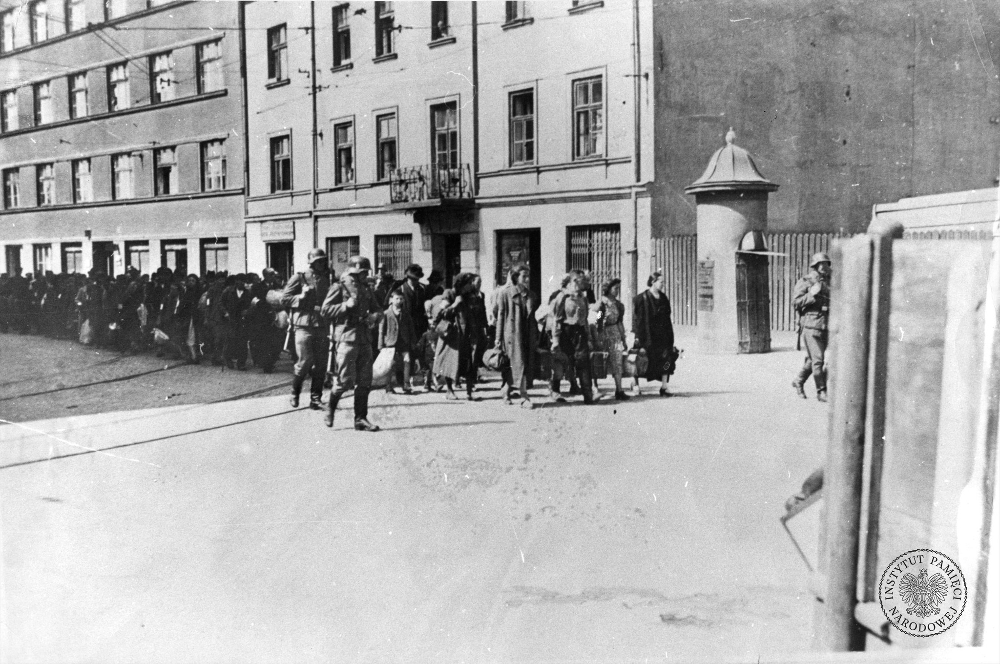<figcaption>Deportacja do Płaszowa · marzec 1943</figcaption></figure>

notes:
1 min. Getto utworzono w 1941 r. w Podgórzu. W marcu 1943 r. Płaszów był obozem pracy przymusowej; obozem koncentracyjnym stał się w 1944 r. Podział getta na części A i B służył selekcji ludności według zdolności do pracy. Nie sugeruj, że uznanie za zdolnego do pracy gwarantowało przeżycie. Fotografia jest datowana na marzec 1943 r., nie na konkretny dzień.

---

<!-- .slide: id="krakow-krzesla" class="case excerpt-case" data-purpose="explanation" data-layout="split" data-goals="G1 G2" -->

<h2>Dlaczego na placu stoją puste krzesła?</h2>

<ul><li>Na dawnym placu Zgody gromadzono ludzi przed deportacjami.</li><li>Puste krzesła oznaczają <b>nieobecnych mieszkańców i pozostawiony dobytek</b>.</li></ul><blockquote class="source-reading">„Na Placu Zgody niszczeje nieprzeliczona ilość szaf, stołów, kredensów i innych mebli”</blockquote>
Tadeusz Pankiewicz · wspomnienie świadka

<figure>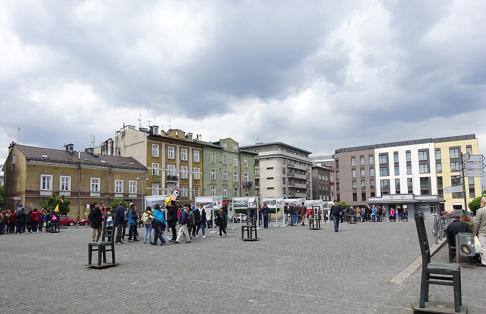<figcaption>Plac Bohaterów Getta · fotografia współczesna.</figcaption></figure>

notes:
1 min. Tadeusz Pankiewicz prowadził Aptekę pod Orłem w getcie. Cytat przytoczono za Fundacją Pełni Kultury, nie z odczytanego pierwodruku. Projektanci Piotr Lewicki i Kazimierz Łatak nawiązali do pozostawionych mebli. Miejski serwis podaje 70 krzeseł, część przewodników 68. Nie opieraj zadania na tej rozbieżności. Nie potwierdzono przeliczenia jednego krzesła na tysiąc ofiar: pomnik nie jest wykresem bilansu.

---

<!-- .slide: id="zamosc" class="case" data-purpose="explanation" data-layout="split" data-goals="G1 G2" -->

<h2>Zamojszczyzna — usunąć rodziny, osiedlić Niemców</h2>

XI 1942 – VIII 1943 · okupacja niemiecka
<ul><li>Wysiedlenia są częścią planu kolonizacji Wschodu: miejsce Polaków mają zająć niemieccy osadnicy.</li><li>Niemcy wypędzają rodziny z domów, odbierają majątek i zamykają ludzi w obozach przejściowych.</li><li><b>Około 110 tys. wysiedlonych z około 300 wsi</b>, w tym <b>około 30 tys. dzieci</b>.</li></ul>
<figure>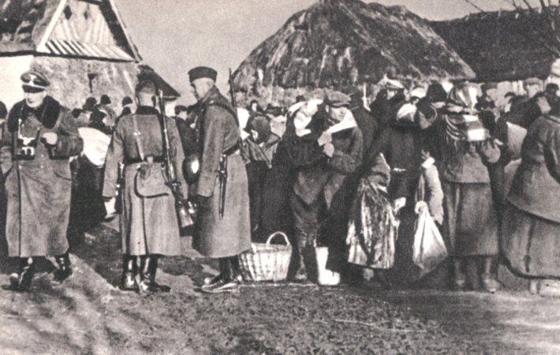<figcaption>Zamojszczyzna · grudzień 1942</figcaption></figure>

notes:
1 min. Zakres: listopad 1942 – sierpień 1943; powiaty zamojski, biłgorajski, hrubieszowski i tomaszowski. Około 30 tys. dzieci zawiera się w 110 tys. wysiedlonych. To bilans wysiedlonych, nie zamordowanych. Źródła podają 294, 297 albo około 300 wsi; nie uczymy pozornie dokładnego spisu. Dane IPN porównano z materiałami Muzeum Dzieci Polskich.

---

<!-- .slide: id="zamosc-mapa" class="full-map" data-purpose="evidence" data-layout="map-focus" data-goals="G1 G2" -->

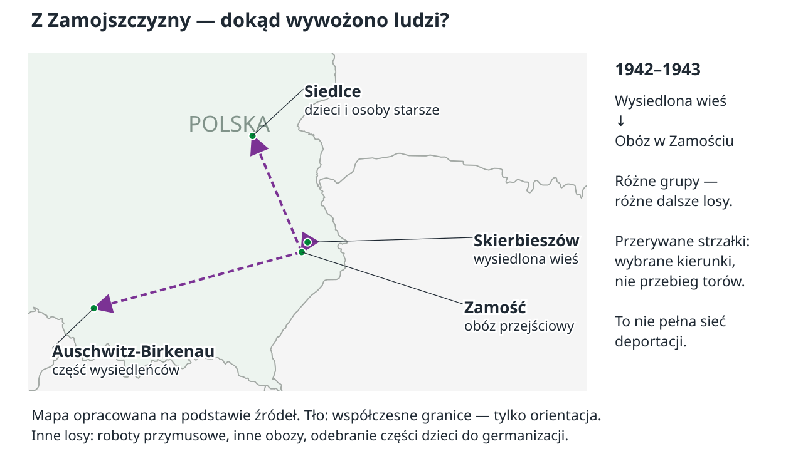

notes:
0.75 min. Mapa jest opracowaniem na podstawie potwierdzonych kierunków i rzeczywistych współrzędnych, nie mapą z epoki. Skierbieszów → Zamość to przykład początku drogi. Zamość → Siedlce: dzieci i starsi zimą 1942/43. Zamość → Auschwitz: odrębne grupy, trzy transporty. Nie jest to jedna podróż jednego dziecka ani rekonstrukcja torów. Współczesne granice służą tylko orientacji. Inne losy obejmowały roboty przymusowe, inne obozy i germanizację; pełnej sieci nie wyrysowano. Dowody w revision-zamosc-krakow-routes.json.

---

<!-- .slide: id="zamosc-dzieci" class="case excerpt-case" data-purpose="evidence" data-layout="split" data-goals="G1" -->

<h2>Dzieci rozdzielone z rodzinami</h2>

<ul><li>Wywożono dzieci do obozów; część uznanych za „rasowo odpowiednie” odbierano do germanizacji.</li><li>Inne trafiały do polskich rodzin i ochron, gdzie organizowano pomoc.</li></ul><blockquote class="source-reading">„cicho płaczące, marznące i głodne dzieci. Dorośli stali spokojnie. Swoją tragedię znosili z godnością. Niektórzy ukradkiem wycierali łzy”</blockquote>
Zygmunt Węcławik · wspomnienie ze Skierbieszowa

<figure>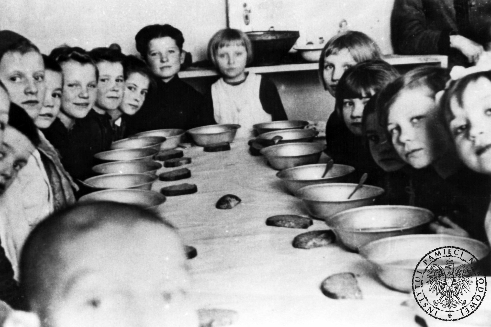<figcaption>Łaskarzew · 1942 lub 1943</figcaption></figure>

notes:
1 min. Wspomnienie Zygmunta Węcławika przytoczył Piotr Biliński, s. 127, za publikacją Glińskiej z 1968 r. Relacja opisuje marznących ludzi spędzonych ze Skierbieszowa; fotografia pokazuje późniejszy etap w Łaskarzewie. Nie utożsamiaj obu scen. Germanizacja oznaczała odebranie dziecka i narzucanie niemieckiej tożsamości. Nie wszystkie z około 30 tys. dzieci wywieziono do Rzeszy.

---

<!-- .slide: id="sochy" class="dark" data-purpose="explanation" data-layout="statement" data-goals="G1 G2" -->

<h2>Sochy — zniszczenie wsi</h2>

1 VI 1943 · Zamojszczyzna

Niemiecki terror wobec wsi pomagającej partyzantom: mordowanie mieszkańców, podpalenia, następnie bombardowanie.
<blockquote class="source-reading">„O piątej nad ranem Niemcy otoczyli wieś i rozpoczęli pacyfikację, mordując mężczyzn, kobiety i dzieci.”</blockquote>
Fragment współczesnego opracowania historycznego.

Zginęło <b>blisko 200 osób</b>. Wieś została zniszczona.

notes:
0.75 min. Sochy to konkretny przykład niemieckiej pacyfikacji, oddzielny od polityki wysiedleń z1942. Data1VI1943 potwierdzona przez IPN i muzea. Szacunki ok.180–200zabitych, nie uczymy pozornie dokładnego bilansu. Nie znaleziono pewnej niedrastycznej fotografii tej pacyfikacji, więc nie podmieniamy jej fotografią innej wsi. Terror wobec mieszkańców nie jest usprawiedliwiony ich pomocą dla partyzantów. Dosłowny fragmentIPNLublin2022: https://lublin.ipn.gov.pl/pl5/aktualnosci/166621,79-Rocznica-pacyfikacji-wsi-Sochy.html . Wybrano krótki fragment, pomijając drastyczne zdania poza granicami cytatu. Około180–200w różnych źródłach, zaIPNblisko200. Nie utożsamiaj pacyfikacji Soch ze wszystkimi wysiedleniami regionu.

---

<!-- .slide: id="ulmowie" class="" data-purpose="explanation" data-layout="statement" data-goals="G1 G2" -->

<h2>Markowa — zwyczajne życie Ulmów</h2>

<figure>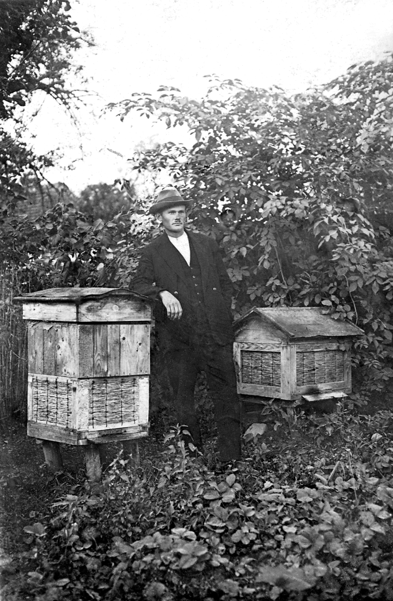<figcaption>Józef Ulma · pasieka</figcaption></figure><figure>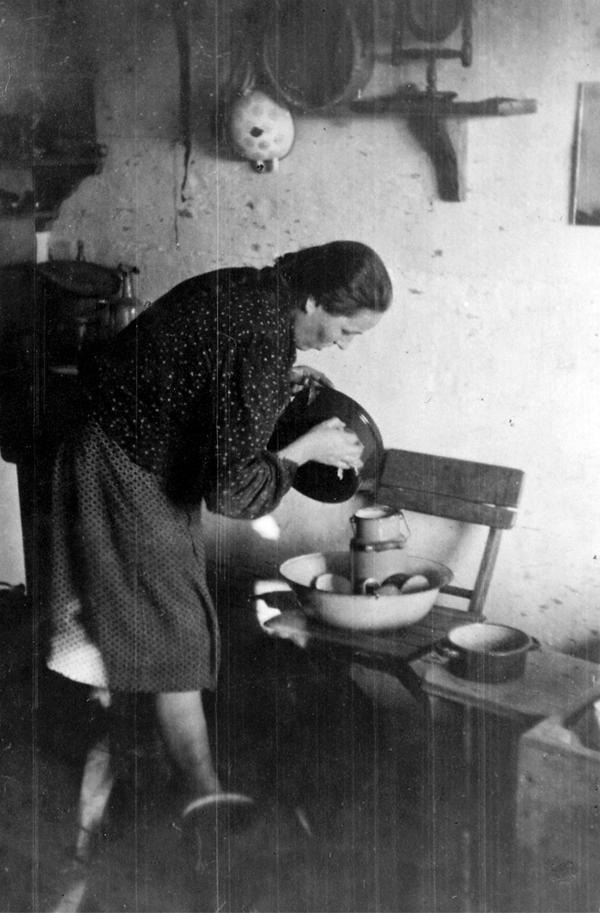<figcaption>Wiktoria Ulma · codzienna praca</figcaption></figure>

Józef uprawiał ziemię, hodował pszczoły i fotografował. Wiktoria opiekowała się rodziną i gospodarstwem.

notes:
0.75 min. Autentyczne fotografie z rodzinnych zbiorów, opublikowane w galerii IPN. Dokładne daty nieustalone, przed 24 marca 1944 r. Nie twierdź, że wykonano je podczas ukrywania Żydów. ZPE omawia pasję fotograficzną Józefa; rozpoznanie osób przyjęto za indywidualnymi podpisami IPN, nie za błędnym podpisem dzieci w ZPE.

---

<!-- .slide: id="ulmowie-dom" class="photo" data-purpose="evidence" data-layout="statement" data-goals="G1 G2" -->

<h2>Dom, w którym udzielono schronienia</h2>
<figure>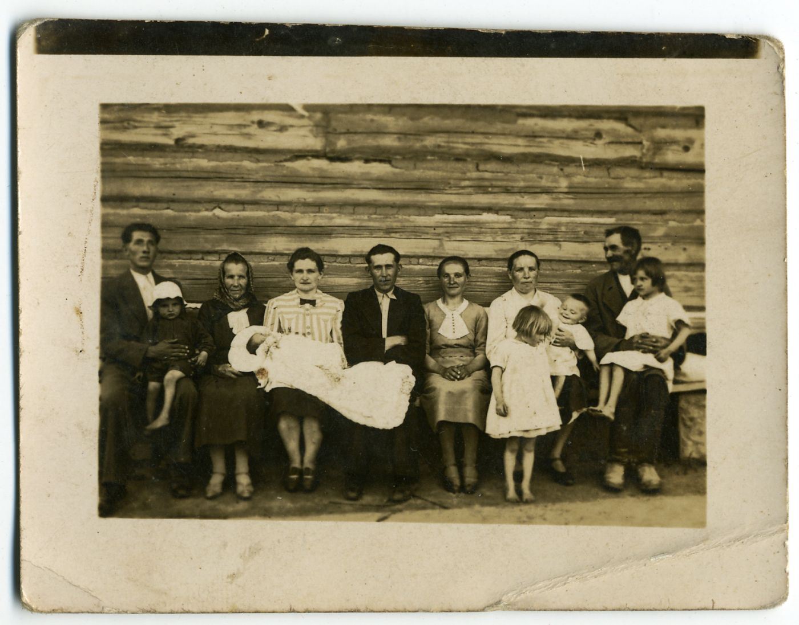<figcaption>Przed domem Ulmów · lato 1941</figcaption></figure>
W tym domu Ulmowie później ukrywali ośmioro Żydów. Żyli tu z sześciorgiem własnych dzieci.

notes:
0.5 min. Fotografia po chrzcinach Antosia z lata 1941 r. nie pokazuje ukrywanych osób ani samego ukrywania. Według IPN Ulmowie przyjęli zagrożonych ludzi najprawdopodobniej w grudniu 1942 r. Nie powtarzaj podanej przez ZPE połowy 1942 r. jako pewnej daty.

---

<!-- .slide: id="ulmowie-grozba" class="reading" data-purpose="evidence" data-layout="statement" data-goals="G1 G2" -->

<h2>Ukrywanie ludzi pod groźbą śmierci</h2>

Niemieckie rozporządzenie · 15 X 1941 · fragment
<blockquote class="source-reading">„Żydzi, którzy bez upoważnienia opuszczają wyznaczoną im dzielnicę, podlegają karze śmierci. Tej samej karze podlegają osoby, które takim Żydom świadomie dają kryjówkę”</blockquote>

notes:
0.5 min. Dokument sprawcy: rozporządzenie Hansa Franka obowiązujące w Generalnym Gubernatorstwie. Fragment przytoczono za ZPE; nie odczytano oryginalnego dziennika rozporządzeń. Nie twierdź, że identyczne prawo obowiązywało w całej Europie. Wskazana lekcja ZPE nie cytuje pierwotnej relacji o Ulmach; zamieszczonej tam relacji Rajbenbach o innych osobach nie wolno przypisać Markowej.

---

<!-- .slide: id="ulmowie-ukrywani" class="case" data-purpose="explanation" data-layout="split" data-goals="G1 G2" -->

<h2>Osiem osób, którym pomagali</h2>

<b>Saul Goldman i jego czterej synowie:</b> Baruch, Mechel, Joachim i Mojżesz.

<b>Gołda Grünfeld oraz Lea Didner z córką Reszlą.</b>

Ulmowie zapewniali im kryjówkę i codzienne utrzymanie.

<figure>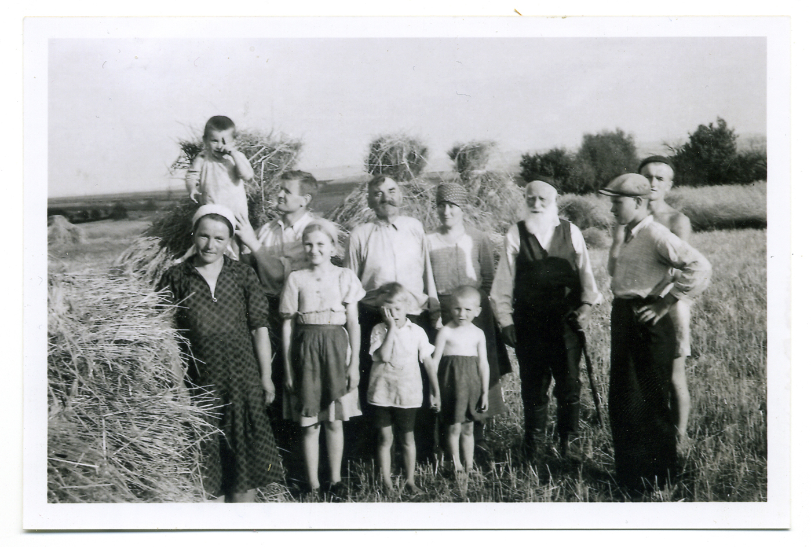<figcaption>Saul Goldman · trzeci z prawej</figcaption></figure>

notes:
0.75 min. Rozpoznanie Saula Goldmana przyjęto za podpisem IPN. Nie zgaduj tożsamości pozostałych osób w grupie. Nie użyto kandydata podpisanego jako czterej synowie, bo na skanie widoczne są trzy osoby. Imiona i warianty nazwisk zachowano zgodnie ze źródłem. To konkretni ludzie chronieni przed niemiecką Zagładą.

---

<!-- .slide: id="ulmowie-zbrodnia" class="case" data-purpose="explanation" data-layout="split" data-goals="G1 G2" -->

<h2>24 marca 1944 — mord w domu Ulmów</h2>

Markowa · niemiecka żandarmeria
<ul><li>Niemieccy żandarmi mordują <b>ośmioro ukrywanych Żydów</b>.</li><li>Zabijają też <b>Józefa, ciężarną Wiktorię i sześcioro ich dzieci</b>.</li><li>To terror wobec prześladowanych i tych, którzy udzielali im schronienia.</li></ul>
<figure><figcaption>Wiktoria z dziećmi · przed zbrodnią</figcaption></figure>

notes:
0.75 min. Niemieckim oddziałem dowodził Eilert Dieken; uczestniczyli także granatowi policjanci. Według IPN prawdopodobnym donosicielem był Włodzimierz Leś; nie przedstawiaj motywu rabunkowego jako bezspornie ustalonego. Bez drastycznych szczegółów zabijania i porodu. Inne rodziny w Markowej nadal pomagały Żydom. Dzieci na fotografii pokazano przed zbrodnią, nie podczas egzekucji.

---

<!-- .slide: id="wolyn-mapa" class="full-map" data-purpose="evidence" data-layout="map-focus" data-goals="G1 G2" -->

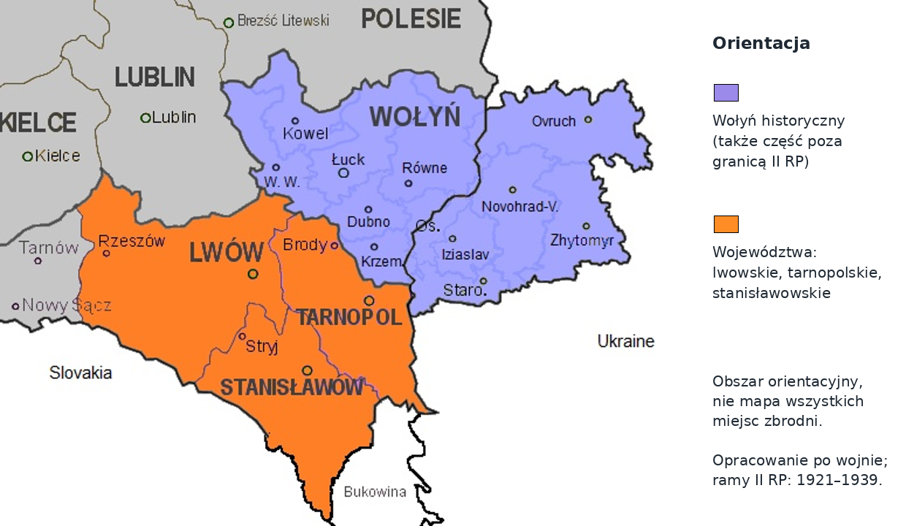

notes:
0.75 min. Przed opowieścią odszukaj Wołyń i Małopolskę Wschodnią, nazywaną też Galicją Wschodnią. Były to wschodnie ziemie II Rzeczypospolitej, dziś zachodnia Ukraina. Sprawdź datę i legendę konkretnej mapy; nie nazywaj współczesnych granic granicami1943. Mapa pełnoekranowa bez dodatkowej planszy. Niebieski obszar to historyczny Wołyń, także część poza granicą II RP. Pomarańczowy to trzy województwa II RP. Legenda wyjaśnia orientację, mapa nie wyznacza dokładnego zasięgu zbrodni.

---

<!-- .slide: id="wolyn-sprawcy" class="" data-purpose="explanation" data-layout="statement" data-goals="G1 G2" -->

<h2>Wołyń — sprawcy i cel ludobójstwa</h2>

Główna fala: 1943–1944
<ul><li><b>OUN-B</b> — banderowska frakcja Organizacji Ukraińskich Nacjonalistów.</li><li><b>UPA</b> — Ukraińska Powstańcza Armia, związana z OUN-B.</li><li>Celem akcji jest usunięcie polskiej ludności z terenów przyszłego państwa ukraińskiego.</li></ul>

Była to zorganizowana akcja ludobójcza przeciw polskim cywilom — nie przypadkowe ofiary walk.

notes:
1.5 min. Jasno nazwij zorganizowaną akcję ludobójczą, nie przypadkowe walki i nie „konieczność wojenną”. Uczestniczyły oddziały UPA, struktury OUN-B i część miejscowej ludności ukraińskiej. Przedwojenne napięcia narodowościowe, dyskryminacja i terror okupacyjny są tłem, nie usprawiedliwieniem. Nie utożsamiaj OUN-B i UPA z całym narodem ukraińskim. Nie przypisuj Stepanowi Banderze konkretnego nieudokumentowanego podpisanego rozkazu; instytucjonalna odpowiedzialność jest wystarczająco jasna. Nie użyto fotografii rodziny z1916 jako domniemanego portretu ofiar1943, bo taki związek nie został ustalony.

---

<!-- .slide: id="wolyn-tekst" class="reading" data-purpose="evidence" data-layout="statement" data-goals="G1 G2" -->

<h2>Dlaczego celem stali się polscy cywile?</h2>

Włodzimierz Mędrzecki · wypowiedź współczesnego historyka
<blockquote class="source-reading">„Fundamentem tej akcji było założenie, że dopóki Polacy mieszkają na spornym terytorium Wołynia i Galicji Wschodniej, dopóty będą czynnikiem na tyle silnym, że uniemożliwią realizację ukraińskiego programu niepodległościowego. Dlatego od końca roku 1942 do ostatnich miesięcy 1944 realizowano plan wymuszenia na Polakach opuszczenia tych ziem nawet przy użyciu siły.”</blockquote>

notes:
0.75 min. To wywiad Tomasza Wiścickiego z historykiem Włodzimierzem Mędrzeckim opublikowany przez Muzeum Historii Polski; wykorzystano dokładny URL nauczycielki. Nie potwierdzono daty publikacji. Fragment jest interpretacją historyka, nie zeznaniem uczestnika. Wcześniejsze napięcia i okupacje stanowią tło, nie usprawiedliwienie zorganizowanej przemocy przeciw cywilom. Wywiad nie zawiera cytowanego pierwotnego świadectwa ocalenia.

---

<!-- .slide: id="wolyn-przebieg" class="" data-purpose="explanation" data-layout="timeline-band" data-goals="G1 G2" -->

<h2>Od napadów do masowej zbrodni</h2>

<b>1943</b>
Narastają ataki na polskie wsie na Wołyniu.

<b>11 VII 1943</b>
„Krwawa niedziela” — skoordynowane napady na liczne miejscowości.

<b>1944</b>
Masowe zbrodnie obejmują Małopolskę Wschodnią.

<b>Do 1945</b>
Ataki trwają także w kolejnych miesiącach wojny.

notes:
1.25 min. Główna chronologia1943–1945. Parośla9II1943 jako jedna z pierwszych masowych zbrodni; nie twierdź, że wcześniej nie dochodziło do przemocy. 11VII to kulminacja, nie jedyny dzień ludobójstwa. Ofiarami są cywile, w tym kobiety, dzieci i starsi. Możesz wspomnieć ataki na kościoły podczas nabożeństw, bez opisu narzędzi i tortur. Nie podawaj spornej precyzyjnej liczby zaatakowanych wsi jako pewnika.

---

<!-- .slide: id="wolyn-obrona" class="dark" data-purpose="explanation" data-layout="process" data-goals="G1 G2" -->

<h2>Obrona, ucieczka, pomoc</h2>

<b>Samoobrona</b>
Polacy organizują obronę, m.in. w Przebrażu.

<b>Ucieczka</b>
Rodziny porzucają domy i szukają schronienia.

<b>Ratowanie</b>
Niektórzy Ukraińcy ostrzegają i ukrywają Polaków, narażając własne życie.

notes:
1 min. Nie uzależniaj uznania ludobójstwa od pominięcia pomocy Ukraińców. Wspomnij o polskich akcjach odwetowych, także zbrodniach na ukraińskich cywilach: trzeba je badać i potępiać, ale nie tworzą symetrii z planową akcją OUN-UPA. Nie mów, że wszyscy ukraińscy cywile wspierali zbrodnie. Przebraże jest konkretnym przykładem samoobrony, a nie dowodem że każda wieś mogła skutecznie się obronić.

---

<!-- .slide: id="wolyn-skutki" class="" data-purpose="synthesis" data-layout="statement" data-goals="G1 G2" -->

<h2>Wołyń — skutki nie kończą się w 1945 roku</h2>

<b>Około 100 tys. polskich ofiar</b> na Wołyniu, w Małopolsce Wschodniej i na sąsiednich terenach objętych zbrodniami.
<ul><li>To <b>szacunek</b>, nie dokładnie ustalona liczba.</li><li>Zniszczenie miejscowości i rozpad społeczności.</li><li>Uchodźstwo, utrata bliskich, wielopokoleniowa trauma.</li><li>Potrzeba identyfikacji ofiar i godnego pochówku.</li></ul>

notes:
0.75 min. Szacunek przypisz Grzegorzowi Motyce w dokumentacji, ok.100tys szerszy obszar, z tego do60tys Wołyń. Inni badacze podają inne oszacowania — nie sklejaj różnych zakresów. Nie mów100tys wyłącznie na Wołyniu. Powojenne wysiedlenia i zmiana granic to także odrębne procesy; nie przypisuj każdego przemieszczenia jednej przyczynie. Aktualna polityka pamięci nie jest dowodem ustaleń z1943.

---

<!-- .slide: id="wolbrom" class="case" data-purpose="explanation" data-layout="split" data-goals="G3" -->

<h2>Wolbrom — likwidacja getta w 1942 roku</h2>

Wrzesień 1942
<ul><li>Niemcy spędzają Żydów na rynek i w stronę stacji. Rozdzielają rodziny.</li><li>Większość deportują do niemieckiego ośrodka zagłady w <b>Bełżcu</b>.</li><li>Osoby starsze, chore i uznane za nienadające się do transportu mordują w lesie przy dzisiejszej ul. Skalskiej.</li></ul>
<figure>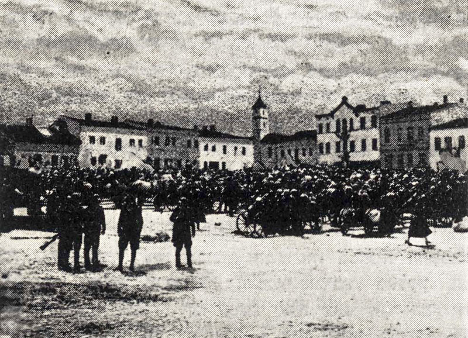<figcaption>Wolbrom, rynek · wrzesień 1942</figcaption></figure>

notes:
1 min. Dodatkowy artykuł IPN z 27 stycznia 2025 r. podaje szacunek około 600 ofiar trzech leśnych mogił, a nie całej społeczności. Liczba 4500 dotyczy odrębnego upamiętnienia społeczności. Yad Vashem opisuje też listopadową egzekucję pozostałych osób; nie dodawaj różnych bilansów bez ustalenia ich zakresu. Fotografia jest datowana na wrzesień 1942 r., nie na konkretny dzień.

---

<!-- .slide: id="wolbrom-rodzina" class="photo" data-purpose="evidence" data-layout="evidence" data-goals="G3" -->

<h2>Wolbrom — ludzie, nie tylko liczby</h2>
<figure>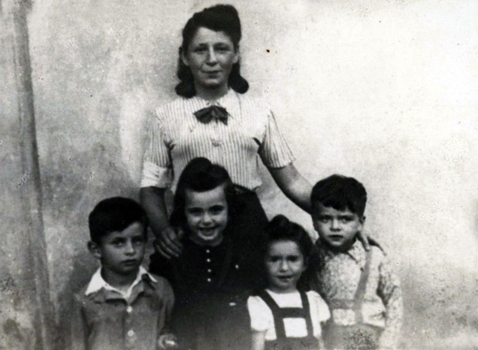<figcaption>Wolbrom · 1940 · rodzina pani Spalonski</figcaption></figure>

notes:
0.5 min. Według podpisu Yad Vashem tylko dwie pokazane osoby przeżyły. Nie wskazuj których ani nie dopisuj imion dzieci. Angielskie nephews/niece nie określają czy to dzieci brata czy siostry. Powiedz: „Zagłada zniszczyła konkretne rodziny mieszkające w naszym mieście”. Nie myl braku imienia w katalogu z brakiem imienia w rzeczywistości.

---

<!-- .slide: id="wolbrom-swiadek" class="reading" data-purpose="evidence" data-layout="statement" data-goals="G1 G2" -->

<h2>Benjamin Katz — rozdzielone rodziny</h2>

Relacja ocalałego · przekład na polski
<blockquote class="source-reading">„Gdy tylko przyjechał pociąg, wszyscy spontanicznie zaczęliśmy płakać – kobiety, starcy i dzieci po jednej stronie, a mężczyźni po drugiej. Wszyscy wiedzieliśmy, że zaraz rozstaniemy się na zawsze i że już nigdy więcej się nie zobaczymy. Wiedzieliśmy, co nas czeka, ale chcę podkreślić, że wszyscy czuliśmy, iż prawdziwy wymiar tego, co się działo, jeszcze do nas nie dotarł.”</blockquote>

notes:
0.75 min. Powojenna relacja Benjamina Katza w księdze Wolbrom Irenu z 1962 r. Przekład roboczy z angielskiej wersji Yad Vashem, nie polski oryginał. Tekst angielski zachowano w dokumentacji. Nie rekonstruuj dokładnego początku akcji na podstawie tej jednej relacji. Można dobrowolnie zapytać, co relacja wyjaśnia o rozdzielaniu rodzin, czego nie wyraża samo słowo deportacja.

---

<!-- .slide: id="wolbrom-las" class="reading" data-purpose="evidence" data-layout="statement" data-goals="G1 G2" -->

<h2>Wolbrom — mordy w pobliskim lesie</h2>

Fragment współczesnego opracowania historycznego
<blockquote class="source-reading">„Operację wymordowania ludności wolbromskiego getta Niemcy zorganizowali we wrześniu 1942 r. Większość żydowskich mieszkańców została wywieziona do niemieckiego obozu zagłady w Bełżcu. Tak jak w przypadku innych gett ludzi starszych, chorych i nie nadających się do transportu, organizatorzy zbrodni mordowali na miejscu. Na miejsce zbrodni wybrali las znajdujący się obecnie przy wjeździe do Wolbromia od strony Skały i Krakowa. Szacuje się, że mogiły kryją szczątki około 600 zamordowanych mężczyzn, kobiet i dzieci.”</blockquote>

notes:
0.5 min. Cytat dosłowny: Instytut Pamięci Narodowej – Oddział w Krakowie, 2025-01-27. https://krakow.ipn.gov.pl/pl4/aktualnosci/212864,Uroczystosc-na-cmentarzu-ofiar-Holokaustu-w-Wolbromiu.html?search=8626077465. To późniejsze opracowanie, nie zeznanie naocznego świadka. Odczytaj i połącz z poprzednio poznanym przebiegiem wydarzeń, bez pisania.

---

<!-- .slide: id="wolbrom-1944" class="case" data-purpose="explanation" data-layout="split" data-goals="G3" -->

<h2>Wolbrom — pokazowa egzekucja 20 więźniów</h2>

26 I 1944 · dawna ul. Lgocka
<ul><li>Gestapo rozstrzeliwuje <b>20 polskich więźniów</b>, przywiezionych z innych miejscowości.</li><li>Wśród ofiar są konspiratorzy oraz ludzie aresztowani pod zarzutem ukrywania Żydów.</li><li>Mord ma zastraszyć mieszkańców. Dziś to miejsce przypomina ul. <b>20 Straconych</b>.</li></ul>
<figure>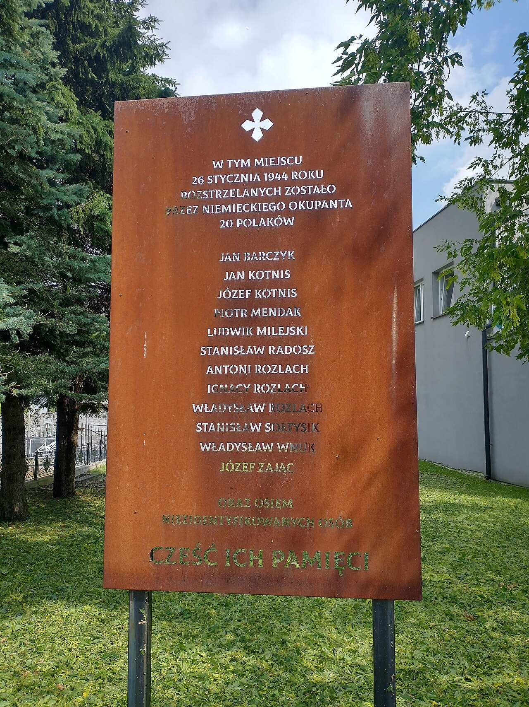<figcaption>Tablica pamięci · fotografia współczesna</figcaption></figure>

notes:
1 min. Podstawa: Ewa Barczyk, Przegląd Olkuski, 2021; Jacek Sypień, Ilcusiana 23/2020, s. 36–38. Wśród ofiar był Józef Kotnis, przedwojenny poseł; część ofiar należała do konspiracji BCh. Nie przypisuj wszystkim identycznego powodu aresztowania. Odwet za śmierć Niemca pojawia się jako przypuszczenie; pewny jest pokazowy terror. Opracowania i upamiętnienie wskazują 26 stycznia, gazeta z 1945 r. podaje 25 stycznia. Rozbieżności nie usunięto z reprodukcji.

---

<!-- .slide: id="wolbrom-gazeta" class="case excerpt-case" data-purpose="evidence" data-layout="split" data-goals="G3" -->

<h2>Wolbrom — zachował się artykuł z 1945 roku</h2>

„Dziennik Zachodni” · relacja o pogrzebie
<blockquote class="source-reading">„Przy dźwiękach marsza żałobnego Chopina przez ulice miasta przeciągnął kondukt żałobny. Na 20 furmankach udekorowanych zielenią spoczywało 20 trumien. W ostatniej wędrówce na miejsce poświęcone towarzyszyły ofiarom dzieci ze wszystkich szkół, straże z okolicznych wiosek, stowarzyszenia i cechy, oraz tysiączne tłumy ludności.”</blockquote>
<figure>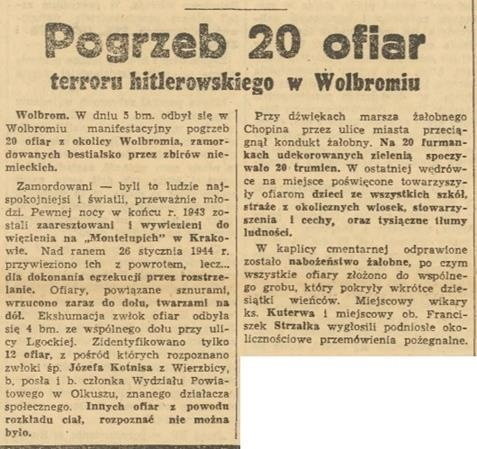<figcaption>Wycinek prasowy · kwiecień 1945</figcaption></figure>

notes:
0.75 min. Datę 9 kwietnia 1945 r. podaje opis reprodukcji w Przeglądzie Olkuskim; sam wycinek nie zawiera winiety numeru. To relacja o powojennym pogrzebie, nie fotografia egzekucji. Gazeta podaje 25 stycznia 1944 r., późniejsze źródła 26 stycznia. Wybrany akapit nie zawiera spornej daty. Czytamy cytat obok; cały skan można powiększyć, ale nie wymagamy odczytania wszystkich drobnych liter.

---

<!-- .slide: id="olkusz-20" class="case" data-purpose="explanation" data-layout="split" data-goals="G3" -->

<h2>Olkusz — 20 zakładników rozstrzelanych</h2>

16 VII 1940 · Parcze
<ul><li>Pretekstem do odwetu jest śmierć niemieckiego żandarma — mimo że dochodzenie wykluczyło motyw polityczny.</li><li>Niemcy rozstrzeliwują <b>20 Polaków</b>: pięciu olkuszan i piętnastu więźniów spoza miasta.</li><li><b>To inna zbrodnia niż Krwawa Środa z 31 lipca.</b></li></ul>
<figure>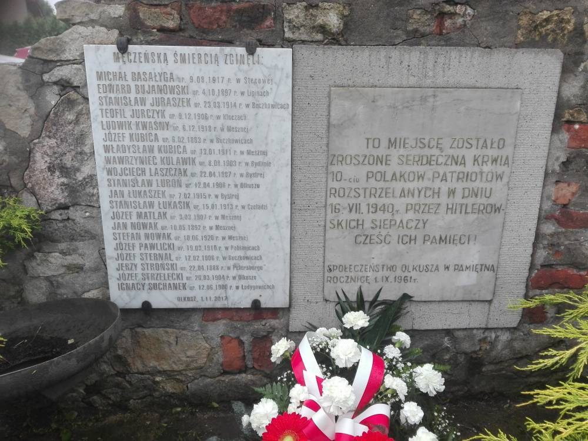<figcaption>Tablice upamiętniające egzekucję z 16 VII 1940</figcaption></figure>

notes:
1 min. Wykorzystano dokładny adres Szlaku Orlich Gniazd. Źródła różnią się szczegółami przywożenia więźniów i przebiegu egzekucji. Pewny bilans to 20 ofiar, w tym pięciu miejscowych. Na jednej tablicy jest dziesięć nazwisk, ponieważ istnieją dwa upamiętnienia — nie oznacza to zmniejszenia bilansu. Infoboks Wikipedii błędnie łączy 20 ofiar z 31 lipca; nie powielać tego.

---

<!-- .slide: id="olkusz-20-tekst" class="reading" data-purpose="evidence" data-layout="statement" data-goals="G1 G2" -->

<h2>Olkusz — pretekst nie był powodem winy zakładników</h2>

Fragment współczesnego opracowania historycznego
<blockquote class="source-reading">„Choć prowadzone przez Niemców dochodzenie wykluczyło motywy polityczne, śmierć żandarma wykorzystano, jako pretekst do przeprowadzenia szeroko zakrojonej akcji odwetowej i sterroryzowania mieszkańców miasta. Dzień po tym wydarzeniu, 16 lipca 1940 roku Niemcy dokonali w Olkuszu odwetowej egzekucji, w czasie, której rozstrzelano 20 Polaków. Piętnastu spośród rozstrzelanych przywieziono z więzienia w Mysłowicach, kolejnych pięć ofiar pochodziło z Olkusza.”</blockquote>

notes:
0.5 min. Cytat dosłowny: Autor indywidualny niepodany; portal Szlak Orlich Gniazd; wskazane źródło: Archiwum UMiG Olkusz; data publikacji niepodana. https://orlegniazda.pl/culturalheritage/1019534/pomniki-20-straconych-w-olkuszu. To późniejsze opracowanie, nie zeznanie naocznego świadka. Odczytaj i połącz z poprzednio poznanym przebiegiem wydarzeń, bez pisania.

---

<!-- .slide: id="olkusz" class="case" data-purpose="explanation" data-layout="split" data-goals="G3" -->

<h2>Olkusz — Krwawa Środa</h2>

31 VII 1940
<ul><li>Niemcy wywlekają mężczyzn z domów i spędzają ich na place.</li><li>Zmuszają do wielogodzinnego leżenia; biją i poniżają.</li><li>Ofiarami są polscy i żydowscy mieszkańcy.</li></ul>
<figure>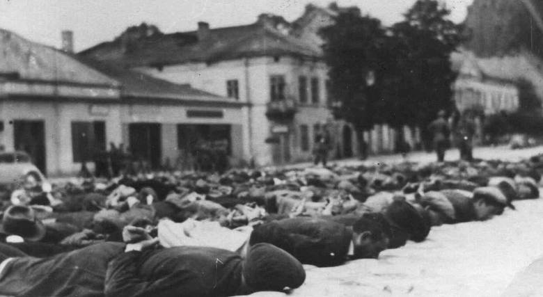<figcaption>Na zdjęciu: zatrzymani zmuszeni do leżenia.</figcaption></figure>

notes:
1.5 min. Uprzedź: mocna scena poniżenia, ale leżący ludzie nie są zwłokami. Terror obejmował SS, policję i żandarmerię. Pretekstem była śmierć niemieckiego żandarma w połowie lipca, mimo wskazania rabunkowego charakteru wcześniejszego napadu. 16VII Niemcy rozstrzelali20Polaków; to osobna data, nie bilans31VII. IPN potwierdza zastrzelenie Tadeusza Lupy i niejednoznaczne relacje o śmierci Majera. Nie ustalaj pewnej liczby wszystkich zgonów. To kolejne wydarzenie po egzekucji16VII,nie ten sam dzień i nie ten sam bilans. TadeuszLupazastrzelonypodczaspróbyucieczki,nieustalajjednejpewnejliczbywszystkichzgonów.

---

<!-- .slide: id="olkusz-zdjecia" class="" data-purpose="evidence" data-layout="photo-pair" data-goals="G3" -->

<h2>Olkusz — fotografie stały się dowodem</h2>

<figure>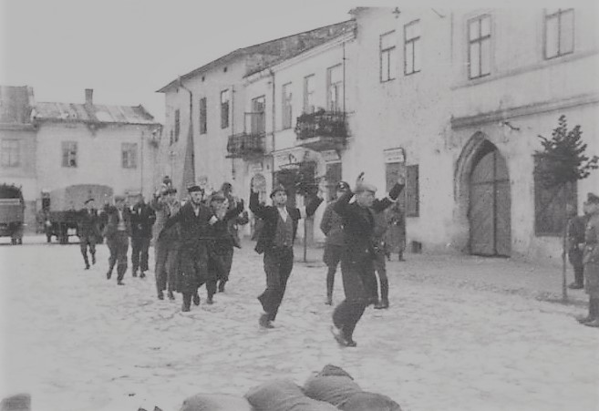<figcaption>Kolumna na rynku · 31 VII 1940</figcaption></figure><figure>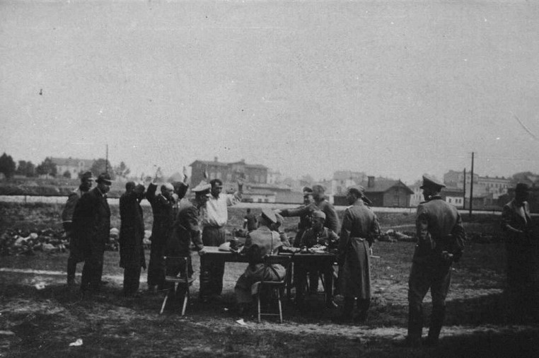<figcaption>Sprawdzanie dokumentów · Czarna Góra</figcaption></figure>

notes:
0.75 min. Niemcy fotografowali własną akcję. Oddali kliszę do zakładu Włodzimierza Dębca, który potajemnie wykonał i zachował odbitki. To przykład ratowania dowodów, nie dowód że Dębiec wykonał wszystkie kadry. Pokaż oba zdjęcia i w razie potrzeby powiększ. Nie rozpoznawaj narodowości cywilów po wyglądzie ani konkretnej jednostki po nieczytelnym mundurze.

---

<!-- .slide: id="olkusz-dokument" class="reading" data-purpose="evidence" data-layout="statement" data-goals="G1 G2" -->

<h2>Jak przetrwały fotografie Krwawej Środy?</h2>

Fragment współczesnego opracowania historycznego
<blockquote class="source-reading">„Niemcy fotografowali całą akcję pacyfikacyjną. Po jej zakończeniu oddali kliszę do wywołania w olkuskim zakładzie fotograficznym Włodzimierza Dębca. Ten, z narażeniem życia, potajemnie wykonał kilka odbitek, które ukrył. Po wojnie przekazał je władzom miasta. Dziś kopie tych zdjęć znajdują się m.in. w zbiorach Muzeum Regionalnego PTTK w Olkuszu i w Archiwum IPN.”</blockquote>

notes:
0.5 min. Cytat dosłowny: Michał Masłowski, 2021-07-31. https://przystanekhistoria.pl/pa2/tematy/zbrodnie-niemieckie/85246,Krwawa-sroda-w-Olkuszu-31-lipca-1940-roku.html. To późniejsze opracowanie, nie zeznanie naocznego świadka. Odczytaj i połącz z poprzednio poznanym przebiegiem wydarzeń, bez pisania.

---

<!-- .slide: id="poreba" class="case" data-purpose="explanation" data-layout="split" data-goals="G3" -->

<h2>Poręba Dzierżna — odwet wymierzony w mieszkańców</h2>

7 VIII 1944
<ul><li>Rano partyzanci ostrzeliwują niemiecki samochód. Po południu Niemcy otaczają wieś.</li><li>Wypędzają ludzi, rozstrzeliwują zatrzymanych, podpalają domy i rabują dobytek.</li><li>Mordują <b>37 osób</b>, także kobietę i dziesięcioletnie dziecko. Ocalałe rodziny tracą bliskich i domy.</li></ul>
<figure>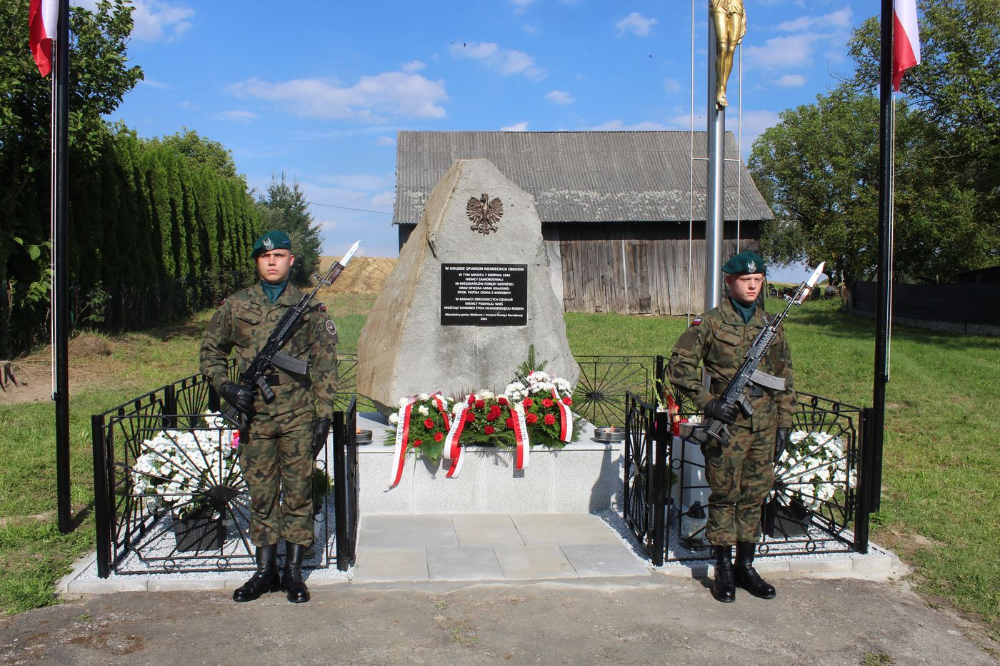<figcaption>Współczesny widok miejsca pamięci</figcaption></figure>

notes:
1 min. Rano oddział AL ostrzelał niemiecki samochód; nie podawaj pewnej liczby zabitych Niemców. Późniejsze mordy na mieszkańcach miały miejsce przy stodole Jana Laskowskiego i w innych punktach wsi. IPN koryguje wcześniejsze 39 na 37, ponieważ dwie osoby zginęły wcześniej w Miechówce, w kwietniu 1944 r. To uwaga nauczycielska, nie dodatkowy slajd metodologiczny. Odwet jest narracją sprawców, nie usprawiedliwieniem mordowania cywilów.

---

<!-- .slide: id="poreba-tekst" class="reading" data-purpose="evidence" data-layout="statement" data-goals="G1 G2" -->

<h2>Poręba Dzierżna — po odejściu oddziałów</h2>

Fragment współczesnego opracowania historycznego
<blockquote class="source-reading">„W sumie Niemcy wymordowali 35 mężczyzn, jedną kobietę i jedno dziecko. Wśród ofiar był jeden żołnierz Armii Krajowej, ppor. Piotr Cień „Ciechanowski” z Wierzbicy. W czasie pacyfikacji spłonęło kilkadziesiąt domów z zabudowaniami gospodarczymi. Te, które się ostały były ogołocone z wartościowych przedmiotów. Przez jakiś czas Niemcy wracali do wsi i grabili plony.”</blockquote>

notes:
0.5 min. Cytat dosłowny: Instytut Pamięci Narodowej – Oddział w Krakowie, 2024-08-07. https://krakow.ipn.gov.pl/pl4/1943-1944-niemiecki-odwet-na-p/204426,Niemieckie-zbrodnie-w-Porebie-Dzierznej-i-Trzyciazu.html. To późniejsze opracowanie, nie zeznanie naocznego świadka. Odczytaj i połącz z poprzednio poznanym przebiegiem wydarzeń, bez pisania.

---

<!-- .slide: id="trzyciaz" class="case" data-purpose="explanation" data-layout="split" data-goals="G3" -->

<h2>Trzyciąż — represje po walce w Smolance</h2>

7 VIII 1944
<ul><li>Dzień wcześniej Niemcy atakują placówkę AK w leśniczówce Smolanka. Partyzanci uchodzą.</li><li>Następnego dnia mordują leśniczego <b>Kazimierza Lorenza i jego żonę Stefanię</b>, palą leśniczówkę.</li><li>We wsi zabijają kolejnych mieszkańców. Łącznie ginie <b>14 osób</b>.</li></ul>
<figure>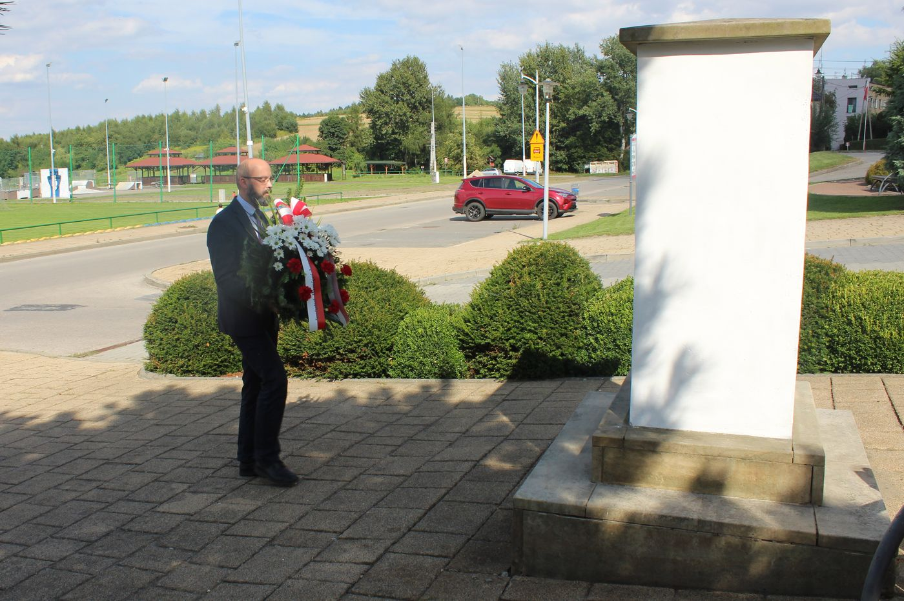<figcaption>Współczesne upamiętnienie w Trzyciążu</figcaption></figure>

notes:
1 min. Łączny bilans: leśniczy z żoną i dwunastu mieszkańców, wśród tych dwunastu sześć kobiet. Niemcy zagrozili zniszczeniem całej wsi w razie dalszej pomocy partyzantom. IPN wskazuje dwie możliwe wersje dekonspiracji placówki: strzał lub donos; nie wybieraj jednej jako pewnej. Nie utożsamiaj z Porębą: ta sama data nie oznacza identycznego przebiegu i okoliczności.

---

<!-- .slide: id="trzyciaz-tekst" class="reading" data-purpose="evidence" data-layout="statement" data-goals="G1 G2" -->

<h2>Trzyciąż — terror miał odciąć pomoc partyzantom</h2>

Fragment współczesnego opracowania historycznego
<blockquote class="source-reading">„Dalej udali się w stronę wsi. Wyciągali siłą mieszkańców z domów. Strzelali do napotkanych przechodniów. W sumie zginęło 14 osób – leśniczy z żoną i 12 mieszkańców Trzyciąża, wśród których było sześć kobiet. W celu zastraszenia mieszkańców Niemcy zapowiedzieli, że jeśli wieś będzie niosła pomoc partyzantom, wrócą i zamordują całą społeczność Trzyciąża, a miejscowość doszczętnie spalą.”</blockquote>

notes:
0.5 min. Cytat dosłowny: Instytut Pamięci Narodowej – Oddział w Krakowie, 2024-08-07. https://krakow.ipn.gov.pl/pl4/1943-1944-niemiecki-odwet-na-p/204426,Niemieckie-zbrodnie-w-Porebie-Dzierznej-i-Trzyciazu.html. To późniejsze opracowanie, nie zeznanie naocznego świadka. Odczytaj i połącz z poprzednio poznanym przebiegiem wydarzeń, bez pisania.

---

<!-- .slide: id="zarzecze" class="case" data-purpose="explanation" data-layout="split" data-goals="G3" -->

<h2>Zarzecze — dziesięć cywilnych ofiar</h2>

19 VIII 1944 · koło Wolbromia
<ul><li>Dzień wcześniej oddział AK „Surowiec” atakuje Niemców budujących umocnienia w okolicy.</li><li>Niemcy wkraczają do wsi i wybierają <b>10 osób do rozstrzelania</b>, w tym kobiety.</li><li>Chcą zastraszyć mieszkańców i zniechęcić ich do pomocy partyzantom.</li></ul>
<figure>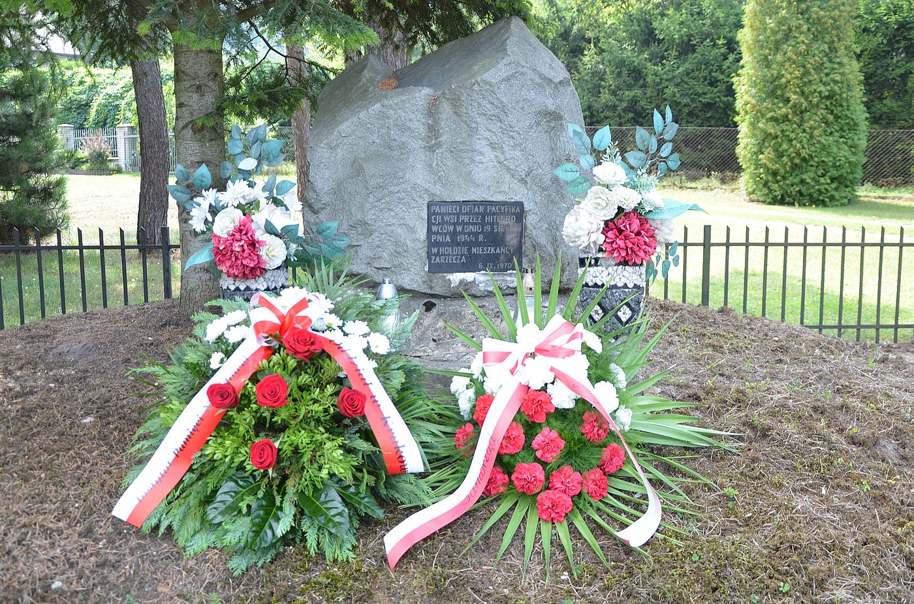<figcaption>Zarzecze · współczesny widok miejsca egzekucji</figcaption></figure>

notes:
1 min. Chodzi o Zarzecze w gminie Wolbrom, powiat olkuski. Oddział AK Surowiec zaatakował 18 sierpnia. Rotmistrz Wacław Zdyb Zawieja poległ w potyczce; nie jest wliczony do dziesięciu ofiar pacyfikacji z 19 sierpnia. Szczątki zamordowanych przeniesiono w 1945 r. do Gołaczew. Nie identyfikuj niemieckiej jednostki jako SS lub Gestapo, bo wskazane źródło tego nie ustala.

---

<!-- .slide: id="zarzecze-tekst" class="reading" data-purpose="evidence" data-layout="statement" data-goals="G1 G2" -->

<h2>Zarzecze — przemoc wobec cywilów</h2>

Fragment współczesnego opracowania historycznego
<blockquote class="source-reading">„Dzień po tym wydarzeniu Niemcy zemścili się na ludności cywilnej. Wkroczyli do Zarzecza i wytypowali do rozstrzelania 10 osób, wśród których znalazły się także kobiety. Akcja okupantów miała na celu zastraszenie ludzi oraz zniechęcenie ich do niesienia pomocy i dawania schronienia partyzantom.”</blockquote>

notes:
0.5 min. Cytat dosłowny: Instytut Pamięci Narodowej – Oddział w Krakowie, 2024-08-19. https://krakow.ipn.gov.pl/pl4/1943-1944-niemiecki-odwet-na-p/204807,Uczcilismy-ofiary-niemieckiej-pacyfikacji-wsi-Zarzecze.html. To późniejsze opracowanie, nie zeznanie naocznego świadka. Odczytaj i połącz z poprzednio poznanym przebiegiem wydarzeń, bez pisania.

---

<!-- .slide: id="podsumowanie" class="" data-purpose="synthesis" data-layout="takeaways" data-goals="G1 G2 G3" -->

<h2>Zbrodnie wojny także w naszej okolicy</h2>

Wolbrom, Olkusz, Poręba Dzierżna, Trzyciąż i Zarzecze — miejsca, w których niemiecka okupacja oznaczała prześladowanie i mordowanie konkretnych ludzi.

Znamy ich losy dzięki zachowanym fotografiom, dokumentom i relacjom.

notes:
0.75 min. Zakończ krótką rozmową, bez obowiązku pisania. Nie dokładaj ogólnych haseł o pamięci. Zapytaj dobrowolnie, które poznane wydarzenie uczniowie potrafią teraz powiązać z miejscem w okolicy.
