<!-- .slide: id="otwarcie" class="explanation-slide" data-purpose="opening" data-layout="hero-source" data-goals="G1" -->

Historia · klasa VIII · świat po 1945 r.
<h1>Początek zimnej wojny</h1>
Wojna się skończyła. Odbudowa i nowy podział dopiero się zaczynały.

<figure class="">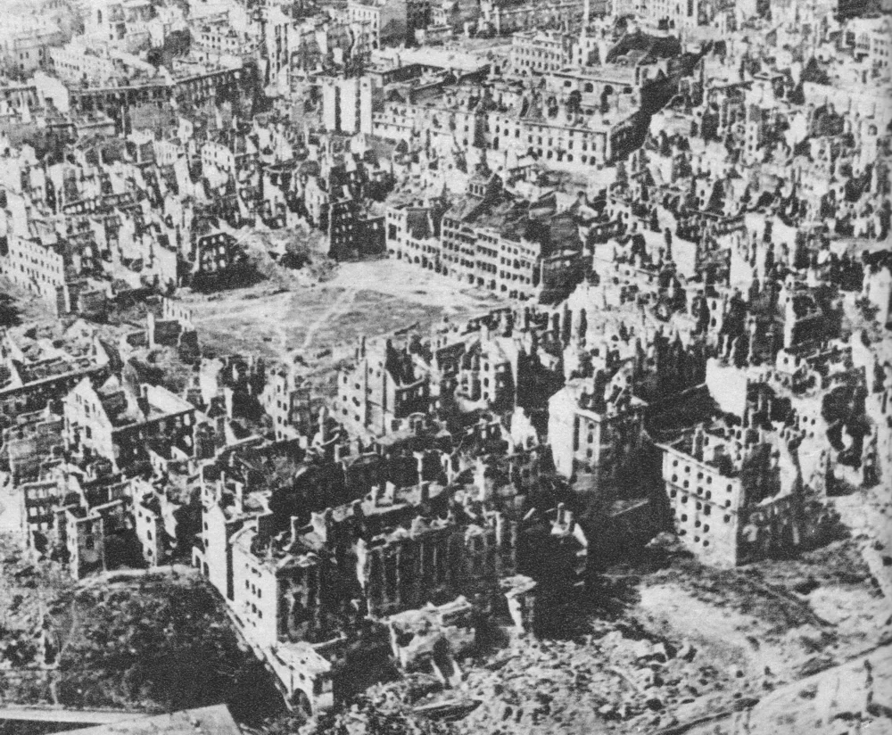<figcaption>Warszawa, styczeń 1945 r.</figcaption></figure>

notes:
0,5 min. Zdjęcie pokazuje cenę wojny, nie walki zimnej wojny. Zapowiedz intensywny przegląd od skutków wojny do muru, bez pytania otwierającego. Nie udawaj spokojnej analizy każdego dokumentu w 45 minut.

---

<!-- .slide: id="skutki" class="explanation-slide" data-purpose="synthesis" data-layout="impact-flow" data-goals="G1" -->

<h2>Skutki II wojny światowej</h2>
Notatka do zeszytu 6 min na zapis

<h3>Demograficzne</h3>
Zginęły dziesiątki milionów ludzi, w tym wielu cywilów. Zagłada zniszczyła żydowskie społeczności Europy.

<figure class="">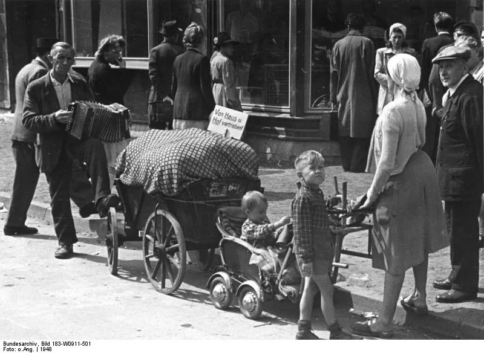</figure>
<h3>Społeczne</h3>
Rodziny traciły bliskich i domy. Przymusowe migracje, osierocenie i urazy psychiczne zmieniły życie ocalałych.

<figure class=""></figure>
<h3>Gospodarcze</h3>
Ruiny mieszkań, fabryk i kolei utrudniały pracę oraz zaopatrzenie. Odbudowa wymagała ogromnego wysiłku.

<figure class="">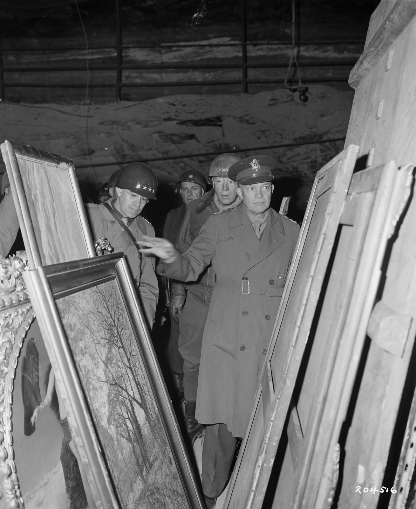</figure>
<h3>Kulturowe</h3>
Niszczono i rabowano zabytki, książki oraz dzieła sztuki. Śmierć twórców i uczonych zubożyła kulturę.

<h3>Polityczne</h3>
Zmieniły się granice. USA i ZSRS stały się supermocarstwami, a Europa zaczęła dzielić się na dwa obozy.

notes:
7 min. 1 min objaśnienia i 6 min cichego zapisu. To jedyna rozbudowana obowiązkowa notatka. Uczeń rysuje środek, pięć gałęzi i zapisuje sens zdań; zdjęć nie przerysowuje. Może skracać własnymi słowami. Demograficzne dotyczą liczby i struktury ludności, społeczne — warunków życia i relacji; kategorie się łączą. Nie wymagaj dokładnego globalnego bilansu ofiar z niejednorodnych statystyk.

---

<!-- .slide: id="poczdam" class="explanation-slide" data-purpose="explanation" data-layout="photo-pair" data-goals="G1" -->
<h2>Poczdam: kto decydował o pokoju?</h2>
<figure class="">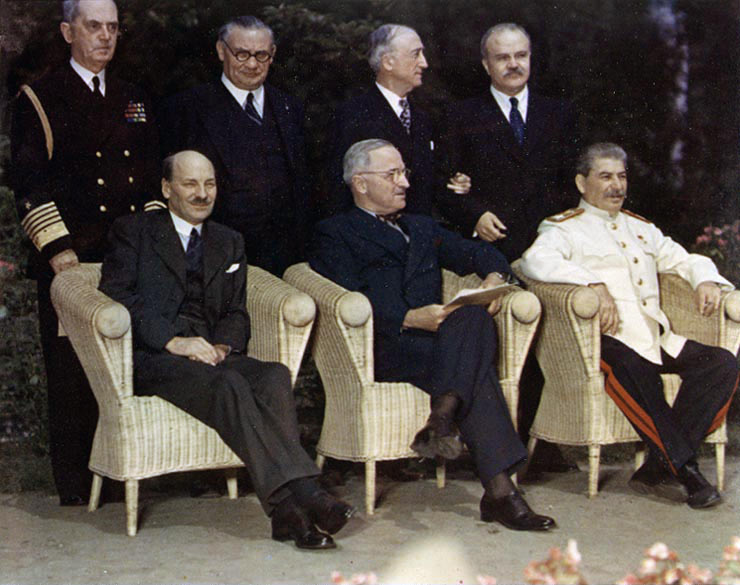<figcaption>Od lewej: Clement Attlee, Harry S. Truman, Józef Stalin. Koniec lipca / początek sierpnia 1945 r.</figcaption></figure>

17 VII–2 VIII 1945 r.

USA, ZSRS i Wielka Brytania ustalały zasady postępowania z pokonanymi Niemcami.

Brytyjski premier <b>Winston Churchill</b> rozpoczął obrady. Po zmianie rządu zastąpił go <b>Clement Attlee</b>.

notes:
1,5 min. Na fotografii jest Attlee. Zmiana 26 VII wynikała z brytyjskich wyborów. Truman był prezydentem USA, Stalin przywódcą ZSRS. Francja nie należała do Wielkiej Trójki, ale była czwartym mocarstwem okupacyjnym. Data konferencji nie jest dokładną datą zdjęcia.

---

<!-- .slide: id="cztery-d" class="explanation-slide" data-purpose="explanation" data-layout="process" data-goals="G1" -->
<h2>Cztery D: jak zmienić Niemcy?</h2><dl class="indexed">
<dt>Demilitaryzacja</dt><dd>Rozbrojenie Niemiec, rozwiązanie ich sił zbrojnych i kontrola przemysłu wojennego miały zapobiec kolejnej wojnie.</dd>

<dt>Denazyfikacja</dt><dd>Likwidowano NSDAP i nazistowskie przepisy; usuwano nazistów z urzędów oraz ścigano sprawców zbrodni.</dd>

<dt>Demokratyzacja</dt><dd>Życie polityczne miało opierać się na demokratycznych partiach, samorządzie i prawach obywateli.</dd>

<dt>Dekartelizacja</dt><dd>Rozbijanie karteli ograniczało skupienie gospodarczej potęgi w wielkich monopolach. Nie oznaczało zamknięcia wszystkich fabryk.</dd>
</dl>

notes:
2,0 min. Wyjaśnij zamiar, nie jednakowe wykonanie w strefach. Dekartelizacja to także demonopolizacja. Protokół przewidywał też decentralizację: rozwój odpowiedzialności władz lokalnych i krajowych; nie podział RFN/NRD. Tu wariant 4D podręcznika s. 97.

---

<!-- .slide: id="poczdam-decyzje" class="explanation-slide" data-purpose="explanation" data-layout="process" data-goals="G1" -->
<h2>Granice, reparacje i przesiedlenia</h2>

<b>Granice.</b> Dawne ziemie niemieckie na wschód od Odry i Nysy Łużyckiej oddano pod administrację Polski. Północna część Prus Wschodnich z Królewcem przypadła ZSRS. Ostateczne rozgraniczenie odłożono do uregulowania pokojowego.

<b>Reparacje</b> to odszkodowania wojenne. Mocarstwa pobierały je głównie ze swoich stref; polskie roszczenia miał zaspokoić ZSRS ze swojej części.

<b>Przesiedlenia.</b> Uzgodniono przeniesienie do Niemiec ludności niemieckiej z Polski, Czechosłowacji i Węgier. W praktyce wysiedleniom towarzyszyły cierpienie i przemoc.

Poczdam nie ustanowił RFN i NRD. Dwa państwa powstały dopiero w 1949 r.

notes:
1,5 min. Protokół wymagał transferu uporządkowanego i humanitarnego; to norma, nie opis wszystkich wysiedleń. ZSRS otrzymywał też część urządzeń ze stref zachodnich. Przy Polsce dopowiedz Gdańsk i południe Prus Wschodnich.

---

<!-- .slide: id="strefy-niemiec" class="map-slide" data-purpose="explanation" data-layout="map-focus" data-goals="G1" -->
<figure class="map-frame">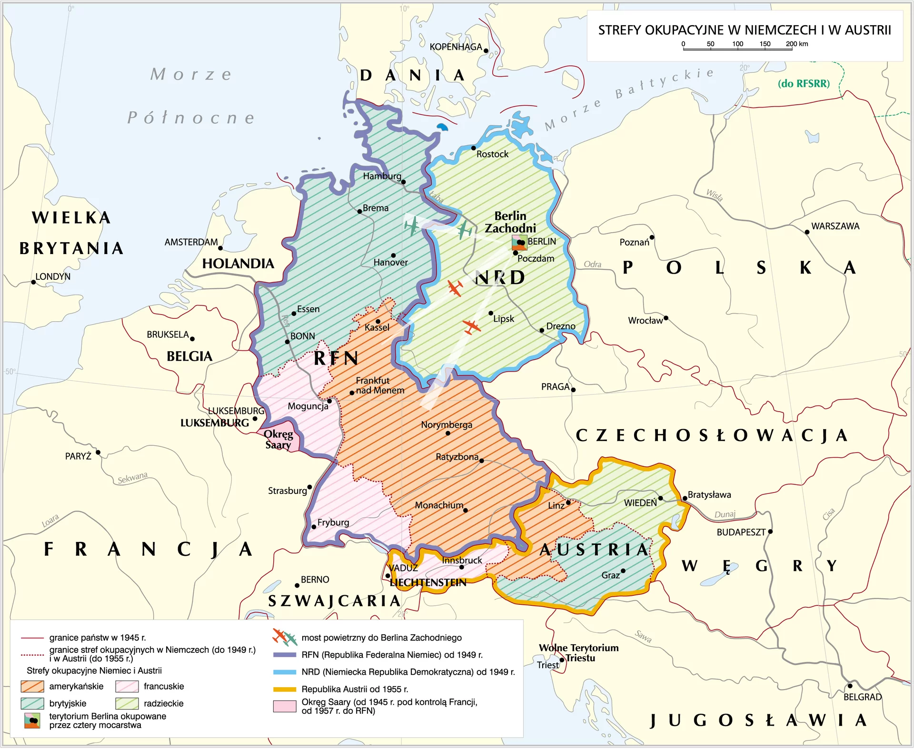</figure>

notes:
1 min. Wariant z filmem: wskaż cztery strefy i położenie Berlina; szczegółowe odczytanie dat w legendzie pozostaw do wglądu, zamiast ponownie referować wszystkie późniejsze zmiany. Mapa jest wielodatowa: czytamy powojenne strefy, lecz legenda obejmuje też państwa z 1949, Austrię od 1955 i Saarę od 1957. Nie jest to jeden stan roku 1945. Wskaż strefy USA, Wielkiej Brytanii, Francji i ZSRS, uzgodnione przed Poczdamem. Potem Berlin wewnątrz sowieckiej strefy. Czytaj przede wszystkim szrafowanie czterech stref; późniejszych dat z legendy nie przenoś na rok konferencji. Zachowano oryginalną legendę.

---

<!-- .slide: id="sektory-berlina" class="map-slide" data-purpose="explanation" data-layout="map-focus" data-goals="G1" -->
<figure class="map-frame">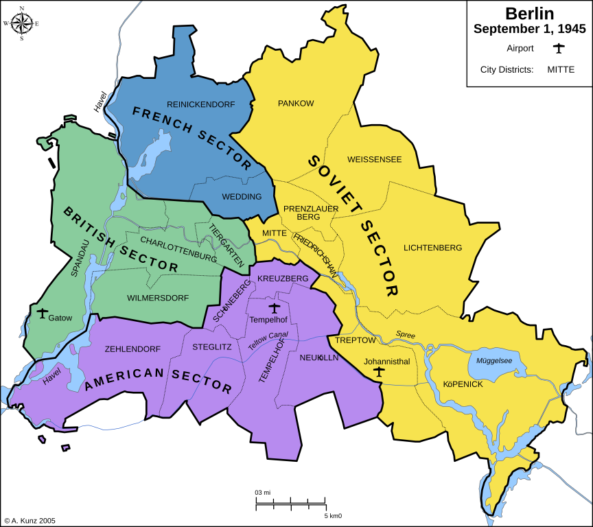</figure>

notes:
0,5 min. Współczesna mapa stanu 1 IX 1945. Wskaż trzy sektory zachodnie i sowiecki. Berlin nie był piątą strefą Niemiec. Sektory zachodnie nie podlegały ZSRS tylko z powodu otoczenia. French — francuski, British — brytyjski, American — amerykański, Soviet — sowiecki.

---

<!-- .slide: id="norymberga" class="explanation-slide" data-purpose="explanation" data-layout="photo-pair" data-goals="G1" -->
<h2>Norymberga: osądzić przywódców</h2>
Główny proces: 20 XI 1945–1 X 1946 r.

<figure class="">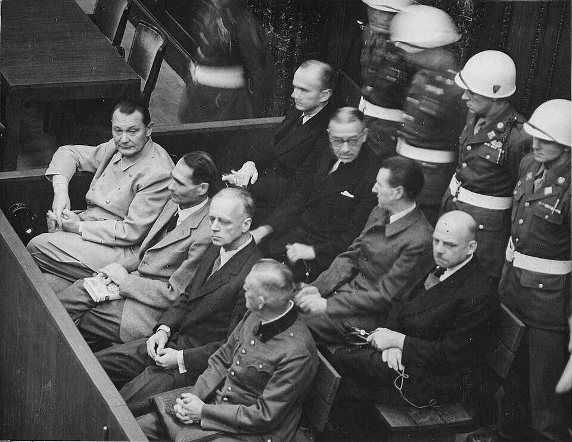<figcaption>Ława oskarżonych, 1945–1946 r. Pierwszy rząd: Göring, Hess, Ribbentrop, Keitel.</figcaption></figure>

<b>Międzynarodowy Trybunał Wojskowy</b> tworzyli sędziowie USA, ZSRS, Wielkiej Brytanii i Francji.

<b>Göring</b> kierował Luftwaffe i należał do najwyższych władz reżimu. <b>Ribbentrop</b> był ministrem spraw zagranicznych.

Sądzono też <b>Hansa Franka</b>, generalnego gubernatora okupowanych ziem polskich. Nie ma go w tym kadrze.

Prokuratorzy przedstawiali dowody zbrodni, w tym dokumenty. Oskarżeni składali wyjaśnienia i bronili się przed zarzutami. Po rozprawach trybunał ogłosił wyroki.

notes:
2,0 min. Nie wszyscy byli żołnierzami. Frank był cywilnym szefem okupacyjnego aparatu terroru. Drugi rząd fotografii: Dönitz, Raeder, Schirach, Sauckel. Krótki przebieg: przedstawienie dowodów przez prokuratorów, wyjaśnienia i obrona oskarżonych, wyroki trybunału. Odróżnij główny proces od procesów późniejszych.

---

<!-- .slide: id="norymberga-wyroki" class="explanation-slide" data-purpose="explanation" data-layout="comparison" data-goals="G1" -->
<h2>Za co oskarżano? Jak osądzono?</h2>

<b>Wspólny plan zbrodni</b> — przygotowanie zbrodniczej polityki.

<b>Zbrodnie przeciw pokojowi</b> — wojna napastnicza.

<b>Zbrodnie wojenne</b> — łamanie praw wojny, np. mordowanie jeńców.

<b>Zbrodnie przeciw ludzkości</b> — masowe mordy, deportacje i prześladowania cywilów, w tym Zagłada.

<h3>Wyroki wobec 22 sądzonych</h3>

<b>12</b>kar śmierci

<b>3</b>dożywocia

<b>4</b>kary terminowe

<b>3</b>uniewinnienia

Oskarżono 24 osoby, lecz postępowanie przeprowadzono wobec 22, w tym jednej zaocznie.

Stanowisko i rozkaz przełożonego nie zwalniają z osobistej odpowiedzialności za zbrodnie.

notes:
1 min. Ley popełnił samobójstwo przed procesem, Gustav Krupp był zbyt chory; Bormanna sądzono zaocznie. 12 wyroków śmierci, lecz 10 egzekucji 16 X 1946: Bormann nieobecny, Göring popełnił samobójstwo. Dożywocia: Hess, Funk, Raeder. Terminowe: Dönitz 10, Neurath 15, Schirach i Speer 20 lat. Uniewinnieni: Fritzsche, Papen, Schacht. Nie wymagaj całej listy pamięciowo.

---

<!-- .slide: id="onz-powstanie" class="explanation-slide" data-purpose="explanation" data-layout="timeline-band" data-goals="G1" -->
<h2>ONZ: współpraca zamiast kolejnej wojny</h2>
Po doświadczeniu dwóch wojen państwa chciały wspólnie chronić pokój, bezpieczeństwo i prawa człowieka.
<ol class="time-axis"><li><b>26 VI 1945</b>
W San Francisco podpisano <b>Kartę Narodów Zjednoczonych</b> — statut, czyli podstawowy dokument ONZ.
</li><li><b>24 X 1945</b>
Karta weszła w życie po ratyfikacjach. ONZ oficjalnie rozpoczęła istnienie.
</li></ol>

<b>1945: 51</b> państw założycielskich.

<b>16 XI 2026: 193</b> państwa członkowskie.

W konferencji uczestniczyło 50 państw. Polska podpisała Kartę później i jest jednym z założycieli.

notes:
1 min. Rozwiń ONZ: Organizacja Narodów Zjednoczonych. Karta reguluje cele, organy i współpracę; podpis i wejście w życie to różne zdarzenia. Współpraca gospodarcza i społeczna też należy do celów. Dane współczesne sprawdzono oficjalnie 16 XI 2026.

---

<!-- .slide: id="onz-organy" class="explanation-slide" data-purpose="explanation" data-layout="process" data-goals="G1" -->
<h2>ONZ nie jest rządem świata</h2><dl class="indexed organs">
<dt>Zgromadzenie Ogólne</dt><dd>Wszystkie państwa mają po jednym głosie. Debatują, przyjmują zalecenia i uchwalają budżet.</dd>

<dt>Rada Bezpieczeństwa</dt><dd>Odpowiada przede wszystkim za pokój. Może ustanawiać sankcje i upoważniać do użycia siły. W 1945 r. miała <b>11</b> członków, dziś ma <b>15</b>.</dd>

<dt>Sekretariat</dt><dd>Sekretarz generalny i pracownicy wykonują codzienną pracę ONZ i prowadzą dyplomację. Sekretarz nie jest „prezydentem świata”.</dd>
</dl>
<b>Pięciu stałych członków RB:</b> USA, Wielka Brytania, Francja, Chiny, ZSRS (dziś Rosja). Ich <b>weto</b> może zablokować decyzję w sprawie nieproceduralnej.

Pierwszy sekretarz: <b>Trygve Lie, od 1946 r.</b> Na 16 XI 2026: <b>António Guterres</b>.

notes:
1 min. Wariant z filmem: objaśnij krótko Zgromadzenie, Radę Bezpieczeństwa z wetem i sekretarza generalnego; nie odczytuj całej tabeli danych dawniej/dziś ani nazwisk z ekranu. ONZ ma sześć głównych organów; pozostałe to Rada Gospodarcza i Społeczna, Rada Powiernicza i Międzynarodowy Trybunał Sprawiedliwości w Hadze. Sekretarza powołuje Zgromadzenie na zalecenie RB. Weto nie dotyczy Zgromadzenia. Rozszerzenie RB weszło w życie w 1965; dziś 10 członków wybieranych na 2 lata. Lie wybrany 1 II 1946.

---

<!-- .slide: id="prawa-czlowieka" class="explanation-slide" data-purpose="explanation" data-layout="photo-pair" data-goals="G1" -->
<h2>Prawa przysługują każdemu człowiekowi</h2>
<figure class="">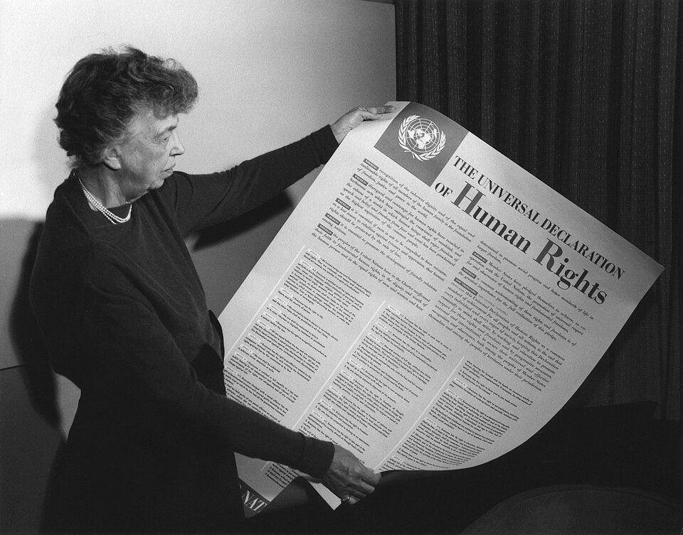<figcaption>Eleanor Roosevelt z plakatem deklaracji, listopad 1949 r.</figcaption></figure>

10 XII 1948 r. · Paryż

Zgromadzenie Ogólne ogłosiło <b>Powszechną Deklarację Praw Człowieka</b>.

Każdy ma godność, prawo do życia, bezpieczeństwa i nauki. Nikogo nie wolno torturować.

Deklaracja jest wspólnym standardem, <b>nie traktatem</b>. Stała się punktem odniesienia dla późniejszych umów i prawa.

notes:
1 min. Zdjęcie z 1949 nie dokumentuje uchwalenia w 1948. Roosevelt przewodniczyła Komisji Praw Człowieka. Ogłoszenie praw nie oznaczało końca ich naruszania. Odróżnij PDPC od Karty NZ.

---

<!-- .slide: id="sowietyzacja" class="explanation-slide" data-purpose="explanation" data-layout="process" data-goals="G2" -->
<h2>Sowietyzacja: własny rząd, zależna polityka</h2>
<b>Sowietyzacja</b> to narzucanie rozwiązań wzorowanych na ZSRS: przewagi partii komunistycznej, represji, cenzury i gospodarki kierowanej przez państwo.

<b>Obecność Armii Czerwonej</b>
W większości krajów ułatwiała komunistom zdobycie władzy.

<b>Przejęcie kontroli</b>
Opanowywano policję i urzędy, usuwano opozycję, fałszowano wybory.

<b>Zależność od Moskwy</b>
Własne rządy nie oznaczały swobody najważniejszych decyzji.

Polska, Czechosłowacja, Węgry, Rumunia, Bułgaria i wschodnie Niemcy (od 1949 r. NRD) znalazły się w sowieckim bloku.

notes:
1,5 min. Tempo i drogi były różne, nie jeden dzień przewrotu wszędzie. Państwa satelickie nie były republikami ZSRS; inaczej Litwa, Łotwa i Estonia wcielone do ZSRS. Albania i Jugosławia miały silną rodzimą partyzantkę komunistyczną. Nacjonalizacja to przejęcie własności przez państwo, nie synonim kolektywizacji.

---

<!-- .slide: id="europa-1949" class="map-slide" data-purpose="explanation" data-layout="map-focus" data-goals="G2" -->
<figure class="map-frame">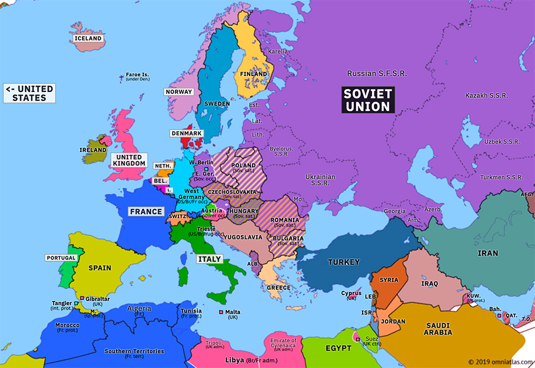</figure>
<h3>Europa 7 X 1949 r.</h3>
<b>Soviet satellite</b> — państwo zależne od ZSRS. <b>Soviet occupied</b> — obszar okupowany przez ZSRS.

Kolory oznaczają obszary kontroli i wpływów; podpisy określają rodzaj zależności.

<b>Jugosławia:</b> komunistyczna, lecz po rozłamie Tito–Stalin w 1948 r. niezależna od Moskwy.

<b>Finlandia i Austria</b> nie były komunistycznymi państwami satelickimi.

notes:
1 min. Jedna migawka 7 X 1949, nie cały proces 1945–1949. Użyj podpisów, nie samego koloru. NRD powstała tego dnia; karta pozostawia opis okupacji sowieckiej. Jugosławia nie stała się demokracją po rozłamie. Finlandia zachowała parlamentaryzm mimo nacisków ZSRS. Austria była okupowana przez cztery mocarstwa; zakończenie okupacji i neutralność w 1955. Albania w 1949 współpracowała z blokiem sowieckim. Prawa Omniatlas do publikacji nieustalone — wyłącznie prywatny przegląd.

---

<!-- .slide: id="zimna-wojna" class="explanation-slide" data-purpose="explanation" data-layout="process" data-goals="G2" -->
<h2>Dlaczego „zimna”, skoro nie był to pokój?</h2>
<b>Zimna wojna</b> była długotrwałą rywalizacją USA i ZSRS oraz związanych z nimi państw o wpływy i przewagę.

Toczyła się w polityce, gospodarce, propagandzie i zbrojeniach. Supermocarstwa unikały otwartej wojny ze sobą, lecz wspierały przeciwne strony konfliktów w innych krajach.

Wspólny wróg pokonany<b>→</b>Spór o Niemcy i wpływy<b>→</b>Sowietyzacja i rosnąca nieufność

Początek jest umowny. Fulton, <b>5 III 1946 r.</b>, stało się symbolem podziału. Ważną cezurą jest też rok 1947.

notes:
1,5 min. Zwięźle objaśnij definicję i jeden przykład sporu; nie odczytuj ponownie całego tekstu. Pół minuty przeniesiono na lekturę artykułu 5, bez naruszania pracy ucznia. Przed następnym slajdem zapowiedz sens lektury: jak Churchill rozumiał kurtynę i jakie kraje wskazywał? Pytania i pełniejsza analiza są opcjonalnym pogłębieniem poza budżetem. Nie ucz, że Churchill wypowiedział zimną wojnę. USA i ZSRS różniły się już podczas sojuszu; po zwycięstwie wrócił spór o przyszły ład.

---

<!-- .slide: id="fulton" class="source-slide" data-purpose="evidence" data-layout="plain" data-goals="G2" -->
<figure class="document">
5 III 1946 r.
<h2>Winston Churchill Przemówienie w Fulton</h2><blockquote>Od Szczecina nad Bałtykiem do Triestu nad Adriatykiem opuściła się żelazna kurtyna w poprzek kontynentu. Poza tą linią znajdują się wszystkie stolice byłych państw środkowej i wschodniej Europy: Warszawa, Praga, Wiedeń, Budapeszt, Bukareszt i Sofia – wszystkie te sławne miasta i zamieszkująca wokół nich ludność leżą, że tak się wyrażę, w sferze radzieckiej i wszystkie, w takiej czy w innej formie, podlegają nie tylko wpływom radzieckim, ale kontroli z Moskwy w bardzo wysokim, niekiedy rosnącym stopniu. [...]</blockquote></figure>

notes:
1,5 min. W rdzeniu: pełna cicha lektura ok. 45–60 s i krótkie wyjaśnienie. Żelazna kurtyna to metafora politycznej bariery i ograniczonych kontaktów, nie istniejący już mur. Według stolic z cytatu: Polska, Czechosłowacja, Austria, Węgry, Rumunia, Bułgaria. Wiedeń pozostaje w cytacie: to perspektywa polityka z marca 1946, nie lista późniejszych satelitów. Austria nie stała się komunistyczną demokracją ludową. Pełne pytania podręcznika i model w assessment; zadanie analityczne poza rdzeniem.

---

<!-- .slide: id="truman" class="explanation-slide" data-purpose="explanation" data-layout="comparison" data-goals="G2" -->
<h2>Truman: powstrzymać rozszerzanie wpływów</h2>
12 III 1947 r. · doktryna Trumana

<b>Doktryna</b> to ogólna zasada prowadzenia polityki. Truman zapowiedział pomoc państwom zagrożonym narzuceniem im cudzej władzy.

<h3>Bezpośrednio: Grecja i Turcja</h3>
Wielka Brytania nie mogła dalej zapewniać im dotychczasowej pomocy. W Grecji trwała wojna domowa.

<h3>Cel: powstrzymywanie</h3>
Wsparcie gospodarcze i wojskowe miało hamować rozszerzanie wpływów komunistycznych, a nie rozpoczynać zbrojny podbój ZSRS.

notes:
1 min. Pomoc dla greckiego rządu wiązała się z lokalną wojną domową. Nie nazywaj wszystkich przeciwników Zachodu armią sterowaną bezpośrednio przez Stalina. Doktryna nie była aktem powstania NATO ani planem odbudowy całej Europy.

---

<!-- .slide: id="marshall" class="explanation-slide" data-purpose="explanation" data-layout="photo-pair" data-goals="G2" -->
<h2>Marshall: odbudowa miała też cel polityczny</h2>
<figure class="">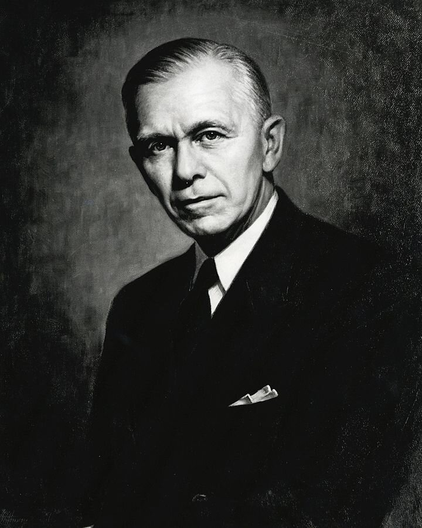<figcaption>George C. Marshall, sekretarz stanu USA w latach 1947–1949; data zdjęcia nieustalona.</figcaption></figure>

1947: propozycja · od 1948: realizacja

USA dostarczały fundusze i towary potrzebne do odbudowy europejskiej produkcji oraz handlu.

Lepsze warunki życia miały ograniczać poparcie dla komunizmu. USA zyskiwały silniejszych partnerów i rynki zbytu.

<b>Polska nie uczestniczyła</b>, ponieważ Stalin odrzucił udział i wymusił rezygnację państw zależnych.

notes:
1,5 min. Nie myl planu Marshalla z UNRRA, z której Polska korzystała. Propozycja 5 VI 1947; realizacja od 1948. Krótkie ustne pytanie po wyjaśnieniu: jak odbudowa mogła służyć powstrzymywaniu? Model: mniejsza bieda i destabilizacja ograniczały atrakcyjność komunizmu, a partnerzy USA stawali się silniejsi.

---

<!-- .slide: id="berlin-blokada" class="explanation-slide" data-purpose="explanation" data-layout="photo-pair" data-goals="G3" -->
<h2>Berlin: blokada zamiast bitwy</h2>
24 VI 1948–12 V 1949 r.

<figure class="">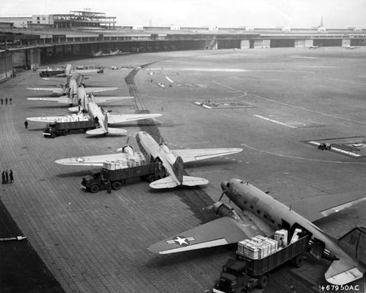<figcaption>Rozładunek na lotnisku Tempelhof, most powietrzny, 1948–1949 r.</figcaption></figure>

<b>Iskra kryzysu:</b> wymiana starego pieniądza na nową markę w zachodnich strefach, a potem zachodnich sektorach Berlina miała uporządkować gospodarkę. ZSRS widział w niej krok ku odrębnemu państwu zachodnioniemieckiemu.

<b>Nacisk:</b> odcięto drogi lądowe i wodne do zachodnich sektorów Berlina oraz dostawy energii.

<b>Most powietrzny:</b> USA i Wielka Brytania dowoziły żywność i węgiel dostępnymi korytarzami lotniczymi. Miasto przetrwało bez forsowania blokady lądowej; Zachód nie wycofał się.

notes:
2,0 min. Reforma walutowa oznaczała zastąpienie starego pieniądza nową marką: miała ułatwić odbudowę legalnego handlu zamiast czarnego rynku. Wprowadzenie jej także do zachodnich sektorów Berlina zaostrzyło spór o gospodarczą i polityczną kontrolę miasta. Nie była jedyną przyczyną: trwał już konflikt o przyszłość Niemiec. W maju 1949 zniesiono blokadę, ale loty dla bezpieczeństwa kontynuowano do września. Odwołaj się do wcześniejszej mapy: miasto otoczone sowiecką strefą, ale czterosektorowe. Chodziło o nacisk na aliantów zachodnich. Most powietrzny nie wymagał forsowania lądowych posterunków, co ograniczało ryzyko bezpośredniej bitwy. Nie myl z murem 1961. Źródło OTH ma rozbieżność 11/12 V; przyjęto 12 V zgodnie z otwarciem artykułu i podręcznikiem.

---

<!-- .slide: id="nato" class="explanation-slide" data-purpose="explanation" data-layout="statement" data-goals="G3" -->
<h2>NATO: wspólna obrona Zachodu</h2>
4 IV 1949 r.

Organizacja Traktatu Północnoatlantyckiego połączyła państwa Ameryki Północnej i Europy w sojusz obronny.

Zbrojna napaść na jednego sojusznika miała być traktowana jako napaść na wszystkich. Współpraca miała odstraszać potencjalnego agresora.

<h3>12 założycieli</h3>
USA i Kanada oraz: Wielka Brytania, Francja, Belgia, Holandia, Luksemburg, Dania, Norwegia, Islandia, Włochy i Portugalia.

NATO było sojuszem państw, nie nowym państwem. RFN dołączyła w 1955 r.

notes:
0,5 min. Wskaż datę powstania, Amerykę Północną i Europę oraz obronny cel NATO. Listy założycieli nie odczytuj; jest do wglądu, nie do pamięciowego odtworzenia. Znaczenie wspólnej obrony wyjaśnij przy następnym pełnym fragmencie artykułu 5. Nie rozwijaj historii rozszerzeń.

---

<!-- .slide: id="nato-artykul-5" class="source-slide" data-purpose="evidence" data-layout="plain" data-goals="G3" -->
<figure class="document">
4 IV 1949 r.
<h2>Traktat Północnoatlantycki Artykuł 5</h2><blockquote>Strony zgadzają się, że zbrojna napaść na jedną lub kilka z nich w Europie lub Ameryce Północnej będzie uważana za napaść przeciwko nim wszystkim; wskutek tego zgadzają się one na to, że, jeżeli taka zbrojna napaść nastąpi, każda z nich [...] udzieli pomocy stronie lub stronom w ten sposób napadniętym, podejmując natychmiast indywidualnie i w porozumieniu z innymi stronami taką akcję, jaką uzna za konieczną, nie wyłączając użycia siły zbrojnej, w celu przywrócenia i utrzymania bezpieczeństwa strefy północnoatlantyckiej.</blockquote></figure>

notes:
1 min. Około 40 sekund na cichą lekturę całego dostarczonego fragmentu, potem krótko objaśnij: napaść na jednego jest sprawą wszystkich, a każdy sojusznik ma udzielić pomocy. Sformułowanie „jaką uzna za konieczną” oznacza dobór działań, włącznie z siłą zbrojną, nie obowiązek identycznej reakcji militarnej wszystkich. To zobowiązanie ma odstraszać agresora. Nie dodawaj nowego zadania pisemnego. Zachowano cały fragment z dostarczonej s. 103 drugiego podręcznika, wraz z jego wewnętrznym [...]; nie jest to pełny artykuł traktatu. Nazwy stron oznaczają tu państwa zawierające umowę. Nie utożsamiaj NATO z ONZ.

---

<!-- .slide: id="niemcy-1949-mapa" class="map-slide" data-purpose="explanation" data-layout="map-focus" data-goals="G3" -->
<figure class="map-frame">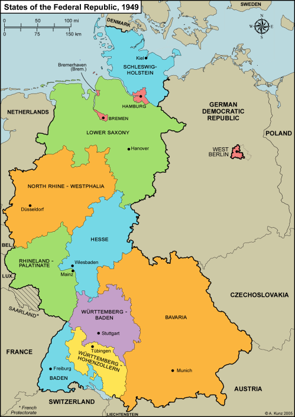</figure>

notes:
1 min. Mapa pokazuje kraje RFN w 1949, a nie dzisiejsze landy; DDR to NRD. Wskaż RFN, NRD i Berlin Zachodni. Bonn i Berlin Wschodni nazwij jako siedziby władz na następnym slajdzie; mapa krajów RFN nie oznacza Bonn. Saara nie należała wówczas do RFN. Berlin Zachodni miał szczególny status pod kontrolą trzech mocarstw, nie był zwykłym landem RFN. Nie użyto uproszczonej mapy GHDI podpisującej go West Berlin (FRG).

---

<!-- .slide: id="niemcy-powstanie" class="explanation-slide" data-purpose="explanation" data-layout="comparison" data-goals="G3" -->
<h2>RFN i NRD: te same pytania, różne odpowiedzi</h2>

<b>Pole</b><h3>RFN <small>Republika Federalna Niemiec</small></h3><h3>NRD <small>Niemiecka Republika Demokratyczna</small></h3>

<b>Powstanie</b>
<b>23 V 1949</b> — Ustawa Zasadnicza. We wrześniu utworzono władze.

<b>7 X 1949</b> — konstytucja i utworzenie państwa.

<b>Terytorium</b>
Trzy zachodnie strefy okupacyjne.

Sowiecka strefa okupacyjna.

<b>Siedziba władz</b>
<b>Bonn</b> — tymczasowa stolica.

<b>Berlin Wschodni</b> — nie całe miasto.

<b>Szef rządu</b>
<b>Konrad Adenauer</b> — kanclerz.

<b>Otto Grotewohl</b> — premier.

<b>Prezydent</b>
<b>Theodor Heuss</b> — głowa państwa.

<b>Wilhelm Pieck</b> — głowa państwa.

notes:
1 min. Wariant z filmem: zaznacz 1949, terytorium i Bonn/Berlin Wschodni. Tabela osób zostaje do wglądu; nie odczytuj całej listy urzędników. RFN: 23 V konstytucja i przyjmowana data powstania; wrzesień ukonstytuowanie władz, nie konkurencyjna data tego samego zdarzenia. Adenauer wybrany 15 IX, Heuss 12 IX. Pieck 11 X. Urząd prezydenta i szefa rządu to różne funkcje. Ulbricht nie był pierwszym premierem ani prezydentem; w 1949 wicepremier i ważny działacz SED, sekretarz generalny partii od 1950.

---

<!-- .slide: id="niemcy-systemy" class="explanation-slide" data-purpose="explanation" data-layout="comparison" data-goals="G3" -->
<h2>Nie wystarczy nazwać państwa „demokracją”</h2>

<b>Pole</b><h3>RFN</h3><h3>NRD</h3>

<b>Władza i wybory</b>
Demokracja parlamentarna: konkurujące partie i możliwość zmiany rządu.

Rzeczywistą władzę sprawowała komunistyczna <b>SED</b>. Inne partie istniały, ale nie mogły swobodnie rywalizować o władzę.

<b>Gospodarka</b>
Gospodarka rynkowa z dużą rolą prywatnych firm, osłonami społecznymi i pomocą zachodnią.

Nacjonalizacja oraz państwowe plany produkcji ograniczały samodzielność przedsiębiorstw.

<b>Życie codzienne</b>
Odbudowa i późniejszy wzrost poprawiały poziom życia, lecz nie usunęły wszystkich nierówności.

Odbudowie towarzyszyły niedobory, cenzura i represje. Warunki życia nie były jednakowe w każdym roku i rodzinie.

Oba państwa początkowo miały ograniczoną samodzielność wobec mocarstw okupacyjnych.

notes:
1 min. Wariant z filmem: wybierz jeden zasadniczy kontrast — swobodna konkurencja partii wobec monopolu SED; gospodarka i życie codzienne pozostają zwięzłymi przykładami na ekranie, bez ponownej lektury tabeli. NRD nie była formalnie państwem z tylko jedną partią, ale SED monopolizowała realną władzę. Konstytucja obiecywała prawa i demokrację; to nie dowód praktyki. Nie przedstawiaj RFN jako natychmiast bogatej i całkowicie suwerennej, ani NRD jako pozbawionej jakiejkolwiek odbudowy. Dane porównawcze gospodarki mają charakter procesu, nie tabeli jednego dnia 1949.

---

<!-- .slide: id="mur-film-wprowadzenie" class="explanation-slide" data-purpose="explanation" data-layout="plain" data-goals="G3" -->
<h2>Berlin: granica w życiu mieszkańców</h2>

Oglądając, zwróćcie uwagę: <b>co zmieniło się dla rodzin i przyjaciół po zamknięciu granicy?</b>

<lesson-video>
  <button class="video-fallback" data-video-play type="button">▶ Odtwórz film„Z dnia na dzień mur rozdzielił mieszkańców Berlina!”<small>3:10 · wymaga Internetu</small></button>
  <iframe data-video-src="https://www.youtube-nocookie.com/embed/jb5QR2cbdug?rel=0" title="Film: Z dnia na dzień mur rozdzielił mieszkańców Berlina" allow="encrypted-media; picture-in-picture; fullscreen" allowfullscreen hidden></iframe>
</lesson-video>

<a href="https://www.youtube.com/watch?v=jb5QR2cbdug" target="_blank" rel="noopener noreferrer">Otwórz na YouTube ↗</a> · gdy odtwarzacz nie działa

notes:
3,5 min. Wprowadzenie przed omówieniem przyczyn i sposobu budowy muru. Zapowiedz pytanie, odtwórz całe nagranie (3:10), a po filmie przyjmij jedną krótką odpowiedź: granica rozdzieliła bliskich, przerwała kontakty, wywołała strach i próby ucieczek. Film zawiera archiwalia i współczesne wypowiedzi świadków — nie jest w całości materiałem z epoki ani filmem bez gadających głów. W próbkach widać ucieczkę z okna i przez drut; nie stwierdzono drastycznych obrażeń w sprawdzonych kadrach. Nie pomyl nagłego zamknięcia granicy w nocy 12/13 VIII 1961 z ukończeniem całego systemu betonowych murów. „Drugie założenie NRD” w dostępnej transkrypcji to metafora umocnienia reżimu, nie data założenia państwa. Odczytano automatyczne napisy i obejrzano 20 próbek, nie wykonano pełnego odsłuchu. Odtwarzacz uruchamia się dopiero po kliknięciu; użyj linku do YouTube, jeśli osadzenie jest zablokowane. Przed przejściem dalej zatrzymaj odtwarzanie. Bez sieci pomiń projekcję, odczytaj pytanie i przejdź do kolejnego slajdu z lokalnym zdjęciem i wyjaśnieniem. Rozsądny bufor na reklamy lub problemy sieciowe nie jest gwarantowany; sprawdź dostęp przed lekcją.

---

<!-- .slide: id="mur-1961" class="explanation-slide" data-purpose="explanation" data-layout="photo-pair" data-goals="G3" -->
<h2>Mur miał zatrzymać ludzi, nie dostawy</h2>
<figure>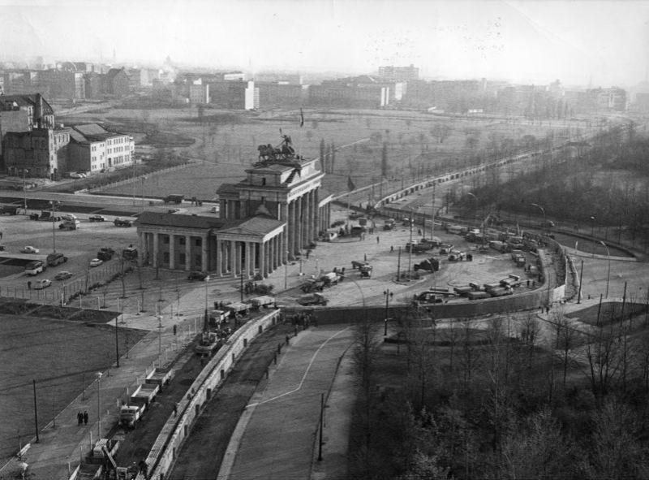<figcaption>Brama Brandenburska i budowa muru, lato / jesień 1961 r.</figcaption></figure>

Noc 12/13 VIII 1961 r.

Ludzie opuszczali NRD z powodu represji, braku wolności i nadziei na lepsze życie. Przez Berlin Zachodni mogli dotrzeć do RFN.

Władze NRD chciały zatrzymać ucieczki, utratę pracowników i osłabienie swojej władzy.

Najpierw zamknięto granicę drutem i zaporami. Potem rozbudowywano mur, pas graniczny, oświetlenie i strażnice.

<b>1948–1949: blokada dostaw.</b> <b>1961: zamknięcie drogi ucieczki.</b>

notes:
0,5 min. Po filmie dopowiedz już tylko cel władz i kolejność drut → późniejsza rozbudowa. Nie powtarzaj całej opowieści o rozdzieleniu bliskich. Władze SED działały za zgodą ZSRS. Granica między NRD a RFN była zamknięta już od 1952; Berlin pozostał ostatnią ważną drogą wyjazdu. Przyczyny migracji były polityczne, gospodarcze i rodzinne. Nie przedstawiaj wszystkich uciekinierów jako robotników ani samej biedy jako jedynego powodu. Fotografia nie pochodzi na pewno z nocy 12/13 VIII: ma szersze datowanie lato/jesień 1961. Mur był rozbudowywany przez lata; nie pokazuj ostatecznego systemu jako gotowego w jedną noc. Rozdzielono rodziny. Blokada dotyczyła nacisku na dostawy i aliantów, mur — zatrzymania ludzi.

---

<!-- .slide: id="mur-ucieczki-kryzys" class="explanation-slide" data-purpose="evidence" data-layout="photo-pair" data-goals="G3" -->
<h2>Ucieczka człowieka, napięcie mocarstw</h2>
<figure>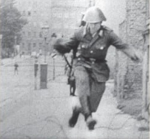<figcaption>Conrad Schumann, strażnik graniczny NRD. Ucieczka do Berlina Zachodniego, 15 VIII 1961 r.</figcaption></figure>

15 VIII 1961 r. · skok przez drut

Nawet pilnujący granicy uciekali. Z czasem coraz trudniejsze zabezpieczenia i uzbrojeni strażnicy czyniły ucieczkę śmiertelnie niebezpieczną.
<h3>27–28 X 1961 r. · Checkpoint Charlie</h3>
Spór o kontrolę przejazdu zachodnich przedstawicieli przerodził się w konfrontację czołgów USA i ZSRS przy przejściu granicznym.

Mocarstwa wycofały czołgi. Udało się uniknąć bezpośredniej walki.

notes:
1 min. Rozpoznana fotografia Petera Leibinga: Conrad Schumann, funkcjonariusz wschodnioniemieckiej policji granicznej, 15 VIII 1961, Bernauer-/Ruppiner Straße. To autentyczne zdjęcie z epoki, nie inscenizacja. Biblioteka Kongresu podaje osobę, fotografa i datę; nie mylić daty notatki na odwrocie 23 VIII 1963 z datą wykonania. Kadr z dostarczonej s. 102, prawa publikacji nieustalone; niska rozdzielczość materiału wejściowego. Przy Checkpoint Charlie chodziło o to, kto może kontrolować przedstawicieli mocarstw i ich uprawnienia w Berlinie Wschodnim. Konfrontacja czołgów 27–28 X nie była bitwą. Zapis podręcznika o staniu przez dwa dni nie oznacza 48 godzin. Nie podawaj liczby ofiar: liczba ze s. 103 jest historycznym bilansem o innym stanie badań niż obecne ustalenia fundacji.

---

<!-- .slide: id="mur-solidarnosc" class="explanation-slide" data-purpose="explanation" data-layout="photo-pair" data-goals="G3" -->
<h2>Berlin Zachodni nie miał zostać sam</h2>
<figure>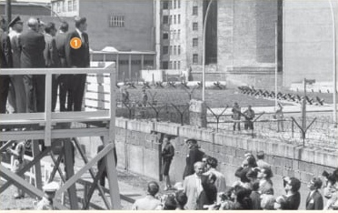<figcaption>John F. Kennedy przy murze, wizyta w Berlinie Zachodnim, 1963 r.</figcaption></figure>

26 VI 1963 r. · John F. Kennedy

Prezydent USA powiedział: <b>„Ich bin ein Berliner”</b> — „Jestem berlińczykiem”. Wyraził solidarność z mieszkańcami i poparcie dla ich wolności.

12 VI 1987 r. · Ronald Reagan

Przed Bramą Brandenburską wezwał przywódcę ZSRS <b>Michaiła Gorbaczowa</b> do otwarcia bramy i zburzenia muru.

Były to deklaracje polityczne. Same przemówienia nie otworzyły granicy.

notes:
0,75 min. Kennedy wygłosił przemówienie przed ratuszem Schöneberg, nie z widocznego na zdjęciu podestu. Fotografia pokazuje oglądanie granicy podczas wizyty, nie moment wypowiadania słynnego zdania. Podest jest widoczny, a autor zdjęcia pozostaje nieustalony. Kadr zachowuje oryginalny pomarańczowy znacznik podręcznika. Reagan przemawiał 12 VI 1987; oficjalna transkrypcja: „Mr. Gorbachev, open this gate! Mr. Gorbachev, tear down this wall!”. Uczniom podano parafrazę wezwania. Nie buduj fałszywej przyczynowości Reagan → natychmiastowy upadek muru. Na s. 103 konwój amerykański i wizyta Johnsona są przypisane do VIII 1963; dotyczą VIII 1961. Ten poboczny szczegół nie jest dodawany do slajdu ani wymagany od uczniów.

---

<!-- .slide: id="mur-otwarcie" class="explanation-slide" data-purpose="explanation" data-layout="timeline-band" data-goals="G3" -->
<h2>Otwarcie granicy to nie zjednoczenie</h2>
W 1989 r. protesty mieszkańców NRD i fala wyjazdów osłabiły komunistyczne władze. Zmiany w bloku wschodnim umożliwiły przełom.
<ol class="time-axis"><li><b>9 XI 1989</b><h3>Otwarcie przejść</h3>
Po niejasnym ogłoszeniu nowych zasad podróży tłumy ruszyły na granicę. Strażnicy otworzyli przejścia do Berlina Zachodniego.
</li><li><b>3 X 1990</b><h3>Zjednoczenie Niemiec</h3>
Po negocjacjach i porozumieniach ziemie NRD weszły do RFN. Dwa państwa połączyły się w jedno.
</li></ol>
Mur nie zniknął w jedną noc. Otwarcie przejść poprzedziło rozbiórkę i zjednoczenie państw.

notes:
0,75 min. 9 XI 1989 Günter Schabowski niejasno zakomunikował nowe zasady podróży jako obowiązujące natychmiast. Nacisk ludzi i decyzje na przejściach doprowadziły do ich otwarcia; nie był to zaplanowany na tę noc demontaż całego muru. Zjednoczenie 3 X 1990 wymagało późniejszych ustaleń wewnątrzniemieckich i międzynarodowych; kanclerzem RFN był Helmut Kohl. Nie rozwijaj tu całego procesu rozpadu bloku — to domknięcie berlińskiego przykładu. Nie wymagaj pamięciowego odtwarzania wszystkich dat wizyt. Daty otwarcia i zjednoczenia odróżnij; nie utożsamiaj z nimi końca ZSRS w 1991. Materiał fundacji potwierdza mechanizm otwarcia i późniejszą rozbiórkę, data zjednoczenia jest sprawdzona osobno.

---

<!-- .slide: id="synteza" class="explanation-slide" data-purpose="synthesis" data-layout="timeline-band" data-goals="G3" -->
<h2>Od wspólnego zwycięstwa do trwałego podziału</h2><ol class="time-axis four"><li><b>1945</b>
Koniec wojny, okupacja Niemiec i powstanie ONZ.
</li><li><b>1946–1947</b>
Kurtyna w słowach Churchilla; polityka Trumana i plan Marshalla.
</li><li><b>1948–1949</b>
Blokada i most powietrzny; NATO oraz dwa państwa niemieckie.
</li><li><b>1961 → 1989 → 1990</b>
Mur, otwarcie przejść, a następnie zjednoczenie Niemiec.
</li></ol>
Rywalizacja mocarstw dotyczyła bezpieczeństwa i wpływów. Jej skutki odczuwali zwykli ludzie.

notes:
0,5 min. Synteza ustna, nie druga notatka do przepisania. Oś porządkuje zdarzenia, odległości nie są skalą czasu. NATO 4 IV powstało przed końcem blokady 12 V. RFN i NRD później w 1949. 9 XI 1989 to otwarcie przejść; 3 X 1990 — zjednoczenie Niemiec.

---

<!-- .slide: id="sprawdzenie" class="exit-ticket-slide" data-purpose="exit-ticket" data-layout="plain" data-goals="G2 G3" -->

3 min · samodzielnie · w zeszycie
<h2>Wyjaśnij, nie zgaduj</h2><ol><li>Dlaczego po zwycięstwie w 1945 r. USA i ZSRS stawały się rywalami? Podaj konkretny przedmiot sporu.</li><li>Wyjaśnij, jak odbudowa gospodarki w planie Marshalla miała służyć powstrzymywaniu komunizmu.</li><li>Uczeń mówi: „W 1948 r. mur podzielił Niemcy na RFN i NRD”. Popraw to zdanie, rozdzielając trzy wydarzenia.</li></ol>

notes:
3 min. Bez podpowiedzi i wyświetlania syntezy. To indywidualna pauza sprawdzająca, nie praca w parze. Model: spór o niezależność Europy Środkowo-Wschodniej lub przyszłość Niemiec; odbudowa ograniczała destabilizację sprzyjającą komunistom; blokada 1948–1949, państwa 1949, mur 1961. Pół minuty buforu po tej pauzie przeznacz na odczyt odpowiedzi i korektę błędu, nie nowy temat.
