<!-- .slide: id="otwarcie" class="explanation-slide" data-purpose="opening" data-layout="split" data-goals="G1" -->

Historia · klasa VIII · Europa po 1945 roku

<h1>Za żelazną kurtyną</h1>
Jedno supermocarstwo. Odrębne państwa. Ograniczona samodzielność.

1945–1960

<figure>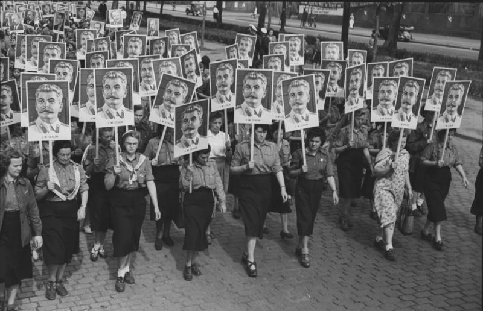<figcaption>Berlin Wschodni, 9 VIII 1951 r. Pochód z portretami Stalina.</figcaption></figure>

notes:
0,5 min. Wariant z filmem: jedno zdanie wprowadzenia i wskazanie portretów; nie powtarzaj całego planu lekcji. Zwięźle przypomnij podział Europy. ZSRS to Związek Socjalistycznych Republik Sowieckich, spotykany też jako ZSRR. Zapowiedz intensywny przegląd, a nie spokojne pogłębienie wszystkich problemów. Bez pytania otwierającego. Fotografia: Berlin Wschodni, 9 VIII 1951, uczestniczki FDJ niosą portrety Stalina podczas festiwalu młodzieży. To scena kultu jednostki i propagandy, nie portret Stalina ani dowód poparcia wszystkich mieszkańców. Wskaż obraz bez osobnego ćwiczenia.

---

<!-- .slide: id="supermocarstwo" class="explanation-slide" data-purpose="explanation" data-layout="comparison" data-goals="G1" -->
<h2>ZSRS: siła większa niż własne granice</h2>
Po zwycięstwie nad Niemcami ZSRS stał się jednym z dwóch supermocarstw — obok USA.

<h3>Własne terytorium</h3>
Do ZSRS wcielono ziemie sąsiadów. Władze sowieckie rządziły nimi bezpośrednio.

<h3>Strefa wpływów</h3>
Armia i nacisk polityczny umożliwiały podporządkowanie innych państw. Zachowały one granice i rządy, ale nie pełną swobodę decyzji.

Wcielenie ziem ≠ zależność państwa satelickiego.

notes:
0,5 min. Wariant z filmem: podaj tylko zasadniczą różnicę wcielenie–zależność; konkretne przykłady odczytamy na dwóch kolejnych mapach. Wyjaśnij satelitę: państwo formalnie odrębne, zależne w najważniejszych decyzjach od mocarstwa. Nie sugeruj posiadania przez ZSRS bomby atomowej już w 1945.

---

<!-- .slide: id="nabytki-mapa" class="map-slide" data-purpose="evidence" data-layout="map-focus" data-goals="G1" -->
<figure class="border-map">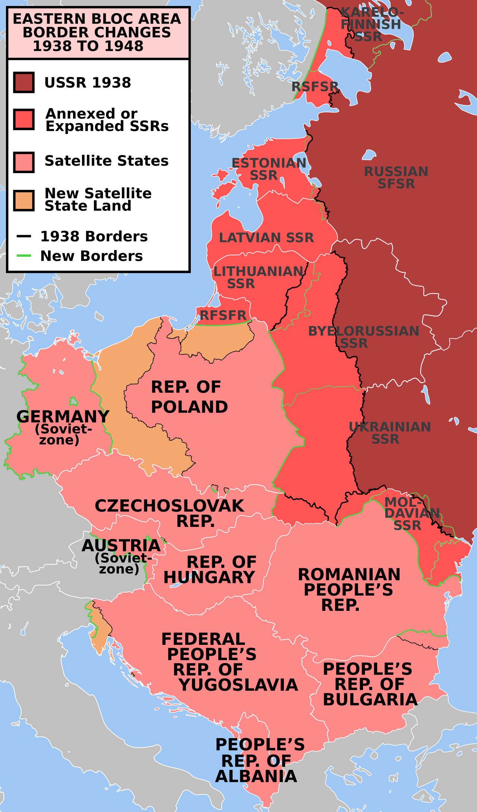</figure>
<h2>1938–1948</h2>
<b>Wcielenia:</b> Litwa, Łotwa i Estonia — 1940; wschodnie ziemie Polski — 1939; Besarabia — 1940. Po wojnie ZSRS utrzymał zasadniczą część tych zdobyczy.

<b>1945:</b> Ruś Zakarpacka została odstąpiona przez Czechosłowację.

<b>Róż to nie czerwień:</b> Polska i Węgry pozostały osobnymi państwami.

Jugosławia: przed rozłamem 1948. Sowiecka strefa Austrii oznacza okupację, nie państwo satelickie.

notes:
3 min. Najpierw pełna legenda: ciemnoczerwony ZSRS1938; czerwony wcielone/powiększone republiki; różowy satelici; pomarańczowy ich nowe ziemie; czarna linia1938, zielona nowe granice. Mapa wielodatowa, nie stan1955. Znajdź Litwę i Polskę, porównaj status. Dodaj ustnie Łotwę, Estonię i Węgry. Źródło obejmuje także strefy okupacyjne: Austria nie była komunistycznym satelitą. Wcielenia1939–1940 zostały przerwane okupacją niemiecką i odnowione. Powiększenie zachowuje źródło; drobne etykiety mają ograniczoną czytelność.

---

<!-- .slide: id="europa-1949" class="map-slide" data-purpose="evidence" data-layout="map-focus" data-goals="G1" -->
<figure class="europe-map">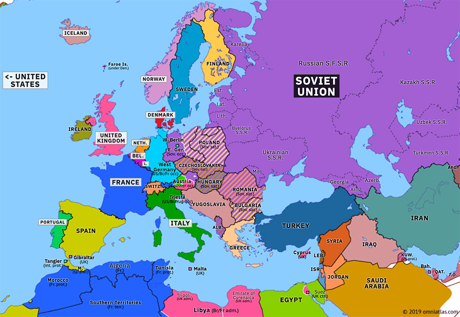</figure>
<h2>7 X 1949</h2>
<b>Fiolet:</b> kontrola lub wpływ ZSRS.

<b>Szrafowanie:</b> dzielona kontrola lub wpływ.

<b>Sov. sat.</b> — satelita. <b>Sov. occ.</b> — okupacja.

Jugosławia ma odrębny kolor i nie jest sowieckim satelitą.
<figure class="">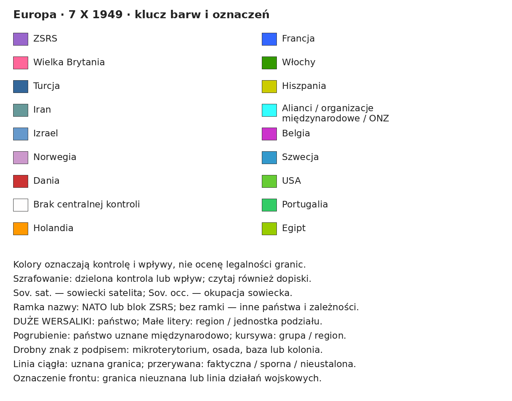<figcaption>Pełna legenda — kliknij.</figcaption></figure>

notes:
2 min. Źródłowy klucz odczytany z media/evidence/omni1949-key.html, nie z błędnego pliku roboczego. Barwa sama nie oznacza wcielenia: Albania jest odrębnym państwem. Wskaż Polskę, Czechosłowację, Węgry, Rumunię i Bułgarię; oddziel republiki bałtyckie. NRD powstała7X1949, źródło pozostawia dopisek sowieckiej okupacji. Nie używaj tej mapy jako mapy UW1955. Otwórz klucz w razie potrzeby, nie odczytuj całej encyklopedii znaków.

---

<!-- .slide: id="sowietyzacja" class="explanation-slide" data-purpose="explanation" data-layout="process" data-goals="G2" -->
<h2>Sowietyzacja: narzucić sowiecki model</h2>
<b>Sowietyzacja</b> to narzucanie rozwiązań wzorowanych na ZSRS w polityce, gospodarce i życiu społecznym.
<ol class="process"><li><b>Osłona wojskowa</b>
Obecność Armii Czerwonej wzmacniała komunistów.
</li><li><b>Przejęcie instytucji</b>
Kontrolowano policję i urzędy, zastraszano opozycję i fałszowano wybory.
</li><li><b>Monopol partii</b>
Nie można było odsunąć rządzących w wolnych wyborach.
</li></ol>
Przykład: cenzura w Polsce blokowała publikowanie krytyki władzy.

notes:
1,5 min. Drogi i tempo przejęcia władzy różniły się. Sowietyzacja nie oznacza samej rusyfikacji ani wcielenia. Przykład tłumaczy mechanizm: mniej dostępnej krytyki utrudnia organizowanie niezależnej opozycji.

---

<!-- .slide: id="demokracja-ludowa" class="explanation-slide" data-purpose="explanation" data-layout="split" data-goals="G2" -->
<h2>„Demokracja ludowa”</h2>

Propagandowa nazwa państwa rzekomo rządzonego przez lud. W rzeczywistości decydowała partia komunistyczna.
<dl class="indexed">
<dt>Władza</dt><dd>Partia kontrolowała państwo. Inne ugrupowania mogły istnieć, ale bez swobodnej konkurencji.</dd>

<dt>Informacja</dt><dd>Cenzura usuwała niewygodne treści, a propaganda przekonywała o słuszności partii.</dd>

<dt>Życie społeczne</dt><dd>Policja polityczna stosowała represje; ograniczano niezależne organizacje, Kościoły i kontakty z Zachodem.</dd>
</dl>
<figure>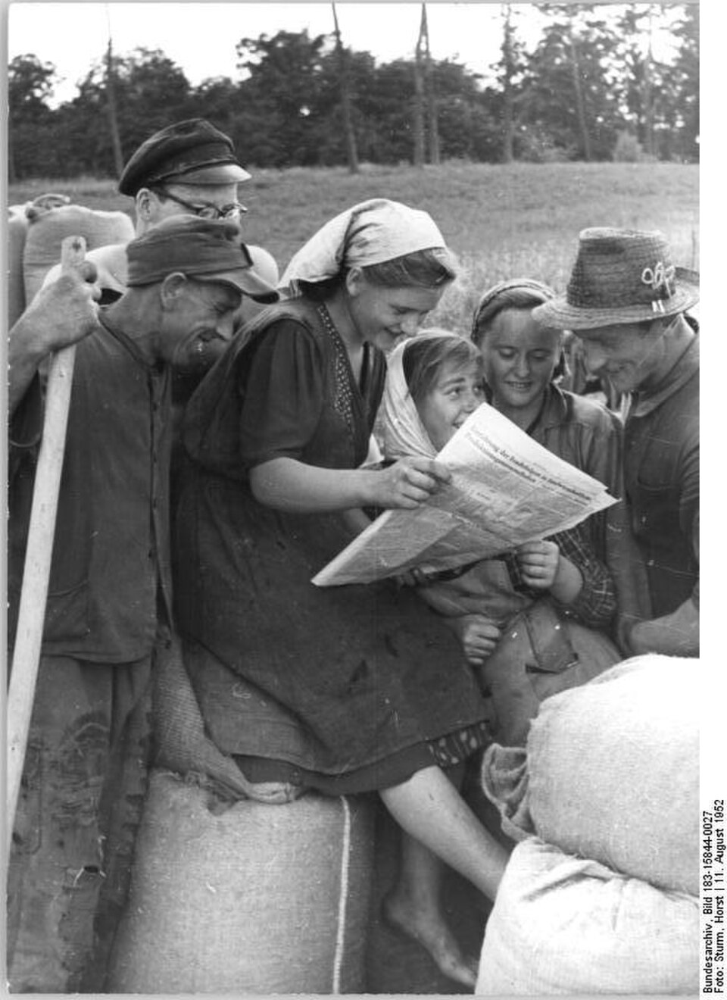<figcaption>Worin, NRD, 11 VIII 1952 r. Rolnicy czytają gazetę — oficjalny obraz życia spółdzielni.</figcaption></figure>

notes:
1,5 min. Ateizacja oznaczała nacisk na odchodzenie od religii, nie pewność, że wszyscy mieszkańcy stali się ateistami. Odróżnij twierdzenia propagandy od praktyki politycznej. Formalna konstytucja nie gwarantowała respektowania praw. Fotografia: Worin, NRD, 11 VIII 1952, członkowie spółdzielni Thomas Müntzer czytają gazetę. Oficjalny opis chwalił ich życie i entuzjazm; nie przyjmuj tego za dowód powszechnego dobrobytu lub dobrowolności kolektywizacji. Kadr pokazuje czytanie prasy, sam nie dowodzi działania cenzury.

---

<!-- .slide: id="film-socrealizm" class="explanation-slide" data-purpose="explanation" data-layout="plain" data-goals="G2" -->
<h2>Propaganda w krajobrazie miasta</h2>

Oglądając, zwróćcie uwagę: <b>jak władza wykorzystywała wygląd miast i kulturę do umacniania swoich wpływów?</b>

<lesson-video>
  <button class="video-fallback" data-video-play type="button">▶ Odtwórz filmPałac Kultury i Nauki był „DAREM” od ZSRR<small>3:09 · po polsku · wymaga Internetu</small></button>
  <iframe data-video-src="https://www.youtube-nocookie.com/embed/BGP_Rqvg7_0?rel=0" title="Film: Pałac Kultury i Nauki był darem od ZSRR" allow="encrypted-media; picture-in-picture; fullscreen" allowfullscreen hidden></iframe>
</lesson-video>

<a href="https://www.youtube.com/watch?v=BGP_Rqvg7_0" target="_blank" rel="noopener noreferrer">Otwórz na YouTube ↗</a> · gdy odtwarzacz nie działa

notes:
3,5 min. Po wyjaśnieniu propagandy i cenzury pokaż konkretny przykład wpływu władzy na kulturę. Przeczytaj pytanie przed uruchomieniem, odtwórz cały film 3:09, zbierz jedną krótką obserwację. Oczekiwane: monumentalne budowle, nazwy miast ku czci Stalina i sztuka gloryfikująca robotników służyły przekonywaniu o potędze i słuszności systemu. Kult jednostki to przesadne wywyższanie przywódcy przez propagandę. Socrealizm podporządkowywał twórczość ideologii i propagandzie; żart o malowaniu tego, co każą, nie jest pełną definicją. Film zawiera archiwalia i współczesne wypowiedzi, nie jest w całości nagraniem z epoki. Tytułowy „dar” nie dowodzi braku politycznej zależności. Odczytano automatyczne napisy i obejrzano 20 próbek obrazu, nie wykonano pełnego odsłuchu. Odtwarzacz ładuje się po kliknięciu; awaryjnie otwórz link YouTube w nowej karcie. Zatrzymaj film przed przejściem dalej. Bez sieci pomiń odtwarzanie i wróć do lokalnej fotografii pochodu z portretami Stalina oraz wyjaśnienia propagandy — nie udawaj odsłuchu. Sprawdź dźwięk, dostęp i ewentualne reklamy przed zajęciami.

---

<!-- .slide: id="gospodarka" class="explanation-slide" data-purpose="explanation" data-layout="split" data-goals="G2" -->
<h2>Państwo decyduje także o gospodarce</h2>
<dl class="photo-definitions">
<dt>Gospodarka planowa</dt><dd>Władze ustalały, co i ile produkować oraz na co przeznaczać środki, zamiast pozostawić te decyzje głównie przedsiębiorstwom i rynkowi.</dd>

<dt>Nacjonalizacja</dt><dd>Państwo przejmowało prywatne przedsiębiorstwa, np. fabryki.</dd>

<dt>Kolektywizacja</dt><dd>Indywidualne gospodarstwa rolne łączono we wspólne, zwykle pod presją władz.</dd>
</dl><figure>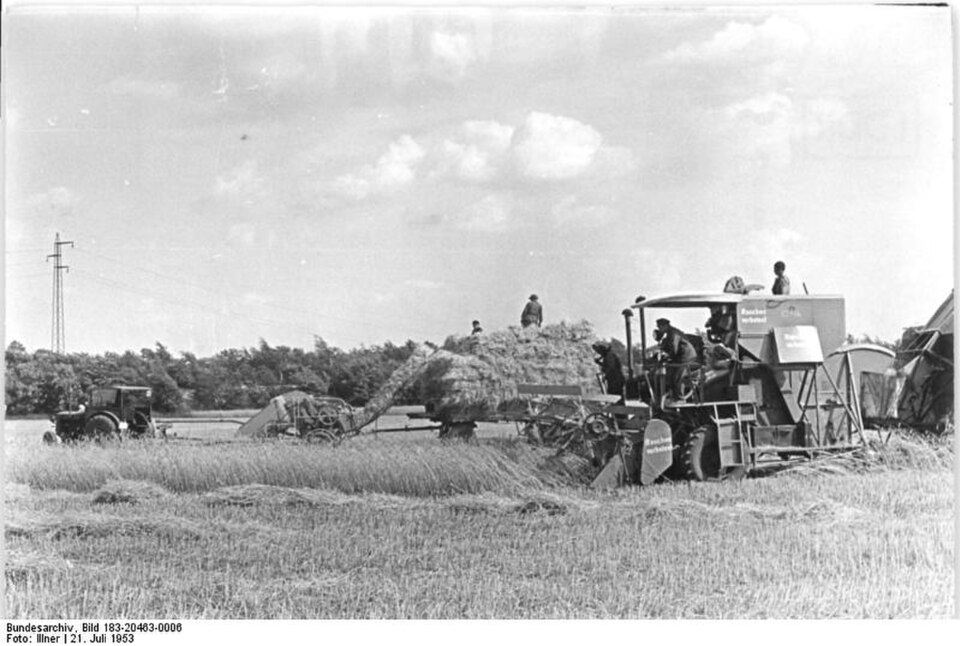<figcaption>Schenkenberg, NRD, 21 VII 1953 r. Żniwa w spółdzielni rolnej.</figcaption></figure>

Zmiany nie były wszędzie jednakowe. W Polsce pozostało wiele prywatnych gospodarstw rolnych.

notes:
1,5 min. Wariant z filmem: porównaj trzy definicje na jednym przykładzie fabryki i gospodarstwa, bez ponownego odczytywania całej treści. Nie utożsamiaj przejęcia fabryki z łączeniem gospodarstw. Dla przykładu plan mógł wyznaczać liczbę produkowanych maszyn. Nie twierdź, że państwa miały jeden identyczny plan dla całego bloku. Fotografia: żniwa spółdzielni 7. Oktober w Schenkenberg, NRD, 21 VII 1953. Widać kombajn i prasę, nie moment odbierania ziemi. Oficjalny opis chwali mechanizację; zdjęcie nie dowodzi dobrowolności kolektywizacji ani jej ogólnego sukcesu.

---

<!-- .slide: id="tito" class="explanation-slide" data-purpose="explanation" data-layout="split" data-goals="G1 G2" -->
<h2>Jugosławia: własna droga</h2>
<figure class="">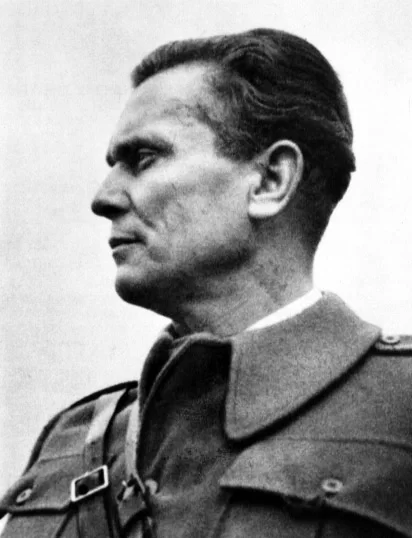<figcaption>Josip Broz-Tito, 1942 r.</figcaption></figure>

Komuniści Tity zdobyli władzę dzięki silnej rodzimej partyzantce. Początkowo współpracowali ze Stalinem.

<b>1948:</b> konflikt o samodzielną politykę Jugosławii. Tito nie podporządkował się Moskwie.

Jugosławia pozostała komunistyczna, ale <b>nie należała do Układu Warszawskiego</b>. Nie stała się demokracją zachodnią.

notes:
1 min. Fotografia1942 nie przedstawia rozłamu1948. W czerwcu1948 partię Jugosławii wykluczono z Kominformu. Nie wykładaj tu historii ruchu niezaangażowanych; wystarczy rozróżnienie ustroju i zależności.

---

<!-- .slide: id="rwpg" class="explanation-slide" data-purpose="explanation" data-layout="comparison" data-goals="G2" -->
<h2>Dwie drogi współpracy gospodarczej</h2>

<h3>EWWiS · od 1952</h3>
<b>Europejska Wspólnota Węgla i Stali</b>

<b>Plan Schumana, 1950:</b> francuski minister zaproponował wspólną kontrolę produkcji węgla i stali Francji, RFN i innych państw.

<b>Cel:</b> powiązać gospodarki i utrudnić kolejną wojnę. Państwa dobrowolnie przekazywały część decyzji wspólnym instytucjom.

<h3>RWPG · od 1949</h3>
<b>Rada Wzajemnej Pomocy Gospodarczej</b>

<b>Deklaracja:</b> pomoc, handel i współpraca państw o gospodarce centralnie planowanej.

<b>Praktyka:</b> przewaga ZSRS i koordynowanie części planów wzmacniały zależność gospodarczą. Państwa nadal miały własne plany.

Współpraca gospodarcza mogła służyć różnym celom. RWPG ≠ sojusz wojskowy.

notes:
2 min. Robert Schuman był ministrem spraw zagranicznych Francji; propozycja z 9 V 1950, traktat z 1951, wejście w życie i początek działalności EWWiS w 1952. Sześć państw: Francja, RFN, Włochy, Belgia, Holandia i Luksemburg. Nie wymagaj dodatkowych list ani dziennych dat. Węgiel i stal były ważne także dla zbrojeń: wspólne decyzje miały utrudniać przygotowanie wojny przeciw partnerom. Zestaw mechanizmy: dobrowolne wspólne instytucje i pokój wobec planowania pod przewagą Moskwy. RWPG: ZSRS, Polska, Czechosłowacja, Węgry, Rumunia, Bułgaria jako założyciele; bez jednego planu dla całego bloku. Zapytaj krótko ustnie: co poza handlem różniło te drogi współpracy? Nie otwieraj drugiej analizy źródła ani dygresji o późniejszej UE. Nie wykorzystano cytatu Schumana — to objaśnienie, nie skrócona reprodukcja dokumentu.

---

<!-- .slide: id="notatka-1" class="explanation-slide" data-purpose="synthesis" data-layout="impact-flow" data-goals="G1 G2" -->
<h2>Notatka: system zależności</h2>
3 min na zapis · połącz gałęzie, zdania możesz skracać

Sowietyzacja <small>narzucanie modelu ZSRS</small>

<b>Polityka</b>
Partia monopolizuje władzę; cenzura i represje tłumią sprzeciw.

<b>Gospodarka</b>
Państwo planuje produkcję, przejmuje fabryki i naciska na kolektywizację.

<b>Zależność</b>
Satelici mają własne granice, lecz nie pełną swobodę decyzji. RWPG — 1949.

<b>Wyjątek</b>
Tito od 1948 prowadzi samodzielną politykę. Jugosławia pozostaje komunistyczna.

notes:
3 min. Pełne3min ciszy na prosty środek, cztery linie i ok.65słów. Nie wymagaj kopiowania geometrii ani ramek. Uczeń może użyć skrótów i strzałek; nie przerywaj zapisu dodatkowymi szczegółami.

---

<!-- .slide: id="chruszczow" class="explanation-slide" data-purpose="explanation" data-layout="split" data-goals="G3" -->
<h2>Po śmierci Stalina</h2>
<figure class="">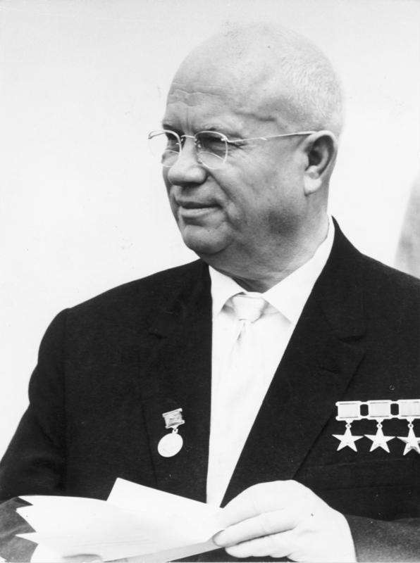<figcaption>Nikita Chruszczow, 28 VI 1963 r.</figcaption></figure>

5 III 1953 — śmierć Józefa Stalina

Rozpoczęła się rywalizacja przywódców. Chruszczow umacniał władzę stopniowo.

<b>Nikita Chruszczow: I sekretarz KC KPZS w latach 1953–1964.</b>

<b>I sekretarz</b> kierował partią komunistyczną. Ponieważ partia kontrolowała państwo, dawało to rzeczywisty wpływ na jego politykę.

Premierem był równocześnie w latach 1958–1964.

notes:
1,5 min. Krótko rozróżnij funkcje, bez dygresji o sukcesji. Podręcznik mylnie podaje1956 jako początek I sekretarza — poprawnie wrzesień1953. Premier Malenkow pojawił się wcześniej w sukcesji, a Chruszczow nie objął obu urzędów5III1953. Fotografia1963 jest portretem, nie zdjęciem referatu.

---

<!-- .slide: id="przed-referatem" class="explanation-slide" data-purpose="practice" data-layout="activity-brief" data-goals="G3" -->
<h2>Przeczytaj, by odpowiedzieć</h2>
Za chwilę: fragment referatu Nikity Chruszczowa podczas XX Zjazdu KPZS, 25 II 1956 r.

<ol class="questions"><li>Jakie metody sprawowania władzy potępia Chruszczow? Wskaż dwa przykłady z tekstu.</li><li>Kogo autor szczególnie broni? Oprzyj odpowiedź na słowach tekstu.</li><li>Czy autor odrzuca władzę partii komunistycznej, czy zarzuca Stalinowi wypaczenie jej zasad? Uzasadnij.</li></ol>

Czytaj samodzielnie i po cichu. Następnie porozmawiamy o słowach autora.

notes:
0,5 min. Pokaż pytania PRZED tekstem. Nie podawaj odpowiedzi ani zakresu oskarżeń. Jeśli potrzebne, KPZS = Komunistyczna Partia Związku Sowieckiego; NKWD = sowiecki aparat bezpieczeństwa, instancje karne = organy stosujące kary i represje. Pytania pozostają do przypomnienia klawiszem wstecz.

---

<!-- .slide: id="referat" class="source-slide" data-purpose="evidence" data-layout="plain" data-goals="G3" -->
<figure class="document">
25 II 1956 r. · zamknięte posiedzenie XX Zjazdu KPZS
<h2>Nikita Chruszczow „O kulcie jednostki i jego następstwach”</h2><blockquote>Towarzysze! [...] Stalin całkowicie odrzucił leninowską metodę przekonywania i kształcenia ludzi. [...] Stalin działał na coraz większą skalę poprzez instancje karne, gwałcąc wszystkie istniejące normy moralności i radzieckiego prawa. Naturalnie takie sobiepańskie [samowolne] zachowanie się jednej osoby zachęca innych do sobiepaństwa. Masowe aresztowania i deportacje wielu tysięcy ludzi, egzekucje bez sądu i bez normalnych dochodzeń stworzyły warunki, w których zatriumfowała niepewność jutra, strach i rozpacz. [...] Stalin użył Partii i NKWD do masowego terroru. I to wtedy, gdy nie było już u nas klas wyzyskujących jako argumentu uzasadniającego stosowanie przemocy. Ten terror skierowany był nie tylko przeciwko resztkom klas ginących, lecz przede wszystkim przeciwko uczciwym pracownikom Partii i państwa. Posypały się przeciwko nim kłamliwe, oszczercze, absurdalne oskarżenia o „dwulicowość”, „szpiegostwo”, „sabotaż”, o przygotowywanie fikcyjnych „zamachów” [...].</blockquote></figure>

notes:
3 min. Cały dostarczony fragment z podręcznikowej s.106 — nie cały historyczny referat. Daj2–3min na cichą lekturę i wskazanie fragmentów; nie czytaj równolegle wykładu. Zachowano wszystkie opuszczenia i dopisek[samowolne]. Oryginał porównany wizualnie; tylko połączono wyrazy dzielone końcem wiersza. Interpretacja dopiero na następnym slajdzie po odpowiedziach.

---

<!-- .slide: id="referat-analiza" class="explanation-slide" data-purpose="explanation" data-layout="comparison" data-goals="G3" -->
<h2>Co zarzuca Stalinowi? Czego nie odrzuca?</h2>

<h3>Oskarżenia</h3>
Masowe aresztowania i deportacje, egzekucje bez sądu, wymyślone oskarżenia. Władza oparta na samowoli i strachu.

<h3>Granica krytyki</h3>
Autor szczególnie broni „uczciwych pracowników Partii i państwa”. Odwołuje się do Lenina — nie odrzuca komunizmu ani władzy partii.

Referat nie był pełnym rozliczeniem zbrodni systemu. Pomijał m.in. Katyń i Wielki Głód.

notes:
1,5 min. Najpierw zbierz krótkie odpowiedzi ze słowami dokumentu, dopiero potem przejdź na ten slajd. Ideologia o klasach wyzyskujących nie usprawiedliwia terroru. Nie wymagaj wywnioskowania Katynia wyłącznie z fragmentu — to dopowiedzenie nauczyciela. Klucz w assessment.md.

---

<!-- .slide: id="odwilz" class="explanation-slide" data-purpose="explanation" data-layout="statement" data-goals="G3" -->
<h2>Odwilż miała granice</h2><dl class="indexed">
<dt>Odwilż</dt><dd>Częściowe złagodzenie represji i cenzury oraz większa swoboda życia kulturalnego.</dd>

<dt>Destalinizacja</dt><dd>Odchodzenie od kultu Stalina i części jego metod: zwalnianie części więźniów, rehabilitacja niesłusznie skazanych, ograniczanie terroru.</dd>
</dl>
<b>Radio Wolna Europa (RWE)</b> nadawało z Zachodu poza cenzurą państw bloku. W 1956 r. rozpowszechniało treść tajnego referatu.

Nie zlikwidowano dyktatury partii ani zależności od Moskwy.

notes:
1,5 min. Rehabilitacja to przywrócenie dobrego imienia niesłusznie skazanym. Zmiany zaczęły się wcześniej; referat przyspieszył rozliczenie. RWE przełamywało monopol informacji, nie obalało cenzury w kraju; władze zagłuszały audycje. Polskie audycje istniały od 1950, regularny program z Monachium ruszył 3 V 1952 — nie myl dat. W czerwcu 1956 RWE rozpowszechniało tekst referatu; nie było jedyną drogą jego obiegu, w Polsce krążyły też partyjne broszury. Pokaż związek: informacja spoza kontroli władz → więcej osób poznaje referat. Nie przypisuj RWE wywołania powstania ani nie ogłaszaj końca represji.

---

<!-- .slide: id="uklad-warszawski" class="explanation-slide" data-purpose="explanation" data-layout="comparison" data-goals="G1 G3" -->

14 V 1955 r. · Warszawa
<h2>Układ Warszawski</h2>
Sojusz wojskowy utworzony po wejściu RFN do NATO. Oficjalnie miał zapewniać wspólną obronę przed napaścią.

<h3>W praktyce</h3>
ZSRS kontrolował najważniejsze decyzje i dowództwo. Sojusz umacniał zależność wojskową bloku.

<h3>Założyciele w 1955</h3>
ZSRS, Polska, NRD, Czechosłowacja, Węgry, Rumunia, Bułgaria i Albania.

Jugosławia nie należała do UW. RWPG miała inne, gospodarcze zadania.

notes:
1,5 min. Pełna nazwa traktatu: Układ o Przyjaźni, Współpracy i Pomocy Wzajemnej. RFN do NATO9V1955. Nie wmawiaj, że podporządkowanie zaczęło się dopiero z podpisaniem sojuszu.

---

<!-- .slide: id="sojusze-mapa" class="map-slide" data-purpose="practice" data-layout="map-focus" data-goals="G1" -->
<figure class="alliance-map">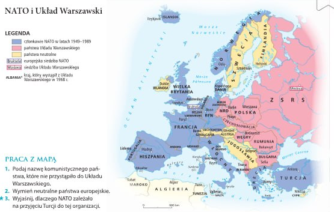</figure>
<h2>Dwa sojusze</h2>
Mapa obejmuje <b>lata 1949–1989</b>, nie jeden rok.

<b>Niebieski:</b> NATO. <b>Różowy:</b> UW. <b>Żółty:</b> neutralne.

<b>1955:</b> wskaż Polskę, NRD, Węgry i Albanię — członków założycielskich UW.

Jugosławia poza UW. Albania wystąpiła formalnie w 1968 r.

notes:
1 min. Zachowano źródłową legendę: NATO1949–1989, państwa UW, neutralne, siedziby NATO i UW, Albania opuściła UW1968. Nie relabelować na1955. Wskaż Francję/Wielką Brytanię jako przykłady NATO; nie ucz z tego syntetycznego obrazu, że wszystkie kraje niebieskie były członkami od1949. Mapa pochodzi z dostarczonej s.107 i ma ograniczoną rozdzielczość; duża legenda jest powtórzona obok. Uczeń wskazuje, nie wypełnia karty.

---

<!-- .slide: id="wegry-przyczyny" class="explanation-slide" data-purpose="explanation" data-layout="split" data-goals="G4" -->
<h2>Węgry 1956: dlaczego wybuchł bunt?</h2>
<figure class="">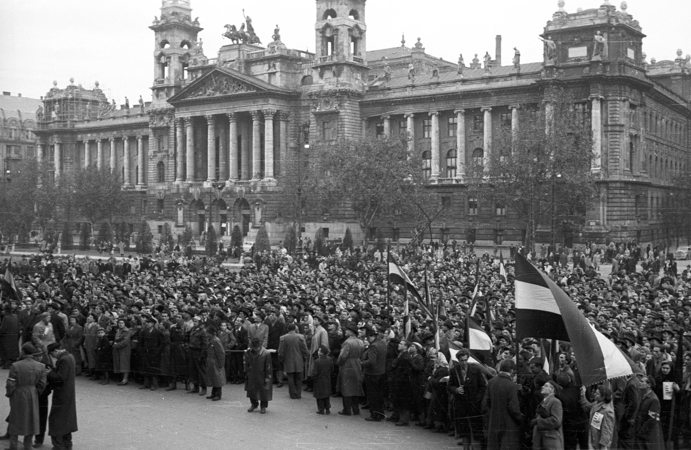<figcaption>Demonstracja na placu Kossutha w Budapeszcie, 1956 r.</figcaption></figure>

<b>Sprzeciw:</b> terror policji politycznej, brak swobód, trudne warunki życia i dominacja ZSRS.

<b>Nadzieja:</b> odwilż po śmierci Stalina i zmiany w Polsce.

<b>23 X:</b> manifestacja solidarności z Polakami pod pomnikiem Bema przerodziła się w walki po ostrzelaniu protestujących.

notes:
2 min. Zdjęcie pokazuje demonstrację1956 na placu Kossutha, nie dokumentuje dokładnie23X ani demonstracji pod Bemem. Nie nazywaj gmachu w tle parlamentem. Uczniowie obserwują tłum i flagi; nie wyprowadzaj wszystkich postulatów ze zdjęcia.

---

<!-- .slide: id="wegry-przebieg" class="explanation-slide" data-purpose="explanation" data-layout="timeline-band" data-goals="G4" -->
<h2>Od protestu do próby niezależności</h2>
Węgry · październik–listopad 1956 r.
<ol class="timeline"><li><b>24 X</b>
Pierwsza interwencja sowiecka. Walki w Budapeszcie.
</li><li><b>Koniec X</b>
Premier <b>Imre Nagy</b> podejmuje reformy: inne partie, ograniczenie represji, zapowiedź wolnych wyborów.
</li><li><b>1 XI</b>
Rząd ogłasza neutralność i wyjście z UW; zwraca się o pomoc do ONZ.
</li><li><b>4 XI</b>
Druga, wielka ofensywa sowiecka. Walki trwają przez następne dni.
</li></ol>
Nagy był komunistą popierającym reformy. Neutralność nie oznaczała wejścia do NATO.

notes:
2,5 min. Oś porządkuje etapy, nie jest proporcjonalną skalą dni. Pod koniec października walki osłabły i część wojsk wycofywano ze stolicy; nie sugeruj spokojnego całego października. 1XI to deklaracja, nie skutecznie zabezpieczona niepodległość. Dalszy opór około10–11XI i lokalnie dłużej, potem także strajki.

---

<!-- .slide: id="wegry-interwencja" class="explanation-slide" data-purpose="explanation" data-layout="hero-source" data-goals="G4" -->
<h2>Moskwa odpowiedziała siłą</h2><figure class="tank-photo">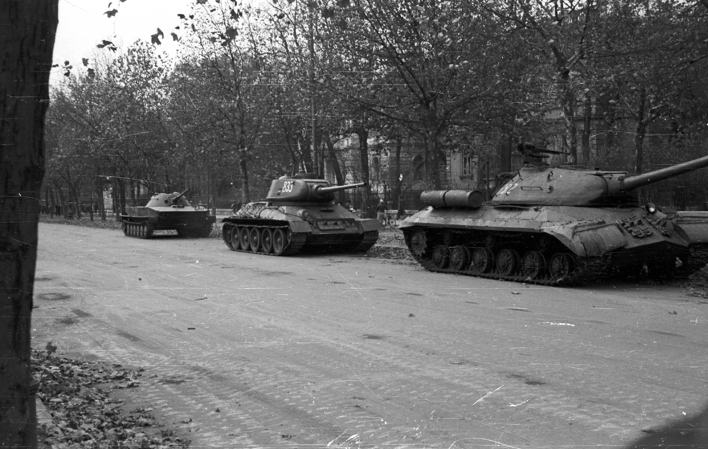<figcaption>Sowieckie czołgi w Budapeszcie, 1956 r.</figcaption></figure>
ZSRS nie dopuścił do wyjścia Węgier z jego strefy kontroli. Od 4 XI armia sowiecka łamała opór powstańców.

notes:
1 min. Wariant z filmem: fotografia ilustruje ofensywę wyjaśnioną na poprzedniej osi; nie powtarzaj jej całego przebiegu. Fotografia1956 pokazuje obecność czołgów, nie moment ostrzału ani zidentyfikowany szturm4XI. Nie nazywaj tego wielonarodową inwazją wszystkich członków UW. Wspierany przez Moskwę rząd Kádára służył uzasadnieniu interwencji, nie był dowodem wolnej zgody społeczeństwa.

---

<!-- .slide: id="wegry-skutki" class="explanation-slide" data-purpose="explanation" data-layout="impact-flow" data-goals="G4" -->
<h2>Klęska powstania i represje</h2>

<b>Władza</b>
János Kádár kierował rządem opartym na poparciu Moskwy. Węgry pozostały w jej bloku.

<b>Ludzie</b>
Tysiące zabitych i rannych, aresztowania i egzekucje. Około <b>200 tys.</b> osób uciekło z kraju.

<b>Imre Nagy</b>
Aresztowany mimo zapewnień o bezpieczeństwie, został stracony po tajnym procesie w <b>1958 r.</b>

Odwilż nie oznaczała zgody Moskwy na samodzielną zmianę ustroju i sojuszu.

notes:
1 min. Nie podawaj niepewnej liczby7000 z ZPE jako ustalonej. Szacunki ofiar mają różny zakres; na slajdzie bezpieczne tysiące. Zachód nie podjął zbrojnego wyzwolenia Węgier. Nie sugeruj egzekucji Nagya już w1956.

---

<!-- .slide: id="odprezenie" class="explanation-slide" data-purpose="explanation" data-layout="timeline-band" data-goals="G4" -->
<h2>Odprężenie</h2>
Próby złagodzenia napięć między rywalami przez rozmowy i porozumienia — bez zakończenia zimnej wojny.
<ol class="timeline three"><li><b>1953</b>
Rozejm w Korei zakończył walki. Nie był traktatem pokojowym.
</li><li><b>1955</b>
Porozumienie mocarstw umożliwiło koniec okupacji Austrii.
</li><li><b>1955</b>
Zbliżenie z Jugosławią poprawiło stosunki, lecz nie podporządkowało Tity Moskwie.
</li></ol>

notes:
1 min. Korea: negocjacje od1951, wiele stron; nie osobisty dekret Chruszczowa. Austria: traktat15V1955, neutralność osobną ustawą26X. To uzupełniający przykład, nie wiadomość ze s.108. Nie utożsamiaj tych prób z całą późniejszą détente lat70.

---

<!-- .slide: id="usa-u2" class="explanation-slide" data-purpose="explanation" data-layout="split" data-goals="G4" -->
<h2>USA 1959: rozmowy i ich kruchość</h2>
<figure class="">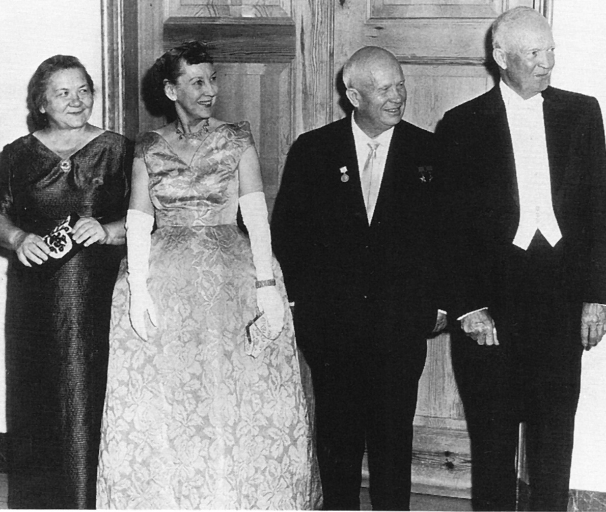<figcaption>Przyjęcie państwowe, 1959 r. Chruszczow i Eisenhower po prawej.</figcaption></figure>

We wrześniu <b>1959 r.</b> Chruszczow odwiedził USA i rozmawiał z prezydentem <b>Dwightem Eisenhowerem</b>.

<b>1 V 1960:</b> ZSRS zestrzelił amerykański samolot szpiegowski U-2. Kryzys doprowadził do załamania spotkania na szczycie w Paryżu.

Rozmowy z Zachodem nie oznaczały zgody na samodzielność państw bloku.

notes:
1 min. Tylko dwa punkty: wizyta i kryzys U-2, bez rozwijania dyplomatycznych szczegółów. Przyjęcie1959: nie przypisuj dokładnej daty25IX ani Camp David temu kadrowi. Pilot U-2 Francis Gary Powers przeżył. Kryzys nie zakończył wszelkiej dyplomacji. Zestaw1959 z1956: zewnętrzne rozmowy i wewnętrzny przymus mogły współistnieć.

---

<!-- .slide: id="notatka-2" class="explanation-slide" data-purpose="synthesis" data-layout="timeline-band" data-goals="G3 G4" -->
<h2>Notatka: nadzieje i granice zmian</h2>
3 min na zapis · narysuj oś i dwie gałęzie

<b>1953</b>
5 III: śmierć Stalina. Chruszczow: I sekretarz 1953–1964.

→
<b>1956</b>
XX Zjazd: krytyka Stalina. Odwilż łagodzi represje, ale partia zachowuje władzę.

<b>W bloku</b>
UW — 1955. Węgry — powstanie 1956, ofensywa 4 XI, represje. Moskwa broni kontroli.

<b>Z Zachodem</b>
Odprężenie: USA 1959. U-2 — 1960: kryzys rozmów. Zimna wojna trwa.

notes:
3 min. Nie dopowiadaj podczas zapisu. Około70słów i proste połączenia. Uczeń nie musi odtwarzać szerokości ramek; treść można skrócić własnymi słowami. To synteza po analizie, nie odpowiedź wyprzedzająca dokument.

---

<!-- .slide: id="sprawdzenie" class="explanation-slide" data-purpose="exit-ticket" data-layout="activity-brief" data-goals="G1 G3 G4" -->
<h2>Samodzielnie: wyjaśnij zależność</h2>

Bez zaglądania do notatek:
<ol><li>Podaj przykład ziem wcielonych do ZSRS i państwa satelickiego. Wyjaśnij różnicę.</li><li>Napisz jedno zdanie: dlaczego wydarzenia na Węgrzech pokazują granice odwilży? Przywołaj konkretny fakt.</li></ol>
Krótki zapis w zeszycie · potem ustne sprawdzenie

notes:
1,5 min. Każdy zapisuje własną odpowiedź; bez konsultacji i drukowanej karty. Minimum: Litwa/Polska oraz odwilż częściowa, bo ofensywa4XI1956 uniemożliwiła niezależną politykę Węgier. Zobacz kilka zapisów, poproś o dwie krótkie wypowiedzi. Klucz assessment.

---

<!-- .slide: id="podsumowanie" class="explanation-slide" data-purpose="synthesis" data-layout="takeaways" data-goals="G1 G2 G3 G4" -->
<h2>Co wynika z tej lekcji?</h2><ol class="summary"><li><b>Nie wszystko było ZSRS.</b> Wcielone ziemie i odrębne państwa satelickie miały inny status.</li><li><b>O władzy decydował monopol partii.</b> „Demokracji ludowej” towarzyszyły cenzura, represje i gospodarka planowa.</li><li><b>Zmiana miała granice.</b> Referat z 1956 r. krytykował Stalina, nie obalał komunizmu; powstanie węgierskie stłumiono.</li><li><b>Rozmowy nie kończyły rywalizacji.</b> Zbliżenie z USA w 1959 r. nie zniosło sowieckiej kontroli nad blokiem.</li></ol>

notes:
0,5 min. Wariant z filmem: po indywidualnym sprawdzeniu krótko nazwij wspólny wniosek, bez ponownego odczytu czterech punktów. Zakończ czterema powiązaniami, bez nowego wykładu. Odpowiedz na główne pytanie: dominacja wojskowa, monopol partii i powiązania gospodarcze ograniczały samodzielność, a przy próbie wyjścia użyto siły. Praska Wiosna pozostaje tematem innej lekcji.
