<!-- .slide: id="otwarcie" data-purpose="opening" data-layout="hero-source" data-goals="G2 G3" -->

<figure>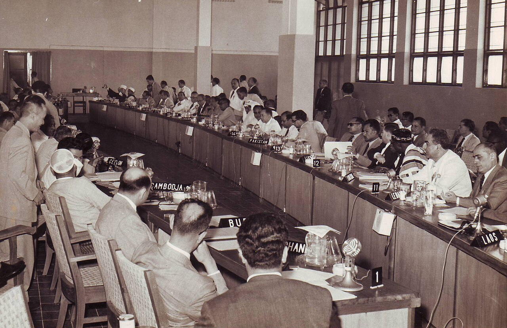<figcaption>Bandung, Indonezja · 20 kwietnia 1955</figcaption></figure>
<h1>Rozpad systemu kolonialnego</h1>
Powojenna Azja i koniec europejskich imperiów

notes:
1 min. Pokaż zdjęcie z Bandung. Zapowiedz dwa wątki: przemiany i konflikty powojennej Azji oraz dekolonizacja. Samego Bandung nie omawiaj jeszcze.

---

<!-- .slide: id="chiny" data-purpose="explanation" data-layout="split" data-goals="G1" -->
<h2>Chiny: dlaczego wróciła wojna domowa?</h2>
<figure>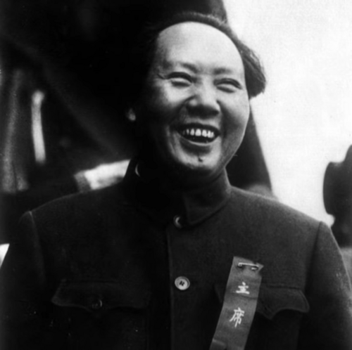<figcaption>Mao Zedong · Pekin, 1 października 1949</figcaption></figure>

<b>Mao Zedong</b> kierował Komunistyczną Partią Chin. <b>Czang Kaj-szek</b> stał na czele rządzącego Kuomintangu.

Obie strony rywalizowały o władzę już przed II wojną światową. Wspólny wróg — Japonia — skłonił je do czasowej współpracy.

<b>Po kapitulacji Japonii</b> nie uzgodniły podziału władzy ani przyszłości kraju. W 1946 r. walki znów toczyły się na wielką skalę.

notes:
1 min. Na zdjęciu Mao w dniu proklamacji ChRL. Wyjaśnij, dlaczego walka z Japonią odsunęła w czasie walkę o władzę, ale jej nie zakończyła.

---

<!-- .slide: id="chiny-przebieg" data-purpose="explanation" data-layout="process" data-goals="G1" -->
<h2>Jak komuniści wygrali?</h2><ol class="history-axis"><li><strong>1946</strong>Kuomintang miał większą armię i kontrolował wiele miast. Narastało jednak niezadowolenie z korupcji i drożyzny.</li><li><strong>1947–1948</strong>Komuniści zdobywali poparcie na wsi, m.in. obietnicą ziemi dla chłopów. Przejęli inicjatywę i opanowali Mandżurię.</li><li><strong>1 X 1949</strong>Mao ogłosił powstanie <b>Chińskiej Republiki Ludowej (ChRL)</b>. Komuniści przejęli władzę na kontynencie.</li><li><strong>koniec 1949</strong>Czang Kaj-szek i rząd istniejącej <b>Republiki Chińskiej</b> wycofali się na Tajwan.</li></ol>

notes:
2 min. Przejdź po osi: przewaga nacjonalistów → utrata poparcia i inicjatywy → zwycięstwo komunistów. To zmiana władzy, nie uzyskanie niepodległości kolonii.

---

<!-- .slide: id="tajwan" data-purpose="evidence" data-layout="map-focus" data-goals="G1" -->
<h2>Tajwan: kto nim rządzi?</h2>
<figure>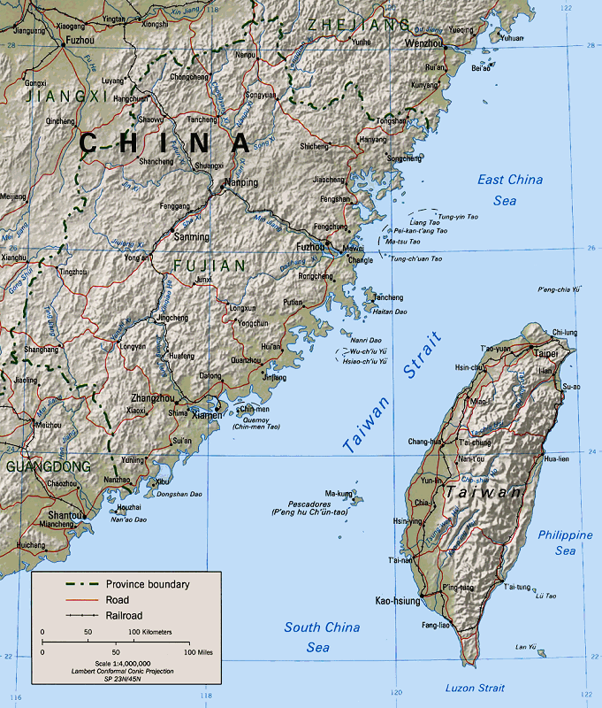<figcaption>Cieśnina Tajwańska · mapa orientacyjna</figcaption></figure>

<b>1949:</b> rząd Czang Kaj-szeka przeniósł się na Tajwan. ChRL nie przejęła wyspy.

<b>Dziś:</b> Tajwan rządzi się sam jako Republika Chińska. Ma własny demokratycznie wybierany rząd, armię i walutę. Pekin uważa wyspę za część ChRL, ale nią nie zarządza.

<b>Na świecie:</b> nieliczne państwa utrzymują z Tajpej formalne stosunki dyplomatyczne. W ONZ Chiny reprezentuje ChRL (od 1971 r.); Tajwan nie ma osobnego miejsca.

notes:
1 min. Wskaż wyspę i kontynent. Rozdziel: kto w praktyce rządzi, czego żąda Pekin i kogo reprezentuje delegacja w ONZ. Rezolucja 2758 dotyczyła reprezentacji Chin; nie przesądza w tekście suwerenności Tajwanu.

---

<!-- .slide: id="tybet" data-purpose="evidence" data-layout="map-focus" data-goals="G1" -->
<h2>Tybet pod presją ChRL</h2>
<figure>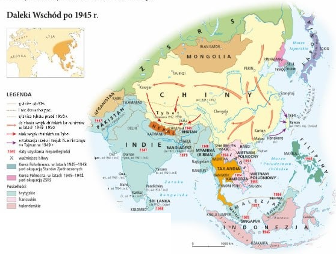<figcaption>Daleki Wschód po 1945 r. · fragment mapy podręcznikowej</figcaption></figure>

Tybet miał własne władze, a Chiny rościły sobie do niego prawa. Pekin chciał przejąć kontrolę nad regionem przy granicy z Indiami.

<b>1950:</b> armia ChRL pokonała Tybetańczyków pod Czamdo w walkach we wschodnim Tybecie.

<b>1951:</b> porozumienie dało ChRL zwierzchnictwo nad Tybetem. Obiecano autonomię i zachowanie religii oraz ustroju.

<b>1959:</b> po stłumieniu powstania w Lhasie Pekin przejął bezpośrednie rządy. Dalajlama uciekł do Indii.

notes:
2 min. Wskaż Tybet, Lhasę i Indie. W 1951 r. zasady zapisane w porozumieniu i rzeczywisty zakres władzy trzeba rozróżnić; w 1959 r. stłumiono powstanie. Dziś Tybet pozostaje pod władzą ChRL.

---

<!-- .slide: id="mao" data-purpose="explanation" data-layout="process" data-goals="G1" -->
<h2>Wielki Skok: co dokładnie planowano?</h2>
<b>Od 1958 r.</b> Mao chciał w kilka lat zmienić rolnicze Chiny w potęgę przemysłową — podnieść jednocześnie produkcję żywności i stali.
<ul class="provisions"><li><b>Komuny ludowe:</b> połączono gospodarstwa. Ziemia, narzędzia i praca znalazły się pod wspólnym zarządem. Organizowano zbiorowe stołówki.</li><li><b>Przemysł także na wsi:</b> mobilizowano ludzi do wytopu metalu w małych piecach i do wielkich robót, np. irygacyjnych.</li><li><b>Plany produkcji:</b> partia wyznaczała bardzo wysokie cele. Państwo odbierało od komun część zboża na zaopatrzenie miast i inne potrzeby.</li></ul>

notes:
2 min. Połącz trzy instrumenty z celem: organizacja wsi, szybkie uprzemysłowienie, obowiązkowe dostawy. Nie każ zapamiętywać listy wszystkich inwestycji.

---

<!-- .slide: id="wielki-skok-zdjecia" data-purpose="evidence" data-layout="plain" data-goals="G1" -->
<h2>Wielki Skok na zdjęciach z epoki</h2>
<figure>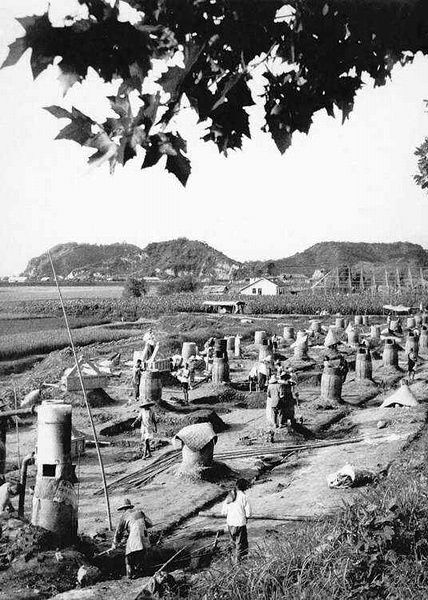<figcaption>Piec przydomowy · Chiny, 1958</figcaption></figure><figure>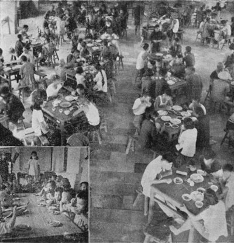<figcaption>Stołówka komuny ludowej · Chiny, 1958</figcaption></figure>

Zdjęcia pokazują organizację pracy i posiłków. Nie mówią, czy wytopiony metal był użyteczny ani czy wszystkim wystarczało jedzenia.

notes:
1 min. Zapytaj: które zdjęcie pokazuje zmianę pracy, które zmianę codziennego życia? Nie wnioskuj ze zdjęć o jakości metalu ani o późniejszym zaopatrzeniu.

---

<!-- .slide: id="wielki-skok-skutki" data-purpose="explanation" data-layout="process" data-goals="G1" -->
<h2>Wielki Skok: dlaczego się nie udał?</h2><ul class="provisions"><li><b>Mniej rąk do zbiorów.</b> Miliony ludzi odciągano od prac rolnych. Część metalu z małych pieców nie nadawała się do przemysłowego wykorzystania.</li><li><b>Zawyżone meldunki i dostawy.</b> Lokalni działacze meldowali większe zbiory, niż osiągali. Państwo wyznaczało dostawy według tych liczb, więc na wsi zostawało za mało zboża.</li><li><b>Wielki głód.</b> Zamiast obiecanego dobrobytu kraj dotknęła katastrofa. Głód pochłonął miliony istnień, a władze wycofały się z najbardziej radykalnych działań.</li></ul>

notes:
2 min. Poprowadź jeden łańcuch: mniej pracy przy zbiorach + przesadzone meldunki → za duże dostawy → braki żywności na wsi. Nie sprowadzaj głodu do samej pogody ani jednego mechanizmu.

---

<!-- .slide: id="rewolucja" data-purpose="explanation" data-layout="split" data-goals="G1" -->
<h2>Rewolucja kulturalna Mao</h2>
<figure>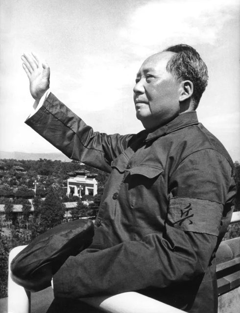<figcaption>Mao na spotkaniu z Czerwoną Gwardią · Pekin, 18 sierpnia 1966</figcaption></figure>

<b>1966–1976.</b> Mao rozpoczął kampanię polityczną. Po klęsce Wielkiego Skoku dążył do odzyskania przewagi w partii i usunięcia przeciwników.

Wzywał młodzież do walki z „czterema przeżytkami”: starymi ideami, kulturą, zwyczajami i przyzwyczajeniami. Powstały oddziały <b>Czerwonej Gwardii</b>.

W praktyce: publiczne upokorzenia i przemoc, prześladowania nauczycieli i działaczy, przerwy w nauce, niszczenie książek i zabytków.

notes:
2 min. Rozdziel cel polityczny, hasła kampanii i skutki. Pierwsze spotkanie Mao z Czerwoną Gwardią ukazano na fotografii; nie jest dowodem poparcia wszystkich mieszkańców.

---

<!-- .slide: id="mao-pytania" data-purpose="practice" data-layout="task-board" data-goals="G1" -->
<h2>Co źródło mówi o nowym porządku?</h2>

Samodzielnie · czytanie z ekranu
<ol class="exit-list"><li>Wskaż nakaz dotyczący domów lub ulic. Co miał zmienić?</li><li>Podaj dwie zmiany przewidziane dla szkół. Wskaż punkt tekstu.</li><li>Wyjaśnij, jak te nakazy miały budować kult Mao.</li></ol>

notes:
1 min. Najpierw uczniowie czytają trzy pytania, potem przechodzą do fragmentu. Bez par i bez osobnych wydruków.

---

<!-- .slide: id="mao-zrodlo" data-purpose="evidence" data-layout="evidence" data-goals="G1" -->
<h2>Zasady rewolucji kulturalnej</h2><figure class="document"><blockquote class="full-quote">
Przewodniczący Mao uczy nas: [...] W toku wielkiej rewolucji kulturalnej musimy buntować się przeciwko wszystkim starym ideom, starej kulturze, starym zwyczajom i przyzwyczajeniom [...]. Pragniemy [...] zniszczyć imperializm, rewizjonizm, burżuazyjne idee i wszystkie inne myśli sprzeczne z myślą Mao. [...]

1. Wszystkie komitety powinny być odpowiedzialne za ustawienie na każdej ulicy tablic z cytatami dzieł Mao, odpowiedzialne za to, aby w każdym domu i każdym mieszkaniu znajdował się portret Mao i tablica z cytatami z jego dzieł. [...]

91. Dzieła Mao mają się stać podręcznikami we wszystkich szkołach [...].

92. W programach szkolnych należy wysunąć na pierwsze miejsce ćwiczenia fizyczne, pracę fizyczną i szkolenie wojskowe.
</blockquote><figcaption>Broszura Czerwonej Gwardii · sierpień 1966 · fragment z podręcznika, s. 110</figcaption></figure>

notes:
4 min. Daj 2 min na cichą lekturę i wyszukanie dowodów, resztę na dwie–trzy odpowiedzi. Pkt 1: tablice i portrety; pkt 91–92: dzieła Mao jako podręczniki, pierwszeństwo ćwiczeń, pracy i szkolenia. Reguły miały podporządkować edukację i codzienność, ale nie dowodzą wdrożenia wszystkich nakazów.

---

<!-- .slide: id="korea-podzial" data-purpose="explanation" data-layout="comparison" data-goals="G1" -->
<h2>Dwie Koree w 1948 r.</h2>
Po kapitulacji Japonii (1945) północ zajęli Sowieci, południe Amerykanie. Strefy rozdzielał <b>38. równoleżnik</b>. W 1948 r. powstały dwa państwa roszczące sobie prawo do całej Korei.
<table class="korea-compare"><thead><tr><th scope="col">Korea Północna</th><th scope="col">Korea Południowa</th></tr></thead><tbody><tr><td><b>Koreańska Republika Ludowo-Demokratyczna</b></td><td><b>Republika Korei</b></td></tr><tr><td>Pjongjang · <b>Kim Ir Sen</b> (premier)</td><td>Seul · <b>Syngman Rhee</b> (prezydent)</td></tr><tr><td>Rządy komunistyczne, gospodarka pod kontrolą państwa</td><td>Rządy antykomunistyczne i coraz bardziej autorytarne, gospodarka z własnością prywatną</td></tr><tr><td>Związana z ZSRS; później wsparcie wojskowe ChRL</td><td>Wspierana przez USA</td></tr></tbody></table>

notes:
2 min. Porównaj wyłącznie odpowiednie wiersze. Nie utożsamiaj autorytarnego Południa z jego dzisiejszą demokracją.

---

<!-- .slide: id="korea" data-purpose="evidence" data-layout="map-focus" data-goals="G1" -->
<h2>Wojna koreańska na mapie</h2>
<figure>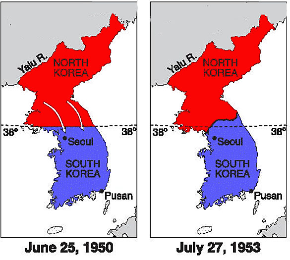<figcaption>1950 → 1953 · przerywana linia to 38°N</figcaption></figure>

<b>Czerwiec 1950:</b> Północ zaatakowała, by zjednoczyć Koreę pod swoją władzą. Jej wojska opanowały niemal całe Południe.

<b>Jesień 1950:</b> siły ONZ pod dowództwem USA odbiły Seul i ruszyły na północ. Wtedy do walk po stronie Północy weszły oddziały chińskie. ZSRS wspierał Północ m.in. sprzętem.

<b>1951–1953:</b> front ustabilizował się w pobliżu 38°N. Porównaj początkowy podział z linią rozejmu.

 Północ &nbsp;  Południe

notes:
2 min. Pokaż linię przerywaną i dwie mapy. Czy linia rozejmu pokrywa się z 38°N? Na zachodzie schodzi poniżej niego, na wschodzie jest powyżej.

---

<!-- .slide: id="korea-rozejm" data-purpose="evidence" data-layout="source-split" data-goals="G1" -->
<h2>Rozejm w Panmundżomie · 27 VII 1953</h2>
<figure>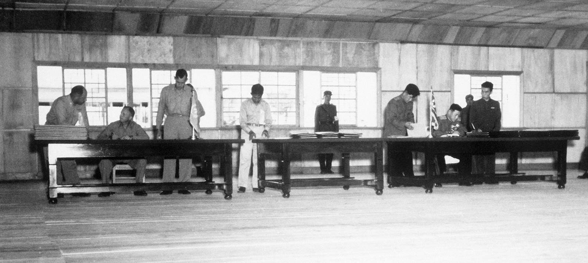<figcaption>Podpisanie rozejmu · Panmundżom, 1953</figcaption></figure>
<ul class="provisions"><li><b>Wstrzymano walki.</b></li><li><b>Wyznaczono linię demarkacyjną</b> wzdłuż frontu oraz strefę zdemilitaryzowaną: po 2 km z każdej strony linii.</li><li><b>Ustalono zasady repatriacji jeńców</b> i międzynarodowego nadzoru nad rozejmem.</li></ul>
<b>Skutek:</b> podział Korei się utrzymał. Nie zawarto traktatu pokojowego.

notes:
1 min. Przeczytaj najważniejsze warunki, rozróżnij rozejm i pokój. Dokument zawarły dowództwa ONZ, armii północnokoreańskiej i chińskich ochotników; rząd Korei Południowej nie podpisał.

---

<!-- .slide: id="notatka-1" data-purpose="synthesis" data-layout="plain" data-goals="G1" -->
<h2>1. Powojenna Azja</h2>
<ol><li><b>1949:</b> komuniści wygrali wojnę domową i utworzyli ChRL; rząd Republiki Chińskiej wycofał się na Tajwan.</li><li><b>Mao:</b> Wielki Skok miał przyspieszyć rozwój, ale doprowadził do katastrofy głodu. Rewolucja kulturalna umacniała władzę Mao przez mobilizację młodzieży i represje.</li><li><b>Korea (1950–1953):</b> Północ zaatakowała Południe. Rozejm utrzymał podział; nie był pokojem.</li></ol>

notes:
2 min. Krótki zapis w zeszycie: uczniowie mogą skrócić do trzech równoważników. Nie czytaj kolejnej wersji.

---

<!-- .slide: id="przyczyny" data-purpose="explanation" data-layout="process" data-goals="G2" -->
<h2>Dlaczego imperia kolonialne się rozpadały?</h2>
<b>Dekolonizacja</b> to proces, w którym kończy się władza kolonialna, a podporządkowane terytoria uzyskują niepodległość.
<ul class="provisions"><li><b>Presja mieszkańców:</b> ruchy niepodległościowe organizowały protesty, negocjowały lub walczyły zbrojnie.</li><li><b>Osłabienie metropolii:</b> po II wojnie światowej europejskim mocarstwom brakowało pieniędzy i sił do utrzymywania kolonii.</li><li><b>Zmiana w Azji:</b> podboje Japonii rozbiły w części Azji dawną administrację europejską i podważyły jej autorytet.</li><li><b>Presja międzynarodowa:</b> coraz więcej państw na forum ONZ popierało samostanowienie, czyli prawo narodów do decydowania o sobie.</li></ul>

notes:
2 min. Zestaw siłę nacisku mieszkańców ze słabością metropolii. Samostanowienie nie jest tym samym co automatyczna niepodległość.

---

<!-- .slide: id="genewa" data-purpose="explanation" data-layout="process" data-goals="G2" -->
<h2>Jak Francja przegrała w Indochinach?</h2><ol class="history-axis"><li><strong>1945</strong>Po klęsce Japonii <b>Ho Chi Minh</b> ogłosił niepodległość Wietnamu. Francja chciała odzyskać dawną kolonię.</li><li><strong>1946–1954</strong>Wybuchła otwarta wojna z <b>Viet Minhem</b> — ruchem niepodległościowym kierowanym przez komunistów. Od 1950 r. wspierała go ChRL, a Francję wspierały USA.</li><li><strong>maj 1954</strong>Viet Minh obległ francuski garnizon w <b>Điện Biên Phủ</b> i zmusił go do kapitulacji. Francja nie była w stanie utrzymać władzy kolonialnej.</li><li><strong>lipiec 1954</strong>Rozmowy w Genewie doprowadziły do zakończenia walk i wycofywania wojsk francuskich.</li></ol>

notes:
2 min. Wyjaśnij: francuska próba powrotu → wojna Viet Minhu → kapitulacja pod Điện Biên Phủ → Genewa. Wymowa przybliżona: djen bjen fu.

---

<!-- .slide: id="indochiny" data-purpose="evidence" data-layout="map-focus" data-goals="G2" -->
<h2>Genewa 1954: co ustalono?</h2>
<figure>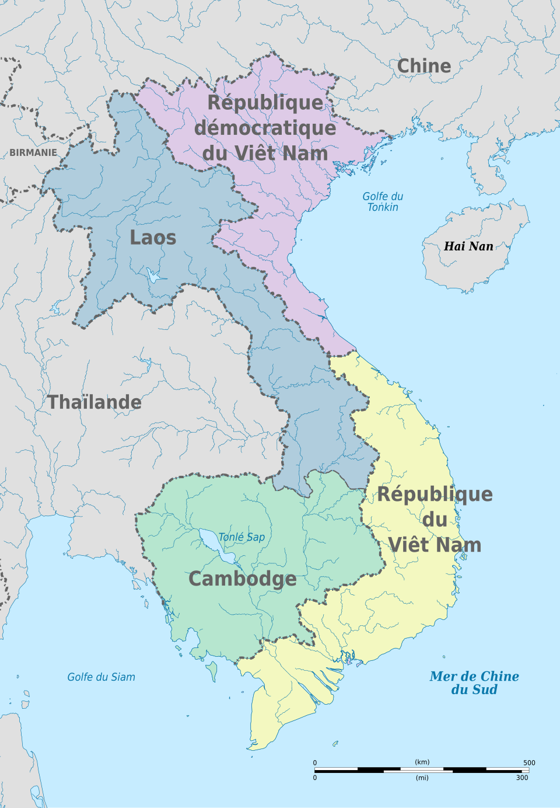<figcaption>Mapa stref · nazwa „Republika Wietnamu” pochodzi z 1955 r.</figcaption></figure>
<ul class="provisions"><li><b>Przerwano walki</b> w Wietnamie, Laosie i Kambodży. Potwierdzono niepodległość Laosu i Kambodży.</li><li><b>Rozdzielono wojska w Wietnamie</b> w pobliżu 17°N: Viet Minh na północy, siły strony francuskiej na południu. To nie miała być granica państw.</li><li><b>Zapowiedziano wybory ogólnowietnamskie w 1956 r.</b> Miały umożliwić zjednoczenie, ale się nie odbyły.</li></ul>
 Północ &nbsp;  Południe

notes:
2 min. Wskaż Laos, Kambodżę i dwie strefy. Rozróżnij rozejmy od ustaleń deklaracji końcowej. Zapowiedzi wyborów nie zrealizowano; USA i Państwo Wietnam nie przyjęły deklaracji końcowej.

---

<!-- .slide: id="indie-decyzja" data-purpose="explanation" data-layout="process" data-goals="G2" -->
<h2>Dlaczego powstały Indie i Pakistan?</h2><ol class="history-axis"><li><strong>Przed 1947</strong>Kongres Narodowy, z którym związany był Gandhi, domagał się niepodległości i chciał utrzymać jedność Indii. Liga Muzułmańska Muhammada Alego Jinnaha żądała dla muzułmanów własnego państwa.</li><li><strong>1947</strong>Brytyjczycy po wojnie zdecydowali się odejść. Nie osiągnięto porozumienia, które pozwoliłoby zachować jeden kraj. W warunkach narastającej przemocy przyjęto plan podziału.</li><li><strong>sierpień 1947</strong>Powstały dwa państwa: <b>Pakistan</b> (14 VIII — obchodzony dzień niepodległości) i <b>Indie</b> (15 VIII). Komisje wyznaczyły granice m.in. w Pendżabie i Bengalu.</li></ol>

notes:
1 min. Powiedz, czego chciał Kongres, czego Liga i co przyspieszyło decyzję Brytyjczyków. 14 VIII to dzień obchodzony w Pakistanie; ustawa przewidywała 15 VIII jako ustawowy dzień powstania obu dominiów.

---

<!-- .slide: id="podzial-indii" data-purpose="evidence" data-layout="map-focus" data-goals="G2" -->
<h2>Indie i Pakistan po podziale</h2>
<figure>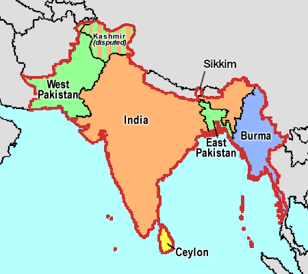<figcaption>Podział Indii Brytyjskich · 1947</figcaption></figure>

<b>Pakistan miał dwie części</b> po obu stronach Indii. Wschodnią stanowił Bengal Wschodni, później Pakistan Wschodni, a od 1971 r. Bangladesz.

<b>Granice</b> prowadzono m.in. według większości religijnej, ale społeczności były wymieszane. Miliony ludzi uciekały w obu kierunkach; doszło do masowej przemocy.

<b>Kaszmir:</b> stał się przedmiotem sporu i wojny między Indiami a Pakistanem.

 Indie &nbsp;  Pakistan Pasy — sporny Kaszmir

notes:
2 min. Uczniowie wskazują dwa człony Pakistanu i Kaszmir. Liczą się przyczyna migracji i różnica między państwem a strukturą wyznaniową, nie odczytanie wszystkich szczegółów mapy.

---

<!-- .slide: id="afryka" data-purpose="evidence" data-layout="map-focus" data-goals="G2 G3" -->
<h2>Afryka pod koniec 1960 r.</h2>
<figure>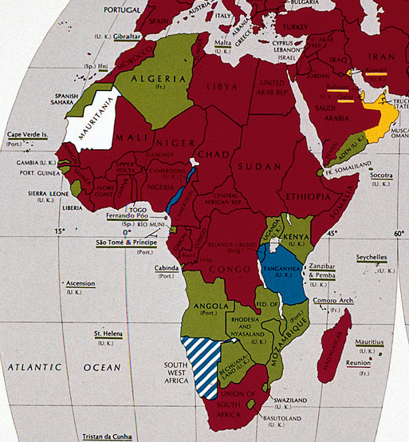<figcaption>Stan na koniec 1960 r. · nie mapa dat niepodległości</figcaption></figure>

<b>1960 — Rok Afryki:</b> niepodległość uzyskało 17 państw, m.in. Nigeria i dawne Kongo Belgijskie.

<b>Porównaj:</b> Kongo jest już niepodległe. Algieria i Angola nadal są zależne. Dekolonizacja nie odbyła się wszędzie naraz.

 członkowie ONZ  inne terytoria zależne  terytoria powiernicze ONZ  mandat administrowany przez RPA

notes:
2 min. Wskaż przykłady na mapie i wyjaśnij legendę. Bordo oznacza członkostwo w ONZ, nie datę niepodległości ani listę 17 nowych państw.

---

<!-- .slide: id="afryka-drogi" data-purpose="explanation" data-layout="process" data-goals="G2" -->
<h2>Afryka: dlaczego w różnym czasie?</h2><ol class="history-axis"><li><strong>1957 · Ghana</strong>Strajki, protesty i sukcesy wyborcze ruchu Kwame Nkrumahy zwiększyły nacisk na Brytyjczyków. Negocjacje doprowadziły do niepodległości.</li><li><strong>1960 · Kongo</strong>Protesty i żądania polityczne przyspieszyły rozmowy. Belgia zgodziła się na szybkie przekazanie władzy.</li><li><strong>1962 · Algieria</strong>Francja długo nie chciała oddać obszaru z liczną ludnością osadniczą. Po wojnie (1954–1962) porozumienia w Évian przewidywały zawieszenie broni, okres przejściowy i referendum o samostanowieniu. Po referendum Algieria uzyskała niepodległość.</li><li><strong>1975 · Angola i Mozambik</strong>Portugalia długo walczyła z ruchami niepodległościowymi. Dopiero zmiana władzy w Lizbonie w 1974 r. przyspieszyła wycofanie.</li></ol>

notes:
2 min. Kontrast w rdzeniu: negocjacje w Ghanie i wojna w Algierii. Pozostałe wiersze można wskazać bez rozwijania. Évian: zawieszenie broni, okres przejściowy i referendum; przewidziano prawa dla ludności europejskiej, lecz wielu osadników wyjechało.

---

<!-- .slide: id="afryka-skutki" data-purpose="explanation" data-layout="process" data-goals="G2 G3" -->
<h2>Afryka: co zmieniła niepodległość?</h2><ul class="provisions"><li><b>Własne rządy:</b> nowe państwa tworzyły instytucje, prowadziły własną dyplomację i wstępowały do ONZ.</li><li><b>Granice zwykle pozostawały:</b> odziedziczono granice kolonialne. W niektórych krajach trwały spory o władzę i zasoby; nie każda dawna kolonia przeszła tę samą drogę.</li><li><b>Zależność gospodarcza mogła trwać:</b> eksport surowców i wpływ zagranicznych firm ograniczały swobodę decyzji — np. w Kongu podczas kryzysu w Katandze.</li></ul>

notes:
1 min. Poproś o jeden przykład: co się zmieniło formalnie, a co mogło trwać mimo własnego rządu? Rozwinięcie o Katandze w dodatkach.

---

<!-- .slide: id="notatka-2" data-purpose="synthesis" data-layout="impact-flow" data-goals="G2 G3" -->

<header>2 min · zapis do zeszytu<h2>2. Dekolonizacja</h2></header><ol><li>Osłabienie imperiów po wojnie i nacisk ruchów niepodległościowych przyspieszyły koniec rządów kolonialnych.</li><li>Indochiny — klęska Francji (1954); Indie i Pakistan — niepodległość i podział (1947); Rok Afryki (1960) — niepodległość 17 państw.</li><li>ONZ poparła samostanowienie. Własny rząd nie usuwał zależności gospodarczej; niezaangażowanie miało chronić swobodę wobec bloków.</li></ol>

notes:
2 min. Krótki zapis: można użyć strzałek i skrótów. Nie dodawaj w tym czasie nowych faktów.

---

<!-- .slide: id="exit" data-purpose="exit-ticket" data-layout="activity-brief" data-goals="G1 G2 G3" -->
<h2>Bilet wyjścia</h2>

2 min · samodzielnie · bez zaglądania do notatki
<ol class="exit-list"><li>Dlaczego ogłoszenie ChRL w 1949 r. nie było uzyskaniem niepodległości kolonii?</li><li>Podaj jedną przyczynę rozpadu imperiów po wojnie.</li><li>Podaj jeden problem, którego samo uzyskanie niepodległości nie rozwiązywało.</li></ol>

notes:
2 min. Dwie minuty na trzy krótkie odpowiedzi. Jeśli trzeba, zbierz ustnie trzy pojedyncze przykłady zamiast odczytywać wszystkie odpowiedzi.

---

<!-- .slide: id="rewolucja-zdjecie" data-purpose="evidence" data-layout="source-split" data-goals="G1" data-extension="true" -->
<h2>Czerwona Gwardia w Pekinie</h2>
<figure>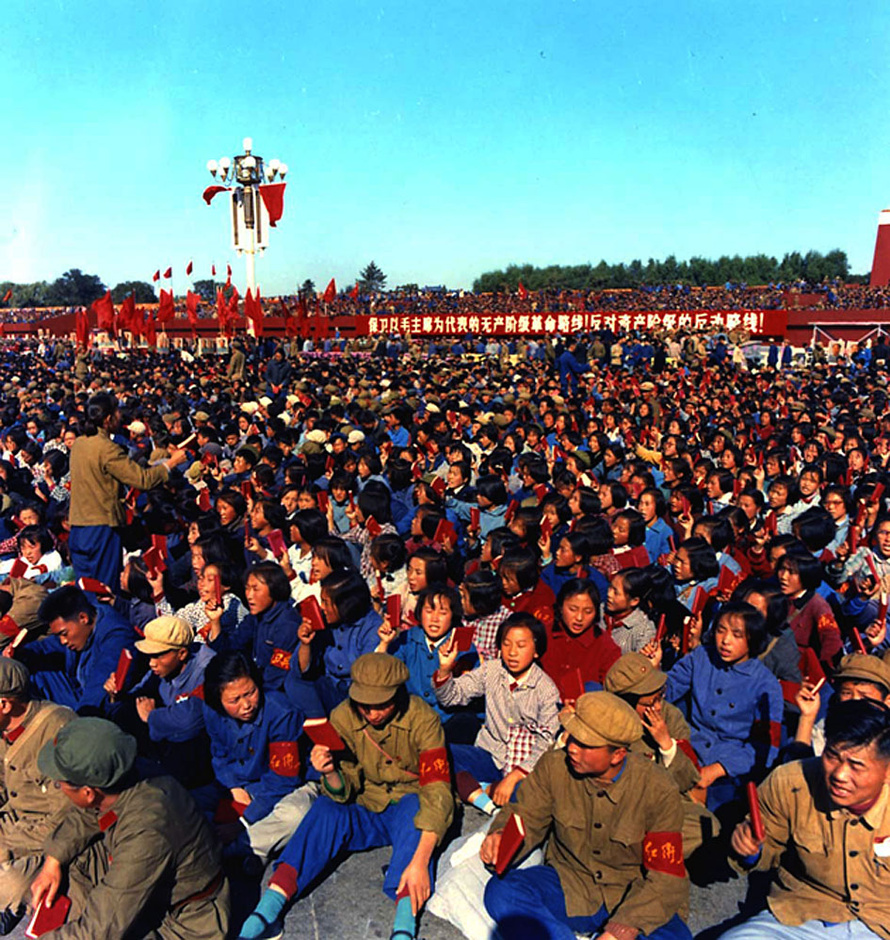<figcaption>Plac Tian’anmen · 15 września 1966</figcaption></figure>

<b>Władze zachęcały młodzież do udziału w masowych wiecach.</b> Znakiem lojalności wobec Mao stały się m.in. opaski Czerwonej Gwardii i „czerwona książeczka” z cytatami przywódcy.

Co widać na zdjęciu? Czego nie da się z niego wyczytać o przekonaniach uczestników?

notes:
Dodatek poza rdzeniem 45 min. Dodatek do rewolucji: fotografia drugiego zgromadzenia; można pokazać bezpośrednio po slajdzie o kampanii. Nie utożsamiaj zdjęcia wiecu z wyrazem wolnego wyboru.

---

<!-- .slide: id="wietnam-uchodzcy" data-purpose="evidence" data-layout="source-split" data-goals="G2" data-extension="true" -->
<h2>Wietnam: podział widziany z Hajfongu</h2>
<figure>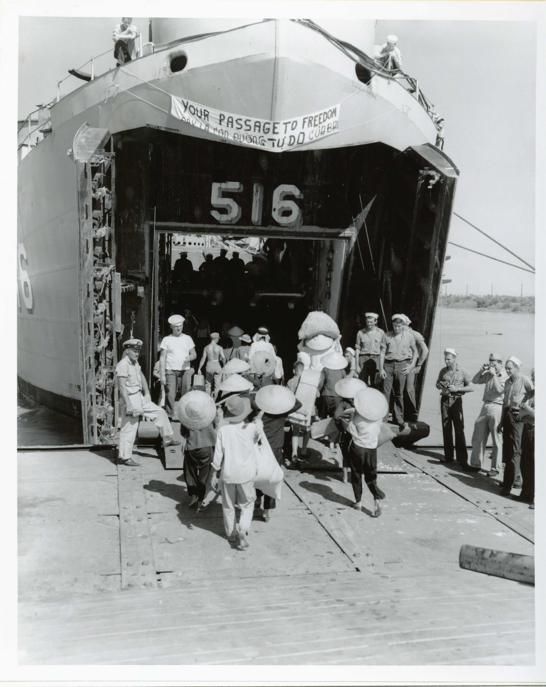<figcaption>Hajfong · październik 1954</figcaption></figure>

Ustalenia genewskie pozwalały cywilom przez <b>300 dni</b> przenosić się z jednej strefy do drugiej.

Na zdjęciu mieszkańcy północy wchodzą na statek płynący na południe. Wielu wybierało wyjazd, obawiając się rządów komunistycznych.

Tymczasowy podział się utrwalił. Późniejsza wojna wietnamska to odrębny konflikt.

notes:
Dodatek poza rdzeniem 45 min. Dodatek po Genewie: obraz konkretnego skutku. Nie jest to fotografia z bitwy ani z konferencji.

---

<!-- .slide: id="gandhi" data-purpose="explanation" data-layout="source-split" data-goals="G2" data-extension="true" -->
<h2>Indie: nacisk bez przemocy</h2>
<figure>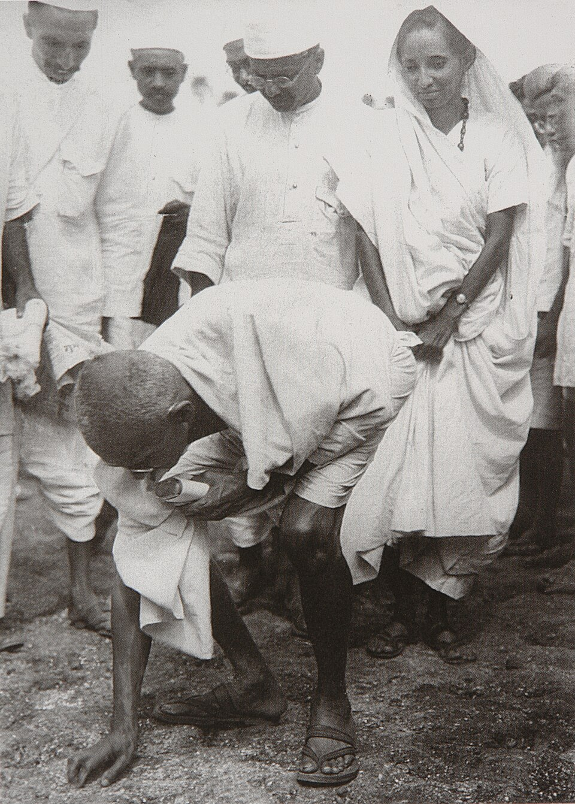<figcaption>Gandhi w Dandi · marsz solny, 1930</figcaption></figure>

<b>Mahatma Gandhi</b> zachęcał do sprzeciwu wobec niesprawiedliwych przepisów bez użycia przemocy.

Marsz solny był publicznym protestem przeciw brytyjskiemu monopolowi na sól.

notes:
Dodatek poza rdzeniem 45 min. Dodatek przed podziałem Indii: przykład oporu bez przemocy. Zdjęcie z 1930 r., nie z uroczystości niepodległości.

---

<!-- .slide: id="deklaracja-onz" data-purpose="evidence" data-layout="evidence" data-goals="G2" data-extension="true" -->
<h2>Deklaracja ONZ z 1960 r.</h2>
Jakie prawo mają narody? Co władze mają zrobić, zamiast zwlekać?
<figure class="document"><blockquote class="full-quote">
1. Uciskanie narodów przez obce państwa, ich panowanie i wyzysk stanowią zaprzeczenie podstawowych praw człowieka, są niezgodne z Kartą Narodów Zjednoczonych i stanowią przeszkodę na drodze do zapewnienia pokoju i współpracy na całym świecie.

2. Wszystkie narody mają prawo do samostanowienia, na mocy tego prawa określają według własnej woli swój status polityczny i swobodnie rozwijają swe życie gospodarcze, społeczne i kulturalne.

3. Niedostateczne przygotowanie polityczne, gospodarcze, społeczne i kulturalne nie powinno w żadnym wypadku stanowić pretekstu do zwlekania z przyznaniem niepodległości [...]

5. Na terytoriach [...] niesamodzielnych oraz na wszelkich innych terytoriach, które nie uzyskały jeszcze niepodległości, należy niezwłocznie poczynić kroki mające na celu przekazanie narodom tych terytoriów wszystkich uprawnień bez żadnych warunków lub zastrzeżeń, zgodnie z ich swobodnie wyrażoną wolą i życzeniem, bez względu na rasę, wyznanie lub kolor skóry – by dać im możność korzystania z całkowitej niepodległości i wolności.
</blockquote><figcaption>Deklaracja o przyznaniu niepodległości krajom i narodom kolonialnym · 14 grudnia 1960 · fragment</figcaption></figure>

notes:
Dodatek poza rdzeniem 45 min. Dodatkowe 4 min: zadaj pytanie przed pokazaniem tekstu. Pkt 2: samostanowienie; pkt 3 i 5: nie zwlekać i przekazać uprawnienia. Deklaracja nie przyznała sama niepodległości.

---

<!-- .slide: id="katanga" data-purpose="explanation" data-layout="source-split" data-goals="G3" data-extension="true" -->
<h2>Kongo: kto decyduje o dochodach?</h2>
<figure>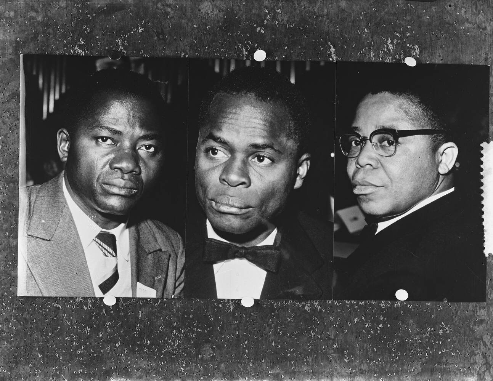<figcaption>Delegaci kongijscy na rozmowy o niepodległości · Bruksela, styczeń 1960</figcaption></figure>

Po niepodległości Konga bogata w miedź i kobalt <b>Katanga</b> próbowała się odłączyć. Belgijska spółka górnicza <b>Union Minière</b> zasilała finansowo władze odłączonej prowincji.

<b>Neokolonializm:</b> zewnętrzny nacisk ograniczający decyzje formalnie niepodległego państwa.

notes:
Dodatek poza rdzeniem 45 min. Dodatek po skutkach w Afryce. To przykład nacisku poprzez dochody z kopalń, nie ogólnej reguły o każdym handlu.

---

<!-- .slide: id="niezaangazowanie" data-purpose="explanation" data-layout="comparison" data-goals="G3" data-extension="true" -->
<h2>Własna polityka wobec bloków</h2>

1955
<h3>Bandung</h3>
Państwa Azji i Afryki rozmawiały o współpracy i sprzeciwie wobec kolonializmu. Konferencja poprzedziła utworzenie ruchu.

1961
<h3>Belgrad</h3>
Pierwszy szczyt <b>Ruchu Państw Niezaangażowanych</b>. Chodziło o prowadzenie własnej polityki bez podporządkowania się blokom.

<b>„Trzeci Świat”</b> — historyczna etykieta wielu państw poza blokami, często dawnych kolonii; nie nazwa ruchu ani współczesny synonim ubóstwa.

notes:
Dodatek poza rdzeniem 45 min. Dodatek: Bandung to konferencja, Belgrad — pierwszy szczyt ruchu. „Trzeci Świat” nie jest nazwą ruchu ani dzisiejszym synonimem ubóstwa.

---

<!-- .slide: id="zastosowanie" data-purpose="practice" data-layout="task-board" data-goals="G2 G3" data-extension="true" -->
<h2>Czy niepodległość oznaczała to samo?</h2>

4 min · indywidualnie w zeszycie

<h3>Indie Brytyjskie · 1947</h3>
Po latach protestów i rozmów Brytyjczycy odeszli. Powstały Indie i Pakistan; ludzie masowo przekraczali nowe granice.

<h3>Algieria · 1962</h3>
Po wieloletniej wojnie podpisano porozumienia i Algieria uzyskała niepodległość. Odejście wielu osadników i specjalistów utrudniło działanie instytucji.

<b>W 2–3 zdaniach</b> porównaj drogę do niepodległości i oceń, czy własne państwo od razu usuwało problemy. Przywołaj po jednym fakcie z każdego opisu.

notes:
Dodatek poza rdzeniem 45 min. Dodatkowe 4 min: 3 min indywidualnie, potem jedna odpowiedź. Rozmowy nie wykluczają przemocy — w Indiach przemoc towarzyszyła podziałowi.

---

<!-- .slide: id="synteza" data-purpose="synthesis" data-layout="takeaways" data-goals="G1 G2 G3" data-extension="true" -->

Wniosek
<h2>Niepodległość zmieniała, kto podejmuje decyzje.</h2><ul><li>Do zakończenia rządów kolonialnych prowadziły różne drogi: nacisk polityczny, negocjacje, wojna.</li><li>Skutki także się różniły: nowe granice, migracje, nowe instytucje, a niekiedy trwała zależność gospodarcza.</li><li>ChRL i wojna koreańska to kontekst powojennej Azji, a nie dwa kolejne przykłady dekolonizacji.</li></ul>

notes:
Dodatek poza rdzeniem 45 min. Dodatkowa synteza z pytania głównego; w ścieżce 45-minutowej tę funkcję pełnią notatka 2 i bilet wyjścia.
