<!-- .slide: id="otwarcie" data-purpose="opening" data-layout="hero-source" data-goals="G1 G2 G3 G4" -->

<figure><figcaption>Kanał Sueski · na styku Afryki i Azji</figcaption></figure><aside>
HISTORIA · KLASA VIII
<h1>Konflikt na Bliskim Wschodzie</h1>
Jak spory o terytorium, bezpieczeństwo i surowce doprowadzały do różnych wojen?
</aside>

notes:
1 min. Na obrazie wskaż Kanał Sueski. Zapowiedz dwa osobne rejony: wschodnie wybrzeże Morza Śródziemnego oraz Zatokę Perską (mapa w bloku 4). To nie jedna wojna.

---

<!-- .slide: id="cele" data-purpose="reference" data-layout="plain" data-goals="G1 G2 G3 G4" -->
<h2>Cele lekcji</h2><ul class="goal-grid"><li><b>01</b>
Wyjaśnię, dlaczego powstał Izrael i czym plan ONZ różnił się od sytuacji po wojnie.
</li><li><b>02</b>
Pokażę Kanał Sueski na mapie i porównam wojny z lat 1967 i 1973.
</li><li><b>03</b>
Odróżnię pokój Egiptu z Izraelem od porozumień Izraela z OWP.
</li><li><b>04</b>
Wyjaśnię rewolucję w Iranie i odróżnię trzy konflikty związane z Irakiem.
</li></ul>

notes:
1 min. Uczniowie nie przepisują celów. Zapowiedz: każdą wojnę poznamy przez trzy pytania: dlaczego wybuchła, co się stało i co po niej zostało.

---

<!-- .slide: id="syjonizm" data-purpose="explanation" data-layout="process" data-goals="G1" -->
<h2>Dlaczego chciano utworzyć państwo żydowskie?</h2>
<b>Syjonizm</b> – ruch narodowy dążący do stworzenia w Palestynie bezpiecznej siedziby narodowej, z czasem państwa żydowskiego.

<article><h3>Dlaczego?</h3>
Żydzi żyli rozproszeni po świecie. Antysemityzm i prześladowania w Europie wzmacniały poparcie dla własnego państwa.
</article><article><h3>Dlaczego tam?</h3>
Palestyna była związana z historią i religią Żydów. Mieszkali tam jednak już m.in. liczni Arabowie palestyńscy, którzy także chcieli decydować o przyszłości tej ziemi.
</article><article><h3>1897 · Bazylea</h3>
Teodor Herzl zorganizował pierwszy kongres syjonistyczny. Ruch powstał przed Zagładą, nie w jej wyniku.
</article>

notes:
2 min. Wyjaśnij różnicę między religią, ruchem politycznym i przynależnością do narodu. Nie zakładaj, że wszyscy Żydzi popierali syjonizm, ani że w Palestynie wcześniej nie mieszkali Żydzi.

---

<!-- .slide: id="mandat" data-purpose="explanation" data-layout="process" data-goals="G1" -->
<h2>Od brytyjskiego mandatu do planu ONZ</h2>
<article><b>1917</b>
<strong>Deklaracja Balfoura:</strong> Wielka Brytania poparła utworzenie w Palestynie „siedziby narodowej dla narodu żydowskiego”. Nie wyznaczyła granic państwa.
</article><article><b>Po I wojnie</b>
Wielka Brytania zarządzała Palestyną jako terytorium mandatowym. Imigracja rosła; narastały konflikty o ziemię i przyszłą władzę.
</article><article><b>Po 1945</b>
Zagłada i sytuacja ocalałych wzmocniły poparcie dla ustanowienia państwa. Brytyjczycy przekazali sprawę ONZ.
</article>

notes:
1 min. Mandat = terytorium powierzone państwu pod zarząd w ramach systemu Ligi Narodów; mandat zatwierdzono w 1922 r. Nie utożsamiaj deklaracji Balfoura z obietnicą dokładnie wytyczonego państwa. Podkreśl, że imigracja zaczęła się przed 1897 r.

---

<!-- .slide: id="plan-onz" data-purpose="evidence" data-layout="map-focus" data-goals="G1" -->
<h2>1947: co zaproponowała ONZ?</h2>
<figure>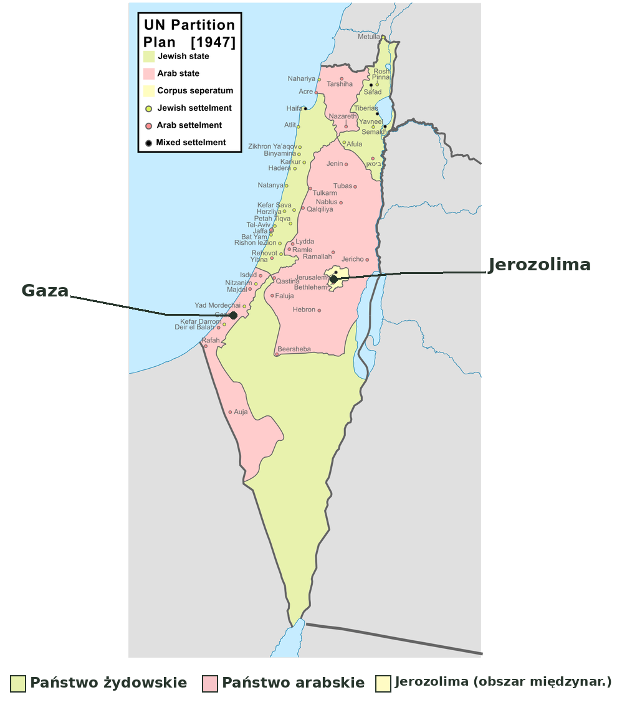<figcaption>Plan podziału Palestyny · 29 listopada 1947</figcaption></figure>
<ul class="terms"><li><b>Państwo żydowskie</b> – projektowane m.in. na części wybrzeża i na pustyni Negew.</li><li><b>Państwo arabskie</b> – projektowane m.in. w środkowej części kraju i przy Gazie.</li><li><b>Jerozolima z okolicą</b> – obszar pod administracją międzynarodową.</li></ul>
Przywódcy żydowscy przyjęli plan. Przywódcy arabscy go odrzucili: nie godzili się na podział i przyznanie projektowanemu państwu żydowskiemu znacznej części kraju.

notes:
2 min. Znajdź z uczniami wybrzeże, Negew i Jerozolimę. Propozycja przewidywała też wspólnotę gospodarczą, ważną dla funkcjonowania rozdzielonych obszarów. Oba państwa były projektami; kategorie ONZ nie oznaczały, że w każdej części mieszkała tylko jedna społeczność.

---

<!-- .slide: id="izrael-1948" data-purpose="explanation" data-layout="split" data-goals="G1" -->
<h2>14 maja 1948: powstaje Izrael</h2>
<figure>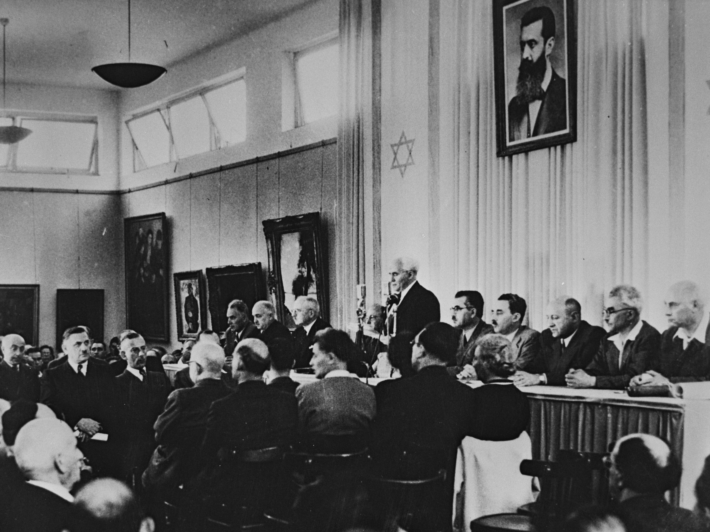<figcaption>Dawid Ben Gurion odczytuje deklarację · Tel Awiw, 14 V 1948</figcaption></figure>

14 V 1948

<b>Dawid Ben Gurion</b>, urodzony w Płońsku jako Dawid Grün, odczytał w Tel Awiwie deklarację niepodległości. Został pierwszym premierem Izraela.

Walki między Żydami i Arabami w Palestynie trwały już od końca 1947 r. Po ogłoszeniu niepodległości do wojny wkroczyły armie sąsiednich państw arabskich, m.in. Egiptu, Transjordanii i Syrii.

Izrael obronił niepodległość. Państwo arabskie przewidziane w planie ONZ nie powstało.

notes:
2 min. Rozróżnij dwie fazy: walki wewnątrz brytyjskiego mandatu, następnie wojna z armiami państw arabskich. Ben Gurion był premierem w latach 1948–1954 i 1955–1963; nie trzeba zapisywać obu kadencji.

---

<!-- .slide: id="rozejmy-1949" data-purpose="evidence" data-layout="map-focus" data-goals="G1" -->
<h2>1949: linie rozejmu</h2>
<figure>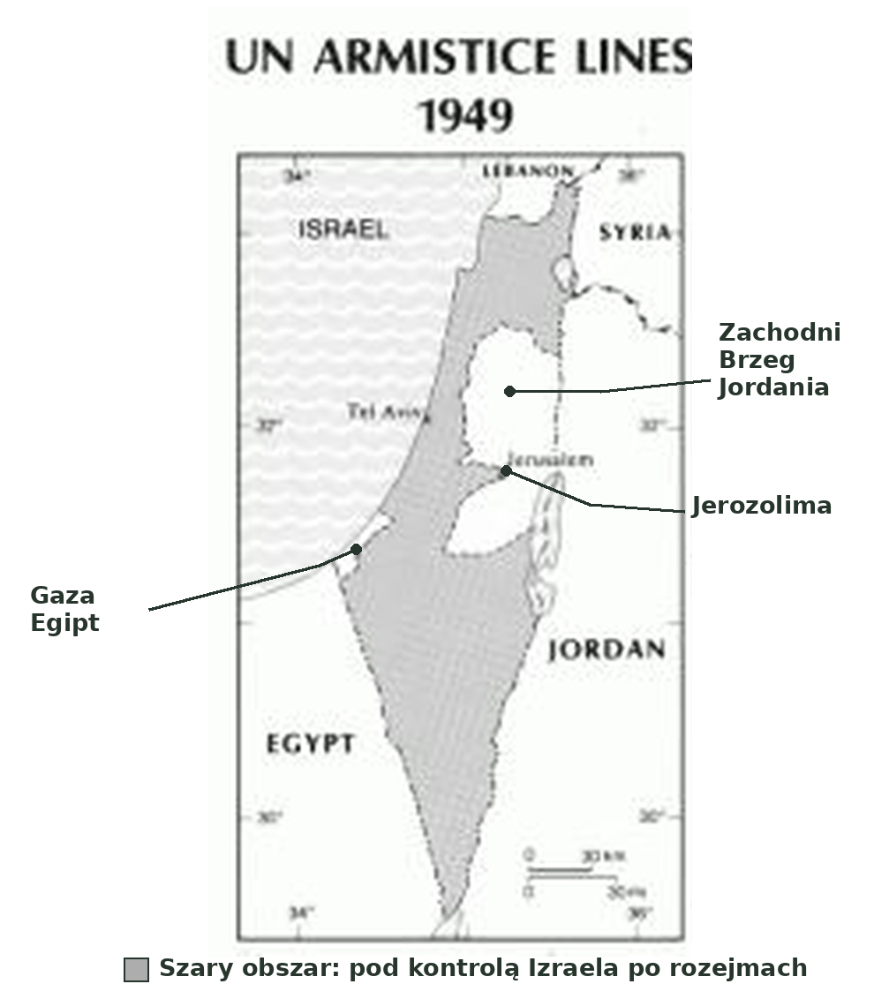<figcaption>Linie rozejmu izraelsko-arabskiego · 1949</figcaption></figure>
<ul class="terms"><li><b>Przerwano walki.</b> Izrael zawarł rozejmy z Egiptem, Libanem, Transjordanią i Syrią.</li><li><b>Linie rozdzieliły wojska.</b> Nie były ostatecznymi granicami.</li><li><b>Izrael kontrolował więcej ziem, niż przewidywał plan ONZ.</b> Gazy pilnował Egipt; Zachodni Brzeg i Wschodnią Jerozolimę kontrolowała Jordania.</li></ul>
Rozejm ≠ traktat pokojowy.

notes:
2 min. Wróć do mapy planu lub użyj porównania na kolejnym slajdzie. Transjordania przyjęła nazwę Jordania w 1949 r. Nie koloruj Wschodniej Jerozolimy jako strefy międzynarodowej po wojnie; planu nie wdrożono.

---

<!-- .slide: id="dwie-mapy" data-purpose="practice" data-layout="task-board" data-goals="G1" -->
<h2>Plan ONZ a wynik wojny</h2>
<figure><figcaption>1947 · plan ONZ</figcaption></figure><figure><figcaption>1949 · linie rozejmu</figcaption></figure>

Porównaj Gazę: do którego państwa miała należeć według planu, a kto kontrolował ją po wojnie?

notes:
2 min. Daj chwilę na lekturę legend. W 1947 r. planowano odrębną strefę Jerozolimy; po wojnie miasto było podzielone. Państwo arabskie z planu nie powstało; Gaza pod kontrolą Egiptu, Zachodni Brzeg Jordanii, a część obszarów przewidzianych dla niego opanował Izrael. Nie porównuj mechanicznie kolorów bez legend.

---

<!-- .slide: id="uchodzcy" data-purpose="explanation" data-layout="split" data-goals="G1" -->
<h2>Co wojna oznaczała dla Palestyńczyków?</h2>
<figure>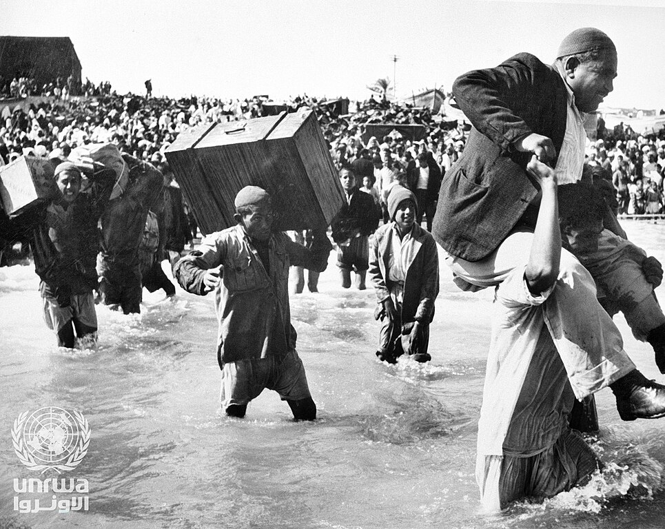<figcaption>Palestyńscy uchodźcy na wybrzeżu Gazy · 1948</figcaption></figure>

ok. 700 tys.

W latach 1947–1949 około 700 tys. Palestyńczyków <b>uciekło lub zostało wypędzonych</b> ze swoich domów. Większość nie mogła wrócić.

Palestyńczycy nazywają te wydarzenia <b>Nakbą</b> – katastrofą. Obozy dla uchodźców, pomyślane jako tymczasowe, stały się miejscem życia wielu rodzin na lata.

Dlaczego klucz do dawnego domu może mieć znaczenie dla rodziny, która nie może do niego wrócić?

notes:
2 min. Wyjaśnij, że liczba jest szacunkiem, a losy rodzin były różne. ZPE: relacja o Ismailu pokazuje pamięć kolejnych pokoleń; sam symbol klucza nie wyjaśnia prawnego sporu o powrót. Możesz odnotować także powojenne migracje Żydów m.in. z Europy i państw arabskich, nie utożsamiając przyczyn wszystkich przesiedleń.

---

<!-- .slide: id="dzis" data-purpose="evidence" data-layout="map-focus" data-goals="G1" -->
<h2>Co pozostało nierozstrzygnięte?</h2>
<figure>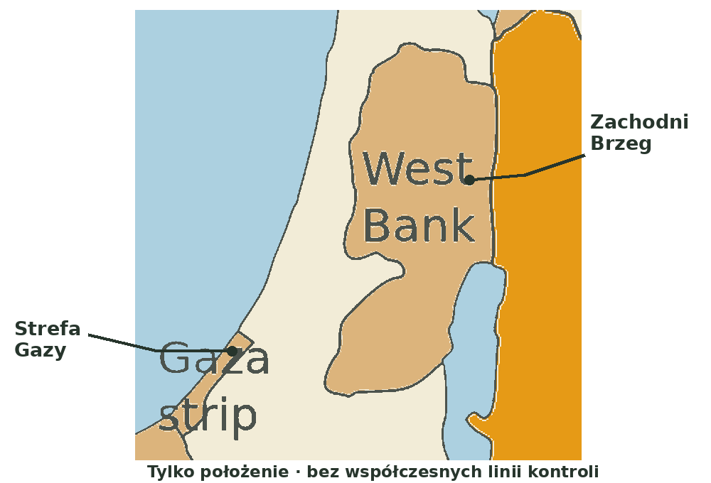<figcaption>Izrael, Zachodni Brzeg i Strefa Gazy · mapa orientacyjna</figcaption></figure>
<ul class="terms"><li><b>Gaza i Zachodni Brzeg</b> nie stykają się. Jerozolima leży przy Zachodnim Brzegu.</li><li><b>Państwo Palestyna:</b> od 2012 r. państwo-obserwator w ONZ, bez pełnej kontroli nad terytorium.</li><li><b>Spory:</b> granice, Jerozolima, izraelskie osiedla, bezpieczeństwo i los uchodźców.</li></ul>
<b>Listopad 2026:</b> ONZ opisuje problemy rodzin w Gazie z wodą, schronieniem i nauką oraz wysiedlenia na Zachodnim Brzegu, m.in. wskutek przemocy osadników.

notes:
2 min. Wskaż Gazę i Zachodni Brzeg, nie opisuj linii mapy orientacyjnej jako bieżącej kontroli. Autonomia Palestyńska nie jest synonimem OWP, Hamasu ani ogółu Palestyńczyków. Najpierw oddziel mieszkańców od władz i ugrupowań; przy OWP wrócisz do historii. Później cofamy się na osi do 1956 r.

---

<!-- .slide: id="notatka-1" data-purpose="synthesis" data-layout="plain" data-goals="G1" -->
<h2>PAMIĘTAJ! · 1. Powstanie Izraela</h2>
<ol><li><b>Syjonizm</b> dążył do stworzenia państwa żydowskiego. W 1947 r. ONZ zaproponowała dwa państwa oraz międzynarodowy status Jerozolimy.</li><li><b>14 V 1948:</b> ogłoszono niepodległość Izraela. Po wojnie wyznaczono linie rozejmu. Państwo arabskie z planu ONZ nie powstało.</li><li>Wielu Palestyńczyków straciło domy. Granice, bezpieczeństwo, Jerozolima i los uchodźców pozostały przedmiotem sporu.</li></ol>

notes:
3 min. Czas na zapis, bez równoczesnego opowiadania. W szkolnym wariancie 45 min można uzupełnić streszczenie zamiast przepisywania wszystkich trzech zdań.

---

<!-- .slide: id="suez" data-purpose="evidence" data-layout="map-focus" data-goals="G2" -->
<h2>Kanał Sueski: dlaczego ten skrót był ważny?</h2>
<figure>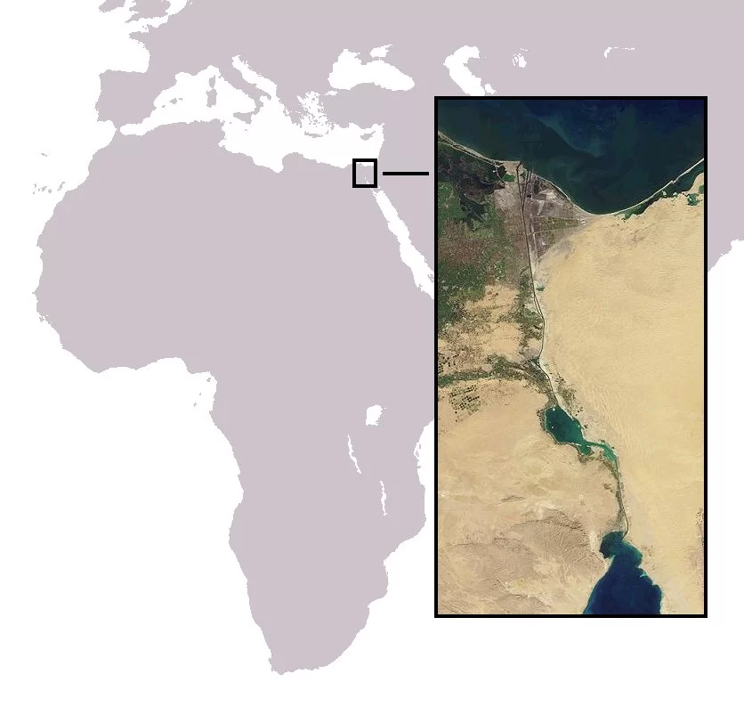<figcaption>Kanał Sueski · Egipt, między Morzem Śródziemnym i Czerwonym</figcaption></figure>

1869

Kanał otwarto dla żeglugi w <b>1869 r.</b> Statki mogły płynąć z Europy w stronę Azji bez opływania Afryki.

Morze Śródziemne → Kanał Sueski → Morze Czerwone

Kontrola nad kanałem dawała dochody z opłat i wpływ na ważny szlak handlowy.

notes:
2 min. Pokaż na mapie oba morza i orientacyjnie trasę wokół Afryki. Egipt leży po obu stronach kanału; Synaj to półwysep na wschód od kanału. Film może zastąpić krótkie objaśnienie trasy, nie dokładaj go do tego czasu.

---

<!-- .slide: id="suez-1956" data-purpose="explanation" data-layout="process" data-goals="G2" -->
<h2>1956: od nacjonalizacji do kryzysu</h2>
<article><h3>Przyczyna</h3>
Prezydent Egiptu <b>Gamal Abdel Naser</b> znacjonalizował spółkę kanału. Egipt przejął nad nią kontrolę. Wielka Brytania i Francja chciały odzyskać wpływ; Izrael miał własny spór z Egiptem m.in. o żeglugę.
</article><article><h3>Przebieg</h3>
<b>Izrael</b> zaatakował Egipt na Synaju. Zgodnie z tajnym porozumieniem do walki przystąpiły też <b>Wielka Brytania i Francja</b>.
</article><article><h3>Skutek</h3>
Nacisk USA, ZSRS i ONZ wymusił wycofanie wojsk. <b>Egipt zachował kontrolę nad kanałem.</b> ONZ wysłała siły pokojowe (UNEF).
</article>

notes:
2 min. Nacjonalizacja dotyczyła spółki zarządzającej kanałem. Francja i Wielka Brytania wycofały się do końca 1956 r.; Izrael w marcu 1957 r. Wyjaśnij paradoks: sukces militarny napastników nie dał im kontroli politycznej nad kanałem. Nie mieszaj kanału z Cieśniną Tirańską.

---

<!-- .slide: id="wojna-1967" data-purpose="evidence" data-layout="map-focus" data-goals="G2" -->
<h2>1967: co Izrael zajął w sześć dni?</h2>
<figure>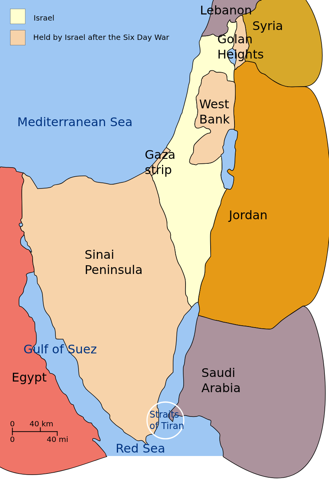<figcaption>Terytoria zajęte w wojnie sześciodniowej · czerwiec 1967</figcaption></figure>

<b>Przed wojną:</b> Egipt rozmieścił wojska na Synaju i zamknął dla Izraela Cieśninę Tirańską. Przy granicach rosło napięcie.

<b>5–10 czerwca:</b> Izrael zaatakował pierwszy; walczył przede wszystkim z Egiptem, Jordanią i Syrią.
<ul class="terms mini"><li>od Egiptu – <b>Synaj i Strefa Gazy</b> (Gaza była pod egipską administracją);</li><li>od Jordanii – <b>Zachodni Brzeg i Wschodnią Jerozolimę</b>;</li><li>od Syrii – <b>Wzgórza Golan</b>.</li></ul>
Zajęcie terytorium nie oznacza uznania go za część Izraela.

notes:
2 min. Wskaż pięć miejsc. Nie przedstawiaj zajętych obszarów jako nowych uznanych granic. Rezolucja RB ONZ 242 po wojnie łączyła wycofanie z terenów zajętych w konflikcie z uznaniem prawa państw regionu do życia w pokoju, w bezpiecznych i uznanych granicach.

---

<!-- .slide: id="wojny-zdjecia" data-purpose="evidence" data-layout="plain" data-goals="G2" -->
<h2>Ten sam region, trzy różne wojny</h2>
<figure>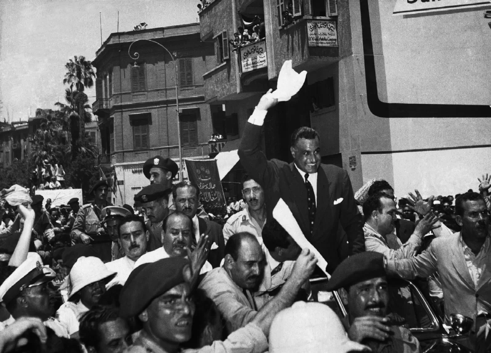<figcaption>1956 · manifestacja w Egipcie po nacjonalizacji</figcaption></figure><figure>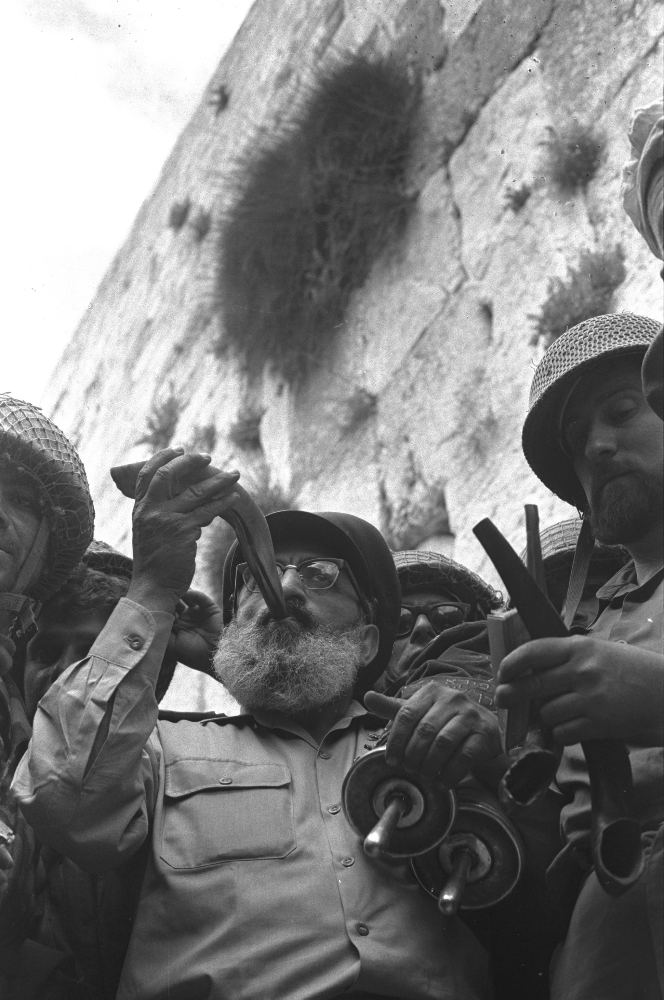<figcaption>1967 · izraelscy żołnierze przy Ścianie Płaczu w Jerozolimie</figcaption></figure><figure>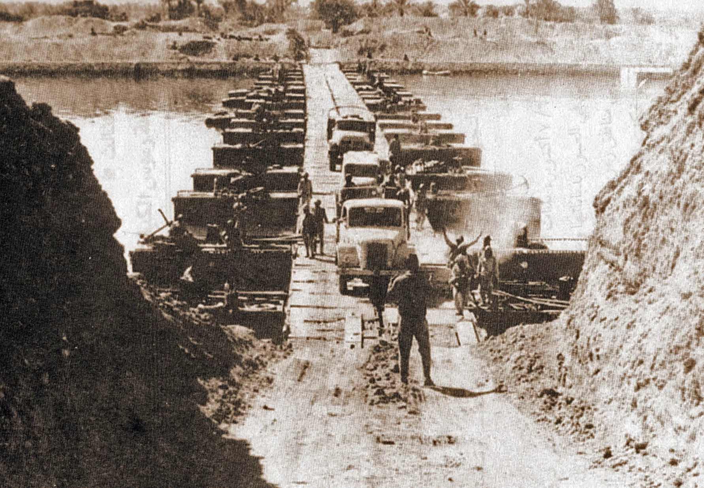<figcaption>1973 · wojska egipskie nad Kanałem Sueskim</figcaption></figure>

Ważne: zdjęcie pokazuje miejsce lub chwilę, ale wynik wojny ustalamy z mapy i dokumentów.

notes:
1 min. Odczytaj daty. Ostatnie zdjęcie jest wprowadzeniem do roku 1973. Nie prowadź analizy sprzętu; chodzi o powtarzające się miejsca, ale różne przyczyny i strony konfliktu.

---

<!-- .slide: id="jom-kippur" data-purpose="explanation" data-layout="process" data-goals="G2" -->
<h2>1973: dlaczego wróciła wojna?</h2>
<b>6 października 1973 r.</b> Egipt i Syria zaatakowały, by odzyskać ziemie zajęte przez Izrael w 1967 r. Był to dzień żydowskiego święta Jom Kippur.

<article><h3>Atak</h3>
Egipt ruszył przez Kanał Sueski na Synaj, a Syria zaatakowała na Wzgórzach Golan.
</article><article><h3>Kontratak</h3>
Zaskoczony Izrael powstrzymał natarcie i przeszedł do kontrataku. Obie strony poniosły duże straty.
</article><article><h3>Zawieszenie broni</h3>
ONZ wezwała strony do przerwania walk i negocjacji. Potem zawarto porozumienia o rozdzieleniu wojsk. Nie oznaczały jeszcze pokoju.
</article>

notes:
2 min. Wróć do położenia kanału i Golanu na mapie z 1967 r. W 1974 r. na froncie egipskim siły UNEF II pilnowały strefy rozdzielenia; na froncie syryjskim odrębna misja UNDOF nadzorowała wyznaczoną strefę, nie całość Golanu. Embargo części arabskich eksporterów ropy wobec wybranych państw pogłębiło kryzys naftowy.

---

<!-- .slide: id="porownanie" data-purpose="explanation" data-layout="comparison" data-goals="G2" -->
<h2>Dwie wojny: 1967 i 1973</h2><table class="compare"><thead><tr><th scope="col">Pytanie</th><th scope="col">Wojna sześciodniowa · 1967</th><th scope="col">Wojna Jom Kippur · 1973</th></tr></thead><tbody><tr><th scope="row">Dlaczego?</th><td>Napięcia graniczne, wojska egipskie na Synaju i zamknięcie Cieśniny Tirańskiej.</td><td>Egipt i Syria chciały odzyskać ziemie zajęte w 1967 r.</td></tr><tr><th scope="row">Co się stało?</th><td>Izrael uderzył pierwszy i pokonał m.in. Egipt, Syrię i Jordanię.</td><td>Egipt i Syria zaatakowały pierwsze. Izrael przeszedł do kontrataku.</td></tr><tr><th scope="row">Co z tego wynikło?</th><td>Izrael zajął m.in. Synaj, Gazę, Zachodni Brzeg ze Wschodnią Jerozolimą i Golan.</td><td>Zawieszenie broni i rozmowy, które otworzyły drogę do późniejszego pokoju Izraela z Egiptem.</td></tr></tbody></table>
Związek między wojnami: to, co było skutkiem w 1967 r., stało się przyczyną w 1973 r.

notes:
2 min. Czytaj wierszami, nie kolumnami. Poproś ucznia o ułożenie ciągu: zajęcie ziem → próba odzyskania → zawieszenie broni → rozmowy. Odróżnij inicjatora działań wojennych od jedynej przyczyny wojny.

---

<!-- .slide: id="notatka-2" data-purpose="synthesis" data-layout="plain" data-goals="G2" -->
<h2>PAMIĘTAJ! · 2. Kanał i wojny</h2>
<ol><li><b>1956:</b> Egipt przejął kontrolę nad spółką Kanału Sueskiego i utrzymał kanał mimo ataku Izraela, Wielkiej Brytanii i Francji.</li><li><b>1967:</b> Izrael wygrał wojnę sześciodniową i zajął nowe obszary, m.in. Synaj i Wzgórza Golan.</li><li><b>1973:</b> Egipt i Syria próbowały odzyskać stracone ziemie. Po zawieszeniu broni rozpoczęły się negocjacje.</li></ol>

notes:
3 min. Czas na zapis. Przed zmianą bloku uczniowie wskazują z pamięci rok, w którym Egipt i Syria zaatakowały pierwsze.

---

<!-- .slide: id="owp" data-purpose="explanation" data-layout="process" data-goals="G3" -->
<h2>Dlaczego powstała OWP?</h2>
<article><b>1964</b>
Powstała <strong>Organizacja Wyzwolenia Palestyny (OWP)</strong> – organizacja skupiająca różne ugrupowania palestyńskie. Chciała reprezentować Palestyńczyków i walczyć o ich samostanowienie.
</article><article><b>1969</b>
Na czele OWP stanął <strong>Jasir Arafat</strong>, przywódca Fatahu. Część ugrupowań prowadziła walkę zbrojną; dochodziło też do zamachów na cywilów.
</article><article><b>1972</b>
Na igrzyskach w <strong>Monachium</strong> członkowie Czarnego Września, związanego z Fatahem, zaatakowali izraelską ekipę. Zginęło jedenastu członków tej ekipy.
</article>

Sprawcy zamachu to konkretna organizacja, nie cały naród ani wszyscy członkowie OWP.

notes:
2 min. Wyjaśnij, że Palestyńczycy nie mieli własnego państwa, a uchodźcy żyli w różnych krajach. Nie opisuj metod zamachu. Późniejsze negocjacje OWP z Izraelem oznaczały zmianę jej oficjalnego stanowiska.

---

<!-- .slide: id="camp-david" data-purpose="evidence" data-layout="source-split" data-goals="G3" -->
<h2>Camp David · 1978: najpierw ustalono ramy</h2>
<figure><figcaption>Menachem Begin i Anwar Sadat podczas rozmów · Camp David, 1978</figcaption></figure>

<b>Egipt i Izrael</b> negocjowały przy pomocy prezydenta USA Jimmy’ego Cartera.
<ul class="terms"><li><b>Uzgodniono podstawę przyszłego pokoju</b> Egiptu z Izraelem, w tym powrót Synaju do Egiptu.</li><li><b>Zaproponowano przejściowy samorząd palestyński</b> na Zachodnim Brzegu i w Gazie.</li><li><b>Nie rozstrzygnięto sprawy państwa palestyńskiego.</b> OWP nie była stroną tych porozumień.</li></ul>

notes:
2 min. Sadat – prezydent Egiptu; Begin – premier Izraela; Carter – mediator. Spotkanie odbyło się w ośrodku prezydenckim w Maryland; dokumenty podpisano 17 września w Białym Domu. Dwa dokumenty ramowe to nie traktat pokojowy.

---

<!-- .slide: id="pokoj-1979" data-purpose="explanation" data-layout="process" data-goals="G3" -->
<h2>Traktat 1979: pokój Egiptu z Izraelem</h2>

<h3>Co ustalono?</h3><ul class="terms"><li>Zakończono stan wojny. Oba państwa uznały się i nawiązały stosunki dyplomatyczne.</li><li>Izrael zobowiązał się wycofać wojska i osadników z Synaju. Główne wycofanie zakończono w 1982 r.</li><li>Ustalono strefy ograniczeń wojskowych na Synaju i zasady swobodnej żeglugi.</li></ul>

<h3>Czego nie ustalono?</h3>
Traktat dotyczył <b>Egiptu i Izraela</b>. Nie rozstrzygnął przyszłości Gazy, Zachodniego Brzegu ani Jerozolimy. Nie był pokojem Izraela ze wszystkimi sąsiadami.

notes:
2 min. Podpisano 26 marca 1979 r. w Waszyngtonie. Spór o niewielką Tabę rozstrzygnięto później, zwrot w 1989 r. Nie przypisuj traktatowi zwrotu Gazy.

---

<!-- .slide: id="oslo" data-purpose="evidence" data-layout="source-split" data-goals="G3" -->
<h2>Oslo · 1993: Izrael i OWP zaczynają negocjować</h2>
<figure>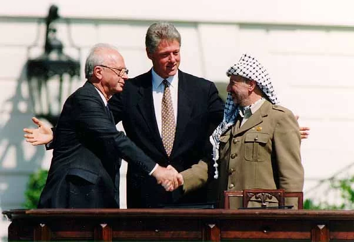<figcaption>Icchak Rabin, Bill Clinton i Jasir Arafat · 13 września 1993</figcaption></figure>
<ul class="terms"><li><b>Listy z 1993 r.:</b> OWP uznała prawo Izraela do istnienia w pokoju i bezpieczeństwie. Izrael uznał OWP za przedstawiciela Palestyńczyków.</li><li><b>Deklaracja zasad:</b> przewidziano okres przejściowy i powstanie palestyńskiego samorządu.</li><li><b>1994:</b> utworzono Autonomię Palestyńską. Przejmowała część spraw na określonych obszarach, najpierw w Gazie i Jerychu.</li></ul>
Samorząd nie oznacza pełnej niepodległości ani ostatecznego pokoju.

notes:
2 min. Po pierwszej intifadzie, czyli powstaniu palestyńskim zapoczątkowanym w 1987 r., podjęto rozmowy; nie była ona jedyną przyczyną Oslo. „Oslo” od miejsca tajnych negocjacji; uroczyste podpisanie deklaracji 13 września 1993 r. w Waszyngtonie. Jeśli zdjęcie ukazuje uścisk przywódców, nie nazywaj ich obu formalnymi sygnatariuszami deklaracji. OWP i Autonomia to nie ta sama instytucja.

---

<!-- .slide: id="co-pozostalo" data-purpose="explanation" data-layout="comparison" data-goals="G3" -->
<h2>Czy wszystkie porozumienia rozwiązywały to samo?</h2><table class="compare agreements"><thead><tr><th>Dokument</th><th>Strony</th><th>Ustalenie i jego granica</th></tr></thead><tbody><tr><th scope="row">Camp David · 1978</th><td>Egipt i Izrael</td><td>Ramy pokoju i propozycja samorządu. Bez porozumienia z OWP.</td></tr><tr><th scope="row">Traktat · 1979</th><td>Egipt i Izrael</td><td>Pokój i powrót Synaju do Egiptu. Bez rozstrzygnięcia sprawy palestyńskiej.</td></tr><tr><th scope="row">Proces z Oslo · 1993–1995</th><td>Izrael i OWP</td><td>Wzajemne uznanie i ograniczony samorząd. Bez ostatecznego porozumienia o Jerozolimie, granicach, osiedlach i uchodźcach.</td></tr></tbody></table>

notes:
2 min. Zapytaj, które porozumienie naprawdę zakończyło stan wojny dwóch państw i które doprowadziło do powstania samorządu. Po 1993 i 1994 r. Oslo II (1995) określało dalsze etapy i różny zakres władzy na Zachodnim Brzegu. Nie ucz liter A/B/C bez dodatkowej mapy.

---

<!-- .slide: id="notatka-3" data-purpose="synthesis" data-layout="plain" data-goals="G3" -->
<h2>PAMIĘTAJ! · 3. Konflikt i rozmowy</h2>
<ol><li><b>OWP</b> powstała w 1964 r., by reprezentować Palestyńczyków i walczyć o ich samostanowienie.</li><li><b>1978 → 1979:</b> Camp David przygotowało traktat. Egipt i Izrael zawarły pokój, a Synaj wrócił do Egiptu.</li><li><b>1993 → 1994:</b> Izrael i OWP zawarły porozumienia; powstała Autonomia Palestyńska. Najtrudniejszych sporów nie rozwiązano.</li></ol>

notes:
3 min. Czas na spokojny zapis. To dobre miejsce na przerwę w wariancie dwóch spotkań, jeśli na pierwszym spokojnie mieścisz pierwsze trzy bloki; alternatywny podział jest w przewodniku.

---

<!-- .slide: id="zatoka" data-purpose="evidence" data-layout="map-focus" data-goals="G4" -->
<h2>Przenosimy się nad Zatokę Perską</h2>
<figure>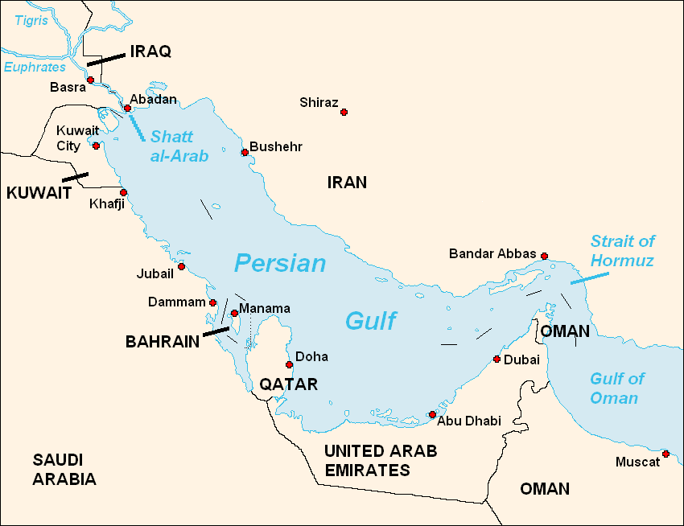<figcaption>Zatoka Perska · mapa orientacyjna</figcaption></figure>
<ul class="terms"><li><b>Iran</b> – na wschód od Iraku; stolica Teheran.</li><li><b>Irak</b> – na zachód od Iranu; stolica Bagdad.</li><li><b>Kuwejt</b> – małe państwo przy północno-zachodnim krańcu Zatoki, na południe od Iraku.</li></ul>
Spory o granice, wpływy i dochody z ropy prowadziły tu do innych wojen niż te wokół Izraela.

notes:
2 min. Uczniowie wskazują trzy państwa. Iran i Irak nie są innymi nazwami tego samego kraju. Nie mieszaj Zatoki Perskiej z Morzem Czerwonym ani Kanałem Sueskim.

---

<!-- .slide: id="iran" data-purpose="evidence" data-layout="plain" data-goals="G4" -->
<h2>Iran · 1979: dlaczego upadł szach?</h2>
<figure><figcaption>Mohammad Reza Pahlawi · szach (monarcha)</figcaption></figure><figure>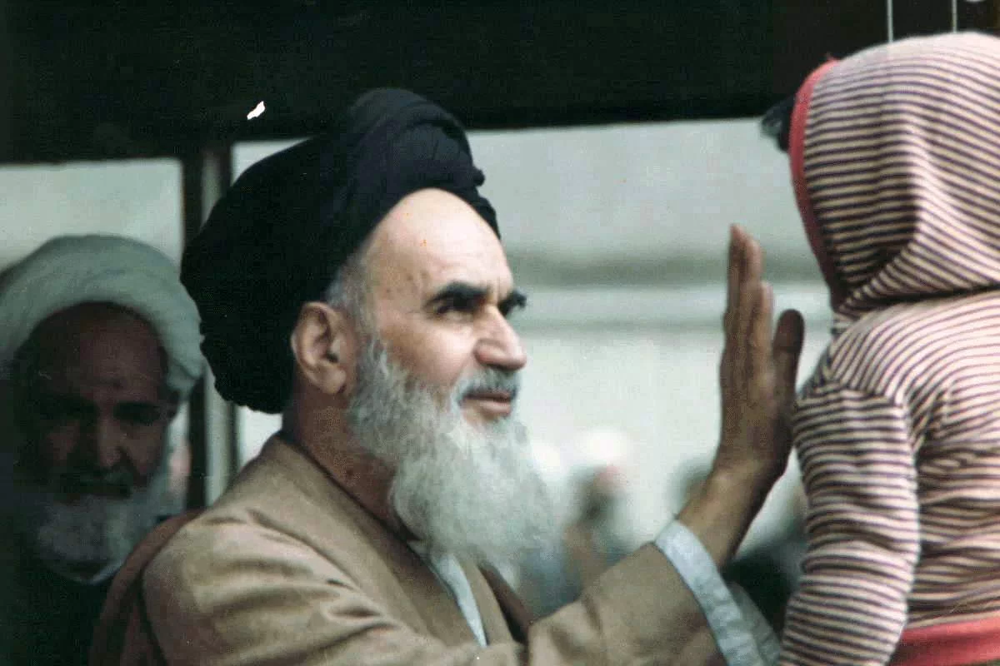<figcaption>Ruhollah Chomeini · ajatollah</figcaption></figure>

<b>Pahlawi:</b> modernizował państwo i współpracował z USA, ale rządził autorytarnie. Represje, nierówny podział korzyści z reform i sprzeciw wobec polityki religijnej dworu zbliżyły różne grupy opozycji.

<b>Chomeini:</b> stanął na czele szerokiego ruchu przeciw szachowi. W 1979 r. masowe protesty obaliły monarchię; powstała <b>Islamska Republika Iranu</b>, w której duchowni uzyskali silną władzę.

notes:
3 min. Postacie różnią się tytułami: szach = monarcha; ajatollah = tytuł uczonego duchownego szyickiego. Zwróć uwagę na autorytaryzm, represje i ekonomię; protestowali także ludzie, którzy nie chcieli rządów duchownych. Nie myl Mohammada Rezy z jego ojcem Rezą Szachem. Jeśli podajesz 1953 r., nazwij obalenie premiera Mosaddegha przewrotem wspieranym przez USA i Wielką Brytanię.

---

<!-- .slide: id="pojecia-iran" data-purpose="explanation" data-layout="comparison" data-goals="G4" -->
<h2>Tytuł a pogląd religijny</h2>

<h3>Ajatollah</h3>
Tytuł wysokiej rangi <b>uczonego duchownego w szyickim islamie</b>. Chomeini był ajatollahem i przywódcą politycznym. Sam tytuł nie oznacza pełnienia urzędu ani poparcia dla przemocy.

<h3>Fundamentalizm religijny</h3>
Przekonanie, że życie społeczne lub prawo powinno być podporządkowane zasadom uznawanym przez ruch za podstawowe reguły wiary. Nie jest określeniem wszystkich wierzących ani synonimem terroryzmu.

W Iranie zwolennicy Chomeiniego połączyli religię z organizacją państwa, ograniczając swobody przeciwników.

notes:
2 min. Odróżnij tytuł od poglądu. „Fundamentalizm” ma szersze zastosowania niż islam; tu odnosi się do nurtu polityczno-religijnego wyniesionego do władzy po rewolucji, nie do wszystkich szyitów ani uczestników protestów.

---

<!-- .slide: id="wojna-irak-iran" data-purpose="explanation" data-layout="split" data-goals="G4" -->
<h2>1980–1988: Irak atakuje Iran</h2>
<figure><figcaption>Saddam Husajn · zdjęcie po zatrzymaniu, 2003</figcaption></figure>
<ul class="terms"><li><b>Dlaczego?</b> Spór o granicę i drogę wodną Szatt al-Arab. Irak chciał wykorzystać osłabienie Iranu po rewolucji.</li><li><b>Co się stało?</b> Irak zaatakował w 1980 r. Iran się obronił i przeszedł do kontrataków.</li><li><b>Skutek:</b> 8 lat walk, duże straty, brak trwałej zmiany granic i długi Iraku.</li></ul>
<b>20 VIII 1988:</b> rozejm pod nadzorem ONZ. Nakazano wycofanie wojsk i wezwano do wymiany jeńców.

notes:
2 min. Pokaż na mapie rejon ujścia Tygrysu i Eufratu. ONZ przyjęła rezolucję 598 w 1987 r., ale rozejm zaczął obowiązywać w 1988 r. Irak używał broni chemicznej; można wskazać ciężar humanitarny, bez technicznego opisu.

---

<!-- .slide: id="kuwejt" data-purpose="explanation" data-layout="process" data-goals="G4" -->
<h2>1990–1991: dlaczego Irak napadł na Kuwejt?</h2>
<article><h3>2 VIII 1990</h3>
Zadłużony Irak spierał się z Kuwejtem o długi, wydobycie i ceny ropy. Saddam Husajn chciał przejąć bogaty w ropę kraj. Wojska irackie zajęły Kuwejt.
</article><article><h3>Styczeń–luty 1991</h3>
ONZ zażądała wycofania Iraku i zezwoliła na użycie siły po upływie terminu. Koalicja pod wodzą USA rozpoczęła operację <b>„Pustynna Burza”</b>.
</article><article><h3>Po wojnie</h3>
Irak wycofano z Kuwejtu. Płonące szyby i wycieki ropy spowodowały katastrofę środowiskową. <b>Saddam Husajn pozostał u władzy.</b>
</article>

notes:
2 min. Po nalotach w styczniu ofensywa lądowa zaczęła się 24 lutego. Nie myl obronnej „Pustynnej Tarczy” z operacją „Pustynna Burza”. Spór o zadłużenie nie usprawiedliwia agresji.

---

<!-- .slide: id="zawieszenie-broni-irak" data-purpose="evidence" data-layout="source-split" data-goals="G4" -->
<h2>1991: Kuwejt odzyskał niepodległość. Co ustaliła ONZ?</h2>
<figure>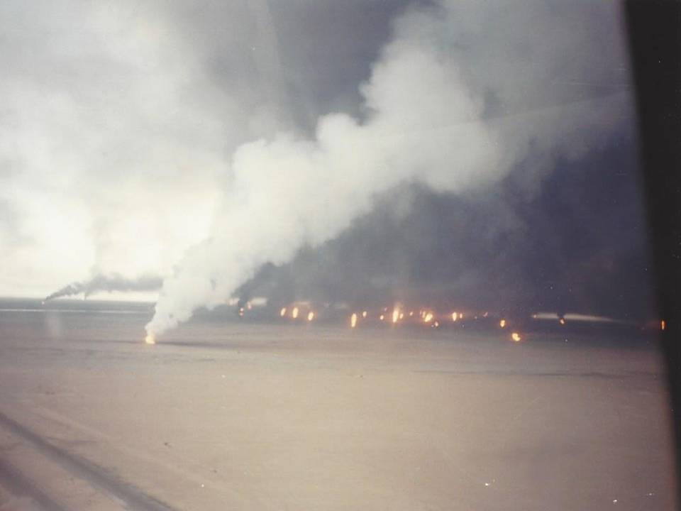<figcaption>Pożary szybów naftowych · Kuwejt, 1 marca 1991</figcaption></figure>
<ul class="terms"><li>Potwierdzono <b>suwerenność Kuwejtu</b> i przewidziano wytyczenie granicy oraz międzynarodowy nadzór.</li><li>Irak miał <b>wypłacić odszkodowania</b> za szkody spowodowane inwazją.</li><li>Irak zobowiązano do <b>rozbrojenia w zakresie broni masowego rażenia</b> i do dopuszczenia międzynarodowych inspekcji.</li></ul>
Zakończenie walk nie oznaczało obalenia Saddama Husajna.

notes:
1 min. To postanowienia rezolucji Rady Bezpieczeństwa ONZ nr 687 z 3 kwietnia 1991 r., nie szczegóły wojskowego rozejmu z początku marca. Porównaj: przywrócenie suwerenności Kuwejtu nie oznaczało zmiany rządu w Iraku.

---

<!-- .slide: id="wojny-zatoki" data-purpose="explanation" data-layout="comparison" data-goals="G4" -->
<h2>Czy istniała „II wojna w Zatoce Perskiej”?</h2>
<b>Tak, spotkasz tę nazwę, ale nie zawsze oznacza ten sam konflikt.</b> Dlatego podawaj daty i strony.
<table class="compare gulf-table"><thead><tr><th>Kiedy?</th><th>Kto walczył i o co?</th><th>Jak je odróżnić?</th></tr></thead><tbody><tr><th scope="row">1980–1988</th><td>Irak zaatakował Iran; spór o granicę i wpływy w Zatoce.</td><td><b>Wojna iracko-irańska.</b> Bywa liczona jako pierwsza.</td></tr><tr><th scope="row">1990–1991</th><td>Irak napadł na Kuwejt; koalicja wyparła wojska Iraku.</td><td><b>Wojna o Kuwejt.</b> Bywa nazywana pierwszą albo drugą wojną w Zatoce.</td></tr><tr><th scope="row">2003</th><td>USA i sojusznicy napadli na Irak i obalili reżim Saddama.</td><td><b>Inwazja na Irak.</b> Bywa nazywana drugą, jeśli za pierwszą uznaje się wojnę o Kuwejt.</td></tr></tbody></table>

notes:
2 min. Pokaż prostą zasadę: Kuwejt, 1990–91 → Saddam pozostaje; Irak, 2003 → Saddam traci władzę. W 2003 r. inwazję uzasadniano m.in. zarzutem posiadania arsenałów broni masowego rażenia; nie znaleziono deklarowanych czynnych arsenałów. Nie przypisuj Irakowi zamachów z 11 września.

---

<!-- .slide: id="notatka-4" data-purpose="synthesis" data-layout="plain" data-goals="G4" -->
<h2>PAMIĘTAJ! · 4. Iran, Irak i Zatoka</h2>
<ol><li><b>1979:</b> rewolucja obaliła szacha Iranu. Powstała republika islamska z silną władzą duchownych.</li><li><b>1980–1988:</b> Irak walczył z Iranem. Po latach wojny Irak był zadłużony.</li><li><b>1990–1991:</b> Irak napadł na Kuwejt, a koalicja go wyparła. Dopiero inwazja z <b>2003 r.</b> obaliła rządy Saddama Husajna.</li></ol>

notes:
3 min. Czas na zapis. Podkreśl dwa różne państwa będące celem inwazji: Kuwejt i Irak.

---

<!-- .slide: id="karta" data-purpose="practice" data-layout="task-board" data-goals="G1 G2 G3 G4" -->
<h2>Uporządkuj cztery wątki</h2>
<ol class="exit-list"><li>Porównaj plan ONZ z rozejmem: zapisz jedną zmianę widoczną na mapach.</li><li>Dokończ związek: „Wynik wojny z 1967 r. przyczynił się do wojny z 1973 r., ponieważ…”.</li><li>Przyporządkuj: <b>traktat 1979</b> i <b>Oslo 1993</b> → powrót Synaju / palestyński samorząd.</li><li>Uzupełnij: w 1980 r. Irak zaatakował …, a w 1990 r. … .</li></ol>

notes:
5 min. 3 minuty odpowiedzi indywidualnych, 2 minuty sprawdzenia. Na karcie jest mapka i miejsce na odpowiedź. Bez wydruku uczniowie pracują w zeszycie, wróć do slajdu „Plan ONZ a wynik wojny”. Szczegóły w oddzielnym kluczu.

---

<!-- .slide: id="exit" data-purpose="exit-ticket" data-layout="task-board" data-goals="G3 G4" -->
<h2>Na koniec: popraw zdanie</h2>

Wybierz jedno zdanie i popraw je w zeszycie:
<ol><li>„Pokój z Egiptem rozwiązał konflikt Izraela z Palestyńczykami”.</li><li>„Operacja «Pustynna Burza» obaliła Saddama Husajna”.</li></ol>

notes:
1 min. Można sprawdzić ustnie. 1: pokój dotyczył Egiptu; sprawę palestyńską negocjowały odrębnie Izrael i OWP. 2: w 1991 r. wyzwolono Kuwejt; rządy Saddama obalono w 2003 r.

---

<!-- .slide: id="synteza" data-purpose="synthesis" data-layout="plain" data-goals="G1 G2 G3 G4" -->
<h2>Podsumowanie</h2><ul class="summary-grid"><li><h3>1. Izrael i Palestyna</h3>
Po planie ONZ z 1947 r. powstał Izrael (1948), ale nie powstało wtedy planowane państwo arabskie. Wojna stworzyła problem uchodźców i pozostawiła spór terytorialny.
</li><li><h3>2. Suez i wojny</h3>
Egipt zachował kanał w 1956 r. Izrael zajął nowe tereny w 1967 r.; Egipt i Syria próbowały je odzyskać w 1973 r.
</li><li><h3>3. Pokój i samorząd</h3>
Egipt i Izrael zawarły pokój w 1979 r. Oslo (1993) otworzyło drogę do samorządu palestyńskiego, ale nie do ostatecznego pokoju.
</li><li><h3>4. Iran, Irak i Kuwejt</h3>
Rewolucja w Iranie (1979), wojna Iraku z Iranem i wojna o Kuwejt to osobne wydarzenia. Saddam stracił władzę dopiero w 2003 r.
</li></ul>

notes:
2 min. Nie każ przepisywać ponownie. Zebrać dwa zdania porównawcze: co po wojnach ustalono i co zostało otwarte; które konflikty rozpoznajemy po stronach. Podkreśl odległość między rejonami i powtarzalną metodę czytania historii.
