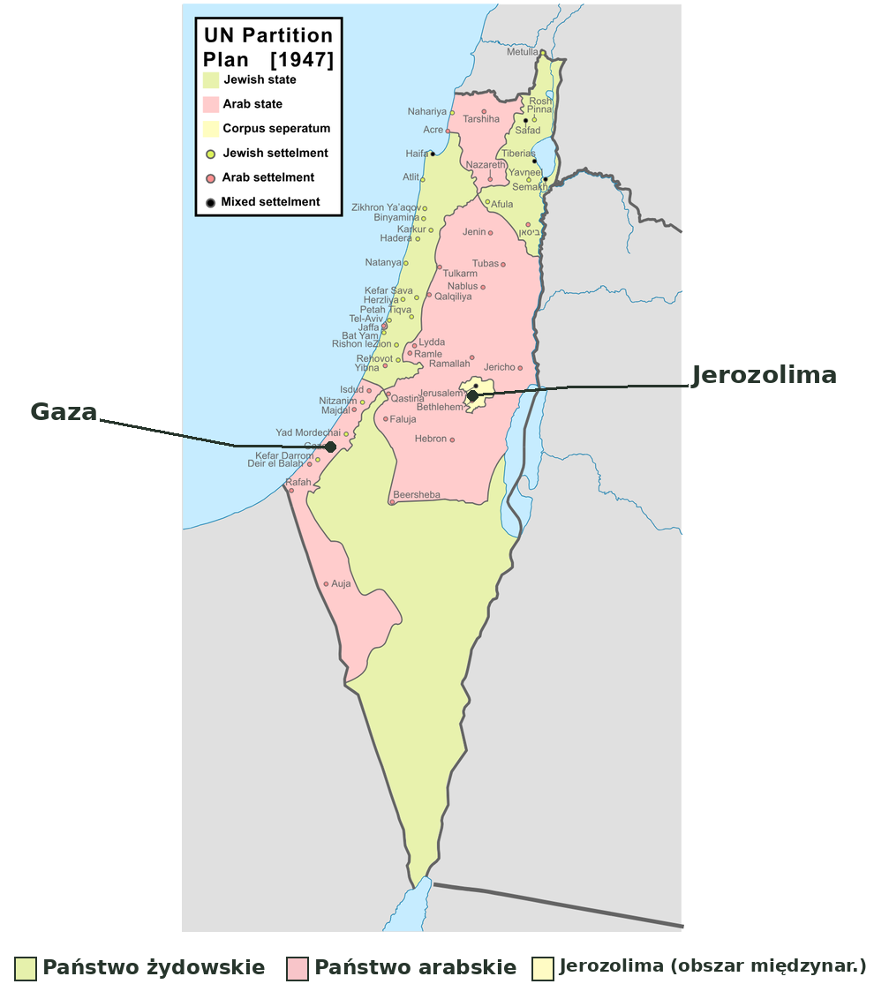
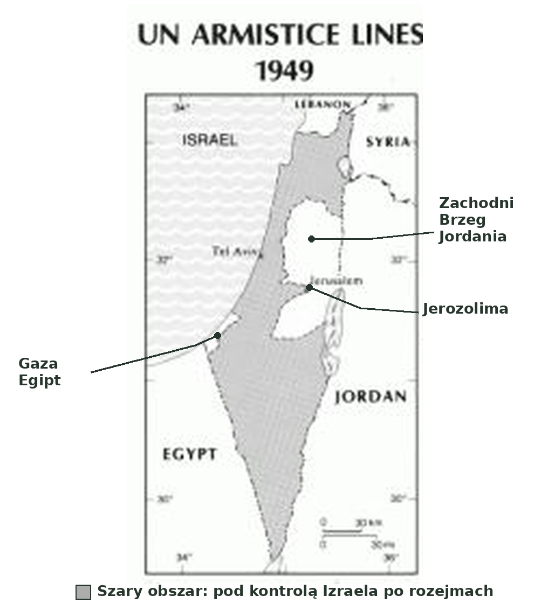

# Konflikt na Bliskim Wschodzie · karta pracy

Samodzielnie. Korzystaj z map i własnych notatek.

## 1. Mapy 1947–1949

Zapisz jedną zmianę widoczną na mapach. Wskaż nazwę miejsca i datę.

 | 

.........................................................................

## 2. 1967 → 1973

Dokończ: „Wynik wojny z 1967 r. przyczynił się do wojny z 1973 r., ponieważ…”.

.........................................................................

## 3. Pokój czy samorząd?

Dopisz właściwy rok do skutku: traktat z 1979 r. albo Oslo 1993.

Powrót Synaju: ....................     Samorząd palestyński: ....................

## 4. Iran czy Kuwejt?

Kogo zaatakował Irak w 1980 r., a kogo w 1990 r.?

1980: .....................................     1990: .....................................
