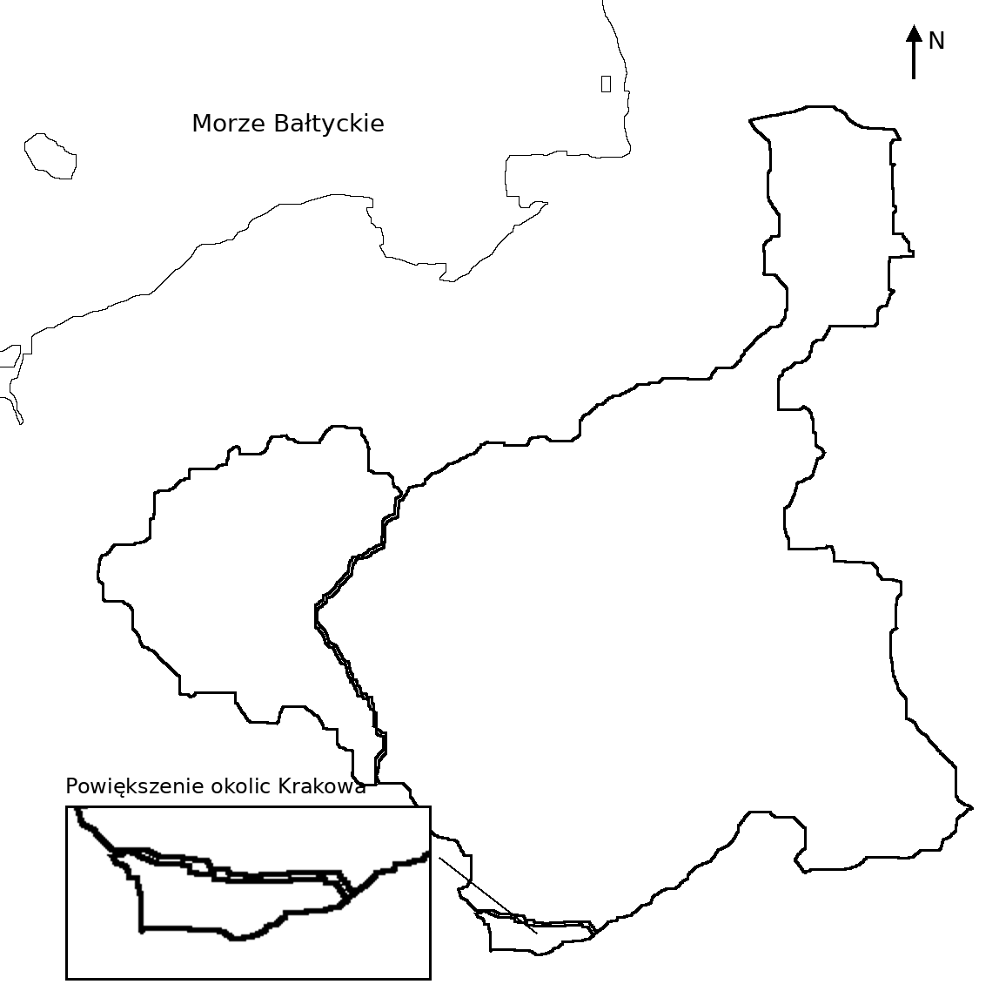

# Kartkówka — kongres, powstanie, emigracja

Imię i nazwisko: ........................................................ Klasa: ........ Data: ............... Wynik: .... / 14 pkt

## 1. Wyjaśnij pojęcia. (4 pkt)

**Unia personalna:** ........................................................................................................

..........................................................................................................................................

**Wielka Emigracja:** ........................................................................................................

..........................................................................................................................................

## 2. Zaznacz P, jeśli zdanie jest prawdziwe, lub F, jeśli jest fałszywe. (3 pkt)

| | | |
|---|---|---|
| Car przestrzegał konstytucji Królestwa Polskiego. | P □ | F □ |
| Po klęsce powstania listopadowego zlikwidowano polską armię i sejm. | P □ | F □ |
| Hôtel Lambert liczył na pomoc rządów Francji i Wielkiej Brytanii. | P □ | F □ |

## 3. Uporządkuj wydarzenia: wpisz 1–4, od najwcześniejszego. (4 pkt)

| | |
|---|---|
| Obrona Warszawy przed wojskami rosyjskimi | ........ |
| Noc listopadowa | ........ |
| Detronizacja cara Mikołaja I | ........ |
| Bitwa pod Ostrołęką | ........ |

## 4. Wpisz na mapie numery we właściwych obszarach. (3 pkt)

**1 — Królestwo Polskie · 2 — Wielkie Księstwo Poznańskie · 3 — Rzeczpospolita Krakowska**

Mapa: M. Szczepańczyk (mathiasrex), na warstwach kgberger; CC BY 3.0. Opracowanie konturowe.

<!-- teacher-key -->

## Klucz odpowiedzi — tylko dla nauczyciela

**Czas: około 15 minut. Maksymalnie 14 pkt. Kartkówka, nie sprawdzian.**

### 1. Pojęcia — 4 pkt

- **Unia personalna — 2 pkt:** dwa państwa mają wspólnego władcę (1 pkt), zachowując odrębność państwową / własne instytucje (1 pkt). Uznaj jedno krótkie zdanie zawierające oba elementy, np. „Związek odrębnych państw połączonych osobą tego samego władcy”. Nie wymagaj przykładu ani daty.
- **Wielka Emigracja — 2 pkt:** emigracja Polaków z przyczyn politycznych / w obawie przed represjami (1 pkt), po klęsce powstania listopadowego (1 pkt). Nie wymagaj liczby emigrantów, nazwisk ani państw docelowych. Uznaj „wyjazd wielu Polaków za granicę po upadku powstania listopadowego, by uniknąć prześladowań”.

### 2. Prawda–fałsz — 3 pkt

Kolejno **F, P, P**. Po 1 pkt za jeden poprawny wybór. Dwa zaznaczenia w jednym wierszu: 0 pkt. Nie wymagaj poprawiania fałszywego zdania, bo polecenie tego nie przewiduje.

### 3. Chronologia — 4 pkt

Kolejno w wierszach **4, 1, 2, 3**. Po 1 pkt za każdą poprawnie przypisaną pozycję. Daty nie są wymagane. Dla nauczyciela: noc listopadowa 29/30 XI 1830; detronizacja 25 I 1831; Ostrołęka 26 V 1831; obrona i upadek Warszawy we IX 1831.

### 4. Mapa — 3 pkt

Po 1 pkt za numer w odpowiednim obszarze:

- **1:** duży wschodni obszar, z wydłużeniem na północny wschód — Królestwo Polskie.
- **2:** obszar na zachód od Królestwa Polskiego — Wielkie Księstwo Poznańskie.
- **3:** mały obszar na południowej granicy Królestwa — Rzeczpospolita Krakowska. Uznaj numer wpisany w jego powiększeniu **lub** na mapie głównej; nie wymagaj obu wpisów.

Wskaż uczniom, że prostokąt w lewym dolnym rogu jest powiększeniem tego samego obszaru, a nie dodatkowym terytorium. Nie oceniaj estetyki wpisów; numer musi pozwalać rozpoznać obszar. Uznaj linię wskazującą obszar przy numerze zapisanym tuż obok.

### Zakres i źródła

- Zakres zamknięty: fotografie podręcznika **„Wczoraj i dziś”, klasa VII, s. 34–43 i 46–49**, przekazane przez nauczycielkę. Rok/edycja nieustalone; zgodność dotyczy pokazanych stron, nie dowolnego wydania.
- Zadanie 1: s. 35 (unia personalna) i 46 (Wielka Emigracja). Zadanie 2: s. 38–39 (łamanie konstytucji), 43 i 48 (represje), 46 (program Hôtel Lambert). Zadanie 3: s. 39–42. Zadanie 4: s. 34 (podział ziem w 1815 r.).
- Ćwiczeniówka: s. 16–19 i 22–23. Za zgodą nauczycielki wykorzystano formę krótkiej chronologii z s. 18, ćw. 4 oraz formę rozpoznawania terytoriów z s. 17. Zmieniono polecenia; nie wymaga się znajomości tekstów ani ćwiczeń z zeszytu ćwiczeń.
- Nie dołączono skanów podręcznika/ćwiczeń do repozytorium ani arkusza. Zadania odwołują się do wiedzy z tych stron, nie do dodatków w lokalnych prezentacjach.
- Mapa bazowa: **Congress Poland in 1815.PNG**, Maciej Szczepańczyk (User:mathiasrex), na warstwach User:kgberger, **CC BY 3.0**, https://creativecommons.org/licenses/by/3.0/ ; https://commons.wikimedia.org/wiki/File:Congress_Poland_in_1815.PNG . Autorstwo i licencja według istniejącego rejestru `classes/7/05-po-upadku-ksiestwa/assets/provenance.json`; obecna próba ponownego dostępu do Commons zwróciła HTTP 403. Zachowany lokalny plik oryginalny i jego SHA-256 potwierdzono przed adaptacją: `f8cc8c16dad0168bb7eca3cc123ce1f1e5c9163602c552a6ac774f208e2bb746`.
- Adaptacja: z kolorowych pól oryginału wydzielono rzeczywiste obrysy trzech terytoriów i wybrzeża, usunięto nazwy, kolory, miasta i rzeki; drobne granice zgeneralizowano do czarno-białego wydruku. Dodano orientację północną oraz jawne powiększenie okolic Krakowa. Nie powiększano Krakowa na mapie głównej. Nie jest to mapa współczesnych granic ani dokładna mapa administracyjna.
- Pomocniczo sprawdzono licencjonowaną mapę ZPE: https://zpe.gov.pl/a/decyzje-kongresu-wiedenskiego-w-sprawie-polskiej/DEPDFKZJT , zasób `R1HVUTOXNH2HQ`, Contentplus.sp. z o.o. na podstawie Krystian Chariza i zespół, CC BY-SA 3.0. **Nie jest źródłem pikseli adaptacji**; pierwotne granice Księstwa Warszawskiego nie są granicami Królestwa Polskiego.
- Podstawa dla klasy VII, 2026/27: stara-przejściowa. Dz.U. 2024 poz. 996: XIX.1, XX.1–2, XX.4; dokładne brzmienie w `curriculum/official/D2024000099601-historia-pp-104-117.txt`. To wycinek zakresu, nie pełne sprawdzenie wszystkich wymagań.
- Pliki uczniowskie HTML i edytowalny DOCX są dołączone oddzielnie od klucza nauczycielskiego. PDF kontrolny pozostaje poza repozytorium. Nagłówki tabel pominięto zgodnie z korektą nauczycielki; punktacja i zakres pozostają bez zmian.
