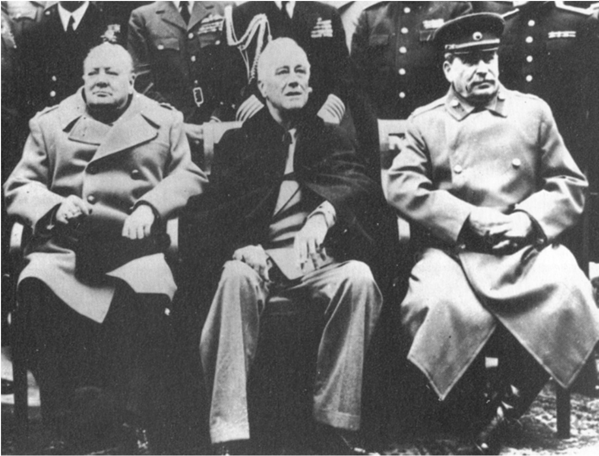

# Sprawdzian — Polacy w czasie II wojny światowej

**Imię i nazwisko: ........................................................................ Klasa: ........ Data: ................**

**Liczba punktów: ........ / 30**

## 1. Wyjaśnij pojęcia. (0–3 p.)

**Deportacja** — ...................................................................................................................................

.................................................................................................................................................................

**Konspiracja** — ..................................................................................................................................

.................................................................................................................................................................

**Sabotaż** — .........................................................................................................................................

.................................................................................................................................................................

## 2. Oceń zdania. Wpisz P — prawda lub F — fałsz. (0–4 p.)

| Zdanie | P/F |
|---|:---:|
| Generalne Gubernatorstwo zostało bezpośrednio wcielone do III Rzeszy. | ........ |
| Sowieckie deportacje obejmowały także rodziny z dziećmi. | ........ |
| Polskie szkolnictwo wyższe mogło legalnie działać pod okupacją niemiecką. | ........ |
| Za pomoc Żydom w okupowanej Polsce Niemcy przewidywali karę śmierci. | ........ |

## 3. Zaznacz jedną poprawną odpowiedź w każdym podpunkcie. (0–3 p.)

**a)** Pierwszą siedzibą rządu RP na uchodźstwie w 1939 r. była:

A. Wielka Brytania. 
B. Francja. 
C. Rumunia.

**b)** Rada Pomocy Żydom działająca przy Delegaturze Rządu RP na Kraj nosiła kryptonim:

A. „Wachlarz”. 
B. „Burza”. 
C. „Żegota”.

**c)** Głównym sprawcą ludobójstwa ludności polskiej na Wołyniu w 1943 r. była:

A. Ukraińska Powstańcza Armia. 
B. Armia Krajowa. 
C. Armia Czerwona.

## 4. Rozpoznaj postacie na podstawie opisów. Wpisz wybrane imiona i nazwiska. Dwie postacie nie pasują do żadnego opisu. (0–4 p.)

**Władysław Anders · Jan Karski · Tadeusz Komorowski „Bór” · Witold Pilecki · Władysław Raczkiewicz · Władysław Sikorski**

| Opis | Imię i nazwisko |
|---|---|
| a) Premier rządu na uchodźstwie i Naczelny Wódz. Zginął w katastrofie lotniczej pod Gibraltarem. | ................................................ |
| b) Prezydent RP na uchodźstwie podczas II wojny światowej. | ................................................ |
| c) Dowódca armii polskiej utworzonej w ZSRS po porozumieniu z 1941 r. Wyprowadził ją na Bliski Wschód. | ................................................ |
| d) Dowódca AK, który podjął decyzję o rozpoczęciu powstania warszawskiego. | ................................................ |

## 5. Uporządkuj wydarzenia chronologicznie. Wpisz 1–4, zaczynając od najwcześniejszego. (0–4 p.)

........ Utworzenie Armii Krajowej.  ........ Agresja ZSRS na Polskę.

........ Proces szesnastu.  ........ Ogłoszenie manifestu PKWN.

## 6. Przeczytaj fragment rozmowy na Kremlu z 3 grudnia 1941 r. i wykonaj polecenie. (0–1 p.)

> Władysław Sikorski: [...] Mam ze sobą listę ok. 4.000 oficerów, których wywieziono siłą i którzy znajdują się jeszcze obecnie w więzieniach i obozach pracy, i nawet ten spis nie jest pełny [...]. Poleciłem sprawdzić czy nie ma ich w Kraju, z którym mam stałą łączność. Okazało się, że nie ma tam żadnego z nich, podobnie jak w obozach naszych jeńców w Niemczech. Ci ludzie znajdują się tutaj. [...]
>
> Józef Stalin: To niemożliwe. Oni uciekli.
>
> Władysław Anders: Dokąd mogli uciec?
>
> Józef Stalin: No, do Mandżurii.
>
> Władysław Anders: To niemożliwe [...].

*Źródło: W. Anders, Bez ostatniego rozdziału, Londyn 1983, s. 89; CKE, czerwiec 2012, zad. 34.*

**Wyjaśnij, jaki był los polskich oficerów, o których rozmawiano w czasie spotkania.**

.................................................................................................................................................................

.................................................................................................................................................................

## 7. Wpisz daty roczne wydarzeń opisanych we wspomnieniach. (0–2 p.)

| Fragment wspomnień | Rok |
|---|:---:|
| W poniedziałek Wielkiego Tygodnia, wcześnie rano, wyrwały nas ze snu wybuchy […]. Żydzi bronili się z rozpaczą i zaciekłością. […] Niemcy zdobywali ulicę za ulicą […]. Armia Krajowa usiłowała przyjść z pomocą walczącym, ale została odparta […]. | ................ |
| Centrum jest w rękach powstańców [...], armia radziecka [...] lada dzień wkroczy na Pragę [...]. Na Woli ogień szaleje; rozchodzi się wieść o masowych egzekucjach ludności cywilnej. | ................ |

*Źródło: A. Szatkowska, Był dom. Wspomnienia, Kraków 2006; CKE, maj 2010, zad. 33, wiersze 3–4.*

## 8. Odpowiedz na pytania o Polskie Państwo Podziemne i akcję „Burza”. (0–4 p.)

**a)** Podaj dwa różne przykłady cywilnej działalności Polskiego Państwa Podziemnego.

1. ..............................................................................................................................................................

2. ..............................................................................................................................................................

**b)** Podaj cel wojskowy i cel polityczny akcji „Burza”.

Cel wojskowy: ........................................................................................................................................

Cel polityczny: .......................................................................................................................................

.................................................................................................................................................................

## 9. Przyjrzyj się fotografii z konferencji w Jałcie i wykonaj polecenia. (0–5 p.)

**a)** Podaj nazwy państw reprezentowanych przez trzech siedzących na pierwszym planie przywódców. Zachowaj kolejność od lewej.

**1.** ........................................ **2.** ........................................ **3.** ........................................

**b)** Podaj rok konferencji w Jałcie: ........................

**c)** Podaj jedno postanowienie konferencji dotyczące Polski.

.................................................................................................................................................................

.................................................................................................................................................................

*Fotografia: CKE, czerwiec 2020, zad. 32.*

<!-- teacher-key -->

## Klucz odpowiedzi — Polacy w czasie II wojny światowej

**Klasa VIII • 30 punktów • około 40–45 minut.** Przyjmuj historycznie poprawne odpowiedzi równoważne. Progi ocen według zasad szkoły; bez punktów ujemnych.

### 1. Pojęcia — 3 p.

Po 1 p.: deportacja — przymusowe przesiedlenie/wywiezienie ludności z miejsca zamieszkania; konspiracja — tajna działalność ukrywana przed okupantem lub władzami; sabotaż — celowe utrudnianie pracy lub produkcji na rzecz okupanta, np. spowalnianie pracy lub wadliwe wykonywanie wyrobów. Nie wymagaj przykładu, skoro polecenie go nie żąda.

### 2. Prawda/fałsz — 4 p.

**F, P, F, P** — po 1 p. GG znajdowało się pod niemiecką okupacją, lecz nie było wcielone do Rzeszy. Polskie uczelnie działały w konspiracji; zdanie nie dotyczy instytucji tworzonych przez okupanta.

### 3. Wybór — 3 p.

**a) B; b) C; c) A** — po 1 p. Pierwszą siedzibą rządu na uchodźstwie była Francja, następnie w 1940 r. przeniesiono go do Wielkiej Brytanii. Żegota = Rada Pomocy Żydom. W c) zbrodnie OUN-UPA; nie przypisuj odpowiedzialności całemu narodowi ukraińskiemu. Wszystkie odpowiedzi do wyboru dotyczą realiów II wojny światowej.

### 4. Postacie — 4 p.

Po 1 p.: **a) Władysław Sikorski; b) Władysław Raczkiewicz; c) Władysław Anders; d) Tadeusz Komorowski „Bór”.** Niewykorzystane: Jan Karski, Witold Pilecki. Akceptuj samo poprawne nazwisko, jeśli identyfikacja jest jednoznaczna; nie oceniaj osobno pseudonimu. Wszystkie sześć postaci jest związanych z Polską podczas II wojny światowej.

### 5. Chronologia — 4 p.

W kolejności zapisu: **2, 1, 4, 3**. Po 1 p. za poprawną pozycję. Daty kontrolne: agresja ZSRS — 17 IX 1939; utworzenie AK — 14 II 1942; ogłoszenie manifestu PKWN — 22 VII 1944; proces szesnastu — czerwiec 1945. Nie wymagaj dat dziennych. Manifest PKWN ogłoszono dzień po powołaniu komitetu.

### 6. Źródło B — 1 p.

Oficerowie zostali **zamordowani przez NKWD w ramach zbrodni katyńskiej** — 1 p. Akceptuj „zamordowani przez Sowietów w 1940 r.” albo jednoznaczne wskazanie zbrodni katyńskiej. Nie wymagaj równocześnie nazwy NKWD, roku i miejsca. Same „zaginęli” lub „uciekli” — 0 p. Odpowiedź Stalina o Mandżurii jest kłamstwem. Zbrodnia katyńska obejmuje więcej miejsc niż las katyński. Odpowiedzi nie podano w innych zadaniach arkusza.

### 7. Źródło F — 2 p.

Pierwszy fragment — **1943 r.**, drugi — **1944 r.**, po 1 p. Odpowiednio: powstanie w getcie warszawskim i powstanie warszawskie. Polecenie wymaga wyłącznie lat, nie nazw ani dat dziennych.

### 8. Podziemie i „Burza” — 4 p.

**a)** Po 1 p. za dwa różne przykłady cywilne, np. tajne nauczanie, podziemne sądownictwo, cywilna administracja/Delegatura Rządu, pomoc społeczna, działalność informacyjna/prasa podziemna. Dwie parafrazy jednego działania — 1 p.; działania zbrojne nie zastępują cywilnych.

**b)** 1 p.: cel wojskowy — walka z wycofującymi się Niemcami/wyzwalanie ziem polskich; 1 p.: cel polityczny — ujawnienie wobec Armii Czerwonej polskich władz i AK jako gospodarzy działających w imieniu legalnego rządu RP, dla obrony niezależności Polski. Samo „pomaganie ZSRS” nie wystarcza jako cel polityczny.

### 9. Fotografia G — 5 p.

**a)** Od lewej: **Wielka Brytania (Churchill) — USA/Stany Zjednoczone (Roosevelt) — ZSRS/ZSRR/Związek Sowiecki/Radziecki (Stalin)**. Po 1 p. za państwo przypisane właściwemu miejscu. Nazwiska nie są wymagane; same nazwiska bez państw nie realizują polecenia. „Anglia” dopuszczalna jako szkolny skrót, z korektą na Wielką Brytanię. „Rosja” zamiast ZSRS jest nieprecyzyjna — wymagaj ówczesnej nazwy państwa, dopuszczając poprawne warianty skrótu.

**b)** **1945 r.** — 1 p. Miesiąc nie jest wymagany. Roku nie podano w podpisie ani w innej części uczniowskiej.

**c)** 1 p. za jedno postanowienie, np. wschodnia granica Polski zasadniczo wzdłuż linii Curzona; poszerzenie Rządu Tymczasowego o innych polskich polityków i utworzenie TRJN; zapowiedź wolnych wyborów; znaczne nabytki terytorialne na północy i zachodzie bez przypisywania Jałcie ostatecznej linii Odry i Nysy Łużyckiej. Nie przyjmuj samego „Polska będzie komunistyczna”. Nie przypisuj samej Jałcie cofnięcia uznania rządowi na uchodźstwie w lipcu 1945 ani szczegółowych ustaleń poczdamskich.

**Suma: 30 p. = 3 + 4 + 3 + 4 + 4 + 1 + 2 + 4 + 5.** Zaakceptowane propozycje: B → zad. 6; F → zad. 7; G → zad. 9. G rozszerzono zgodnie z korektą nauczyciela: państwa od lewej (3 p.), rok (1 p.), jedno postanowienie wobec Polski (1 p.).

## Źródła i zakres — dla nauczyciela

- B: CKE, czerwiec 2012, poziom podstawowy, zad. 34, s. PDF 25. Źródło: W. Anders, Bez ostatniego rozdziału. Wspomnienia z lat 1939–1946, Londyn 1983, s. 89. Arkusz: https://arkusze.pl/maturalne/historia-2012-czerwiec-matura-podstawowa.pdf#page=25 ; klucz: https://arkusze.pl/maturalne/historia-2012-czerwiec-matura-podstawowa-odpowiedzi.pdf#page=15 . Zachowano fragment i pytanie.
- F: CKE, maj 2010, zad. 33, wiersze 3–4, s. PDF 22. A. Szatkowska, Był dom. Wspomnienia, Kraków 2006; oryginalny zbiorczy odsyłacz: s. 57, 97, 120–121, 157, 299. Arkusz: https://arkusze.pl/maturalne/historia-2010-maj-matura-podstawowa.pdf#page=22 ; klucz: https://arkusze.pl/maturalne/historia-2010-maj-matura-podstawowa-odpowiedzi.pdf#page=15 . Zachowano wybrane fragmenty i wymaganie podania lat.
- G: CKE, czerwiec 2020, stara formuła, zad. 32, s. PDF 19. Reprodukcja za: Wielkie bitwy i wielkie postaci drugiej wojny światowej, Warszawa 1999, s. 237. Arkusz: https://arkusze.pl/maturalne/historia-2020-czerwiec-matura-stara-podstawowa.pdf#page=19 ; klucz: https://arkusze.pl/maturalne/historia-2020-czerwiec-matura-stara-podstawowa-odpowiedzi.pdf#page=15 . Fotografia odtworzona z dwóch sąsiadujących pasów tego samego zdjęcia zapisanych w PDF, skala szarości. Nie jest to montaż różnych zdjęć ani obraz generowany. Pytania o państwa i rok są adaptacją na życzenie nauczyciela; identyfikację i datowanie potwierdzono w lokalnej zweryfikowanej lekcji o końcu wojny.
- Pozostałe treści: zweryfikowane lokalne lekcje classes/8/06-wladze-na-uchodzstwie, 08-polskie-panstwo-podziemne, 09-spoleczenstwo-pod-okupacja, 10-powstanie-warszawskie-burza, 11-sprawa-polska-pod-koniec-wojny. Forma: wzór „II Rzeczpospolita szlachecka.docx”. Zakres: sześć tematów z przesłanego zdjęcia. Podstawa stara-przejściowa dla VIII 2026/27: Dz.U. 2024 poz. 996, XXXIII.1–5, XXXIV.1 i 3; sprawdzany jest wycinek wymagań. Nie włączono niezaakceptowanych propozycji A, C, D, E, H.
